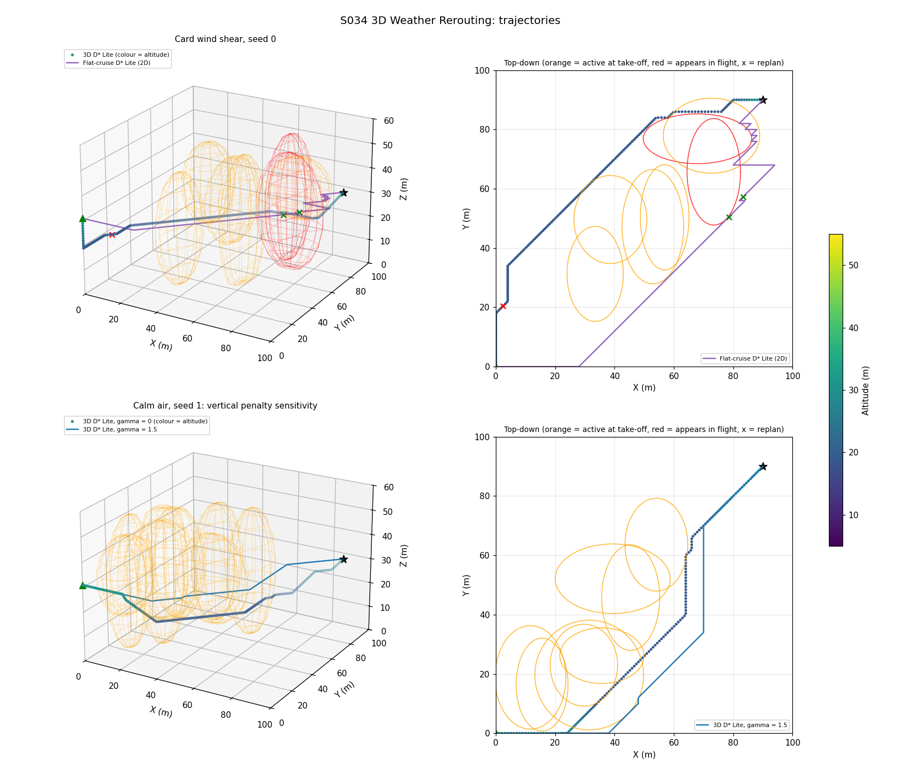
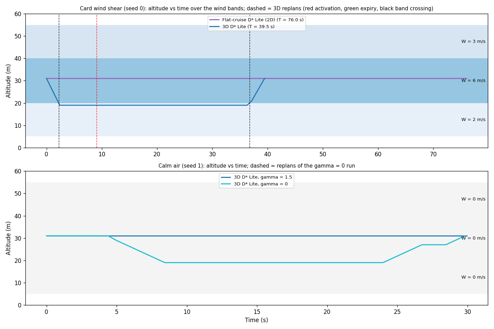
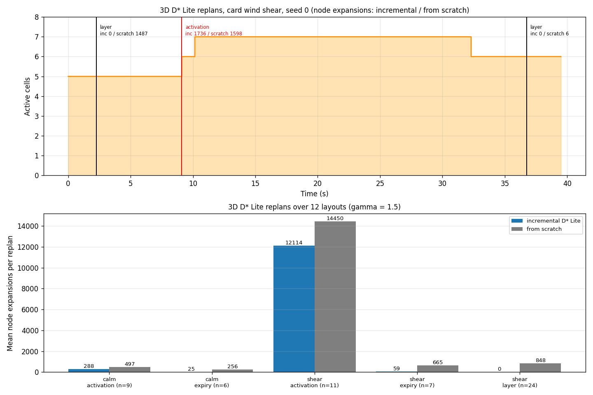
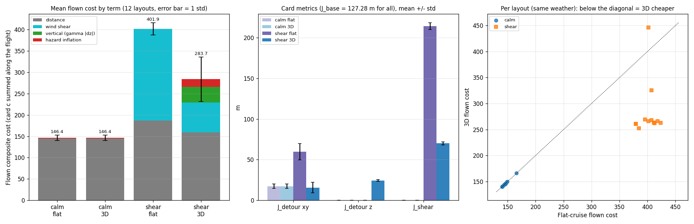
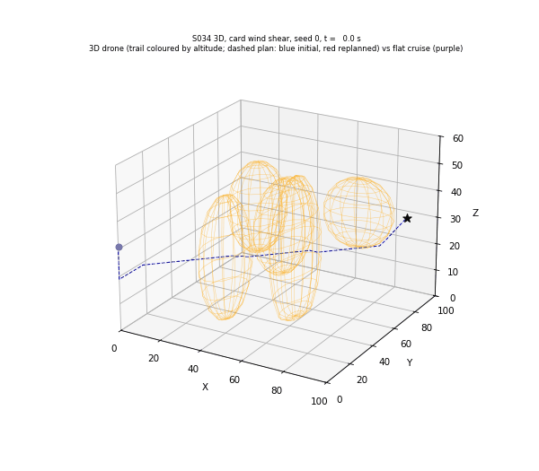

# S034 3D Weather Rerouting

**Domain**: Logistics & Delivery | **Difficulty**: ⭐⭐⭐⭐ | **Status**: ✅ Completed

---

## Problem Definition

**Setup**: A delivery drone flies from (0, 0, 31) m to (90, 90, 31) m (straight line 127.28 m) through a 100 × 100 × 60 m airspace. The planner graph is a 2 m voxel grid, 26-connected, with node altitudes 5, 7, …, 55 m (the card's floor and ceiling). Eight axis-aligned **ellipsoidal convective cells** sit on or near the route. Each has horizontal semi-axes a, b ~ U(8, 20) m, a vertical semi-axis c ~ U(10, 30) m, severity w ~ U(0.3, 1.0) and lifetime τ ~ U(30, 120) s. Some cells are active at take-off, others appear or expire in flight.

Three **altitude wind bands** blow from 105° (the route heads 45°, so the headwind component along the route is 0.5 W):

| Band | Altitude | Mean wind W | Ground speed along the route | Card cost per metre along the route |
|---|---|---|---|---|
| low | 5 – 20 m | 2 m/s | 4.00 m/s | 1.50 |
| mid | 20 – 40 m | 6 m/s | 2.00 m/s | 2.50 |
| high | 40 – 55 m | 3 m/s | 3.50 m/s | 1.75 |

The drone replans with **D\* Lite** on the card's composite edge cost (distance + wind-shear penalty + hazard inflation + vertical penalty).

**Variants** (same weather, same wind, same seeds):

1. **Blind**: locked to the 31 m layer, no weather information, never replans.
2. **Flat-cruise D\* Lite (the 2D comparator)**: locked to the 31 m layer, replans on weather events, so it can only detour horizontally. This is the "flat 2D cruise" the card's cost breakdown asks for.
3. **3D D\* Lite**: free altitude 5–55 m, replans on weather events and on wind-band crossings.

**Two wind worlds** separate the two reasons the card gives for changing altitude:

- **calm**: no wind. An altitude change can only come from weather avoidance (vertical bypass).
- **shear**: the card's three wind bands.

A calm-air **sensitivity run** repeats the 3D variant with γ = 0 (no vertical penalty) to test whether the card's γ = 1.5 is what decides between vertical and horizontal bypasses.

**Key question**: Does the free vertical degree of freedom buy anything, and is it used to climb over or dive under weather cells, or to change wind band?

---

## Mathematical Model

**Ground speed along an edge** (card), with $\hat{\mathbf{w}}$ the direction the wind blows from:

$$v_{eff}(u,v) = v_{max} - \bar{W}(z_u)\,\hat{\mathbf{e}}_{uv}\cdot\hat{\mathbf{w}}$$

Edges with $v_{eff} < 0.5$ m/s are not flyable (infinite cost). The drone flies every edge at its $v_{eff}$, so mission time depends on the band.

**Edge cost** (card):

$$c(u,v,t) = L_{uv} + \beta\,\bar{W}(z_u)\max(\hat{\mathbf{e}}_{uv}\cdot\hat{\mathbf{w}}, 0)\,L_{uv} + \alpha\,L_{uv}\sum_{k \in \mathcal{A}(t)} w_k\,\mathbf{1}[v \in \mathcal{H}_k] + \gamma\,|z_v - z_u|$$

$$\mathcal{H}_k = \left\{\left(\tfrac{x - c_{x,k}}{a_k}\right)^2 + \left(\tfrac{y - c_{y,k}}{b_k}\right)^2 + \left(\tfrac{z - c_{z,k}}{c_k}\right)^2 \le 1\right\}$$

**D\* Lite**: backward search from the goal, keys $[\min(g, rhs) + h + k_m;\ \min(g, rhs)]$ rounded to 10⁻⁶. When the active cell set changes, every voxel whose hazard weight changed (activation or expiry) triggers UpdateVertex on its neighbours. The over-consistent expansion uses the O(1) predecessor update of the optimised D\* Lite. After every search the script asserts that the extracted path's cost equals $g(s_{start})$.

**Heuristic** (card form corrected, see deviations): $h = \|\mathbf{d}\| + \gamma|d_z| + \beta W_{lb}\max(\mathbf{d}\cdot\hat{\mathbf{w}}, 0)$, with $W_{lb}$ the weakest band wind the search may use. It is consistent.

**Replanning triggers** (card):

1. a newly active cell contains a node of the remaining path;
2. an expiring cell, inflated by $D_{near}$ = 6 m, contains a node of the remaining path;
3. the drone crosses a wind-band boundary (3D, shear world).

At a replan the drone finishes the edge it is flying (≤ 3.46 m) and plans from the edge's end node.

**Vertical bypass heuristic** (card): $\Delta z_{above} = c_{z,k} + c_k - z$, $\Delta z_{below} = z - (c_{z,k} - c_k)$. It proposes the smaller shift that keeps the 3 m margin inside 5–55 m, or "none".

**Decision log**: at each activation replan of the 3D variant, for each new cell on the path, the script records:

- how the new plan passes the cell: **around** (never inside its xy footprint), **over** or **under** (inside the footprint, above or below the cell), or **through**;
- the card heuristic's proposal;
- the cost of a **forced-horizontal** alternative (the cell's whole footprint column treated as hazardous);
- the cost of a **via-bypass-point** alternative (best path through the heuristic's bypass altitude above or below the cell centre).

**Metrics** (card): $J_{base}$ = 127.28 m; $J_{detour}^{xy} = L_{xy} - J_{base}$; $J_{detour}^{z} = \sum|\Delta z|$ (start and goal are at the same altitude); $J_{shear} = \sum \beta\bar{W}\max(\hat{\mathbf{e}}\cdot\hat{\mathbf{w}},0)\,\Delta s$; $J_{hazard}$ = seconds the true position spends inside an active ellipsoid. The **flown cost** is the card edge cost summed along the flown path, with the weather actually active at that time. It is the objective all planners minimise and the main comparison metric.

---

## Key Parameters

| Parameter | Value |
|-----------|-------|
| Airspace | 100 m × 100 m × 60 m |
| Planner grid | 2 m voxels, 50 × 50 × 26 nodes (x, y = 0–98 m, z = 5–55 m), 26-connected |
| Start → goal | (0, 0, 31) → (90, 90, 31) m |
| Flat-cruise / blind layer | 31 m |
| Airspeed $v_{max}$ | 5 m/s |
| Slowest flyable ground speed | 0.5 m/s |
| Time step | 0.05 s |
| Hazard cells per layout | 8 |
| Horizontal semi-axes $a_k, b_k$ | U(8, 20) m |
| Vertical semi-axis $c_k$ | U(10, 30) m |
| Lifetime τ / severity w | U(30, 120) s / U(0.3, 1.0) |
| Activation time | U(−60, 20) s (negative = active at take-off) |
| Cell centre | U(0.15, 0.85) of the straight route, ±10 m lateral, 31 ± 8 m altitude |
| Hazard inflation α | 10 |
| Wind bands (shear world) | 2 m/s below 20 m, 6 m/s 20–40 m, 3 m/s above 40 m; calm world: 0 |
| Wind direction $\psi_w$ | from 105° |
| Wind penalty β | 0.5 |
| Vertical penalty γ | 1.5 (sensitivity run: 0) |
| Bypass margin $z_{margin}$ | 3 m |
| Expiry trigger margin $D_{near}$ | 6 m |
| Simulation cap | 300 s |
| Monte-Carlo layouts | 12 (seeds 0–11), identical for every variant and world |

---

## Implementation

```
src/02_logistics_delivery/3d/s034_3d_weather_rerouting.py
```

```bash
conda activate drones
python src/02_logistics_delivery/3d/s034_3d_weather_rerouting.py
```

Runtime ≈ 4.5–6 min (270 s and 362 s on two runs while four other simulations shared the machine): 84 flights, from-scratch comparison searches and decision-log searches for every 3D replan, and a 97-frame GIF. Two runs gave byte-identical console output and output files.

---

## Results

All numbers come from the script's console output. Every flight in every configuration reached the goal. The altitude stayed inside 5–55 m and the slowest ground speed flown was 2.00 m/s (asserted, along with path cost = $g(s_{start})$ after every search). The incremental and from-scratch D\* Lite costs agreed exactly at every replan (max difference 0.0e+00).

### Wind bands on their own

Along the 45° route the headwind component is 0.5 W, so the band determines both speed and cost:

| Band | v_eff along the route | Cost per metre |
|---|---:|---:|
| low (W = 2 m/s) | 4.00 m/s | 1.50 |
| mid (W = 6 m/s) | 2.00 m/s | 2.50 |
| high (W = 3 m/s) | 3.50 m/s | 1.75 |

In the mid band the edges toward +y and toward (−x, +y) are unflyable ($v_{eff}$ < 0.5 m/s); 20 of the 676 (layer, direction) pairs.

No-weather plans (static costs only):

| World | Flat (31 m) | 3D |
|---|---|---|
| calm | 127.28 (straight line) | 127.28 (straight line, stays at 31 m) |
| shear | 318.20 (straight line, 127.28 m) | **249.55** (149.91 m, dives to 19 m and climbs back) |

Even without weather, the 3D planner leaves the 6 m/s band for the 2 m/s band below 20 m. That alone is worth 68.65 cost units.

### Monte Carlo, 12 layouts (mean ± std)

| World | Variant | Flown cost | Mission time (s) | J_hazard (s) | Layouts with exposure | z range (m) |
|---|---|---:|---:|---:|---:|---|
| calm | Blind | 1043.33 ± 247.82 | 25.50 | 15.18 ± 2.30 | 12/12 | 31 |
| calm | Flat-cruise D\* Lite | 146.42 ± 6.54 | 28.94 ± 0.57 | 0.13 ± 0.36 | 2/12 | 31 |
| calm | 3D D\* Lite | 146.42 ± 6.54 | 28.94 ± 0.57 | 0.13 ± 0.36 | 2/12 | 31 |
| calm | 3D D\* Lite, γ = 0 | 150.23 ± 14.23 | 28.95 ± 0.57 | 0.35 ± 0.78 | 3/12 | 11–31 |
| shear | Blind | 1162.65 ± 274.78 | 63.65 | 35.81 ± 8.02 | 12/12 | 31 |
| shear | Flat-cruise D\* Lite | 401.86 ± 13.99 | 76.97 ± 2.21 | 0.07 ± 0.23 | 1/12 | 31 |
| shear | 3D D\* Lite | **283.67 ± 52.03** | **38.61 ± 1.23** | 0.75 ± 1.76 | 3/12 | 17–31 |

Card metrics (mean ± std):

| World | Variant | $J_{detour}^{xy}$ (m) | $J_{detour}^{z}$ (m) | $J_{shear}$ | γ\|Δz\| | Hazard inflation |
|---|---|---:|---:|---:|---:|---:|
| calm | Flat / 3D (identical) | 17.28 ± 2.83 | 0.00 | 0.00 | 0.00 | 1.86 ± 6.16 |
| calm | 3D, γ = 0 | 15.62 ± 3.56 | 5.33 ± 12.36 | 0.00 | 0.00 | 5.61 ± 13.36 |
| shear | Blind | 0.00 | 0.00 | 190.92 | 0.00 | 844.45 ± 274.78 |
| shear | Flat | 59.80 ± 9.88 | 0.00 | 214.44 ± 4.01 | 0.00 | 0.34 ± 1.12 |
| shear | 3D | 15.67 ± 6.32 | 24.33 ± 1.11 | 70.15 ± 1.80 | 36.50 ± 1.66 | 18.16 ± 44.80 |

**3D vs flat cruise, layout by layout (same weather):**

- **Calm air**: 3D cheaper 0, tie 12, dearer 0. The 3D planner never left 31 m, so every flight is identical to the flat-cruise flight.
- **Wind shear**: 3D cheaper in 11 of 12 layouts, dearer in 1. The difference (3D − flat) is −118.19 on average (−29.4 %), with min −160.91, median −133.75 and max +44.50. On J_hazard the 3D drone is lower in 1 layout, equal in 8 and higher in 3.

Per-layout flown cost (J_hazard in s) in the shear world:

| Seed | 0 | 1 | 2 | 3 | 4 | 5 | 6 | 7 | 8 | 9 | 10 | 11 |
|---|---|---|---|---|---|---|---|---|---|---|---|---|
| Flat | 395.94 | 423.70 | 412.60 | 401.49 | 411.46 (0.85) | 418.15 | 379.28 | 407.04 | 379.28 | 401.49 | 407.04 | 384.83 |
| 3D | 269.03 | 262.80 (0.20) | 262.28 | 266.17 | 263.69 | 266.17 | 260.59 | 325.66 (2.90) | 261.11 | **445.99 (5.95)** | 267.86 | 252.66 |

### Replanning

| Configuration | Trigger | n | Path changed | Mean expansions (incremental / from scratch) |
|---|---|---:|---:|---|
| calm, 3D | activation | 9 | 8 | 287.9 / 496.9 |
| calm, 3D | expiry | 6 | 0 | 24.7 / 255.7 |
| calm, 3D γ = 0 | activation | 12 | 10 | 1903.8 / 4162.0 |
| calm, 3D γ = 0 | expiry | 6 | 0 | 209.7 / 1571.7 |
| shear, flat | activation | 10 | 10 | 291.0 / – |
| shear, flat | expiry | 21 | 7 | 57.7 / – |
| shear, 3D | activation | 11 | 10 | 12113.9 / 14450.1 |
| shear, 3D | expiry | 7 | 3 | 59.1 / 664.6 |
| shear, 3D | **wind-band crossing** | 24 | **0** | **0.0** / 847.8 |

(The calm flat variant had 9 activation and 6 expiry replans; it uses the same D\* Lite and gives the same paths as the calm 3D variant.)

### Vertical bypass vs horizontal detour: decision log

At each activation replan of a 3D flight, for each new cell on the path:

- **cost**: the D\* Lite cost-to-go of the plan it chose;
- **forced-horizontal**: the cost with the cell's whole footprint column treated as hazardous;
- **via bypass point**: the cost of the best path through the card heuristic's bypass altitude over the cell centre.

| World, γ | Decisions | around | climb over | dive under | level past, above | level past, below | through |
|---|---:|---:|---:|---:|---:|---:|---:|
| calm, 1.5 | 9 | 4 | 0 | 0 | 2 | 2 | 1 |
| calm, 0 | 12 | 5 | 0 | 0 | 2 | 2 | 3 |
| shear, 1.5 | 11 | 2 | 0 | 3 | 0 | 4 | 2 |

"Level past" means the plan crosses the cell's footprint above or below the cell without changing altitude, for example skimming above the low top of a cell that is centred below the cruise layer.

- **Card heuristic proposals.** The heuristic proposed a vertical bypass in 5 (calm, γ = 1.5), 7 (calm, γ = 0) and 6 (shear) events. D\* Lite never took the proposal in calm air.
- **Shear world.** D\* Lite dived in 3 events, and only 1 matched the heuristic's direction: seed 9, cell 5, where the drone was still descending (25.2 m) and continued under the cell.
- **Cost of the heuristic's bypass.** Flying through the heuristic's bypass point cost more than the chosen plan in every event: +64.82 to +156.89 in calm air with γ = 1.5, +22.63 to +103.36 with γ = 0, and +29.60 to +127.36 in the shear world.
- **Forced-horizontal alternative.** It was never cheaper than the chosen plan. It cost +0.00 in most events and +1.17 to +24.35 in the rest.

### Key findings

- **The card's main 3D claim, that the drone climbs over or dives under weather cells, does not hold in calm air with the card's γ = 1.5.** Across 12 layouts the 3D planner never left 31 m, and its flown cost matched the flat-cruise planner in all 12 (tie 12/12).
  - The cells are tall (c ~ U(10, 30) m against a, b ~ U(8, 20) m) and centred at 23–39 m. The card heuristic's bypass altitudes in calm air were 10.5–24.3 m away from 31 m (6.7, 17.6, 20.5 and 44.4 m), an altitude change needed both ways at 1.5 per metre, on top of the extra distance.
  - A horizontal detour costs 17.28 m on average. The via-bypass-point alternative was 65–157 cost units dearer in every event.
- **The vertical penalty is not the only obstacle.** With γ = 0, the drone left 31 m in only 2 of 12 layouts.
  - Seed 1: its initial plan dives to 19 m, under the cells near the start, and saves 0.38 (149.16 vs 149.54).
  - Seed 2: it dives to 11–15 m. Two cells then activate on top of it, it goes through them (J_hazard 2.65 s), and the flight costs 192.20 vs 146.02.
  - Geometry alone (the vertical semi-axes) makes horizontal detours the usual winner.
- **With wind shear, 3D wins clearly, but because of the wind, not the weather.**
  - All 12 3D flights dive to the 2 m/s band (19 m, once 17 m) and climb back at the end ($J_{detour}^{z}$ = 24.33 m, γ|Δz| = 36.50). This cuts $J_{shear}$ from 214.44 to 70.15 and the mission time from 76.97 s to 38.61 s.
  - Of the mean 118.19 saving, 68.65 is already present in the no-weather plans (wind-band choice). The other 49.54 comes from cheaper weather handling: the flat drone's weather adds 83.66 above its no-weather cost, the 3D drone's only 34.12.
  - The flat drone's detours are long ($J_{detour}^{xy}$ 59.80 m vs 17.28 m in calm air), because in the 6 m/s band the northward edges are unflyable or expensive and it has to zig-zag (see the top-down plot).
- **The low band is not free of weather risk.** Cell bottoms lie anywhere from below the 5 m floor up to 29 m. The low-flying 3D drone spent time inside cells in 3 layouts (seed 1: 0.20 s, seed 7: 2.90 s, seed 9: 5.95 s), against 1 layout for the flat drone (seed 4: 0.85 s). In seeds 7 and 9 a cell activated on the low route and the replanned path went through it. In seed 9 this made the 3D flight dearer than the flat one (445.99 vs 401.49). The card's target $J_{hazard}$ = 0 is not met by any planner in every layout, because cells can appear on top of the drone.
- **Most "under" passes in the shear world are a side effect of the wind choice.** 4 of the 7 under-cell passes are level: the drone is already at 19 m for the wind and passes below cells whose bottom is above it.
- **The wind-band-crossing trigger is a no-op.** The band winds are static, so crossing a band changes no edge cost. The 24 band-crossing replans expanded 0 nodes and changed 0 paths.
- **Incremental search pays off least in the 3D shear world.** Activation replans re-expanded 12113.9 nodes on average against 14450.1 from scratch, because a new cell on the low route can push the optimum through a different band. In calm air the saving is larger (287.9 vs 496.9), and for expiries it is ~10× (24.7 vs 255.7, 59.1 vs 664.6).

### Plots

**3D trajectories** (isometric and top-down). Top: shear world, seed 0, 3D drone coloured by altitude vs flat cruise (purple). Bottom: calm air, seed 1, γ = 0 (coloured by altitude) vs γ = 1.5 (blue). Orange cells are active at take-off, red cells appear in flight, and × marks a replan (red activation, green expiry):



**Altitude over the wind bands.** Top: shear world, seed 0, with the band winds shaded and the 3D replans dashed (black = band crossing). Bottom: calm air, seed 1, γ = 1.5 vs γ = 0:



**Replanning timeline.** Top: active cells and replans of the seed-0 3D shear flight, with incremental / from-scratch expansions annotated. Bottom: mean expansions per replan type over the 12 layouts:



**Cost breakdown.** Left: mean flown cost by term (distance, wind shear, vertical, hazard inflation). Middle: the card metrics. Right: flat vs 3D flown cost per layout:



**Animation** (shear world, seed 0, 97 frames, one every 16 steps). Active cells are orange. The 3D trail is coloured by altitude, and its current plan is dashed (blue for the initial plan, red after a replan). The flat-cruise drone is purple:



### Deviations from the scenario card

| Card | Implementation | Reason |
|------|------|--------|
| Grid 50 × 50 × 30 voxels | 50 × 50 × 26 nodes (z = 5–55 m) | 30 layers at 2 m from 5 m would reach 63 m, above the 55 m ceiling; card corrected |
| Heuristic $\|\mathbf{d}\| \cdot c_{min}$, $c_{min} = 1 + \gamma\,\mathbf{1}[\Delta z \ne 0]$ | $\|\mathbf{d}\| + \gamma\lvert d_z\rvert + \beta W_{lb}\max(\mathbf{d}\cdot\hat{\mathbf{w}}, 0)$ | the card form is inadmissible (it charges γ on the whole distance); card corrected |
| $v_{eff} = v_{max} - \bar{W}\,\hat{\mathbf{e}}\cdot\hat{\mathbf{w}}$ for every edge | edges with $v_{eff}$ < 0.5 m/s are unflyable | $W_{mid}$ = 6 m/s > $v_{max}$ = 5 m/s makes $v_{eff}$ ≤ 0 for into-wind mid-band edges; card corrected |
| Kinematics $\mathbf{v} = v_{max}\,\hat{\mathbf{d}}$ (wind ignored) | the drone flies each grid edge at the card's $v_{eff}$; at a replan it finishes the edge it is on (≤ 3.46 m) | the card's own $t_{edge}$ makes time depend on the band; finishing the edge keeps every flown segment a checked grid edge |
| Bypass heuristic seeds a D\* Lite warm start by "removing nodes from the closed set" | the proposal is logged and compared with D\* Lite's choice and with a via-bypass-point plan | D\* Lite has no closed set; the margin/floor check was also added to the formula (card corrected) |
| "tailwind decreases" energy | tailwind adds 0 (card formula with max(·, 0)) | the card's formula and text disagreed; the formula is kept (a negative cost would break D\* Lite); card text corrected |
| $z_0$, $z_f$, $\psi_w$ not given | $z_0 = z_f$ = 31 m (middle of the 6 m/s band), wind from 105° (headwind 0.5 W along the route) | needed to define the problem; a 31 m start makes the band choice a real trade against γ\|Δz\| |
| Cell positions and activation times not given | centres on/near the route (31 ± 8 m), activation U(−60, 20) s | as in the fixed 2D S034: otherwise few cells ever touch a ~30–80 s flight |
| Expiry trigger: expired cell intersects the remaining path | expired cell inflated by 6 m contains a path node | a path that avoids a cell never intersects it, so the card's condition never fires (as in the 2D fix) |
| Layer-crossing trigger "changes wind-shear edge costs" | implemented, but it changes nothing | band winds are static, so edge costs do not depend on where the drone is; reported as a no-op (24 replans, 0 expansions) |
| $J_{total}$ sums metres and seconds | components reported separately; comparison on the flown composite cost | $J_{hazard}$ is in seconds; the flown cost is the quantity all planners minimise |
| Replanning latency (ms) | node expansions, incremental vs from scratch | deterministic and reproducible |
| Comparison "S034 (flat 2D cruise)" | a flat-cruise D\* Lite locked to 31 m in the same 3D world, wind and weather | a fair same-world comparator. The fixed 2D S034 script is not a pure flat cruise either (its drone drops from 16 to 8 m in its voxel grid). |
| — | added: blind variant, calm world, γ = 0 sensitivity, 12-layout Monte Carlo | to separate weather avoidance from wind-band choice and test whether γ blocks vertical bypasses |
| Animation: cells "pulsing", altitude ribbon | cells drawn while active; trail as altitude-coloured points; flat drone shown too | equivalent information, cheaper rendering |

---

## Extensions

1. Make the band winds vary in time, so the band-crossing trigger has something to react to.
2. Draw cells with a ground-based or flat-topped (anvil) vertical profile, where vertical bypasses are geometrically easier.
3. Sweep γ and the vertical semi-axis range to map where vertical bypass starts to beat horizontal detours.
4. Use a crab-angle ground-speed model instead of the card's linear $v_{eff}$.
5. Use multiple drones sharing the low band, with vertical separation constraints.

---

## Related Scenarios

- Original: [S034 Weather Rerouting](../../../../scenarios/02_logistics_delivery/S034_weather_rerouting.md)
- 3D card: [S034 3D Upgrade — Weather Rerouting](../../../../scenarios/02_logistics_delivery/3d/S034_3d_weather_rerouting.md)
- 3D path planning: [S022 3D Upgrade — Obstacle Avoidance Delivery](../../../../scenarios/02_logistics_delivery/3d/S022_3d_obstacle_avoidance.md)
- Wind: [S024 3D Upgrade — Wind Compensation](../../../../scenarios/02_logistics_delivery/3d/S024_3d_wind_compensation.md)
- Follow-up: [S035 UTM Simulation](../../../../scenarios/02_logistics_delivery/S035_utm_simulation.md)
