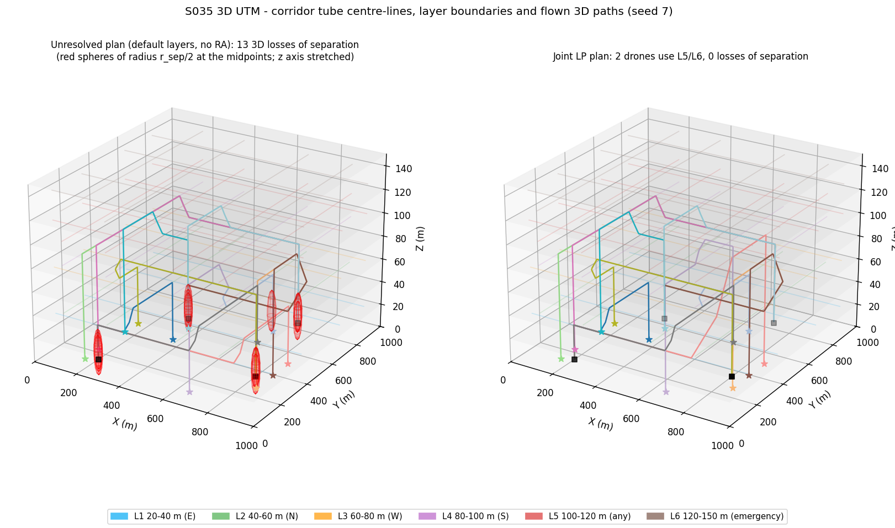
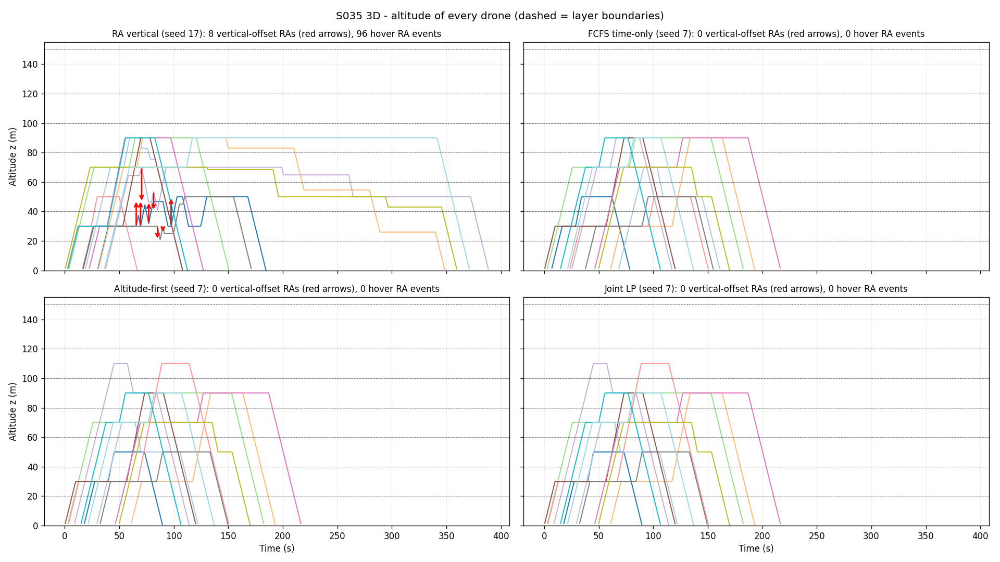
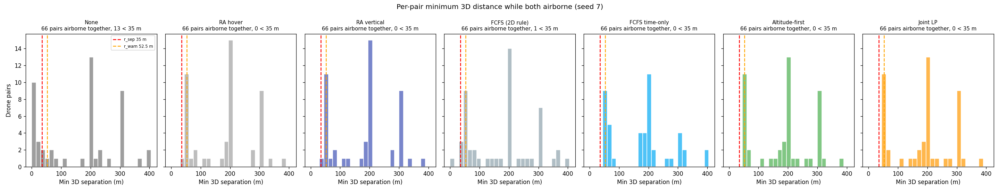
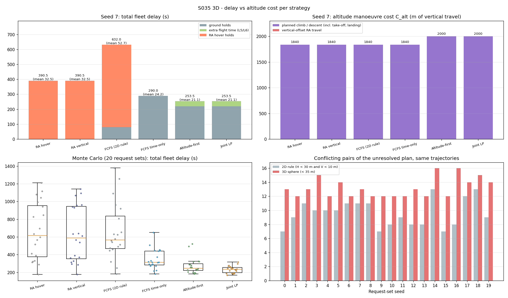
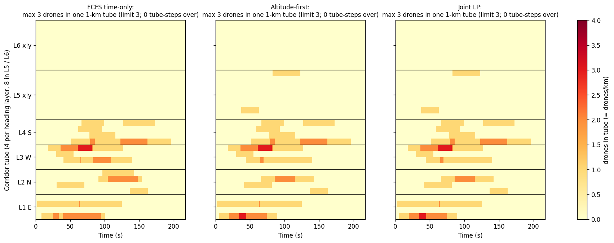
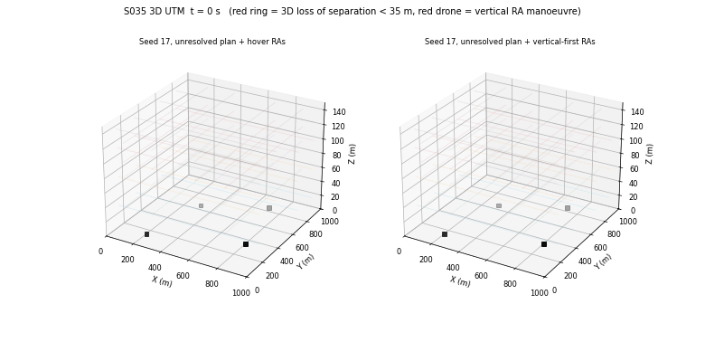

# S035 3D UTM Simulation

**Domain**: Logistics & Delivery | **Difficulty**: ⭐⭐⭐ | **Status**: ✅ Completed

---

## Problem Definition

**Setup**: A centralised UTM service manages 12 delivery drones in a 1000 × 1000 × 150 m urban airspace with 6 altitude layers:

| Layer | Band | Heading | Corridor tubes |
|-------|------|---------|----------------|
| L1 | 20–40 m | East | 4 (along x at y = 150, 350, 650, 850 m) |
| L2 | 40–60 m | North | 4 (along y at the same offsets) |
| L3 | 60–80 m | West | 4 along x |
| L4 | 80–100 m | South | 4 along y |
| L5 | 100–120 m | any (express) | 8 (4 along x, 4 along y) |
| L6 | 120–150 m | emergency only | 8 |

Tubes are flown at the band's mid-altitude and have radius $r_c$ = 25 m. The request sets (depots, destinations, request times, emergency drone) are the same random draws as the 2D S035 script.

Each drone flies an L-shaped route:

1. vertical take-off at its depot;
2. an east/west leg;
3. an inclined layer-transition ramp, centred on the corner and flown at exactly $\gamma_{max}$ = 20°;
4. a north/south leg;
5. a vertical landing.

The **default** route uses the heading layers: L1 or L3 for the east/west leg, L2 or L4 for the north/south leg. Either leg may instead use L5, and the emergency drone may also use L6. Every drone therefore has 4 layer options (the emergency drone has 9). An option is rejected at registration if its ramp does not fit on the legs at $|\gamma| \le \gamma_{max}$.

**Separation** is a single 3D sphere: $\|\mathbf{p}_k - \mathbf{p}_j\| \ge r_{sep}$ = 35 m. The 2D version used two separate thresholds: horizontal < 30 m **and** vertical < 10 m.

**Runs compared** (all on the same requests and the same trajectories):

| Run | Plan | Execution monitor |
|-----|------|-------------------|
| None | unresolved (default layers, no holds) | none |
| RA hover | unresolved | hover RAs (2D S035 behaviour) |
| RA vertical | unresolved | vertical-offset RA first, hover as fallback |
| FCFS (2D rule) | 2D S035 FCFS, planned with the 2D cylinder rule (45 m / 10 m buffer) | hover RAs, judged by the 3D sphere |
| **FCFS time-only** (card strategy 1) | FCFS ground holds, default layers, sphere rule | hover RAs |
| **Altitude-first** (card strategy 2) | FCFS order; a drone in conflict first takes another layer option at zero hold, otherwise the cheapest option plus hold | vertical-first RAs |
| **Joint LP** (card strategy 3) | layer options by local search, ground holds of each layer assignment by the precedence LP (HiGHS) | vertical-first RAs |

**Key questions**:

- Does the 3D sphere pack traffic more compactly than the 2D rule, as the card claims?
- Do altitude changes, either strategic layer reallocation or the tactical vertical-offset RA, reduce fleet delay compared with time-only resolution?

---

## Mathematical Model

### Route and climb-angle constraint

Each ramp climbs or descends $\Delta z = z_{mid,\ell_2} - z_{mid,\ell_1}$ over a horizontal length $h = |\Delta z| / \tan\gamma_{max}$. Half of $h$ lies on each leg, and each half must end at least 10 m before the end of its leg.

- Horizontal speed is $v$ = 10 m/s on every non-vertical segment.
- On a ramp, the climb rate is therefore $\dot z = v \tan\gamma_{max}$ = 3.64 m/s (card formula).
- Every non-terminal leg is checked with $\gamma = \arctan(|\Delta z| / \Delta_{xy}) \le \gamma_{max}$ (asserted).
- Vertical take-off and landing run at 3 m/s, as in 2D S035. They are terminal VTOL segments and are exempt from the γ check.

### 3D conflict sets

The trajectories are sampled every 0.5 s. For drones $k$ and $j$ flying options $a$ and $b$, the UTM pre-computes

$$F_{kj}^{ab} = \{\, s = \delta_j - \delta_k : \exists\, i, i' \text{ with } \|\mathbf{p}_{k,i}^{a} - \mathbf{p}_{j,i'}^{b}\| < r \text{ at the same time} \,\}$$

These are the relative ground holds (in 0.5 s units) that produce a conflict.

- Conflicts are **counted** with $r = r_{sep}$ = 35 m.
- **Strategic plans** are built with the warning sphere $r = r_{warn}$ = 52.5 m, so that a correctly executed plan never triggers an RA.
- The 2D-rule reference uses the 2D cylinder (45 m / 10 m for planning, 30 m / 10 m for counting).

### Strategies

- **Registration** (FCFS time-only and Altitude-first): intents are registered in request order. Each one gets the smallest hold $\delta_j \ge 0$ with $\delta_j - \delta_k \notin F_{kj}$ for every registered $k$, while keeping each 1 km tube at $\le \rho_{max}$ = 3 drones.
- **Altitude-first**:
  - If the default layers conflict at zero hold, the drone takes the alternate option with the smallest extra flight time that is conflict-free at zero hold, provided the extra time is $\le T_{thresh}$ = 30 s.
  - Otherwise it takes the option and hold that minimise hold + extra flight time.
- **Joint LP**: for a fixed layer assignment, solve

$$\min \sum_k \delta_k \quad \text{s.t.} \quad lo_{kj} \le \delta_j - \delta_k \le hi_{kj} \;\; \forall \text{ conflicting } (k,j), \qquad \delta_k \ge 0$$

  - $[lo_{kj}, hi_{kj}]$ is the conflict-free interval of $F_{kj}$ that contains the offset of a feasible reference plan: after all conflicting offsets, before them, or in the gap between two encounters.
  - The reference plan is FCFS registration on those layers, or the Altitude-first plan.
  - Pairs that become conflicting are added and the LP re-solved (constraint generation).
  - The reference stays feasible, so the LP total never exceeds it. The local search starts from the better of the FCFS time-only and Altitude-first plans, so Joint LP ≤ both (asserted).
  - A first-improvement local search changes one drone's layer option at a time, for up to 3 passes, and minimises $\sum_k \delta_k + \sum_k \Delta T_k^{extra}$.
  - Like the 2D LP, it does **not** model tube capacity.

### Separation assurance (execution, every 0.5 s)

For every pair, the monitor predicts both drones along their plans over $T_{la}$ = 15 s, in 1 s samples. It includes holds already commanded and any vertical offset still being flown. A predicted 3D distance below $r_{warn}$ = 52.5 m raises an RA:

- **Vertical-offset RA** (vertical mode, tried first): the lower-precedence drone $w$ is commanded

$$\Delta z_{cmd} = \operatorname{sign}(z_w - z_o)\,\max\bigl(r_{sep} - |z_w(t+T_{la}) - z_o(t+T_{la})|,\; \Delta z_{min}\bigr), \qquad \Delta z_{min} = 5 \text{ m}$$

  - The offset is flown at $\dot z = v\tan\gamma_{max}$ while horizontal progress continues.
  - It is accepted only if the drone is in cruise (past the take-off climb, with at least $T_{la}$ + 40 s of cruise left), stays within 20–150 m, and keeps the predicted distance to every other drone $\ge r_{sep}$.
  - Otherwise the other drone is tried, and then the hover fallback.
  - The offset may cross into the adjacent layer (card).
  - It is released (ramped back to 0) once the prediction without it stays $\ge r_{warn}$, and always before the landing descent.
- **Hover RA** (2D S035 behaviour): one drone holds for $t_{RA} = (r_{warn} - d_{pred})/v_{close} + t_{buffer}$.
  - A drone still on its pad always waits there.
  - Otherwise the lower-precedence drone holds if that clears the encounter without creating a new one; else the other drone holds.
  - A watchdog releases a drone that has hovered for 60 s, and that drone cannot be held again for 10 s. This breaks hold cycles: without it, three drones holding for one another deadlocked in testing.

### Metrics

- **Delay**: $T_{delay} = \sum_k (t_k^{landing} - t_k^{nominal})$. The nominal landing is that of the default route with no hold, so delay = ground holds + extra flight time of L5/L6 options + RA hover holds. The script asserts this decomposition.
- **Throughput**: $\Theta = N / T_{mission} \cdot 60$.
- **Conflict rate**: $\lambda_{3D} = |\mathcal{C}_{3D}| / (\binom{N}{2} T_{mission}/60)$, with $|\mathcal{C}_{3D}|$ the sphere-conflicting pairs of the executed plan.
- **Altitude manoeuvre cost**: $C_{alt} = \sum_k \int |\dot z_k|\,dt$, including take-off and landing.
- **Loss of separation (LoS)**: a pair of airborne drones closer than 35 m, counted once per pair.
- **Tube density**: the number of airborne drones within $r_c$ of a tube centre-line of their own route. A tube is 1 km long, so this count equals drones/km.

---

## Key Parameters

| Parameter | Value |
|-----------|-------|
| Airspace | 1000 m × 1000 m × 150 m |
| Drones | 12 (1 emergency) |
| Altitude layers | 6: 20–40, 40–60, 60–80, 80–100, 100–120, 120–150 m, flown at mid-band |
| Tube centre-line offsets | 150, 350, 650, 850 m (32 tubes) |
| Tube radius $r_c$ | 25 m |
| Separation sphere $r_{sep}$ | 35 m |
| Warning sphere $r_{warn}$ (also strategic planning buffer) | 52.5 m |
| Look-ahead $T_{la}$ | 15 s (predicted in 1 s samples) |
| Max climb / descent angle $\gamma_{max}$ | 20° (ramp climb rate 3.64 m/s) |
| Min altitude step $\Delta z_{min}$ | 5 m |
| Cruise speed (horizontal) | 10 m/s |
| Vertical take-off / landing speed | 3 m/s |
| Corridor capacity $\rho_{max}$ | 3 drones/km |
| Temporal buffer $t_{buffer}$ | 2 s |
| Closing speed for hover $t_{RA}$, $v_{close}$ | 10 m/s |
| Altitude-first threshold $T_{thresh}$ | 30 s of extra flight time |
| Ramp margin | 10 m before each leg end |
| Vertical-RA altitude limits | 20–150 m |
| Hover watchdog | 60 s, then 10 s immunity |
| Joint LP local search | up to 3 passes |
| Max ground hold considered | 400 s |
| Timestep = conflict-scan resolution | 0.5 s |
| Request window | U(0, 10) s |
| LP solver | `scipy.optimize.linprog` (HiGHS) |
| 2D-rule reference | 30 m horizontal / 10 m vertical, 45 m planning buffer |
| Request sets | seed 7 (plots), seeds 0–19 (Monte Carlo) |

---

## Implementation

```
src/02_logistics_delivery/3d/s035_3d_utm_simulation.py
```

```bash
conda activate drones
python src/02_logistics_delivery/3d/s035_3d_utm_simulation.py
```

Runtime ≈ 3.5–5 min (198–283 s measured): 22 request sets × 7 executions, plus a 100-frame GIF. This was measured while other simulations shared the machine.

---

## Results

All numbers come from the script's console output. Two runs gave byte-identical console output and output files. No registration was denied, and no γ check rejected an option (53 options for seed 7).

### Seed 7

**Unresolved plan, same trajectories:** 13 conflicting pairs under the 3D sphere, 11 under the 2D rule. The two extra pairs, D2-D6 and D2-D10, are same-depot pairs that come within 35 m of each other but never inside the 2D cylinder. The 2D S035 script found 10 pairs, because its corner climbs are vertical rather than ramped.

| Run | Conflicts in plan | LoS (3D) | Min 3D sep (m) | RA events (in take-off) | Vertical RAs | Ground holds (s) | Extra flight (s) | RA holds (s) | Total delay (s) | Mean / max (s) | $C_{alt}$ (m) | L5/L6 drones | Θ (/min) | $\lambda_{3D}$ |
|-----|---:|---:|---:|---:|---:|---:|---:|---:|---:|---|---:|---:|---:|---:|
| None | 13 | 13 | 1.5 | 0 | 0 | 0.0 | 0.0 | 0.0 | 0.0 | 0.0 / 0.0 | 1840 | 0 | 3.934 | 0.0646 |
| RA hover | 13 | 0 | 40.0 | 55 (28) | 0 | 0.0 | 0.0 | 390.5 | 390.5 | 32.5 / 80.5 | 1840 | 0 | 2.851 | 0.0468 |
| RA vertical | 13 | 0 | 40.0 | 55 (28) | 0 | 0.0 | 0.0 | 390.5 | 390.5 | 32.5 / 80.5 | 1840 | 0 | 2.851 | 0.0468 |
| FCFS (2D rule) | 10 | 1 | 3.8 | 95 (33) | 0 | 82.0 | 0.0 | 550.0 | 632.0 | 52.7 / 107.5 | 1840 | 0 | 2.874 | 0.0363 |
| FCFS time-only | 0 | 0 | 53.2 | 0 | 0 | 290.0 | 0.0 | 0.0 | 290.0 | 24.2 / 59.0 | 1840 | 0 | 3.318 | 0 |
| Altitude-first | 0 | 0 | 53.2 | 0 | 0 | 220.0 | 33.5 | 0.0 | **253.5** | 21.1 / 52.5 | 2000 | 2 | 3.318 | 0 |
| Joint LP | 0 | 0 | 53.2 | 0 | 0 | 220.0 | 33.5 | 0.0 | **253.5** | 21.1 / 52.5 | 2000 | 2 | 3.318 | 0 |

- Altitude-first moves D4 to L1/L5 and D5 to L5/L4. The Joint LP evaluated 43 layer assignments and found nothing better.
- The FCFS (2D rule) run has 3 watchdog releases; RA hover and RA vertical have 1 each.
- No drone missed its deadline in any seed-7 run.
- The maximum tube density is 3 drones/km in every seed-7 run.

### Monte Carlo, 20 request sets (seeds 0–19)

Unresolved conflicting pairs: 2D rule 9.60 ± 1.85, 3D sphere 13.20 ± 1.36. The sphere count is ≥ the 2D-rule count in 20/20 sets.

| Run | LoS (3D), mean (sets with LoS) | RA events (in take-off) | Vertical RAs | Total delay (s), mean ± std [min, max] | Extra flight (s) | $C_{alt}$ (m) | L5/L6 drones | Θ (/min) | Max tube density (sets over cap) | Watchdog releases | Late drones |
|-----|---|---:|---:|---|---:|---:|---:|---:|---|---:|---:|
| None | 13.15 (20) | 0 | 0 | 0.0 | 0.0 | 1784.0 | 0 | 4.532 | 5 (5) | 0 | 0 |
| RA hover | 0.60 (8) | 79.60 (29.20) | 0 | 664.9 ± 314.1 [176.5, 1210.5] | 0.0 | 1784.0 | 0 | 2.740 | 4 (1) | 4.80 | 0.95 |
| RA vertical | 0.60 (8) | 84.95 (29.30) | 2.20 | 630.0 ± 308.9 [176.5, 1140.5] | 0.0 | 1825.8 | 0 | 2.828 | 4 (1) | 4.30 | 0.80 |
| FCFS (2D rule) | 0.65 (10) | 83.90 (29.40) | 0 | 656.7 ± 313.4 [180.5, 1380.0] | 0.0 | 1784.0 | 0 | 2.790 | 4 (1) | 4.55 | 1.00 |
| FCFS time-only | 0 (0) | 0 | 0 | 346.3 ± 110.5 [181.5, 650.5] | 0.0 | 1784.0 | 0 | 3.260 | 3 (0) | 0 | 0.15 |
| Altitude-first | 0 (0) | 0 | 0 | 273.5 ± 89.1 [181.5, 520.5] | 37.4 | 1959.0 | 2.60 | 3.694 | 3 (0) | 0 | 0.05 |
| Joint LP | 0 (0) | 0 | 0 | **232.3 ± 39.3** [166.5, 316.0] | 40.2 | 1965.0 | 2.95 | 3.781 | 4 (1) | 0 | 0.05 |

Win counts on total delay, same request sets:

| Comparison | Lower | Equal | Higher |
|------------|---:|---:|---:|
| Altitude-first vs FCFS time-only | 18 | 1 | 1 |
| Joint LP vs FCFS time-only | 18 | 2 | 0 |
| Joint LP vs Altitude-first | 15 | 5 | 0 |
| RA vertical vs RA hover | 13 | 4 | 3 |
| FCFS time-only vs FCFS (2D rule) | 17 | 0 | 3 |

**Seed with the most vertical-offset RAs: 17** (shown in the altitude plot and the animation):

| Run | LoS (3D) | Min 3D sep (m) | RA events (in take-off) | Vertical-offset commands | RA holds (s) | Total delay (s) | $C_{alt}$ (m), of which RA offsets | Watchdog releases | Late drones |
|-----|---:|---:|---:|---:|---:|---:|---|---:|---:|
| RA hover | 2 | 4.5 | 99 (16) | 0 | 1117.0 | 1117.0 | 1840.0, 0.0 | 11 | 3 |
| RA vertical | 3 | 13.7 | 114 (16) | 8 | 1094.5 | 1094.5 | 2054.8, 214.8 | 9 | 2 |

### Key findings

- **The 3D sphere is stricter, not more compact.** The card claimed the sphere allows "more compact packing". It cannot with these numbers:
  - The 2D zone (horizontal < 30 m and vertical < 10 m) lies inside the 35 m sphere, since $\sqrt{30^2+10^2} = 31.6$ m.
  - The 35 m radius is larger than the 20 m spacing between layer mid-altitudes, so drones crossing in adjacent layers are no longer separated by the layering.
  - On the same trajectories the sphere flags 13.20 vs 9.60 conflicting pairs, ≥ the 2D rule in 20/20 sets. The card text is corrected.
- **2D-rule plans are not safe under the 3D standard.** The FCFS plan built with the 2D rule still has 10 sphere conflicts on seed 7. Flown under the sphere monitor, it needs 95 RA events and 550.0 s of RA holds (632.0 s total delay), and it still loses separation once (min 3.8 m).
  - Over 20 sets it has LoS in 10 sets and costs 656.7 s, against 346.3 s for FCFS planned with the sphere.
  - Planning with the 3D sphere is cheaper in 17/20 sets.
  - The price of the stricter sphere shows in the strategic holds: 290.0 s of ground holds for FCFS time-only against 82.0 s for the 2D-rule FCFS plan on seed 7.
- **Strategic altitude reallocation does reduce delay, as the card expected.**
  - Altitude-first beats FCFS time-only in 18/20 sets (273.5 vs 346.3 s mean); the remaining sets are 1 equal and 1 higher.
  - Joint LP is lower still: 232.3 ± 39.3 s, lower than FCFS time-only in 18/20 sets and never higher, and lower than Altitude-first in 15/20 sets and never higher.
  - The cost is altitude: about 2.6–3.0 drones per set move to L5/L6, adding 37.4–40.2 s of flight time and 175–181 m of vertical travel (C_alt 1959.0–1965.0 m vs 1784.0 m).
  - Joint LP ignores tube capacity (like the 2D LP) and exceeded 3 drones/km in 1 of 20 sets. Altitude-first enforces capacity and never exceeded it.
  - On seed 7, Altitude-first and Joint LP coincide (253.5 vs 290.0 s for FCFS time-only).
- **The tactical vertical-offset RA helps little, and not reliably.**
  - It fired only 2.20 times per set on average. On seed 7 it never fired: every candidate offset failed the acceptance test.
  - About 29 of the 80–85 RA episodes per set (about 35 %) involve a drone still in its vertical take-off climb, where an offset is not allowed. In the remaining episodes the offset failed the cruise-window test, the 20–150 m limits, or the test that every other drone stays ≥ 35 m away.
  - With vertical RAs, the mean delay drops from 664.9 to 630.0 s. It is lower in 13/20 sets, equal in 4 and higher in 3, and LoS is unchanged (0.60 per set, 8 sets).
  - On seed 17, 8 offsets cut RA holds only from 1117.0 to 1094.5 s, cost 214.8 m of extra vertical travel, and one more pair lost separation (3 vs 2).
  - The tactical layer is far worse than any strategic plan either way (630–665 s vs 232–346 s). As in 2D, holding drones in the air late is less efficient than shifting departures early.
- **The tactical monitor is not a guarantee.** Hover RAs, vertical or not, leave 0.60 LoS per set. About 4–5 watchdog releases per set show that pure holds can lock up in dense depot clusters. Strategic plans built to the 52.5 m warning sphere had no LoS and no RA in any set.

---

## Output Files

### 3D Airspace

Left: unresolved plan on seed 7, with the 13 losses of separation shown as red spheres of radius $r_{sep}/2$ at the pair midpoints. The z axis is stretched, so the spheres look elongated. Right: the Joint LP plan, where D4 and D5 use L5 (110 m). Thin coloured lines are tube centre-lines by layer, grey planes are layer boundaries, black squares are depots and stars are destinations.



### Altitude Time Series

$z_k(t)$ for every drone; dashed lines are layer boundaries.

- Top-left: RA vertical on seed 17, where red arrows mark the 8 vertical-offset commands. The offsets cross into adjacent layers and some are held for a long time, until the encounter clears $r_{warn}$.
- Other panels: seed 7 strategic plans. Ramps between layers are the sloped segments at 20°. Under Altitude-first and Joint LP, two drones climb to 110 m.



### 3D Separation Histogram

Per-pair minimum 3D distance while both drones are airborne (seed 7). Red dashed line: $r_{sep}$ = 35 m; orange: $r_{warn}$ = 52.5 m. The three strategic plans keep every pair at ≥ 53.2 m.



### Delay and Altitude Cost

- Top-left: seed 7 total delay, split into ground holds, extra flight time and RA holds.
- Top-right: seed 7 $C_{alt}$, split into planned climb/descent and vertical-offset RA travel.
- Bottom-left: Monte Carlo total delay per run, as box plots with every set shown as a dot.
- Bottom-right: conflicting pairs of the unresolved plan under the 2D rule and the 3D sphere for each request set.



### Corridor Tube Utilisation

Drones per tube against time for the three sphere-based strategies (seed 7; limit 3 drones/km). Altitude-first and Joint LP put short stretches into L5 tubes.



### Animation

Seed 17, unresolved plan: hover RAs (left) against vertical-first RAs (right), in a rotating 3D view.

- Drones turn red for 10 s after a vertical-offset command.
- Red rings mark 3D losses of separation.
- 100 frames, one every 4 s of simulated time.



---

### Deviations from the scenario card

| Card | Implementation | Reason |
|------|----------------|--------|
| Sphere "enables more compact packing" | Reported as false; card text corrected | The 2D cylinder lies inside the 35 m sphere ($\sqrt{30^2+10^2} = 31.6$ m), and the sphere is larger than the 20 m layer spacing. |
| $\mathcal{L}_k = \{\ell : z_{lo,\ell} \le z_k^{nominal} \le z_{hi,\ell}\}$ | Alternate layers come from the heading rule: the heading layer, L5 for any drone, L6 for the emergency drone; card corrected | The card's set contains only the current layer, so reallocation was impossible. |
| Δt_sep = r_sep / v_close + t_buffer as a fixed departure gap; δ_k − δ_j ≥ Δt_sep | Exact pairwise conflict-free intervals from the sampled 3D trajectories, with sides from a feasible reference plan | A fixed gap does not guarantee separation for merging and crossing routes (same fix as 2D S035). The interval form also handles a gap between two encounters, where the 2D one-sided form made the LP infeasible. |
| "MILP relaxation" over δ_k and ℓ_k | LP over δ_k for a fixed layer assignment, plus a first-improvement local search over layer options | A joint MILP needs disjunctive constraints per option pair; the LP + search is a heuristic, not a global optimum. |
| RA when the single extrapolated point $\mathbf{p} + \mathbf{v} T_{la}$ is inside $r_{warn}$ | Prediction along the plans over the whole 15 s window (1 s samples) | A single extrapolated point misses encounters inside the window, and straight-line extrapolation is wrong at ramps and corners (as in 2D S035). |
| RA preference: altitude offset → speed reduction → hover | Altitude offset → hover; no speed reduction | Hover is the zero-speed limit; a speed-command layer is left as an extension. |
| Vertical offset at any time | Only in cruise (past the take-off climb, ≥ $T_{la}$ + 40 s before landing); 20–150 m; released before landing | Offsets during the vertical take-off or landing are not meaningful, and a drone must not begin landing with an offset. |
| Take-off / landing at γ ≤ 20° | Vertical take-off and landing (3 m/s) exempt from the γ check | They are VTOL terminal segments, as in 2D S035; the γ rule is applied to every corridor and transition leg. |
| Layer change "transition segments" | Ramp centred on the route's corner at exactly γ_max, half on each leg | The card does not say where the transition is flown. |
| $T_{thresh}$ "configurable", no value | 30 s of extra flight time | Added parameter. On seed 7 the alternate options add 6.5–63.5 s, so the costliest options are taken only in the fallback step. |
| Hold cycles not addressed | Pad drones always wait; 60 s hover watchdog with 10 s immunity | Without it, three drones holding for one another deadlocked. Releases are counted and reported. |
| Tube density, $r_c$ = 25 m | A drone is counted only in its own route's tubes, by 3D distance | $r_c$ exceeds the 10 m half-layer thickness, so parallel tubes of adjacent layers overlap (noted in the card). |
| Joint optimisation with corridor density constraint | Joint LP ignores capacity; registration-based strategies enforce it | As in 2D S035; Joint LP exceeded 3 drones/km in 1 of 20 sets (reported). |
| Δt = 0.1 s | Δt = 0.5 s (= conflict-scan resolution) | At 10 m/s a drone moves 5 m per step, well below 35 m, and the run stays under 5 min (as in 2D S035). |
| Single instance | Seed 7 for plots, plus a 20-set Monte Carlo with win counts | The strategy ranking varies by instance. |
| Vertical-RA panel and GIF on the plotted instance | Seed 17, the set with the most vertical-offset RAs | On seed 7 no vertical RA fires, so it would show nothing. |
| Added runs | None, RA hover, RA vertical, FCFS (2D rule) | Needed to separate the effects of the sphere rule, the tactical RA mode and strategic resolution. |

---

## Extensions

1. Wind shear by altitude layer: re-evaluate separation under worst-case wind drift for each band.
2. Speed-reduction RAs before hover, as the card's middle preference.
3. A true MILP for joint layer and hold assignment, as an optimality reference for the local search.
4. Ramped (non-vertical) take-off and landing under the γ limit, which would make vertical RAs usable near depots.
5. Dynamic L5/L6 capacity release when L1–L4 utilisation exceeds a threshold.

---

## Related Scenarios

- Original: [S035 UTM Simulation](../../../../scenarios/02_logistics_delivery/S035_utm_simulation.md)
- 3D card: [S035 3D Upgrade — UTM Simulation](../../../../scenarios/02_logistics_delivery/3d/S035_3d_utm_simulation.md)
- 3D references: [S022 3D Upgrade — Obstacle Avoidance Delivery](../../../../scenarios/02_logistics_delivery/3d/S022_3d_obstacle_avoidance.md), [S031 3D Upgrade — Path De-confliction](../../../../scenarios/02_logistics_delivery/3d/S031_3d_path_deconfliction.md)
- Algorithm reference: [S019 Dynamic Target Reassignment](../../../../scenarios/01_pursuit_evasion/S019_dynamic_reassignment.md)
- Follow-up: [S036 Last-Mile Relay](../../../../scenarios/02_logistics_delivery/S036_last_mile_relay.md)
