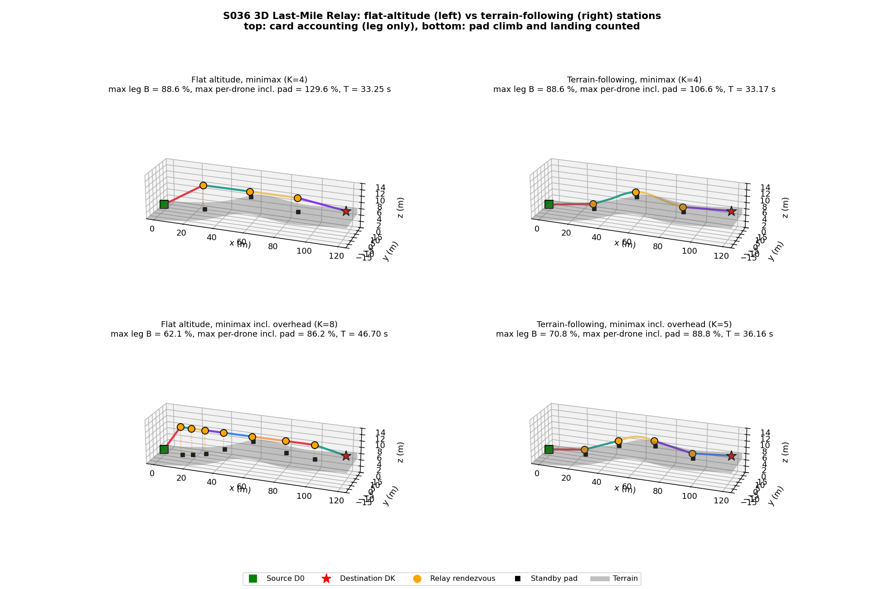
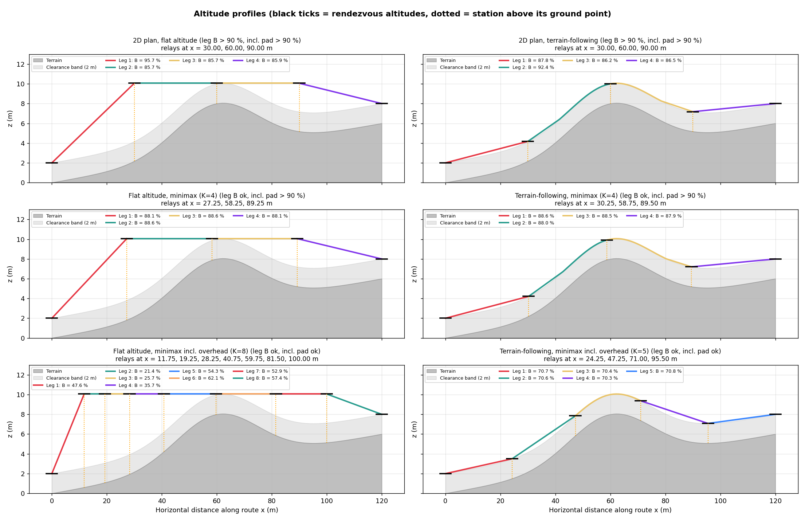
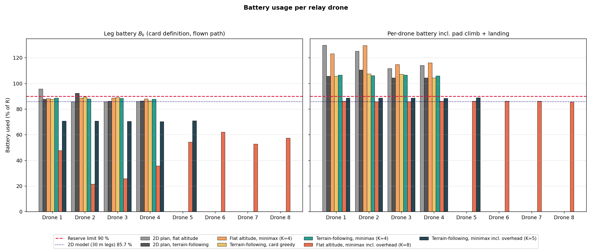
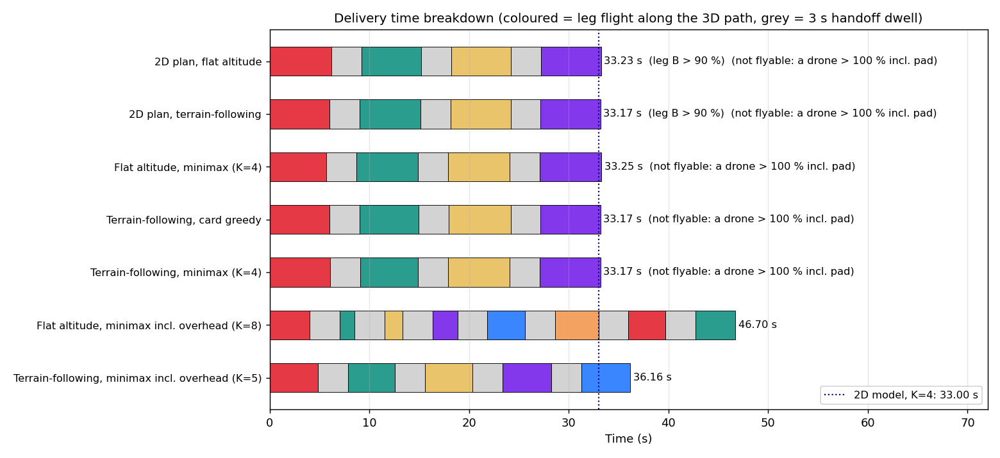
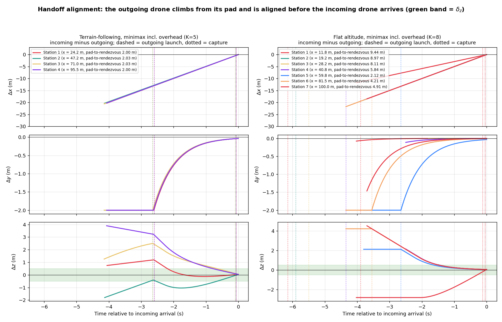
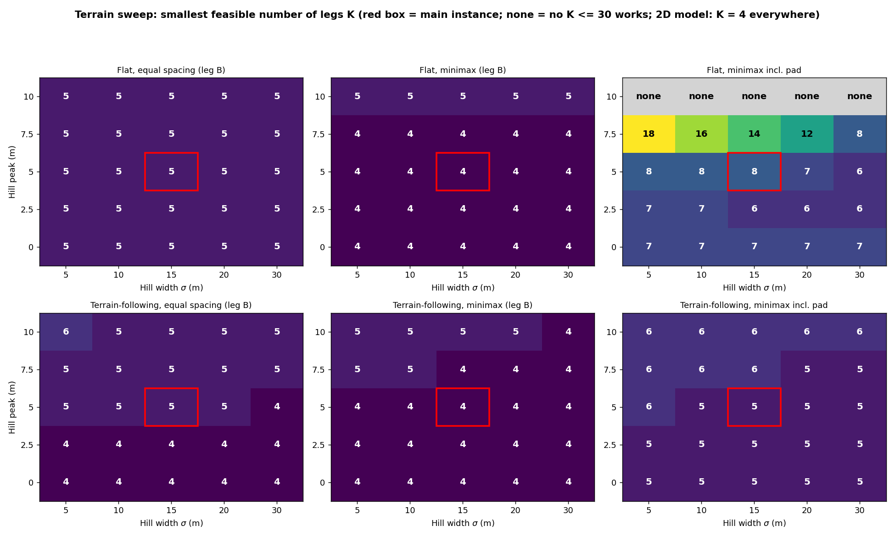
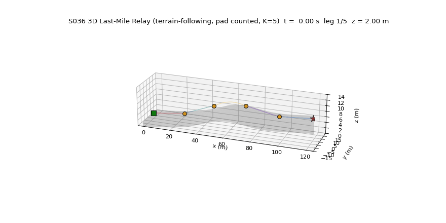

# S036 3D Last-Mile Relay

**Domain**: Logistics & Delivery | **Difficulty**: ⭐⭐⭐ | **Status**: ✅ Completed

---

## Problem Definition

**Setup**: a parcel travels from a source depot $D_0 = (0, 0, 2)$ m to a destination $D_K = (120, 0, 8)$ m, 120 m apart on the ground. The terrain under the route is a ramp that rises 6 m from $D_0$ to $D_K$, plus a 5 m Gaussian hill at the centre (60, 0). No single drone can fly the route ($R_{eff} = 0.9 \times 35 = 31.5$ m), so a chain of relay drones carries the parcel leg by leg. At each relay station the parcel is handed to a fresh drone (3 s dwell).

In 3D, three things change compared with the 2D S036:

- every leg climbs or descends, and climbing costs extra battery;
- a leg must stay at least $h_{clr} = 2$ m above the terrain;
- before each handoff, the outgoing drone has to climb from its pad to the rendezvous altitude.

**Station altitude models** (the card's comparison):

- **Flat altitude**: every intermediate rendezvous point sits at one fixed altitude, $Z_{flat}$ = 10.056 m. This is the lowest altitude that clears terrain + 2 m everywhere on the route. The two terminals stay at terrain + 2 m.
- **Terrain-following**: every rendezvous point sits at terrain + 2 m (card: $z_k = h(x_k, y_k) + h_{clr}$).

**Relay plans** (all flown with the same flight and battery model):

| Plan | Relay positions |
|------|-----------------|
| 2D plan, flat altitude | the 2D S036 relays, x = 30 / 60 / 90 m |
| 2D plan, terrain-following | the same relays, with terrain-following stations |
| Flat altitude, minimax | relay x chosen to minimise the worst leg battery, smallest feasible K |
| Terrain-following, card greedy | the card's furthest-reachable segmentation over 1 m via-points |
| Terrain-following, minimax | as flat minimax, with terrain-following stations |
| Flat / terrain-following, minimax incl. overhead | as minimax, but each drone's battery also pays for its pad climb and its landing |

**Key question**: does the third dimension change the number of relay legs, the battery use and the delivery time? Do terrain-following stations beat stations at a fixed altitude?

---

## Mathematical Model

**Leg path** (card): a leg flies the straight 3D line between the two rendezvous points. Wherever the terrain would come closer than $h_{clr}$, the line is raised to the clearance floor:

$$z_{fly}(s) = \max\bigl(h(p_x(s), p_y(s)) + h_{clr},\ (1-s)\,z_{k-1} + s\,z_k\bigr)$$

The terrain $h$ is the analytic surface sampled on a 1 m DEM and bilinearly interpolated. Each leg is sampled every ≤ 0.25 m along x.

**Battery** (card formula, evaluated on the flown path):

$$B_k = \frac{L_k^{path} + \alpha_{climb}\, C_k}{R}, \qquad B_k \le 0.90$$

Here $L_k^{path}$ is the flown 3D path length and $C_k$ the cumulative climb along it. The card's chord form $B_k = (d_k^{3D} + \alpha_{climb}\max(0, \Delta z_k))/R$ is also printed for comparison.

**Flight time**: 5 m/s along the 3D path, slowed wherever needed so that $|v_z| \le 2$ m/s. The delivery time is $T = \sum_k t_k^{flight} + (K-1)\,\tau_h$.

**Relay placement**:

- *Minimax*: exact dynamic programming on a 0.25 m grid of relay x positions. It finds the smallest $K$ whose worst leg satisfies $B \le 0.90$ and, for that $K$, the smallest worst leg. Ties are broken by the smallest $\sum B_k$.
- *Card greedy*: from the current station, take the furthest 1 m via-point whose leg satisfies $B \le 0.90$.

**Handoff** (card): the outgoing drone waits on a pad on the ground, 2 m to the side of the station. It launches early enough to be aligned 1 s before the incoming drone arrives. It flies with the card's proportional law, $\dot z = K_z (z_k - z)$ with $|\dot z| \le 2$ m/s, plus the same law horizontally, and with $|v| \le 5$ m/s. Capture is declared when $|z_{out} - z_k| < 0.5$ m and $\|\mathbf p_{in} - \mathbf p_{out}\|_3 < 0.5$ m.

**Station overhead**:

- each drone climbs from its pad to the rendezvous point before its leg, which costs (path + 0.3 × climb) / R;
- after the handoff it flies back down to the pad of the next station, which costs path / R.

The plans "incl. overhead" add both to the drone's battery. The script asserts that no drone it flies uses more than 100 %.

---

## Key Parameters

| Parameter | Value | Source |
|-----------|-------|--------|
| $D_0$, $D_K$ | (0, 0, 2.002), (120, 0, 8.002) m | card (z = terrain + 2 m) |
| Ground distance $L_{2D}$ | 120 m | card |
| Terrain | ramp 0 → 6 m along x + Gaussian hill, peak 5 m at (60, 0) | card |
| Hill width σ | 15 m | **added** (card gives none; swept 5–30 m) |
| Terrain clearance $h_{clr}$ | 2.0 m | card |
| DEM resolution | 1.0 m (bilinear) | card |
| Max range $R$ | 35 m | card |
| Battery reserve | 10 % ($B_k \le 0.90$, $R_{eff}$ = 31.5 m) | card |
| Climb surcharge $\alpha_{climb}$ | 0.30 | card |
| Cruise speed $v_c$ | 5.0 m/s (3D) | card |
| Max vertical speed | 2.0 m/s | card |
| Alignment gain $K_z$ | 1.5 s⁻¹ | card |
| Horizontal alignment gain | 1.5 s⁻¹ | **added** (same as $K_z$) |
| Capture radius / altitude tolerance | 0.5 m / 0.5 m | card |
| Handoff dwell $\tau_h$ | 3.0 s | card |
| Altitude bounds | [0.5, 20] m (asserted) | card |
| Time step | 0.05 s | card |
| Standby pad offset | 2 m lateral (+y), on the ground | **added** |
| Alignment lead margin | 1.0 s | **added** |
| Relay grid (minimax DP) | 0.25 m (sweep: 0.5 m) | **added** |
| Leg sampling | ≤ 0.25 m along x | **added** |
| Terrain sweep | peak 0 / 2.5 / 5 / 7.5 / 10 m × σ 5 / 10 / 15 / 20 / 30 m | **added** |
| Animation | 93 frames (every 8th 0.05 s step), 20 fps | — |

### Deviations from the scenario card

| Card | Implementation | Reason |
|------|----------------|--------|
| Objective 1: $R_{eff} = R(1 - B_{res})\cdot\eta_{alt}$ | $R_{eff,k} = R(1 - B_{res}) / \eta_{alt}$ (card corrected) | Multiplying would make a climbing leg's range *longer*. The card's own Mathematical Model divides. |
| $K^* = \lceil \max_k d_k^{3D} / R_{eff} \rceil$ | $K^* \ge \lceil \lVert D_K - D_0 \rVert_3 / R_{eff} \rceil = \lceil 120.15 / 31.5 \rceil = 4$ as a lower bound; the true minimum comes from the DP (card corrected) | The card's formula divides one leg by the range, which gives 1 for any feasible plan. |
| "Optimal equal spacing" with leg $\sqrt{(L/K)^2 + (\Delta H/K)^2}$ | Equal spacing is evaluated, but is not optimal; minimax DP is used (card note added) | The formula holds only on a constant slope. With a hill, the legs over the hill climb more. |
| $B_k$ on the chord $d_k^{3D}$ with the net $\Delta z_k$ | $B_k$ on the flown terrain-following path with the cumulative climb; the chord value is printed alongside | The card itself times the legs on the flown path. The chord form under-counts by at most 1.1 points here (70.4 vs 69.3 %). |
| Hill width not given | σ = 15 m, plus a 25-terrain sweep | needed to define the DEM; the sweep shows how much the results depend on it |
| Standby position of the outgoing drone not given | Pad on the ground, 2 m to the side of the station; pad climb and landing reported, and counted in the "incl. overhead" plans | The card asks for a vertical alignment phase "while approaching horizontally" but does not say where the drone waits. |
| Flat-2D comparison "fixed altitude" | $Z_{flat}$ = lowest terrain-safe altitude (10.056 m); terminals stay at terrain + 2 m | Any lower fixed altitude would hit the hill. |
| Free relay altitude (card bottleneck objective lists altitude as a variable) | Altitude is fixed by the station model (terrain + 2 m or $Z_{flat}$) | The card's own constraint $z_k = h + h_{clr}$ makes altitude dependent, and free altitude is the card's Extension 1. |
| Hover energy | Not modelled (battery is distance-based, as on the card) | The outgoing drone hovers 1 s or more at the rendezvous point before capture; this costs nothing in the card's model. |
| Bent corridor of the 2D S036 | Not used; straight route only | The 3D card defines only the straight $D_0 \to D_K$ route. |

---

## Simulation Results

Console output of `python src/02_logistics_delivery/3d/s036_3d_last_mile_relay.py`. The script is deterministic (no random numbers), and two runs gave byte-identical output and files. Runtime is about 1.5–3 min, mostly the terrain sweep.

Terrain on the route: h(0) = 0.0017 m, h(120) = 6.0017 m, and the maximum is 8.056 m at x = 62.00 m. The straight 3D distance from $D_0$ to $D_K$ is 120.150 m.

The 2D model (no altitude) gives K = 4 legs of 30 m, B = 85.7 % per leg and T = 33.00 s. Equal horizontal spacing needs K = 5 in 3D with either station model (worst leg 79.2 % flat, 73.7 % terrain-following).

### All plans

| Plan | K | Relay x (m) | Worst leg $B_k$ (flown) | Worst leg, card chord form | Worst drone incl. pad climb + landing | Total path | Total climb | Delivery time T |
|------|---|-------------|------|------|------|------|------|------|
| 2D plan, flat altitude | 4 | 30, 60, 90 | **95.7 %** ✗ | 95.7 % | 129.8 % | 121.13 m | 8.05 m | 33.23 s |
| 2D plan, terrain-following | 4 | 30, 60, 90 | **92.4 %** ✗ | 92.3 % | 110.5 % | 120.85 m | 8.88 m | 33.17 s |
| Flat altitude, minimax | 4 | 27.25, 58.25, 89.25 | 88.6 % | 88.6 % | 129.6 % | 121.23 m | 8.05 m | 33.25 s |
| Terrain-following, card greedy | 4 | 30, 59, 90 | 89.5 % | 89.4 % | 107.5 % | 120.85 m | 8.88 m | 33.17 s |
| Terrain-following, minimax | 4 | 30.25, 58.75, 89.50 | 88.6 % | 88.6 % | 106.6 % | 120.85 m | 8.86 m | 33.17 s |
| Flat altitude, minimax incl. overhead | 8 | 11.75, 19.25, 28.25, 40.75, 59.75, 81.50, 100.00 | 62.1 % | 62.1 % | 86.2 % | 122.60 m | 8.05 m | **46.70 s** |
| Terrain-following, minimax incl. overhead | 5 | 24.25, 47.25, 71.00, 95.50 | 70.8 % | 70.8 % | 88.8 % | 120.81 m | 8.98 m | **36.16 s** |

✗ = breaks the 90 % reserve on a leg. Only the last two plans keep every drone, including its pad climb and landing, under 90 %. The first five would need more than 100 % for some drone, so the script does not fly them through the time-stepped handoff simulation. Their T is the formula value.

**Pad-to-rendezvous height** (the climb the outgoing drone makes before each leg):

- terrain-following stations: 2.00–2.04 m everywhere;
- flat-altitude stations: up to 9.44 m. In the flat incl.-overhead plan the heights are 2.00, 9.44, 8.97, 8.11, 5.84, 2.12, 4.21, 4.91, 2.00 m. Alignment then takes up to 5.15 s, against 1.60–1.65 s for terrain-following.

**Time-stepped handoffs** (the two flown plans):

- capture is declared 0.05–0.13 s before the incoming drone's nominal arrival;
- the outgoing drone launches 2.60–2.65 s before arrival on the terrain-following plan, and 2.65–6.15 s before arrival on the flat plan;
- after the 3 s dwell, the outgoing drone is at most 0.615 mm from the rendezvous point.

### Terrain sweep (25 terrains, hill peak 0–10 m × σ 5–30 m)

| Comparison | Terrain-following better (fewer legs) | Equal | Flat better |
|------------|------|------|------|
| Equal spacing, leg $B_k$ | 11 | 13 | 1 |
| Minimax, leg $B_k$ | 1 | 22 | 2 |
| Minimax, incl. pad climb + landing | **25** | 0 | 0 |

- Equal spacing needs more than 4 legs with terrain-following stations on 14 of 25 terrains; minimax needs more than 4 on 6 of 25.
- With a 10 m hill, a flat-altitude chain that counts the pad overhead is infeasible for every K ≤ 30 (marked "none"). $Z_{flat}$ is then 15.00–15.11 m. Stations over low ground then sit 9–15 m above their pads, so the pad climb and landing eat most of a battery, and the DP finds no chain that keeps every drone under 90 %.

### Findings

- **The 2D plan does not survive the third dimension.** The 2D relays at x = 30 / 60 / 90 m give 85.7 % per drone in 2D. Flown at a fixed safe altitude, the first drone must also climb 8.05 m, and uses 95.7 %. Flown terrain-following, the drone climbing the hill (leg 2, +5.82 m) uses 92.4 %. Both break the 90 % reserve. Equal spacing needs a fifth leg.
- **Under the card's leg-only battery, the card's K\* = 4 holds, but only with optimised placement, and the station model makes no difference.** Minimax placement brings the worst leg to 88.6 % for *both* flat and terrain-following stations, with K = 4 and T = 33.25 vs 33.17 s. Both chains climb about the same total height (8.05 vs 8.86 m), because the route must get over the hill either way. The sweep confirms this: with leg-only accounting, the two station models need the same K on 22 of 25 terrains. **The card's expected advantage of terrain-following does not appear here.**
- **The difference appears once the handoff climb is counted.** A flat-altitude station 8–9 m above low ground makes each outgoing drone climb that far before its leg, and land from that high after the next handoff. Counting this:
  - the flat chain needs K = 8 and 46.70 s;
  - the terrain-following chain needs K = 5 and 36.16 s, which is 10.54 s faster;
  - terrain-following needs fewer legs on 25 of 25 sweep terrains.
  This advantage comes from where the drones wait (pads on the ground, an assumption added here). If flat-altitude stations were towers with pads at the rendezvous altitude, the overhead would vanish and the leg-only result would apply.
- **Counting the pad overhead costs a leg even for terrain-following.** The 2 m pad climb (2 m lateral offset) and the landing take about 18 points of battery (88.8 − 70.8 %) on a 35 m-range drone. The card's K = 4 needs up to 106.6 % per drone once this is counted, so it cannot be flown.
- **The card's greedy segmentation is nearly as good as minimax here** (worst leg 89.5 % vs 88.6 %, same K = 4 and the same time). With greedy, the leg climbing the hill sits close to the reserve limit.
- **Terrain-following adds little path length.** The flown path is at most 0.19 m longer than the chord on any leg (23.99 vs 23.80 m, the leg from x = 47.25 to 71.00 m that rides over the hilltop). On that leg the card's chord battery formula under-counts by 1.1 points (70.4 vs 69.3 %), the largest gap of any leg.

---

## Output Files

### 3D Trajectories

Flat-altitude (left) vs terrain-following (right) stations. Top: card accounting with K = 4. Bottom: pad climb and landing counted (K = 8 vs K = 5). Orange dots are rendezvous points, black squares are standby pads on the ground, and the dotted lines show each station's height above its pad:

### Altitude Profiles

Altitude against horizontal distance for six plans. The dark grey area is the terrain and the light band the 2 m clearance; black ticks mark the rendezvous altitudes. The 2D plan's leg 1 (flat) and leg 2 (terrain-following) are the legs that break the reserve:

### Battery Usage

Left: leg battery $B_k$ (card definition, flown path). Right: per-drone battery including the pad climb and the landing. Red dashed line: 90 % reserve limit. Dotted line: the 2D model's 85.7 %:

### Delivery Time Breakdown

Leg flight time (coloured) and 3 s handoff dwell (grey) per plan. The dotted line is the 2D model's 33.00 s:

### Handoff Detail

Δx, Δy and Δz between the incoming and the outgoing drone at every handoff of the two flown plans, against time relative to the incoming drone's arrival. Dashed lines mark the outgoing drone's launch and dotted lines the capture; the green band is $\delta_z$ = 0.5 m. On the terrain-following plan the outgoing drone climbs about 2 m. On the flat plan it climbs up to 9.44 m, and launches up to 6.15 s early:

### Terrain Sweep

Smallest feasible K for 25 hill shapes. Top: flat-altitude stations. Bottom: terrain-following stations. Columns: equal spacing, minimax and minimax including the pad overhead. The red box is the main instance:

### Animation

The parcel (dark dot) on the terrain-following chain with the pad overhead counted (K = 5). The purple triangle is the outgoing drone climbing from its pad; a yellow flash marks each capture (93 frames):

---

## Extensions

1. Free relay altitude (card Extension 1): let $z_k$ range over $[h + h_{clr}, z_{max}]$ and add it to the DP, for example to cut the hill climb with a higher station before the hill.
2. A hover-power term, so that the outgoing drone's waiting time at the rendezvous point costs energy.
3. Horizontal detours around the hill instead of over it.
4. Elevated pads (towers) for flat-altitude stations, with their own cost, to compare against terrain-following ground pads.
5. Wind shear $\mathbf w(z)$ (card Extension 3).

---

## Related Scenarios

- Original 2D version: [S036 Last-Mile Relay](../../../../scenarios/02_logistics_delivery/S036_last_mile_relay.md)
- 3D card: [S036 3D Upgrade — Last-Mile Relay](../../../../scenarios/02_logistics_delivery/3d/S036_3d_last_mile_relay.md)
- Prerequisites: [S021 3D Upgrade — Point Delivery](../../../../scenarios/02_logistics_delivery/3d/S021_3d_point_delivery.md), [S024 3D Upgrade — Wind Compensation](../../../../scenarios/02_logistics_delivery/3d/S024_3d_wind_compensation.md)
- Related 3D logistics: [S027 3D Upgrade — Aerial Refueling Relay](../../../../scenarios/02_logistics_delivery/3d/S027_3d_aerial_refueling.md), [S037 3D Upgrade — Reverse Logistics](../../../../scenarios/02_logistics_delivery/3d/S037_3d_reverse_logistics.md)
