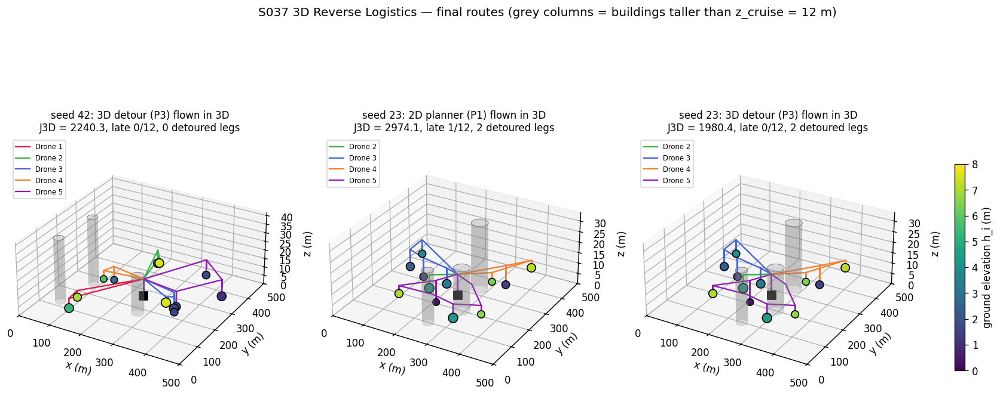
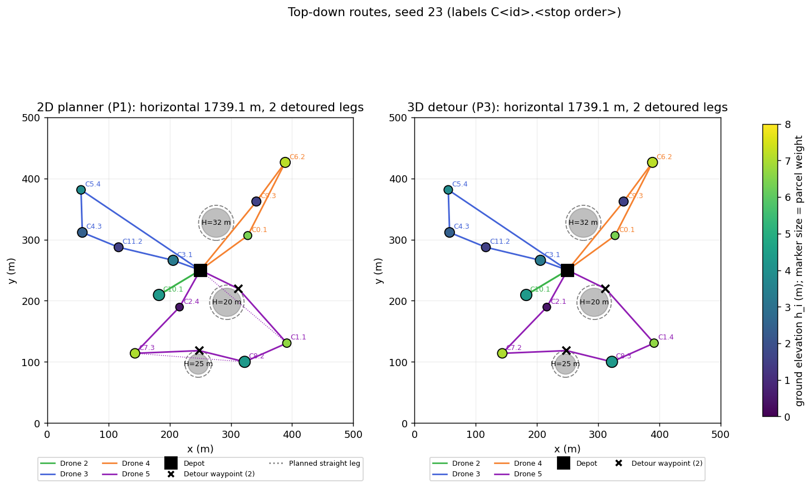
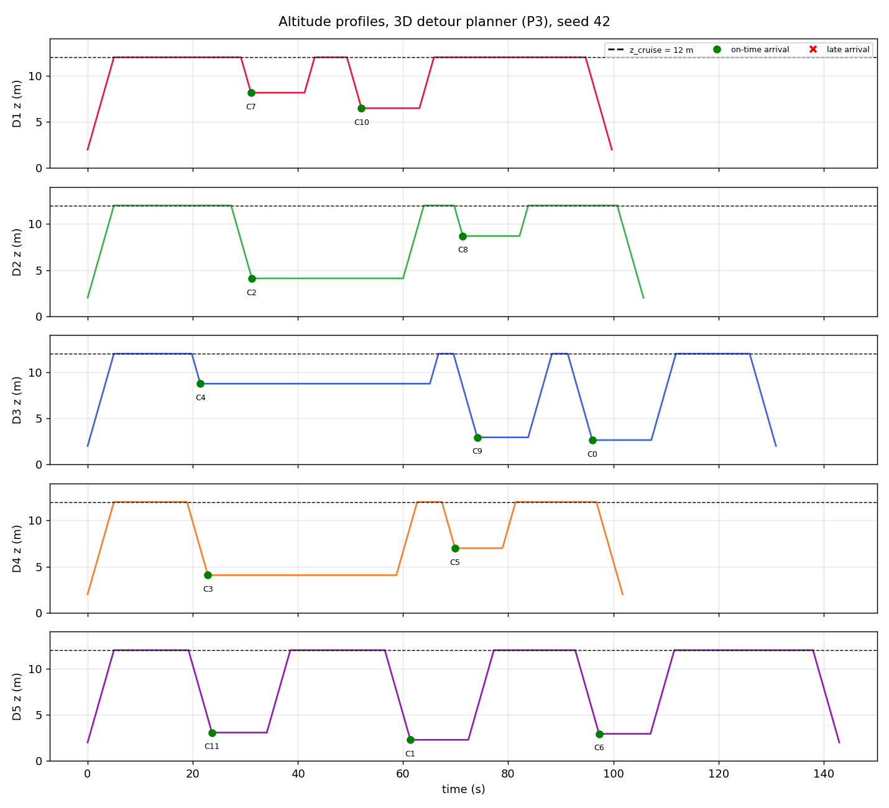
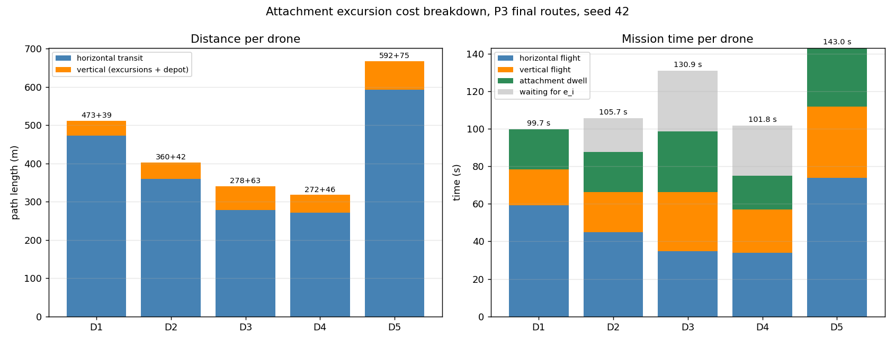
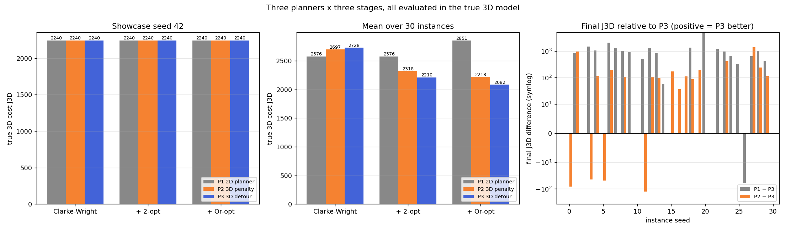
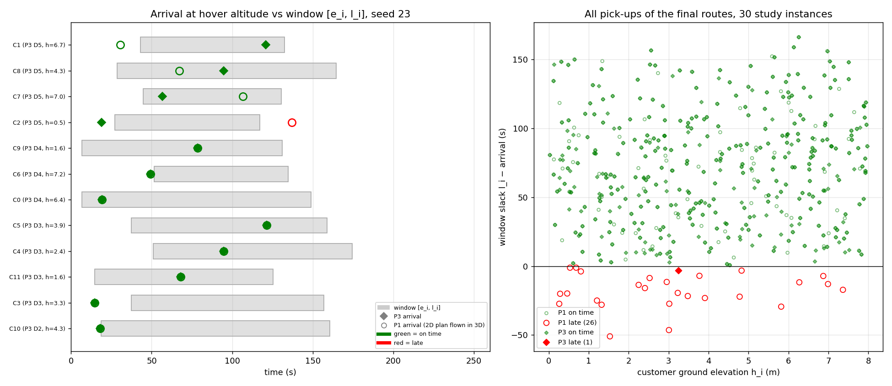
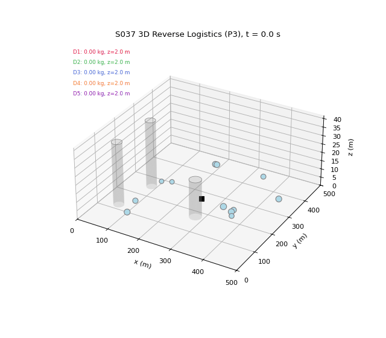

# S037 3D Reverse Logistics

**Domain**: Logistics & Delivery | **Difficulty**: ⭐⭐⭐⭐ | **Status**: ✅ Completed

---

## Problem Definition

**Setup**: 5 drones collect returned parcels from 12 customers and bring them to the depot at (250, 250, 2) m. Each customer has a parcel weight and a pick-up time window. The customers and their weights and windows are the same random draws as in the 2D S037 (same seeds, same draw order). The 3D card adds:

- a fixed transit altitude $z_{cruise} = 12$ m, with a 10 m climb after take-off and a 10 m descent before landing;
- a ground elevation $h_i \sim U[0, 8]$ m per customer. At every stop the drone descends to $z_{hover,i} = h_i + 1.2$ m, hovers while the parcel is winched aboard, then climbs back to 12 m;
- an attachment dwell $\tau_i = 8 + 3 q_i$ s;
- 3 cylindrical buildings, taller than 12 m, that every transit leg must clear horizontally by $r_c + 5$ m;
- a 3D energy proxy $E_k$ with a range limit of 2500 m-equivalent.

**Planners compared**: all three run the S037 pipeline (Clarke-Wright → 2-opt → Or-opt) on the same instances, but each plans with a different cost model:

| Planner | Planning model |
|---|---|
| **P1 2D planner** | the S037 2D cost: straight horizontal legs; no vertical motion, dwell or obstacles |
| **P2 3D penalty** | the card's optimisation model: straight legs plus the obstacle penalty $\nu W$, with vertical cost and 3D timing. Detours are inserted only after planning. |
| **P3 3D detour** | legs use the confirmed detour paths, so the planning model equals the evaluation model |

Every result is **evaluated in the true 3D model**: detoured legs, vertical excursions, dwell and 3D timing. The cost of a set of routes in that model is called $J_{3D}$.

The instances are:

- **seed 42**: the 2D showcase instance;
- **seeds 0–29**: 30 more instances, with the same draws for every planner;
- **seed 23**: a contrast instance for the route figures, because on seed 42 all three planners return the same routes. It is chosen by a fixed rule: the study seed with the median P1 − P3 gap among the 21 seeds where P1 and P3 differ.

**Key questions**:

- Does the third dimension change the routes or the outcome?
- Do the card's claims about elevation hold?

---

## Mathematical Model

**Leg timing.** Leaving the previous hover point at time $d_{j-1}$, the drone climbs back to cruise altitude, transits horizontally and descends at stop $j$. Its arrival time at hover altitude is

$$a_j = d_{j-1} + \frac{\Delta z_{j-1}}{v_z} + \frac{L_{j-1,j}}{v_c} + \frac{\Delta z_j}{v_z}$$

where:

- $\Delta z_i = z_{cruise} - h_i - 1.2$ is the excursion depth at customer $i$;
- $\Delta z_0 = \Delta z_{depot} = 10$ m;
- $L_{j-1,j}$ is the horizontal leg length (straight or detoured).

The drone then waits for the window if needed, dwells and departs:

$$d_j = \max(e_j, a_j) + \tau_j$$

The lateness at stop $j$ is $\max(0, a_j - l_j)$.

**Route cost** (card): $C^{dist}_k = \text{horizontal} + 2\sum_j \Delta z_j + 2\Delta z_{depot}$.

**Energy and range**: $E_k = \text{horizontal} + \gamma \cdot \text{vertical}$, with $\gamma = 1.4$, and the range limit is $E_k \le R_{max}$.

**Objective**:

$$J = \sum_k \left(C^{dist}_k + \lambda V_k + \mu \max(0, E_k - R_{max}) + \nu W_k\right)$$

- $W$ is the buffer penetration depth of the straight legs: $\sum \max(0, r_c + r_{safety} - d_{seg})$. It is non-zero only in P2's planning model.
- $J_{3D}$ is $J$ evaluated on the detoured legs, where $W = 0$.

**Detour** (card rule): a leg that violates a buffer gets one waypoint per blocking obstacle at $\mathbf{c} + R'\hat{\mathbf{n}}^{\pm}$, where $\hat{\mathbf{n}}$ is perpendicular to the leg. The side with the shorter path wins. $R'$ starts at $r_c + r_{safety}$ and is pushed outward in 0.25 m steps until both sub-legs clear the buffer. The sub-legs are then checked recursively against the other obstacles.

**Savings**: $s_{ij} = C(\{i\}) + C(\{j\}) - C(\{i, j\})$, computed with each planner's own distance-type cost:

- P1: horizontal length;
- P2: $C^{dist} + \nu W$ on straight legs;
- P3: $C^{dist}$ on detoured legs.

On straight legs, each customer's excursion $2\Delta z_i$ appears once in $C(\{i\})$ and once in $C(\{i,j\})$, so it cancels: $s^{3D}_{ij} = s^{2D}_{ij} + 2\Delta z_{depot}$. That is, the 3D savings are the 2D savings plus a constant 20 m.

**2-opt and Or-opt**: the S037 moves (every sub-sequence reversal, and single-customer relocation under the capacity limit), accepted when the planner's own $J$ decreases.

---

## Key Parameters

| Parameter | Value |
|-----------|-------|
| Fleet / customers | 5 drones / 12 customers, uniform in [50, 450]² m (2D S037 draws) |
| Depot | (250, 250, 2) m |
| Payload capacity $Q_{max}$ | 3.0 kg (hard; asserted) |
| Range $R_{max}$ | 2500 m-equivalent (soft penalty $\mu$; final routes asserted ≤ $R_{max}$) |
| Horizontal speed $v_c$ / vertical speed $v_z$ | 8.0 m/s / 2.0 m/s |
| Transit altitude $z_{cruise}$ / depot altitude | 12 m / 2 m |
| Ground elevation $h_i$ | U[0, 8] m (stream `default_rng([seed, 37])`) |
| Hover clearance $z_{offset}$ | 1.2 m |
| Attachment time $\tau_0 + \kappa q_i$ | 8 s + 3 s/kg × $q_i$ |
| Parcel weight $q_i$ | U[0.3, 1.2] kg |
| Window $e_i$ / $l_i$ | U[0, 60] s / U[90, 180] s |
| Obstacles | 3 cylinders, radius U[15, 25] m |
| Obstacle height $H_c$ | U[20, 40] m (added) |
| Safety buffer $r_{safety}$ | 5 m |
| Obstacle placement margin | buffer edge ≥ 5 m from every customer, the depot and other buffers (added) |
| Detour step | 0.25 m (added) |
| Vertical energy penalty $\gamma$ | 1.4 |
| Penalty weights $\lambda$ / $\mu$ / $\nu$ | 50 per s of lateness / 1000 per m-eq of range excess / 500 per m of penetration depth |
| Instances | showcase seed 42; study seeds 0–29 |
| Trajectory sample step | 0.1 s |
| Animation | 144 frames (every 10th sample = 1.0 s of flight), 15 fps |

### Deviations from the scenario card

| Card | Implementation | Reason |
|---|---|---|
| Obstacle height $H_c$ not given | $H_c \sim U[20, 40]$ m | Obstacles only block 12 m transit legs if they are taller than 12 m (constraint 4). |
| Constraint 5: $z_{cruise} \ge H_c$ within $2r_c$ of an obstacle | dropped; the buffer $r_c + r_{safety}$ is enforced below $H_c$ | With $H_c > z_{cruise}$, constraint 5 can never hold, and the card's own detour waypoint lies inside $2r_c$. Card corrected. |
| Arrival time uses $2\Delta z_j / v_z$ before reaching stop $j$ | ascent of the previous stop + transit + descent at stop $j$ | The card charged the ascent from stop $j$ before the drone reached stop $j$. Totals match but the arrival times did not. Card corrected. |
| Detour waypoint exactly at $r_c + r_{safety}$ | waypoint pushed outward until both sub-legs clear the buffer; recursive check against other obstacles | At exactly $r_c + r_{safety}$ the sub-legs cut back into the buffer. A visibility-graph fallback exists for the case where the rule finds no path, but it was never needed (0 of 2340 leg pairs). Card corrected. |
| 3D savings make tall-building stops less attractive merge candidates | not observed; shown analytically and numerically to be false | The excursions cancel in the savings. Tall buildings have the *smallest* $\Delta z$. Card corrected. |
| More lateness expected for high-elevation customers "due to longer attachment time" | tested; the opposite holds | Attachment time depends on weight, not on $h_i$. Card corrected. |
| $W$ called a penetration "volume"; $\lambda$ in "s/m" | $W$ is a depth in m; $\lambda$ is per second of lateness | unit fixes in the card |
| One planner | three planners (P1, P2, P3) | to show what the 3D model changes versus the 2D plan, and how the card's penalty method compares with exact detour costs |
| Savings use $C^{dist}$ | P2's savings use $C^{dist} + \nu W$ | P2's legs are straight, so without $W$ its construction would not see the obstacles at all |
| Range is a hard constraint | soft penalty $\mu$ in $J$, as in 2D S037; final routes asserted within range | Range never binds: the largest route energy is 1141.0 of 2500 m-eq. |
| Single instance | showcase seed 42 plus 30 study seeds, and a rule-chosen contrast seed for the figures | Results depend on the random instance. |

---

## Implementation

```
src/02_logistics_delivery/3d/s037_3d_reverse_logistics.py
```

```bash
conda activate drones
python src/02_logistics_delivery/3d/s037_3d_reverse_logistics.py
```

Runtime is about 40–60 s. Two runs gave byte-identical console output, PNGs and GIF.

The script asserts these invariants for every final route of every planner and instance, on trajectories sampled every 0.1 s:

- every customer is served exactly once;
- the load is ≤ $Q_{max}$ and the energy is ≤ $R_{max}$;
- the trajectory arrival times match the timing model;
- the horizontal speed is ≤ 8 m/s and the vertical speed ≤ 2 m/s;
- the drone stays at or above $h_i + 1.2$ m over each customer and never goes above 12 m;
- the drone never comes within $r_c + r_{safety}$ of a building.

---

## Results

### Showcase instance (seed 42)

- Total parcel weight: 9.46 kg.
- Ground elevations: 1.08–7.55 m, so the excursion depth $\Delta z$ is 3.25–9.72 m.
- 7 of the 78 node pairs have a straight leg through a building buffer, but no route uses one of them.

| Planner | Stage | Horizontal (m) | Vertical (m) | Lateness (s) | Detoured legs | Makespan (s) | $J_{3D}$ |
|---|---|---|---|---|---|---|---|
| P1, P2, P3 | CW, + 2-opt, + Or-opt (all identical) | 1974.5 | 265.8 | 0.0 | 0 | 143.0 | 2240.3 |

All 9 planner/stage combinations give the 2D S037 routes `[7,10] [2,8] [4,9,0] [3,5] [11,1,6]`. P1's own (2D) cost is 1974.5, exactly the 2D result. The vertical excursions add 265.8 m. Of this, 100 m comes from the 5 depot climb-and-descend pairs and 165.8 m from 2Σ$\Delta z$.

The makespan grows from 74.0 s in P1's 2D model to 143.0 s in true 3D. Every pick-up is still on time.

**P3 final routes, per drone** (true 3D):

| Drone | Stops | Horizontal (m) | Vertical (m) | $E$ (m-eq) | Load (kg) | Horizontal flight (s) | Vertical flight (s) | Dwell (s) | Wait (s) | Back at depot (s) |
|---|---|---|---|---|---|---|---|---|---|---|
| D1 | 2 | 473.2 | 38.7 | 527.4 | 1.74 | 59.1 | 19.4 | 21.2 | 0.0 | 99.7 |
| D2 | 2 | 359.8 | 42.4 | 419.2 | 1.81 | 45.0 | 21.2 | 21.4 | 18.1 | 105.7 |
| D3 | 3 | 277.6 | 63.3 | 366.3 | 2.81 | 34.7 | 31.7 | 32.4 | 32.2 | 130.9 |
| D4 | 2 | 271.6 | 45.9 | 335.9 | 0.70 | 34.0 | 22.9 | 18.1 | 26.8 | 101.8 |
| D5 | 3 | 592.3 | 75.4 | 697.9 | 2.41 | 74.0 | 37.7 | 31.2 | 0.0 | 143.0 |

Vertical flight and dwell together take 40.6–68.9 s per drone, about as long as the horizontal flight (34–74 s).

### Study (30 instances, seeds 0–29; final routes; same draws for every planner)

| Metric | P1 2D planner | P2 3D penalty | P3 3D detour |
|---|---|---|---|
| $J_{3D}$ mean ± std | 2851.0 ± 944.5 | 2218.4 ± 405.8 | **2081.8 ± 214.9** |
| $J_{3D}$ median (range) | 2833.8 (1681.4–6535.0) | 2115.7 (1615.4–3801.6) | **2037.7** (1615.3–2502.8) |
| Instances with lateness | 20 / 30 | 3 / 30 | **1 / 30** |
| Late pick-ups | 26 / 360 | 3 / 360 | **1 / 360** |
| Total lateness | 476.6 s | 42.9 s | **3.0 s** |
| Detoured legs per instance (mean) | 0.97 | 0.10 | 1.00 |

Head-to-head on final $J_{3D}$:

| Pair | Wins | Losses | Ties | Mean gap | Median gap | Range of gap |
|---|---|---|---|---|---|---|
| P3 vs P1 | 20 | 1 | 9 | 769.2 | 666.4 | −59.7 to 4919.7 |
| P3 vs P2 | 16 | 4 | 10 | 136.6 | 18.5 | −125.1 to 1400.7 |
| P2 vs P1 | 20 | 7 | 3 | 632.6 | 451.4 | −749.3 to 4919.6 |

Mean $J_{3D}$ by optimisation stage:

| Planner | Clarke-Wright | + 2-opt | + Or-opt | 2-opt lowers $J_{3D}$ | Or-opt lowers / raises $J_{3D}$ |
|---|---|---|---|---|---|
| P1 | 2575.5 | 2575.5 | 2851.0 | 0 / 30 | 22 / 7 |
| P2 | 2696.5 | 2318.1 | 2218.4 | 11 / 30 | 28 / 0 |
| P3 | 2727.9 | 2209.6 | 2081.8 | 14 / 30 | 29 / 0 |

Other numbers:

- **Clarke-Wright with the vertical cost but no obstacles** gives exactly the 2D Clarke-Wright routes in 31 of 31 instances. With detoured legs (P3), it gives them in 28 of 31.
- **Where P1's lateness comes from** (study total): 0.0 s in the 2D model, 467.6 s with 3D timing on straight legs (vertical motion and dwell only), and 476.6 s in true 3D with detours.
- **Elevation vs lateness**, final routes over all study pick-ups:
  - P1: 19 of 180 low pick-ups (h < 4 m) are late, against 7 of 180 high ones (h ≥ 4 m); corr(h, arrival − l) = −0.150.
  - P3: 1 low and 0 high pick-ups are late; corr = −0.071.
  - The excursion time $2\Delta z / v_z$ runs from 2.8 s (h = 8 m) to 10.8 s (h = 0 m).
- **Obstacles**: on average 8.0 of 78 node pairs per instance are blocked (range 0–20).
- **Physical checks**: the largest route energy is 1141.0 m-eq (limit 2500) and the largest load is 2.99 kg (limit 3.0).

### Contrast instance (seed 23)

| Planner | $J_{3D}$ | Horizontal (m) | Lateness (s) | Detoured legs | Makespan (s) | Routes |
|---|---|---|---|---|---|---|
| P1 | 2974.1 | 1739.1 | 19.9 (1 late) | 2 | 168.9 | `[] [10] [3,11,4,5] [0,6,9] [1,8,7,2]` |
| P2 | 2401.6 | 1964.1 | 3.9 (1 late) | 1 | 184.2 | `[] [2,8,1,6] [3,11,4,5] [0,9] [7,10]` |
| P3 | **1980.4** | 1739.1 | 0.0 | 2 | 168.9 | `[] [10] [3,11,4,5] [0,6,9] [2,7,8,1]` |

P1 and P3 fly the same customer sets. P3 only reverses drone 5's route:

- **P1** visits far-away C1 first. In the 2D model the drone waits there for C1's window to open, so the cost does not show the problem. In 3D, three excursions and dwells come before C2, and C2 is reached 19.9 s after its window closes.
- **P3** takes C2 first and arrives on time everywhere.

### Key findings

- **The third dimension matters through time, not through distance.** Vertical excursions add a near-constant 20 m per route plus 2Δz per stop, whatever the order of the stops. Together with the attachment dwell, they nearly double mission time: the showcase makespan goes from 74.0 s to 143.0 s. The 2D README found that time windows never bind. In 3D, the 2D plans (P1) are late in 20 of 30 instances. Almost all of that lateness (467.6 of 476.6 s) comes from vertical motion and dwell, not from obstacle detours. The 3D-aware planner P3 is late in 1 of 30.
- **2-opt starts to matter.** In 2D, 2-opt never improved anything. With the 3D timing it lowers P3's $J_{3D}$ in 14 of 30 instances, because the order of a route now decides whether a window is met. P1's 2D Or-opt step makes things *worse* in 3D on average (2575.5 → 2851.0) and raises $J_{3D}$ in 7 of 30 instances. Its relocations shorten the 2D distance, but the 2D model sees no time cost in adding a stop to an already long route, so some routes become late once the vertical time is counted.
- **Card claim "3D savings re-rank merges by elevation": false.** The excursions cancel in the savings, so without obstacles the 3D Clarke-Wright routes equal the 2D ones in 31 of 31 instances. Only obstacle detours change the construction (3 of 31 instances differ).
- **Card claim "more lateness at high-elevation customers": the opposite holds.** Low customers have the deepest excursions. For P1, 19 of the 26 late pick-ups are at h < 4 m. The correlation is weak (−0.150), because the position in the route matters far more than elevation.
- **The card's penalty method (P2) over-avoids buildings.** At ν = 500 per metre of penetration, a straight leg that grazes a buffer by 10 m costs 5000, while the real detour costs a few metres. P2 therefore avoids blocked legs (0.10 detoured legs per instance, against 1.00 for P3), even at the price of longer or later routes. On seed 27 P2 uses no detoured leg where P3 uses one, and it accepts 22.2 s of lateness ($J_{3D}$ 3801.6 against 2400.9). P3, which plans with the real detour lengths, beats P2 in 16 instances and loses in 4. The 4 losses, by up to 125.1, are heuristic local optima, not a property of the cost model.
- **Range and capacity**: range never binds (largest route energy 1141.0 of 2500 m-eq). Capacity binds as in 2D (largest load 2.99 kg).

---

## Output Files

### 3D Routes

Left: seed 42, P3 (identical for all planners). Middle and right: seed 23, P1 and P3, flown in 3D. Each stop shows a vertical excursion down to the hover altitude. Grey columns are buildings, and markers are coloured by ground elevation:



### Top-Down Map

Seed 23, P1 (left) and P3 (right):

- Dotted lines are P1's planned straight legs, and black crosses are detour waypoints.
- Customer labels are `C<id>.<stop order>`. Marker size is the parcel weight and colour is the ground elevation.
- Drone 5's stop order is reversed between the two panels.



### Altitude Profiles

Seed 42, P3. Each panel shows a 10 m depot climb, the 12 m cruise plateau (dashed), and a descent to each hover altitude. The flat segments are waits for $e_i$ and attachment dwells; dots mark on-time arrivals:



### Cost Breakdown

Seed 42, P3, per drone. Left: horizontal and vertical path length. Right: mission time split into horizontal flight, vertical flight, attachment dwell and waiting:



### Stage Comparison

$J_{3D}$ for three planners × three stages.

- Left: seed 42 (all equal).
- Middle: mean over the 30 study instances.
- Right: per-seed final $J_{3D}$ gap to P3, on a symlog scale; positive means P3 is better.



### Time Windows

Left: seed 23 windows with P3 arrivals (diamonds) and P1 arrivals (circles); P1 reaches C2 late. Right: window slack against ground elevation for every pick-up of the P1 and P3 final routes over the 30 study instances:



### Animation

Seed 42, P3, 144 frames. The drones climb, cruise, descend at each customer, dwell and climb again. Customers take their drone's colour once the parcel is aboard, and the per-drone payload and altitude are shown top left:



---

## Extensions

1. A variable transit altitude per leg: fly over the lower buildings ($H_c$ = 20–25 m) instead of around them, trading γ-weighted climb against the detour.
2. Adjustable winch length, to shorten the deepest excursions (the low customers).
3. Time-window-aware construction (insertion by deadline) instead of savings, since in 3D the windows bind.
4. Multi-customer Or-opt or swap moves, to escape the local optima where P2 beats P3.
5. A hover-power battery model, so that waiting and dwell also consume range.

---

## Related Scenarios

- Original: [S037 Reverse Logistics](../../../../scenarios/02_logistics_delivery/S037_reverse_logistics.md)
- 3D card: [S037 3D Upgrade — Reverse Logistics](../../../../scenarios/02_logistics_delivery/3d/S037_3d_reverse_logistics.md)
- Obstacle avoidance in 3D: [S022 3D Upgrade — Obstacle Avoidance Delivery](../../../../scenarios/02_logistics_delivery/3d/S022_3d_obstacle_avoidance.md)
- Time windows in 3D: [S029 3D Upgrade — Urban Logistics Scheduling](../../../../scenarios/02_logistics_delivery/3d/S029_3d_urban_logistics.md)
- Neighbours: [S036 Last-Mile Relay](../../../../scenarios/02_logistics_delivery/S036_last_mile_relay.md), [S038 Disaster Relief Drop](../../../../scenarios/02_logistics_delivery/S038_disaster_relief_drop.md)
