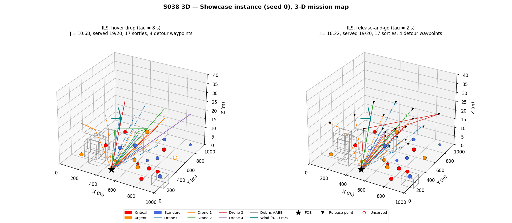
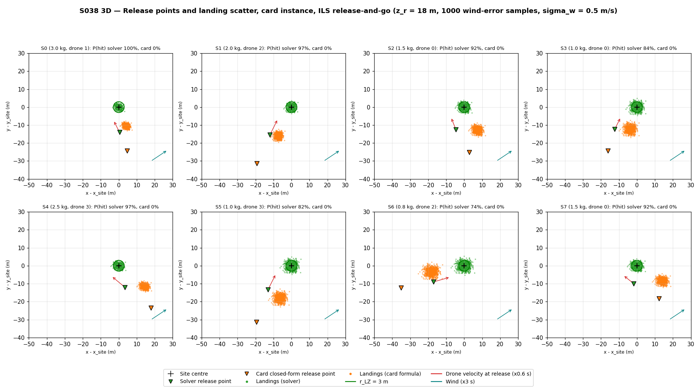
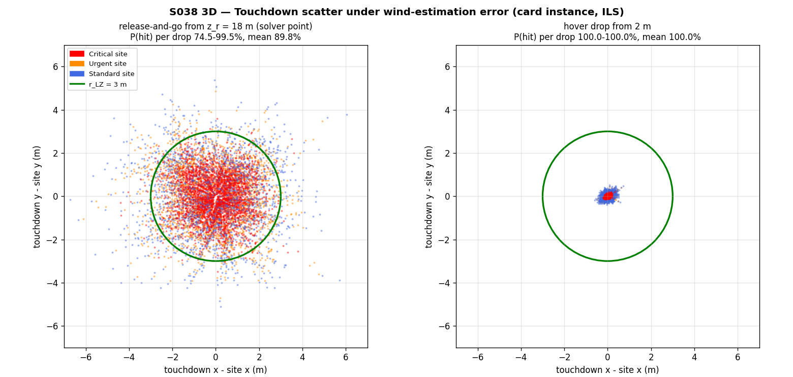
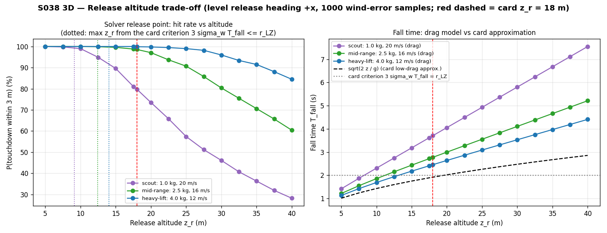
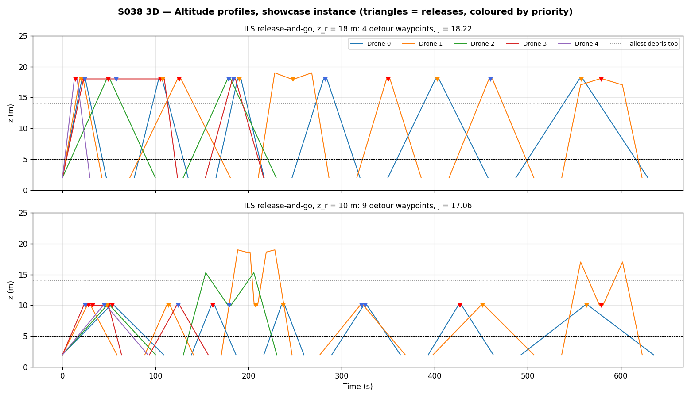
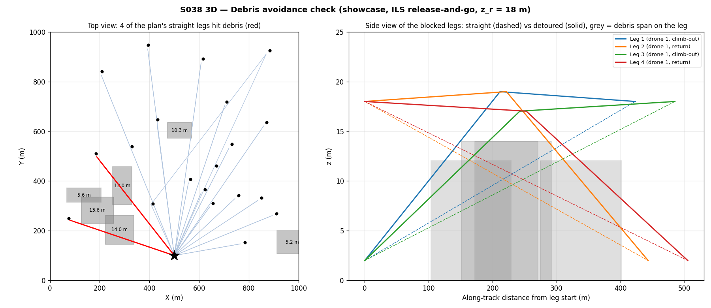
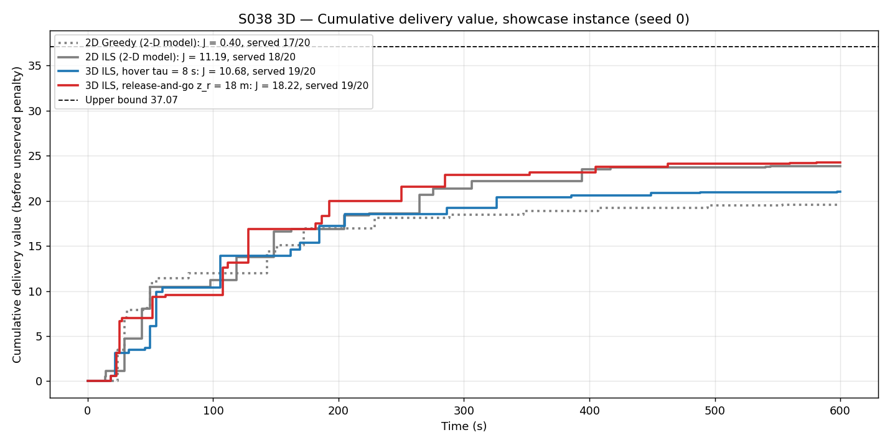
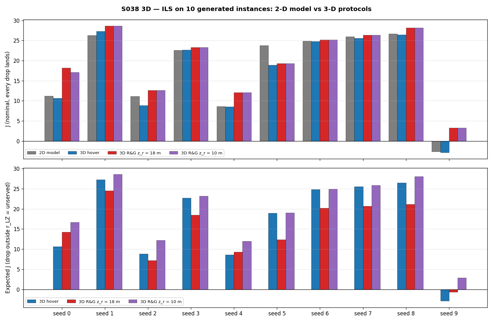
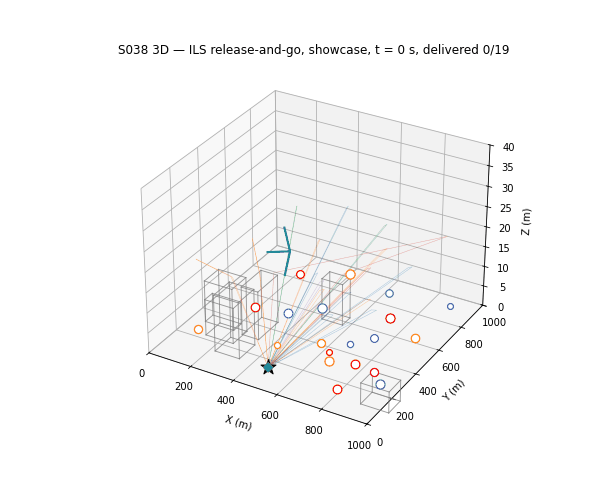

# S038 3D Disaster Relief Drop

**Domain**: Logistics & Delivery | **Difficulty**: ⭐⭐⭐ | **Status**: ✅ Completed

---

## Problem Definition

**Setup**: This is the S038 relief mission flown in a 3D world. A fleet of 5 drones (2 heavy-lift, 2 mid-range, 1 scout) flies from a forward operating base (FOB) at (500, 100, 2) m to relief sites on the ground (z = 0) in a 1000 × 1000 m area. Each site has a priority, a demand $q_i$ (the package mass) and a soft deadline. Drones fly several sorties within 600 s, with a 30 s battery swap between sorties. The 3D card adds four things:

- **Debris**: 6 axis-aligned boxes (AABBs) per instance, each up to 15 m tall. A segment that hits a box gets a vertical detour.
- **Payload range penalty**: a sortie's range drops by 50 m per kg of payload.
- **Ballistic airdrop**: the package is released in flight at $z_r$ = 18 m and falls under gravity, drag and a steady wind of (3, 2, 0) m/s. The drone must release it upwind and short of the site, at a computed release point.
- **Landing accuracy**: the wind is known only to $\sigma_w$ = 0.5 m/s per axis. A drop counts only if it lands within $r_{LZ}$ = 3 m of the site centre.

**Drop protocols compared**:

| Protocol | What the drone does | Drop dwell |
|----------|--------------------|-----------|
| **Hover** (2D S038 protocol) | flies to the site overhead at 18 m, descends, releases from 2 m and climbs back | $\tau_{drop}$ = 8 s |
| **Release-and-go, $z_r$ = 18 m** (card) | flies a straight, level 20 m run-in and releases at the wind-corrected release point without slowing | $\tau_{drop}$ = 2 s |
| **Release-and-go, $z_r$ = 10 m** (added) | the same, released from 10 m. This is near the highest altitude the card's own accuracy criterion allows (see Results) | $\tau_{drop}$ = 2 s |

**Release-point methods compared** (on the same flown release velocities and the same wind-error samples):

- **(A) solver**: numerical integration of the drag ODE (used for flying);
- **(B) card closed form**: $(\mathbf{v}_{xy} + \mathbf{w}_{xy})\sqrt{2 z_r / g}$;
- **(C) overhead**: no correction.

**Planners**: Greedy, Regret and ILS are the fixed 2D S038 planners. Here they are re-run on the 3D distance matrix, with each protocol's $\tau_{drop}$ and the payload range penalty. The **2D baseline** is the 2D script itself, imported unchanged. The card's 8-site instance cannot rank anything, because every good plan reaches the upper bound. As in 2D, the comparison is therefore made on the 20-site generated instances: showcase seed 0, plus a 10-instance study (seeds 0–9).

**Key question**: Does the faster release-and-go drop (τ = 2 s instead of 8 s) raise the delivered value once the 3D effects that come with it are included: ballistics, wind uncertainty and debris?

---

## Mathematical Model

**Kinematics and route length** (card): drones fly straight 3D segments at constant speed $v_k$, and the wind does not act on the drone. A sortie is feasible if

$$\sum_{i\in\sigma} q_i \le Q_k, \qquad L^{3D}(\sigma) \le R_k^{eff} = R_k - \alpha_R \sum_{i\in\sigma} q_i,$$

where $L^{3D}$ is the full 3D round-trip length including detour waypoints.

**Debris clearance** (card): every segment is tested against every AABB with the slab method. A blocked segment A→B gets a waypoint at its horizontal midpoint, at altitude $\max\big((A_z+B_z)/2,\ z^{max}_j + \Delta z_{clear}\big)$. Both halves are re-checked recursively. The script asserts that the recursion converges, that no flown segment hits debris, and that every waypoint except the FOB lies within 5–40 m.

**Package dynamics** (3D quadratic drag on the air-relative velocity, integrated with RK4, dt = 0.01 s):

$$\ddot{\mathbf{p}} = -g\,\hat{\mathbf{z}} - \frac{C_d}{m_p}\,\|\dot{\mathbf{p}} - \mathbf{w}\|\,(\dot{\mathbf{p}} - \mathbf{w}), \qquad \dot{\mathbf{p}}(0) = v_k\,\mathbf{u}$$

For a release with no vertical velocity, the fall time is $T_{fall} = \frac{v_t}{g}\operatorname{arccosh}\big(e^{g z_r / v_t^2}\big)$, with $v_t = \sqrt{m_p g / C_d}$. The script checks its integrator against this formula.

**Release point**: $\mathbf{p}_{rel} = \mathbf{s}_i - \Delta\mathbf{p}(v_k\mathbf{u}, m_p, \mathbf{w})$. Here $\mathbf{u}$ is the horizontal heading of the planning leg (previous node → site), and the 20 m level run-in makes the release velocity exactly $v_k\mathbf{u}$. The script asserts that each nominal drop lands within 1 mm of the site centre, and that no package trajectory passes through debris.

**Landing accuracy**: 1000 wind-error samples $\delta\mathbf{w} \sim \mathcal{N}(0, \sigma_w^2 I_2)$ are drawn once and reused for every drop, method and protocol. The miss distance is $\|\Delta\mathbf{p}(\mathbf{w}+\delta\mathbf{w}) - \Delta\mathbf{p}_{method}\|$, and $P(\text{hit}) = P(\text{miss} \le r_{LZ})$. The card's criterion is $3\sigma_w T_{fall} \le r_{LZ}$.

**Objective** (unchanged from S038):

$$J = \sum_{\text{served}} w_i q_i e^{-\lambda \max(0, t_i - d_i)} - \mu \sum_{\text{unserved}} w_i q_i.$$

- For release-and-go, $t_i$ is the touchdown time (release time + $T_{fall}$).
- For hover, $t_i$ is the arrival time above the site, the 2D convention.

**Expected J** counts a drop outside $r_{LZ}$ as unserved:

$$E[J] = \sum_{\text{served}} \big[P_i\,V_i - (1-P_i)\,\mu w_i q_i\big] - \mu\sum_{\text{unserved}} w_i q_i,$$

with $P_i$ the solver's Monte Carlo hit probability.

**Exact evaluation**: the planners use the 3D distances between site overheads (18 m, or 10 m for the low variant) and the FOB. After planning, each schedule is re-evaluated on the flown geometry: release points, run-ins, detours and touchdown times. Any site that would break the range is removed (this happened 0 times), and so is any site delivered after $T_{max}$.

---

## Key Parameters

| Parameter | Value |
|-----------|-------|
| Fleet | 2 × heavy-lift (5.0 kg, 2000 m, 12 m/s), 2 × mid-range (2.5 kg, 2800 m, 16 m/s), 1 × scout (1.0 kg, 3500 m, 20 m/s) |
| FOB | (500, 100, 2) m |
| Sites | on the ground (z = 0); card instance (8 sites) and generated instances from the 2D script (20 sites, seeds 0–9) |
| Mission horizon $T_{max}$ / battery swap $\tau_{turn}$ | 600 s / 30 s |
| Drop dwell | hover 8 s, release-and-go 2 s |
| Value decay λ / unserved penalty μ | 0.01 s⁻¹ / 5.0 |
| Payload range penalty $\alpha_R$ | 50 m/kg (round-trip range) |
| Release altitude $z_r$ | 18 m (card); 10 m (added variant) |
| Hover release altitude | 2 m |
| Altitude bounds | 5–40 m (all waypoints except the FOB) |
| Run-in before each release | 20 m, straight and level (added) |
| Wind $\mathbf{w}$ | (3, 2, 0) m/s |
| Wind-estimation error $\sigma_w$ | 0.5 m/s per horizontal axis |
| Drag constant $C_d$ | 0.3 kg/m |
| Landing zone $r_{LZ}$ | 3 m |
| Debris | 6 AABBs per instance; centre U(0, 1000)², sides U(40, 160) m, top U(5, 15) m; ≥ 30 m from every site, ≥ 40 m from the FOB (added); seed 38 (card), 1000 + instance seed |
| Detour clearance $\Delta z_{clear}$ / max recursion depth | 5 m / 20 |
| Ballistic integrator | RK4, dt = 0.01 s |
| Monte Carlo | 1000 wind-error samples per drop, seed 3838, common to all methods and protocols |
| Release-altitude sweep | 5–40 m in 2.5 m steps plus 18 m; level release heading +x; 1.0 kg at 20 m/s, 2.5 kg at 16 m/s, 4.0 kg at 12 m/s |
| ILS | 3 restarts × 25 iterations, kick 3 sites, seed 2026 + instance seed (as in 2D) |
| Animation | showcase, ILS release-and-go, one frame every 4 s of the 1 s grid, 159 frames, 12 fps |

### Deviations from the scenario card

| Card | Implementation | Reason |
|------|----------------|--------|
| $T_{fall} = \frac{v_t}{g}\ln(\cosh(g z_r/v_t^2))^{1/2}\cdot 2 \approx \sqrt{2 z_r/g}$ | exact $\frac{v_t}{g}\operatorname{arccosh}(e^{g z_r/v_t^2})$; the card is corrected | the card expression does not solve its own ODE. For 0.5–4 kg packages $g z_r / v_t^2$ = 1.35–10.8, so the low-drag approximation is far off: 1.92 s instead of 2.36–3.55 s |
| $\Delta\mathbf{p}_{bal} = (\mathbf{v}_{xy} + \mathbf{w}_{xy}) T_{fall}$ | numerical 3D drag integration (method A); the card formula is kept as method B | the formula is not the drag solution: without drag, wind has no effect, and with drag the forward velocity decays. Method B misses every site by 11–19 m (0 % hits). The card is corrected. |
| $\sigma_w$ = 0.5 m | 0.5 m/s wind error per axis | $3\sigma_w T_{fall}$ is only a length if $\sigma_w$ is a speed; the card is corrected |
| detour waypoint = midpoint **+** $(0, 0, z^{max} + \Delta z)$ | midpoint altitude **set** to $\max(z_{mid}, z^{max} + \Delta z)$ | the card says "raised to $z_{detour}$", and adding could break the 40 m bound; the card is corrected |
| release while flying through $\mathbf{p}_{rel}$ on the incoming leg | 20 m straight, level run-in along the planning-leg heading before each release | the release velocity then does not depend on the release point. A fixed point on the incoming leg did not converge when two sites are 6.5 m apart (seed 3). |
| cruise altitude 20 m, release at 18 m | straight segments FOB (2 m) ↔ release points at $z_r$; detours up to $z^{max}$ + 5 m | the card's kinematics are straight segments between 3D waypoints; a separate 20 m level adds no decision |
| "drone altitudes are decision variables in [5, 40] m" | $z_r$ is a parameter: 18 m (card) and 10 m (added), plus a 5–40 m sweep; detour altitudes follow the card's rule | the planners optimise routes, not altitudes; the sweep and the 10 m variant show the altitude trade-off |
| $\tau_{drop}^{3D}$ = 2 s at the release point | counted as a 2 s time penalty; the animation holds the drone at the release point | the card gives no manoeuvre model |
| delivery time = arrival at the waypoint | release-and-go: touchdown (release + $T_{fall}$; 2.64–4.00 s later on the card instance at 18 m); hover: arrival above the site (2D convention) | touchdown is when supplies arrive. This choice slightly penalises release-and-go relative to hover. |
| debris boxes not specified | seeded random boxes (see parameters), new boxes per instance | the card only gives the count and the height bound |
| "one-way range" wording | round-trip 3D length ≤ $R_k^{eff}$ | the card's own feasibility formula sums the whole sortie from FOB to FOB, as the 2D script does |
| planners use 3D route lengths | planners use 3D distances between site overheads; each schedule is then re-evaluated exactly on the flown path | release points depend on the incoming heading, so an exact distance matrix does not exist. The exact evaluation needed 0 range repairs. |
| card instance only | card instance plus the 2D script's 20-site generated instances (showcase seed 0, study seeds 0–9) | every good plan reaches the upper bound (10.767) on the card instance, so it cannot rank anything |
| — | added: hover protocol in 3D, $z_r$ = 10 m variant (ILS only), expected J, release-altitude sweep | needed to separate the τ gain from the 3D geometry and to price the landing misses |
| "cumulative J(t) for the 3D planner vs the 2D greedy baseline" | 2D Greedy, 2D ILS, 3D hover ILS and 3D release-and-go ILS | a 3D ILS vs 2D Greedy comparison alone would mix the planner effect with the protocol effect |
| animation: "parabolic arc" | drag trajectories, which are not parabolic | follows the drag model |

---

## Simulation Results

Console output of `python src/02_logistics_delivery/3d/s038_3d_disaster_relief.py`. Two runs gave byte-identical console output and output files. Runtime was about 3 min (178 s and 170 s, with other jobs running on the machine).

### Ballistics check (vertical release from rest at 18 m, no wind)

| Mass | $v_t$ | $T_{fall}$ RK4 | $T_{fall}$ analytic | $\sqrt{2z/g}$ (card) | Card $3\sigma_w T_{fall}$ |
|------|-------|----------------|---------------------|-----------------------|--------------------------|
| 1.0 kg | 5.72 m/s | 3.5518 s | 3.5518 s | 1.9157 s | 5.33 m |
| 2.5 kg | 9.04 m/s | 2.6266 s | 2.6266 s | 1.9157 s | 3.94 m |
| 4.0 kg | 11.44 m/s | 2.3619 s | 2.3619 s | 1.9157 s | 3.54 m |

The card's own criterion $3\sigma_w T_{fall} \le 3$ m **fails at $z_r$ = 18 m for every package mass in the instances (≤ 4 kg)**. It allows at most 9.1 m (1.0 kg), 12.4 m (2.5 kg) or 14.1 m (4.0 kg).

### Release-point methods (card instance, ILS, release-and-go at 18 m)

| Site | Mass | $T_{fall}$ | Solver offset | Card-formula offset | Card-formula nominal miss | P(hit) solver / card / overhead | 99.7 % miss (solver) |
|------|------|-----------|---------------|---------------------|---------------------------|---------------------------------|----------------------|
| S0 | 3.0 kg | 2.64 s | 13.98 m | 24.81 m | 11.21 m | 99.5 % / 0.0 % / 0.0 % | 3.15 m |
| S1 | 2.0 kg | 2.94 s | 19.49 m | 36.79 m | 17.54 m | 97.0 % / 0.0 % / 0.0 % | 3.93 m |
| S2 | 1.5 kg | 3.20 s | 13.31 m | 25.33 m | 14.70 m | 92.1 % / 0.0 % / 0.0 % | 4.63 m |
| S3 | 1.0 kg | 3.65 s | 17.35 m | 29.19 m | 12.71 m | 84.3 % / 0.0 % / 0.0 % | 5.52 m |
| S4 | 2.5 kg | 2.81 s | 12.52 m | 29.44 m | 18.32 m | 97.4 % / 0.0 % / 0.0 % | 4.04 m |
| S5 | 1.0 kg | 3.68 s | 18.59 m | 36.81 m | 19.11 m | 81.6 % / 0.0 % / 0.0 % | 5.74 m |
| S6 | 0.8 kg | 4.00 s | 19.32 m | 37.29 m | 18.41 m | 74.5 % / 0.0 % / 0.0 % | 6.72 m |
| S7 | 1.5 kg | 3.21 s | 10.04 m | 21.91 m | 16.36 m | 91.7 % / 0.0 % / 0.0 % | 4.96 m |

At $z_r$ = 10 m the solver's P(hit) is 98.2–100.0 % (mean 99.6 %), and the 99.7 % miss is 1.82–3.96 m. For the hover drop from 2 m all three methods hit 100 %: the solver offset is only 0.30–0.99 m, and the 99.7 % miss is 0.21–0.61 m.

### Release-altitude sweep (solver point, level release)

| $z_r$ | Scout 1.0 kg, 20 m/s | Mid-range 2.5 kg, 16 m/s | Heavy-lift 4.0 kg, 12 m/s |
|-------|----------------------|--------------------------|---------------------------|
| 5 m | 100.0 % | 100.0 % | 100.0 % |
| 10 m | 99.0 % | 100.0 % | 100.0 % |
| 15 m | 89.6 % | 99.6 % | 100.0 % |
| **18 m** | **79.8 %** (99.7 % miss 6.22 m) | **98.6 %** (3.86 m) | **99.9 %** (2.47 m) |
| 20 m | 73.5 % | 97.1 % | 99.8 % |

### Mission results

**Card instance** (8 sites; upper bound 10.767). With the 3D geometry, 6 of 36 node pairs need a detour at 18 m and 12 of 36 at 10 m. No site is out of range.

| Planner | 2D model | 3D hover | 3D R&G 18 m (expected J) | 3D R&G 10 m (expected J) |
|---------|----------|----------|--------------------------|--------------------------|
| Greedy | 8.619 | 8.617 | 8.796 (5.952) | — |
| Regret | 10.767 | 10.767 | 10.767 (7.563) | — |
| ILS | 10.767 | 10.767 | 10.767 (7.551) | 10.767 (10.684) |

**Showcase** (seed 0: 20 sites, 54.4 kg, upper bound 37.067). 2 of 210 node pairs need a detour at 18 m and 44 of 210 at 10 m.

| Planner / world | J | Served | Critical | Late | Mean lateness | Sorties | Expected J | P(hit) mean (min) | Detour waypoints (extra m) | Flown |
|-----------------|---|--------|----------|------|---------------|---------|-----------|-------------------|-----------------------------|-------|
| Greedy 2D | 0.403 | 17/20 | 7/7 | 8 | 72.0 s | 14 | — | — | — | — |
| Greedy 3D hover | 0.393 | 17/20 | 7/7 | 8 | 72.1 s | 14 | 0.393 | 100.0 % | 4 (+1.1) | 16175 m |
| Greedy 3D R&G 18 m | 8.542 | 18/20 | 7/7 | 8 | 64.8 s | 15 | 4.619 | 92.8 % (63.2 %) | 4 (+1.1) | 16567 m |
| Regret 2D | −31.150 | 16/20 | 5/7 | 5 | 39.3 s | 14 | — | — | — | — |
| Regret 3D hover | −31.156 | 16/20 | 5/7 | 5 | 39.3 s | 14 | −31.156 | 100.0 % | 1 (+0.2) | 16209 m |
| Regret 3D R&G 18 m | −17.197 | 17/20 | 5/7 | 6 | 42.9 s | 15 | −20.906 | 92.6 % (64.9 %) | 1 (+0.2) | 16219 m |
| ILS 2D | 11.186 | 18/20 | 7/7 | 6 | 62.0 s | 18 | — | — | — | — |
| ILS 3D hover | 10.679 | 19/20 | 7/7 | 7 | 95.2 s | 17 | 10.679 | 100.0 % | 4 (+1.1) | 18113 m |
| ILS 3D R&G 18 m | **18.222** | 19/20 | 7/7 | 9 | 71.7 s | 17 | 14.254 | 93.2 % (63.2 %) | 4 (+1.1) | 17665 m |
| ILS 3D R&G 10 m | 17.059 | 19/20 | 7/7 | 7 | 76.2 s | 17 | **16.687** | 99.2 % (94.1 %) | 9 (+3.6) | 18039 m |

The planners' own estimate of J differs from the exact value. For ILS R&G at 18 m it is 17.808 against an exact 18.222. The planners assume a flight to the site overhead and value the arrival time. In the exact flight, the release point lies 10–20 m short of the site along the approach (card instance), which shortens the flown path (17665 m against 18113 m for hover), and the value is taken at touchdown.

**Study: ILS on 10 generated instances**

| Seed | 2D | 3D hover | R&G 18 m | R&G 10 m | E[J] hover | E[J] R&G 18 m | E[J] R&G 10 m | Served 2D/h/18/10 |
|------|----|----------|----------|----------|-----------|---------------|---------------|-------------------|
| 0 | 11.19 | 10.68 | 18.22 | 17.06 | 10.68 | 14.25 | 16.69 | 18/19/19/19 |
| 1 | 26.30 | 27.28 | 28.68 | 28.67 | 27.28 | 24.53 | 28.61 | 20/20/20/20 |
| 2 | 11.15 | 8.84 | 12.64 | 12.63 | 8.84 | 7.17 | 12.24 | 18/18/18/18 |
| 3 | 22.56 | 22.71 | 23.33 | 23.32 | 22.71 | 18.52 | 23.19 | 20/20/20/20 |
| 4 | 8.58 | 8.57 | 12.08 | 12.06 | 8.57 | 9.29 | 12.00 | 18/18/19/19 |
| 5 | 23.78 | 18.94 | 19.31 | 19.32 | 18.94 | 12.36 | 19.07 | 20/19/19/19 |
| 6 | 24.88 | 24.80 | 25.20 | 25.20 | 24.80 | 20.20 | 24.92 | 20/20/20/20 |
| 7 | 25.95 | 25.57 | 26.35 | 26.34 | 25.57 | 20.65 | 25.87 | 20/20/20/20 |
| 8 | 26.67 | 26.47 | 28.17 | 28.19 | 26.47 | 21.15 | 28.02 | 20/20/20/20 |
| 9 | −2.67 | −2.88 | 3.26 | 3.26 | −2.88 | −0.62 | 2.91 | 17/17/17/17 |
| **Mean (std)** | 17.84 (9.58) | 17.10 (9.69) | **19.72** (7.88) | 19.61 (7.91) | 17.10 (9.69) | 14.75 (7.38) | **19.35** (7.94) | |

Head-to-head counts and differences:

- **Nominal J (every drop lands):**
  - R&G 18 m beats hover on 10/10 instances, by 2.63 on average (min 0.37, max 7.54).
  - Hover beats 2D on only 2/10. The mean 3D-minus-2D difference is −0.74 (min −4.83, max 0.98).
  - R&G 10 m beats R&G 18 m on 2/10.
- **Expected J (a miss counts as unserved):**
  - R&G 18 m beats hover on only 3/10, by −2.35 on average (min −6.58, max 3.58).
  - R&G 10 m beats hover on 10/10, by 2.25 on average (min 0.11, max 6.01).
  - R&G 10 m beats R&G 18 m on 10/10.
- **Per-drop hit rate over the study:** at 18 m the mean P(hit) is 93.7 %, the minimum 55.8 %, and 41 of 192 drops are below 90 %. At 10 m the mean is 99.5 % and the minimum 91.3 %.
- **All planners, mean nominal J (2D / hover / R&G 18 m):**
  - Greedy 6.71 / 6.22 / 9.16; R&G beats hover on 10/10.
  - Regret 4.09 / 3.49 / 6.97; R&G beats hover on 9/10.
  - ILS 17.84 / 17.10 / 19.72; R&G beats hover on 10/10.
- **Detours (ILS):** 0–12 detour waypoints per instance, adding 0.0–4.1 m in total at 18 m and 0.0–6.0 m at 10 m. The exact evaluation needed 0 range repairs.
- **Range penalty:** on seed 5, site S15 (3.0 kg) cannot be served by any drone in 3D. Its round trip is 1864 m, longer than the heavy-lift $R_{eff}$ of 1850 m. With a full payload, $R_{eff}$ is 1750 m (heavy-lift), 2675 m (mid-range) and 3450 m (scout).

### Key findings

- **The card's 3D expectation holds only nominally.** Release-and-go at 18 m raises J over hover on all 10 instances (mean +2.63, all three planners agree). On the showcase it lifts ILS from 10.68 to 18.22. Each drop saves 6 s of dwell, which matters most on the overloaded instances.
- **The gain disappears once landing accuracy is priced in.** The 18 m release misses the 3 m landing zone too often: 41 of 192 study drops have P(hit) below 90 %, and the worst has 55.8 %. Light packages are the problem. A 1 kg package falls for 3.7 s at the 1 kg terminal velocity of 5.7 m/s, long enough to pick up most of the wind error. Counting a miss as unserved, release-and-go at 18 m beats hover on only 3/10 instances (mean −2.35).
- **Altitude is the real 3D decision.** Dropping from 10 m, near the card criterion's limit of 9.1–14.1 m, keeps the release-and-go time gain: nominal J 19.61 against 19.72 at 18 m. It also raises the per-drop hit rate to 99.5 % on average. Its expected J beats hover on 10/10 instances (mean +2.25) and beats 18 m on 10/10. The cost is more detours: 44 of 210 showcase node pairs instead of 2, because 10 m is below some debris tops. They add only 0.0–6.0 m per instance.
- **The card's closed-form release point fails.** With drag the forward throw is much shorter than $(\mathbf{v}+\mathbf{w})\sqrt{2z/g}$. The card formula's release point is 11–19 m from the correct one, and it hits 0 % of the drops, the same as releasing overhead. The release point must come from the drag model.
- **Debris and the 3D geometry barely matter at this altitude.** Inter-site legs at 18 m clear every box (all tops ≤ 15 m). Only the climb-out and return legs between 2 m and 18 m can be blocked, and the detours add at most 4.1 m per instance. The 3D hover result is within −0.74 of the 2D model on average. The largest loss (seed 5, −4.83) comes from the **payload range penalty**: it makes the heavy site S15 unreachable.

---

## Output Files

### 3D Mission Map

Showcase, ILS. Left: hover drop. Right: release-and-go at 18 m, where triangles mark the release points. Debris is drawn as grey wireframes, the teal arrow is the wind, and solid / dashed / dotted lines are a drone's 1st / 2nd / 3rd+ sortie. Hollow sites are unserved:

### Release Points and Landing Scatter

Card instance, ILS, release-and-go at 18 m, one panel per site. The panels show the solver release point (green), the card's closed-form release point (orange), the drone velocity at release, the wind, and 1000 touchdowns for each method under wind-estimation error. The green circle is $r_{LZ}$ = 3 m:

### Touchdown Scatter

Card instance, ILS. All touchdowns relative to their site centre, coloured by site priority. Left: release-and-go from 18 m. Right: hover drop from 2 m:

### Release Altitude Trade-off

Left: the solver's hit rate against release altitude for the three drone classes. Dotted lines mark the highest altitude the card criterion $3\sigma_w T_{fall} \le r_{LZ}$ allows, and the red dashed line is the card's 18 m. Right: fall time with drag against the card's $\sqrt{2z/g}$:

### Altitude Profiles

Showcase, ILS release-and-go. Top: 18 m. Bottom: 10 m. Each sortie climbs from the FOB at 2 m, flies level at $z_r$ between releases (triangles) and descends home. The bumps to 15–19 m are debris detours, which are more frequent at 10 m:

### Debris Avoidance Check

Showcase, ILS release-and-go at 18 m. Left: top view. The 4 straight legs that would hit a debris box are drawn in red; all four are climb-out or return legs of drone 1. Right: side view of those legs, straight (dashed) against detoured (solid), with each box's along-track span in grey:

### Cumulative Delivery Value

Showcase: 2D Greedy and 2D ILS (2D model), 3D ILS with hover, and 3D ILS with release-and-go at 18 m. The value is nominal, with every drop assumed to land:

### Instance Study

ILS on seeds 0–9. Top: nominal J. Bottom: expected J, where a drop outside $r_{LZ}$ counts as unserved:

### Animation

Showcase, ILS release-and-go at 18 m (159 frames). Packages appear at the release point and follow their drag trajectory to the ground, and a site turns green at touchdown:

---

## Extensions

1. Choose the release altitude per drop, from mass, speed and the debris near the site, instead of one fixed $z_r$.
2. Choose the run-in heading per drop, for example into the wind, to shorten the fall drift.
3. Use a spatially varying wind field, with the release correction updated from wind measurements taken in flight.
4. Plan on expected J: put the Monte Carlo hit probability into the planner instead of evaluating it afterwards.
5. Add a terrain model, so altitudes are above ground level instead of fixed.

---

## Related Scenarios

- 2D original: [S038 Disaster Relief Drop](../../../../scenarios/02_logistics_delivery/S038_disaster_relief_drop.md) ([2D results](../../s038_disaster_relief_drop/README.md))
- 3D card: [S038 3D Upgrade — Disaster Relief Drop](../../../../scenarios/02_logistics_delivery/3d/S038_3d_disaster_relief.md)
- Wind compensation: [S024 Wind Compensation](../../../../scenarios/02_logistics_delivery/S024_wind_compensation.md), [S024 3D Upgrade — Wind Compensation](../../../../scenarios/02_logistics_delivery/3d/S024_3d_wind_compensation.md)
- Obstacle-aware replanning: [S034 Weather Rerouting](../../../../scenarios/02_logistics_delivery/S034_weather_rerouting.md)
- Range extension: [S036 Last-Mile Relay](../../../../scenarios/02_logistics_delivery/S036_last_mile_relay.md)
