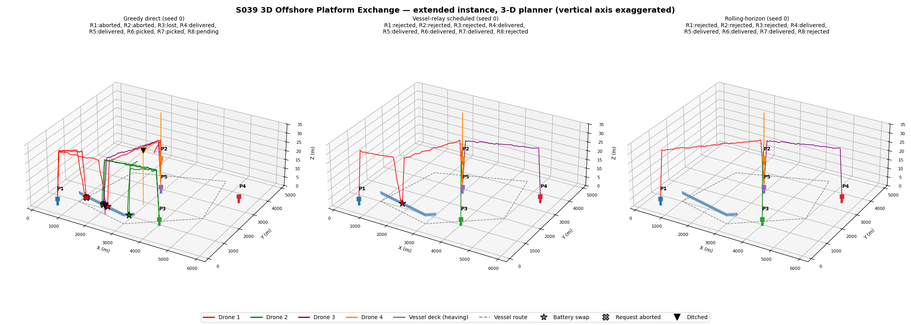
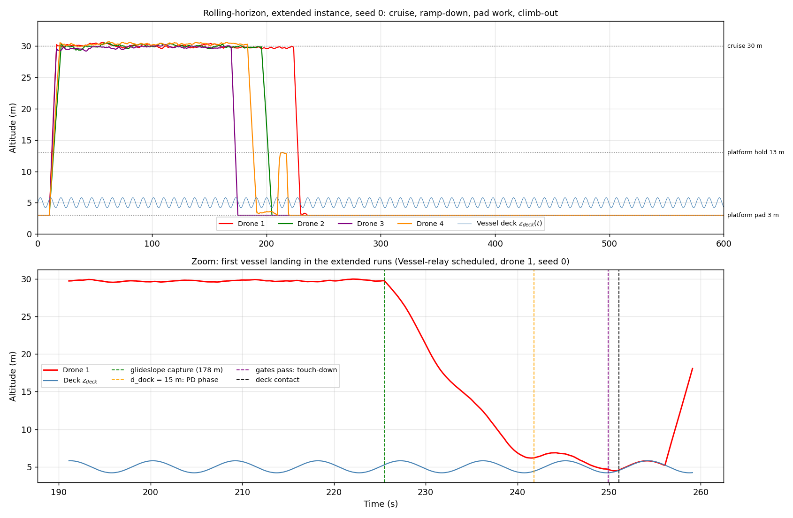
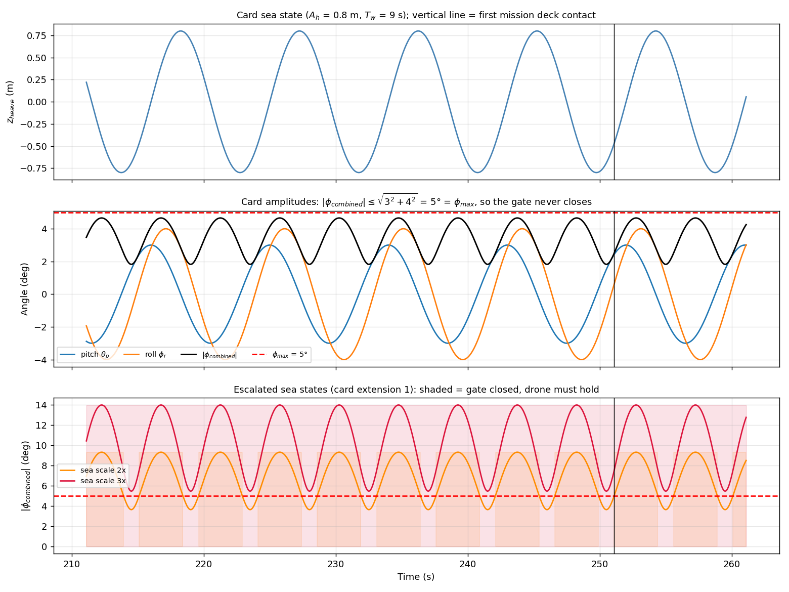
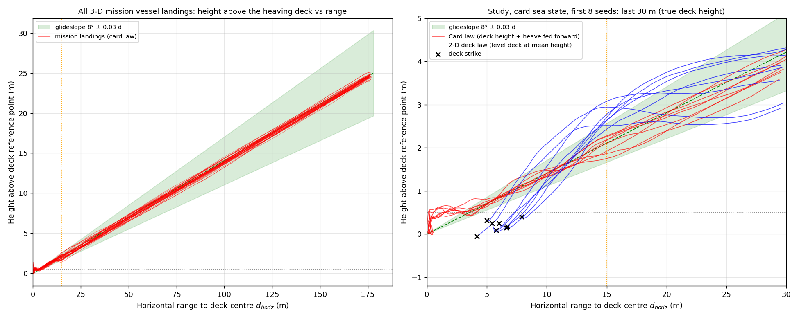
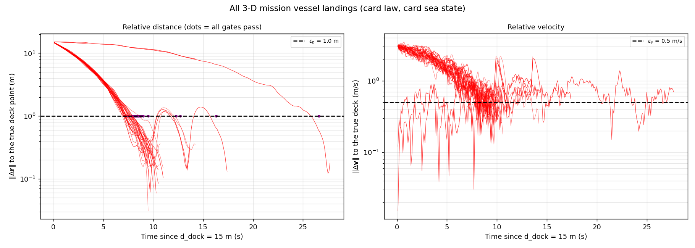
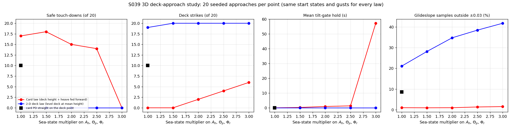
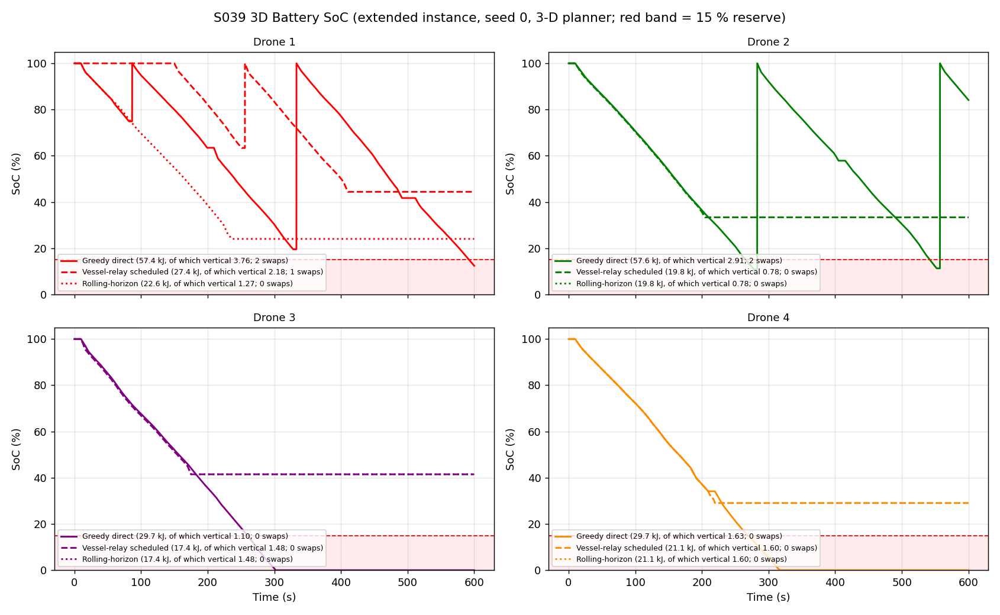
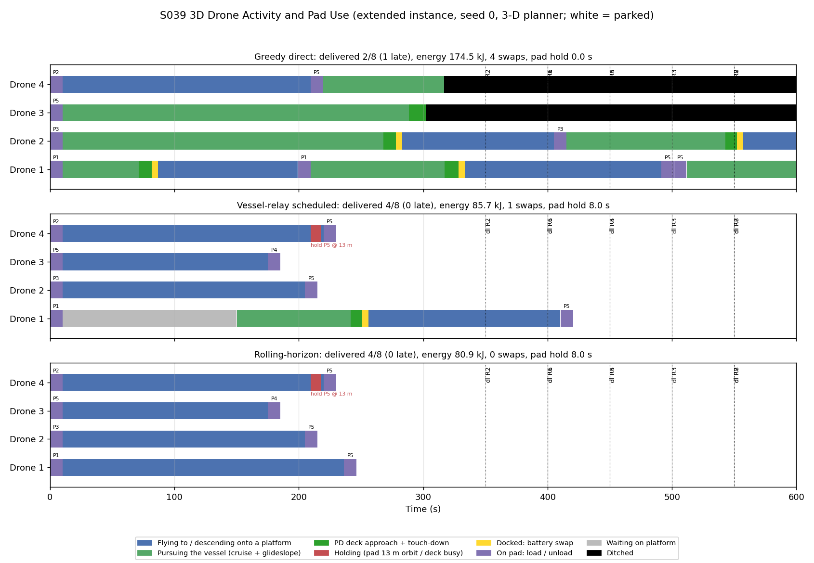
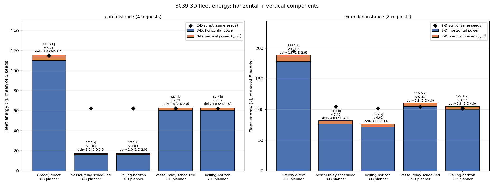
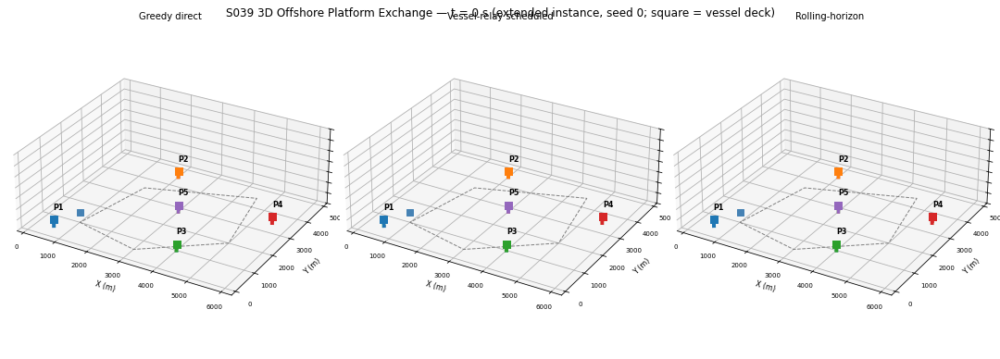

# S039 3D Offshore Platform Exchange

**Domain**: Logistics & Delivery | **Difficulty**: ⭐⭐⭐ | **Status**: ✅ Completed

---

## Problem Definition

**Setup**: the fixed 2D S039 mission flown in true 3D. 4 drones carry cargo between 5 offshore platforms in a 6 × 6 km sea area. A support vessel sails the card's looping route at 4 m/s and offers battery swaps on a single deck. The wind is the 2D mean (4.0, 1.5) m/s plus the same horizontal Dryden gust, and now also a vertical Dryden gust. The 2D strategies (Greedy direct, Vessel-relay scheduled, Rolling-horizon), the card instance (R1–R4) and the extended instance (R1–R8) are unchanged.

What 3D adds:

- **Altitude profile**: drones cruise at 30 m. They ramp down to the 3 m platform pads over the last 100 m of a leg and climb out over the first 100 m. A drone that finds a pad busy circles it at 13 m.
- **Moving, tilting deck**: the vessel deck heaves (0.8 m), pitches (3°) and rolls (4°) with a 9 s wave period. The drone descends an 8° glideslope referenced to the deck, switches to the card's 3D moving-deck PD law inside 15 m, and holds 0.5 m above the pad. It touches down only when it is within 1 m and 0.5 m/s of the deck **and** the combined deck tilt is below 5°.
- **Vertical energy**: the power model adds $k_{vert} v_z^2$.

**Key questions**:

1. Does the drone really need the deck height and heave fed forward (the card's guidance law), or is the 2D assumption of a level deck at its mean height good enough?
2. Does the tilt gate make drones wait?
3. Do the 3D overheads (climbs, glideslope, deck approach) change which requests are feasible and how much energy the strategies use?

---

## Mathematical Model

### Deck motion and frames

$$\mathbf{p}_{deck}(t) = \begin{bmatrix} p_{v,x}(t) \\ p_{v,y}(t) \\ z_{ref} + A_h \sin(\omega_w t + \phi_h)\end{bmatrix},\quad
\theta_p = \Theta_p \sin(\omega_w t + \phi_p),\quad \phi_r = \Phi_r \sin(\omega_w t + \phi_r^{(0)})$$

The deck orientation is $R_{ws} = R_z(\psi_v)R_y(\theta_p)R_x(\phi_r)$. The deck normal is $\hat{\mathbf{n}} = R_{ws}\hat{\mathbf{z}}$, and the ship-body coordinates of the drone are $\mathbf{q}^s = R_{ws}^T(\mathbf{p} - \mathbf{p}_{deck})$. The 3D card had the heading and tilt rotations in the wrong order; the card is corrected. The drone is over the 2 × 2 m pad when $|q^s_x|, |q^s_y| < 1.0$ m. The deck surface is the plane through $\mathbf{p}_{deck}$ with normal $\hat{\mathbf{n}}$, 20 m long and 10 m wide. Every drone position, at every step and in every mode (approach, docked, swap, take-off, cruise, wreck), is asserted to be on or above this plane whenever the drone is over the deck, in the missions and in the deck-approach study. An independent post-hoc check recomputes the plane from the card formulas for every logged position of all 50 mission runs: 9774 samples over the deck, none below it.

**Tilt gate**: $|\phi_{combined}| = \sqrt{\theta_p^2 + \phi_r^2} < \phi_{max} = 5°$. For any phases, $|\phi_{combined}| \le \sqrt{\Theta_p^2 + \Phi_r^2} = \sqrt{3^2+4^2} = 5°$, so **at the card sea state the gate can never close**. The script prints this bound, and the card now notes it. The gate only binds when the sea state is escalated (card extension 1).

### Approach to the vessel

1. **Pursuit** (as in 2D): the drone flies to the predicted intercept point. Within the braking zone its closing speed relative to the vessel is capped at $\sqrt{V_{dock}^2 + 2a_{dec}(d - d_{dock})}$, so it reaches $d_{dock}$ at about 3 m/s.
2. **Glideslope**: $z_{cmd} = \min\bigl(z_{cruise},\; z_{deck,est}(t) + d_{horiz}\tan\gamma_{gs}\bigr)$. It meets the cruise altitude at $d = (30-5)/\tan 8° = 177.9$ m. The altitude loop is $v_z = \dot z_{cmd} + K_z(z_{cmd} - z)$, limited to 5 m/s, and the drone moves as $\dot z = v_z + \xi_z$.
3. **PD phase** ($d \le d_{dock}$ = 15 m), using the card law $\mathbf{u} = -K_p\Delta\mathbf{r} - K_d\Delta\mathbf{v} + \ddot{\mathbf{p}}_{ref}$ with the 2D card gains $K_p$ = 1.8, $K_d$ = 1.2. Acceleration is limited to 4 m/s². $\Delta\mathbf{r}$ and $\Delta\mathbf{v}$ are taken to a **glide reference**: deck + horizontal offset $\mathbf{o}(t)$ + height $\max(|\mathbf{o}|\tan\gamma_{gs}, 0.5\text{ m})$.
   - $\mathbf{o}(t)$ is a cubic Hermite curve. It starts from the drone's offset and relative velocity at $d_{dock}$, and reaches zero offset with zero relative velocity after $T = 2d_0/v_0$ (clipped to 3–30 s).
   - The reference velocity and acceleration come from finite differences, as the card prescribes.
   - The card's literal form, PD straight to the deck point, is run as an ablation.
4. **Touch-down**: when $\|\Delta\mathbf{r}\| < \epsilon_p$, $\|\Delta\mathbf{v}\| < \epsilon_v$ (both measured to the true deck), the drone is over the pad and the tilt gate is open, the reference descends at 0.3 m/s until the drone meets the deck plane.
   - A **safe touch-down** is a commanded contact with a normal impact speed below $\epsilon_v$ = 0.5 m/s.
   - A contact before the touch-down command is a **deck strike**.
   - In the missions, a deck strike or a touch-down at or above $\epsilon_v$ is not accepted. The drone **goes around**: it climbs back to the 0.5 m hover at least 2 m/s faster than the deck rises, then waits for the gates again. Only a safe touch-down docks (asserted). The go-around's time and energy are flown and charged like any other flight. The deck-approach study keeps a single attempt per approach, so its "safe" count measures first attempts.

**Glideslope error** (evaluation only, against the true heaving deck): $\varepsilon_{gs} = (z - z_{deck} - d\tan\gamma_{gs})/d$ for 3.56 m ≤ d ≤ 177.9 m. Below 3.56 m the hover floor replaces the glideslope.

**Guidance laws compared** (same reference construction):

- **Card law**: $z_{deck,est}$ includes heave, and the finite-difference reference acceleration includes the heave acceleration.
- **2D deck law**: $z_{deck,est} = z_{ref}$, the level deck of the 2D model. Gates and contacts are still evaluated against the true deck.

### Energy

$$\dot E = -P_{cruise} - k_{wind}\|\mathbf{w}_{xy}\|^2 - k_{vert} v_{z}^2$$

Here $v_z$ is the commanded (air-relative) vertical speed. The horizontal part is the 2D power model. Vertical gust: $\xi_{z,k+1} = a\xi_{z,k} + \sigma_{g,z}\sqrt{1-a^2}\,\eta$ with $a = e^{-V_a\Delta t/L_{g,z}}$, which is the discrete form of the card's first-order Dryden filter.

### 3D planner

The planner is a copy of the 2D planner. Each leg costs the 2D mean-wind leg plus vertical terms:

- a climb-out ramp of $k_{vert}\Delta z^2 V_a / d_{ramp}$ (437 J for 27 m);
- a platform descent ramp (437 J);
- for a vessel leg, a calibrated approach overhead instead of the descent ramp. It is 11.86 s and 1339 J, from 20 gust-free card-law approaches (`calibrate_overhead`).

The 15 % energy reserve is unchanged.

---

## Key Parameters

| Parameter | Value |
|-----------|-------|
| All 2D S039 parameters | unchanged, imported from the 2D script: 4 drones, 5 platforms, $V_a$ 12 m/s, vessel 4 m/s, $E_{full}$ 29.74 kJ, reserve 15 %, $P_{cruise}$ 80 W, $k_{wind}$ 0.8, mean wind (4.0, 1.5) m/s, $\sigma_g$ 1.2 m/s, $L_g$ 200 m, $d_{dock}$ 15 m, $R_{hold}$ 30 m, swap 5 s, pad handling 10 s, Δt 0.1 s, $T_{max}$ 600 s, replan 30 s, 5 gust seeds |
| Cruise altitude / platform pad / mean deck height | 30.0 m / 3.0 m / 5.0 m |
| Heave / pitch / roll amplitude, wave period | 0.8 m / 3.0° / 4.0°, 9.0 s |
| Tilt gate $\phi_{max}$ | 5.0° |
| Glideslope $\gamma_{gs}$ / tolerance $\varepsilon_{gs,max}$ | 8.0° / 0.03 |
| Platform ramp distance / holding altitude | 100 m / 13 m (pad + 10 m) |
| Vertical gust $\sigma_{g,z}$ / $L_{g,z}$ | 0.4 m/s / 100 m |
| $k_{vert}$ | 5.0 W·s²/m² |
| Pad half-dimensions | 1.0 × 1.0 m |
| $\epsilon_p$ / $\epsilon_v$ / $K_p$ / $K_d$ (2D card) | 1.0 m / 0.5 m/s / 1.8 / 1.2 |
| *Added:* wave phases $\phi_h$, $\phi_p$, $\phi_r^{(0)}$ | 0, π/2, π/4 |
| *Added:* vertical speed limit / altitude gain $K_z$ | 5.0 m/s / 1.5 s⁻¹ |
| *Added:* PD acceleration limit | 4.0 m/s² |
| *Added:* braking $V_{dock}$ / $a_{dec}$ | 3.0 m/s / 1.0 m/s² |
| *Added:* hover height over the pad / touch-down descent rate | 0.5 m / 0.3 m/s |
| *Added:* vessel deck size (for contact checks) | 20 × 10 m |
| *Added:* approach study | 20 seeded approaches per law and sea state, starting 400 m from the vessel at 30 m on a random bearing at a random time; time-out 150 s; sea-state multipliers 1.0, 1.5, 2.0, 2.5, 3.0 |
| Animation | 151 frames (every 40th step of 6001), 15 fps |

### Deviations from the scenario card

| Card | Implementation | Reason |
|------|----------------|--------|
| PD law applied to the deck point from $d_{dock}$ | PD law tracks a glide reference that brings the offset to zero with zero relative velocity (Hermite, $T = 2d_0/v_0$) | Applied straight to the deck point from 15 m, the card gains ($\zeta = K_d / 2\sqrt{K_p}$ = 0.45) overshoot and strike the deck in 10 of 20 approaches (ablation below). The glide reference keeps the card gains and the finite-difference feed-forward. |
| Drone reaches $d_{dock}$ at full pursuit speed (2D) | closing speed capped by braking ($V_{dock}$ 3 m/s, $a_{dec}$ 1 m/s²) | Without braking the drone enters the PD phase at about 11 m/s relative and cannot stop within 15 m at 4 m/s². During braking the drone holds its commanded ground velocity, so the horizontal gust does not act on it there. |
| $\hat{\mathbf{n}} = R_x R_y \hat{\mathbf{z}}$; $R_{sb} = R_z^T R_x^T R_y^T$; grid test $\lvert q\rvert < \ell/2$ | $R_{ws} = R_z(\psi_v)R_y(\theta_p)R_x(\phi_r)$, $R_{sb} = R_{ws}^T$; $\lvert q\rvert < \ell$ | Card math fixed: pitch must be about the ship's beam axis, and ℓ are already half-dimensions. The 3D card is corrected. |
| Tilt gate makes the drone hold for a near-level deck | never binds at the card amplitudes (bound 5° = $\phi_{max}$); tested with escalated sea states | Card arithmetic, now noted on the card. |
| Glideslope "inside $d_{dock}$" | glideslope from 177.9 m, where it meets the cruise altitude | At 15 m the glideslope is only 2.1 m above the deck, so the 25 m descent has to start earlier. The card is annotated. |
| — | hover 0.5 m over the pad, touch-down at 0.3 m/s, safe if impact < $\epsilon_v$ | The card gives no touch-down kinematics. The hover height must stay below $\epsilon_p$ = 1 m. |
| Wave phases unspecified | 0, π/2, π/4 | The tilt bound holds for any phase. The escalated-sea results depend on the phases; with these, the minimum tilt at 3× is 5.47°, so the gate never opens (see Results). |
| "Deck-relative approach path $q^s_x$ vs $q^s_z$" | height above deck vs horizontal range | Drones approach from any bearing, so $q^s_x$ alone is not the approach axis. |
| Planner unchanged from 2D | 3D planner charges climbs, descents and a calibrated approach overhead; the 2D planner is kept as an ablation | Needed for a fair use of the 15 % reserve in 3D. |
| — | a downdraft at take-off or arrival cannot push a drone below its pad; the pad holds it (5 such steps in all runs) | ground-contact constraint |
| — | a drone taking off from the heaving deck after a swap, whose climb is slower than the deck's rise plus a downdraft, is carried up by the deck (35 steps with the 3D planner, 13 with the 2D planner) | deck-contact constraint; the previous version let such drones dip up to 0.163 m below the deck plane |
| — | a drone that empties its battery ditches and falls at 5 m/s to the sea; above the vessel deck it comes to rest on the deck (never through it) until the vessel has moved on, then falls to the sea | no flying on an empty battery (asserted); the wreck is not carried by the vessel |
| Touch-down "when all gates pass" | in missions, a strike or an impact ≥ $\epsilon_v$ = 0.5 m/s triggers a go-around (climb at ≥ 2 m/s relative to the deck back to the 0.5 m hover, then retry the gates); only safe touch-downs dock | The previous version docked every contact and counted 6 landings at 0.50–0.68 m/s as docked, which the study's own safe rule rejects. The 2 m/s climb rate is added. |
| — | an idle drone with nothing queued after a swap flies to the nearest platform | In 2D it hovered for free at the vessel's old position. |
| Approach plots per landing | the study uses 20 seeded approaches per law and sea state | The mission has only 42 vessel landings, all at the card sea state. |

---

## Implementation

```bash
conda activate drones
python src/02_logistics_delivery/3d/s039_3d_offshore_platform.py
```

The script imports the fixed 2D script for its constants, wind model, vessel route, planner and baseline runs. The 2D baseline is re-run on the same seeds. Horizontal gusts use the 2D streams (`default_rng([seed, k])`), so every model sees identical horizontal gusts. Vertical gusts use `default_rng([seed, k, 1])`.

The script asserts these invariants:

- no flight on an empty battery;
- nobody below sea level or inside a platform;
- nobody below the vessel deck surface while over the 20 × 10 m deck (every step, every mode; the post-hoc check finds a minimum clearance of 0.000 m, i.e. drones resting on the deck);
- no step longer than 2.5 m.

Runtime ≈ 4–5 min (250–292 s; calibration, 220 approaches, 50 3D missions, 30 2D missions, plots, GIF). Two runs gave byte-identical output and files.

---

## Results

### Model checks (printed)

- The glideslope meets the cruise altitude at 177.9 m. At $d_{dock}$ its tolerance is 0.03 × 15 = 0.45 m, smaller than the 0.8 m heave. A level-deck reference therefore violates it at heave peaks whenever d < 26.7 m.
- Tilt gate closed for 0.0 % of the wave period at the card sea state (tilt 1.82–4.66° with these phases), 54.8 % at 1.5×, 73.8 % at 2×, 87.7 % at 2.5× and 100.0 % at 3× (minimum tilt 5.47°).
- The small-angle tilt differs from the exact $\arccos(\cos\theta\cos\phi)$ by at most 4.16 arcsec.
- Heave-following costs only $k_{vert}(A_h\omega)^2/2$ = 0.78 W on average (heave rate amplitude 0.559 m/s). A 27 m platform ramp costs 437 J at $V_a$.

### Experiment 1 — deck approach: card law vs 2D level-deck law

Approaches start 400 m from the vessel at 30 m. There are 20 per point, with the same start states and gusts for every law.

| Law | Sea | Touch-downs | Strikes | Time-outs | **Safe** | Impact speed, m/s mean [min–max] | Glideslope samples outside ±0.03 | Mean tilt hold (max) | 15 m → contact |
|-----|-----|-------------|---------|-----------|----------|------------------------|-----------|-------------|---------|
| Card law | 1.0× | 20 | 0 | 0 | **17** | 0.32 [0.09–0.66] | 1.0 % | 0.0 s (0.0) | 10.0 s |
| 2D deck law | 1.0× | 1 | 19 | 0 | **0** | 0.49 [0.09–0.88] | 21.1 % | 0.0 s | 5.6 s |
| Card PD straight on deck point | 1.0× | 10 | 10 | 0 | **10** | 0.33 [0.01–0.69] | 8.6 % | 0.0 s | 6.9 s |
| Card law | 1.5× | 20 | 0 | 0 | **18** | 0.34 [0.09–0.67] | 0.9 % | 0.2 s (1.4) | 10.5 s |
| 2D deck law | 1.5× | 0 | 20 | 0 | **0** | 0.74 [0.13–1.04] | 28.2 % | 0.0 s | 5.3 s |
| Card law | 2.0× | 18 | 2 | 0 | **15** | 0.33 [0.14–0.59] | 1.0 % | 0.9 s (3.4) | 10.8 s |
| 2D deck law | 2.0× | 0 | 20 | 0 | **0** | 0.94 [0.17–1.35] | 34.8 % | 0.0 s | 4.9 s |
| Card law | 2.5× | 16 | 4 | 0 | **14** | 0.33 [0.02–0.56] | 1.3 % | 1.3 s (3.7) | 10.7 s |
| 2D deck law | 2.5× | 0 | 20 | 0 | **0** | 1.05 [0.15–1.61] | 38.5 % | 0.0 s | 4.2 s |
| Card law | 3.0× | 0 | 6 | 14 | **0** | 0.22 [0.03–0.31] | 1.5 % | 57.2 s (87.3) | 3.2 s |
| 2D deck law | 3.0× | 0 | 20 | 0 | **0** | 1.28 [0.21–1.96] | 41.8 % | 0.0 s | 3.9 s |

The paired result per seed counts seeds where only the card law is safe, only the 2D deck law is safe, both, or neither:

| Sea | Only card safe | Only 2D deck safe | Both | Neither |
|-----|-----|-----|-----|-----|
| 1.0× | 17 | 0 | 0 | 3 |
| 1.5× | 18 | 0 | 0 | 2 |
| 2.0× | 15 | 0 | 0 | 5 |
| 2.5× | 14 | 0 | 0 | 6 |
| 3.0× | 0 | 0 | 0 | 20 |

Minimum clearance above the deck plane before the touch-down command:

- card law: 0.269 m (1×), 0.149 m (1.5×), 0.084 m (2×), 0.011 m (2.5×), 0.014 m (3×);
- 2D deck law: 0.001, 0.013, 0.007, 0.006 and 0.028 m;
- direct PD: 0.003 m.

Impact speeds of strikes are included in the impact column; "safe" counts only commanded touch-downs below 0.5 m/s. The 15 m → contact time averages over approaches that made contact.

### Experiment 2 — missions (5 gust seeds; same horizontal gusts for 2D and 3D)

**Feasibility from a full battery at the origin at t = 0** (printed):

| Request | Direct energy 2D / 3D (share of a battery) | 2D planner | 3D planner |
|---------|-----|-----|-----|
| R1 P1→P4 (dl 400 s) | 117 % / 120 % | none by 600 s | none |
| R2 P3→P2 (dl 350 s) | 124 % / 127 % | none | none |
| **R3 P5→P1 (dl 500 s)** | 140 % / 142 % | **506 s, 1 swap** | **none** |
| R4 P2→P5 | 54 % / 57 % | 175 s | 175 s |
| R5 P1→P5 | 70 % / 73 % | 224 s | 224 s |
| R6 P3→P5 | 63 % / 66 % | 204 s | 204 s |
| R7 P5→P4 | 52 % / 55 % | 170 s | 170 s |
| R8 P1→P3 | 71 % / 74 % | 229 s | 229 s |

**Card instance** (mean of 5 seeds):

| Model | Strategy | Energy (kJ) | of which vertical | Delivered | On time | Swaps | Lowest SoC (min) | Runs below 15 % | Ditched | Requests delivered |
|-------|----------|-------------|-------------------|-----------|---------|-------|------------------|-----------------|---------|-----|
| 2D script | Greedy | 114.73 ± 4.18 | — | 2.0 | 1.6 | 3.0 | 11.6 % (5.6 %) | 4/5 | 0 | R3 5/5 (3 on time), R4 5/5 |
| 2D script | Relay / Rolling | 62.23 ± 3.99 | — | 2.0 | 1.4 | 1.0 | 14.4 % (7.3 %) | 2/5 | 0 | R3 5/5 (2 on time), R4 5/5 |
| 3D, 3D planner | Greedy | 115.19 ± 9.09 | 5.21 (4.5 %) | 1.6 | 1.4 | 2.4 | 2.1 % (0.0 %) | 5/5 | 3 | R3 3/5 (2 on time), R4 5/5 |
| 3D, 3D planner | Relay / Rolling | **17.16 ± 1.48** | 1.03 (6.0 %) | 1.0 | 1.0 | 0.0 | **42.3 % (34.1 %)** | **0/5** | 0 | R3 rejected, R4 5/5 |
| 3D, 2D planner | Relay / Rolling | 62.73 ± 8.26 | 2.32 (3.7 %) | 1.8 | 1.0 | 0.8 | 7.0 % (0.0 %) | **5/5** | 1 | R3 4/5 (**0 on time**), R4 5/5 |

**Extended instance** (mean of 5 seeds):

| Model | Strategy | Energy (kJ) | of which vertical | Delivered | On time | Swaps | Lowest SoC (min) | Runs below 15 % | Ditched | Requests delivered |
|-------|----------|-------------|-------------------|-----------|---------|-------|------------------|-----------------|---------|-----|
| 2D script | Greedy | 194.87 ± 1.10 | — | 2.6 | 2.0 | 5.4 | 0.0 % | 5/5 | 6 | R3 5/5, R4 5/5, R5 3/5 |
| 2D script | Relay | 104.42 ± 4.11 | — | 4.0 | 3.4 | 2.0 | 14.4 % (7.3 %) | 2/5 | 0 | R3–R6 5/5 (R3 2 on time) |
| 2D script | Rolling | 101.62 ± 4.32 | — | 4.0 | 3.4 | 1.0 | 14.4 % (7.3 %) | 2/5 | 0 | R3–R6 5/5 (R3 2 on time) |
| 3D, 3D planner | Greedy | 188.13 ± 14.06 | 10.03 (5.3 %) | 1.8 | 1.4 | 5.0 | 0.0 % | 5/5 | 9 | R3 3/5, R4 5/5, R5 1/5 |
| 3D, 3D planner | Relay | 81.44 ± 2.43 | 5.40 (6.6 %) | 4.0 | **4.0** | 1.0 | 34.4 % (29.0 %) | **0/5** | 0 | R4, R5, R6, **R7** 5/5, all on time |
| 3D, 3D planner | Rolling | **76.24 ± 2.60** | 4.62 (6.1 %) | 4.0 | **4.0** | 0.0 | 24.4 % (22.9 %) | **0/5** | 0 | R4, R5, R6, **R7** 5/5, all on time |
| 3D, 2D planner | Relay | 109.97 ± 8.85 | 5.36 (4.9 %) | 3.8 | 3.0 | 1.8 | 7.0 % (0.0 %) | 5/5 | 1 | R3 4/5 (0 on time), R4–R6 5/5 |
| 3D, 2D planner | Rolling | 104.78 ± 8.89 | 4.57 (4.4 %) | 3.8 | 3.0 | 0.8 | 7.0 % (0.0 %) | 5/5 | 1 | R3 4/5 (0 on time), R4–R6 5/5 |

**Go-arounds** (sum over 5 seeds): Greedy 4 (card) and 5 (extended); 3D-planner relay 0 and 1, rolling 0 and 0; 2D-planner relay 2 and 3, rolling 2 and 2. Deck strikes: 0 in every mission.

Per seed, the 3D-planner relay and rolling delivered the same number as 2D on the extended instance and 1 fewer on the card instance. On time they did better than 2D in 3 of 5 extended seeds (+1 each) and worse in 2 of 5 card seeds (−1 each).

**Vessel landings in all 3D missions** (3D planner, both instances, 5 seeds):

- 42 docked landings, all safe: impact speed 0.35 [0.12–0.49] m/s, 0 at or above $\epsilon_v$.
- 10 go-arounds in 6 approaches (at most 2 in one approach). All 10 were hard touch-downs at 0.61 [0.50–0.68] m/s; there were no deck strikes. Per seed: Greedy [2, 0, 0, 0, 2] (card) and [2, 0, 0, 1, 2] (extended); relay [0, 0, 0, 0, 1] on the extended instance; all others 0.
- 6 approaches passed $d_{dock}$ but never docked: all 6 drones (all Greedy) ran out of battery above the deck, 2 of them after a go-around. None was still in progress at $T_{max}$.
- 15 m → contact took 11.4 [8.4–27.8] s, including go-arounds. A drone had to wait beside a busy deck 4 times. 2 landings entered the PD phase at under 1 m/s closing speed, i.e. from that wait, and took 27.8 s, because $T = 2d_0/v_0$ with $v_0$ floored at 1 m/s. The other landings took 8.4–17.5 s.
- Total tilt-gate hold: 0.0 s.
- Glideslope samples outside ±0.03: 199/9696 (2.1 %), max $|\varepsilon|$ 0.060.
- Minimum deck clearance before the touch-down command: 0.132 m.

### Key findings

- **The deck height must be fed forward; the 2D level-deck assumption fails.**
  - At the card sea state the card law lands safely in 17 of 20 approaches.
  - The level-deck law strikes the deck in 19 of 20 and is never safe. In 17 of 20 paired seeds only the card law was safe, and never the reverse.
  - The level-deck law hovers 0.5 m above the *mean* deck, so the 0.8 m heave crest, plus the tilted deck under the drone, reaches it.
  - The level-deck law also violates the glideslope in 21.1 % of samples against 1.0 % for the card law, as the ±0.45 m tolerance at 15 m predicts.
- **The card's gains need a glide reference.** Applying the PD law straight to the deck point from 15 m gives 10 strikes out of 20 at the card sea state. The underdamped gains ($\zeta$ = 0.45) overshoot the hover height.
- **The tilt gate never binds at the card sea state**, which is card arithmetic: the 3° and 4° amplitudes cap the combined tilt at exactly 5°. Over 42 mission landings the hold time is 0.0 s.
  - Escalating the sea state makes it bind: mean hold 0.2 s at 1.5×, 0.9 s at 2× and 1.3 s at 2.5×.
  - At 3× the gate is closed all the time with the chosen phases: 14 time-outs and 6 strikes, 0 safe landings.
  - The card law also starts to strike at 2× (2 strikes) and 2.5× (4 strikes). The likely cause is that the deck now moves faster than the hover can follow: the heave amplitude reaches 1.6–2.0 m against the 0.5 m hover margin, the heave rate 1.1–1.4 m/s, and the deck plane under a drone offset from the centre tilts by up to 9–12°.
- **The 3D overheads make R3 infeasible.** Two costs eat the 2D plan's thin energy margin on the P5 → vessel leg:
  - the climb-out (437 J);
  - the deck approach (11.86 s braking + PD convergence, 1339 J in total, 4.5 % of a battery).

  The 3D planner therefore rejects R3. In the extended instance it gives D3 R7 instead, which the 2D planner had always rejected.
  - Result: relay and rolling deliver 4.0 / 8, all on time, against 3.4 on time in 2D. They use 81.44 and 76.24 kJ against 104.42 and 101.62 kJ in 2D, but this is **not a like-for-like energy saving**: the 3D plans serve R4–R7, the 2D plans R3–R6. The dropped R3 (P5 → P1 with a vessel swap) needs 140–142 % of a battery, while the added R7 needs 52–55 %. The like-for-like comparison is the 2D planner's request set flown in 3D (next point).
  - On the card instance they deliver 1 instead of 2, because R3 is dropped.
- **Flying the 2D plan in the 3D world breaches the reserve every time.** With the 2D planner, the drone carrying R3 reaches the vessel with almost no reserve. The lowest SoC falls to 7.0 % on average in 5 of 5 runs.
  - In seed 3 (on both instances) that drone touches down hard (≥ $\epsilon_v$), goes around, and its battery runs out: it ditches over the deck and R3 is lost.
  - In the other 4 seeds R3 is delivered, late every time.
  - On the same request set (R3–R6) as the 2D script, the 3D world costs 109.97 / 104.78 kJ (relay / rolling) against 104.42 / 101.62 kJ in 2D, with 0.2 fewer deliveries on average.
  - The earlier version accepted that hard touch-down as a dock and swapped the battery, so it reported R3 delivered 5/5 with 0 ditches.
- **Greedy gets worse in 3D.** It ditches 3 drones on the card instance (2D: 0) and 9 on the extended instance (2D: 6). It also needs 9 of the 10 go-arounds in the 3D-planner missions, because its drones reach the vessel nearly empty. It delivers 1.6 and 1.8 requests against 2.0 and 2.6 in 2D. Its emergency rule is the 2D one with 3D leg costs. It still does not budget the vessel approach itself, so the extra 3D cost shows up as more empty batteries.
- **Vertical energy is a small share.** It is 3.7–6.6 % of fleet energy (1.03–10.03 kJ). Heave-following is negligible: 0.78 W on average. The large effects of 3D come from feasibility and landing safety, not from the climb energy itself.

---

## Output Files

### 3D Sea Area

Extended instance, seed 0. The vertical axis is exaggerated; stubs are the 3 m platforms, and the blue line is the heaving vessel deck:



### Altitude Profiles

Top: rolling-horizon altitudes. Drones cruise at 30 m and ramp to 3 m pads; drone 4 circles P5 at 13 m while the pad is busy. Bottom: the first vessel landing (relay, drone 1), showing glideslope capture at 178 m, the PD phase from 15 m, the hover over the heaving deck, touch-down, the 5 s swap riding the deck, and the climb-out:



### Heave and Tilt

Card sea state around the first mission deck contact. The combined tilt stays below 5° (max 4.66°). Bottom: at 2× and 3× the gate is closed in the shaded intervals, and at 3× it is closed all the time:



### Deck-Relative Approach Paths

Left: all 42 docked mission landings track the glideslope band against the true heaving deck. Right: the study at the card sea state, first 8 seeds. The card law (red) settles at the 0.5 m hover; the level-deck law (blue) strikes the deck (×) at 4–8 m range:



### Convergence to the Deck

$\|\Delta\mathbf{r}\|$ and $\|\Delta\mathbf{v}\|$ to the true deck after $d_{dock}$, for every docked mission landing. Dots mark where all gates pass. The 2 slow approaches started from rest beside a busy deck. The curves that climb back above 1 m after 10 s are go-arounds:



### Sea-State Sweep

Safe touch-downs, strikes, tilt-gate hold and glideslope violations against the sea-state multiplier. The black square is the card PD applied straight to the deck point:



### Battery SoC

Extended instance, seed 0, 3D planner; the legend gives each drone's vertical energy:



### Activity and Pad Use

Extended instance, seed 0. Pad labels sit above the load/unload bars, and hold annotations give the 13 m orbit altitude:



### Energy Comparison

Stacked horizontal and vertical energy for the 3D runs, with the 2D script on the same seeds (◆) and the delivered counts:



### Animation

Extended instance, seed 0, all three strategies (151 frames):



---

## Extensions

1. Predict the deck motion (AR(2) or Kalman, card extensions 2 and 5) to raise the hover margin and time the touch-down at heave troughs. This would cut the hard touch-downs that now force go-arounds (10 in the missions).
2. Random-phase or spectral (JONSWAP) seas instead of one sinusoid, so the 3× result no longer hinges on the chosen phase offsets.
3. Let the planner reserve the vessel deck in time, since drones waiting beside a busy deck take up to 27.8 s to land; a faster glide reference from rest would also help.
4. Sweep $\gamma_{gs}$ in [4°, 15°] (card extension 3) against the vertical gust.

---

## Related Scenarios

- 2D card: [S039 Offshore Platform Exchange](../../../../scenarios/02_logistics_delivery/S039_offshore_platform_exchange.md)
- 3D card: [S039 3D Upgrade — Offshore Platform Exchange](../../../../scenarios/02_logistics_delivery/3d/S039_3d_offshore_platform.md)
- Moving deck: [S023 3D Upgrade — Moving Landing Pad](../../../../scenarios/02_logistics_delivery/3d/S023_3d_moving_landing_pad.md), [S023 Moving Landing Pad](../../../../scenarios/02_logistics_delivery/S023_moving_landing_pad.md)
- Wind: [S024 3D Upgrade — Wind Compensation](../../../../scenarios/02_logistics_delivery/3d/S024_3d_wind_compensation.md)
- Relay concept: [S027 3D Upgrade — Aerial Refueling Relay](../../../../scenarios/02_logistics_delivery/3d/S027_3d_aerial_refueling.md)
