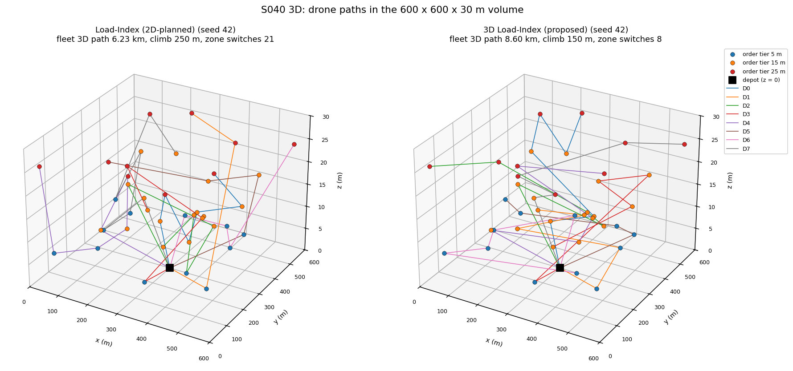
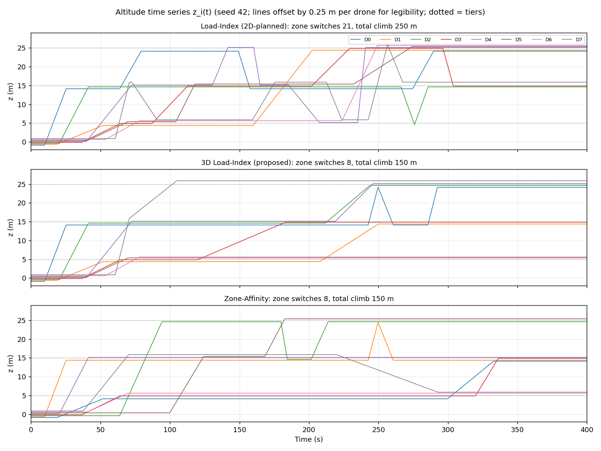
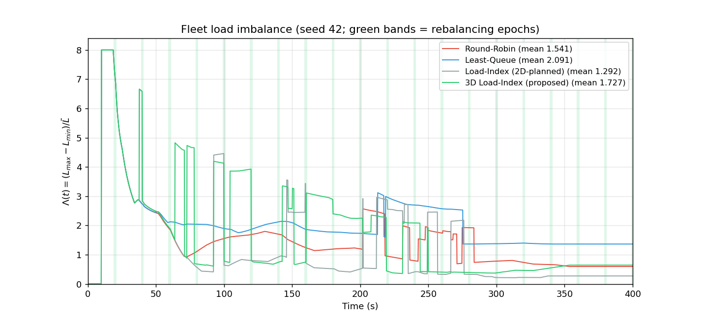
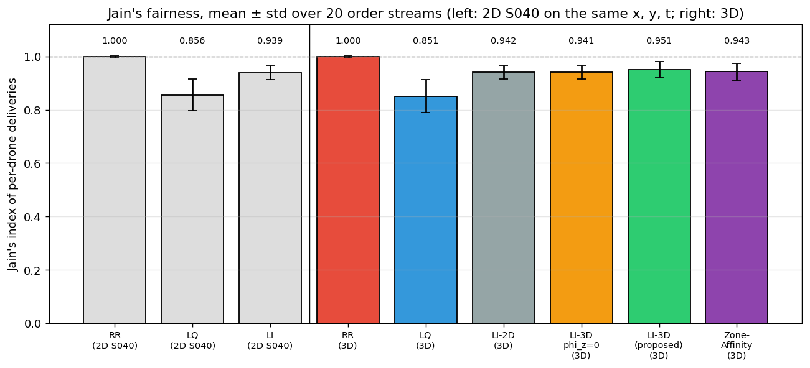
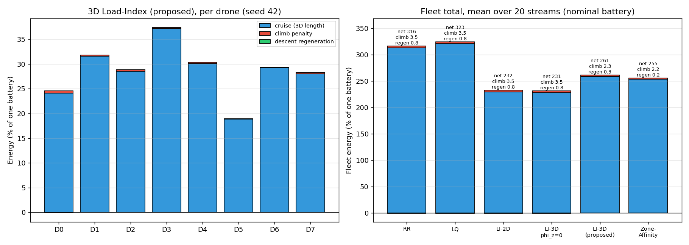
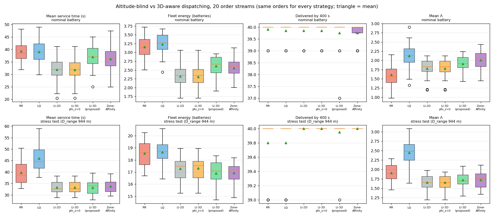
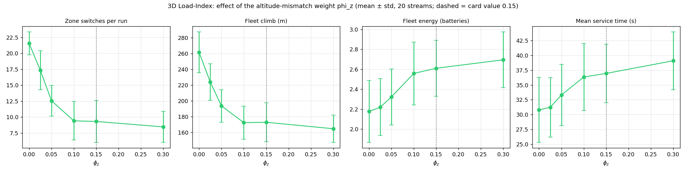
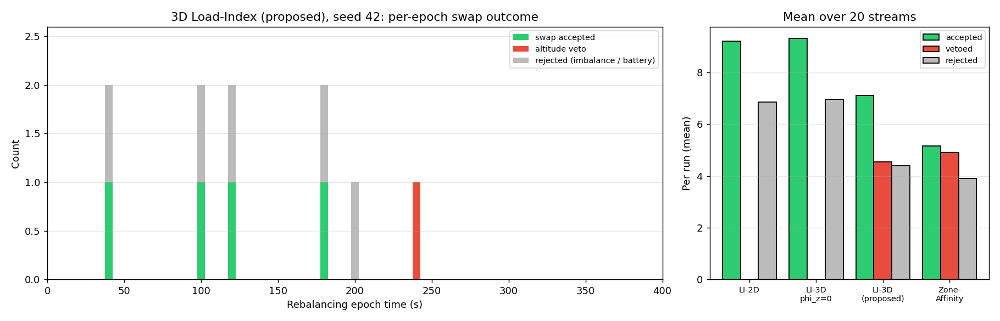
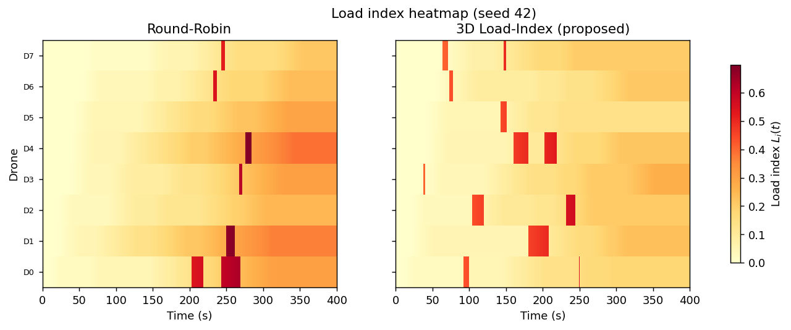
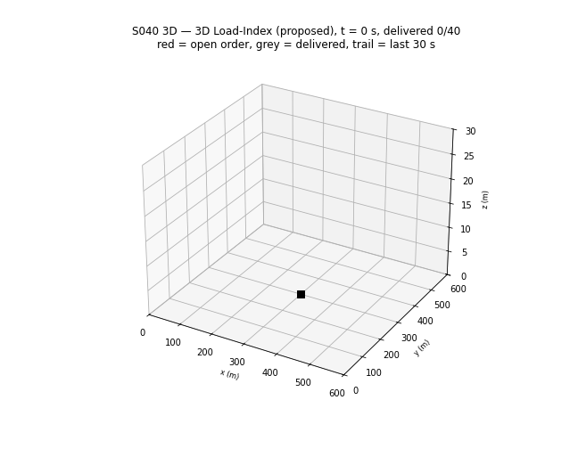

# S040 3D Fleet Load Balancing

**Domain**: Logistics & Delivery | **Difficulty**: ⭐⭐⭐ | **Status**: ✅ Completed

---

## Problem Definition

**Setup**: 8 delivery drones work from one ground depot at (300, 300, 0) m with 2 charging pads, over a 600 × 600 × 30 m urban volume. 40 orders appear at uniformly random times in [0, 320] s; the horizon is 400 s. Every order has a horizontal location and a **delivery tier** $z_o \in \{5, 15, 25\}$ m (ground hand-off, mid-floor, rooftop), each with probability 1/3.

The horizontal stream (x, y, arrival time) is drawn exactly as in the fixed [2D S040](../../s040_fleet_load_balancing/README.md), so both versions see the same orders. The tiers come from a separate generator, `default_rng(seed + 1000)`.

Each drone works through its own FIFO queue and flies straight 3D legs at 8 m/s (3D speed). It returns to the depot, descending to z = 0, only to recharge. Climbing costs extra energy and descending returns a little.

**Key question** (card): does a dispatcher that sees altitude, through 3D distances, a 3D energy model, an altitude-mismatch penalty $\phi_z$ and a swap veto, balance the fleet better and use less energy than one that ignores altitude?

**Strategies.** The card asks for strategies 1, 2, 5 and 6. Strategies 3 and 4 are added to separate the effect of each 3D ingredient.

| # | Strategy | Assignment | 3D ingredients |
|---|----------|-----------|----------------|
| 1 | **Round-Robin** (RR) | order $j$ → drone $j \bmod 8$ | none |
| 2 | **Least-Queue** (LQ) | fewest unfinished orders, ties → lowest index | none |
| 3 | **Load-Index, 2D-planned** (LI-2D) | 2D S040 balancer: horizontal marginal distance and horizontal battery check | none (what the 2D dispatcher would do in this 3D world) |
| 4 | **Load-Index 3D, $\phi_z$ = 0** (LI-3D $\phi_z$=0) | 3D marginal distance, 3D energy in the battery check | 3D geometry and energy only, no zone terms |
| 5 | **3D Load-Index** (proposed) | as 4, plus $\phi_z$ = 0.15 mismatch term and the 15 m swap veto | all of the card's terms |
| 6 | **Zone-Affinity** | as 5, but each drone has a fixed preferred tier (D0 5 m, D1 15 m, D2 25 m, D3 5 m, …; 3/3/2 drones) instead of its last delivery altitude | card's strategy 4 |

All six are flown and scored in the same 3D world on the same order streams. The drone-level safety rules use the true 3D energy model for every strategy; only the dispatcher's planning model differs. These rules are the pre-departure check, the card's in-flight return rule and the idle-recharge rule.

---

## Mathematical Model

**3D energy per leg** (card, with the missing $\alpha$ restored; see Deviations):

$$\Delta s_{net} = k\left(d^{3D} + \gamma\,\max(\Delta z, 0) - \eta_{regen}\,\max(-\Delta z, 0)\right), \qquad k = \frac{\alpha (m_{body}+m_p) g}{E_{cap}} = 2.6487\times10^{-4}\ \text{SoC/m}$$

$D_{range} = 1/k$ = 3775 m of level flight. Climbing 1 m costs an extra $\gamma k$ (half a metre of cruise), and descending 1 m returns $\eta_{regen} k$. The script integrates this per 0.2 s step along the straight 3D leg and asserts that SoC never drops below 0.

**Load index and imbalance** (card):

$$L_i = 0.4\,w_i + 0.25\,\frac{f_i^{3D}}{1800} + 0.2\,(1-s_i), \qquad \Lambda(t) = \frac{L_{max}-L_{min}}{\bar L}$$

Here $w_i$ is the number of queued (not yet started) orders and $f_i^{3D}$ the cumulative 3D path length. The same $L_i$ and $\Lambda$ are used to report every strategy.

**Assignment** (load-index strategies): $k^* = \arg\min_{i \in \mathcal A}\,[L_i + \Delta L_i]$, where

$$\Delta L_i = 0.4 + 0.25\,\frac{d(\mathbf p_{last,i}, \mathbf q_o)}{1800} + \phi_z\,\frac{|z_o - z_i^{zone}|}{25}$$

- $d$ is the 3D distance, or the horizontal distance for LI-2D.
- $z_i^{zone}$ is the altitude of drone $i$'s most recent delivery, or its fixed preferred tier for Zone-Affinity.
- $\mathcal A$ holds the drones that are idle or flying and pass the battery check
  $s_i - \sum_{\text{legs}} k\,(d^{3D} + \gamma\,\Delta z^+) \ge \beta_{safe}$. The legs run over the route position → current order → queue → new order → depot. As in the card's formula, regeneration is not credited. LI-2D uses $k\,d^{2D}$ instead.

**Rebalancing** (every 20 s, at most 2 swaps): the last queued order of the most-loaded drone moves to the least-loaded available drone. The move is vetoed if $|z_o - z_{i^-}^{zone}| > 15$ m (strategies 5 and 6). Otherwise it is accepted only if it passes the receiver's battery check and lowers $\Lambda$. The first failure ends the epoch, as in 2D.

**Return threshold** (card): $s_{min}^{3D} = k\,d^{3D}(\mathbf p_i, \text{depot}) + \gamma k \max(z_{depot} - z_i, 0) + \beta_{safe}$. The depot is on the ground, so the climb term is always 0.

**Jain's index** of per-drone deliveries: $\mathcal J = (\sum D_i)^2 / (N \sum D_i^2)$.

**Asserted invariants** (every step): order conservation; SoC ≥ 0; 0 ≤ z ≤ 30 m and x, y inside the volume; at most 2 drones charging, and only at the depot. At the end of each run, SoC bookkeeping (1 + charged − used = final SoC) is checked. On the recorded runs, every step is checked to be no longer than $v\,\Delta t$ = 1.6 m.

---

## Key Parameters

| Parameter | Value |
|-----------|-------|
| Fleet / charging pads | 8 drones / 2 pads |
| Orders | 40, arrival uniform in [0, 320] s, (x, y) uniform in [0, 600]² m (2D S040 draw) |
| Delivery tiers $z_o$ | 5 / 15 / 25 m, equal probability, `default_rng(seed + 1000)` |
| Volume ceiling (asserted) | 30 m |
| Depot | (300, 300, 0) m |
| Horizon / time step | 400 s / 0.2 s |
| Cruise speed | 8.0 m/s (3D) |
| Masses | body 1.5 kg + payload 0.3 kg |
| Discharge coefficient $\alpha$ | 1.5 × 10⁻⁵ 1/m → $k$ = 2.6487 × 10⁻⁴ SoC/m, $D_{range}$ = 3775 m |
| Climb penalty $\gamma$ / regeneration $\eta_{regen}$ | 0.5 / 0.2 (multiples of $k$ per metre of climb / descent) |
| Charge rate / safety reserve $\beta_{safe}$ | 0.20 $E_{cap}$/s / 0.05 |
| Load-index weights $(\phi_w, \phi_f, \phi_s, \phi_z)$ | (0.4, 0.25, 0.2, 0.15) |
| $F_{norm}^{3D}$ / $z_{max}$ | 1800 m / 25 m |
| Swap veto $\Delta z_{veto}$ | 15 m |
| Rebalancing period / max swaps per epoch | 20 s / 2 |
| On-time promise (from 2D) | 120 s from arrival to drop |
| Showcase stream / study | seed 42 / seeds 0–19 (20 streams) |
| Stress test (from 2D) | $\alpha$ = 6.0 × 10⁻⁵ 1/m → $k$ = 1.0595 × 10⁻³ SoC/m, $D_{range}$ = 944 m, same 20 streams |
| $\phi_z$ sweep (added) | 0, 0.025, 0.05, 0.1, 0.15, 0.3 (strategy 5 with veto, 20 streams) |
| No-rebalancing ablation (added) | strategy 4 with swaps switched off, 20 streams |
| Animation | strategy 5, seed 42, every 20th step → 101 frames at 10 fps, trail = last 30 s |

### Deviations from the scenario card

| Card | Implementation | Reason |
|------|----------------|--------|
| $\alpha$ = 1.5 × 10⁻⁴ 1/m, "range ~3560 m" | $\alpha$ = 1.5 × 10⁻⁵ 1/m, range 3775 m; card corrected | 1.5 × 10⁻⁴ gives 1/(1.5 × 10⁻⁴ × 1.8 × 9.81) = 377 m. The same fix was made in 2D S040. |
| Climb term $\gamma (m_{body}+m_p) g \max(\Delta z,0)/E_{cap}$ and regeneration $\eta (m_{body}+m_p) g\,\lvert\Delta z\rvert/E_{cap}$, without $\alpha$ | both multiplied by $\alpha$; card corrected (energy model, feasibility and return threshold) | With $E_{cap}$ = 1, the formula as written makes one 25 m climb cost 0.5 × 1.8 × 9.81 × 25 ≈ 221 batteries. The card's own parameter text ("extra fraction of cruise energy per m climbed") matches $\gamma k$. |
| $z_i^{zone}$ = altitude of the most recent delivery | before a drone's first delivery $z_i^{zone}$ is undefined: no $\phi_z$ term and no veto for that drone | not specified on the card. Using the depot's z = 0 would penalise every tier for fresh drones and veto all 25 m orders. |
| Zone-Affinity: "pre-assign each drone to a preferred altitude zone" | fixed tier D$i$ → tier $i \bmod 3$ (3/3/2 drones), used as $z_i^{zone}$ in the $\phi_z$ term and the veto | the card gives no split; 8 drones cannot be split evenly over 3 tiers |
| 4 strategies | 6 strategies, plus a $\phi_z$ sweep and a no-rebalancing ablation | LI-2D and LI-3D $\phi_z$=0 separate "3D geometry/energy" from "zone terms" |
| Imbalance plot: RR, LQ, 3D Load-Index | adds LI-2D | shows the altitude-blind balancer next to the proposed one |
| "3D vs 2D cost comparison" | all strategies flown in the same 3D world; "2D" means planned with horizontal distances (LI-2D). 2D S040, run on the same (x, y, t) streams, is only a reference in the Jain chart and the printout. | 2D S040 uses other load weights (0.5, 0.3, 0.2; $F_{norm}$ = 1888 m), so its $\Lambda$ is not comparable |
| Battery check credits nothing for descent | kept (conservative, as in the card's feasibility formula) | — |
| — | pre-departure check, idle-recharge rule (worst case: farthest corner at 25 m and home) and 120 s on-time promise, kept from 2D S040 and switched to the 3D energy model | the 2D fix needed the idle-recharge rule to avoid a stress-test deadlock |
| Charge rate 0.20 $E_{cap}$/s | kept | a full charge takes 5 s, which is unrealistically fast (inherited, as noted in 2D); it matters only in the stress test |
| RL dispatcher, wind layers, glide-slope model (extensions) | not implemented | out of scope |

---

## Implementation

```
src/02_logistics_delivery/3d/s040_3d_fleet_balancing.py
```

```bash
conda activate drones
python src/02_logistics_delivery/3d/s040_3d_fleet_balancing.py
```

The runtime is 175–223 s for 366 3D runs and 60 2D reference runs, plus plots and the GIF. These timings were measured while other simulations shared the CPU. Every random draw is seeded. Two runs gave byte-identical console output and byte-identical PNGs and GIF.

---

## Results

All numbers are from the console output. "Energy" is the fleet's net discharge in units of one full battery.

### Showcase stream (seed 42; tiers: 12 × 5 m, 18 × 15 m, 10 × 25 m)

| Strategy | Delivered (on time / late) | Mean / p95 / max service (s) | Energy (cruise / climb / regen) | 3D flight (km) | Climb (m) | Zone switches | Jain | Mean $\Lambda$ | Swaps / vetoes / rejects | Min SoC |
|----------|-----------|----------------|-------------|------|------|----|------|------|------|------|
| Round-Robin | 40 (40 / 0) | 40.2 / 69.8 / 72.2 | 3.271 (3.246 / 0.029 / 0.004) | 12.25 | 220 | 18 | 1.000 | 1.541 | – | 0.459 |
| Least-Queue | 40 (40 / 0) | 38.0 / 62.5 / 104.2 | 3.120 (3.094 / 0.033 / 0.006) | 11.68 | 250 | 21 | 0.862 | 2.091 | – | 0.423 |
| LI-2D | 40 (40 / 0) | **21.4** / **52.9** / **62.8** | **1.679** (1.650 / 0.033 / 0.004) | **6.23** | 250 | 21 | 0.943 | **1.292** | 4 / 0 / 4 | 0.761 |
| LI-3D $\phi_z$=0 | 40 (40 / 0) | **21.4** / **52.9** / **62.8** | **1.679** (1.650 / 0.033 / 0.004) | **6.23** | 250 | 21 | 0.943 | **1.292** | 4 / 0 / 4 | 0.761 |
| 3D Load-Index (proposed) | 40 (40 / 0) | 30.0 / 58.8 / 89.7 | 2.296 (2.277 / 0.020 / 0.001) | 8.60 | **150** | **8** | 0.990 | 1.727 | 4 / 1 / 5 | 0.626 |
| Zone-Affinity | 40 (40 / 0) | 32.9 / 70.9 / 111.2 | 2.361 (2.343 / 0.020 / 0.002) | 8.84 | **150** | **8** | 0.943 | 2.026 | 8 / 5 / 5 | 0.637 |

No strategy needs a recharge on seed 42. Per-drone deliveries:

- RR [5, 5, 5, 5, 5, 5, 5, 5]
- LQ [7, 6, 7, 6, 6, 4, 3, 1]
- LI-2D and LI-3D $\phi_z$=0 [6, 3, 5, 5, 6, 4, 4, 7]
- proposed [6, 5, 5, 5, 5, 4, 5, 5]
- Zone-Affinity [4, 6, 7, 4, 6, 5, 5, 3]

### 20 order streams, nominal battery (means; sd in brackets)

| Strategy | Delivered (open at 400 s) | Mean service (s) | p95 (s) | Energy | Climb energy / regen | Flight (km) | Climb (m) | Zone switches | Jain | Mean $\Lambda$ | Swaps / vetoes | Returns |
|----------|------|------|------|------|------|------|------|------|------|------|------|------|
| Round-Robin | 39.90 (0.10) | 39.3 (4.8) | 73.1 | 3.155 (0.329) | 0.035 / 0.008 | 11.81 | 261 | 21.5 | 1.000 | 1.607 | – | 0.05 |
| Least-Queue | 39.85 (0.15) | 39.1 (4.4) | 71.0 | 3.233 (0.311) | 0.035 / 0.008 | 12.10 | 267 | 21.8 | 0.851 | 2.125 | – | 0.35 |
| LI-2D | 39.85 (0.15) | 31.9 (5.5) | 71.5 | 2.318 (0.346) | 0.035 / 0.008 | 8.65 | 267 | 21.9 | 0.942 | 1.777 | 9.20 / 0 | 0 |
| LI-3D $\phi_z$=0 | 39.85 (0.15) | **31.8** (5.4) | **71.4** | **2.307** (0.335) | 0.035 / 0.008 | **8.61** | 262 | 21.4 | 0.941 | 1.776 | 9.30 / 0 | 0 |
| 3D Load-Index (proposed) | 39.75 (0.25) | 37.0 (4.9) | 77.8 | 2.610 (0.281) | 0.023 / 0.003 | 9.78 | 173 | 9.3 | 0.951 | 1.907 | 7.10 / 4.55 | 0 |
| Zone-Affinity | 39.75 (0.25) | 36.2 (5.5) | 75.4 | 2.554 (0.298) | 0.022 / 0.002 | 9.57 | **163** | **9.0** | 0.943 | 2.007 | 5.15 / 4.90 | 0 |

- **Lowest mean service time per stream**: LI-2D 13, Zone-Affinity 3, RR 1, LQ 1, LI-3D $\phi_z$=0 1, proposed 1.
- **Lowest energy per stream**: LI-2D 14, Zone-Affinity 4, LI-3D $\phi_z$=0 1, proposed 1.
- **Paired, LI-3D $\phi_z$=0 − LI-2D**:
  - service −0.103 s (lower on 2 streams, equal on 18);
  - energy −0.011 (lower on 2, equal on 18);
  - delivered equal on all 20.
- **Paired, proposed − LI-3D $\phi_z$=0**:
  - service +5.157 s (higher on 17 of 20);
  - energy +0.303 (higher on 18 of 20);
  - delivered −0.100 (lower on 3, higher on 3).
- **Paired, Zone-Affinity − proposed**:
  - service −0.766 s (lower on 10, higher on 10);
  - energy −0.057 (lower on 12, higher on 8).
- **In-flight aborts** (the card's in-flight return rule firing): 0 for every strategy.

### Low-battery stress test ($D_{range}$ = 944 m, same 20 streams; means)

| Strategy | Delivered (open) | Mean service (s) | p95 (s) | Energy | Climb energy / regen | Flight (km) | Climb (m) | Zone switches | Jain | Mean $\Lambda$ | Returns | Min SoC |
|----------|------|------|------|------|------|------|------|------|------|------|------|------|
| Round-Robin | 39.80 (0.20) | 39.7 | 76.0 | 18.537 | 0.300 / 0.118 | 17.32 | 565 | 21.4 | 0.999 | 1.909 | 36.65 | 0.057 |
| Least-Queue | 39.80 (0.20) | 45.9 | 82.2 | 18.640 | 0.303 / 0.118 | 17.42 | 573 | 22.1 | 0.897 | 2.448 | 36.90 | 0.057 |
| LI-2D | **40.00** (0) | 33.3 | 59.1 | 17.282 | 0.272 / 0.109 | 16.16 | 514 | 21.4 | 0.959 | 1.653 | 31.40 | 0.059 |
| LI-3D $\phi_z$=0 | **40.00** (0) | 33.3 | 58.9 | 17.315 | 0.273 / 0.109 | 16.19 | 516 | 21.4 | 0.957 | 1.652 | 31.55 | 0.059 |
| 3D Load-Index (proposed) | 39.95 (0.05) | **33.2** | 58.7 | **16.892** | 0.253 / 0.101 | **15.80** | **478** | **13.3** | 0.960 | 1.719 | 30.10 | 0.055 |
| Zone-Affinity | **40.00** (0) | 33.7 | **58.0** | 16.932 | 0.254 / 0.101 | 15.84 | 480 | 16.1 | 0.961 | 1.724 | **30.05** | 0.065 |

- **Lowest energy per stream**: proposed 11, Zone-Affinity 7, LI-2D 2.
- **Lowest mean service time per stream**: proposed 8, LI-2D 7, Zone-Affinity 5.
- **Paired, proposed − LI-3D $\phi_z$=0**:
  - energy −0.423 (lower on 16 of 20);
  - service −0.076 s (lower on 11, higher on 9);
  - delivered −0.050.
- **Paired, LI-3D $\phi_z$=0 − LI-2D**:
  - energy +0.033 (higher on 3, equal on 17);
  - service −0.021 s (equal on 17).
- **In-flight aborts**: 0 for every strategy.

### $\phi_z$ sweep and rebalancing ablation (nominal battery, 20 streams)

| Variant | Zone switches | Climb (m) | Energy | Flight (km) | Mean service (s) | Delivered | Vetoes |
|---------|------|------|------|------|------|------|------|
| $\phi_z$ = 0 (veto on) | 21.6 | 261 | 2.178 | 8.12 | 30.8 | 39.95 | 3.40 |
| $\phi_z$ = 0.025 | 17.4 | 224 | 2.221 | 8.29 | 31.2 | 39.90 | 3.30 |
| $\phi_z$ = 0.05 | 12.6 | 194 | 2.323 | 8.69 | 33.3 | 39.85 | 4.90 |
| $\phi_z$ = 0.1 | 9.4 | 172 | 2.559 | 9.58 | 36.4 | 39.90 | 4.95 |
| $\phi_z$ = 0.15 (card) | 9.3 | 173 | 2.610 | 9.78 | 37.0 | 39.75 | 4.55 |
| $\phi_z$ = 0.3 | 8.4 | 165 | 2.695 | 10.10 | 39.1 | 39.75 | 5.25 |
| No rebalancing ($\phi_z$ = 0, no veto, no swaps) | 21.6 | 263 | **1.911** | **7.11** | **27.6** | **40.00** | – |

2D S040 on the same (x, y, t) streams (flat world, 2D weights), for reference:

| 2D strategy | Delivered | Mean service (s) | Jain | Flight (km) |
|------|------|------|------|------|
| Round-Robin | 39.90 | 39.3 | 1.000 | 11.79 |
| Least-Queue | 39.85 | 39.0 | 0.856 | 12.09 |
| Load-Index | 39.90 | 30.7 | 0.939 | 8.29 |

### Key findings

- **The card's 3D expectation does not hold.** The card expects that ignoring altitude increases imbalance $\bar\Lambda$ and reduces throughput. In this volume it does not. LI-2D, which plans with horizontal distances, and LI-3D $\phi_z$=0, which plans with 3D distances and the 3D energy model, give identical runs on seed 42. Over the 20 streams they are identical on 18 nominal and 17 stress runs: $\bar\Lambda$ 1.777 against 1.776, 39.85 deliveries each, energy 2.318 against 2.307. The reason is scale. The tiers differ by at most 20 m, while a leg is typically hundreds of metres long. A 200 m leg with a 20 m climb has $d^{3D}$ = 201.0 m, and the climb penalty adds 0.5 × 20 = 10 m-equivalent, about 5 %. The card's in-flight return rule never fires for any strategy (0 aborts), so the 2D planner's under-estimated energy never strands a drone. The 3D pre-departure check and the 0.05 reserve absorb the difference.
- **Altitude is about 1 % of the energy.** In the nominal study, the climb penalty is 0.035 batteries out of a fleet total of 2.3–3.2 batteries, and regeneration returns 0.008 (energy chart). Even in the stress test, where drones climb out of the depot after every recharge, climb energy is 0.25–0.30 of 17–19 batteries.
- **The proposed $\phi_z$ term clusters drones by tier, but costs energy and time.** The proposed balancer is compared with the otherwise identical LI-3D $\phi_z$=0:
  - zone switches drop from 21.4 to 9.3 per run, and climb from 262 m to 173 m (altitude plot: drones stay on their tier);
  - the direct saving is small: climb energy 0.035 → 0.023 and regeneration 0.008 → 0.003, a net saving of 0.007 batteries;
  - the extra horizontal flight costs much more: 8.61 → 9.78 km, so energy rises by 0.303 (+13 %, higher on 18 of 20 streams) and mean service time rises by 5.2 s (worse on 17 of 20).
- **Why the trade is bad.** At the card weights, a full tier mismatch adds $\phi_z \times 20/25$ = 0.12 load units. The distance term gives the same score to 0.12 / 0.25 × 1800 = 864 m of extra distance. Physically, avoiding the 20 m climb saves only $\gamma \times 20$ = 10 m-equivalent of cruise. The $\phi_z$ sweep is monotone: every increase of $\phi_z$ lowers zone switches and climb but raises energy and service time.
- **The stress-test gain for the proposed balancer is not an altitude effect.** With $D_{range}$ = 944 m the proposed balancer uses the least energy: 16.892 against 17.315 batteries for $\phi_z$=0, lower on 16 of 20 streams. Its service time is unchanged (33.2 against 33.3 s) and it delivers 0.05 fewer orders. Only 0.020 + (−0.008) = 0.012 batteries of the 0.423 difference come from climbing less (climb 0.273 → 0.253, regeneration 0.109 → 0.101). The rest is 0.39 km less horizontal flight (16.19 → 15.80 km, × 1.0595 × 10⁻³ ≈ 0.41) and 1.45 fewer recharge returns per run (31.55 → 30.10). So the different assignment pattern happens to save trips under a binding battery. This mechanism was not isolated further.
- **The swap veto helps only because it blocks swaps, and swaps hurt.** With $\phi_z$ = 0, adding the veto lowers energy from 2.307 to 2.178 and service time from 31.8 to 30.8 s. With no rebalancing at all, the balancer is better than every variant: energy 1.911, mean service 27.6 s, and 40.00 of 40 delivered. The queue swaps chase a lower $\Lambda$, which counts queue length but not distance, so they move orders to drones that are farther away. This was measured in the 3D world only; 2D S040 was not re-tested here.
- **$\Lambda$ and Jain do not reward the 3D terms.**
  - **Imbalance**: the proposed balancer has a higher $\bar\Lambda$ than $\phi_z$=0 (1.907 against 1.776). On seed 42 the lowest $\bar\Lambda$ belongs to LI-2D and LI-3D $\phi_z$=0 (1.292 each).
  - **Fairness**: Jain's index is 0.951 for the proposed balancer, 0.941 for $\phi_z$=0 and 0.943 for Zone-Affinity, all close. Round-Robin is 1.000 by construction (5 orders each whenever all 40 are delivered).
  - **Against 2D S040**: on the same horizontal streams, 2D Load-Index gives 30.7 s mean service and Jain 0.939; the 3D LI-2D gives 31.9 s and 0.942.
- **Zone-Affinity is no better than the proposed balancer.** Fixed tiers give the same clustering as last-delivery tiers: 9.0 against 9.3 zone switches. Energy and service time differ in both directions: energy lower on 12 of 20 streams, service time lower on 10.
- **The 2D conclusions survive.** Load-index balancers still beat RR and LQ in both service time and energy: 31.8 against 39.3 and 39.1 s, and 2.307 against 3.155 and 3.233 batteries. In the stress test, only the load-index variants deliver every order on almost every stream; RR and LQ leave 0.20 orders open on average.
- **Magnitude check**: RR on seed 42 flies 12.25 km, and 12.25 km × 2.6487 × 10⁻⁴ /m = 3.245 batteries matches the printed cruise energy of 3.246. Its 220 m of climb × 0.5 × 2.6487 × 10⁻⁴ = 0.029 matches the printed climb energy.

---

## Output Files

### 3D Trajectories

Seed 42. Left: LI-2D. Right: the proposed 3D Load-Index. Order spheres sit at their tier altitude, coloured by tier; the black square is the ground depot. The proposed balancer flies more horizontal path (8.60 km against 6.23 km) but climbs less (150 m against 250 m):



### Altitude Time Series

$z_i(t)$ per drone for LI-2D, the proposed balancer and Zone-Affinity (seed 42). The lines are offset by 0.25 m per drone so that overlapping drones stay visible. With $\phi_z$ the drones settle on one tier; LI-2D switches tiers 21 times:



### Imbalance Time Series

$\Lambda(t)$ for RR, LQ, LI-2D and the proposed balancer (seed 42). The green bands mark the rebalancing epochs. The spike to 8 at the first order is arithmetic: one drone is loaded and seven are empty:



### Jain's Fairness

Mean ± std over the 20 streams. Left: 2D S040 strategies on the same (x, y, t) streams. Right: the six 3D strategies:



### Energy Breakdown

Left: per-drone cruise, climb penalty and regeneration for the proposed balancer (seed 42). Right: fleet totals per strategy, 20-stream means, with the climb and regeneration shares printed. The altitude terms are barely visible:



### Altitude-Blind vs 3D-Aware Comparison

Box plots over the 20 streams of mean service time, fleet energy, deliveries and mean $\Lambda$. Top: nominal battery. Bottom: stress test:



### $\phi_z$ Sweep

Zone switches, climb, energy and service time against $\phi_z$ (mean ± std, 20 streams; dashed line = card value):



### Queue-Swap Veto Log

Left: per-epoch outcome for the proposed balancer on seed 42 (accepted, vetoed by altitude, or rejected for imbalance or battery). Right: mean per run over the 20 streams:



### Load Index Heatmap

$L_i(t)$ for Round-Robin and the proposed balancer (seed 42). The red bands are orders waiting in a drone's queue:



### Animation

The proposed balancer on seed 42 in 3D (101 frames). Drones are coloured by index, with a 30 s trail. Red dots are open orders and grey dots delivered ones:



---

## Extensions

1. Use the planned route's last altitude, not the most recent delivery, as $z_i^{zone}$, and scale $\phi_z$ to the real climb cost ($\phi_z \approx \phi_f \gamma z_{max} / F_{norm}$) instead of the card's 0.15.
2. Make tiers matter physically: taller buildings (100 m tiers as in S029 3D), a realistic climb power, or altitude-dependent wind layers (card extension 4).
3. Replace the $\Lambda$-driven queue swaps with swaps that must also shorten the total route, since the ablation shows plain swaps cost energy.
4. Glide-slope climbs with vertical-speed limits (card extension 3), and depot reloading between deliveries.
5. RL dispatcher with $z_i^{zone}$ and $z_o$ in the state (card extension 5).

---

## Related Scenarios

- 2D version: [S040 Fleet Load Balancing](../../../../scenarios/02_logistics_delivery/S040_fleet_load_balancing.md) ([2D results](../../s040_fleet_load_balancing/README.md))
- 3D card: [S040 3D Upgrade — Fleet Load Balancing](../../../../scenarios/02_logistics_delivery/3d/S040_3d_fleet_balancing.md)
- Other 3D logistics upgrades: [S029 3D Upgrade — Urban Logistics Scheduling](../../../../scenarios/02_logistics_delivery/3d/S029_3d_urban_logistics.md), [S030 3D Upgrade — Multi-Depot Delivery](../../../../scenarios/02_logistics_delivery/3d/S030_3d_multi_depot.md)
- Algorithmic cross-reference: [S032 Charging Queue](../../../../scenarios/02_logistics_delivery/S032_charging_queue.md), [S033 Online Order Insertion](../../../../scenarios/02_logistics_delivery/S033_online_order_insertion.md), [S019 Dynamic Target Reassignment](../../../../scenarios/01_pursuit_evasion/S019_dynamic_reassignment.md)
