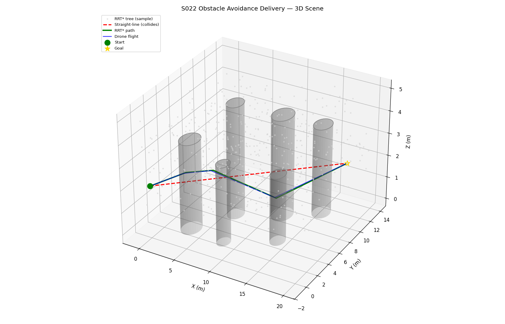
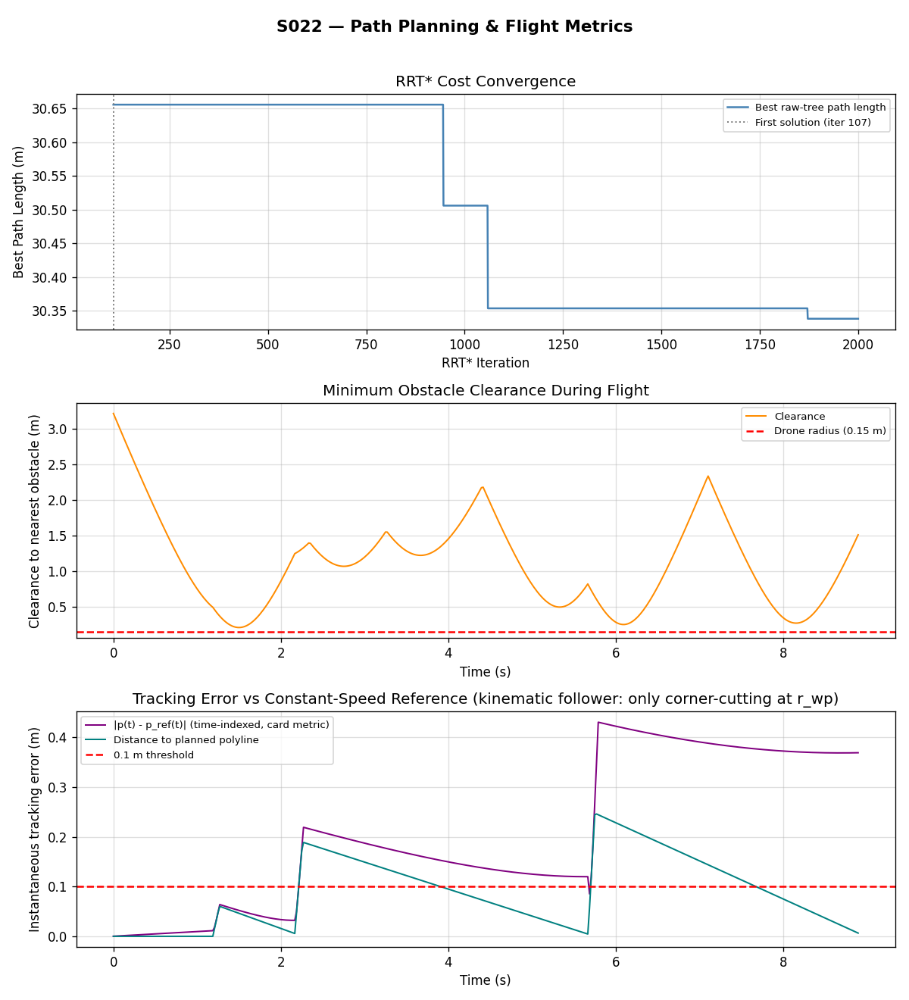
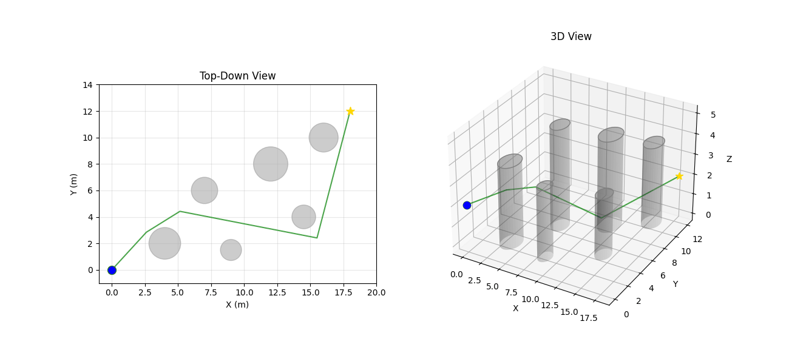

# S022 Obstacle Avoidance Delivery

**Domain**: Logistics & Delivery | **Difficulty**: ⭐⭐ | **Status**: ✅ Completed

---

## Problem Definition

**Setup**: A delivery drone flies from a depot to a drop zone through a 3D urban environment containing cylindrical building obstacles. A naive straight-line path collides with obstacles; RRT* finds a collision-free path that routes around all obstacles, which is then shortcut and flown by a kinematic waypoint follower.

**Objective**: Demonstrate that RRT* produces a collision-free path, quantify the detour overhead, and measure how closely the drone tracks the planned path (card target: tracking RMSE < 0.1 m).

---

## Mathematical Model Summary

**RRT* core operations:**

Nearest neighbor: $\mathbf{q}_{nearest} = \arg\min_{\mathbf{q} \in \mathcal{T}} \|\mathbf{q}_{rand} - \mathbf{q}\|_2$

Steering: $\mathbf{q}_{new} = \mathbf{q}_{nearest} + \min(\eta, d)\,\hat{\mathbf{u}}$

Near-node radius (as in the card): $r_n = \min\!\left(\gamma_{RRT^*} \left(\frac{\log n}{n}\right)^{1/3},\ \eta\right)$

Rewire condition: for each $\mathbf{q}_{near}$ within $r_n$:
$$\text{cost}(\mathbf{q}_{new}) + d(\mathbf{q}_{new}, \mathbf{q}_{near}) < \text{cost}(\mathbf{q}_{near}) \Rightarrow \text{re-parent } \mathbf{q}_{near}$$
(the cost change is propagated to the whole subtree of $\mathbf{q}_{near}$).

Path post-processing: greedy shortcut — drop $\mathbf{w}_k$ whenever $\mathbf{w}_{k-1} \to \mathbf{w}_{k+1}$ is collision-free.

Tracking: $\mathbf{v}_{cmd} = v_{cruise}\,(\mathbf{w}_{target} - \mathbf{p}) / (\|\mathbf{w}_{target} - \mathbf{p}\| + \epsilon)$; advance to the next waypoint when $\|\mathbf{p} - \mathbf{w}_{target}\| < r_{wp}$.

Tracking error (card definition): $\epsilon_{track} = \sqrt{\frac{1}{T}\sum_t \|\mathbf{p}(t) - \mathbf{p}_{ref}(t)\|^2}$, with $\mathbf{p}_{ref}(t)$ a constant-speed ($v_{cruise}$) reference along the shortcut path.

---

## Key Parameters

| Parameter | Value |
|-----------|-------|
| Start position | (0, 0, 2) m |
| Goal position | (18, 12, 2) m |
| Straight-line distance | 21.63 m |
| Number of obstacles | 6 vertical cylinders (layout as in the card) |
| Sampling bounds | x ∈ [-1, 20], y ∈ [-1, 14], z ∈ [1.0, 5.0] m |
| Max RRT* iterations | 2000 |
| Step size η | 1.0 m |
| γ_RRT* | 12.0 |
| Goal sampling bias | 10 % |
| Goal connection distance | 1.5 η = 1.5 m |
| Drone radius (collision buffer) | 0.15 m |
| Cruise speed / speed limit | 3.0 m/s / 4.0 m/s |
| Waypoint threshold r_wp | 0.3 m |
| Control frequency | 48 Hz (dt = 1/48 s) |
| Random seed | 42 (`np.random.default_rng`) |

### Deviations from the scenario card

| Item | Card | Code | Reason |
|------|------|------|--------|
| Steering step | always a full step: $\mathbf{q}_{new} = \mathbf{q}_{nearest} + \eta\,\hat{\mathbf{u}}$ | $\mathbf{q}_{new} = \mathbf{q}_{nearest} + \min(\eta, d)\,\hat{\mathbf{u}}$, $d = \|\mathbf{q}_{rand} - \mathbf{q}_{nearest}\|$ | standard RRT* steering: a sample closer than η (including the goal sample) is reached exactly instead of being overshot by up to η |
| Goal handling | not specified | 10 % goal-biased sampling; a node within 1.5 η of the goal with a free edge becomes a goal-parent candidate | standard RRT* practice; needed to connect the tree to an exact goal point |
| Tracking controller | "Roles" mentions a PID position controller | the card's own *Waypoint Tracking Controller* section (constant-speed proportional-direction velocity command) on a kinematic point mass (`DroneBase`) | follows the card's maths section; no PID/dynamics are simulated |
| Extra metric | — | distance from the drone to the planned polyline (cross-track) is reported alongside the card's time-indexed RMSE | the time-indexed RMSE mostly measures along-track lead from corner-cutting, not lateral deviation (see below) |
| Planning time | card lists planning time as a console metric | iteration counts are reported instead | wall-clock time is machine-dependent (an earlier README reported 9.65 s, a rerun took 21.07 s), so it is not printed |

Near radius: the code now follows the card exactly, $r_n = \min(\gamma(\log n/n)^{1/3}, \eta)$. (A previous version capped $r_n$ at $3\eta$ without explanation.) With γ = 12 the γ-term stays above 1.87 m for every n ≤ 2000, so in practice $r_n = \eta = 1.0$ m throughout the run.

---

## Simulation Results

| Metric | Value |
|--------|-------|
| RRT* iterations / accepted nodes | 2000 / 1869 |
| First solution found at | iteration 107 (raw cost 30.66 m) |
| Raw RRT* path length (33 waypoints) | 30.34 m |
| Shortcut path length (5 waypoints) | **27.32 m** |
| Detour ratio ρ | **1.263** (26.3 % overhead) |
| Flight time (429 trajectory samples at 48 Hz) | 8.92 s |
| Final distance to goal | 0.255 m (stops inside r_wp = 0.3 m) |
| Min obstacle clearance (surface → drone centre) | **0.206 m** > 0.15 m ✅ |
| Tracking RMSE (card metric) | **0.2526 m** (max 0.4305 m) — ❌ above the 0.1 m target |
| Max distance to planned path | 0.2460 m |
| Straight-line collision-free | ❌ No |
| RRT* path collision-free | ✅ Yes |

**Path quality.** RRT* reliably finds a collision-free route (first solution after 107 iterations), but with the card's near radius capped at η = 1.0 m the rewiring neighbourhood is small and the tree barely improves on its first solution: the best raw-tree cost falls only from 30.66 m to 30.34 m over the remaining ~1900 iterations (see convergence curve). The greedy shortcut pass does most of the improvement (30.34 → 27.32 m), but it cannot change the homotopy class: the path zig-zags between the cylinders instead of taking a near-straight corridor, giving a 26.3 % detour. A larger near radius, more iterations or Informed RRT* would be needed for a tighter path. Sanity check: 27.32 m at 3.0 m/s ≈ 9.1 s, consistent with the 8.92 s flight (corner-cutting shortens the flown path slightly).

**Tracking — honest reading.** The drone is a perfect kinematic follower (velocity command applied exactly, no dynamics or disturbances), so the only source of tracking error is corner-cutting: it switches to the next waypoint when 0.3 m away and then flies straight at it. This has two effects: (1) a lateral deviation from the planned polyline of up to 0.246 m right after each sharp corner, decaying linearly as the drone converges onto the next segment; (2) a shorter flown path, so the drone runs *ahead* of the time-indexed constant-speed reference — this accumulated along-track lead (0.3692 m at the end of the flight) dominates the card's RMSE metric. The card's 0.1 m RMSE target is therefore **not met** (0.2526 m). This says nothing about control quality: the error is set entirely by the 0.3 m waypoint radius and the sharpness of the corners, and would shrink with a smaller r_wp. (The previous README's "0.0723 m < 0.1 m" came from a different, nearly straight path and an off-by-one in the reference index, which is fixed.)

---

## Output Files

### 3D Trajectory

Straight-line path (dashed red, collides with obstacles) vs shortcut RRT* path (solid green, collision-free) and the flown drone track (blue). Grey dots are a 500-node sample of the RRT* tree; obstacles are grey cylinders:

### Metrics

Top: best raw-tree path length vs iteration (first solution marked). Middle: clearance from obstacle surfaces to the drone centre vs time — never below the 0.15 m drone radius. Bottom: time-indexed tracking error (purple, card metric) and distance to the planned polyline (teal); the jumps occur at the waypoint switches:

### Animation

Top-down and 3D views of the flight (150 frames, sub-sampled from 429 trajectory samples):

---

## Extensions

1. Compare RRT* vs Informed RRT* — restrict sampling to an ellipsoid after finding the first solution and measure convergence speed
2. Add dynamic obstacles (moving drones) and switch to RRT* with obstacle prediction
3. Vary obstacle density and plot planning effort (iterations) vs path quality trade-off
4. Replace the kinematic follower with a dynamic model + PID to make the tracking metric meaningful

---

## Related Scenarios

- Prerequisites: [S021](../../../scenarios/02_logistics_delivery/S021_point_delivery.md) — obstacle-free baseline
- Follow-ups: [S031](../../../scenarios/02_logistics_delivery/S031_path_deconfliction.md) — multi-drone conflict avoidance, [S034](../../../scenarios/02_logistics_delivery/S034_weather_rerouting.md) — dynamic replanning
