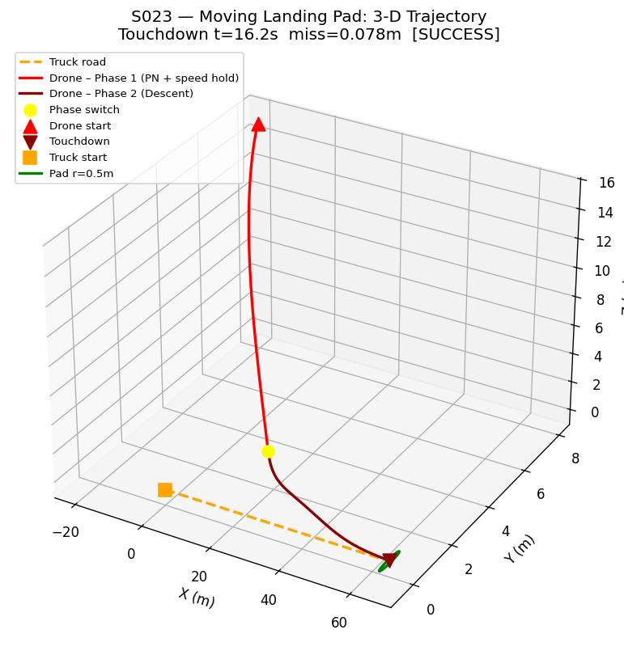
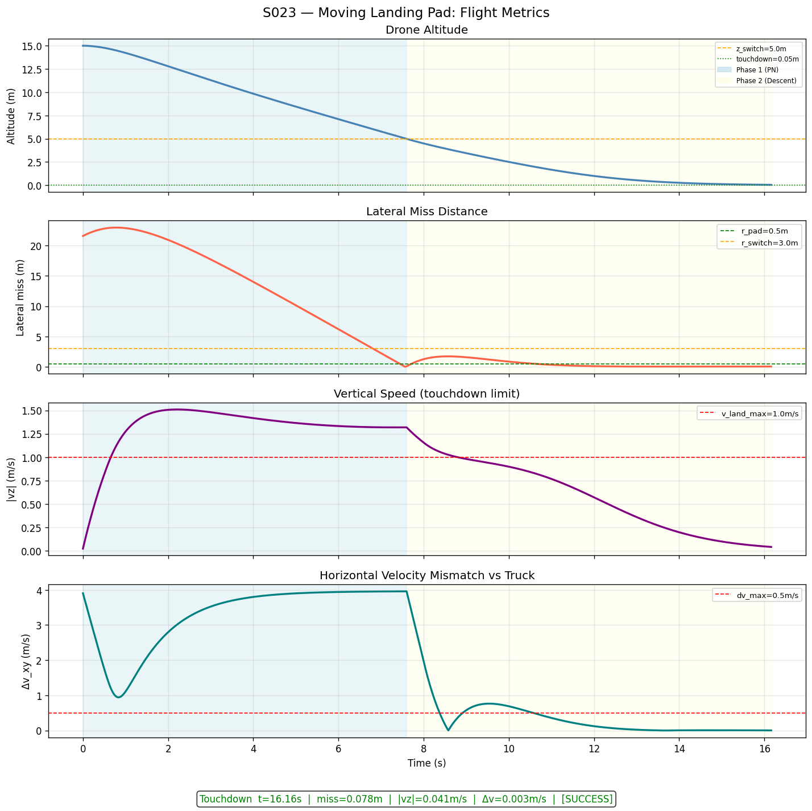
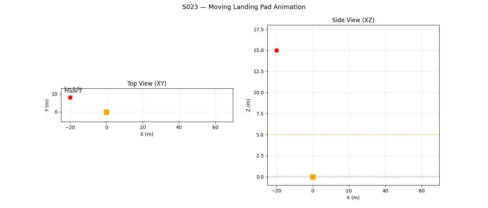

# S023 Moving Landing Pad

**Domain**: Logistics & Delivery | **Difficulty**: ⭐⭐⭐ | **Status**: ✅ Completed

---

## Problem Definition

**Setup**: A delivery drone must land on a moving ground vehicle (truck) travelling along a straight road (the $x$-axis, $y = z = 0$) at constant speed. The drone starts at rest, 15 m up and offset from the road. It predicts the truck's future intercept position, flies there with proportional navigation, then descends while matching the truck's velocity to achieve a soft touchdown within a pad of radius $r_{pad} = 0.5$ m.

**Objective**: Achieve touchdown with lateral miss ≤ 0.5 m, vertical speed ≤ 1.0 m/s, and horizontal velocity mismatch ≤ 0.5 m/s.

---

## Mathematical Model Summary

**Kinematics** (double integrator, gravity cancelled by thrust): $\dot{\mathbf{p}} = \mathbf{v}$, $\dot{\mathbf{v}} = \mathbf{a}_{cmd}$, $\|\mathbf{a}_{cmd}\| \le a_{max}$, $\|\mathbf{v}\| \le v_{max}$.

**Intercept point prediction** (fixed-point iteration each step, run until $|\Delta t_{fly}^{(k+1)} - \Delta t_{fly}^{(k)}| < 10^{-6}$ s, max 100 iterations):

$$\mathbf{p}^*_{xy} = \mathbf{p}_{T,xy} + \mathbf{v}_{T,xy}\,\Delta t_{fly}, \qquad z^* = z_{switch}, \qquad \Delta t_{fly} = \frac{\|\mathbf{p}^* - \mathbf{p}_D\|}{v_{max}}$$

**Phase 1 — 3-D Proportional Navigation** toward $\mathbf{p}^*$ (card form):

$$\mathbf{a}_{PN} = N\,V_c\,\dot{\hat{\boldsymbol\lambda}}, \qquad \hat{\boldsymbol\lambda} = \frac{\mathbf{p}^* - \mathbf{p}_D}{\|\mathbf{p}^* - \mathbf{p}_D\|}, \qquad \dot{\hat{\boldsymbol\lambda}} \approx \frac{\hat{\boldsymbol\lambda}(t) - \hat{\boldsymbol\lambda}(t-\Delta t)}{\Delta t}, \qquad V_c = -\frac{d}{dt}\|\mathbf{p}^* - \mathbf{p}_D\|$$

plus an along-LOS speed-hold term (see Deviations): $\mathbf{a}_{cmd} = \mathbf{a}_{PN} + \text{clip}\big(K_{ax}(v_{max} - \mathbf{v}_D\cdot\hat{\boldsymbol\lambda}),\ \pm\sqrt{a_{max}^2 - \|\mathbf{a}_{PN}\|^2}\big)\,\hat{\boldsymbol\lambda}$, with $\|\mathbf{a}_{PN}\| \le a_{max}$ (steering has priority).

**Phase 2 — descent + velocity matching** (entered when $z_D \le z_{switch}$ and lateral distance to the truck $\le r_{switch}$):

$$\mathbf{a}_{xy} = K_p(\mathbf{p}_{T,xy} - \mathbf{p}_{D,xy}) + K_v(\mathbf{v}_{T,xy} - \mathbf{v}_{D,xy})$$

$$\dot z_{cmd}(z) = -v_{land,max}\tanh\!\left(\frac{z}{z_{flare}}\right), \qquad a_z = K_{\dot z}\,(\dot z_{cmd} - \dot z_D)$$

The tanh flare commands ≈ 1 m/s descent high up and slows smoothly towards 0 as $z \to 0$ (not a constant descent rate).

**Touchdown conditions** (checked when $z_D \le 0.05$ m):

$$\|\mathbf{p}_{xy,D} - \mathbf{p}_{xy,T}\| \leq r_{pad}, \quad |\dot{z}| \leq v_{land,max}, \quad \|\dot{\mathbf{p}}_{xy,D} - \dot{\mathbf{p}}_{xy,T}\| \leq \Delta v_{max}$$

---

## Key Parameters

| Parameter | Value |
|-----------|-------|
| Drone start position | (-20, 8, 15) m, at rest |
| Truck start / speed | x = 0 m, 4.0 m/s along +x |
| Drone max speed $v_{max}$ | 8.0 m/s |
| Drone max acceleration $a_{max}$ | 5.0 m/s² |
| PN navigation constant $N$ | 3 |
| Along-LOS speed-hold gain $K_{ax}$ | 1.0 s⁻¹ |
| Phase-switch altitude $z_{switch}$ | 5.0 m |
| Phase-switch lateral radius $r_{switch}$ | 3.0 m |
| Phase-2 gains $K_p$ / $K_v$ / $K_{\dot z}$ | 1.2 / 1.8 / 2.0 |
| Flare altitude constant $z_{flare}$ | 2.0 m |
| Max touchdown vertical speed $v_{land,max}$ | 1.0 m/s (also the flare's max commanded descent rate) |
| Pad radius $r_{pad}$ | 0.5 m |
| Max horizontal velocity mismatch $\Delta v_{max}$ | 0.5 m/s |
| Touchdown detection altitude | 0.05 m |
| Time step / control frequency | 0.02 s / 50 Hz |
| Simulation budget | 30 s |

### Deviations from the scenario card

| Item | Card | Code | Reason |
|------|------|------|--------|
| Phase-1 acceleration | pure PN, $\mathbf{a} = N V_c \dot{\hat{\boldsymbol\lambda}}$ | PN **plus** an along-LOS speed-hold term $K_{ax}(v_{max} - \mathbf{v}\cdot\hat{\boldsymbol\lambda})$ using the acceleration budget PN leaves | PN only commands acceleration normal to the LOS; the drone starts at rest, so pure PN has no closing speed and never moves toward the target. The speed hold also makes the drone fly at $v_{max}$, which is what the intercept predictor assumes. |
| Aim point altitude | predictor returns the truck's future position on the ground | aim point is placed at $z_{switch} = 5$ m above the predicted truck position | Phase 1 is meant to hand over at $z_{switch}$; aiming at the ground would dive at 8 m/s and could hit the ground before the Phase-2 lateral condition is met. |
| Intercept predictor iterations | "converged after 3–5 fixed-point iterations" | iterate until the change in $\Delta t_{fly}$ is < 10⁻⁶ s (21 iterations at t = 0) | the map contracts by only ≈ 0.5 per iteration here, so 5 iterations leave a 0.27 m error in the initial aim point |
| LOS rate | card maths: finite difference; card code: $\mathbf{v}_{\perp,rel}/r$ with $\mathbf{v}_T$ as target velocity | finite difference of $\hat{\boldsymbol\lambda}$ and of the range (card maths) | the target is the re-predicted intercept point, not the truck, so its motion is captured by differencing rather than by assuming it moves with $\mathbf{v}_T$ |

The previous version of this script never called its PN function (Phase 1 was a pure-pursuit velocity tracker with an altitude hold) while the README and plot labels claimed PN; that has been replaced by the guidance above.

---

## Simulation Results

| Metric | Value | Limit | Status |
|--------|-------|-------|--------|
| Initial predicted aim point | (21.91, 0.00, 5.00) m after 21 iterations (5 iterations would give x = 21.64 m) | — | — |
| Predictor iterations over Phase 1 | max 21, mean 20.2 | 100 | — |
| Phase 1 → 2 switch | t = 7.62 s at (30.67, -0.03, 4.96) m | — | — |
| Lateral miss / Δv_horiz / \|vz\| at switch | 0.191 m / 3.859 m/s / 1.310 m/s | — | — |
| Number of phase changes | 1 (no chattering) | — | — |
| Phase 2: max lateral miss / duration | 1.744 m / 8.54 s | — | — |
| PN steering \|a_PN\| in Phase 1 | max 1.078 m/s², mean 0.150 m/s² | 5.0 m/s² | — |
| Touchdown time | **16.16 s** | 30 s | ✅ |
| Lateral miss | **0.0777 m** | 0.5 m | ✅ |
| Vertical speed \|vz\| | **0.0408 m/s** | 1.0 m/s | ✅ |
| Horizontal velocity mismatch | **0.0032 m/s** | 0.5 m/s | ✅ |
| Overall result | **SUCCESS** | — | — |

**Phase 1.** The converged first prediction places the intercept point at x = 21.91 m (check: distance from the start to (21.91, 0, 5) is $\sqrt{41.91^2 + 8^2 + 10^2} = 43.82$ m → 5.48 s at 8 m/s → truck at 4 × 5.48 = 21.91 m ✓). The fixed-point map contracts only by a factor of up to $v_T/v_{max} = 0.5$ per iteration, so it needs 21 iterations to reach the 10⁻⁶ s tolerance; the card's "3–5 iterations" would stop at x = 21.64 m (the previous version of the script, which also returned the point from the second-to-last iterate, used x = 21.34 m). Because the drone starts from rest and only reaches $v_{max}$ gradually (the speed-hold gain is 1 s⁻¹), the actual hand-over happens later, at 7.62 s, and the predicted point drifts forward to x = 30.44 m — the truck is at 4 × 7.62 = 30.48 m then. PN absorbs this drift with small steering accelerations (max 1.08 m/s²), and the drone arrives 0.19 m from the truck at 4.96 m altitude. It arrives still flying at close to $v_{max}$, so the horizontal velocity mismatch at hand-over is 3.86 m/s.

**Phase 2.** The PD law brings the 3.86 m/s mismatch below the 0.5 m/s limit within 0.76 s; the drone overshoots ahead of the truck (lateral miss peaks at 1.744 m, Δv rebounds to 0.765 m/s) and then settles. The flare brings the descent rate from 1.31 m/s at hand-over to 0.04 m/s at touchdown. Phase 2 takes 8.54 s.

Why Phase 2 is shorter than the ideal tanh profile — the script simulates the vertical channel alone from the hand-over altitude (z = 4.99 m):

| Vertical channel | Time to touchdown |
|------------------|-------------------|
| Ideal first-order profile $\dot z = -v_{land}\tanh(z/z_{flare})$ | 10.97 s |
| Rate loop ($K_{\dot z} = 2$), entering from rest | 9.24 s |
| Rate loop, entering on the tanh profile (−0.986 m/s) | 8.76 s |
| Rate loop, entering at the actual −1.319 m/s | 8.58 s |

The ≈ 2.4 s saving comes from the second-order rate loop: its descent rate lags behind the commanded profile, and near the ground (where the commanded rate shrinks towards zero and the ideal profile spends most of its time) that lag keeps the drone descending faster than commanded. The faster entry speed accounts for only 0.18 s of it (8.76 → 8.58 s). The vertical-only figure (8.58 s) matches the full run (8.54 s); the small difference comes from the joint acceleration limit shared with the lateral channel. Touchdown at 16.16 s meets all three criteria with wide margins.

Compared with the previous (pure-pursuit) version, which touched down at 13.46 s and failed on Δv_horiz (0.53 m/s), the current run lands later but cleanly. The difference is not only due to PN vs pure pursuit: the old Phase 1 also held altitude and aimed differently, so the two runs are not a controlled comparison.

---

## Output Files

### 3D Trajectory

Truck road (orange dashed), drone Phase 1 (red, PN + speed hold) and Phase 2 (dark red, descent), phase-switch point (yellow), and the pad circle (green) at the truck's touchdown position:

### Metrics Time Series

Altitude, lateral miss distance, vertical speed and horizontal velocity mismatch versus time; Phase 1 is shaded blue, Phase 2 yellow:

### Animation

Top view and side view (150 frames sub-sampled from the 50 Hz simulation, played at 20 fps):

---

## Extensions

1. Add a velocity pre-matching segment at the end of Phase 1 (reduce the closing speed to the truck speed) to remove the 3.9 m/s hand-over mismatch and the Phase-2 overshoot
2. Use a Kalman filter to handle truck velocity uncertainty (noisy telemetry)
3. Extend to sinusoidal truck path — the drone must continuously update the intercept prediction

---

## Related Scenarios

- Prerequisites: [S021](../../../scenarios/02_logistics_delivery/S021_point_delivery.md) — basic landing
- Follow-ups: [S039](../../../scenarios/02_logistics_delivery/S039_offshore_platform_exchange.md) — landing on a ship deck with 6-DOF motion
