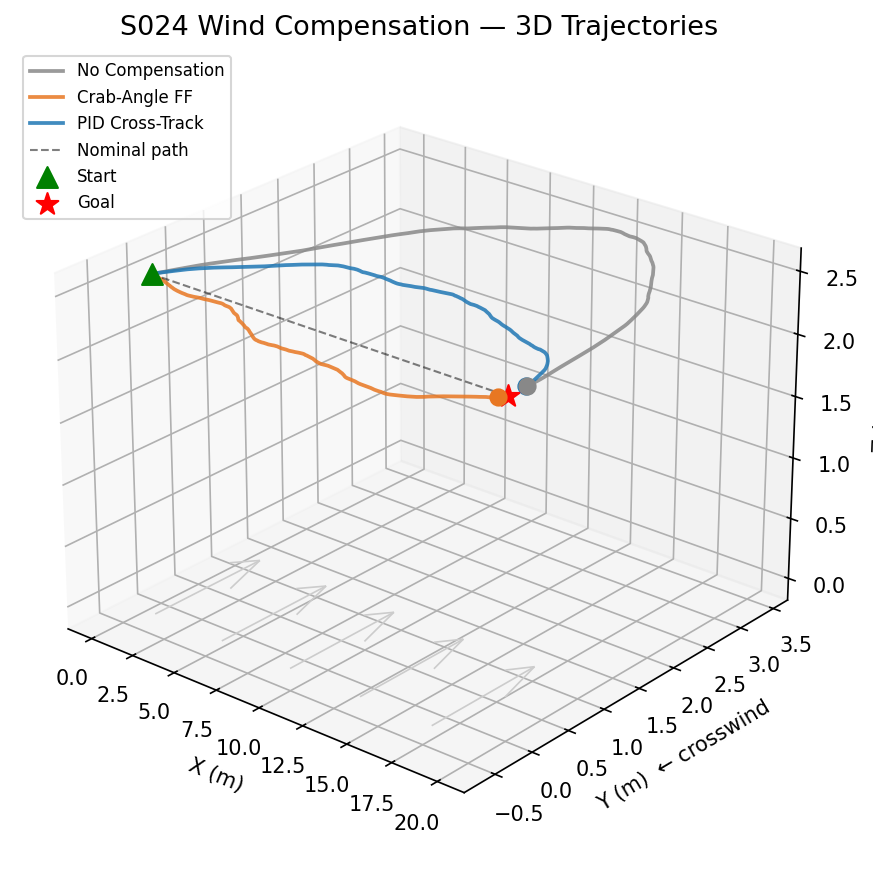
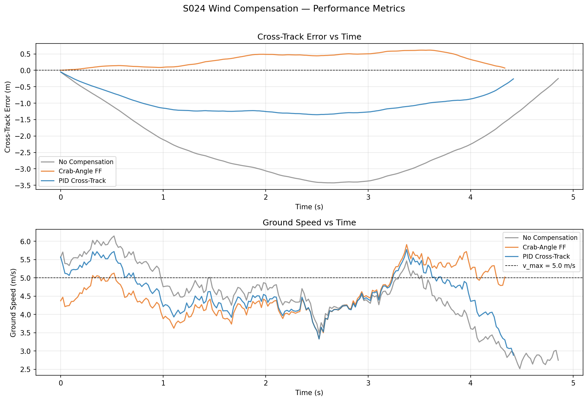
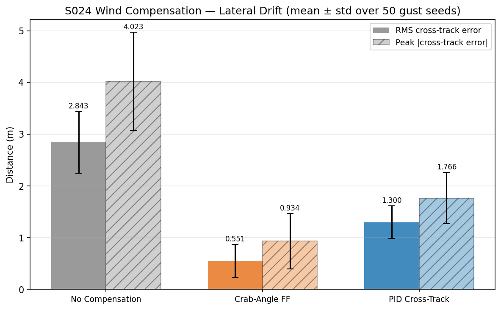
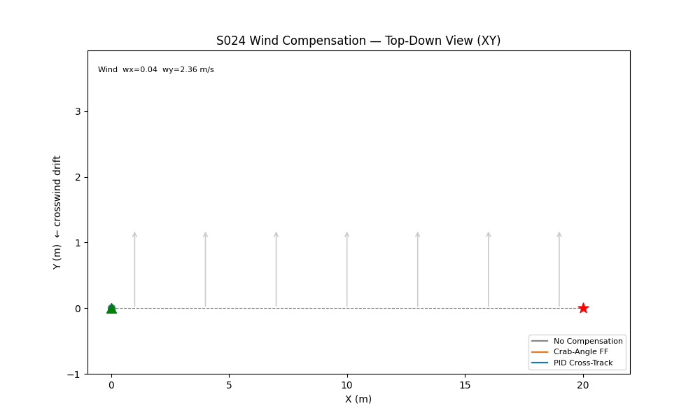

# S024 Wind Compensation

**Domain**: Logistics & Delivery | **Difficulty**: ⭐⭐ | **Status**: ✅ Completed

---

## Problem Definition

**Setup**: A delivery drone flies a 20 m straight-line route under a persistent crosswind with gusts. Three guidance strategies are compared under identical gust sequences: no compensation, crab-angle feedforward, and PID cross-track correction. Every run ends when the drone enters the 0.3 m arrival radius around the goal.

**Objective**: Reduce lateral drift (cross-track error, RMS and peak) and flight time using wind compensation.

---

## Mathematical Model Summary

**Kinematics**: $\dot{\mathbf{p}}_{xy} = \mathbf{v}_{air} + \mathbf{w}(t)$, $\|\mathbf{v}_{air}\| \le v_{max}$; altitude hold $\dot z = k_z (z_{ref} - z)$.

**Wind model**: mean crosswind plus a first-order Gauss-Markov gust (discrete form):

$$\mathbf{w}_{g,k+1} = \alpha\,\mathbf{w}_{g,k} + \sqrt{1-\alpha^2}\,\sigma_g\,\boldsymbol{\eta}_k, \quad \alpha = e^{-\Delta t/\tau_g}, \quad \boldsymbol{\eta}_k \sim \mathcal{N}(0, I)$$

$$\mathbf{w} = \bar{\mathbf{w}} + \mathbf{w}_g$$

**No compensation**: $\mathbf{v}_{air} = v_{max}\,\hat{\mathbf{d}}$, with $\hat{\mathbf{d}}$ the current bearing to the goal (pure pursuit of the goal, wind ignored).

**Crab-angle feedforward**: rotate the bearing by the crab angle that cancels the *mean* crosswind

$$\sin\delta = -\frac{\bar w_y}{v_{max}}, \quad \mathbf{v}_{air} = v_{max} \cdot R(\delta) \cdot \hat{\mathbf{d}}$$

(with $\bar w_y = +2.5$ m/s, $\delta = -30°$: the drone points into the wind; nominal along-track ground speed $\sqrt{5^2 - 2.5^2} = 4.33$ m/s).

**PID cross-track correction**: with $e_{ct} = (\mathbf{p} - \mathbf{p}_0) \times \hat{\mathbf{d}}_0$ (positive = right of track),

$$v_\perp = K_p e_{ct} + K_i \int e_{ct}\, dt + K_d \dot{e}_{ct}, \qquad \mathbf{v}_{air} = \text{clip}\big(v_{max}\hat{\mathbf{d}} + v_\perp \hat{\mathbf{n}},\ v_{max}\big)$$

with $\hat{\mathbf{n}}$ the left-of-track normal and the integral clamped to ±10 m·s (anti-windup).

---

## Key Parameters

| Parameter | Value |
|-----------|-------|
| Start position | (0, 0, 2.5) m |
| Goal position | (20, 0, 2.5) m |
| Mean crosswind | 2.5 m/s (+y) |
| Gust σ / correlation time | 0.8 m/s / 1.5 s (Gauss-Markov) |
| Drone max airspeed | 5.0 m/s |
| Simulation / control rate | 48 Hz |
| PID gains | Kp=1.2, Ki=0.05, Kd=0.3 (integral clamp ±10) |
| Altitude-hold gain $k_z$ | 2.0 s⁻¹ |
| Arrival radius | 0.3 m |
| Safety timeout | 60 s |
| Random seed (showcase run) | 42 (`np.random.default_rng`) |
| Monte-Carlo runs | 50 gust seeds (42–91), same seeds for every strategy |

### Deviations from the scenario card

| Item | Card | Code | Reason |
|------|------|------|--------|
| Terminal metric / bar chart | "lateral displacement at arrival: final miss distance" | bar chart shows RMS and peak \|cross-track error\| (Monte-Carlo mean ± std); final distance is printed only as an arrival check | every run stops at the first step inside the 0.3 m arrival radius, so the final distance is 0.18–0.30 m for every strategy by construction and cannot rank them |
| PID along-track direction | card code uses the fixed nominal direction $\hat{\mathbf{d}}_0$ | current bearing to the goal $\hat{\mathbf{d}}$ (as in the card's Strategy-1 definition) | keeps the three strategies on the same along-track law, so only the lateral correction differs |
| Statistics | single run | single showcase run (seed 42) **plus** a 50-seed Monte-Carlo | one gust realisation is not enough to rank strategies |
| Drone dynamics | Roles mention "first-order velocity dynamics" | airspeed command applied instantly (kinematic), as in the card's own code | follows the card implementation |

---

## Simulation Results

**Showcase run (seed 42)**

| Strategy | Flight Time | RMS Cross-Track Error | Peak \|Cross-Track Error\| | Final distance (arrival check) |
|----------|------------|----------------------|---------------------------|------------------|
| No Compensation | 4.87 s | 2.477 m | 3.427 m | 0.252 m |
| Crab-Angle FF | **4.35 s** | **0.389 m** | **0.614 m** | 0.246 m |
| PID Cross-Track | 4.44 s | 1.070 m | 1.352 m | 0.273 m |

**Monte-Carlo, 50 gust seeds (mean ± std)**

| Strategy | Flight Time | RMS Cross-Track Error | Peak \|Cross-Track Error\| | Final distance range | Arrived |
|----------|------------|----------------------|---------------------------|---------------------|---------|
| No Compensation | 5.18 ± 0.83 s | 2.843 ± 0.598 m | 4.023 ± 0.946 m | 0.233–0.299 m | 50/50 |
| Crab-Angle FF | **4.46 ± 0.55 s** | **0.551 ± 0.321 m** | **0.934 ± 0.535 m** | 0.176–0.299 m | 50/50 |
| PID Cross-Track | 4.61 ± 0.64 s | 1.300 ± 0.315 m | 1.766 ± 0.495 m | 0.228–0.300 m | 50/50 |

**Findings**

- **Crab-angle feedforward is best on every discriminating metric.** Over 50 seeds it cuts RMS cross-track error by 80.6 % vs no compensation (0.551 vs 2.843 m) and flight time by 13.9 % (4.46 vs 5.18 s); in the seed-42 run the reductions are 84.3 % (0.389 vs 2.477 m) and 10.7 % (4.35 vs 4.87 s). Its residual error comes from gusts only — it cancels the mean wind exactly, so it drifts to whichever side the gust pushes (in seed 42 it slightly over-compensates and drifts right, $e_{ct} > 0$).
- **The card's expected result is not met.** The card expects the crab angle to bring the mean lateral error to near zero and the PID to "suppress gust residuals to < 0.15 m RMS". Neither holds in this simulation: the PID's RMS cross-track error is 1.300 ± 0.315 m over 50 seeds (1.070 m for seed 42), almost 9× the expected value, and even crab-angle feedforward leaves 0.551 ± 0.321 m RMS from gusts. The reason is given below; no gain was retuned to meet the expectation.
- **PID with the card's gains lies in between.** A mainly proportional loop needs a standing error to generate the ≈ 2.5 m/s lateral airspeed that cancels the mean wind, and Ki = 0.05 is far too small to remove it within a ≈ 4.5 s flight (∫e dt ≈ 1.2 m × 4.4 s ≈ 5 m·s contributes only ≈ 0.25 m/s). The PID therefore settles on a plateau of about 1.2–1.3 m downwind of the track (left, $e_{ct} < 0$; peak 1.352 m) in the seed-42 run. A higher Ki or crab FF + PID would remove this offset.
- **No compensation still arrives**, because it re-aims at the goal every step (pure pursuit), but it is blown up to 3.4 m (seed 42) / 4.0 m on average off track and approaches the goal partly into the wind, which makes it the slowest.
- **Final distance is not a performance metric here**: every strategy stops at its first step inside 0.3 m, so the values (0.18–0.30 m) only confirm arrival. The previous README's claim that "PID achieves the smallest final miss" was an artefact of this stopping rule and has been dropped.
- Sanity check: 20 m at the crab's nominal 4.33 m/s ground speed ≈ 4.6 s, minus ≈ 0.07 s for stopping 0.3 m early ≈ 4.55 s, consistent with the 4.46 s Monte-Carlo mean.

---

## Output Files

### 3D Trajectory

Seed-42 trajectories: no compensation (grey), crab-angle feedforward (orange) and PID (blue), with the nominal path dashed and decorative wind arrows on the ground plane:

### Cross-Track Error and Speed

Seed-42 cross-track error (negative = blown left/downwind, +y) and ground speed for all three strategies:

### Lateral Drift Bar Chart

RMS and peak |cross-track error| per strategy, mean ± std over the 50 Monte-Carlo gust seeds:

### Animation

Top-down view of the seed-42 run (118 frames — every 2nd of the 235 samples of the longest run — at 20 fps):

---

## Extensions

1. Combine crab-angle feedforward + PID cross-track for best-of-both performance
2. Replace the Gauss-Markov gust with a Dryden turbulence model and compare disturbance rejection
3. Implement Extended Kalman Filter wind estimation for unknown wind scenarios

---

## Related Scenarios

- Prerequisites: [S021](../../../scenarios/02_logistics_delivery/S021_point_delivery.md) — baseline delivery
- Follow-ups: [S034](../../../scenarios/02_logistics_delivery/S034_weather_rerouting.md) — dynamic rerouting around storm zones
