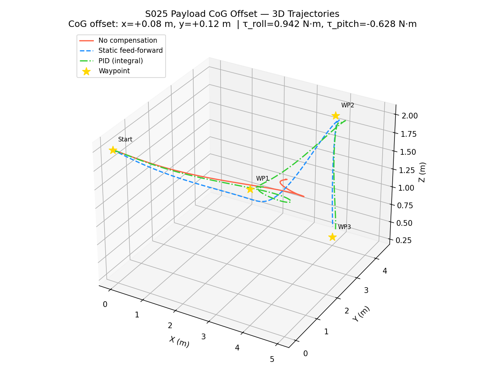
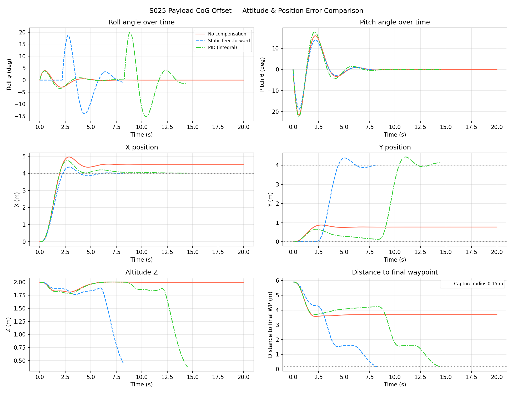
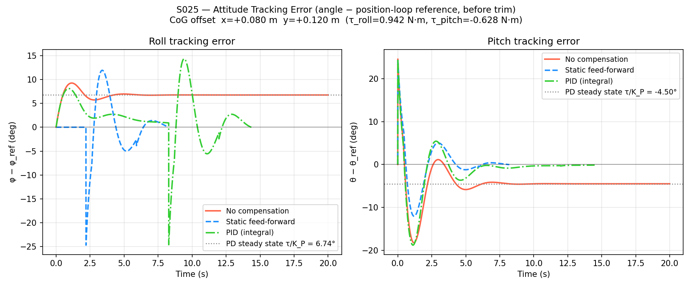
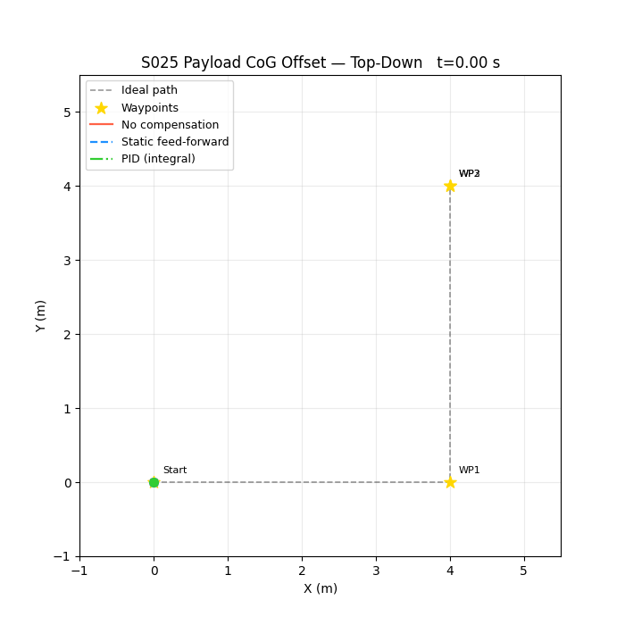

# S025 Payload CoG Offset

**Domain**: Logistics & Delivery | **Difficulty**: ⭐⭐ | **Status**: ✅ Completed

---

## Problem Definition

**Setup**: A 2.3 kg delivery drone (1.5 kg airframe + 0.8 kg payload) carries a payload whose centre of gravity sits at $\mathbf{r} = (x, y) = (+0.08,\ +0.12)$ m from the airframe centre. The offset creates constant roll and pitch disturbance torques. The drone starts at (0, 0, 2) m and must capture three waypoints — (4, 0, 2), (4, 4, 2) and the delivery point (4, 4, 0.3) m — within a 0.15 m radius. Three attitude-control strategies are compared under the same cascaded position → attitude controller.

**Objective**: Show how an un-modelled CoG offset degrades waypoint tracking, and compare a model-based static feed-forward trim with a model-free integral (PID) correction.

---

## Mathematical Model Summary

**Disturbance torque** (payload weight acting at the offset; model sign convention: +roll tilts thrust toward +y, +pitch toward −x, so the payload side dips):

$$\tau_{roll} = +m_p g\, r_y = 0.8 \times 9.81 \times 0.12 = +0.942\ \text{N·m}, \qquad \tau_{pitch} = -m_p g\, r_x = -0.8 \times 9.81 \times 0.08 = -0.628\ \text{N·m}$$

**Attitude dynamics** (linearised, Euler integration): $I\,\dot{\boldsymbol\omega} = \boldsymbol\tau_{cmd} + \boldsymbol\tau_{dist}$, $\dot{\boldsymbol\eta} = \boldsymbol\omega$; translational: $a_x = -T\sin\theta/m$, $a_y = T\sin\phi/m$, $a_z = T\cos\phi\cos\theta/m - g$.

**Position loop** (all modes): $\mathbf{a}_d = K_{p,pos}(\mathbf{p}_{wp} - \mathbf{p}) - K_{d,pos}\mathbf{v}$, $T = m(g + a_{d,z})$, $\phi_{ref} = a_{d,y} m/T$, $\theta_{ref} = -a_{d,x} m/T$ (clipped to ±25°).

**Attitude controllers** (torque output, clipped to ±5 N·m):

| Mode | Torque command | How the offset is handled |
|------|----------------|---------------------------|
| No compensation | $\boldsymbol\tau = K_P(\boldsymbol\eta_{ref} - \boldsymbol\eta) - K_D\boldsymbol\omega$ | not at all |
| Static feed-forward | same PD law, but with a trimmed reference $\boldsymbol\eta_{ref} + \boldsymbol\eta_{trim}$, $\boldsymbol\eta_{trim} = -\boldsymbol\tau_{dist}/K_P$ | the trim makes the $K_P$ term supply exactly $-\boldsymbol\tau_{dist}$, i.e. it is equivalent to a feed-forward torque $\boldsymbol\tau_{ff} = -\boldsymbol\tau_{dist}$ (perfect knowledge of the offset) |
| PID (integral) | $\boldsymbol\tau = K_P\mathbf{e} - K_D\boldsymbol\omega + K_I\!\int\mathbf{e}\,dt$, $\mathbf{e} = \boldsymbol\eta_{ref} - \boldsymbol\eta$, integral clamped to ±0.5 rad·s | no model: the integrator learns the offset torque; no $\tau_{ff}$ |

**PD steady state under the offset**: $K_P(\eta_{ref} - \eta) + \tau = 0 \Rightarrow \eta - \eta_{ref} = \tau/K_P$ → +6.74° roll, −4.50° pitch. Since $\tau_{cmd}$ is a torque, the trim is $-\tau/K_P$ (−0.118 rad roll, +0.0785 rad pitch); the previous version divided additionally by $I_{xx}$, giving ≈ −7.85 rad, which pinned the attitude at the ±25° clamp and made the feed-forward run diverge.

**No-compensation hover offset**: at a hover the actual tilt must be 0, so the position loop has to command $\eta_{ref} = -\tau/K_P$, which needs a standing position error $g\,(\tau/K_P)/K_{p,pos}$: predicted +0.513 m in x and +0.770 m in y (towards the payload side). Both exceed the 0.15 m capture radius, so no waypoint can be captured.

---

## Key Parameters

| Parameter | Value |
|-----------|-------|
| Airframe / payload / total mass | 1.5 / 0.8 / 2.30 kg |
| Inertia $I_{xx}, I_{yy}, I_{zz}$ | 0.015, 0.015, 0.025 kg·m² |
| CoG offset | x = +0.08 m, y = +0.12 m |
| Disturbance torque (roll / pitch) | +0.942 / −0.628 N·m |
| Position-loop gains $K_{p,pos}$ / $K_{d,pos}$ | 1.5 / 1.8 |
| Attitude gains $K_P$ / $K_D$ / $K_I$ | 8.0 / 3.0 / 2.0 ($K_I$ only in PID mode) |
| Integral clamp | ±0.5 rad·s (max integral torque 1.0 N·m) |
| Feed-forward trim (roll / pitch) | −0.118 rad / +0.0785 rad |
| Torque / rate / speed / tilt limits | ±5 N·m / ±10 rad/s / 8 m/s / ±25° |
| Waypoints (start + 3 targets) | (0,0,2) start → (4,0,2) → (4,4,2) → (4,4,0.3) m |
| Waypoint capture radius | 0.15 m |
| Control / simulation rate | 200 Hz (dt = 5 ms) |
| Simulation time limit | 20 s |

### Deviations from the scenario card

None — the card was an empty stub and has been filled in to describe this model. Two corrections relative to the previous version of this README/script: the start position is no longer counted as a reached waypoint (scores are out of 3 targets, not 4), and the CoG constants were renamed `COG_X`/`COG_Y` (the old `COG_DX = 0.12` was actually the y offset).

---

## Simulation Results

| Controller | Waypoints Reached | WP capture times | Final Position | Final attitude-tracking error (roll / pitch) |
|-----------|------------------|------------------|----------------|-----------------|
| No Compensation | **0/3** (timeout 20 s) | none | (4.513, 0.770, 2.000) — 0.925 m from WP1 | +6.74° / −4.50° |
| Static feed-forward | **3/3** ✅ | 2.19 s, 5.90 s, **8.20 s** | (3.991, 4.015, 0.447) | +0.13° / −0.02° |
| PID (integral) | **3/3** ✅ | 8.28 s, 11.97 s, **14.48 s** | (4.019, 4.124, 0.381) | −0.13° / −0.13° |

(Attitude-tracking error = actual angle − attitude requested by the position loop, before any trim. Final positions of the two successful runs are the points where the 0.15 m capture radius around (4, 4, 0.3) was entered: 0.149 m for both.)

**No compensation** does not drift away — it settles into a steady hover at (4.513, 0.770, 2.000), exactly the predicted offset (+0.513 m, +0.770 m) from WP1, with the attitude-tracking error at the predicted τ/K_P values (+6.74° / −4.50°) and the actual tilt back at 0°. Because 0.925 m > 0.15 m, WP1 is never captured. The old README's "drifts off-course after the first waypoint" misread the start position as a captured waypoint.

**Static feed-forward** (perfect knowledge) cancels the disturbance from the first time step — its roll stays at exactly 0° and its y deviation at 0.000 m on the first leg — and completes the mission fastest (8.20 s). The old "unstable due to modelling error amplification" result was caused by the unit bug in the trim, not by the method.

**PID** needs no model but must first wind up its integrator ($K_I/K_P = 0.25$ s⁻¹): on the first leg the drone is pushed up to 0.660 m sideways and only creeps back to the track, capturing WP1 at 8.28 s instead of 2.19 s. Once the integrator holds the offset torque, the later legs take about as long as with feed-forward (WP1→WP3: 6.20 s vs 6.01 s). Total mission 14.48 s, 77 % longer than feed-forward. The integral clamp allows up to 1.0 N·m, just enough for the 0.942 N·m roll torque.

| Controller | Leg 1 (start→WP1) max \|y\| deviation | Peak \|roll\| / \|pitch\| tracking error |
|-----------|------------------------|-------------------------|
| No Compensation | 0.874 m | 9.25° / 24.61° |
| Static feed-forward | 0.000 m | 24.67° / 24.67° |
| PID (integral) | 0.660 m | 24.58° / 24.61° |

The ≈ 24.6° peaks come from the ±25° position-loop reference steps at take-off (pitch, all modes) and at the WP1→WP2 switch (roll, only for the two modes that get there), not from the CoG offset, so they are not used to rank the controllers. The leg-1 lateral deviation is the clean measure of the disturbance: zero with perfect feed-forward, 0.660 m while the PID integrator winds up, 0.874 m without compensation.

---

## Output Files

### 3D Trajectory

No compensation (red, stalls offset from WP1), static feed-forward (blue dashed) and PID (green dash-dot, sideways excursion on the first leg) with the start and the three waypoints:

### Attitude and Position

Roll and pitch angles, x/y/z position (dotted lines at the waypoint coordinates) and distance to the final waypoint (capture radius dotted) for all three controllers:

### Attitude Tracking Error

Roll and pitch tracking error (angle − position-loop reference) with the PD steady-state value τ/K_P (dotted). No compensation settles on the dotted line; feed-forward and PID settle at 0. The large spikes are the reference steps at waypoint switches:

### Animation

Top-down view of all three runs (149 frames, every 27th of the 4001 samples of the 20 s run, played at 20 fps ≈ 2.7× real time):

---

## Extensions

1. Add payload mass uncertainty (±20 %) — the feed-forward trim then becomes wrong and the integral term is needed; compare FF + I vs I alone
2. Simulate mid-flight payload shift (sudden CoG change) — test recovery time
3. Extend to S026: multiple drones sharing a suspended load with dynamic CoG

---

## Related Scenarios

- Prerequisites: [S021 Point Delivery](../../../scenarios/02_logistics_delivery/S021_point_delivery.md) — basic delivery
- Follow-ups: [S026 Cooperative Heavy Lift](../../../scenarios/02_logistics_delivery/S026_cooperative_heavy_lift.md) — multi-drone suspended load with cable tension
