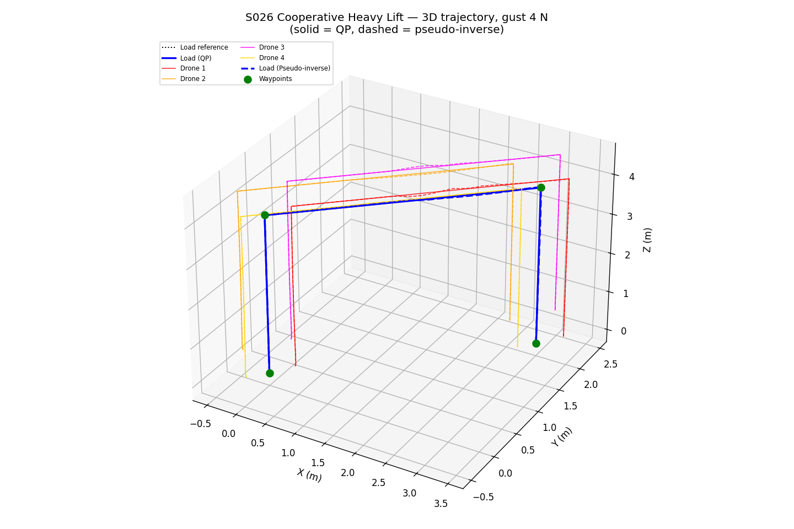
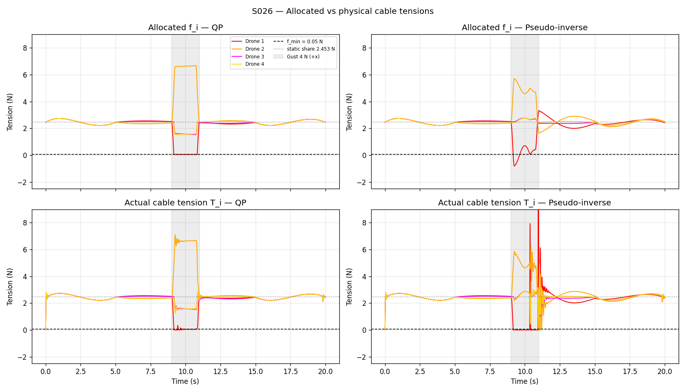
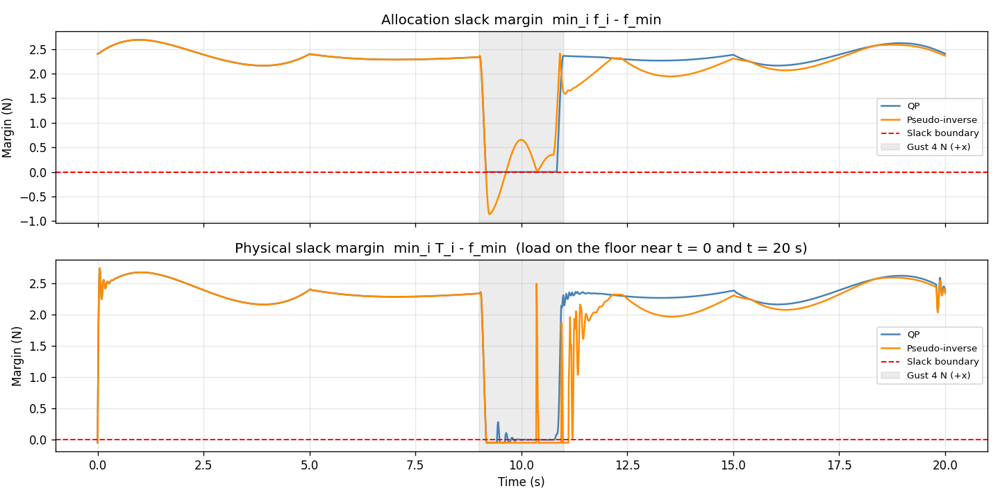
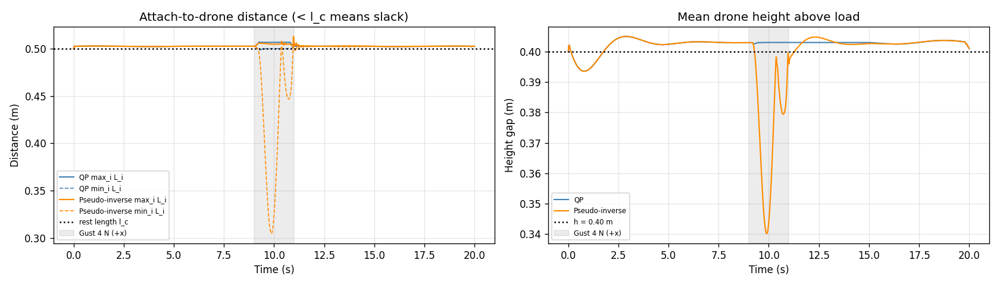
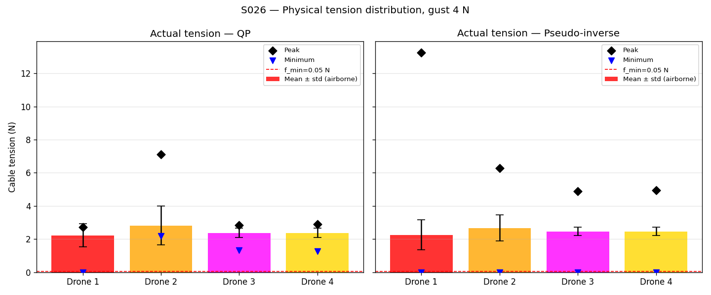
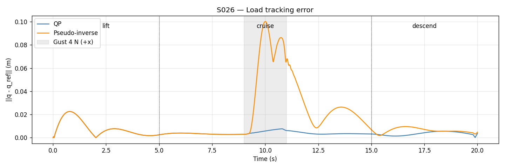
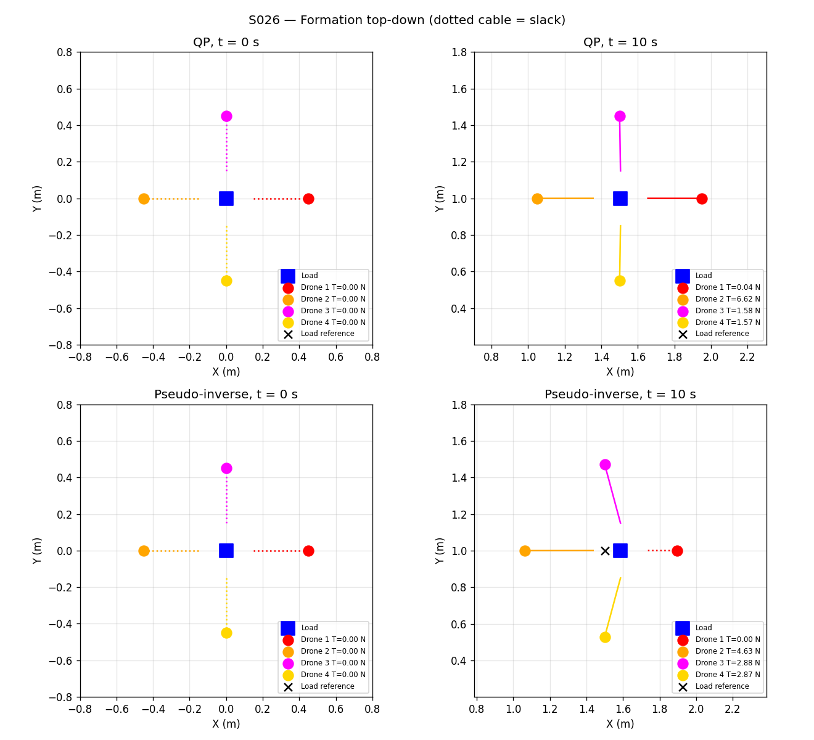
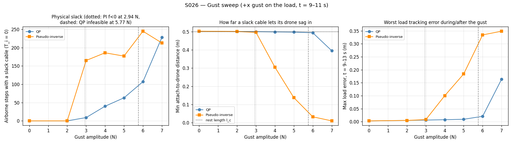
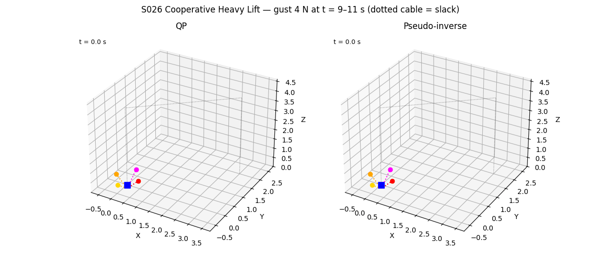

# S026 Cooperative Heavy Lift

**Domain**: Logistics & Delivery | **Difficulty**: ⭐⭐⭐ | **Status**: ✅ Completed

---

## Problem Definition

**Setup**: $N = 4$ quadrotors carry a $m_L = 0.8$ kg package on four cables of rest length $l_c = 0.5$ m. The package is too heavy for one drone (single-drone payload limit 0.3 kg). The drones fly in a symmetric cross above the load and lift it from the floor at (0, 0, 0) to $z_d = 4.0$ m (0–5 s). They then carry it to (3, 2, 4) m (5–15 s) and set it down at (3, 2, 0) m (15–20 s). During the cruise, a lateral gust pushes the load in +x (t = 9–11 s).

**Objective**: Allocate cable tensions that give the load the force it needs, and keep every cable taut ($f_i \geq f_{min} = 0.05$ N). The comparison is between the minimum-norm pseudo-inverse allocation and the anti-slack QP, in a slung-load simulation where the cables really can go slack.

---

## Mathematical Model Summary

**Physical model** (integrated at 1 kHz, semi-implicit Euler):

- Cable $i$ runs from the attachment point $\mathbf{q} + \mathbf{b}_i$ to drone $\mathbf{p}_i$. It has length $L_i$ and unit vector $\hat{\mathbf{c}}_i$. It is a stiff spring-damper that can only pull: $T_i = \max\!\big(0,\ k_c (L_i - l_c) + c_c \dot L_i\big)$ if $L_i > l_c$, otherwise $T_i = 0$ (slack).
- Drone: $m_d \ddot{\mathbf{p}}_i = \mathbf{u}_i - m_d g \hat{\mathbf{z}} - T_i \hat{\mathbf{c}}_i$, so every drone feels the cable reaction. Thrust is limited to $\|\mathbf{u}_i\| \le T_{max}$.
- Load (point mass, does not rotate): $m_L \ddot{\mathbf{q}} = \sum_i T_i \hat{\mathbf{c}}_i - m_L g \hat{\mathbf{z}} + \mathbf{F}_{gust}$, plus a spring-damper floor at $z = 0$.

**Allocation** (100 Hz, uses the measured cable directions, $\mathbf{A} = [\hat{\mathbf{c}}_1 \cdots \hat{\mathbf{c}}_4] \in \mathbb{R}^{3\times 4}$):

$$\mathbf{A}\mathbf{f} = \mathbf{W}, \qquad \mathbf{W} = m_L\,(g\hat{\mathbf{z}} + \ddot{\mathbf{q}}_{ref}) - \mathbf{F}_{gust}$$

- **Pseudo-inverse**: $\mathbf{f} = \mathbf{A}^T(\mathbf{A}\mathbf{A}^T)^{-1}\mathbf{W}$ (minimum norm; nothing stops $f_i < 0$).
- **Anti-slack QP**: $\min \mathbf{f}^T\mathbf{f}$ s.t. $\mathbf{A}\mathbf{f} = \mathbf{W}$, $f_i \ge f_{min}$ (SLSQP). If this is infeasible, the QP falls back to the bounded least-squares force with $f_i \ge f_{min}$.

**Drone control** (same for both strategies): $\mathbf{u}_i = m_d\big(\ddot{\mathbf{q}}_{ref} + K_p(\mathbf{q}_{ref} + \mathbf{d}_i - \mathbf{p}_i) + K_d(\dot{\mathbf{q}}_{ref} - \dot{\mathbf{p}}_i) + g\hat{\mathbf{z}}\big) + f_i \hat{\mathbf{c}}_i$. The last term is the tension feed-forward: each drone pulls with the tension the allocator assigned it.

**Geometry**: $s = 0.15 + \sqrt{0.5^2 - 0.4^2} = 0.45$ m and $\cos\alpha_0 = h/l_c = 0.8$, so the cable angle is $\alpha_0 = 36.87°$. The static share per cable is $m_L g / (4\cos\alpha_0) = 7.848 / 3.2 = 2.4525$ N.

**Where the two allocations should differ** (hover geometry, gust $F_w$ in +x): only cables 1 (+x) and 2 (−x) can resist the gust, so $f_{1,2} = f_0 \mp F_w/(2\sin\alpha_0)$.

- Pseudo-inverse: $f_1 < 0$ once $F_w > 2\sin\alpha_0 f_0 = 2 \times 0.6 \times 2.4525 = 2.943$ N.
- QP: it can shift load from cables 3/4 onto 1/2 (null-space direction (1, 1, −1, −1)). This stays feasible up to $F_w = 2\sin\alpha_0(2f_0 - 2f_{min}) = 1.2 \times 4.805 = 5.766$ N.

Below 2.94 N the QP constraint is inactive and both methods must give identical results. Above 5.77 N neither method can hold every cable taut.

---

## Key Parameters

| Parameter | Value |
|-----------|-------|
| Number of drones $N$ | 4 |
| Load mass $m_L$ | 0.8 kg |
| Drone mass $m_d$ / thrust limit $T_{max}$ | 0.5 kg / 15.0 N |
| Cable rest length $l_c$ / stiffness $k_c$ / damping $c_c$ | 0.5 m / 1000 N/m / 5.0 N·s/m |
| Attachment radius on the load | 0.15 m |
| Formation radius $s$ / height offset $h$ | 0.45 m / 0.40 m ($\alpha_0$ = 36.87°) |
| Minimum tension $f_{min}$ | 0.05 N |
| PD gains $(K_p, K_d)$ | 4.0, 2.0 (plus $\ddot{\mathbf{q}}_{ref}$ feed-forward) |
| Control period / physics step | 0.01 s / 0.001 s (10 sub-steps) |
| Floor stiffness / damping (load) | 5000 N/m / 50 N·s/m |
| Waypoints | (0,0,0) → (0,0,4) in 0–5 s → (3,2,4) in 5–15 s → (3,2,0) in 15–20 s (quintic) |
| Gust on the load | +x, t = 9–11 s, 0.25 s raised-cosine ramps, assumed measured (ideal feed-forward) |
| Gust for the detailed plots | 4.0 N |
| Gust sweep | 0, 2, 3, 4, 5, 6, 7 N |
| Total mission time | 20 s |

### Deviations from the scenario card

- **Card corrected** (arithmetic/physics errors in the original card):
  - $s = 0.6$ m with $b = 0.15$ m and $h = 0.4$ m implies a 0.602 m cable, not $l_c = 0.5$ m. $s$ is now 0.45 m.
  - $m_d = 0.027$ kg (Crazyflie) cannot pull a 2.45 N cable. The script and card now use 0.5 kg.
  - The 0.1 kg single-drone payload limit made the lift impossible even with four drones (4 × 0.1 < 0.8 kg). It is now 0.3 kg.
  - The pseudo-inverse $\mathbf{A}^T(\mathbf{A}\mathbf{A}^T)^{-1}$ cannot be evaluated for the card's 6×4 matrix ($\mathbf{A}\mathbf{A}^T$ has rank ≤ 4).
- **Force rows only**: the card's load model is translational (point mass), so only the three force-balance rows are used, and the moment rows are dropped. The desired force includes $m_L\ddot{\mathbf{q}}_{ref}$ and the measured gust.
- **Acceleration feed-forward** $\ddot{\mathbf{q}}_{ref}$ was added to the drone PD. Without it the drones lag their slots by $\ddot q / K_p \approx 0.2$ m. At the end of the descent the load then reaches the floor before the drones. The cables go slack, the drones sink to near load height, and the near-horizontal cables make the allocation blow up (> 60 N in a test run).
- **Gust test added** (card Extension 4). Without a disturbance, the pseudo-inverse never goes below $f_{min}$ (0 violation steps in the 0 N and 2 N sweep rows). The QP constraint therefore never activates, and the two methods give identical results. The gust is the test that tells them apart.
- **Card expectation not met**: "QP distributes load more evenly" is false here. Once the constraint is active, the QP loads cable 2 more (6.67 N vs 5.71 N allocated at 4 N gust), and its tension CoV is higher (0.3045 vs 0.2615). What the QP buys is taut cables, not more even tensions.

---

## Simulation Results

All numbers are from the run printed by the script. "Airborne" means load z > 0.01 m: 1946 of 2001 samples. "Physical slack" counts airborne samples in which at least one cable has $T_i = 0$ (it is shorter than its rest length).

**Physical consistency** (both runs, 4 N gust): the attachment-to-drone distance stays within 0.4986–0.5071 m (QP). The drones fly 0.3936–0.4050 m above the load, against a design value of $h = 0.40$ m. The median actual tension is 2.4200 N (QP) and 2.4503 N (PI), against the static share of 2.4525 N. No drone hits the 15 N thrust limit (maximum 10.996 N QP, 10.049 N PI). The previous version had cables drifting to 0.34–0.65 m, a load rising level with the drones and 10.75 N median tension. All of that came from the broken model.

### Detailed run, 4 N gust

| Metric | QP (Anti-Slack) | Pseudo-Inverse |
|--------|----------------|----------------|
| Allocated tension range | 0.0500 … 6.6707 N | **−0.8106** … 5.7064 N |
| Allocation steps with $f_i < f_{min}$ | **0** | 47 |
| Physical slack samples ($T_i = 0$) | 40 | 186 |
| Shortest attach-to-drone distance | 0.4986 m (cable 0.3 % short) | **0.3047 m** (drone 1 sagged 0.195 m toward the load) |
| Drone-load height gap | 0.3936 … 0.4050 m | 0.3401 … 0.4050 m |
| Peak actual tension | 7.1026 N | 13.2664 N (snap when cable 1 re-tightens) |
| Tension CoV (all cables, airborne) | 0.3045 | 0.2615 |
| Load error RMS / max (whole mission) | 0.0064 / 0.0226 m | 0.0269 / 0.1002 m |
| Max load error, t = 9–13 s | **0.0077 m** | 0.1002 m |
| QP infeasible steps | 0 | — |
| Final load position | (3.000, 2.000, 0.004) m | (2.997, 2.000, 0.004) m |

**Pseudo-inverse**: the analytic estimate is $f_1 = 2.4525 - 4/(2 \times 0.6) = -0.88$ N; the simulation gives −0.8106 N. Drone 1 therefore pushes itself toward the load. Its cable goes slack and it drops 0.195 m (0.5 − 0.3047 m) before its PD pulls it back. The load loses the force that cable 1 was supposed to supply, and it is displaced by up to 0.1002 m from the reference. When cable 1 snaps taut again, the tension spikes to 13.27 N.

**QP**: drone 1 is held at exactly $f_{min}$ and the load is moved from cables 3/4 onto cable 2. The analytic estimate is $f_2 = 2.4525 + 3.333 + 0.931 = 6.717$ N, with null-space shift λ = 3.333 − 2.4525 + 0.05 = 0.931 N; the simulation gives 6.6707 N. The load stays within 0.0077 m of the reference.

The QP still has 40 physical-slack samples. A target of 0.05 N is only 0.05 mm of cable stretch, so transients during the gust ramps briefly unload cable 1 to exactly zero, even though the drone stays at the cable length (minimum distance 0.4986 m). The two methods differ in *how much* the cable goes slack, not in whether it is ever exactly zero.

### Gust sweep

| Gust (N) | PI steps $f<f_{min}$ | Slack samples QP / PI | Min distance QP / PI (m) | Max load error t = 9–13 s, QP / PI (m) | QP infeasible steps |
|---|---|---|---|---|---|
| 0.0 | 0 | 0 / 0 | 0.5022 / 0.5022 | 0.0032 / 0.0032 | 0 |
| 2.0 | 0 | 0 / 0 | 0.5008 / 0.5008 | 0.0049 / 0.0049 | 0 |
| 3.0 | 155 | 9 / 165 | 0.4999 / 0.4960 | 0.0062 / 0.0081 | 0 |
| 4.0 | 47 | 40 / 186 | 0.4986 / 0.3047 | 0.0077 / 0.1002 | 0 |
| 5.0 | 46 | 63 / 177 | 0.4974 / 0.1375 | 0.0093 / 0.1840 | 0 |
| 6.0 | 84 | 107 / 245 | 0.4936 / 0.0326 | 0.0207 / 0.3346 | 66 |
| 7.0 | 92 | 228 / 213 | 0.3953 / 0.0102 | 0.1635 / 0.3488 | 33 |

- **0 and 2 N**: identical results. The QP constraint is never active, as the 2.943 N analytic threshold predicts.
- **3–5 N**: the two methods split. The pseudo-inverse lets drone 1 fall inward by up to 0.36 m (0.5 − 0.1375 m) and the load error grows to 0.184 m. The QP keeps every drone within 3 mm of the cable length and the load error below 1 cm.
- **3 N**: the PI violation count (155) is larger than at 4 N (47). At 3 N the allocation sits just below $f_{min}$ for the whole gust plateau. At 4 N it goes clearly negative, drone 1 sags, and the changed cable geometry pushes the next allocations back above $f_{min}$.
- **6 and 7 N**: above the 5.766 N feasibility limit the QP is infeasible for 66 and 33 steps (bounded least-squares fallback). At 7 N it also lets a drone sag (0.3953 m). The QP has slightly more slack samples than PI at 7 N (228 vs 213), but its load error is still half (0.1635 vs 0.3488 m). Neither method can hold the load cleanly against a gust this large with four cables at 36.87°.

---

## Output Files

### 3D Trajectory
Load (blue) and drone paths for the 4 N gust; solid = QP, dashed = pseudo-inverse. The paths overlap except for the brief sag of the pseudo-inverse drone 1 near the middle of the cruise:

### Cable Tensions
Top: allocated $f_i$. Bottom: actual spring tensions $T_i$. Left: QP, right: pseudo-inverse. The gust window is shaded. The QP pins cable 1 at 0.05 N and raises cable 2 to about 6.7 N. The pseudo-inverse allocates −0.81 N to cable 1, whose actual tension then sits at 0 until it snaps taut near t = 10.4 and 11 s (the spike to 13.3 N is cut off at the 9 N axis limit):

### Slack Margin
$\min_i f_i - f_{min}$ (allocation, top) and $\min_i T_i - f_{min}$ (actual, bottom). The physical margin starts at −0.05 N at t = 0 because the load is resting on the floor and the cables are exactly at rest length:

### Cable Geometry
Left: shortest and longest attach-to-drone distance (below the 0.5 m rest length means the cable is slack). Right: mean drone height above the load (design 0.40 m):

### Tension Comparison
Actual tension per cable while airborne (mean ± std, peak, minimum) for the 4 N gust run:

### Load Position Error
$\|\mathbf{q}(t) - \mathbf{q}_{ref}(t)\|$ over the lift / cruise / descent phases. The curves are identical except during and after the gust:

### Formation Snapshots
Top-down view at t = 0 s and t = 10 s (mid-gust) for both strategies; a dotted cable has $T_i = 0$. At t = 0 all cables are dotted because the load is still on the floor and no cable is stretched yet. At t = 10 s the QP's cable 1 carries 0.04 N while the pseudo-inverse's cable 1 is slack and the load sits visibly off its reference (×), close to the 0.1002 m error peak:

### Gust Sweep
Slack samples, shortest attach-to-drone distance and load error during and after the gust, for gusts of 0–7 N. The dotted line marks the analytic pseudo-inverse threshold (2.94 N) and the dashed line the QP feasibility limit (5.77 N):

### Animation
QP (left) and pseudo-inverse (right), 4 N gust: 125 frames sampled evenly from the 2001 control steps, 10 fps (12.5 s for the 20 s mission). Cables with zero tension are drawn dotted; at this scale the pseudo-inverse's drone 1 sag is small but visible around t = 10 s:

---

## Extensions

1. Scale to $N = 6$ drones in hexagonal formation — additional redundancy widens the gust range in which the QP stays feasible
2. Rigid-body load with rotation: use the full 6-row wrench (force + moment) allocation, which needs a least-squares or full-rank formulation
3. One-drone failure at $t = 10$ s — test if remaining drones can rebalance via QP redistribution
4. Estimate the gust with a disturbance observer instead of assuming it is measured
5. Asymmetric load CoM offset — re-solve QP for unequal tension distribution and verify moment balance

---

## Related Scenarios

- Prerequisites: [S021](../../../scenarios/02_logistics_delivery/S021_point_delivery.md) — basic delivery, [S025](../../../scenarios/02_logistics_delivery/S025_payload_cog_offset.md) — payload attitude compensation
- Follow-ups: [S027](../../../scenarios/02_logistics_delivery/S027_aerial_refueling_relay.md) — aerial refueling, [S028](../../../scenarios/02_logistics_delivery/S028_cargo_escort_formation.md) — escort formation
