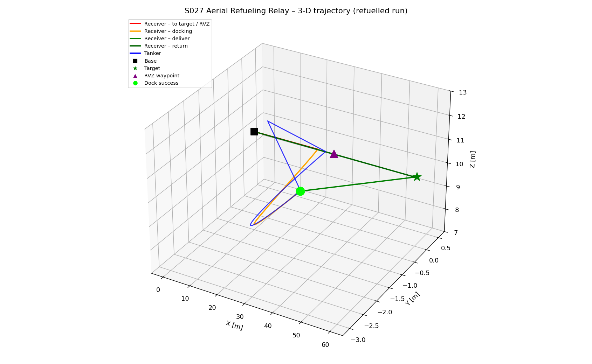
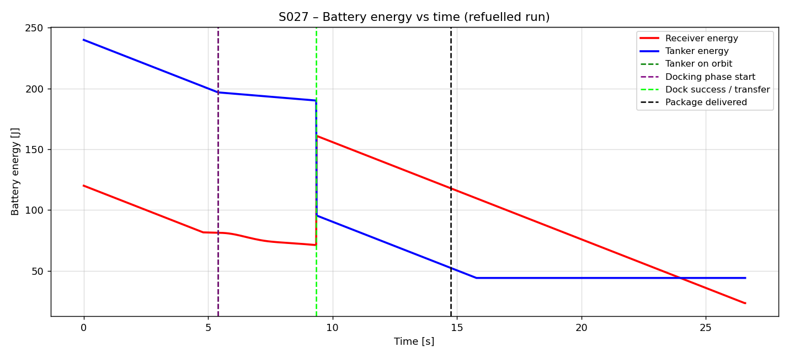
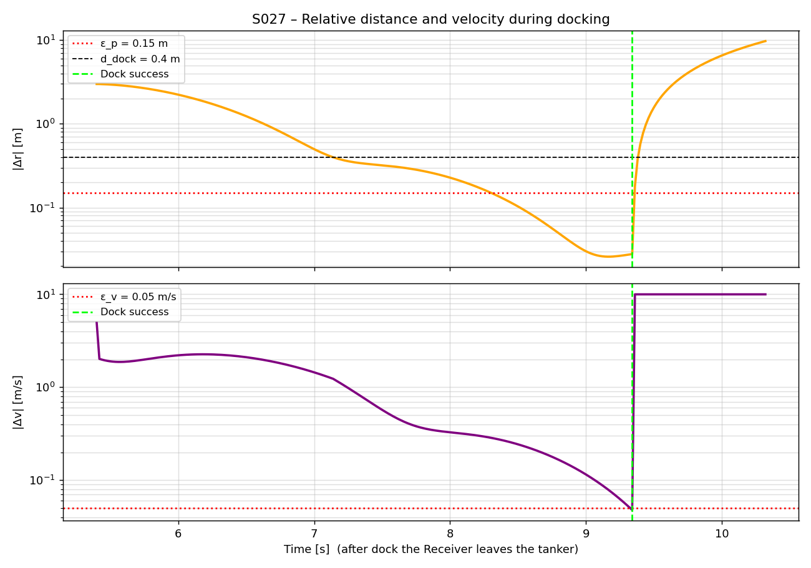
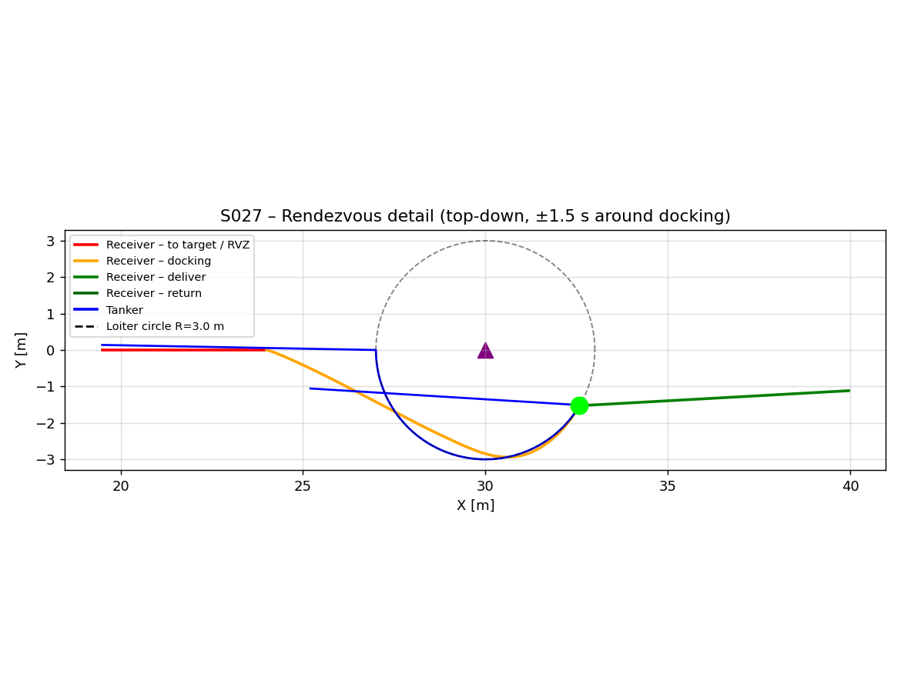
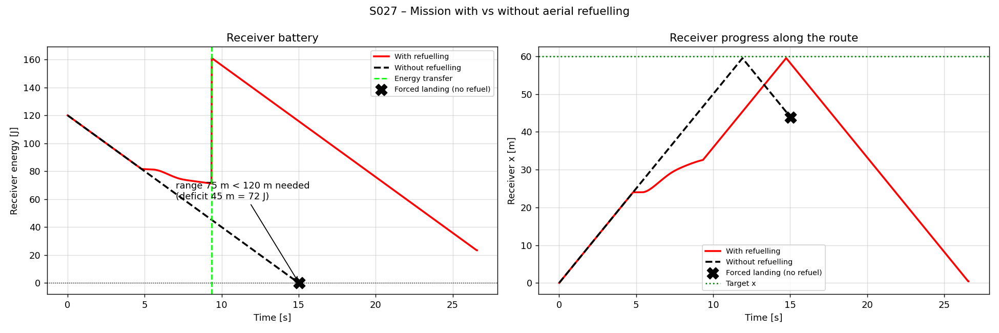
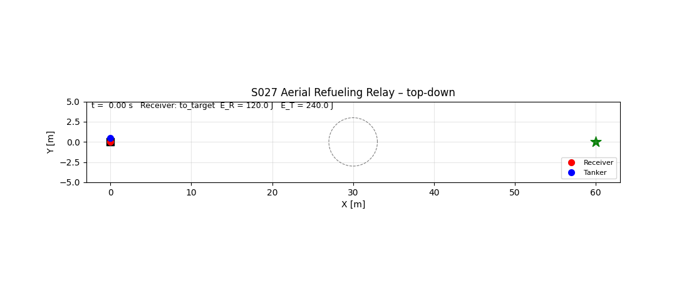

# S027 Aerial Refueling Relay

**Domain**: Logistics & Delivery | **Difficulty**: ⭐⭐⭐ | **Status**: ✅ Completed

---

## Problem Definition

A delivery drone (Receiver) must fly from base to a target 60 m away and back, but its battery covers only 75 m. It checks the card's range trigger. When the trigger fires, a tanker launches from base, flies to a loiter orbit around the route midpoint, and holds station there. The Receiver docks (relative position < ε_p and relative velocity < ε_v), receives energy, delivers the package and returns, while the Tanker returns to base. A second run without refuelling shows the forced landing the trigger predicts.

---

## Mathematical Model Summary

**Battery drain model**:

$$\dot{E} = -(k_f v^2 + k_h)$$

**Remaining range and refuel trigger** (card):

$$d_{rem} = \frac{E}{k_f V^2 + k_h} \cdot V, \qquad \text{request refuel if } d_{rem} < d_{target} + d_{base} + d_{margin}$$

**Rendezvous waypoint** (midpoint fraction $\alpha$):

$$\mathbf{w}_{rvz} = (1-\alpha)\,\mathbf{p}_{base} + \alpha\,\mathbf{p}_{target}$$

**Tanker loiter orbit** (entry phase $\phi_0 = \pi$, the side of the circle facing base):

$$\mathbf{p}_T(t) = \mathbf{w}_{rvz} + R_{orb}\begin{bmatrix}\cos(\omega t + \phi_0)\\\sin(\omega t + \phi_0)\\0\end{bmatrix}, \qquad \omega = V_{T,orb}/R_{orb}$$

**Receiver approach control** (Phase 1, $\|\Delta\mathbf{r}\| > d_{dock}$):

$$\mathbf{u}_R = -K_p\,\Delta\mathbf{r} - K_d\,\Delta\mathbf{v} + \mathbf{a}_T$$

**Soft-dock control** (Phase 2, $\|\Delta\mathbf{r}\| \le d_{dock}$):

$$\mathbf{u}_R = -K_{p2}\,\Delta\mathbf{r} - K_{d2}\,\Delta\mathbf{v} + \mathbf{a}_T$$

**Energy transfer** (5% loss):

$$E_R \mathrel{+}= \Delta E_{xfer}, \qquad E_T \mathrel{-}= \Delta E_{xfer}(1 + \eta_{loss})$$

**Energy budget**: cruise power $0.3 \times 5^2 + 0.5 = 8.0$ W, i.e. 1.6 J/m. The 120 m round trip needs 192 J. $E_{0,R} = 120$ J gives a 75 m range, so refuelling is required; $120 + 90 = 210$ J gives 131.2 m, so the mission is feasible.

---

## Key Parameters

| Parameter | Value |
|---|---|
| Cruise speed (both drones) | 5.0 m/s |
| Tanker loiter speed $V_{T,orb}$ | 2.0 m/s |
| Loiter radius $R_{orb}$ | 3.0 m |
| Flight power coefficient $k_f$ | 0.3 W·s²/m² |
| Hover baseline drain $k_h$ | 0.5 W |
| Receiver initial battery $E_{0,R}$ | 120 J |
| Tanker initial battery $E_{0,T}$ | 240 J |
| Energy transferred $\Delta E_{xfer}$ | 90 J |
| Transfer loss fraction $\eta_{loss}$ | 5% |
| Docking engagement radius $d_{dock}$ | 0.4 m |
| Position dock tolerance $\epsilon_p$ | 0.15 m |
| Velocity dock tolerance $\epsilon_v$ | 0.05 m/s |
| Approach PD gains $(K_p, K_d)$ | (2.0, 1.5) |
| Soft-dock PD gains $(K_{p2}, K_{d2})$ | (4.0, 2.5) |
| Range safety margin $d_{margin}$ | 5.0 m |
| Docking phase entry | Receiver within $2R_{orb} = 6$ m of the RVZ and Tanker on orbit |
| Rendezvous fraction $\alpha$ | 0.5 (midpoint, RVZ = (30, 0, 10) m) |
| Base-to-target distance / altitude | 60.0 m / 10 m |
| Waypoint arrival radius | 0.5 m |
| Simulation time-step DT / limit | 0.02 s / 120 s |

### Deviations from the scenario card

- **Card corrected — energies ×3.** The card's 40 / 80 / 30 J gave the Receiver only 40 / 1.6 = 25 m of range, so it could not even reach the RVZ 30 m away. The previous script instead used 400 / 800 / 300 J. That is 2.08× the full 192 J round trip, so refuelling was unnecessary and the "without refuelling" run never ran out (the Receiver ended with 508 J, more than it started with). All three card energies are now scaled by 3 (ratios kept): 120 / 240 / 90 J.
- **Card corrected — soft-dock feed-forward.** The card's Phase-2 law has no $\mathbf{a}_T$ feed-forward. Against a tanker on a 2 m/s, 3 m orbit, that leaves a steady lag of $V_{T,orb}^2 / R_{orb} / K_{p2} = 0.333$ m, more than $\epsilon_p$. The script checks this: with the card's law the Receiver never docks, its mean distance over the last 4 s of soft-dock is 0.330 m, and its battery runs empty while it is still chasing the tanker (t = 45.62 s). $\mathbf{a}_T$ was added to Phase 2 in both the script and the card.
- **Loiter speed, radius and gains are back to the card values.** The previous script used 1 m/s, 2 m/s and 3/2, 6/4 without explanation.
- **Trigger fires at t = 0.** With these energies the card's range trigger fires immediately ($d_{rem}$ = 75.0 m < 125.0 m needed), so the Tanker is launched at t = 0, as in the card's "standard configuration".
- **Additions the card leaves open:**
  - The Tanker flies to the orbit entry point instead of jumping onto the orbit. The previous script teleported it 3 m from the RVZ centre.
  - The Receiver holds position 6 m before the RVZ until the Tanker is on its orbit.
  - Drones in cruise are kinematic: velocity is set directly to 5 m/s toward the goal.
- **Dock check ordering fixed.** Previously the Tanker was advanced before the Receiver's dock check within a step, so the event line (|Δr| 0.0218 m, |Δv| 0.0496 m/s) and the summary (|Δr| 0.0023 m, |Δv| 0.0511 m/s, outside tolerance) described different states. The dock condition is now checked on the recorded state of both drones before either one moves. The event line and the history give identical values.

---

## Simulation Results

| Metric | Value |
|---|---|
| Refuel trigger | t = 0.00 s ($d_{rem}$ 75.0 m < need 125.0 m) |
| Receiver holds 6.00 m before RVZ | from 4.80 s |
| Tanker on loiter orbit | 5.40 s |
| Docking phase start | 5.40 s |
| Docking success | 9.34 s (duration 3.94 s) |
| \|Δr\| / \|Δv\| at dock | 0.0278 m / 0.0479 m/s (tol 0.15 m / 0.05 m/s) |
| Energy before transfer | Receiver 71.15 J, Tanker 190.10 J |
| Energy after transfer | Receiver 161.15 J, Tanker 95.60 J |
| Package delivered | 14.74 s |
| Receiver home | 26.56 s, final energy 23.38 J |
| Tanker home | 15.78 s, final energy 44.08 J |
| Min range margin after refuel ($d_{rem}$ − needed, needed includes 5 m margin) | 8.24 m |
| Mission complete | 26.58 s |
| **Without refuelling** | forced landing at t = 15.02 s, x = 43.90 m (package delivered, 43.90 m short of base); 75.10 m flown of 120 m |

**Energy checks**:
- Tanker at dock: 240 − 5.40 s × 8.0 W (transit) − 3.94 s × 1.7 W (orbit at 2 m/s: 0.3 × 4 + 0.5 = 1.7 W) = 240 − 43.2 − 6.7 = 190.1 J. After the transfer: 190.10 − 90 × 1.05 = 95.60 J.
- Receiver: 71.15 + 90 = 161.15 J.
- Without refuelling: the Receiver flies 120 J / 1.6 J/m = 75 m. That is 60 m out, then 15 m of the way back, so it lands near x = 44 m (43.90 m, after the 0.5 m arrival radius).
- The refuelled Receiver ends with 23.38 J, less than it started with, and its range margin never drops below 8.24 m.

---

## Output Files

### 3D Trajectory
Receiver colour-coded by phase (to target/RVZ = red, docking = orange, deliver = green, return = dark green); Tanker in blue. The RVZ, the dock point, the base and the target are marked:

### Battery
Energy vs time for both drones, with event markers: Tanker on orbit and docking start (both at 5.40 s, lines overlap), dock success / transfer, and package delivered. The Tanker's energy stays constant after it lands at 15.78 s:

### Docking Relative Motion
Semi-log relative distance and relative velocity from the docking start until 1 s after the dock. Before the dock, |Δv| falls through ε_v = 0.05 m/s. After the dock, the two drones fly apart (|Δv| ≈ 10 m/s, both at 5 m/s in opposite directions):

### Rendezvous Detail (top-down)
The Tanker arrives at the orbit entry point (27, 0) and circles. The Receiver leaves its hold point 6 m before the RVZ, curves onto the orbit behind the Tanker and docks at about (32.6, −1.5) m. Shown from 1.5 s before docking starts to 1.5 s after the dock:

### Mission Comparison
Receiver battery (left) and x-position (right) with and without refuelling. Without refuelling, the Receiver delivers the package but runs empty 43.90 m from base, as the trigger predicted: a 75 m range against 120 m needed is a 45 m (72 J) deficit:

### Animation
Top-down view of the refuelled mission: 138 frames at 12 fps, sampled more densely during docking. While docked, the Receiver dot is hidden under the Tanker (3 cm apart):

---

## Extensions

1. Optimal rendezvous fraction: sweep alpha in [0.3, 0.7] and minimise total mission time
2. Wind disturbance during docking: add turbulence model and re-tune PD gains
3. Multi-hop refueling chain: add a second Tanker for ultra-long-range delivery
4. Partial transfer strategy: transfer only the minimum required energy
5. Moving refueling platform: Tanker flies straight segment, Receiver intercepts a moving target

---

## Related Scenarios

- Prerequisites: [S021](../../../scenarios/02_logistics_delivery/S021_point_delivery.md) — basic delivery, [S024](../../../scenarios/02_logistics_delivery/S024_wind_compensation.md) — wind disturbance compensation
- Follow-ups: [S028](../../../scenarios/02_logistics_delivery/S028_cargo_escort_formation.md) — cargo escort formation, [S036](../../../scenarios/02_logistics_delivery/S036_last_mile_relay.md) — last-mile relay
- Cross-domain: [S012](../../../scenarios/01_pursuit_evasion/S012_relay_pursuit.md) — relay handoff state machine pattern
