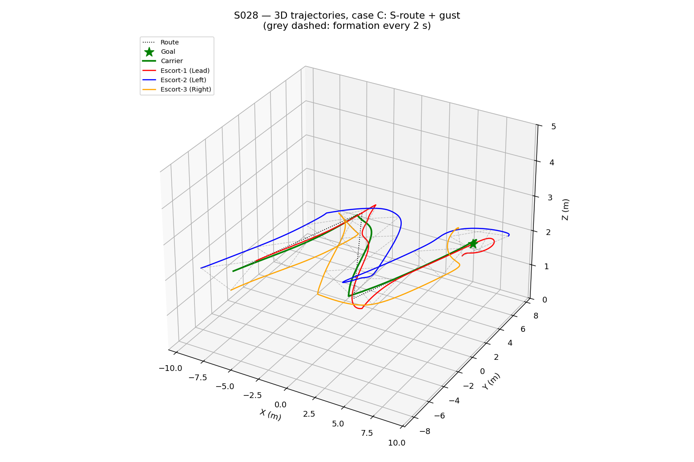
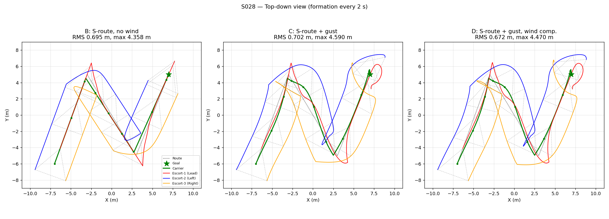
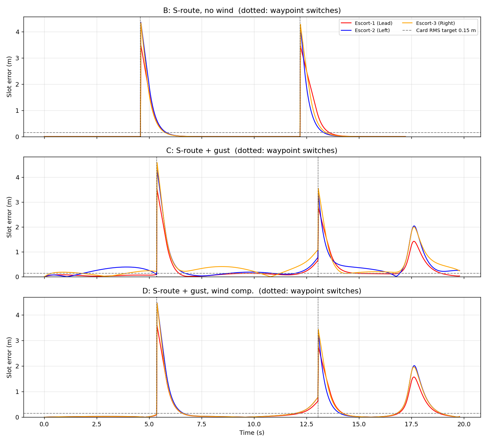
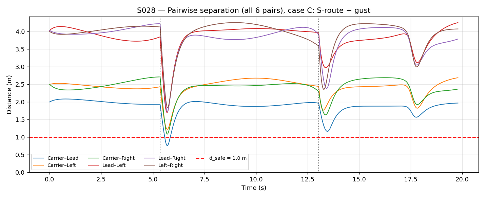
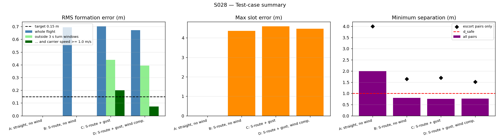
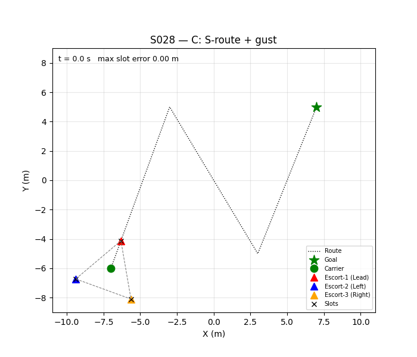

# S028 Cargo Escort Formation

**Domain**: Logistics & Delivery | **Difficulty**: ⭐⭐⭐ | **Status**: ✅ Completed

---

## Problem Definition

**Setup**: A cargo drone (Carrier) flies a waypoint route. Three escort drones (Lead, Left, Right) fly in a protective triangle around it, each tracking a slot defined in the Carrier's heading frame. Four test cases are run with the same controller:

| Case | Route | Carrier speed | Disturbance | Escort law |
|---|---|---|---|---|
| A | straight (−8, 0, 2) → (8, 0, 2) m (card setup) | 3.0 m/s | none | card VS law |
| B | S-route (−7, −6) → (−3, 5) → (3, −5) → (7, 5) m, z = 2 m; turns of 129° and 127° | 3.0 / 1.5 / 3.0 m/s per leg | none | card VS law |
| C | as B | as B | travelling lateral gust | card VS law |
| D | as B | as B | travelling lateral gust | VS law + wind compensation |

**Objective**:
1. Minimise formation error, the RMS deviation of each escort from its slot. The card's target is < 0.15 m.
2. The Carrier must arrive within 0.2 m of the goal.
3. No pair of drones may come closer than $d_{safe} = 1.0$ m, Carrier included.

---

## Mathematical Model Summary

**Slot position** for escort $i$ (body-frame offset rotated by Carrier heading $\psi_C = \operatorname{atan2}(v_{C,y}, v_{C,x})$; the heading is held when the Carrier is at rest):

$$\mathbf{s}_i(t) = \mathbf{p}_C(t) + \mathbf{R}(\psi_C) \cdot \mathbf{f}_i$$

**Carrier guidance** (card): $\mathbf{v}_{C} = K_{pC}(\mathbf{g} - \mathbf{p}_C) - K_{dC}\mathbf{v}_C$, clamped to the leg speed. It switches to the next waypoint within 0.5 m.

**Virtual-structure escort control** (card, cases A–C):

$$\mathbf{v}_{E_i,cmd} = K_{pE} (\mathbf{s}_i - \mathbf{p}_{E_i}) + \mathbf{v}_C + \sum_j \mathbf{v}_{rep,ij}$$

The command is clamped to 6 m/s. The repulsion term follows the card's formula, $k_{rep}(d_{safe} - d_{ij})/d_{ij}\,\hat{\mathbf{r}}_{ij}$ for $d_{ij} < d_{safe}$, with the other escorts **and the Carrier** as sources.

**Wind** (cases C, D; card Extension 1, made position-dependent so that drones feel different wind):

$$\mathbf{w}(\mathbf{p}, t) = [0,\ w_y \sin(\omega t - \kappa x),\ 0], \qquad \kappa = 2\pi/\lambda$$

Every drone's ground velocity is its command plus the local wind. A uniform wind would move all drones identically and could not disturb the formation of these kinematic drones.

**Wind compensation** (case D): the escort feeds forward the Carrier's actual ground velocity $\mathbf{v}_C + \mathbf{w}(\mathbf{p}_C)$ and subtracts its own measured wind $\mathbf{w}(\mathbf{p}_{E_i})$.

**Why case C has a standing error**: the slot error obeys $\dot{\mathbf{e}} = -K_{pE}\mathbf{e} + (\mathbf{w}_C - \mathbf{w}_{E_i})$ plus heading-rotation terms. For escorts up to 2.5 m apart in x, $|\mathbf{w}_C - \mathbf{w}_E| \le 2 w_y \sin(\kappa \Delta x / 2) = 2 \sin(0.654) = 1.22$ m/s. That gives a quasi-steady error of up to $1.22/3 \approx 0.4$ m, which case D removes.

**RMS formation error**: $\bar{e}_{rms} = \sqrt{\frac{1}{N M}\sum_i \sum_k e_i(k\Delta t)^2}$ over the flight, from t = 0 to Carrier arrival.

---

## Key Parameters

| Parameter | Value |
|-----------|-------|
| Carrier start / goal (case A) | (−8, 0, 2) m / (8, 0, 2) m |
| S-route (cases B–D) | (−7, −6, 2) → (−3, 5, 2) → (3, −5, 2) → (7, 5, 2) m |
| Carrier speed | 3.0 m/s (case A; S-route legs 1 and 3), 1.5 m/s (S-route leg 2) |
| Carrier gains $K_{pC}$ / $K_{dC}$ | 1.5 / 0.4 |
| Escort max speed | 6.0 m/s |
| Slot — Lead (E1) | (+2.0, 0.0, 0.0) m body |
| Slot — Left (E2) | (−1.5, +2.0, 0.0) m body |
| Slot — Right (E3) | (−1.5, −2.0, 0.0) m body |
| Escort position gain $K_{pE}$ | 3.0 |
| Repulsion gain $k_{rep}$ | 3.0 |
| Safety distance $d_{safe}$ | 1.0 m |
| Arrival tolerance / waypoint switch radius | 0.2 m / 0.5 m |
| Gust $w_y$ / $\omega$ / wavelength $\lambda$ | 1.0 m/s / 1.0 rad/s / 12 m |
| Turn window (metric only) | 3 s after each waypoint switch |
| Cruise threshold (metric only) | Carrier speed ≥ 1.0 m/s |
| Simulation timestep $\Delta t$ | 1/48 s (~48 Hz) |
| Max simulation time | 30 s (each run ends at Carrier arrival) |

### Deviations from the scenario card

- **Test cases B–D added** (card Extensions 1 and 2). On the card's straight route the escorts start in their slots, the Carrier flies straight at constant velocity, the slot feed-forward is exact, and there is no disturbance. The formation error is therefore exactly zero by construction (case A), which does not test the controller.
- **Wind is position-dependent**, not the card's uniform $[0, w_y\sin\omega t, 0]$. With kinematic drones a uniform wind shifts everyone equally and leaves the formation unchanged.
- **Separation includes the Carrier**, and escorts are also repelled by the Carrier. The card's repulsion formula counts escort–escort pairs only. The previous version's "4.0 m minimum separation" was the escort–escort minimum; the real minimum on the straight route is Carrier–Lead = 2.0 m.
- **Heading held at rest.** The previous code reset the formation heading to +x whenever the Carrier stopped. That was harmless on a +x route but would rotate the formation on any other route.
- **Card expectations not met**: "error converges near zero within ~2 s", RMS < 0.15 m and minimum separation > $d_{safe}$ all hold only on the straight route. On the S-route all three fail; see the results.
- **Middle-leg speed 1.5 m/s is not from the card.** The card's Carrier flies at a constant 3.0 m/s. The S-route halves the speed on its middle leg so that the escorts' Carrier-velocity feed-forward is tested through speed changes as well as turns.
- N = 3 escorts only; the optional rear escort is not simulated.

---

## Simulation Results

| Metric | A: straight | B: S-route | C: + gust | D: + gust, wind comp. |
|--------|---|---|---|---|
| Carrier arrival time | 6.85 s | 17.21 s | 19.79 s | 19.79 s |
| Carrier final error | 0.1994 m | 0.1988 m | 0.1937 m | 0.1937 m |
| RMS formation error (whole flight) | **0.0000 m** ✅ | 0.6952 m ❌ | 0.7019 m ❌ | 0.6716 m ❌ |
| RMS per escort (Lead / Left / Right) | 0 / 0 / 0 m | 0.6690 / 0.6965 / 0.7192 m | 0.5963 / 0.7183 / 0.7786 m | 0.6060 / 0.6952 / 0.7088 m |
| Max slot error | 0.0000 m | 4.3581 m | 4.5903 m | 4.4699 m |
| RMS outside 3 s turn windows | 0.0000 m | 0.0001 m | 0.4399 m | 0.3934 m |
| RMS on cruise (outside turn windows, Carrier ≥ 1 m/s) | 0.0000 m | 0.0001 m | 0.2004 m | **0.0735 m** |
| Max Carrier heading deviation from leg direction (outside turn windows / cruise) | 0.0° / 0.0° | 2.2° / 2.2° | 154.4° / 24.6° | 154.4° / 24.6° |
| Min separation, all pairs | 2.0000 m (Carrier–Lead) ✅ | 0.7991 m (Carrier–Lead) ❌ | 0.7607 m (Carrier–Lead) ❌ | 0.7714 m (Carrier–Lead) ❌ |
| Min separation, escort pairs only | 4.0000 m | 1.6504 m | 1.6992 m | 1.5221 m |
| Steps with repulsion active | 0 of 329 | 29 of 826 | 13 of 950 | 13 of 950 |

**Case A**: zero error and 2.0 m minimum separation (the Lead's slot is 2.0 m ahead of the Carrier). This only confirms the geometry.

**Turns dominate the error (case B).**
- The slots are attached to the Carrier's *velocity* heading. At a waypoint switch the heading turns by about 129°, so every slot jumps along a chord of $2r\sin(129°/2)$: 3.6 m for the Lead (r = 2.0 m) and 4.5 m for the side escorts (r = 2.5 m). The measured peak is 4.3581 m.
- The P-law ($K_{pE} = 3$, escort speed limited to 6 m/s) needs about 1.5 s to close the gap. Outside the 3 s turn windows the error is 0.0001 m.
- The Lead moves straight toward its new slot, so it cuts the corner past the Carrier. The chord's closest point to the Carrier is $2.0 \cos(64.5°) = 0.86$ m, below $d_{safe}$, and the repulsion term activates for 29 steps. The minimum Carrier–Lead distance is 0.7991 m, so repulsion slows but does not prevent the violation.
- The VS law with an instantaneously rotating slot frame cannot meet the card targets on a route with sharp turns. A turn-rate-limited heading or a rounded path would be needed.

**Gust without compensation (case C).** On cruise segments the RMS is 0.2004 m, above the 0.15 m target. This is consistent with the ≈ 0.4 m upper bound from the different wind each drone feels. Outside the turn windows the RMS is higher (0.4399 m, max 2.0469 m), because the Carrier slows down before WP2 and near the goal. At low speed its velocity heading is dominated by its own correction against the gust: the heading deviates up to 154.4° from the leg direction, against 24.6° on cruise segments. Because the slot frame follows that heading, the whole formation swings around (peak near t = 17.6 s in the error plot).

**Gust with compensation (case D).** Feeding forward the Carrier's ground velocity and the escort's own wind cuts the cruise RMS from 0.2004 m to 0.0735 m, inside the 0.15 m target. It does not help with the heading swings at low Carrier speed (0.3934 m outside turn windows), or with the turns. Whole-flight RMS therefore only drops from 0.7019 m to 0.6716 m.

---

## Output Files

### 3D Trajectory
Case C (S-route + gust): Carrier (green), escorts (red/blue/orange), route (dotted), formation triangle every 2 s (grey dashed):

### Top-Down XY View
Cases B, C and D side by side. Note the escorts swinging wide at the two turns, and the formation wobbling near the goal under the gust:

### Formation Metrics
Per-escort slot error vs time for cases B, C and D (dotted lines: waypoint switches; dashed line: the 0.15 m card target). Each switch produces a spike that decays in about 1.5 s. Peaks per escort (Lead / Left / Right): 3.49 / 4.36 / 4.34 m and 3.46 / 4.23 / 4.28 m in case B; at the first switch 3.52 / 4.34 / 4.59 m (C) and 3.58 / 4.47 / 4.46 m (D); at the second switch only 2.80 / 3.37 / 3.55 m (C) and 2.76 / 3.36 / 3.43 m (D). With the gust, case C keeps a 0.1–0.4 m standing error on the legs, while case D does not. Both show the bump at t ≈ 17.6 s while the Carrier slows near the goal:

### Pairwise Separation
All six pairs for case C. Carrier–Lead dips to 0.76 m just after the first turn and to about 1.2 m after the second:

### Combined Metrics
Summary for all four cases: RMS error (whole flight, outside turn windows, cruise only), max slot error, and minimum separation (all pairs vs escort pairs only):

### Animation
Case C, top-down, 140 frames at 12 fps sampled evenly over the 19.79 s flight; slots are marked with ×:

---

## Extensions

1. Rate-limit the formation heading (or fly a rounded path) so slots do not jump at waypoint switches — the main error and separation problem found above
2. Define the slot frame from the route leg instead of the Carrier's instantaneous velocity, removing the low-speed heading swings under wind
3. Replace virtual-structure law with consensus-based controller using only neighbour-to-neighbour communication
4. Introduce a threat drone; one escort breaks formation to intercept (combine with S001 PNG guidance)
5. Scale to $N = 6$ escorts in a hexagonal ring and compare RMS error vs $N = 3$ triangle

---

## Related Scenarios

- Prerequisites: [S021 Point Delivery](../../../scenarios/02_logistics_delivery/S021_point_delivery.md) — basic delivery, [S026 Cooperative Heavy Lift](../../../scenarios/02_logistics_delivery/S026_cooperative_heavy_lift.md) — multi-drone load
- Follow-ups: [S029 Urban Logistics Scheduling](../../../scenarios/02_logistics_delivery/S029_urban_logistics_scheduling.md) — multi-drone routing, [S031 Path De-confliction](../../../scenarios/02_logistics_delivery/S031_path_deconfliction.md) — multi-drone conflict avoidance
- Domain 1 analogue: [S011 Swarm Encirclement](../../../scenarios/01_pursuit_evasion/S011_swarm_encirclement.md) — virtual-structure coordination pattern
