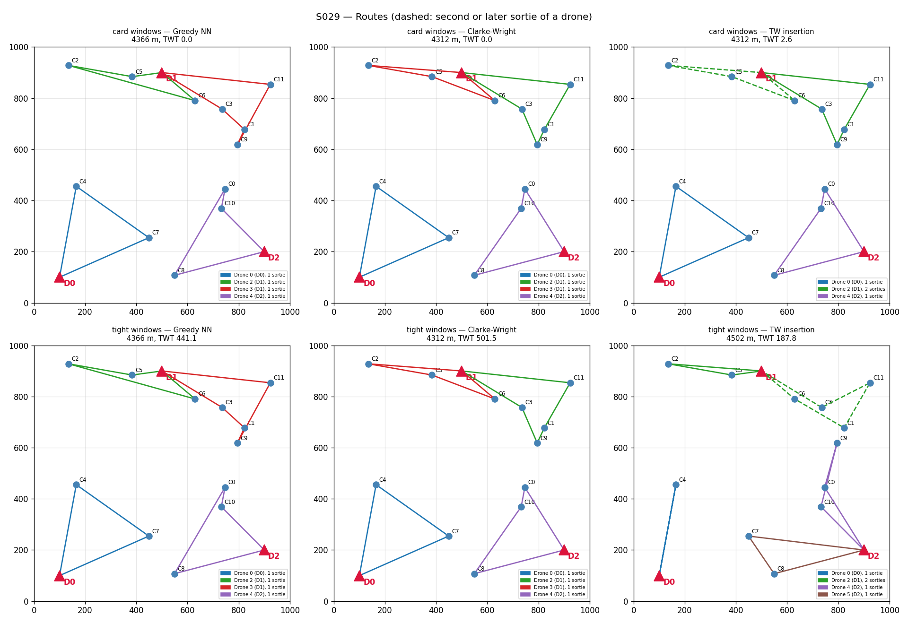
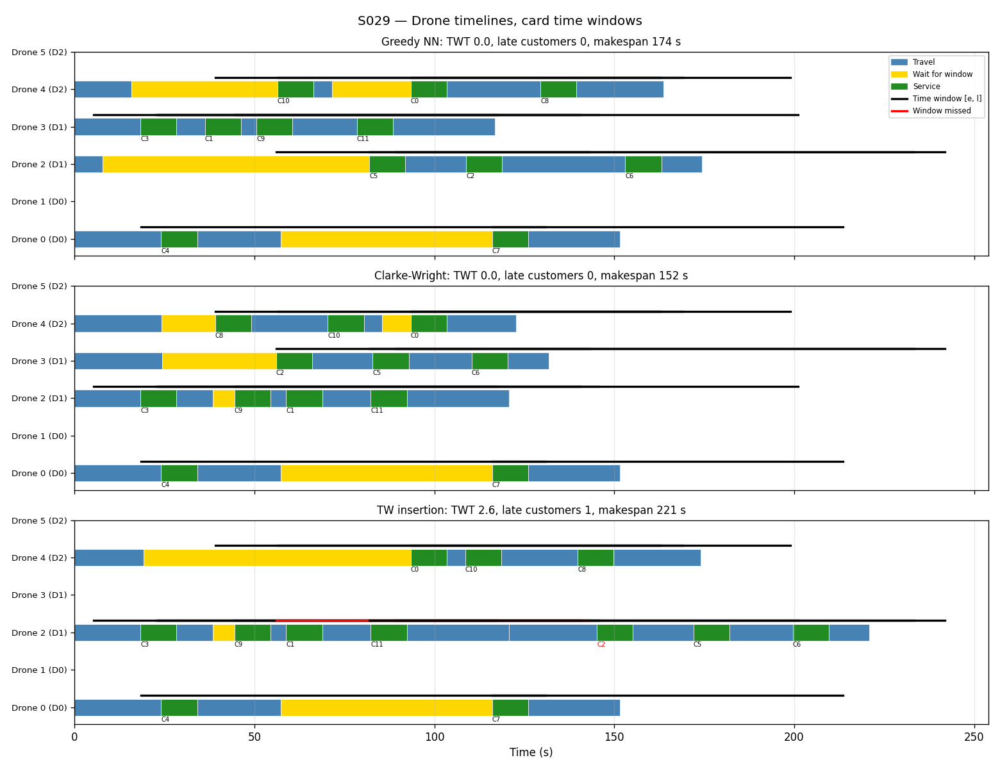
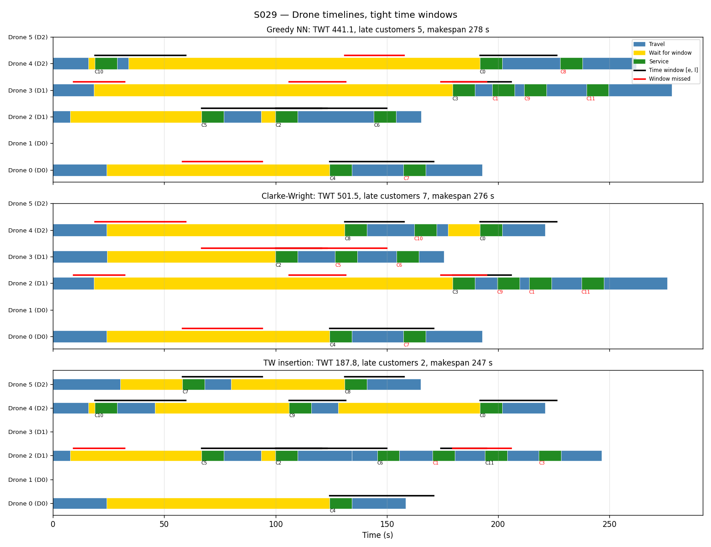
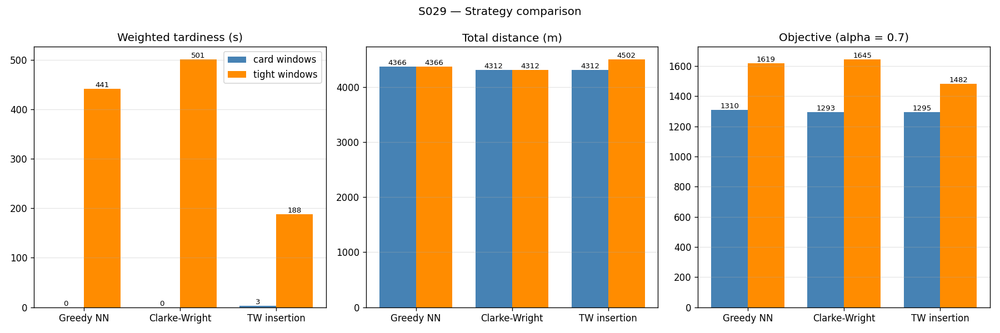
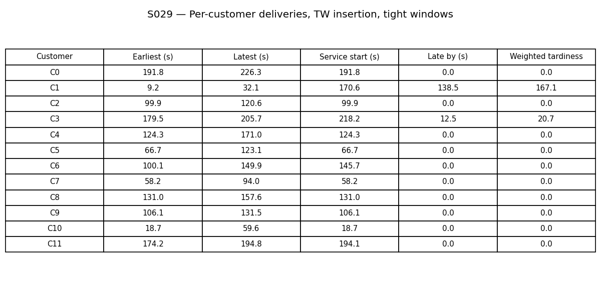
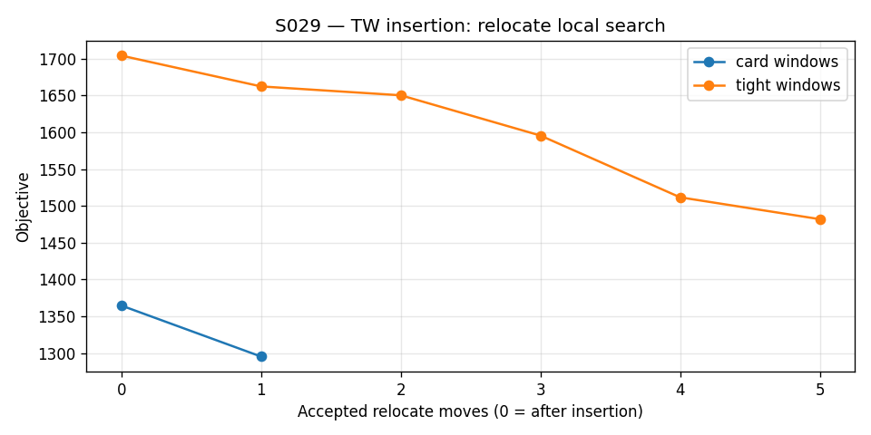
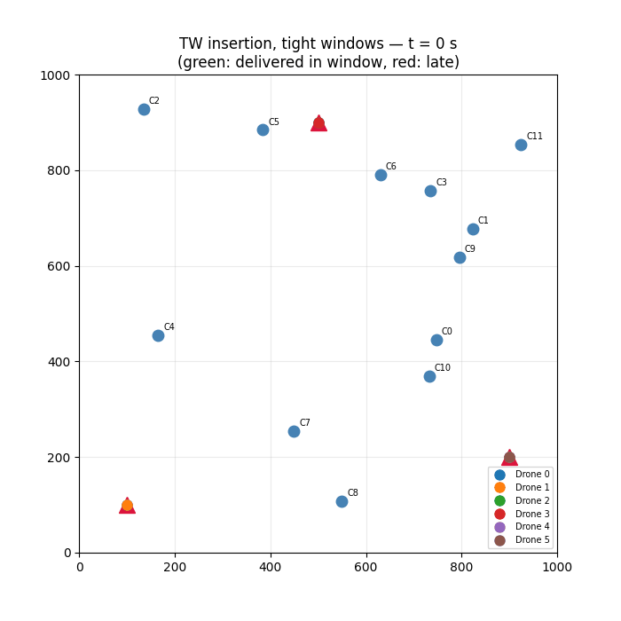

# S029 Urban Logistics Scheduling

**Domain**: Logistics & Delivery | **Difficulty**: ⭐⭐⭐⭐ | **Status**: ✅ Completed

---

## Problem Definition

**Setup**: An urban delivery network has $D = 3$ depots and $C = 12$ customers on a $1000 \times 1000$ m grid. A fleet of $K = 6$ drones is split across the depots (2 per depot).
- **Sorties**: a drone may fly several sorties. Each sortie starts and ends at the drone's own depot, with payload capacity $Q = 3.0$ kg and range $R_{max} = 4000$ m per sortie.
- **Orders**: each customer has a demand, an importance weight $w_c$ and a time window $[e_c, l_c]$. Waiting for $e_c$ is allowed; serving after $l_c$ costs weighted tardiness.

**Objective**: minimise the card's weighted sum $\alpha\,\text{TWT} + (1-\alpha)\,\text{distance}$ with $\alpha = 0.7$.

**Strategies compared**:
1. **Greedy NN** — each customer goes to its nearest depot. Nearest-neighbour sorties are built within capacity and range, and each sortie goes to the depot drone that becomes free first. Time windows are ignored.
2. **Clarke-Wright Savings** — savings merges inside each nearest-depot group, with capacity and range checks, and the same sortie-to-drone assignment. Time windows are ignored.
3. **TW insertion (VRPTW heuristic)** — time-window aware; used because OR-Tools is not installed in the `drones` environment. Customers are taken in order of latest time $l_c$ (urgency). Each is inserted at the position with the smallest increase in the objective, searching every drone, every depot, every position in an existing sortie, or a new sortie. A relocate local search then moves single customers to their best position while the objective improves (a Solomon-style insertion heuristic plus local search).

**Instances** (same depots, customers, demands and weights; seed 42):
- **card** — the card's time windows: $e_c \sim U(0, 120)$ s, width $\sim U(60, 180)$ s.
- **tight** — narrow windows spread over the morning: $e_c \sim U(0, 240)$ s, width $\sim U(20, 60)$ s, seed 2029. This instance was added because the card windows are so loose that the two original strategies already have zero tardiness, so they cannot show what time-window awareness is worth.

---

## Mathematical Model Summary

**Travel time** between nodes $i$ and $j$: $t_{ij} = \|\mathbf{p}_i - \mathbf{p}_j\| / v$. **Service start** $s_c = \max(\text{arrival}_c, e_c)$, followed by a 10 s service.

**Clarke-Wright savings** for customers $i, j$ of the same depot $d$:

$$S_{ij} = d_{d,i} + d_{d,j} - d_{ij}$$

Merge greedily in decreasing $S_{ij}$ order (route ends only), subject to $\sum q_c \leq Q$ and route length $\leq R_{max}$.

**Composite objective**:

$$J = \alpha \sum_{c} w_c \max(0,\; s_c - l_c) + (1-\alpha) \sum_{k} L_k$$

Here $L_k$ is the total distance of drone $k$ over all its sorties.

**Insertion cost** (strategy 3): $\Delta J_k$ = the change in drone $k$'s objective when $c$ is inserted, with the full schedule (waits and later sorties) re-simulated. An insertion is feasible only if the affected sortie keeps load ≤ $Q$ and length ≤ $R_{max}$.

---

## Key Parameters

| Parameter | Value |
|-----------|-------|
| Depots | 3: (100,100), (500,900), (900,200) m |
| Customers | 12, random seed 42, in [50, 950] m |
| Drones | 6 total (2 per depot) |
| Cruising speed | 15 m/s |
| Payload capacity per sortie | 3.0 kg |
| Max range per sortie | 4000 m |
| Service time per stop | 10 s |
| Card windows: earliest / width | U(0, 120) s / U(60, 180) s (seed 42) |
| Tight windows: earliest / width | U(0, 240) s / U(20, 60) s (seed 2029) |
| Demand per customer | U(0.3, 1.5) kg |
| Importance weight $w_c$ | U(0.5, 2.0) |
| Tardiness weight $\alpha$ | 0.7 |
| Turnaround between sorties | 0 s (instant battery/payload swap) |

### Deviations from the scenario card

- **Third strategy.** The card asks for a VRPTW solved with OR-Tools CP-SAT. OR-Tools is not installed in the environment, so a documented time-window-aware insertion heuristic with relocate local search is used instead. It is a heuristic, not an exact solver; the card instance shows it can end in a local optimum (see the results).
- **Homogeneous fleet.** The card's setup calls the fleet heterogeneous, but its parameters give every drone the same speed (15 m/s), capacity (3.0 kg) and range (4000 m). The simulation uses that homogeneous fleet; drone-specific speeds and capacities are left to Extension 1.
- **Soft time windows.** The card's model lists $e_c \le s_c \le l_c$ as a hard constraint but also minimises tardiness, which only makes sense for soft windows. Windows are treated as soft (late service allowed and penalised), and early arrival waits.
- **Tight-window instance added** (see the Instances list above).
- **Multi-sortie bug fixed.** The previous version concatenated a drone's extra sorties into one customer list without a depot return, so capacity and range were not enforced across sorties. Every sortie now returns to the depot and is checked separately; the largest sortie load is 2.78 kg and the longest sortie 1153 m. In this instance neither old strategy needed more than one sortie per drone, so their card-instance numbers (4366.5 m and 4311.7 m) are unchanged.
- The simulation uses event-based timing instead of the card's 0.5 s timestep. The animation samples positions from these event times.

---

## Simulation Results

All 12 customers are served in every case.

### Card time windows (earliest 5.3–116.1 s, width 75.6–159.9 s)

| Metric | Greedy NN | Clarke-Wright | TW insertion |
|--------|-----------|---------------|--------------|
| Total flight distance | 4366.5 m | **4311.7 m** | **4311.7 m** |
| Total weighted tardiness | **0.00** | **0.00** | 2.62 (1 late) |
| Objective ($\alpha = 0.7$) | 1309.95 | **1293.50** | 1295.33 |
| Makespan | 174.4 s | 151.6 s | 220.9 s |
| Sorties / drones used | 4 / 4 | 4 / 4 | 4 / 3 |

The windows are loose, so time-window awareness has nothing to gain and Clarke-Wright is best.
- **Why TW insertion falls behind.** It ends 1.83 above Clarke-Wright (1295.33 − 1293.50). Its routes have the same distance, but drone 2 flies Clarke-Wright's two D1 sorties back to back ([3, 9, 1, 11] then [2, 5, 6]) while the second D1 drone stays idle, so C2 is 1.9 s late.
- **Why the local search cannot fix it.** Moving a single customer to the idle drone adds distance. The one-customer relocate neighbourhood cannot move the whole sortie, so the search stops in this local optimum (1364.56 → 1295.33 after 1 move).

### Tight time windows (earliest 9.2–191.8 s, width 20.6–56.4 s)

| Metric | Greedy NN | Clarke-Wright | TW insertion |
|--------|-----------|---------------|--------------|
| Total flight distance | 4366.5 m | **4311.7 m** | 4501.6 m |
| Total weighted tardiness | 441.14 (5 late) | 501.46 (7 late) | **187.81 (2 late)** |
| Objective ($\alpha = 0.7$) | 1618.75 | 1644.52 | **1481.95** |
| Makespan | 278.0 s | 275.9 s | 246.6 s |
| Sorties / drones used | 4 / 4 | 4 / 4 | 5 / 4 |

- **Ignoring windows is costly.** Greedy NN and Clarke-Wright build the same routes as on the card instance (distance unchanged). Their drones then wait at the first customer for its window to open and reach the following customers too late; for example, Clarke-Wright's drone 2 waits until about 180 s at C3.
- **TW insertion cuts tardiness.** Weighted tardiness drops by 57% versus Greedy NN (187.81 vs 441.14) and 63% versus Clarke-Wright. It costs 4.4% more distance (4501.6 vs 4311.7 m) and uses a fifth sortie and a second D2 drone. The local search improves the objective from 1704.02 to 1481.95 in 5 moves.
- **Why two customers are still late.** Under $\alpha = 0.7$ it is cheaper to be late than to fly a dedicated sortie (script output):
  - **C1** (window 9.2–32.1 s): it is served 138.5 s late, a weighted 167.1, which costs 0.7 × 167.1 = 117.0. A dedicated sortie from D1 (391.9 m away) would cost 0.3 × 2 × 391.9 = 235.2 in distance.
  - **C3**: 12.5 s late costs 14.5, against 164.9 for a dedicated sortie.

  A larger $\alpha$ would trade distance for punctuality (Extension 4).

---

## Output Files

### Route Maps
All three strategies (columns) on both instances (rows). Each drone has its own colour; a dashed line is a drone's second sortie. Tight windows make TW insertion split D1's customers differently and use a second D2 drone:

### Gantt — card windows
Travel (blue), waiting for a window to open (yellow) and service (green) per drone. The black bar is each served customer's time window, red if missed. In the TW insertion panel, drone 2 flies two sorties back to back and C2 is late:

### Gantt — tight windows
Same layout for the tight instance. Greedy NN and Clarke-Wright drones wait for one customer's window and then miss the next ones (red). TW insertion orders stops by window, with 2 late customers:

### Strategy Comparison
Weighted tardiness, total distance and objective for each strategy on both instances:

### Per-Customer Delivery Table
Earliest/latest time, service start and tardiness per customer for the best tight-window solution (TW insertion):

### Local-Search Convergence
Objective of the TW insertion heuristic after the insertion phase (move 0) and after each accepted relocate move:

### Animation
TW insertion on the tight instance: 120 frames at 10 fps covering the 247 s of flight. Customers turn green when served inside their window and red when served late:

---

## Extensions

1. Heterogeneous fleet — drones with different speeds and capacities; revisit savings with drone-specific arc costs
2. Online order insertion (S033) — new orders arrive after routes are committed; rolling-horizon re-optimisation
3. Charging queue integration (S032) — replace range constraint with battery model and recharge stops
4. Multi-objective Pareto front — plot tardiness vs distance trade-off across $\alpha \in [0, 1]$
5. Exact VRPTW (OR-Tools / CP-SAT) as a reference, and a sortie-move neighbourhood for the local search

---

## Related Scenarios

- Prerequisites: [S021](../../../scenarios/02_logistics_delivery/S021_point_delivery.md) — basic A-to-B delivery, [S022](../../../scenarios/02_logistics_delivery/S022_obstacle_avoidance_delivery.md) — RRT* path planning
- Follow-ups: [S030](../../../scenarios/02_logistics_delivery/S030_multi_depot_delivery.md) — multi-depot partition, [S031](../../../scenarios/02_logistics_delivery/S031_path_deconfliction.md) — airspace deconfliction, [S033](../../../scenarios/02_logistics_delivery/S033_online_order_insertion.md) — online VRP
- Algorithmic cross-reference: [S018](../../../scenarios/01_pursuit_evasion/S018_multi_target_intercept.md) — TSP/Hungarian assignment
