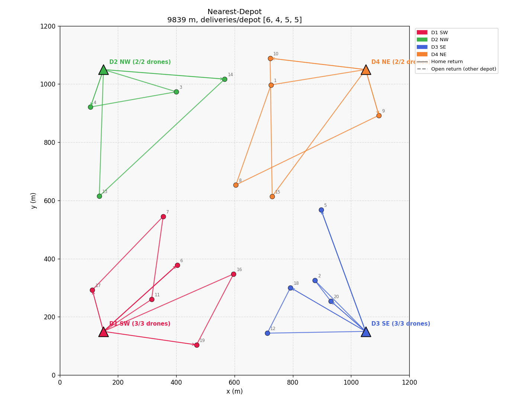
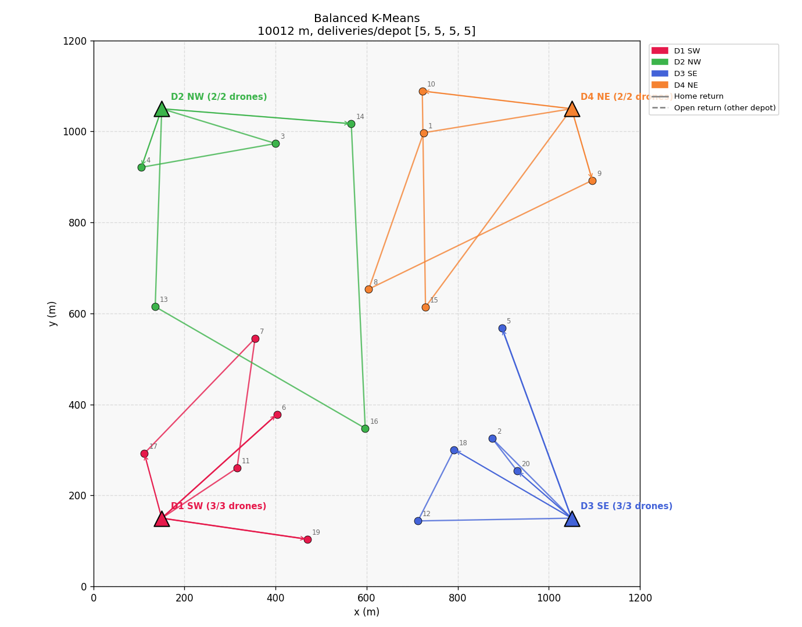
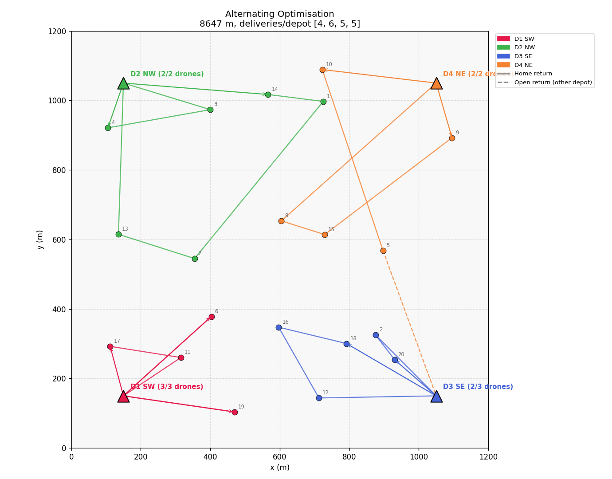
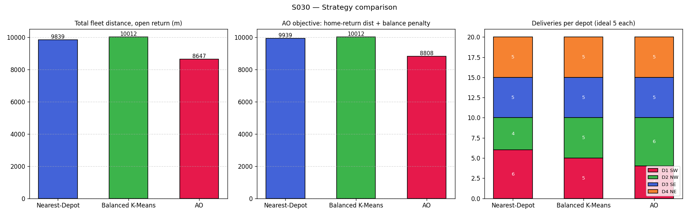
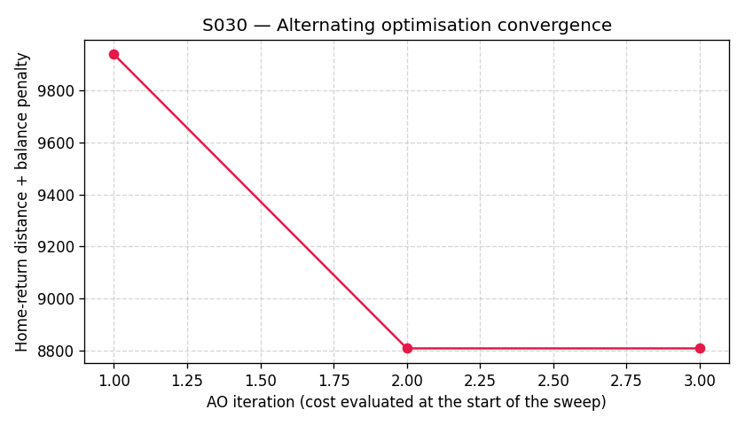
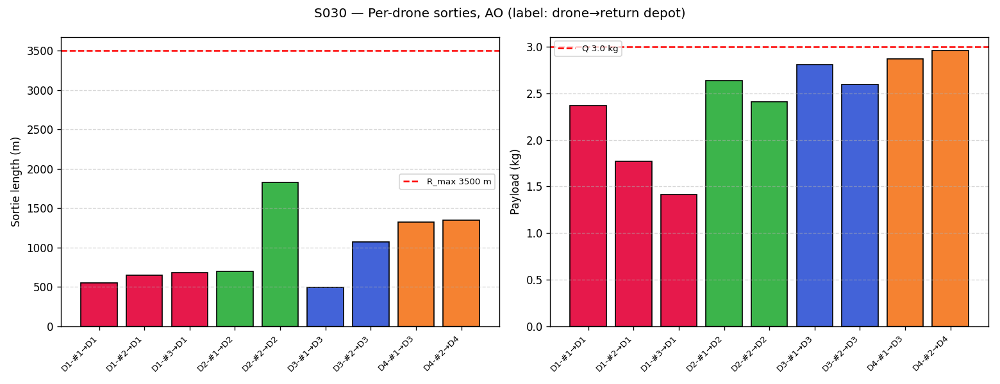
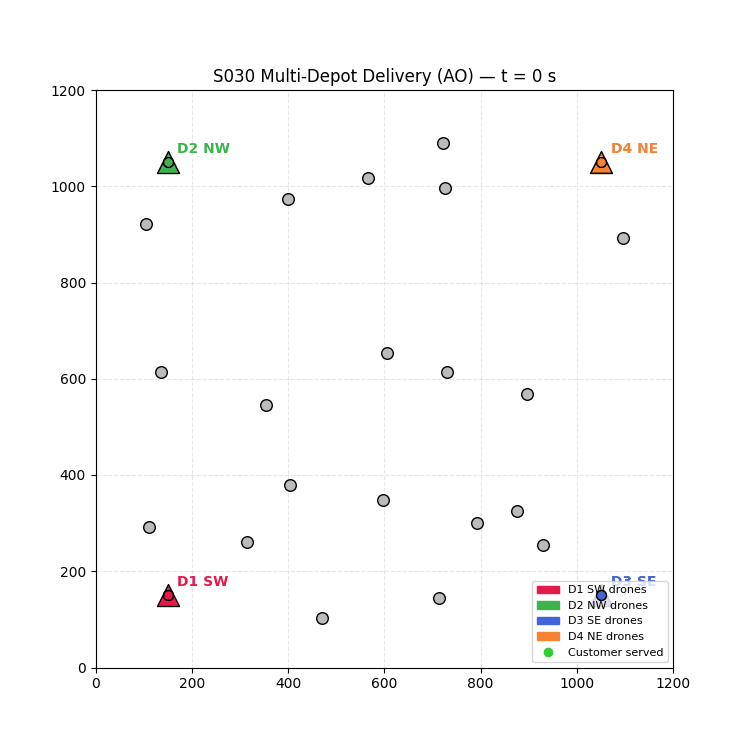

# S030 Multi-Depot Delivery

**Domain**: Logistics & Delivery | **Difficulty**: ⭐⭐⭐ | **Status**: ✅ Completed

---

## Problem Definition

**Setup**: A drone delivery network has $D = 4$ depots in a $1200 \times 1200$ m area. Each depot has a fleet ($F = [3, 2, 3, 2]$, 10 drones) and a cargo inventory ($I = [25, 18, 25, 20]$ kg), and $N = 20$ customer orders must be delivered. As in the card's formulation, each drone flies one route, so depot $m$ can dispatch at most $F_m$ sorties. After its last delivery a drone may **land at a different depot** than its origin (open-route MD-VRP), provided that depot has a free docking slot.

**Objective**: Partition the customers across depots and sequence each drone's route to minimise total fleet distance, plus a load-balance penalty $\lambda \sum_m (n_m - \bar n)^2$. Each sortie must stay within payload $Q = 3.0$ kg and range $R_{max} = 3500$ m, each depot within its fleet size and inventory.

**Strategies compared**:
1. **Nearest-Depot** — each customer goes to its geometrically closest depot.
2. **Balanced K-Means** — depot-anchored K-Means as in the card (seeded at the depots; centroid = 0.5 × depot + 0.5 × cluster mean). Its assignment step caps every cluster at $\lceil N/D \rceil = 5$ customers, assigning customers in order of regret (2nd-nearest minus nearest centroid distance). It targets the card's balance term directly.
3. **Alternating Optimisation (AO)** — starts from Nearest-Depot. Each sweep moves every customer to the depot that most lowers home-return distance + balance penalty, rebuilding routes with 2-opt each time; it stops when the objective changes by less than 1 m.

**Routing inside a depot** (all strategies): the depot builds nearest-neighbour sorties within payload and range limits, then improves each with 2-opt. If that needs more sorties than the depot has drones, it tries a first-fit-decreasing bin packing into $F_m$ sorties. A partition that still does not fit, or that exceeds the depot's inventory, is infeasible (AO never accepts it).

---

## Mathematical Model Summary

**Multi-depot VRP objective** (distance + load-balance penalty):

$$\min \; \sum_{k \in \mathcal{K}} L_k + \lambda \sum_{m \in \mathcal{D}} (n_m - \bar{n})^2$$

Here $L_k$ is drone $k$'s route length, $n_m$ the number of deliveries from depot $m$, and $\bar{n} = N/D = 5$.

**Constraints**:

- Each sortie: $\sum q_c \le Q$ and length $\le R_{max}$.
- Each depot: number of sorties $\le F_m$ and $\sum q_c \le I_m$.

**2-opt swap gain** (accept when positive):

$$\text{gain}(i,j) = d_{v_{i-1},v_i} + d_{v_j,v_{j+1}} - d_{v_{i-1},v_j} - d_{v_i,v_{j+1}}$$

**Open-route return**: after its last delivery, a drone flies to the nearest depot with a free docking slot (slots = fleet size):

$$m^*_k = \arg\min_{m:\,A_m>0} d_{last_k, m}, \qquad \Delta R_k = d_{last_k,\,\delta(k)} - d_{last_k,\,m^*_k}$$

**AO convergence**: stop when $|J^{(t+1)} - J^{(t)}| < \varepsilon_{AO} = 1$. AO optimises the home-return distance; the open-route return is applied afterwards to every strategy.

---

## Key Parameters

| Parameter | Value |
|-----------|-------|
| Depots | 4 (corners): (150,150), (150,1050), (1050,150), (1050,1050) m |
| Fleet distribution | [3, 2, 3, 2] drones per depot = 10 total, one sortie per drone |
| Depot inventory | [25, 18, 25, 20] kg |
| Docking slots for open return | = fleet size per depot |
| Customers | 20, random seed 7, in [100, 1100] m |
| Demand per customer | U(0.3, 1.8) kg (total 21.81 kg) |
| Drone payload $Q$ | 3.0 kg |
| Max range $R_{max}$ | 3500 m per sortie |
| Cruising speed $v$ | 14 m/s |
| Service time per stop | 8 s |
| Balance weight $\lambda$ | 50 m²/delivery² |
| AO convergence $\varepsilon_{AO}$ / max iterations | 1.0 / 50 |
| Balanced K-Means cluster cap / max iterations | 5 customers / 100 |
| Open-route return | enabled |

### Deviations from the scenario card

- **K-Means replaced by a balanced variant.** The card's depot-anchored K-Means (centroids pulled halfway toward their depots) produced exactly the Nearest-Depot partition: the centroids never move far from the depots. It was therefore not a real third comparison, which the previous README did not mention. The size cap makes it a distinct method that optimises the card's balance term.
- **Fleet size and inventory are now enforced.** Previously `n_drones` was unused, so a depot could fly any number of sorties.
  - **Fleet** (one sortie per drone): this constraint binds. Nearest-Depot and Balanced K-Means use every drone at every depot (sorties [3, 2, 3, 2]). AO rejected 54 candidate partitions because a depot would have needed more sorties than drones, and its D4 routes needed the bin-packing fallback.
  - **Inventory**: it never binds. Each depot's inventory (18–25 kg) exceeds what its fleet can carry in one wave ($F_m \cdot Q$ = 6–9 kg); the largest dispatched cargo is 6.51 kg.
- **No time-stepped simulation.** Distances and times are computed from the route geometry; the card's 0.5 s timestep is not used. The GIF samples positions from those event times.
- AO uses nearest-neighbour + 2-opt routes, not the card's Clarke-Wright seeding.

---

## Simulation Results

| Strategy | Distance, open return (m) | Home-return distance (m) | Open-route saving (m) | Deliveries/depot | Balance std | Objective (home dist + penalty) | Sorties/depot | Makespan |
|----------|------|------|------|------|------|------|------|------|
| Nearest-Depot | 9839.0 | 9839.0 | 0.0 | [6, 4, 5, 5] | 0.71 | 9939.0 | [3, 2, 3, 2] | 124.2 s |
| Balanced K-Means | 10012.5 | 10012.5 | 0.0 | **[5, 5, 5, 5]** | **0.00** | 10012.5 | [3, 2, 3, 2] | 170.9 s |
| **AO** | **8646.8** | **8707.5** | **60.7** | [4, 6, 5, 5] | 0.71 | **8807.5** | [3, 2, 2, 2] | 162.5 s |

All three solutions are feasible. Largest sortie load: 2.87 / 2.87 / 2.96 kg. Longest sortie with home return: 1442.1 / 2056.3 / 1827.4 m.

- **AO** saves 12.1% of fleet distance over Nearest-Depot ((9839.0 − 8646.8) / 9839.0). It reassigns 4 customers (1, 5, 7, 16) and converges in 3 iterations (9939.0 → 8807.5 → 8807.5).
  - It ends with the same balance penalty (100) as Nearest-Depot, now with D2 overloaded instead of D1. It also uses only 2 of D3's 3 drones.
  - The only open-route return is D4-#1 ending at D3, saving 60.7 m.
- **Balanced K-Means** moves only customer 16 (D1 → D2) and reaches perfect balance (penalty 0). That costs 173.5 m more distance (10012.5 − 9839.0) and a longer makespan, because a D2 drone must fly from the NW corner to customer 16 near the map centre (its sortie is the longest of all strategies, 2056.3 m). Under λ = 50 the penalty drop (100 → 0) is smaller than the extra distance, so its objective (10012.5) is the worst of the three.
- **Nearest-Depot** has the shortest makespan (124.2 s): every depot uses all its drones on short local sorties.

Compared with the previous README, AO went from 8661.8 m to 8646.8 m and the open-route saving from 225.1 m to 60.7 m. Those numbers came from a version without the fleet limit; enforcing it changes AO's partition and D4's sorties.

### Per-Drone Summary (AO Strategy)

| Drone | Origin | Return | Stops | Route (m) | Load (kg) |
|-------|--------|--------|-------|-----------|-----------|
| D1-#1 | D1 | D1 | 2 | 552.2 | 2.37 |
| D1-#2 | D1 | D1 | 1 | 645.7 | 1.77 |
| D1-#3 | D1 | D1 | 1 | 681.8 | 1.41 |
| D2-#1 | D2 | D2 | 2 | 697.4 | 2.64 |
| D2-#2 | D2 | D2 | 4 | 1827.4 | 2.41 |
| D3-#1 | D3 | D3 | 2 | 495.4 | 2.81 |
| D3-#2 | D3 | D3 | 3 | 1071.1 | 2.59 |
| D4-#1 | D4 | **D3** | 2 | 1324.8 | 2.87 |
| D4-#2 | D4 | D4 | 3 | 1351.0 | 2.96 |

---

## Output Files

### Route Map — Nearest-Depot
Customers coloured by assigned depot and routes with arrows on the first leg. The label shows sorties used out of the depot's fleet:

### Route Map — Balanced K-Means
Same view for the balanced partition. Customer 16 is served from D2, giving 5 deliveries per depot:

### Route Map — Alternating Optimisation
AO solution. The dashed leg is D4-#1's open-route return from customer 5 to D3:

### Strategy Comparison
Total distance (open return), AO objective (home-return distance + balance penalty) and deliveries per depot for the three strategies:

### AO Convergence
Objective at the start of each AO sweep: 9939.0 → 8807.5 → 8807.5 (stop):

### Per-Drone Metrics (AO)
Sortie length and payload for each of the 9 drones AO uses (label: drone → return depot), against $R_{max}$ and $Q$:

### Animation
All 9 AO sorties flown simultaneously, coloured by origin depot: 130 frames at 10 fps covering the 163 s of flight. Customers turn green when served:

---

## Extensions

1. Heterogeneous drone speeds — assign faster drones to depots with larger service areas
2. Dynamic depot failure — mid-mission removal of one depot forces re-routing of in-flight drones
3. Time-window integration — augment MD-VRP with per-customer time windows (MD-VRPTW) solved with OR-Tools
4. Depot replenishment / multiple waves — with several sorties per drone the inventory limit would start to bind
5. 3D extension — depots at different altitudes; add altitude-change energy cost $E_{alt} = mg|\Delta z|$ to arc cost

---

## Related Scenarios

- Prerequisites: [S021](../../../scenarios/02_logistics_delivery/S021_point_delivery.md) — basic delivery, [S029](../../../scenarios/02_logistics_delivery/S029_urban_logistics_scheduling.md) — single-depot VRP
- Follow-ups: [S031](../../../scenarios/02_logistics_delivery/S031_path_deconfliction.md) — airspace deconfliction, [S033](../../../scenarios/02_logistics_delivery/S033_online_order_insertion.md) — online order insertion
- Range-constrained: [S027](../../../scenarios/02_logistics_delivery/S027_aerial_refueling_relay.md) — aerial refueling, [S036](../../../scenarios/02_logistics_delivery/S036_last_mile_relay.md) — last-mile relay
