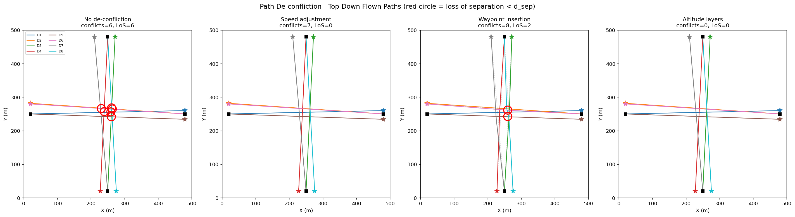
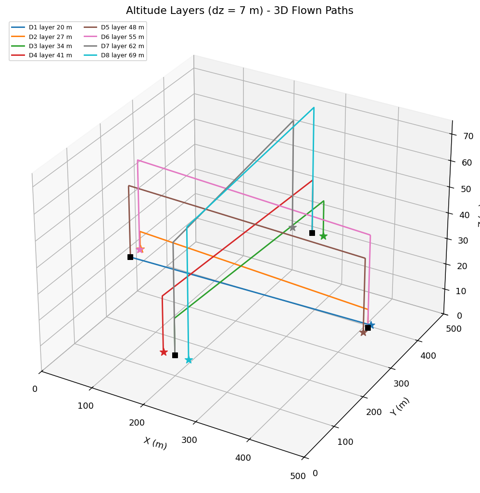
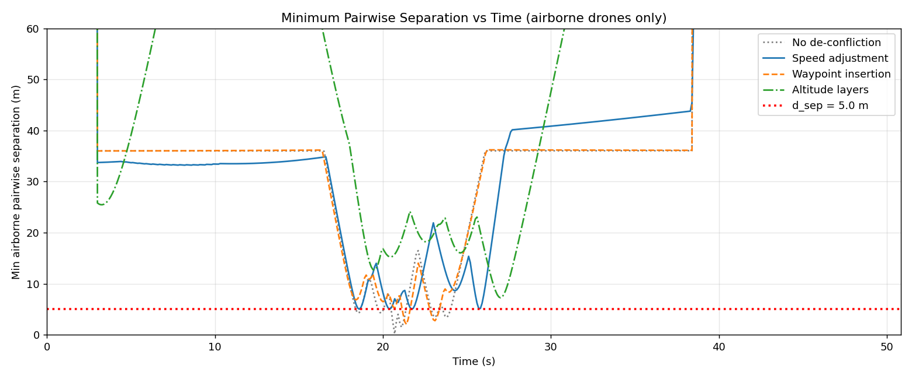
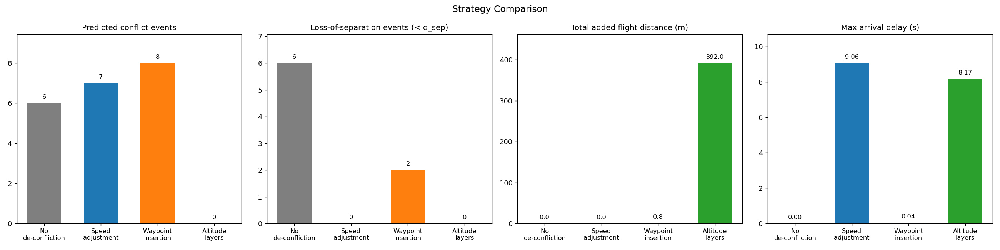
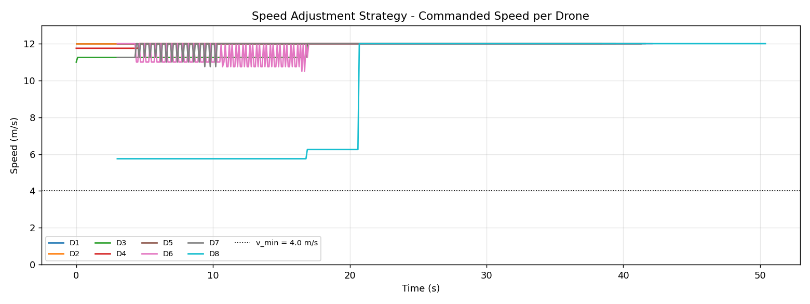
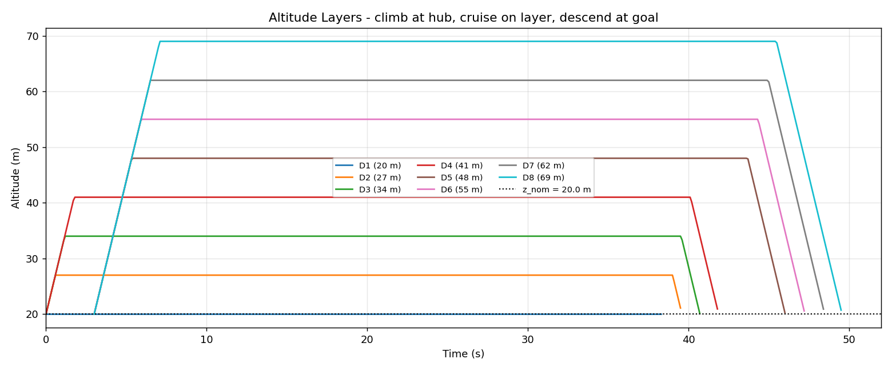
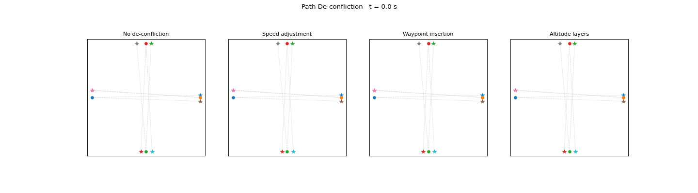

# S031 Path De-confliction

**Domain**: Logistics & Delivery | **Difficulty**: ⭐⭐⭐ | **Status**: ✅ Completed

---

## Problem Definition

**Setup**: 8 delivery drones fly straight-line routes across a 500 × 500 m urban airspace at the same speed (12 m/s) and the same nominal altitude (20 m). They launch from four edge hubs (two drones per hub; the second wave launches 3 s after the first) toward delivery points on the opposite edge, so the routes funnel through the city centre and pairs of drones reach the crossing points at almost the same time. Without de-confliction the traffic contains 6 genuine losses of separation. Three de-confliction strategies are compared with this unresolved baseline.

**Key question**: Which strategy prevents losses of separation, and what does each one cost in added distance and arrival delay?

---

## Mathematical Model

### CPA Conflict Detection

$$t_{CPA} = -\frac{\Delta\mathbf{p} \cdot \Delta\mathbf{v}}{\|\Delta\mathbf{v}\|^2}, \qquad d_{CPA} = \|\Delta\mathbf{p} + \Delta\mathbf{v}\,t_{CPA}\|$$

A conflict is declared for an airborne pair when $d_{CPA} < d_{sep} = 5$ m and $t_{CPA} \in (0, T_{horizon}]$, evaluated every timestep with nominal-speed velocities.

### Strategy 1 — Priority-Based Speed Adjustment

Lower index = higher priority, so the larger-index drone of a conflicting pair yields. It flies at the highest speed $v' \in [v_{min}, v]$ (scanned downwards in 0.25 m/s steps) for which $d_{CPA} \geq d_{sep} + \delta_{margin}$; if none clears, $v' = v_{min}$. The check is repeated every step, so the drone returns to $v$ as soon as no conflict is predicted at nominal speed.

### Strategy 2 — Lateral Waypoint Insertion

$$\mathbf{w}_{avoid} = \mathbf{p}_{mid} + (d_{sep} + \delta_{margin})\,\hat{\mathbf{n}}_{ij}$$

$\mathbf{p}_{mid}$ is the midpoint of the two drones at $t_{CPA}$; $\hat{\mathbf{n}}_{ij}$ is the horizontal normal to the relative velocity, pointing to the side the yielding drone already passes on. As in the card, each drone holds at most one active avoidance waypoint.

### Strategy 3 — Altitude Layer Assignment

$$z_i = z_{base} + (i-1)\,\Delta z, \quad z_{base}=20\text{ m},\; \Delta z = d_{sep} + \delta_{margin} = 7\text{ m}$$

Each drone climbs vertically at its hub to its layer, cruises, and descends at its goal to the 20 m hand-over altitude, so its added distance is $2|z_i - z_{nom}|$.

### Metrics

- **Conflict events / LoS events**: distinct drone pairs ever flagged by the CPA detector / ever closer than $d_{sep}$. Only airborne drones (launched and not yet arrived) are counted, so drones waiting on the ground at a hub never count.
- **Added distance**: flown path length − straight-line origin→goal length.
- **Delay**: actual arrival time (interpolated inside the timestep) − (launch time + straight-line length / v).

---

## Key Parameters

| Parameter | Value |
|-----------|-------|
| Fleet size $N$ | 8 drones |
| Cruise speed $v$ | 12.0 m/s |
| Minimum speed $v_{min}$ (strategy 1) | 4.0 m/s |
| Speed scan step (strategy 1) | 0.25 m/s |
| Separation threshold $d_{sep}$ | 5.0 m |
| Clearance margin $\delta_{margin}$ | 2.0 m |
| Look-ahead window $T_{horizon}$ | 30 s |
| Timestep $\Delta t$ | 0.1 s |
| Simulation cap | 200 s |
| Nominal altitude $z_{nom}$ | 20.0 m |
| Altitude layers (strategy 3) | $z_{base}$ = 20 m, $\Delta z$ = 7 m → 20–69 m |
| Arena | 500 × 500 m |
| Hubs | (20, 250), (480, 250), (250, 20), (250, 480) m — 2 drones each |
| Goals | opposite edge (20 m inset), offset U(−40, 40) m along the edge, rng seed 7 |
| Second-wave launch delay | 3.0 s (D5–D8) |

---

## Implementation

```
src/02_logistics_delivery/s031_path_deconfliction.py
```

```bash
conda activate drones
python src/02_logistics_delivery/s031_path_deconfliction.py
```

Runtime ≈ 16 s (the GIF has 127 frames).

---

## Results

| Strategy | Conflict pairs | LoS pairs (< 5 m) | Min airborne sep (m) | Added dist (m) | Total delay (s) | Max delay (s) |
|----------|---------------:|------------------:|---------------------:|---------------:|----------------:|--------------:|
| No de-confliction | 6 | 6 | 0.19 | 0.0 | 0.00 | 0.00 |
| Speed adjustment | 7 | 0 | 5.02 | 0.0 | 11.21 | 9.06 |
| Waypoint insertion | 8 | 2 (D5–D8, D6–D8) | 2.05 | 0.8 | 0.07 | 0.04 |
| Altitude layers | 0 | 0 | 7.25 | 392.0 | 32.67 | 8.17 |

All 8 drones reached their goals in every run. Lowest commanded speed under strategy 1: 5.75 m/s. Strategy 2 inserted 6 avoidance waypoints.

**Key Findings**:
- **The baseline traffic really conflicts**: pairs D1–D3, D1–D4, D3–D8, D5–D8, D6–D7 and D6–D8 are flagged (at launch, 0 s or 3 s) and all six become actual losses of separation near the centre between 18 and 24 s (minimum 0.19 m).
- **Speed adjustment** removed every loss of separation at zero added distance, but delays drones: D8, which has the lowest priority and yields to D3, D5 and D6, flies at 5.75–6.25 m/s for about 18 s and arrives 9.06 s late. It also created one new conflict pair (D3–D6, flagged at 4.4 s) because slowed drones change the encounter timing. Because the drone resumes 12 m/s as soon as the *nominal-speed* prediction clears 5 m, the 2 m margin is not kept in practice: the minimum separation is 5.02 m, just above $d_{sep}$, and D6/D7 chatter between ~10.5 and 12 m/s (see speed profile).
- **Waypoint insertion** is almost free (0.8 m total, 0.04 s max delay — a 7 m lateral offset over a ~200 m leg adds only centimetres) but left 2 losses of separation (min 2.05 m). D8 is in conflict with D3, D5 and D6 at once; under the one-active-waypoint rule it only gets a waypoint for D3, and the D5/D6 conflicts are skipped until that waypoint is reached, by which time they are inside the intersection.
- **Altitude layers** prevented every conflict by construction (0 flagged; minimum 7.25 m ≥ Δz = 7 m) but is the most expensive: 392 m of climbing and descending (2 × 7 × (0+1+…+7)) and up to 8.17 s delay for the top-layer drone (2 × 49 m / 12 m/s).
- Trade-off: speed adjustment is the only horizontal strategy that kept separation here, at the price of delay concentrated on the lowest-priority drone; altitude layers are the safest but pay a fleet-wide distance cost that grows with N²; the simple single-waypoint rule is cheapest but not safe in a multi-drone intersection.

**2D Trajectory Map** (dashed grey = planned route, red circles = loss-of-separation locations):



**3D Altitude Layer Plot**:



**Separation Time Series** (airborne drones only):



**Strategy Comparison Bar Chart**:



**Speed Profiles (Strategy 1)**:



**Altitude Time Series (Strategy 3)**:



**Animation** (all four runs side by side; red ring = pair currently closer than 5 m):



### Deviations from the scenario card

| Card | Code | Reason |
|------|------|--------|
| All drones depart together from one depot (250, 250) to random goals in [20, 480]² | 4 edge hubs, 2 drones each, goals on the opposite edge with seed-7 random offsets of ±40 m, second wave launched 3 s later | Straight rays from one point at equal speed always diverge (t_CPA ≤ 0), so the card's traffic contains no conflict at all and the strategies cannot be compared. Hubs + crossing routes create genuine conflicts. The ±40 m spread was chosen so that the *unresolved* traffic contains several conflicts (spreads of ±60–150 m gave only 1–4); it was not tuned on any strategy's result. |
| Δz = 2 m, layers 18–32 m | Δz = 7 m, layers 20–69 m | 2 m < d_sep = 5 m violates the card's own condition Δz ≥ d_sep (the card has been corrected). |
| Altitude cost $|z_i - z_{nom}|$ | Climb at hub + descent at goal = $2|z_i - z_{nom}|$, flown in the simulation | Drones start and end at the 20 m hand-over altitude. |
| Speed: bisection on v′ | Descending scan in 0.25 m/s steps | $d_{CPA}(v')$ is not monotonic (slowing the drone that would pass first initially worsens the encounter), which breaks bisection. |
| Speed: drone "resumes v once the conflict has passed" (card code never restored speed) | Speed recomputed every step from nominal | Implements the card text. |
| Yielding drone = lower index in the card code | Larger index yields | Matches the card text (lower index = higher priority). |
| Conflict count per timestep; added distance ≈ delay × v | Distinct pairs; added distance measured from flown path; arrival time interpolated in the step | Per-step counts inflate the number; the old arrival logging (time before `t += DT`) produced spurious negative delays. |
| — | "No de-confliction" baseline run added | Shows how many conflicts the traffic contains. |

---

## Extensions

1. Mixed-speed fleet — drones with different cruise speeds; test altitude-layer separation when overtaking is possible
2. Dynamic conflict re-check — allow several queued avoidance waypoints so multi-drone intersections are handled
3. Velocity Obstacle (VO) method — unified reactive planner replacing per-strategy rules
4. 3D conflict zones — no-fly cylinders; extend waypoint insertion with RRT*
5. Scalability study — sweep N ∈ {4, 8, 16, 32} and plot conflict count vs fleet size

---

## Related Scenarios

- Prerequisites: [S021](../../../scenarios/02_logistics_delivery/S021_point_delivery.md), [S022](../../../scenarios/02_logistics_delivery/S022_obstacle_avoidance_delivery.md), [S029](../../../scenarios/02_logistics_delivery/S029_urban_logistics_scheduling.md)
- Follow-ups: [S032](../../../scenarios/02_logistics_delivery/S032_charging_queue.md), [S033](../../../scenarios/02_logistics_delivery/S033_online_order_insertion.md)
- Algorithmic cross-reference: [S028](../../../scenarios/02_logistics_delivery/S028_cargo_escort_formation.md) (formation separation), [S022](../../../scenarios/02_logistics_delivery/S022_obstacle_avoidance_delivery.md) (obstacle avoidance)
