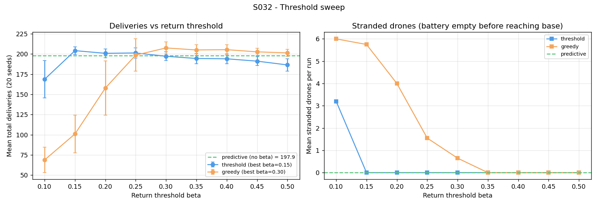
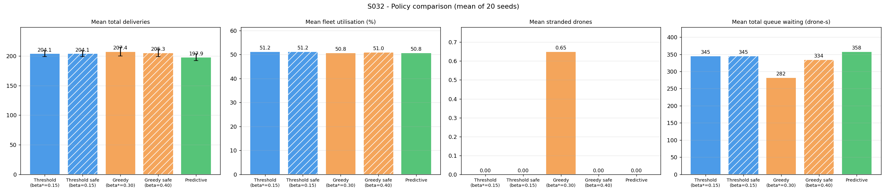
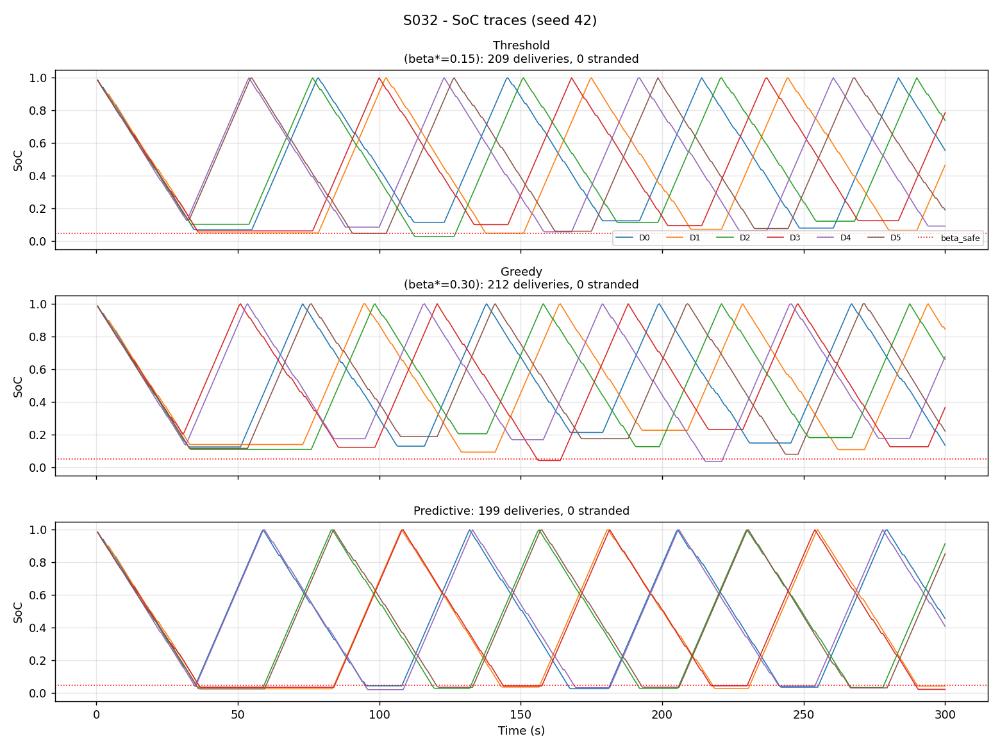
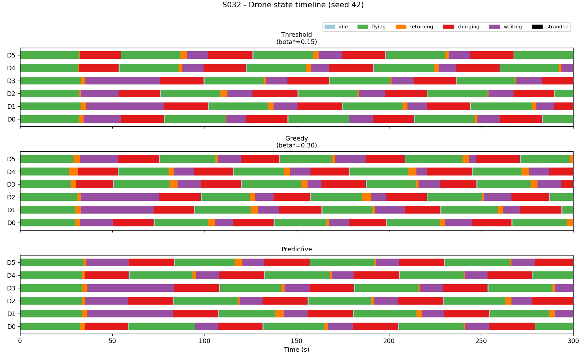
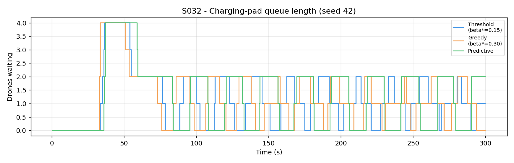
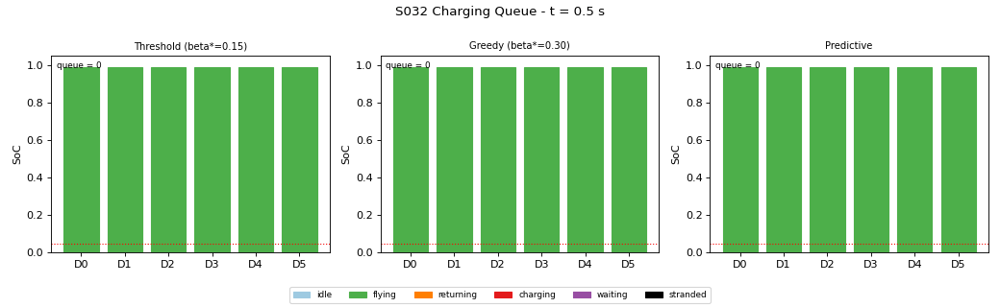

# S032 Charging Queue

**Domain**: Logistics & Delivery | **Difficulty**: ⭐⭐⭐ | **Status**: ✅ Completed

---

## Problem Definition

**Setup**: A fleet of 6 delivery drones works a ±30 m city grid for 300 s, taking delivery points from a shared mission queue. Drones fly **multi-drop sorties**: after each delivery they go straight to the next delivery point and only return to base when their charge policy says so. The base has 2 charging pads; a returning drone waits in a FIFO queue if both pads are busy and charges to full before taking the next delivery. A drone whose battery reaches 0 before it is back at base is **stranded** (out of service for the rest of the run, its parcel goes back into the queue).

**Key question**: Which return-to-charge rule delivers the most parcels when the two pads are the bottleneck, and what is the optimal threshold β*?

**Policies**:
1. **Threshold** — abort the current delivery and return as soon as SoC ≤ β (β swept 0.10–0.50)
2. **Greedy (always-finish)** — never abort a delivery; after each delivery return if SoC ≤ β (β swept 0.10–0.50)
3. **Predictive** — return (aborting if needed) as soon as SoC ≤ s_min(i) = energy to fly home + β_safe

---

## Mathematical Model

**Battery discharge per metre of flight:**

$$\frac{\Delta s}{d} = \frac{\alpha (m_{body} + m_p) g}{E_{cap}} = \frac{1.8\times10^{-4}\cdot 2.0 \cdot 9.81}{1} = 3.53\times10^{-3}\ \text{per m}$$

so a full battery lasts 283 m (35.4 s at 8 m/s). A random delivery leg in the 60 × 60 m grid averages ≈ 0.52 × 60 ≈ 31 m ≈ 11 % of a charge, and a worst-case leg (85 m diagonal) costs 30 %.

**Minimum SoC needed to return safely (predictive policy):**

$$s_{min}(i) = \frac{\alpha (m_{body} + m_p) g \cdot \|\mathbf{p}_i - \mathbf{p}_{base}\|}{E_{cap}} + \beta_{safe}$$

**Charging time given arrival SoC:**

$$t_{chg} = \frac{(1 - s_{arrive}) \cdot E_{cap}}{P_{chg}} \quad (\le 25\text{ s})$$

**Fleet utilisation:** $u_i = t_{fly,i} / T_{sim}$ (flying + returning time; no mandatory grounding).

**Optimal threshold:** $\beta^* = \arg\max_{\beta} \bar D_{total}(\beta)$, and $\beta^*_{safe}$ = the best β with zero stranded drones in all seeds.

**Why the pads bind:** 2 pads × 0.04 E_cap/s × 300 s = 24 E_cap of charging in the whole run, while 6 drones flying continuously would use 6 × 300 s × 8 m/s × 3.53×10⁻³ ≈ 51 E_cap. Energy, not flight time, limits deliveries, so how much energy each delivery costs (aborted legs, return legs) is what separates the policies.

---

## Key Parameters

| Parameter | Value |
|-----------|-------|
| Fleet size N | 6 drones |
| Charging pads K | 2 |
| Simulation horizon T_sim | 300 s |
| Timestep DT | 0.5 s |
| Cruise speed v | 8.0 m/s |
| Battery capacity E_cap | 1.0 (normalised) |
| Charging rate P_chg | 0.04 E_cap/s (25 s from empty) |
| Discharge constant α | 1.8 × 10⁻⁴ m⁻¹ |
| Body mass m_body | 1.5 kg |
| Payload mass m_p | 0.5 kg |
| Safety reserve β_safe | 0.05 (predictive policy) |
| Delivery area | [−30, 30]² m |
| Base position | (0, 0, 2) m |
| Threshold sweep | 0.10 – 0.50 in steps of 0.05 (threshold and greedy) |
| Monte-Carlo runs | 20 delivery streams (seeds 42 – 61), identical for every policy |

---

## Implementation

```
src/02_logistics_delivery/s032_charging_queue.py
```

```bash
conda activate drones
python src/02_logistics_delivery/s032_charging_queue.py
```

Runtime ≈ 35 s (380 simulations + a 150-frame GIF).

---

## Results

### Threshold sweep (mean ± std over 20 seeds)

| β | Threshold: deliveries | Threshold: stranded | Greedy: deliveries | Greedy: stranded |
|---|---:|---:|---:|---:|
| 0.10 | 168.7 ± 22.9 | 3.20 | 68.8 ± 15.8 | 6.00 |
| 0.15 | **204.1 ± 4.9** | 0.00 | 101.0 ± 23.4 | 5.75 |
| 0.20 | 200.8 ± 5.4 | 0.00 | 157.8 ± 33.6 | 4.00 |
| 0.25 | 201.2 ± 6.5 | 0.00 | 198.6 ± 20.1 | 1.55 |
| 0.30 | 197.1 ± 5.4 | 0.00 | **207.4 ± 7.5** | 0.65 |
| 0.35 | 194.4 ± 6.3 | 0.00 | 204.9 ± 6.5 | 0.00 |
| 0.40 | 194.0 ± 6.2 | 0.00 | 205.3 ± 6.3 | 0.00 |
| 0.45 | 191.1 ± 5.5 | 0.00 | 202.6 ± 4.4 | 0.00 |
| 0.50 | 186.4 ± 7.6 | 0.00 | 201.3 ± 4.4 | 0.00 |

Threshold: β* = β*_safe = 0.15. Greedy: β* = 0.30, β*_safe = 0.40.

### Policy comparison (mean of 20 seeds)

| Policy | Deliveries | Utilisation | Stranded | Aborted deliveries | Charge visits | Queue wait (drone-s) |
|--------|---:|---:|---:|---:|---:|---:|
| Threshold β* = 0.15 (also the safe optimum) | 204.1 ± 4.9 | 51.2 % | 0.00 | 24.00 | 25.00 | 345.1 |
| Greedy β* = 0.30 | 207.4 ± 7.5 | 50.8 % | 0.65 | 0.00 | 26.10 | 282.1 |
| Greedy safe β = 0.40 | 205.3 ± 6.3 | 51.0 % | 0.00 | 0.00 | 30.75 | 334.3 |
| Predictive | 197.9 ± 5.8 | 50.8 % | 0.00 | 21.20 | 24.00 | 357.8 |

Recorded single runs (seed 42, used for the traces, Gantt chart, queue plot and animation): threshold β = 0.15 → 209 deliveries, greedy β = 0.30 → 212, predictive → 199; 0 stranded in all three, maximum queue length 4.

**Key Findings**:
- **The policies now behave differently.** Batteries are actually drained (SoC traces go down to 0.03–0.2), the thresholds bind, and the sweep has a clear shape: too low a β strands drones, too high a β wastes energy on extra return trips (threshold charge visits rise from 25.00 at β = 0.15 to 40.40 at β = 0.50, deliveries fall from 204.1 to 186.4).
- **Threshold policy**: β = 0.10 strands 3.20 drones per run (28 m of range left is less than the up-to-42 m flight home), so β* = 0.15 — the lowest swept β that got every drone home in all 20 seeds (the farthest grid corner is 42 m from base, 42 × 3.53×10⁻³ ≈ 0.15).
- **Greedy needs a much higher β** because it checks SoC only after a delivery and then commits to a whole leg *plus* the flight home: worst case 85 m to the next point (0.30 SoC) and 42 m from that point back to base (0.15 SoC), so up to ≈ 0.45 SoC is needed after the check. Such worst-case pairs are rare, so in the 20 seeds stranding stops at β = 0.35 rather than 0.45. Below β = 0.35 it strands drones; its raw optimum β* = 0.30 still strands 0.65 drones per run. Part of that score comes from the stranding itself: a stranded drone no longer occupies a pad, so the survivors wait less (282.1 vs 334.3 drone-s). Counting only safe settings, greedy at β = 0.40 (205.3) is the best policy here, because it never wastes energy on an aborted leg.
- **Predictive** never strands a drone and needs no tuning, but delivered the least (197.9, about 6 fewer than threshold β = 0.15, i.e. roughly one standard deviation). It aborts 21.20 deliveries per run mid-leg (energy spent on the abandoned leg is wasted), and because it drains every drone to ~0.03–0.05 the charges are long and drones fall into lock-step pairs (see SoC traces), giving the highest queue wait (357.8 drone-s).
- **Utilisation is ~51 % for every policy**: with 24 E_cap of pad energy against ~51 E_cap of potential demand, the fleet spends about half the time charging or queueing whatever the policy. Policy choice moves deliveries by only ~5 % among safe settings; adding pads or charge power would move them much more (not swept here).

**Threshold sweep — mean deliveries and stranded drones vs β:**



**Policy comparison — deliveries, utilisation, stranded drones, queue waiting (hatched = best stranding-free β):**



**SoC traces — battery state of charge for all 6 drones, one panel per policy (seed 42):**



**State timeline — Gantt chart of each drone's state, one panel per policy (seed 42):**



**Queue length — drones waiting for a pad, per policy (seed 42):**



**Animation — SoC bars coloured by state for the three policies (seed 42, 150 frames):**



### Deviations from the scenario card

| Card | Code | Reason |
|------|------|--------|
| Drone returns to base after every single delivery | Multi-drop sorties: a drone chains deliveries and returns only when its policy says so (parcels are treated as reloaded during charging; payload mass stays 0.5 kg) | With a return after every ~85 m round trip SoC never fell below ~0.70, no threshold ever triggered and all policies were identical (old result 270/270/270). |
| P_chg = 0.25 E_cap/s (full charge in 4 s) | P_chg = 0.04 E_cap/s (25 s) | At 4 s per charge the pads are never a bottleneck, so there is no charging queue to study. At 0.04 the pads can supply 24 E_cap per run against ~51 E_cap of demand. |
| Safety override (`soc ≤ s_min`) applied in every policy | Applied only in the predictive policy; others can strand | The override made greedy identical to predictive. Stranding is reported as a separate metric instead. |
| Greedy has no β | Greedy uses β, checked only after a completed delivery, and is swept like the threshold policy | A greedy drone needs some rule for when to go home; sweeping β for both keeps the comparison fair. |
| Single run, seed 42 | Mean of 20 seeds (42–61), same delivery streams for every policy | Single-run differences of a few deliveries are within noise. |
| Card comment says α gives "~5 km range" | Actual range 283 m | Arithmetic error in the card (fixed). |
| — | β*_safe (best β with zero stranded drones) reported alongside β* | The raw argmax can reward losing drones. |

---

## Extensions

1. **Variable number of pads**: sweep K ∈ {1, 2, 3, 4} and plot D_total(K) — diminishing returns analysis
2. **Heterogeneous batteries**: drones have different E_cap values; does the shared threshold β* still hold?
3. **Priority queuing**: high-urgency deliveries jump the mission queue; analyse impact on mean delivery latency
4. **Adaptive threshold via RL**: replace the fixed β with a PPO agent whose observation is (s_i, dist_to_base, n_q, n_pending)
5. **Distributed charging depots**: place M depots across the grid and add depot-assignment as an optimisation variable

---

## Related Scenarios

- Prerequisites: [S021 Point Delivery](../../../scenarios/02_logistics_delivery/S021_point_delivery.md), [S029 Urban Logistics Scheduling](../../../scenarios/02_logistics_delivery/S029_urban_logistics_scheduling.md)
- Follow-ups: [S033 Online Order Insertion](../../../scenarios/02_logistics_delivery/S033_online_order_insertion.md), [S040 Fleet Load Balancing](../../../scenarios/02_logistics_delivery/S040_fleet_load_balancing.md)
- See also: [S027 Aerial Refueling Relay](../../../scenarios/02_logistics_delivery/S027_aerial_refueling_relay.md) (airborne battery replenishment analogue)
