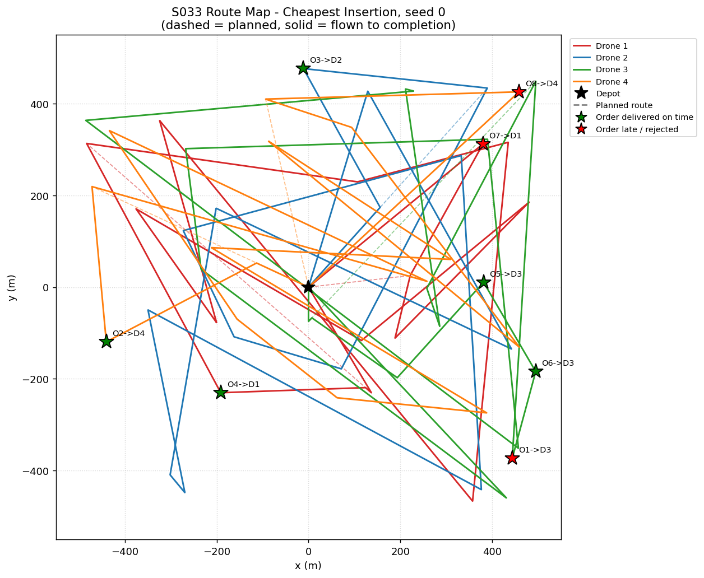
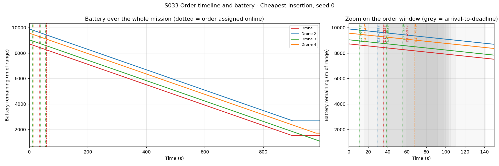
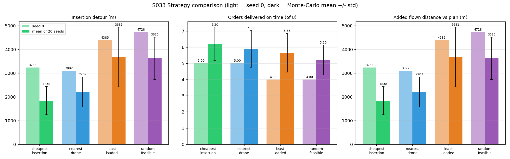
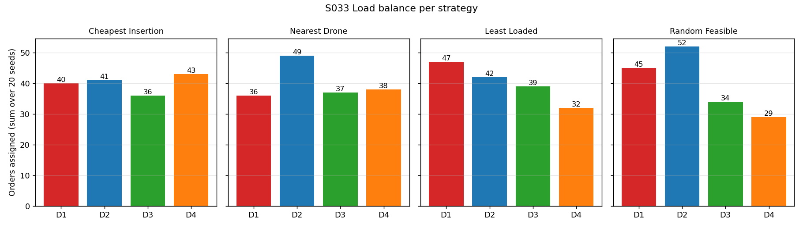
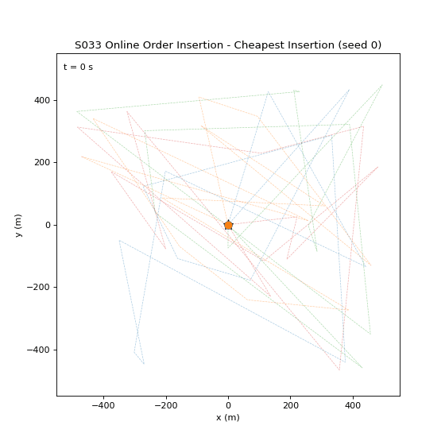

# S033 Online Order Insertion

**Domain**: Logistics & Delivery | **Difficulty**: ⭐⭐⭐ | **Status**: ✅ Completed

---

## Problem Definition

**Setup**: 4 drones leave the depot at t = 0 on pre-planned routes (12 random waypoints each, then back to the depot) in a 1000 × 1000 m arena. Between t = 10 s and 80 s, 8 new online orders arrive. Each order has a deadline = arrival time + nearest-drone ETA + 30 s. The dispatcher splices each order into one drone's remaining route without stopping any drone, subject to battery range and deadline feasibility. If no drone can meet the deadline, the order is **queued**: it is appended (before the final depot return) to the drone that will finish its route earliest and has enough battery, and is served late. The simulation runs until every drone is back at the depot. Four assignment strategies are compared.

**Key question**: Which online insertion strategy minimises the added flight distance while delivering the most orders on time?

---

## Mathematical Model

### Cheapest Insertion

For drone $k$ with remaining route $[\mathbf{w}_0 = \mathbf{p}_k, \mathbf{w}_1, \ldots, \mathbf{w}_{n_k}]$, inserting order $\mathbf{q}$ between $\mathbf{w}_i$ and $\mathbf{w}_{i+1}$ costs

$$\Delta_{k,i} = \|\mathbf{w}_i - \mathbf{q}\| + \|\mathbf{q} - \mathbf{w}_{i+1}\| - \|\mathbf{w}_i - \mathbf{w}_{i+1}\|$$

### Feasibility

- Battery: $L_k + \Delta_{k,i} \le B_k^{rem}$ ($L_k$ = remaining route length; $B_k^{rem}$ is reduced only by distance actually flown)
- Deadline: $t_{now} + \big(\sum_{j<i}\|\mathbf{w}_{j+1}-\mathbf{w}_j\| + \|\mathbf{w}_i - \mathbf{q}\|\big)/v \le t_{deadline}$
- $t_{deadline} = t_{arrive} + \min_k \|\mathbf{p}_k^{plan}(t_{arrive}) - \mathbf{q}\|/v + 30$ s, using drone positions on the *planned* routes so every strategy gets the same deadlines

### Strategies (all choose among feasible drones, at that drone's cheapest feasible slot)

| Strategy | Drone chosen |
|----------|-------------|
| Cheapest Insertion | global minimum $\Delta_{k,i}$ |
| Nearest Drone | smallest $\|\mathbf{p}_k - \mathbf{q}\|$ |
| Least Loaded | fewest remaining waypoints |
| Random Feasible | uniform random (own seeded generator) |

### Metrics

Insertion detour $\sum \Delta$; added flown distance = total flown − total planned route length; on-time = actual delivery time ≤ deadline (measured in the simulation, not predicted).

---

## Key Parameters

| Parameter | Value |
|-----------|-------|
| Fleet size K | 4 drones |
| Pre-planned waypoints per drone | 12 (+ return to depot) |
| Online orders | 8, arrival U(10, 80) s |
| Deadline | arrival + nearest-drone ETA + 30 s |
| Drone speed v | 8.0 m/s |
| Full battery range B_full | 10 000 m |
| Initial battery | B_full × U(0.75, 1.0) |
| Arena | [−500, 500]² m (1000 × 1000 m), altitude 2–8 m |
| Depot | (0, 0, 2) m |
| Timestep DT | 0.1 s |
| Instances | seed 0 for the plots; seeds 0–19 for the Monte-Carlo means |

---

## Implementation

```
src/02_logistics_delivery/s033_online_order_insertion.py
```

```bash
conda activate drones
python src/02_logistics_delivery/s033_online_order_insertion.py
```

Runtime ≈ 32 s (84 full simulations + a 150-frame GIF).

---

## Results

### Seed 0 (the instance shown in the plots)

Planned routes 6472–6896 m per drone (≈ 810–860 s of flight), so the run lasts until ≈ 1000 s.

| Strategy | Detour (m) | Online / queued / rejected | On time | Late | Makespan (s) | Lowest final battery (m) |
|----------|---:|---|---:|---:|---:|---:|
| Cheapest Insertion | 3235.2 | 6 / 2 / 0 | 5/8 | 3 | 992.4 | 1096.9 |
| Nearest Drone | 3092.3 | 7 / 1 / 0 | 5/8 | 3 | 964.1 | 1367.9 |
| Least Loaded | 4384.7 | 8 / 0 / 0 | 4/8 | 4 | 1114.0 | 811.3 |
| Random Feasible | 4727.9 | 8 / 0 / 0 | 4/8 | 4 | 1087.5 | 336.1 |

### Mean over 20 instances (seeds 0–19)

| Strategy | Detour (m), mean ± std | On time (of 8) | Late | Queued | Rejected | Makespan (s) |
|----------|---:|---:|---:|---:|---:|---:|
| Cheapest Insertion | 1838.3 ± 593.6 | 6.20 | 1.80 | 0.30 | 0.00 | 984.7 |
| Nearest Drone | 2207.4 ± 628.3 | 5.90 | 2.10 | 0.25 | 0.00 | 997.9 |
| Least Loaded | 3681.2 ± 1254.2 | 5.65 | 2.35 | 0.30 | 0.00 | 1037.6 |
| Random Feasible | 3624.7 ± 893.5 | 5.20 | 2.80 | 0.25 | 0.00 | 1043.8 |

Cheapest insertion had a detour no larger than Nearest Drone in 18/20 instances, Least Loaded in 20/20 and Random Feasible in 19/20. In every run the added flown distance equals the insertion detour exactly (battery is debited only by flying).

**Key Findings**:
- **Over many instances, cheapest insertion is best on both criteria**: 17 % less detour than Nearest Drone and about half that of Least Loaded / Random, and the most on-time deliveries (6.20 of 8).
- **On a single instance it can lose.** On seed 0, Nearest Drone needed 143 m less detour than Cheapest Insertion. Greedy one-order-at-a-time insertion is myopic: the cheapest slot for an early order can make later orders infeasible, and Cheapest Insertion had to queue 2 orders (appended at the end of a route, which is long and late) against 1 for Nearest Drone.
- **"Feasible at insertion" does not guarantee "on time".** The deadline check covers only the new order; later insertions placed ahead of it on the same route delay it. On seed 0, Cheapest Insertion assigned 6 orders online but delivered only 5 on time (the 2 queued orders are late by construction). An extension would re-check deadlines of already-inserted orders.
- **Least Loaded and Random** ignore geometry and pay for it in distance (≈ 3.6–3.7 km per instance) and makespan (≈ 50–60 s longer); on seed 0, Random Feasible left one drone with only 336 m of range.
- Battery was never the binding constraint (0 rejections in any run): with 7.5–10 km of range and ≈ 6.5–6.9 km routes, the deadline is what makes orders infeasible.

**Route Map** (cheapest insertion, seed 0; dashed = planned, solid = flown to completion; green star = on time, red = late):



**Order Timeline and Battery** (cheapest insertion, seed 0; dotted line = order inserted online, dashed = queued; grey bands = arrival-to-deadline windows):



**Strategy Comparison** (seed 0 and 20-instance mean ± std):



**Load Balance per Drone** (orders assigned, summed over 20 instances):



**Animation** (cheapest insertion, seed 0, 150 frames over the whole ≈ 990 s mission; purple star = order waiting, grey = delivered):



### Deviations from the scenario card

| Card | Code | Reason |
|------|------|--------|
| Card sketch debits the battery at insertion (`battery_rem -= ...`) | Battery debited only while flying | The old code subtracted the detour at insertion *and* again while flying it (double count). |
| "Queued for the next available drone" | Appended before the depot return of the drone with the earliest route completion and enough battery; delivered late; rejected only if no drone has the battery | The old code counted such orders as "queued" and then dropped them. |
| Deadline = nearest-drone ETA + 30 s | Same, with ETA from the planned routes at arrival time | The old code used arrival + 30 + U(0, 20) s with no ETA term, which made many orders infeasible. Using planned positions gives every strategy identical deadlines. |
| Single instance | Seed 0 for plots + 20-instance means | One instance of 8 orders is too small to rank strategies (seed 0 ranks Nearest Drone first). |
| — | Run continues until all drones return (cap 3000 s) | The old 230 s cap stopped the run while routes still needed ≈ 800 s, so the route map showed partial paths. |
| Insertion position may be any segment | Never after the final depot return | The route must end at the depot. |

---

## Extensions

1. Time-window constraints on online orders — must be delivered within deadline $d_o$
2. Re-optimise full route after each insertion (not just greedy local insertion)
3. Rejection policy — decline orders whose cheapest insertion exceeds a detour budget
4. Multi-depot online insertion — orders can be re-assigned to a different depot drone if closer
5. Stochastic order forecast — predict likely future orders to pre-position drones

---

## Related Scenarios

- Prerequisites: [S021](../../../scenarios/02_logistics_delivery/S021_point_delivery.md), [S029](../../../scenarios/02_logistics_delivery/S029_urban_logistics_scheduling.md)
- Follow-ups: [S034](../../../scenarios/02_logistics_delivery/S034_weather_rerouting.md), [S040](../../../scenarios/02_logistics_delivery/S040_fleet_load_balancing.md)
- Algorithmic cross-reference: [S030](../../../scenarios/02_logistics_delivery/S030_multi_depot_delivery.md) (multi-depot routing), [S037](../../../scenarios/02_logistics_delivery/S037_reverse_logistics.md) (VRPTW)
