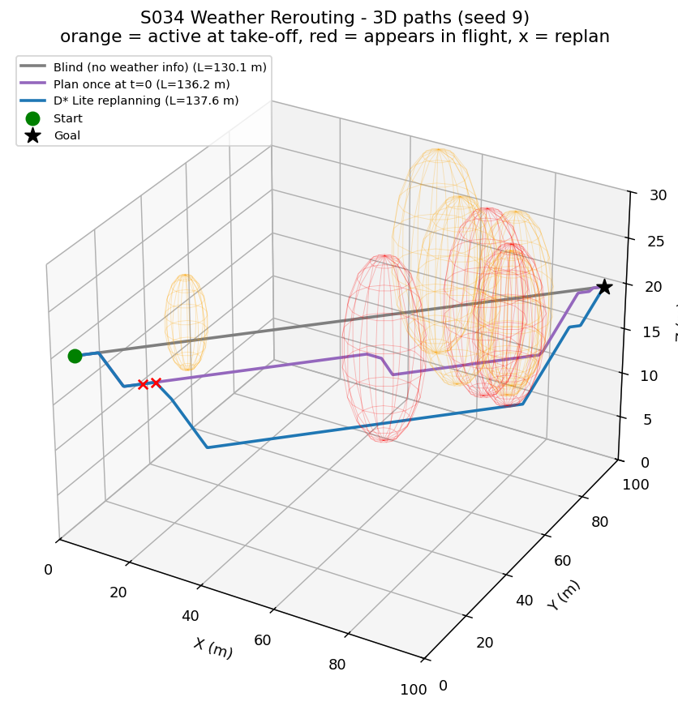
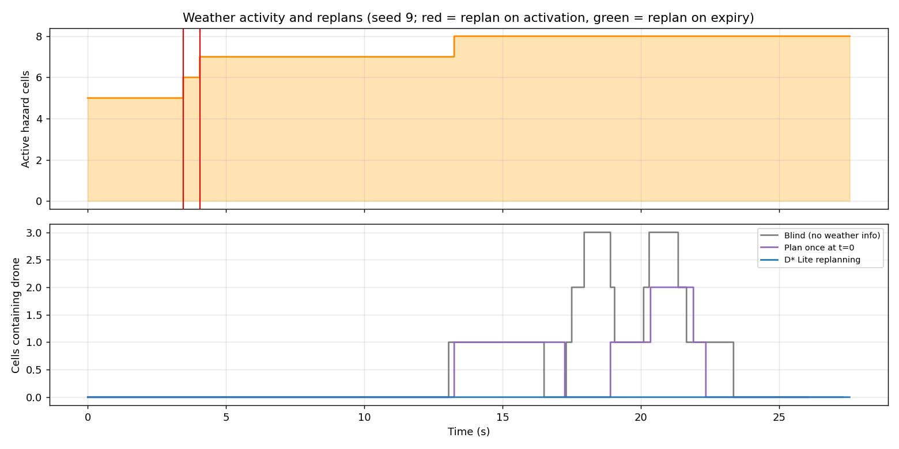
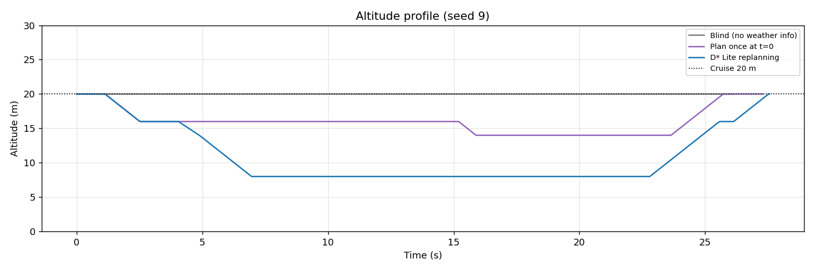
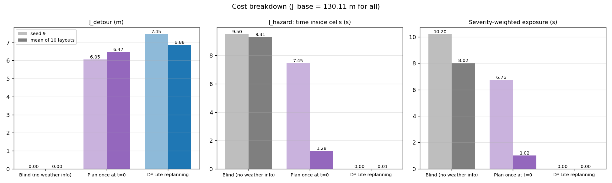
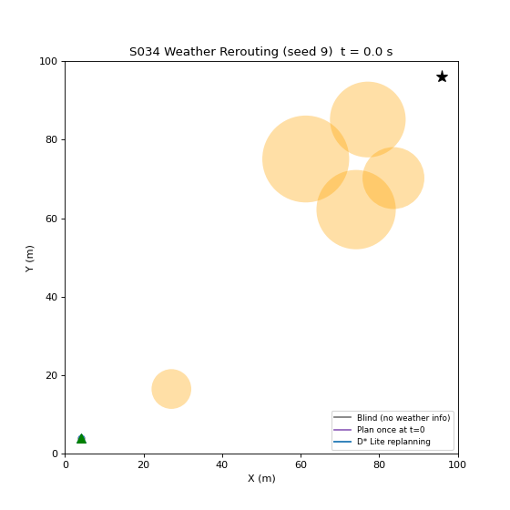

# S034 Weather Rerouting

**Domain**: Logistics & Delivery | **Difficulty**: ⭐⭐⭐ | **Status**: ✅ Completed

---

## Problem Definition

**Setup**: A delivery drone crosses a 100 × 100 × 30 m urban airspace from (4, 4, 20) m to (96, 96, 20) m at 5 m/s (straight line 130.11 m, ≈ 26 s). The airspace is a 2 m voxel grid with 26-connected edges. Eight spherical wind-hazard cells sit on or near the route: some are already active at take-off and may expire during the flight, others appear while the drone is en route. Hazard voxels inflate edge costs, and the drone replans in real time with **D\* Lite**.

Three variants fly the same weather:
1. **Blind** — shortest path ignoring weather, never replanned
2. **Plan once** — D\* Lite plan using the cells active at t = 0, never replanned
3. **D\* Lite replanning** — same initial plan, then event-triggered incremental replanning

**Key question**: How much hazard exposure does real-time rerouting avoid, at what detour cost, and how much search does incremental replanning save over planning from scratch?

---

## Mathematical Model

### Edge cost

$$c(u,v,t) = \|\mathbf{p}_u - \mathbf{p}_v\| \left(1 + \alpha \sum_{k:\, v \in \mathcal{H}_k(t)} w_k\right), \qquad \alpha = 10$$

$$\mathcal{H}_k(t) = \{v : \|\mathbf{p}_v - \mathbf{c}_k\| \le r_k\}, \quad t_{on,k} \le t < t_{on,k} + \tau_k$$

### D\* Lite

Backward search from the goal with $g$, $rhs$ and keys $[\min(g, rhs) + h(s_{start}, s) + k_m;\ \min(g, rhs)]$, Euclidean $h$. When the active set changes, every voxel whose hazard weight changed — on **activation or expiry** — triggers UpdateVertex on all its neighbours (the edges entering it changed cost). $k_m$ is increased by $h(s_{last}, s_{start})$ when the drone has moved. Keys are rounded to 10⁻⁶ m so that floating-point noise cannot break the $k_2$ tie-break.

### Replanning triggers (event-driven)

1. A newly activated cell intersects the remaining planned path.
2. An expiring cell lies within $D_{near}$ = 6 m of the remaining path (it may have been forcing a detour).

### Metrics

$J_{base} = \|\mathbf{p}_{goal} - \mathbf{p}_{start}\|$, $J_{detour} = L_{actual} - J_{base}$, $J_{hazard}$ = time the drone's true position is inside an active sphere, severity-weighted exposure $= \int \sum_k w_k \mathbf{1}[\mathbf{p} \in \mathcal{H}_k]\,dt$.

---

## Key Parameters

| Parameter | Value |
|-----------|-------|
| Airspace | 100 m × 100 m × 30 m |
| Voxel resolution / grid | 2 m / 50 × 50 × 15 nodes, 26-connected |
| Start → goal | (4, 4, 20) → (96, 96, 20) m |
| Cruise altitude | 20 m |
| Drone speed | 5 m/s |
| Timestep | 0.05 s |
| Hazard cells per layout | 8 |
| Hazard radius / lifetime / severity | U(4, 12) m / U(30, 120) s / U(0.3, 1.0) |
| Hazard activation time | U(−60, 20) s (negative = already active at take-off) |
| Hazard placement | centre at U(0.15, 0.85) of the straight route, ±10 m lateral, 20 ± 4 m altitude |
| Inflation factor α | 10 |
| Replanning | event-triggered (activation on path; expiry within 6 m of path) |
| Planner | D\* Lite, Euclidean heuristic |
| Layout shown in plots | seed 9 |
| Monte-Carlo layouts | 10 (seeds 0–9) |

---

## Implementation

```
src/02_logistics_delivery/s034_weather_rerouting.py
```

```bash
conda activate drones
python src/02_logistics_delivery/s034_weather_rerouting.py
```

Runtime ≈ 70 s (33 flights including the from-scratch comparison searches + a 138-frame GIF).

---

## Results

### Layout seed 9 (plots)

Cells 1, 2, 3, 5 and 6 are active at take-off (none expires before the drone lands); cell 4 (t = 3.4 s), cell 7 (t = 4.0 s) and cell 0 (t = 13.2 s) appear during the flight.

| Variant | Path length (m) | J_detour (m) | J_hazard (s) | Severity-weighted (s) | Mission time (s) | Replans |
|---------|---:|---:|---:|---:|---:|---|
| Blind | 130.11 | 0.00 | 9.50 | 10.20 | 26.05 | 0 |
| Plan once at t = 0 | 136.16 | 6.05 | 7.45 | 6.76 | 27.30 | 0 |
| D\* Lite replanning | 137.56 | 7.45 | 0.00 | 0.00 | 27.55 | 2 (3.45 s, 4.05 s — both activations) |

D\* Lite expansions: initial plan 2331; replan at 3.45 s 551 (from scratch 1113); replan at 4.05 s 1155 (from scratch 1710).

### Monte Carlo, 10 layouts (seeds 0–9)

| Variant | Mean J_detour (m) | Mean J_hazard (s) | Mean severity-weighted (s) | Layouts with any exposure | Mean replans |
|---------|---:|---:|---:|---:|---:|
| Blind | 0.00 | 9.31 | 8.02 | 10/10 | 0.0 |
| Plan once at t = 0 | 6.47 | 1.28 | 1.02 | 4/10 | 0.0 |
| D\* Lite replanning | 6.88 | 0.01 | 0.00 | 1/10 | 0.9 |

10 cells expired during the D\* Lite flights; 9 replans were triggered (4 on activation, 5 on expiry). Mean expansions per replan: incremental 259 vs from scratch 1319. The incremental and from-scratch path costs at every replan agreed exactly (max difference 0.0e+00 m). All drones reached the goal in every run.

Mean detour per replanning event (change in the remaining planned path length at the replan): +1.01 m on activation (n = 4, +0.10 to +1.52 m) and +0.00 m on expiry (n = 5).

Exposure by cell origin (cell-seconds inside cells active at take-off / cells appearing in flight; overlapping cells are counted once each, so the sum can exceed J_hazard):

| Variant | Layouts hit by in-flight cells | Per-layout exposure (take-off / in-flight) |
|---------|---:|---|
| Blind | 6/10 | seed 0: 11.15/3.95; 1: 13.40/2.35; 2: 10.35/2.10; 3: 11.55/6.75; 4: 17.25/3.80; 5: 3.80/0.00; 6: 11.10/0.00; 7: 9.95/0.00; 8: 9.95/0.00; 9: 6.20/8.40 |
| Plan once | 3/10 | seed 3: 0.00/1.10; 4: 0.55/3.70; 8: 0.05/0.00; 9: 0.00/9.00 |
| D\* Lite | 0/10 | seed 8: 0.05/0.00 |

**Key Findings**:
- **Rerouting is genuinely exercised.** Cells appear on the route while the drone flies; in seed 9 two activations at 3.45 s and 4.05 s make the drone drop from 16 m to 8 m and pass under the storm cluster, while the plan-once drone flies into the newly active cells for 7.45 s.
- **Replanning removes almost all exposure for ≈ 0.4 m extra detour on average.** Mean J_hazard falls from 9.31 s (blind) to 1.28 s (plan once) to 0.01 s (D\* Lite); the mean detour rises from 6.47 m to 6.88 m (≈ 5 % above J_base). The one residual exposure (0.05 s in seed 8) comes from discretisation: the straight segment between two voxel nodes outside a sphere can clip its edge.
- **Most of the protection comes from knowing the current weather at all** (blind → plan once), but in 3/10 layouts (seeds 3, 4, 9) cells that appeared after take-off still hit the plan-once drone; only replanning handles those (D\* Lite: 0/10). The remaining plan-once exposure to cells already active at take-off (0.55 cell-s in seed 4, 0.05 in seed 8) and D\* Lite's 0.05 s in seed 8 are the voxel path clipping the edge of a sphere.
- **Expiry replans did not shorten any route here.** The 5 expiry-triggered replans returned paths of the same remaining length (+0.00 m per event; detours identical to the plan-once route in those layouts), while activation replans added +1.01 m each on average: other cells still constrained the corridor. With the 26 s mission, expiries are rarer than activations.
- **Incremental search pays off**: a replan re-expanded on average 259 nodes vs 1319 for a fresh search from the drone's position (≈ 5× fewer), with identical path costs. Wall-clock latency is not reported because it is not reproducible run-to-run; expansions are the deterministic proxy.

**3D trajectories** (orange = cells active at take-off, red = cells appearing in flight, × = replan points):



**Timeline** (active cells and replans; below: number of cells containing each drone):



**Altitude profile** (the blind path stays at 20 m, hidden under the cruise line):



**Cost breakdown** (seed 9 and 10-layout mean):



**Animation** (top-down; cells fade in/out; the D\* Lite trail turns red for 1 s after a replan):



### Deviations from the scenario card

| Card | Code | Reason |
|------|------|--------|
| Hazard placement / onset not specified (old code: anywhere in [15, 85]², onset U(5, 350) s) | Centres on/near the straight route; onset U(−60, 20) s | With onsets up to 350 s and a 26 s mission only 2 of 8 cells were ever active and none touched the path, so the drone never replanned. The new timing gives cells that are present at take-off, cells that appear in flight and cells that expire in flight. |
| Expiry trigger: expired cell intersects the remaining path | Expired cell within 6 m of the remaining path | A path that already avoids a cell never intersects it, so the card's condition can never fire; the margin catches cells the path was skirting. |
| Initial plan (old code) ignored weather | Plan-once and D\* Lite variants plan with the cells active at t = 0; the "blind" variant keeps the no-weather plan as the nominal reference | The card's cost breakdown asks for nominal vs rerouted flight. |
| Card code only updates voxels of active cells | Voxels whose weight changed on activation **and expiry** are updated | Otherwise expired cells keep their inflated costs inside D\* Lite. |
| Mean replanning latency (ms) | Node expansions (incremental vs from scratch) | Deterministic and reproducible. |
| Animation: top-down **and isometric** view | Top-down view only | The isometric view is given by the static 3D trajectory plot; a rotating 3D GIF with fading spheres would add minutes of rendering for no extra information. |
| Arrival tolerance 3 m (old code) | Drone flies to the goal exactly | The old 3 m tolerance made the path 127.25 m, *shorter* than the 130.11 m straight line. |

---

## Extensions

1. Multiple drones rerouting simultaneously with shared hazard maps
2. Probabilistic storm cell forecasts with uncertainty ellipsoids
3. Energy-aware rerouting that trades detour length against battery consumption
4. Wind field integration — cells produce directional wind that both pushes the drone and raises power consumption
5. Fleet-wide rerouting coordinator that prevents drones from converging on the same safe corridor

---

## Related Scenarios

- Prerequisites: [S021 Point Delivery](../../../scenarios/02_logistics_delivery/S021_point_delivery.md), [S022 Obstacle Avoidance Delivery](../../../scenarios/02_logistics_delivery/S022_obstacle_avoidance_delivery.md)
- Follow-ups: [S035 UTM Simulation](../../../scenarios/02_logistics_delivery/S035_utm_simulation.md)
- Algorithmic cross-reference: [S022 Obstacle Avoidance Delivery](../../../scenarios/02_logistics_delivery/S022_obstacle_avoidance_delivery.md) (obstacle avoidance), [S031 Path De-confliction](../../../scenarios/02_logistics_delivery/S031_path_deconfliction.md) (airspace separation)
