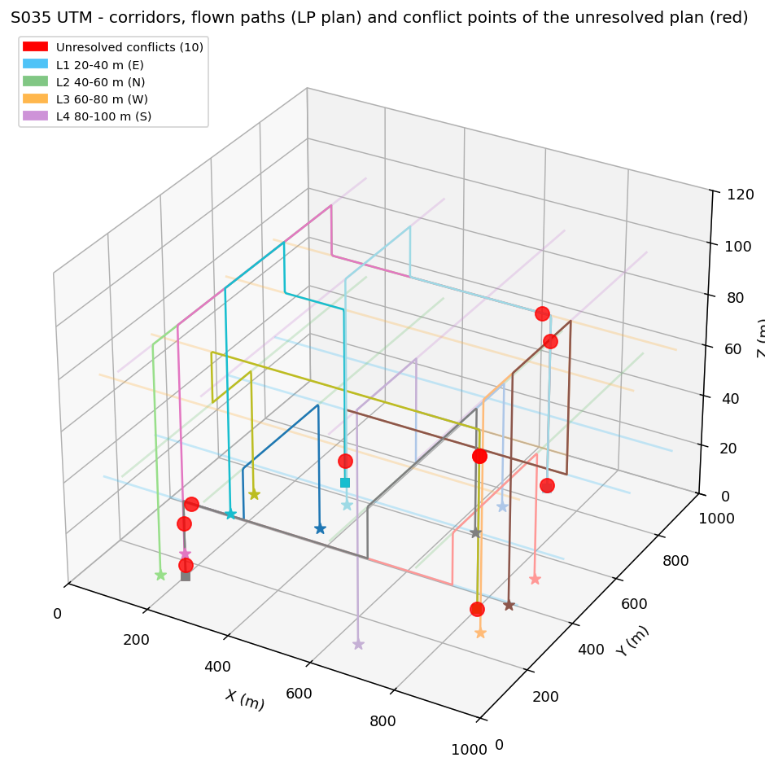
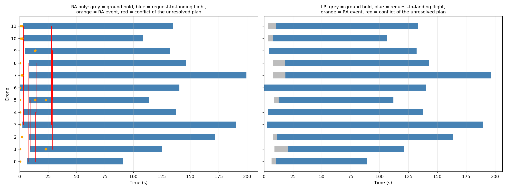
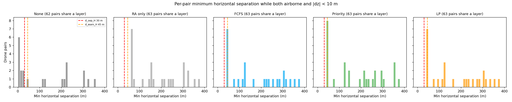
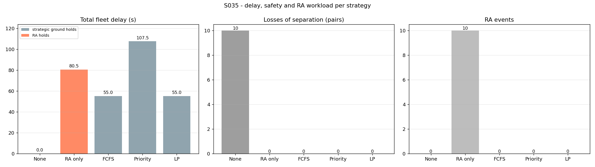
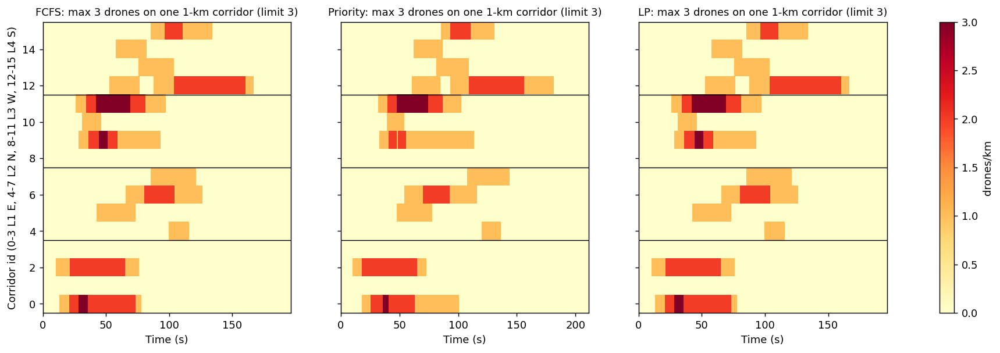
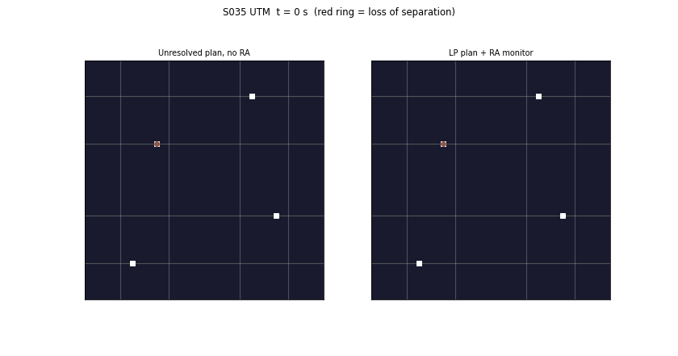

# S035 UTM Simulation

**Domain**: Logistics & Delivery | **Difficulty**: ⭐⭐⭐ | **Status**: ✅ Completed

---

## Problem Definition

**Setup**: A centralised UAS Traffic Management (UTM) service manages 12 delivery drones in a 1000 × 1000 × 120 m urban airspace. The airspace has 4 directional altitude layers with 4 parallel corridor centre-lines each (16 corridors, 1 km long). Every drone takes off from one of 4 depots that sit on corridor lines, flies an L-shaped route made only of corridor segments — an east/west leg in L1 (eastbound) or L3 (westbound), a layer change, a north/south leg in L2 (northbound) or L4 (southbound) — and lands. All 12 flight requests arrive within 10 s, so the unresolved plans conflict.

The UTM resolves conflicts **strategically** (ground holds before departure) with three strategies and monitors execution with a **separation-assurance** loop that issues Resolution Advisories (RAs). Two references are also run: the unresolved plan with no RA ("None") and the unresolved plan protected only by RAs ("RA only").

**Key question**: Which strategy removes conflicts at the lowest fleet delay, and how does strategic deconfliction compare with purely tactical RAs?

---

## Mathematical Model

### Conflict definition

Drones $k$ and $j$ are in conflict at time $t$ when both are **airborne** (after take-off, before landing — drones waiting on the ground are not traffic) and

$$\|\mathbf{p}_k(t) - \mathbf{p}_j(t)\|_H < d_{sep}^H = 30\text{ m} \quad\text{and}\quad |z_k(t) - z_j(t)| < d_{sep}^V = 10\text{ m}$$

Trajectories are sampled every 0.5 s. For each pair the UTM pre-computes the set $F_{kj}$ of relative ground-hold offsets $s = \delta_j - \delta_k$ (multiples of 0.5 s) that produce a conflict; a plan is conflict-free when $\delta_j - \delta_k \notin F_{kj}$ for every pair. Strategic plans are built with the RA warning distance $d_{warn}^H = 45$ m as the horizontal buffer, so a correctly executed plan never triggers an RA.

### Strategies (ground holds $\delta_k \ge 0$)

- **FCFS**: register intents in request order; each drone gets the smallest hold that is conflict-free with all registered intents and keeps every corridor at ≤ ρ_max drones.
- **Priority**: same registration in order of urgency $u_k = \alpha_u / \text{slack}_k + \beta_u \cdot \text{IsEmergency}_k + \gamma_u q_k$ (highest first).
- **LP (centralised)**: $\min \sum_k \delta_k$ s.t. one precedence constraint per conflicting pair — $\delta_j - \delta_k \ge \max F_{kj} + 0.5$ s (j passes after k) or $\delta_j - \delta_k \le \min F_{kj} - 0.5$ s (j passes before), whichever is closer to the current offset — solved with `scipy.optimize.linprog` (HiGHS); pairs that become conflicting are added and the LP re-solved (constraint generation). The LP does **not** model corridor capacity.

### Separation assurance (execution)

Every 0.5 s the monitor predicts each pair over the next $T_{la}$ = 15 s along the plans. If the predicted horizontal separation (with $|\Delta z| < 10$ m) drops below $d_{warn}^H$ = 45 m, an RA holds one drone — hovering if airborne, staying on the ground if not — for

$$t_{RA} = \frac{d_{warn}^H - d_{pred}}{v_{close}} + t_{buffer}$$

The lower-precedence drone is held unless that would not clear the encounter or would create a new one, in which case the other drone holds. An RA *event* is counted once per pair episode (not every timestep).

### Metrics

Total delay $= \sum_k (t_k^{landing} - t_k^{nominal\ landing})$ (ground holds + RA holds); throughput $\Theta = N / T_{mission} \times 60$; conflict rate $\lambda = |\mathcal{C}| / \big(\binom{N}{2} T_{mission}/60\big)$ with $|\mathcal{C}|$ = conflicting pairs of the executed plan; corridor occupancy = airborne drones on a corridor (1 km ⇒ drones/km).

---

## Key Parameters

| Parameter | Value |
|-----------|-------|
| Airspace volume | 1000 m × 1000 m × 120 m |
| Number of drones | 12 |
| Corridors | 16 (4 per layer, centre-lines at 150, 350, 650, 850 m) |
| Altitude layers | L1 20–40 m E, L2 40–60 m N, L3 60–80 m W, L4 80–100 m S (flown at mid-band) |
| Depots | (200, 150), (800, 350), (300, 650), (700, 850) m |
| Request window | all requests in U(0, 10) s |
| Horizontal / vertical separation $d_{sep}^H$ / $d_{sep}^V$ | 30 m / 10 m |
| Warning distance $d_{warn}^H$ (also strategic planning buffer) | 45 m |
| Look-ahead $T_{la}$ | 15 s |
| Cruise speed | 10 m/s |
| Climb / descent / layer-change speed | 3 m/s |
| Closing speed for $t_{RA}$, $v_{close}$ | 10 m/s |
| Temporal buffer $t_{buffer}$ | 2 s |
| Corridor capacity $\rho_{max}$ | 3 drones/km |
| Priority weights $\alpha_u, \beta_u, \gamma_u$ | 100, 1.0, 0.3 (slack U(60, 300) s, payload U(0.5, 2.5) kg, 1 emergency drone) |
| Max ground hold considered | 400 s |
| Timestep = conflict-scan resolution | 0.5 s |
| LP solver | `scipy.optimize.linprog` (HiGHS) |
| Request set in plots / Monte Carlo | seed 7 / seeds 0–9 |

---

## Implementation

```
src/02_logistics_delivery/s035_utm_simulation.py
```

```bash
conda activate drones
python src/02_logistics_delivery/s035_utm_simulation.py
```

Runtime ≈ 2.5 min (55 executions with the RA monitor + a 131-frame GIF).

---

## Results

### Request set seed 7

The unresolved plan has **10 conflicting pairs**: D0-D4, D0-D8, D1-D5, D1-D9, D3-D7, D3-D11, D4-D8, D5-D9, D6-D10, D7-D11 (all between drones from the same depot that climb out and merge into the same corridor seconds apart).

| Run | Conflicts in plan | Losses of separation (executed) | Min horiz. sep (m) | RA events | Ground holds (s) | RA holds (s) | Total delay (s) | Mean / max delay (s) | Throughput (/min) | Max corridor occupancy |
|-----|---:|---:|---:|---:|---:|---:|---:|---|---:|---:|
| None (no RA) | 10 | 10 | 0.0 | 0 | 0.0 | 0.0 | 0.0 | 0.0 / 0.0 | 3.789 | 3 |
| RA only | 10 | 0 | 60.0 | 10 | 0.0 | 80.5 | 80.5 | 6.7 / 15.5 | 3.609 | 3 |
| FCFS | 0 | 0 | 45.0 | 0 | 55.0 | 0.0 | 55.0 | 4.6 / 11.5 | 3.664 | 3 |
| Priority | 0 | 0 | 45.0 | 0 | 106.0 | 0.0 | 106.0 | 8.8 / 22.5 | 3.404 | 3 |
| LP | 0 | 0 | 45.0 | 0 | 55.0 | 0.0 | 55.0 | 4.6 / 11.5 | 3.664 | 3 |

Conflict rate: 0.0478 /pair/min (None), 0.0456 (RA only, unresolved plan), 0 for the three strategies. LP needed 2 solves with 11 precedence constraints and returned the same holds as FCFS on this set. No drone missed its deadline.

### Monte Carlo, 10 request sets (seeds 0–9), means

| Run | Conflicts in plan | Losses of separation | RA events | Total delay (s) ± std | Max corridor occupancy | Sets over capacity |
|-----|---:|---:|---:|---:|---:|---:|
| None | 9.8 | 9.8 | 0.0 | 0.0 ± 0.0 | 4 | 2/10 |
| RA only | 9.8 | 0.3 | 10.5 | 91.1 ± 12.9 | 4 | 2/10 |
| FCFS | 0.0 | 0.0 | 0.0 | 68.2 ± 12.5 | 3 | 0/10 |
| Priority | 0.0 | 0.0 | 0.0 | 90.8 ± 19.9 | 3 | 0/10 |
| LP | 0.0 | 0.0 | 0.0 | 65.6 ± 15.1 | 4 | 2/10 |

LP total delay was lower than FCFS in 7/10 sets and equal in 1/10 (higher in 2/10).

**Key Findings**:
- **Resolution now changes the outcome.** The unresolved plan has 10 conflicting pairs that all become real losses of separation; every strategic plan has 0 conflicts and 0 losses of separation, and because plans are built to the 45 m warning distance no RA fires during their execution.
- **Tactical RAs alone work but cost more.** Holding drones only when the 15 s look-ahead predicts an encounter avoided every loss of separation on seed 7 (80.5 s of RA holds), but on average left 0.3 losses of separation per set (3 over the 10 sets) and cost 91.1 s of delay — more than FCFS (68.2 s) or LP (65.6 s). Holding a drone in the air late is less efficient than shifting its departure early.
- **LP vs FCFS**: on seed 7 they coincide (55.0 s). Over 10 sets LP is lower on average (65.6 vs 68.2 s) and better in 7 sets, but LP ignores corridor capacity and exceeded 3 drones/km in 2 sets, while FCFS enforces it. Part of LP's advantage therefore comes from relaxing a constraint FCFS respects. LP is also not globally optimal (precedence per pair is chosen heuristically), which is why FCFS beats it in 2 sets.
- **Priority ordering is the most expensive** (106.0 s on seed 7, 90.8 s mean): it gives urgent drones a free slot first, which pushes several lower-priority drones back by 20 s or more (max delay 22.5 s) and lowers throughput to 3.404 /min.
- Throughput differs little (3.40–3.79 /min) because it is set by the longest routes (D3, D7 ≈ 180 s of flight); the fleet delays are tens of seconds on top of 80–190 s flights.

**3D airspace** (corridor centre-lines by layer, paths flown under the LP plan, red = conflict points of the unresolved plan):



**Conflict timeline** (RA only vs LP; grey = ground hold, orange = RA event, red = conflicting pair in the unresolved plan):



**Separation histogram** (per-pair minimum horizontal separation while both airborne in the same 10 m band):



**Delay, safety and RA workload**:



**Corridor utilisation** (drones per 1 km corridor vs time, limit 3):



**Animation** (top-down, unresolved plan without RA vs LP plan; red ring = loss of separation):



### Deviations from the scenario card

| Card | Code | Reason |
|------|------|--------|
| FCFS/priority holds via $\Delta t_{sep} = d_{sep}^H/v_{close} + t_{buffer}$ on departure-time gaps; card code computed the gap as `delays[k] - delays[j]` (sign error, fixed in the card) | Exact pairwise forbidden-offset sets $F_{kj}$ from the sampled trajectories; registration searches the smallest feasible hold | A fixed departure gap does not guarantee separation for crossing or merging routes; the old sign error made FCFS "beat" the LP optimum (69.1 s < 75.4 s), which is impossible for a feasible plan. |
| LP precedence from FCFS order | Precedence per conflicting pair = the cheaper side; constraint generation | Fixing FCFS precedence often forces long holds; the LP is still a heuristic, not a MILP. |
| RAs only logged | RAs hold (hover / ground-hold) the drone during execution; events counted once per episode | The old code logged ~1700 per-timestep "RAs" and no drone reacted. |
| Drones waiting at the depot reported at waypoint 0 | Only airborne drones count as traffic | Same-depot pairs were "in conflict" at t = 0 whatever the delay, so resolution changed nothing (12 conflicts before and after). |
| Corridor assignment placeholder; capacity not enforced | Routes are built from corridor segments; capacity ≤ 3 drones/km enforced in FCFS/Priority registration, measured for all runs | LP does not include it (reported: 2/10 sets exceed it). |
| Strategic separation $d_{sep}^H$ = 30 m | Strategic plans use $d_{warn}^H$ = 45 m; conflicts are still counted at 30 m | Otherwise every resolved plan triggers RAs whose holds can create new conflicts. |
| Δt = 0.1 s | Δt = 0.5 s (= conflict-scan resolution) | At 10 m/s a drone moves 5 m per step, well below the 30 m minimum; keeps the run under 3 min. |
| Requests "simultaneous" | Requests within 10 s | Near-simultaneous demand; the same 10 s window is used for all 10 Monte-Carlo sets. |
| Single instance | Seed 7 for plots + 10-set Monte Carlo | Strategy ranking varies by instance. |

---

## Extensions

1. Geofenced no-fly zones — some corridors closed dynamically; UTM must reroute affected drones
2. Demand surge — 30+ drones simultaneously requesting corridors; study throughput saturation
3. Cooperative speed regulation — all drones in a conflict adjust speed symmetrically instead of one-sided RA
4. Weather-aware UTM — storm cell data feeds directly into corridor capacity reduction
5. Real-time re-optimisation with rolling LP horizon as new drones enter the airspace

---

## Related Scenarios

- Prerequisites: [S031](../../../scenarios/02_logistics_delivery/S031_path_deconfliction.md), [S029](../../../scenarios/02_logistics_delivery/S029_urban_logistics_scheduling.md)
- Follow-ups: [S036](../../../scenarios/02_logistics_delivery/S036_last_mile_relay.md), [S040](../../../scenarios/02_logistics_delivery/S040_fleet_load_balancing.md)
- Algorithmic cross-reference: [S031](../../../scenarios/02_logistics_delivery/S031_path_deconfliction.md) (CPA conflict detection), [S034](../../../scenarios/02_logistics_delivery/S034_weather_rerouting.md) (dynamic rerouting)
