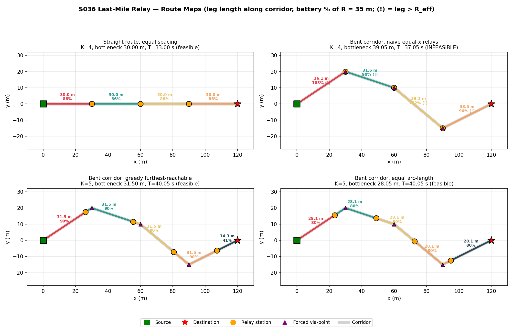
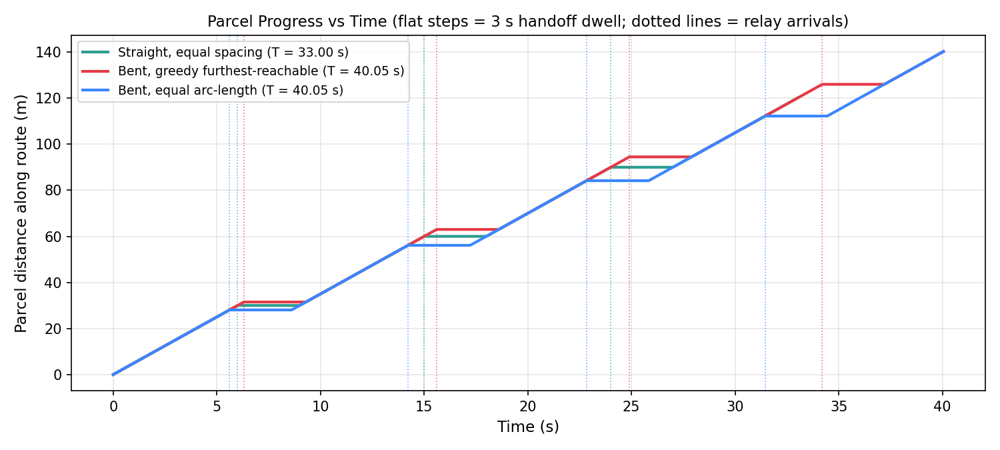
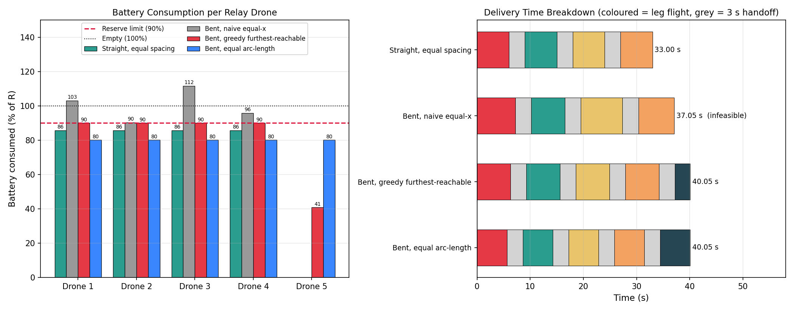
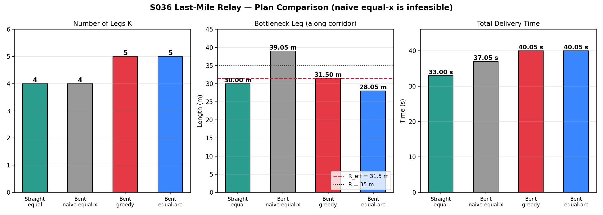
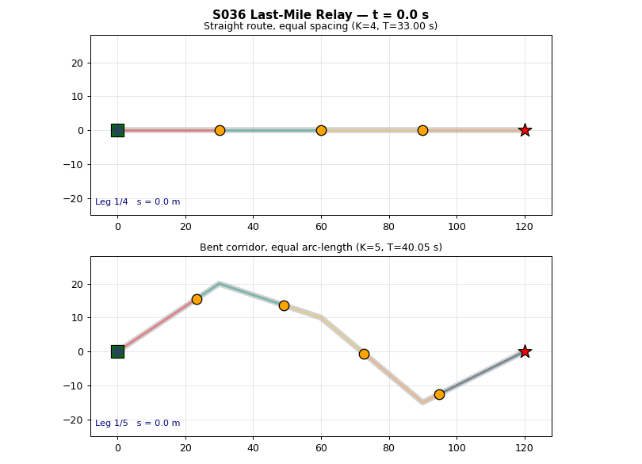

# S036 Last-Mile Relay

**Domain**: Logistics & Delivery | **Difficulty**: ⭐⭐⭐ | **Status**: ✅ Completed

---

## Problem Definition

**Setup**: A parcel must be delivered from a source depot at (0, 0) to a destination at (120, 0) m. The 120 m distance exceeds any single drone's effective range (31.5 m), so a chain of relay drones carries it leg by leg; at each relay station the parcel is handed to a fresh drone (3 s dwell). Two route geometries are studied:

- **Straight route** (120 m): relays placed by equal spacing.
- **Bent corridor**: airspace restrictions force the route through three via-points (30, 20), (60, 10), (90, −15) m. Drones must stay inside the corridor, so a leg's length is its length **along the corridor polyline** (140.27 m in total), not the straight chord between its two relay stations. Three relay plans are compared on it: naive equal-x spacing (relays at x = 30 / 60 / 90 m, copied from the straight route), greedy furthest-reachable segmentation, and equal arc-length spacing.

**Key question**: How does corridor curvature change the number of relay legs, the bottleneck leg (worst-case battery use) and the delivery time, and which relay placement is best on the bent corridor?

---

## Mathematical Model

### Leg Lengths and Range Constraint

With relay stations at arc lengths $0 = s_0 < s_1 < \dots < s_K = L$ along the route, leg $k$ has length $d_k = s_k - s_{k-1}$ (along the polyline). Feasibility requires

$$d_k \le R_{eff} = (1 - 0.10)\,R = 0.9 \times 35 = 31.5\ \text{m} \quad \forall k$$

### Relay Placement Strategies

- **Equal spacing** (minimum bottleneck for a given $K$): $K = \lceil L / R_{eff} \rceil$, $s_k = kL/K$, so every leg is $L/K$.
- **Greedy furthest-reachable**: each leg is extended until it reaches $R_{eff}$ ($s_k = s_{k-1} + R_{eff}$); the last leg takes the remainder. This minimises $K$ but not the bottleneck.
- **Naive equal-x**: relays at the corridor points with $x = 30, 60, 90$ m (the straight-route spacing), ignoring the detours.

### Battery and Delivery Time

$$B_k = \frac{d_k}{R}, \qquad T_{delivery} = \frac{\sum_k d_k}{v} + (K-1)\,\tau_h$$

$B_k \le 0.90$ is the same constraint as $d_k \le R_{eff}$.

---

## Key Parameters

| Parameter | Value |
|-----------|-------|
| Source → destination | (0, 0) → (120, 0) m; straight distance 120 m |
| Bent-corridor via-points | (30, 20), (60, 10), (90, −15) m |
| Bent-corridor length (along polyline) | 140.27 m (segments 36.06 + 31.62 + 39.05 + 33.54) |
| Drone max range $R$ | 35 m |
| Battery reserve | 10 % |
| Effective range $R_{eff}$ | 31.5 m |
| Cruise speed $v$ | 5 m/s |
| Handoff dwell $\tau_h$ | 3 s |
| Parcel-trace sampling step | 0.05 s |
| Model | 2-D top-down (altitude not simulated) |
| Animation | 140 frames at 20 fps |

### Deviations from the scenario card

- **Leg length measured along the corridor.** The card's greedy pseudocode uses the straight-line distance between candidate points. On the bent corridor that chord cuts through the restricted corners; the previous version of this script did exactly that and reported a leg sum of 132.8 m for a 140.3 m corridor, understating battery use and delivery time. All legs are now measured as arc length along the polyline.
- **Continuous greedy cut.** The card picks the furthest reachable point from a discrete candidate list (the previous script used points every ~5 m). Here every corridor point is a candidate, so each greedy leg is exactly $R_{eff}$ = 31.5 m except the last.
- **Extra plans on the bent corridor.** The card asks for "equal spacing (straight) vs greedy (bent)" and, as an extension, "greedy vs equal-spacing on the non-straight corridor". Both are done here: the bent corridor is solved with naive equal-x spacing, greedy, and equal arc-length spacing.
- **2-opt and handoff pre-positioning** (card sections "2-opt Improvement" and "Handoff Protocol") are not simulated. Relay drones are assumed to be waiting at their stations. On a single fixed corridor the leg order cannot be changed, so 2-opt has nothing to swap.
- **No altitude.** The previous README listed a 20 m cruise altitude; the model is 2-D, as in the card.

---

## Implementation

```
src/02_logistics_delivery/s036_last_mile_relay.py
```

```bash
conda activate drones
python src/02_logistics_delivery/s036_last_mile_relay.py
```

Runtime ≈ 31 s (mostly the GIF). Deterministic (no random numbers); two runs gave identical output.

---

## Results

A direct single-drone flight is infeasible (120 m > 31.5 m).

| Metric | Straight, equal spacing | Bent, naive equal-x | Bent, greedy | Bent, equal arc-length |
|--------|------------------------|---------------------|--------------|------------------------|
| Feasible | ✅ | ❌ (all 4 legs > 31.5 m) | ✅ | ✅ |
| Legs $K$ | 4 | 4 | 5 | 5 |
| Relay arc positions (m) | 30, 60, 90 | 36.06, 67.68, 106.73 | 31.50, 63.00, 94.50, 126.00 | 28.05, 56.11, 84.16, 112.22 |
| Leg lengths along route (m) | 30.00 ×4 | 36.06 / 31.62 / 39.05 / 33.54 | 31.50 ×4, 14.27 | 28.05 ×5 |
| Bottleneck leg (m) | 30.00 | 39.05 | 31.50 | **28.05** |
| Battery per drone | 85.7 % each | 103.0 / 90.4 / 111.6 / 95.8 % | 90.0 % ×4, 40.8 % | **80.2 % each** |
| Total delivery time (s) | 33.00 | 37.05 (not flyable) | 40.05 | 40.05 |

Time check: straight 120 / 5 + 3 × 3 = 24 + 9 = 33.00 s; bent 140.27 / 5 + 4 × 3 = 28.05 + 12 = 40.05 s.

**Key Findings**:
- **Curvature costs a leg.** The detours make the corridor 140.27 m instead of 120 m (+16.9 %). $K = \lceil 140.27 / 31.5 \rceil = \lceil 4.45 \rceil = 5$ legs instead of 4, and delivery takes 40.05 s instead of 33.00 s (+21.4 %): 4.05 s more flight (20.27 m / 5 m/s) plus one extra 3 s handoff.
- **Copying the straight-route spacing fails.** With relays at x = 30 / 60 / 90 m (which are exactly the via-points), every leg exceeds $R_{eff}$, and legs 1 and 3 exceed the full range $R$ (103.0 % and 111.6 % battery). Four legs cannot cover 140.27 m at 31.5 m each (4 × 31.5 = 126 m), however the relays are placed.
- **Greedy and equal arc-length use the same number of drones and take the same time, but they load the drones differently.** Both use 5 legs, and since total distance and handoff count are equal, both take 40.05 s. Greedy runs four drones to exactly the 90 % reserve limit (zero margin) and leaves the fifth at 40.8 %. Equal arc-length spreads the load evenly, so every drone uses 80.2 %. That lowers the bottleneck from 31.50 m to 28.05 m and leaves each drone a 10 % margin above the reserve.
- **Old results were understated.** The previous version measured legs as straight chords: 5 legs, bottleneck 30.90 m and 38.56 s. Measured along the corridor, the greedy delivery takes 40.05 s.

**Route Map** (leg lengths along the corridor and battery % of R; (!) marks legs longer than $R_{eff}$):



**Parcel Progress Over Time**: distance along the route vs time for the three feasible plans. The flat steps are the 3 s handoffs, and the two bent plans reach 140.27 m at the same 40.05 s.



**Battery and Timing per Drone**: battery consumed by each relay drone for all four plans, with the 90 % reserve line, and the time breakdown (coloured = leg flight, grey = handoff):



**Plan Comparison**: number of legs, bottleneck leg against $R_{eff}$ and $R$, and total delivery time:



**Animation**: the parcel on the straight route (top) and on the bent corridor with equal arc-length relays (bottom), on a common clock (140 frames, 20 fps):



---

## Extensions

1. Dynamic transfer points: relay drones pre-position optimally (card's handoff protocol) rather than waiting at fixed stations
2. Wind-aware segmentation: legs into a headwind are shorter, so adjust $K$ and the leg lengths accordingly
3. Parallel relay chains: two parcels delivered simultaneously on overlapping corridors
4. Battery heterogeneity: drones with different capacities assigned to legs in proportion
5. Failure recovery: if one relay drone fails, re-route the parcel to the nearest available drone

---

## Related Scenarios

- Prerequisites: [S021](../../../scenarios/02_logistics_delivery/S021_point_delivery.md), [S027](../../../scenarios/02_logistics_delivery/S027_aerial_refueling_relay.md)
- Follow-ups: [S037](../../../scenarios/02_logistics_delivery/S037_reverse_logistics.md), [S039](../../../scenarios/02_logistics_delivery/S039_offshore_platform_exchange.md)
- Algorithmic cross-reference: [S027](../../../scenarios/02_logistics_delivery/S027_aerial_refueling_relay.md) (aerial relay), [S032](../../../scenarios/02_logistics_delivery/S032_charging_queue.md) (battery management)
