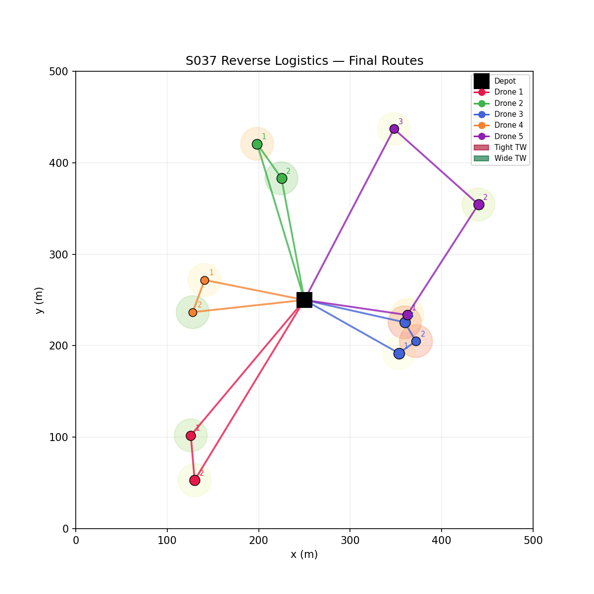
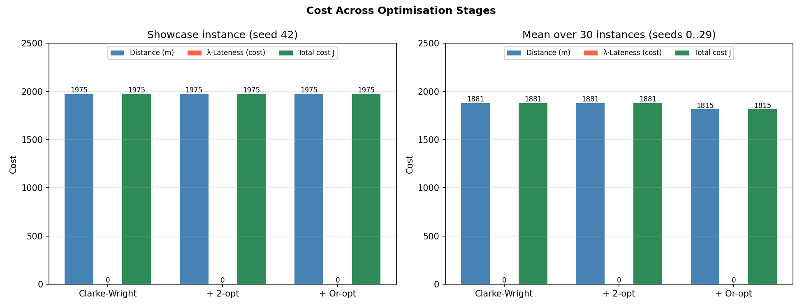
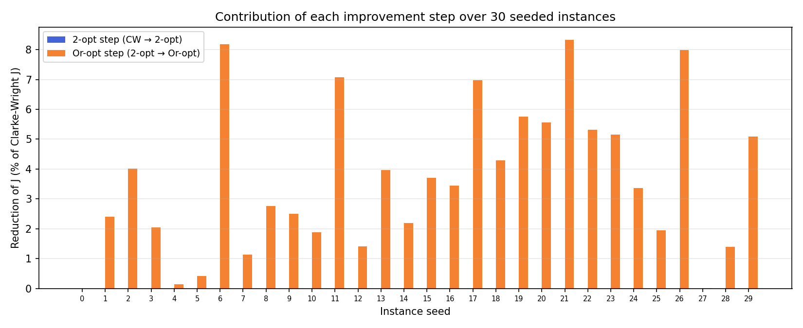
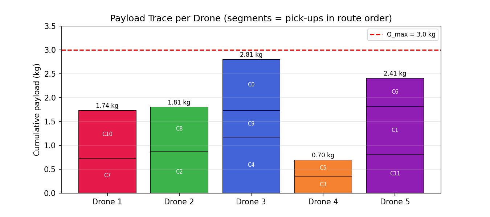
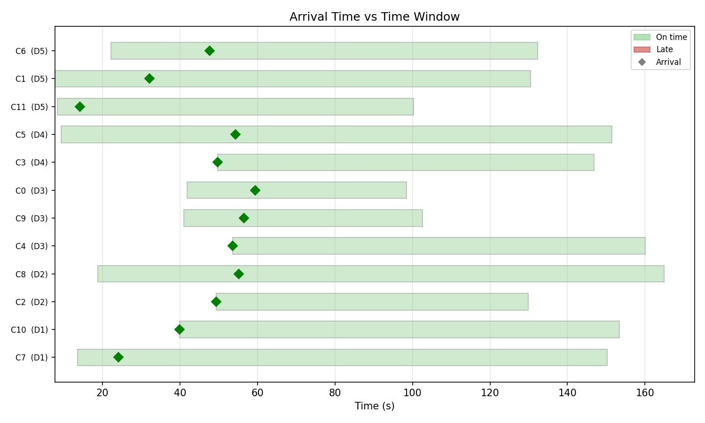
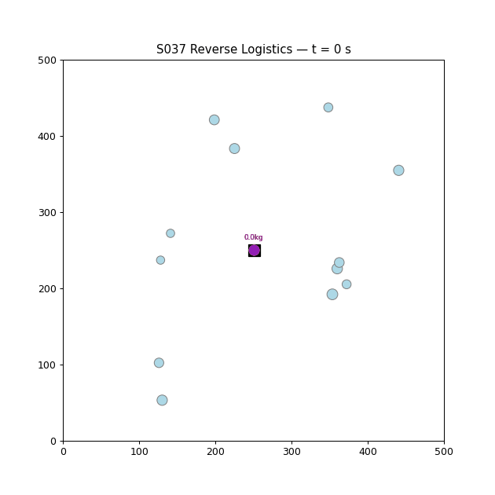

# S037 Reverse Logistics

**Domain**: Logistics & Delivery | **Difficulty**: ⭐⭐⭐ | **Status**: ✅ Completed

---

## Problem Definition

**Setup**: A fleet of 5 drones must collect returned items from 12 customer locations and bring them to a central depot at (250, 250) m. Each customer has a parcel weight and a pick-up time window. The problem is a Capacitated Vehicle Routing Problem with Time Windows (CVRPTW), solved in three stages: Clarke-Wright savings initialisation, 2-opt intra-route improvement, and Or-opt inter-route relocation. The pipeline is shown in detail on one showcase instance (seed 42) and repeated on 30 further seeded instances to see whether the per-stage gains generalise.

**Key question**: How much does each local-search stage improve on the Clarke-Wright solution, and are all customers served within their time windows?

---

## Mathematical Model

### Clarke-Wright Savings

$$s_{ij} = d(\text{depot}, i) + d(\text{depot}, j) - d(i, j)$$

Starting from 12 single-customer routes, routes are merged in decreasing order of $s_{ij}$ when $i$ is at the tail of one route and $j$ at the head of another (or vice versa) and the merged payload is ≤ $Q_{max}$. Merging stops once 5 routes (one per drone) remain.

### 2-opt Improvement

For every route, reverse every sub-sequence $[j..k]$ with $0 \le j < k < n$, including those that start at the first stop. A reversal is accepted if it lowers the route cost $L_k + \lambda V_k + \mu \max(0, L_k - R_{max})$.

### Or-opt Improvement

Relocate a **single** customer to any position in another route if the receiving route stays within $Q_{max}$ and the summed cost of the two routes decreases.

### Arrival Times and Total Cost

$$t_j = \max\!\left(e_{i_j},\ t_{j-1} + \frac{d_{j-1,j}}{v}\right), \qquad J = \sum_k L_k + \lambda \sum_k V_k + \mu \sum_k \max(0, L_k - R_{max})$$

with lateness $V_k = \sum_j \max(0, t_j - l_{i_j})$. A drone that arrives before $e_i$ hovers until the window opens.

---

## Key Parameters

| Parameter | Value |
|-----------|-------|
| Fleet size | 5 drones |
| Customers | 12 pick-up locations, uniform in [50, 450]² m (arena 500 × 500 m) |
| Depot | (250, 250) m |
| Drone speed $v$ | 8 m/s |
| Max payload per drone $Q_{max}$ | 3.0 kg (hard constraint) |
| Max route length $R_{max}$ | 2000 m (soft, penalty $\mu$ = 1000 per m) |
| Lateness penalty $\lambda$ | 50 per s of lateness |
| Parcel weight | 0.3–1.2 kg (uniform) |
| Window opens $e_i$ / closes $l_i$ | 0–60 s / 90–180 s (uniform) |
| Showcase instance seed | 42 |
| Generalisation study | 30 instances, seeds 0–29 |
| Animation | 150 frames at 20 fps, trajectory sampled every 0.1 s |

### Deviations from the scenario card

- **2-opt loop bounds fixed.** The previous code (and the card's code listing) started `j` at 1, so the first stop could never be moved, and on 2- or 3-stop routes almost no reversals were tried. All sub-sequences are now tested.
- **Clarke-Wright merge in both orientations.** The card's procedure allows "tail of $i$ / head of $j$, or vice versa", but the previous code only tried $i \to j$. Both orientations are now tried. This changes the showcase instance's starting solution: CW now gives 1974.5 m instead of 1980.8 m.
- **No silent customer loss.** If Clarke-Wright cannot reduce the routes to 5, the script now raises an error instead of truncating the route list. After each solve it also asserts that every customer is served exactly once and that every payload is ≤ $Q_{max}$. Neither problem occurred in the 31 instances.
- **Range is a soft penalty.** The card's Or-opt accepts a move only if range stays satisfied; here range excess is penalised through $\mu$ in $J$. No route came close to 2000 m (longest showcase route 592.3 m), so this makes no difference.
- **Multiple instances.** The card specifies only seed 42. The previous README's general claim that "relocation beats reversal" rested on that single instance, so 30 extra seeded instances were added.
- **Time windows never bind.** With these card parameters every drone in the showcase instance is back at the depot by 74.0 s, while the earliest window closes at 90 s or later. No instance (showcase or study) had any lateness, so the time-window machinery is never tested by this card's parameters.

---

## Implementation

```
src/02_logistics_delivery/s037_reverse_logistics.py
```

```bash
conda activate drones
python src/02_logistics_delivery/s037_reverse_logistics.py
```

Runtime ≈ 13 s. All instances use seeded `np.random.default_rng(seed)`; two runs gave identical output.

---

## Results

### Showcase instance (seed 42)

Total parcel weight 9.46 kg against a fleet capacity of 5 × 3.0 = 15.0 kg.

| Stage | Distance (m) | Lateness (s) | Total cost J |
|-------|-------------|-------------|--------------|
| Clarke-Wright | 1974.5 | 0.0 | 1974.5 |
| After 2-opt | 1974.5 | 0.0 | 1974.5 |
| After Or-opt | 1974.5 | 0.0 | 1974.5 |

Routes (customer ids, unchanged by both improvement stages): `[7, 10]`, `[2, 8]`, `[4, 9, 0]`, `[3, 5]`, `[11, 1, 6]`.

| Drone | Stops | Distance (m) | Payload (kg) | Lateness (s) | Back at depot (s) |
|-------|-------|-------------|-------------|-------------|------------------|
| D1 | 2 | 473.2 | 1.74 | 0.0 | 68.7 |
| D2 | 2 | 359.8 | 1.81 | 0.0 | 72.1 |
| D3 | 3 | 277.6 | 2.81 | 0.0 | 73.5 |
| D4 | 2 | 271.6 | 0.70 | 0.0 | 69.7 |
| D5 | 3 | 592.3 | 2.41 | 0.0 | 74.0 |

All 12 customers are picked up on time (12/12, lateness 0).

### Generalisation study (30 instances, seeds 0–29)

| Metric | 2-opt step (CW → 2-opt) | Or-opt step (2-opt → Or-opt) |
|--------|------------------------|------------------------------|
| Instances where J improves | 0 / 30 | 29 / 30 |
| Mean reduction (% of CW J, per-instance average) | 0.00 % | 3.61 % |
| Max reduction | 0.00 % | 8.33 % |

Mean J over the 30 instances: CW 1880.6 → 2-opt 1880.6 → Or-opt 1814.7. The reduction of the mean is (1880.6 − 1814.7) / 1880.6 = 3.5 %; the 3.61 % above is the mean of the per-instance percentages. Or-opt gave the larger step in 29 instances; in 1 instance (seed 0) neither stage improved anything. Some Or-opt gains are negligible: on seed 27, for example, the reduction is 0.00 % (J 2131.6 → 2131.5). No instance had lateness, either before or after optimisation.

**Key Findings**:
- **On these instances, relocation helps and reversal does not.** With the loop bounds fixed, 2-opt still found no improving reversal in any of the 31 instances. Clarke-Wright stops at 5 routes, so routes are short (1–5 stops), and the savings merges already put such short routes in the best order. Time windows never bind, so reversing a route's direction cannot reduce lateness either. Or-opt improved J in 29 of 30 study instances (mean 3.61 %). This holds for this instance family only; on longer routes or with tight windows 2-opt would have room to work.
- **The showcase instance is a local optimum for both moves.** On seed 42 neither stage changes the Clarke-Wright routes (1974.5 m). The previous version of the script, with one-directional CW merging, started from a different CW solution (1980.8 m), and Or-opt took it to 1793.1 m. A solution about 9 % shorter therefore exists, but single-customer relocation cannot reach it from the current start. For example, C11 sits next to D3's cluster, but D3 (2.81 kg) cannot take C11 (0.81 kg) without exceeding 3.0 kg.
- **Capacity, not time, is the active constraint.** Every route is under 600 m and all drones are back by 74.0 s, well inside the 90–180 s window closes. The binding limit is the 3.0 kg payload: D3 carries 2.81 kg.
- The old README's claim that "D4 carried no stops" no longer applies: all five drones are used (D4 carries the lightest load, 0.70 kg).

**Route Map** (showcase instance; numbers = pick-up order; background disc colour = window width, red tight → green wide):



**Cost Comparison (CW → 2-opt → Or-opt)**: the showcase instance (left) and the mean over the 30-instance study (right):



**Per-instance contribution of each stage** (2-opt bars are all zero):



**Payload Trace per Drone** (segments are pick-ups in route order; red line = $Q_{max}$):



**Time Windows Compliance** (bar = $[e_i, l_i]$, diamond = arrival; all on time):



**Animation** (showcase instance; customers take their drone's colour once picked up; payload counter above each drone):



---

## Extensions

1. Mixed fleet with heterogeneous payload capacities and speeds
2. Stochastic pickup weights: a customer's payload is only revealed on arrival
3. Dynamic insertion of new pickup requests during the mission (cf. S033)
4. Battery-constrained routing with mandatory recharging stops at the depot
5. Multi-depot reverse logistics where damaged items are sorted to different repair facilities
6. Tighter time windows or fewer drones, so that windows actually bind and 2-opt / multi-customer Or-opt moves have room to work

---

## Related Scenarios

- Prerequisites: [S021](../../../scenarios/02_logistics_delivery/S021_point_delivery.md), [S029](../../../scenarios/02_logistics_delivery/S029_urban_logistics_scheduling.md)
- Follow-ups: [S038](../../../scenarios/02_logistics_delivery/S038_disaster_relief_drop.md), [S040](../../../scenarios/02_logistics_delivery/S040_fleet_load_balancing.md)
- Algorithmic cross-reference: [S030](../../../scenarios/02_logistics_delivery/S030_multi_depot_delivery.md) (multi-depot VRP), [S033](../../../scenarios/02_logistics_delivery/S033_online_order_insertion.md) (online insertion)
