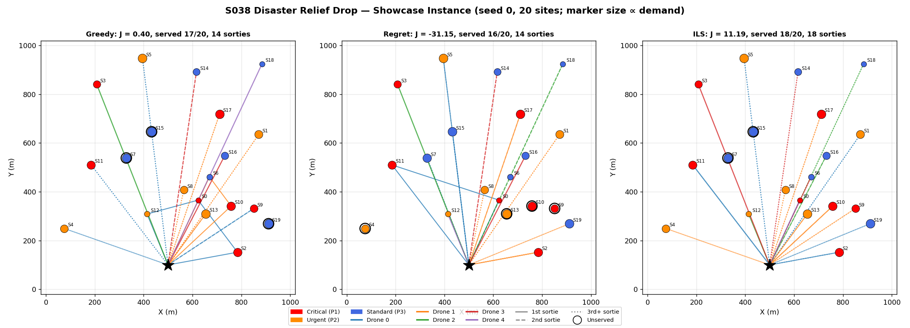
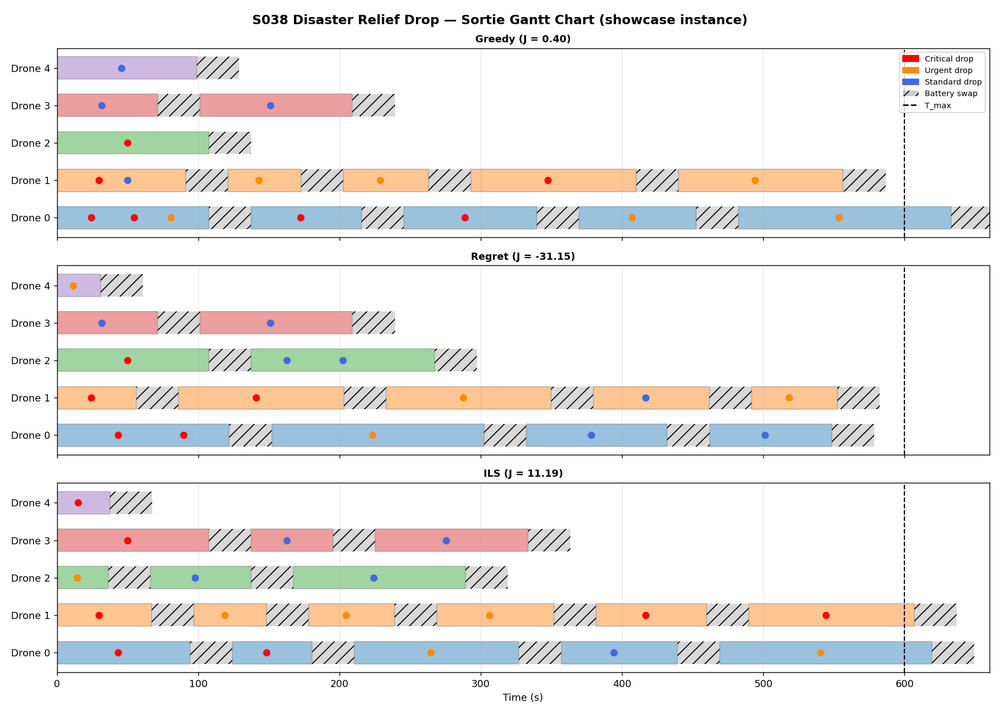
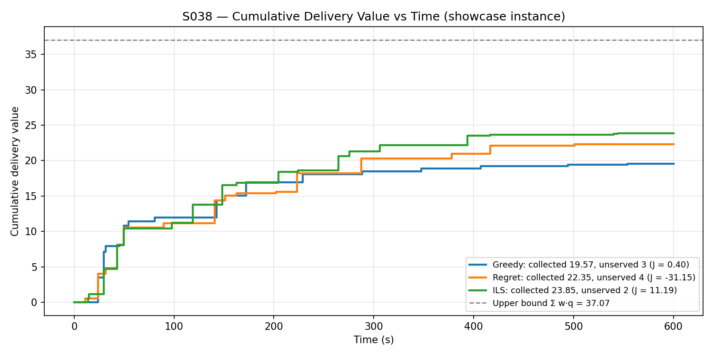
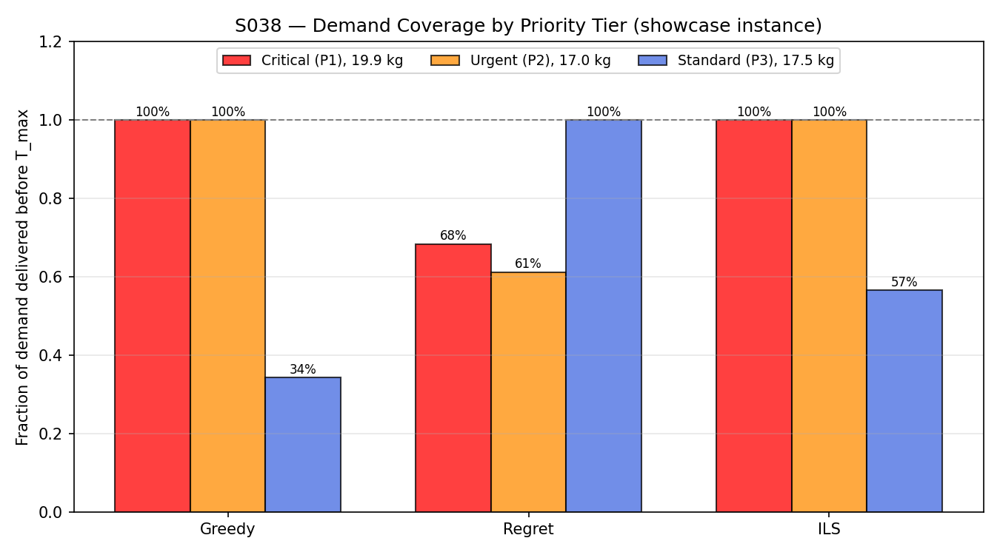
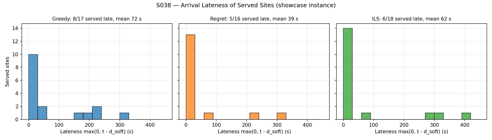
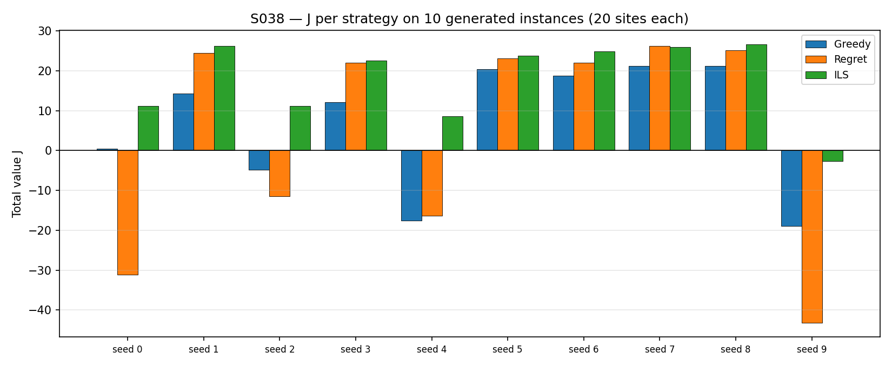
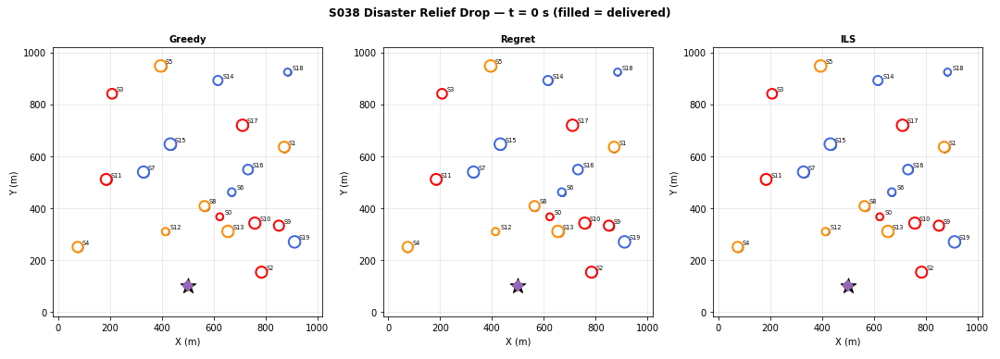

# S038 Disaster Relief Drop

**Domain**: Logistics & Delivery | **Difficulty**: ⭐⭐⭐⭐ | **Status**: ✅ Completed

---

## Problem Definition

**Setup**: A heterogeneous fleet of 5 drones (2 heavy-lift, 2 mid-range, 1 fast scout) flies relief supplies from a forward operating base (FOB) at (500, 100) m to disaster sites in a 1000 × 1000 m area. Each site has a priority (critical / urgent / standard), a demand (kg) and a soft deadline after which its value decays. Drones fly several sorties within a 600 s horizon, with a 30 s battery swap at the FOB between sorties. Each sortie must respect the drone's payload and range. Three dispatch strategies are compared: Greedy priority-first, Regret insertion and Iterated Local Search (ILS).

The card's 8-site instance turned out to be too easy to rank the strategies (see Results), so the comparison is made on harder generated instances: 20 sites, earlier deadlines and more demand. One showcase instance is plotted, and a 10-instance seeded study checks that the ranking holds beyond it.

**Key question**: Which strategy delivers the most priority-weighted, time-discounted value when the fleet cannot serve every site on time?

---

## Mathematical Model

### Value of a Delivery and Objective

$$V_i(t) = w_i\, q_i\, e^{-\lambda \max(0,\, t - d_i)}, \qquad w_i = \frac{\pi_{max} + 1 - \pi_i}{\pi_{max}} \in \{1, \tfrac{2}{3}, \tfrac{1}{3}\}$$

$$J = \sum_{i\ \text{served}} V_i(t_i) \;-\; \mu \sum_{i\ \text{unserved}} w_i q_i$$

A site is served if the drone arrives by $T_{max}$. The upper bound $\sum_i w_i q_i$ is reached only if every site is served before its deadline.

### Sortie Timing and Feasibility

Arrival at the $j$-th site of a sortie: $t_{i_j} = t_0 + \sum_{l \le j} d_{l-1,l}/v_k + (j-1)\tau_{drop}$. The return time adds the last drop and the leg home, and the next sortie departs $\tau_{turn}$ after the return. Each sortie needs $\sum q_i \le Q_k$ and round-trip length $\le R_k$.

### Strategies (same schedule representation and same evaluator $J$)

| Strategy | How it builds the schedule |
|----------|---------------------------|
| **Greedy priority-first** | The earliest-available drone takes the site with the highest score $w_\pi / (d_{FOB,i}/v_k)$, $w_\pi = \pi_{max}+1-\pi_i$, among sites it can carry and reach by $T_{max}$. It then packs further sites by nearest neighbour from its current position while payload and range allow, and finally applies 2-opt (by distance) to the sortie. |
| **Regret insertion** | For every unassigned site, the best insertion into each drone is computed over all positions in existing sorties plus a new sortie. Cost = $w_i q_i$ − (gain in $J$). The site with the largest regret (2nd-best − best drone cost) is inserted at its best position. Construction only; no improvement phase. |
| **ILS** | Random feasible start, then local search with Or-opt (move one site to any position or a new sortie of any drone, unassigned sites included) and intra-sortie 2-opt, both accepted only if $J$ increases. Perturbation relocates 3 random sites, followed by local search again; a candidate is accepted if $J$ improves. 3 restarts × 25 iterations. |

After construction, any site whose arrival would fall after $T_{max}$ is removed from its sortie for all strategies (it is unserved either way, and removing it can only bring later sites forward).

---

## Key Parameters

| Parameter | Value |
|-----------|-------|
| Fleet | 5 drones: 2 × heavy-lift (5.0 kg, 2000 m, 12 m/s), 2 × mid-range (2.5 kg, 2800 m, 16 m/s), 1 × scout (1.0 kg, 3500 m, 20 m/s) |
| FOB | (500, 100) m |
| Area | 1000 × 1000 m (2-D model, no altitude) |
| Mission horizon $T_{max}$ | 600 s |
| Drop time $\tau_{drop}$ | 8 s (includes descent/ascent) |
| Battery swap $\tau_{turn}$ | 30 s |
| Value decay $\lambda$ | 0.01 s⁻¹ |
| Unserved penalty $\mu$ | 5.0 |
| Card instance | 8 sites, 13.3 kg total, 3 critical / 3 urgent / 2 standard |
| Generated instances | 20 sites, x ∈ [50, 950], y ∈ [150, 950] m, demand U(0.5, 4.0) kg (rounded to 0.1), P(critical / urgent / standard) = 0.3 / 0.4 / 0.3 |
| Generated soft deadlines | critical U(60, 150) s, urgent U(120, 300) s, standard U(200, 450) s |
| Showcase instance / study | seed 0 / seeds 0–9 |
| ILS | 3 restarts × 25 iterations, kick = 3 sites, seed 2026 + instance seed |
| Animation | 150 frames at 15 fps over 0–600 s |

### Deviations from the scenario card

- **The fleet has 5 drones, not 3.** The previous README said "3 drones", "12 m/s", "800 × 800 m", "λ = 0.005" and a 25 m drop altitude. The code (and the card) use 5 drones with a mixed 12 / 16 / 20 m/s fleet, a 1000 m area and λ = 0.01 s⁻¹, and the model is 2-D.
- **The card instance cannot rank the strategies.** The old result (all three at J = 10.767) equals the upper bound $\sum w q$ = 7.5 + (4.0 × 2/3) + (1.8 × 1/3) = 7.5 + 2.667 + 0.6 = 10.767: every site was served before its deadline, so J could not tell the strategies apart. The card instance is still solved and reported, but the ranking is made on generated 20-site instances with heavier demand (54.4 kg on the showcase vs 13.3 kg) and earlier deadlines.
- **Strategies reimplemented on a common multi-sortie representation.** Previously Regret and ILS gave each drone only one sortie, Regret ranked insertions by distance only, ILS was a plain multi-start without perturbation, and Greedy could pick a site heavier than the drone's payload. All three now use multi-sortie schedules and the same evaluator. Regret and ILS work on $J$; Greedy uses the card's score and distance-based 2-opt.
- **Greedy packing uses the true nearest neighbour.** Candidates are re-sorted from the current site after each pick, as the card says; the old code sorted them once from the seed site. On the card instance this makes Greedy pack s2 and s3 behind s4 and serve critical s0 late (see Results).
- **Not modelled:** cruise/drop altitudes (2-D model), the "FOB pulsing" in the animation, and the card's per-sortie value accounting for Or-opt (here the whole $J$ of the affected drones is recomputed).

---

## Implementation

```
src/02_logistics_delivery/s038_disaster_relief_drop.py
```

```bash
conda activate drones
python src/02_logistics_delivery/s038_disaster_relief_drop.py
```

Runtime ≈ 1 min 40 s (solving all 12 instances plus plots and GIF). All random sources are seeded `np.random.default_rng`; two runs gave identical output.

---

## Results

### Card instance (8 sites, upper bound 10.767)

| Strategy | J | Served | Critical served | Served late | Mean lateness (s) | Sorties |
|----------|---|--------|-----------------|-------------|-------------------|---------|
| Greedy | 8.619 | 8/8 | 3/3 | 1 | 15.7 | 4 |
| Regret | **10.767** | 8/8 | 3/3 | 0 | 0.0 | 4 |
| ILS | **10.767** | 8/8 | 3/3 | 0 | 0.0 | 5 |

Regret and ILS both reach the upper bound, so this instance cannot tell them apart. Greedy's heavy drone 0 packs critical s4 together with s2 and s3 (5.0 kg). Critical s0 (3.0 kg, deadline 120 s) is left for its second sortie and is reached at 245.8 s, 125.8 s late. That costs 3.0 × (1 − e^(−1.258)) = 3.0 × 0.716 = 2.148, and 10.767 − 2.148 = 8.619. Mean lateness 125.8 / 8 = 15.7 s.

### Showcase generated instance (seed 0: 20 sites, 54.4 kg, 7 critical / 6 urgent / 7 standard, upper bound 37.067)

| Strategy | J | Served | Critical served | Served late | Mean lateness (s) | Sorties | Unserved sites |
|----------|---|--------|-----------------|-------------|-------------------|---------|----------------|
| Greedy | 0.403 | 17/20 | 7/7 | 8 | 72.0 | 14 | S7, S15, S19 |
| Regret | −31.150 | 16/20 | 5/7 | 5 | 39.3 | 14 | S4, S9, S10, S13 |
| ILS | **11.186** | 18/20 | 7/7 | 6 | 62.0 | 18 | S7, S15 |

(Mean lateness is averaged over the served sites, including the on-time ones at 0 s.)

### Study: 10 generated instances (seeds 0–9)

| Seed | Greedy J | Regret J | ILS J | Served G / R / I |
|------|---------|---------|-------|------------------|
| 0 | 0.40 | −31.15 | **11.19** | 17 / 16 / 18 |
| 1 | 14.26 | 24.48 | **26.30** | 19 / 20 / 20 |
| 2 | −4.82 | −11.51 | **11.15** | 16 / 17 / 18 |
| 3 | 12.07 | 22.00 | **22.56** | 19 / 20 / 20 |
| 4 | −17.55 | −16.28 | **8.58** | 16 / 17 / 18 |
| 5 | 20.38 | 23.15 | **23.78** | 20 / 20 / 20 |
| 6 | 18.82 | 22.04 | **24.88** | 20 / 20 / 20 |
| 7 | 21.27 | **26.22** | 25.95 | 20 / 20 / 20 |
| 8 | 21.23 | 25.18 | **26.67** | 20 / 20 / 20 |
| 9 | −18.96 | −43.21 | **−2.67** | 15 / 16 / 17 |
| **Mean (std)** | 6.71 (15.04) | 4.09 (25.48) | **17.84 (9.58)** | 18.2 / 18.6 / 19.1 |

ILS is best on 9/10 instances: it beats Greedy on 10/10 and Regret on 9/10. Regret beats Greedy on 7/10 but has the lowest mean, because of three instances with large losses (seeds 0, 2, 9).

**Key Findings**:
- **On the harder instances, the fleet is overloaded and the strategies differ.** Even the best strategy gets about 30 % of the upper bound on the showcase (11.19 / 37.07), and on 4 of 10 study instances (seeds 0, 2, 4, 9) at least one site goes unserved for every strategy. The five drones cannot reach every site before its deadline. Sites heavier than 2.5 kg can only be carried by the two 12 m/s heavy-lift drones, and on the showcase 13 of the 20 sites are that heavy. Those two drones are the bottleneck: on the showcase Gantt chart they fly until about 600 s, while the 1.0–2.5 kg drones finish early because no light sites remain. Every site left unserved on the showcase, by any strategy, is a heavy one (2.7–4.0 kg).
- **ILS wins because it optimises J directly over the whole schedule.** On the showcase it serves 18/20 sites, including all 7 critical ones, and uses 18 sorties (more and shorter ones) against 14 for the constructive methods. Its advantage holds in 9 of 10 instances (mean J 17.84 vs 6.71 Greedy and 4.09 Regret). It also costs the most computation: 3 restarts × 25 local searches per instance against a single construction pass.
- **Regret can neglect critical sites.** Priority does enter the insertion cost: cost = $w_i q_i$ − (gain in J), and the gain is scaled by $w_i q_i$. But the order of insertion is set by the regret, the *difference* between a site's two best drone costs, not by the value at stake. Heavy sites can only go to drones 0 and 1, which have identical payload, range and speed. As long as those two drones' timelines are similar, a heavy site's two costs are almost equal and its regret is small, however critical the site is. Sites with very different best and second-best drones are inserted first. The μ penalty for leaving a site unserved is not part of the regret at all, so the algorithm does not anticipate that a deferred heavy site may later no longer fit before $T_{max}$. As a result the heavy sites are inserted late, after the heavy drones' timelines have filled up. The showcase result fits this explanation: Regret leaves the heavy critical sites S9 (2.7 kg) and S10 (3.6 kg) unserved, so only 5 of 7 critical sites and 68 % of critical demand are delivered, while 100 % of standard demand is delivered, and the μ = 5 penalty makes J negative (−31.15). When capacity suffices (seeds 1, 3, 5–8) it is close to ILS and better than Greedy.
- **Greedy protects priority but wastes heavy-drone time.** Its priority score serves all critical and urgent demand on the showcase, but nearest-neighbour packing builds long sorties that make later sites late (8 of 17 served late, mean 72.0 s). It also gives up standard sites (34 % of standard demand delivered).
- The old README's statements that "the 3-drone fleet has adequate capacity" and that the strategies converge described a 5-drone fleet on an instance that was too easy. Both are withdrawn.

**Mission Map** (showcase; solid / dashed / dotted = 1st / 2nd / 3rd+ sortie of each drone; black rings = unserved sites):



**Gantt Chart** (showcase; coloured bar = sortie, hatched = battery swap, dots = drops coloured by priority):



**Cumulative Delivery Value** (showcase; the final value collected excludes the unserved penalty, which the legend shows in J):



**Coverage by Priority Tier** (showcase; fraction of each tier's demand delivered before $T_{max}$):



**Lateness Histogram** (showcase; served sites only):



**Instance Study** (J per strategy on the 10 generated instances):



**Animation** (showcase; all three strategies on a common clock; sites fill in when delivered; 150 frames, 15 fps):



---

## Extensions

1. Partial payload: a site's demand can be split over several visits
2. No-fly zones: debris fields block direct routes; integrate RRT* path planning
3. Dynamic site discovery: new sites are reported mid-mission by ground scouts
4. Degraded comms: drones operate autonomously without real-time dispatch updates
5. Airdrop accuracy model: wind drift displaces the payload; optimise the drop point to hit the target
6. Priority-weighted regret (scale regret by $w_i$), to fix the neglect of critical sites shown above

---

## Related Scenarios

- Prerequisites: [S021 Point Delivery](../../../scenarios/02_logistics_delivery/S021_point_delivery.md), [S034 Weather Rerouting](../../../scenarios/02_logistics_delivery/S034_weather_rerouting.md)
- Follow-ups: [S039 Offshore Platform Exchange](../../../scenarios/02_logistics_delivery/S039_offshore_platform_exchange.md), [S040 Fleet Load Balancing](../../../scenarios/02_logistics_delivery/S040_fleet_load_balancing.md)
- Algorithmic cross-reference: [S037 Reverse Logistics](../../../scenarios/02_logistics_delivery/S037_reverse_logistics.md) (VRPTW), [S033 Online Order Insertion](../../../scenarios/02_logistics_delivery/S033_online_order_insertion.md) (dynamic insertion)
