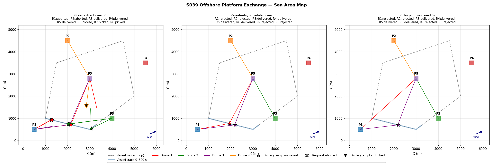
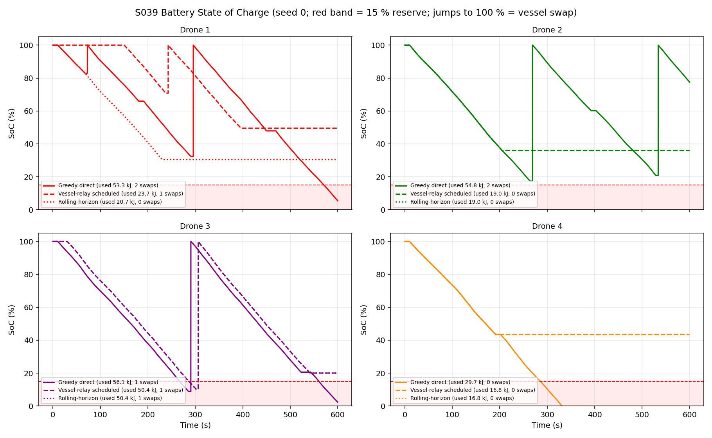
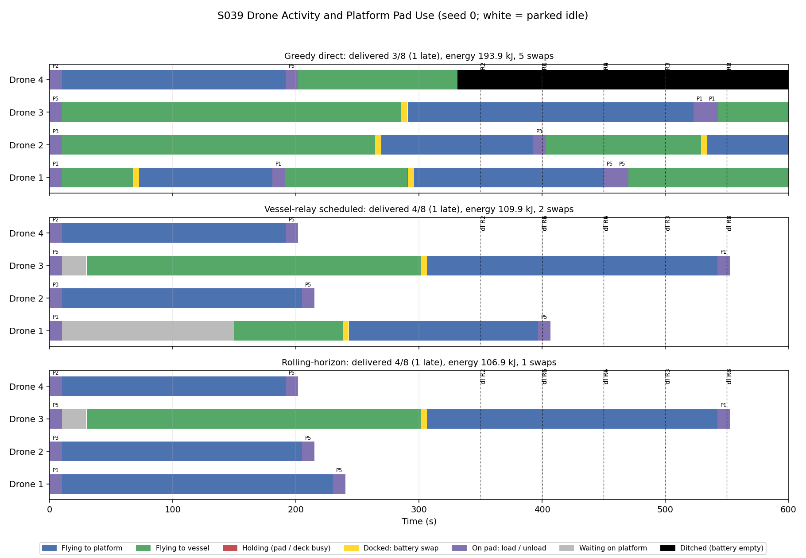
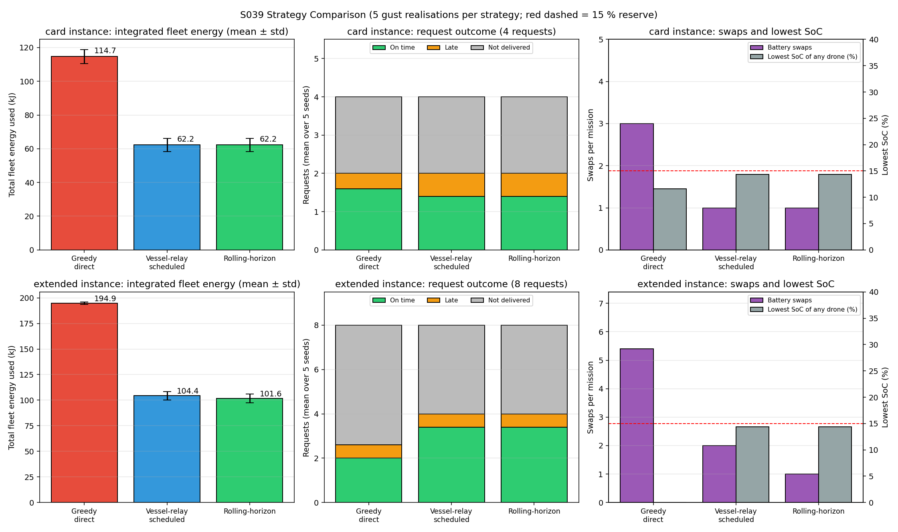
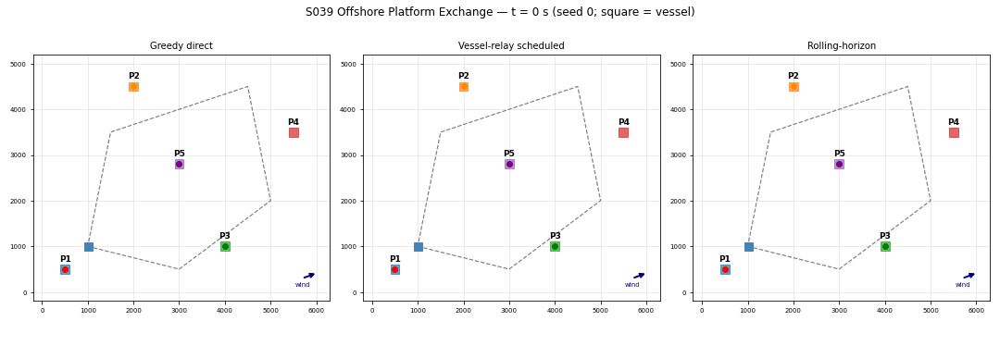

# S039 Offshore Platform Exchange

**Domain**: Logistics & Delivery | **Difficulty**: ⭐⭐⭐⭐ | **Status**: ✅ Completed

---

## Problem Definition

**Setup**: 4 drones carry cargo between 5 offshore platforms in a 6 × 6 km sea area. A support vessel sails a fixed looping route at 4 m/s and offers battery swaps on a single moving deck. Each platform has one landing pad. Wind is a steady mean (4.0, 1.5) m/s plus a Dryden gust, so groundspeed, and therefore range, depend strongly on heading. Three dispatch strategies are compared: Greedy direct, Vessel-relay scheduled and Rolling-horizon.

**Key question**: Which strategy delivers the most cargo on time for the least fleet energy, and when does a vessel battery swap actually extend a drone's range enough to make a delivery possible?

---

## Mathematical Model

### Wind, Groundspeed and Power

$$\sin\delta = \frac{\|\mathbf{w}\|\sin(\psi_{des}-\psi_w)}{V_a}, \qquad V_g = V_a\cos\delta + \|\mathbf{w}\|\cos(\psi_{des}-\psi_w), \qquad P = P_{cruise} + k_{wind}\|\mathbf{w}\|^2$$

Gust: first-order Dryden filter per drone ($\sigma_g$ = 1.2 m/s, $L_g$ = 200 m), seeded.

### Battery, Range and Reserve

- **Battery capacity**: $E_{full}$ is the energy needed to fly $R_{max}$ = 5000 m eastbound in the mean wind: $E_{full} = 94.6\ \text{W} \times 5000\ \text{m} / 15.90\ \text{m/s} = 29.74$ kJ.
- **Planning power**: plans use the mean wind plus the expected gust power, $P_{plan} = 80 + 0.8\,(18.25 + 2 \times 1.2^2) = 96.9$ W. A full battery therefore lasts 29.74 kJ / 96.9 W = 307 s.
- **Reserve**: every battery-limited stretch must end with at least $E_{res} = 0.15\,E_{full} = 4.46$ kJ.
- **Range depends on heading**: into the wind, $V_g$ drops to about 8–11 m/s, so a full battery reaches only about 2.5–3.5 km.

### Vessel Intercept

$t^*_{n+1} = t + \|\mathbf{p}_v(t^*_n) - \mathbf{p}_k\| / V_g(\psi_{to\,vessel})$, a fixed-point iteration. During execution the drone re-solves it every step while pursuing the vessel and docks once it is within $d_{dock}$ = 15 m and the deck is free.

### Fleet Energy Metric

$E_{fleet} = \sum_k \int P_k\,dt$ over all flying, holding and vessel-approach time, including the energy used before every battery swap.

### Strategies

| Strategy | Assignment | Route / vessel use |
|----------|-----------|--------------------|
| **Greedy direct** | Nearest idle drone takes each pending request (when a drone becomes idle). | Flies direct. Diverts to the vessel only on a battery emergency: remaining energy − planned energy to the current target < $E_{res}$. If the emergency fires again straight after a swap (battery ≥ 98 %), the request is **aborted** instead of looping. |
| **Vessel-relay scheduled** | One static plan at t = 0; requests are inserted in deadline order, each into the drone that delivers it earliest (tasks are chained per drone). | For each drone it evaluates direct, swap-after-pickup (with an optimised wait of 0–390 s at the origin) and swap-before-pickup routes. Among on-time options it picks the one that **leaves the most charge** ("proactive swaps"); otherwise the earliest. Requests with no feasible route by $T_{max}$ are **rejected**. |
| **Rolling-horizon** | Same insertion planner, re-run every 30 s from the actual drone states (energy after gusts, position) for all requests not yet picked up, including previously rejected ones. | Picks the **minimum-energy** on-time route (the card's objective); otherwise the earliest. |

All strategies share the same execution model: single platform pad (holding orbit if busy), single vessel deck (hover beside it if busy), 10 s load/unload on the pad, 5 s battery swap. A drone whose battery reaches 0 in flight ditches.

---

## Key Parameters

| Parameter | Value |
|-----------|-------|
| Drones / platforms | 4 / 5 (positions as in the card; drones start at P1, P3, P5, P2) |
| Drone airspeed $V_a$ | 12 m/s |
| Vessel speed $V_s$ | 4 m/s, card route starting at (1000, 1000) at t = 0 |
| $R_{max}$ (eastbound, mean wind) | 5000 m → $E_{full}$ = 29.74 kJ |
| Battery reserve | 15 % of $E_{full}$ (4.46 kJ) |
| $P_{cruise}$ / $k_{wind}$ | 80 W / 0.8 W·s²/m² |
| Mean wind / gust $\sigma_g$ / $L_g$ | (4.0, 1.5) m/s / 1.2 m/s / 200 m |
| Planning power $P_{plan}$ | 96.9 W |
| Deck engagement radius $d_{dock}$ | 15 m |
| Holding orbit radius | 30 m |
| Battery swap / pad load-unload time | 5 s / 10 s |
| Time step / horizon / replanning interval | 0.1 s / 600 s / 30 s |
| Card instance | R1 P1→P4 (dl 400 s), R2 P3→P2 (350 s), R3 P5→P1 (500 s), R4 P2→P5 (450 s) |
| Extended instance | card + R5 P1→P5 (450 s), R6 P3→P5 (400 s), R7 P5→P4 (550 s), R8 P1→P3 (550 s) |
| Gust realisations | 5 per strategy and instance (seeds 0–4); plots use seed 0 of the extended instance |
| Animation | 150 frames at 15 fps over 0–600 s |

### Deviations from the scenario card

- **Livelock fixed.** Previously the range check used eastbound groundspeed for every heading and nothing checked feasibility. R1 (P1→P4, 5831 m) can never be flown on one battery, so after every swap the drone still failed the check and diverted again: 60 swaps and R1 never delivered. The old README blamed the "single-pad bottleneck". Now the range check uses the actual bearing. The planners reject infeasible requests explicitly, and Greedy aborts a request when a fresh battery still cannot complete it.
- **Fleet energy integrated.** The old metric was $\sum(E_{full} - E_{final})$, which ignored everything used before a swap (51.04 kJ for a drone that swapped 60 times). It is replaced by $\int P\,dt$.
- **Three distinct strategies.** Previously `maybe_use_vessel_proactively` was never called and "relay" ran the greedy code. The strategies now differ as in the table above. The card's rolling-horizon MIP (`linprog` min-cost flow) is replaced by the deadline-ordered insertion heuristic, which has 4–8 requests to place. The card's "proactive swap" is interpreted as "maximise the charge left after each delivery".
- **Reserve in energy, not metres.** The card's $d_{safety} = 0.15\,R_{max}$ = 750 m is a fixed distance, but range depends strongly on heading here. The reserve is therefore 15 % of battery energy (equal to 750 m only on an eastbound leg), and the planner adds the expected gust power ($2\sigma_g^2$ term).
- **Not modelled:** the PD moving-deck landing (the drone docks once within $d_{dock}$; see S023 for deck tracking), holding altitude, and the deck-approach convergence plots. The unused constants $\epsilon_p$, $\epsilon_v$, $K_p$, $K_d$ were removed.
- **Added parameters.** Card values for swap time (5 s) and pad load/unload time (10 s) do not exist, so these were added. Pad occupancy counts only landing and load/unload; parked drones do not block a pad.
- **Extended instance added.** On the card instance the two planners must produce the same plan: only R3 and R4 are feasible, and each has a single feasible route. The extended instance adds four requests so that drones chain tasks and choose between direct and swap routes.
- **Card expectations not met.** R1 and R2 cannot be delivered by any strategy (see below), so the card's feasibility objective ("every request within its deadline") is unattainable with the card's parameters. Platform pad conflicts are almost absent: total holding time is 0–1.0 s per run.

---

## Implementation

```
src/02_logistics_delivery/s039_offshore_platform_exchange.py
```

```bash
conda activate drones
python src/02_logistics_delivery/s039_offshore_platform_exchange.py
```

Runtime ≈ 1.5 min (30 runs of 6000 steps plus plots and GIF). Gusts are seeded per run and per drone (`default_rng([seed, k])`); two runs gave identical output.

---

## Results

### Feasibility at t = 0 (planner, from a full battery at the origin)

| Request | Distance | Direct energy (share of one battery) | Deadline | Earliest feasible delivery |
|---------|----------|---------------------------------------|----------|----------------------------|
| R1 P1→P4 | 5831 m | 117 % | 400 s | none by 600 s |
| R2 P3→P2 | 4031 m | 124 % (into the wind) | 350 s | none by 600 s |
| R3 P5→P1 | 3397 m | 140 % (into the wind) | 500 s | 506 s with 1 swap |
| R4 P2→P5 | 1972 m | 54 % | 450 s | 175 s direct |
| R5 P1→P5 | 3397 m | 70 % | 450 s | 224 s direct |
| R6 P3→P5 | 2059 m | 63 % | 400 s | 204 s direct |
| R7 P5→P4 | 2596 m | 52 % | 550 s | 170 s direct |
| R8 P1→P3 | 3536 m | 71 % | 550 s | 229 s direct |

R1 and R2 are impossible because the vessel spends the whole 600 s horizon in the south of the area, between (1000, 1000) and (3271, 703). Even after a swap there, the remaining leg to P4 or P2 exceeds what a full battery can fly with a 15 % reserve. The best R1 relay would arrive after $T_{max}$. R3 needs the vessel swap, which turns a 140 % trip into a feasible one, but even its earliest plan (506 s) misses the 500 s deadline. The R5–R8 times assume a drone with a full battery is already at the origin; in the runs, chaining changes that.

### Card instance (4 requests; mean of 5 gust seeds)

| Strategy | Fleet energy (kJ) | Delivered | On time | Swaps | Lowest SoC | Runs below 15 % | Request outcome |
|----------|------------------|-----------|---------|-------|------------|-----------------|-----------------|
| Greedy direct | 114.73 ± 4.18 | 2.0 / 4 | 1.6 | 3.0 | 11.6 % | 4 / 5 | R1, R2 aborted after a useless swap; R3 at 469–523 s; R4 at 169–192 s |
| Vessel-relay scheduled | **62.23 ± 3.99** | 2.0 / 4 | 1.4 | 1.0 | 14.4 % | 2 / 5 | R1, R2 rejected; R3 at 488–542 s; R4 at 169–192 s |
| Rolling-horizon | **62.23 ± 3.99** | 2.0 / 4 | 1.4 | 1.0 | 14.4 % | 2 / 5 | identical to relay |

### Extended instance (8 requests; mean of 5 gust seeds)

| Strategy | Fleet energy (kJ) | Delivered | On time | Swaps | Lowest SoC | Drones ditched (5 runs) |
|----------|------------------|-----------|---------|-------|------------|-------------------------|
| Greedy direct | 194.87 ± 1.10 | 2.6 / 8 | 2.0 | 5.4 | 0.0 % | 6 |
| Vessel-relay scheduled | 104.42 ± 4.11 | 4.0 / 8 | 3.4 | 2.0 | 14.4 % | 0 |
| Rolling-horizon | **101.62 ± 4.32** | 4.0 / 8 | 3.4 | 1.0 | 14.4 % | 0 |

Seed 0, per drone (extended instance): Greedy D1 53.29 / D2 54.77 / D3 56.10 / D4 29.74 kJ (D4 ditched at 331.3 s). Relay D1 23.69 (1 swap, ends at 50 % SoC) / D2 19.02 / D3 50.43 / D4 16.81 kJ. Rolling D1 20.67 (0 swaps, ends at 30 %) / D2 19.02 / D3 50.43 / D4 16.81 kJ.

**Key Findings**:
- **The vessel extends range for one request and cannot rescue two others.** R3 (140 % of a battery into the wind) is delivered by every strategy thanks to one vessel swap. R1 and R2 are infeasible with the card's vessel route, wind and horizon. The old "60 swaps" were a livelock on R1, not a vessel-pad bottleneck.
- **Greedy wastes about half its energy on impossible requests.** On the card instance it delivers the same two requests as the planners but uses 114.73 kJ against 62.23 kJ. The 52.50 kJ difference is the R1/R2 attempts: on seed 0, D1 and D2 use 15.20 + 36.41 = 51.61 kJ to fly to the vessel, swap and abort. On the extended instance the emergency-only diverting goes further: drones run their batteries down far from the vessel, 6 drones ditch over 5 runs, R6–R8 are never completed, and greedy delivers 2.6 of 8 against 4.0 for the planners.
- **Greedy is slightly faster on R3 because it accepts lower charge.** It flies straight to the vessel, so R3 arrives at 469–523 s and is on time in 3 of 5 runs (relay/rolling: 488–542 s, 2 of 5). Its lowest SoC falls below the 15 % reserve in 4 of 5 card runs (down to 5.6 %).
- **Relay and rolling differ only where their objectives differ.** On the extended instance, relay's max-charge rule sends D1 to the vessel for a swap before R5 (delivered at 379–405 s, D1 ends at 50 % SoC). Rolling flies R5 direct (223–230 s, D1 ends at 30 %). Rolling uses 2.80 kJ less on average (104.42 − 101.62) and one swap fewer. The extra charge from relay's proactive swap is never used: R7 and R8 stay rejected by both planners. On seed 0, D1, D2 and D4 finish their first tasks at P5 with 30–50 % SoC (D1 30 % under rolling, 50 % under relay; D2 36 %; D4 43 %), but R7 (P5→P4) needs 52 % + 15 % reserve = 67 %. D3 is busy with R3 until 542 s, and R8 starts from P1. The planner inserts requests one at a time in deadline order and does not look ahead, so it does not keep a fresh drone at P1 for R8.
- **Re-planning had nothing to recover here.** The rolling planner re-tries R1, R2, R7 and R8 every 30 s, but they end "rejected" in every run. Its events on seed 0 match relay's apart from the R5 route. On the card instance rolling is identical to relay in every seed.
- **The planners' reserve can still be breached on the way to the vessel.** In 2 of 5 runs (seeds 0 and 3) the lowest charge falls to 10.4 % / 7.3 %. On seed 0 the battery plot shows this is D3 chasing the vessel just before its R3 swap: the pursuit takes longer than the planned intercept, and the reserve check is not applied while a drone is already heading to the vessel.

**Sea Area Map** (extended instance, seed 0; stars = swaps, X = aborted request, ▼ = ditched drone; blue band = the vessel's track during the 600 s):



**Battery SoC Traces** (extended instance, seed 0; solid = greedy, dashed = relay, dotted = rolling; when two lines coincide only one is visible):



**Drone Activity and Platform Pad Use** (extended instance, seed 0; pad labels above the load/unload bars; dotted lines = request deadlines):



**Strategy Comparison** (top: card instance; bottom: extended instance; 5 gust seeds):



**Animation** (extended instance, seed 0; all three strategies on a common clock; square = vessel):



---

## Extensions

1. Multi-pad vessel, or a vessel route optimised jointly with the requests (here the vessel never reaches the north of the area, which is what makes R1 and R2 impossible)
2. Sea-state model: vessel pitch/roll affects landing success probability; add retry logic
3. Fuel-cell drones: replace battery swaps with hydrogen refuelling (longer but less frequent stops)
4. Adverse weather window: certain time slots are no-fly, and the planner must schedule around them
5. Look-ahead assignment (e.g. MIP over all requests) that reserves a drone or a swap for later requests such as R7 and R8

---

## Related Scenarios

- Prerequisites: [S021](../../../scenarios/02_logistics_delivery/S021_point_delivery.md), [S023](../../../scenarios/02_logistics_delivery/S023_moving_landing_pad.md), [S036](../../../scenarios/02_logistics_delivery/S036_last_mile_relay.md)
- Follow-ups: [S040](../../../scenarios/02_logistics_delivery/S040_fleet_load_balancing.md)
- Algorithmic cross-reference: [S023](../../../scenarios/02_logistics_delivery/S023_moving_landing_pad.md) (moving platform landing), [S032](../../../scenarios/02_logistics_delivery/S032_charging_queue.md) (charging queue management)
