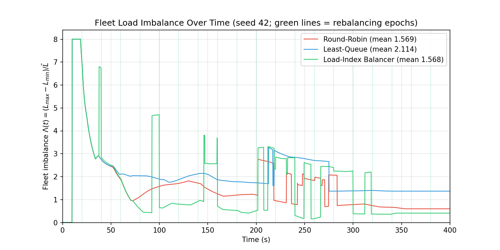
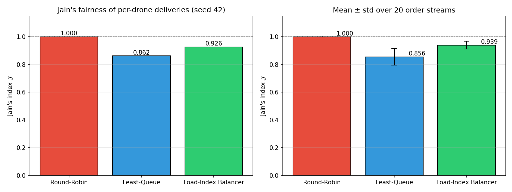
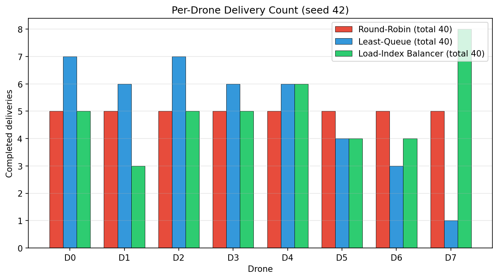
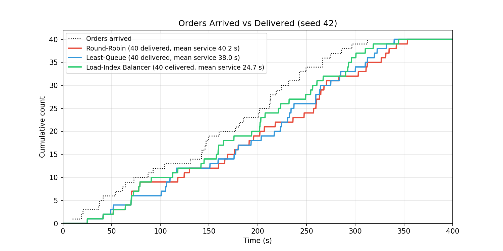
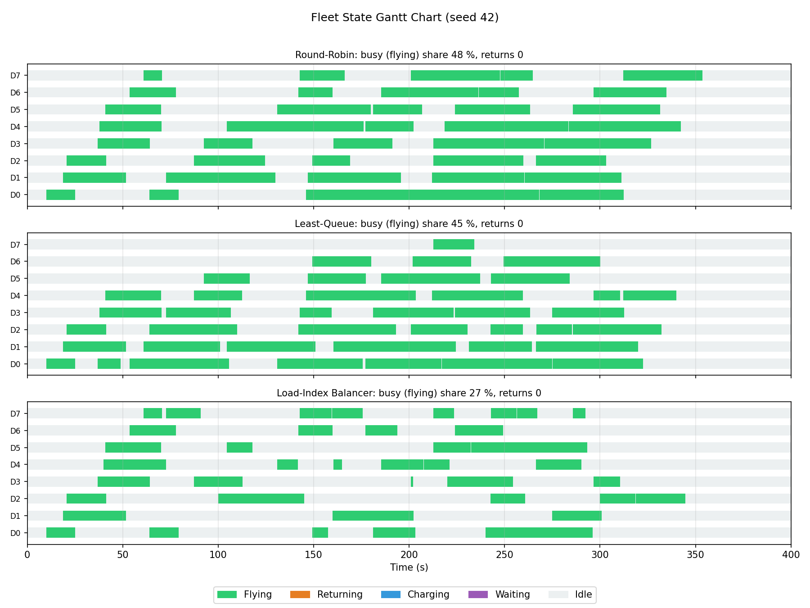
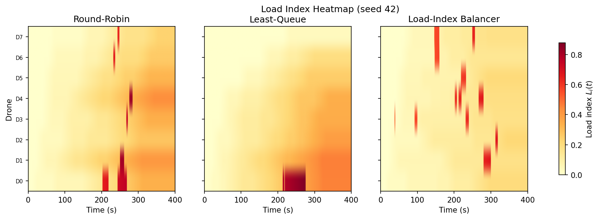
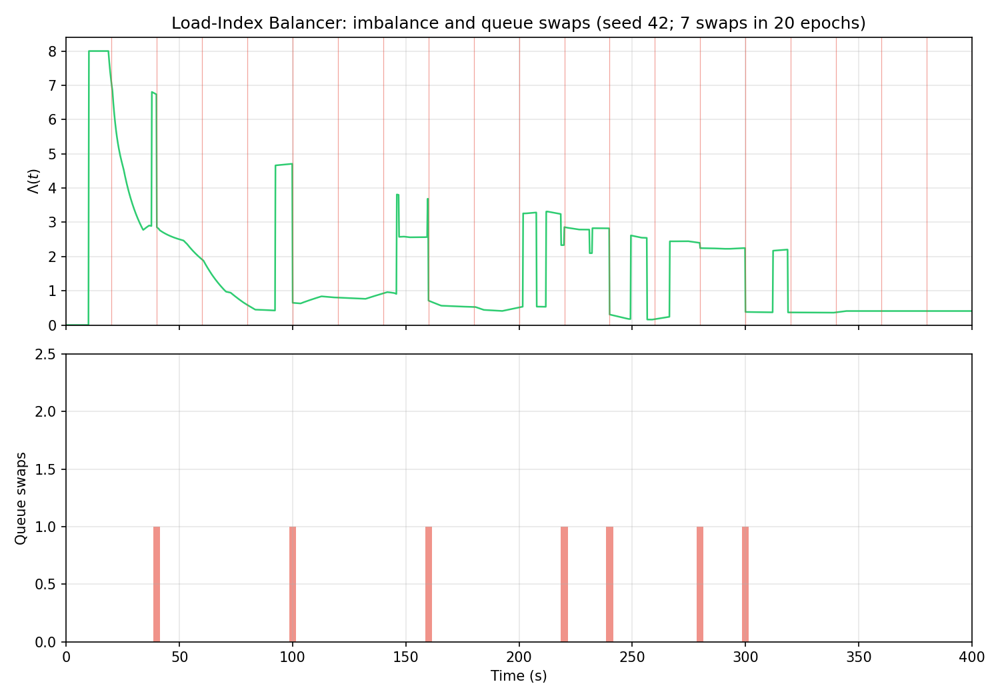
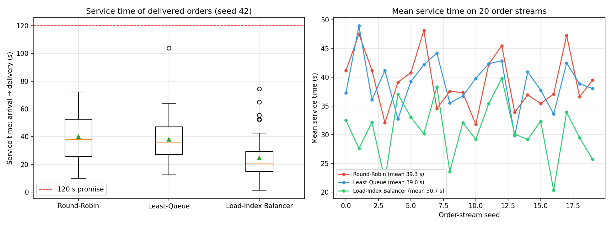
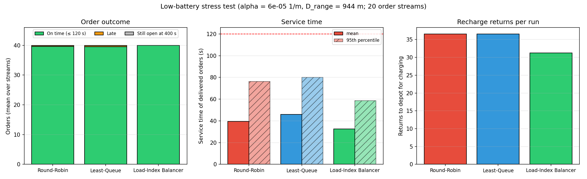
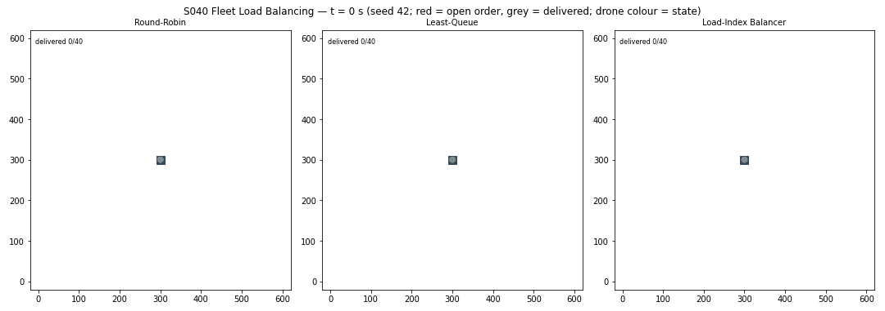

# S040 Fleet Load Balancing

**Domain**: Logistics & Delivery | **Difficulty**: ⭐⭐⭐⭐ | **Status**: ✅ Completed

---

## Problem Definition

**Setup**: 8 delivery drones operate from a single depot at (300, 300) m with 2 charging pads, over a 600 × 600 m grid (2-D model). 40 orders appear at uniformly random times in [0, 320] s at uniformly random locations; the horizon is 400 s. As in the card, each drone works through its own FIFO queue, flying directly from one delivery point to the next, and goes back to the depot only to recharge. Three dispatch strategies are compared: Round-Robin, Least-Queue and the card's Load-Index Balancer with periodic queue swaps.

**Key question**: Which strategy serves orders fastest and spreads the work most evenly, and does the composite load index help compared with the two state-blind rules?

---

## Mathematical Model

### Battery

$$\Delta s = \frac{\alpha\,(m_{body}+m_p)\,g\,d}{E_{cap}}, \qquad k = \alpha (m_{body}+m_p) g = 1.5\times10^{-5} \times 1.8 \times 9.81 = 2.649\times10^{-4}\ \text{SoC/m}, \qquad D_{range} = 1/k = 3775\ \text{m}$$

A drone needs $s \ge \beta_{safe}$ = 0.05 after flying home. Recharge happens on a pad at 0.20 $E_{cap}$/s.

### Load Index and Imbalance (card)

$$L_i = 0.5\,w_i + 0.3\,\frac{f_i}{F_{norm}} + 0.2\,(1 - s_i), \qquad \Lambda(t) = \frac{L_{max}(t) - L_{min}(t)}{\bar L(t)}$$

Here $w_i$ is the number of queued (not yet started) orders, $f_i$ the cumulative flight distance, and $F_{norm} = D_{range}/2$ = 1888 m. The reported $\bar\Lambda$ is averaged over all 0.2 s time steps.

### Strategies (what the code actually does)

| Strategy | Assignment rule | Uses drone state? |
|----------|----------------|-------------------|
| **Round-Robin** | Order $j$ goes to drone $j \bmod 8$ the moment it arrives. | No. A drone may be busy, returning or charging. |
| **Least-Queue** | Drone with the fewest unfinished orders (queued + in progress); ties go to the lowest index. | Only the order count. It ignores battery, charging state and distance. |
| **Load-Index Balancer** | $\arg\min_i\,[L_i + \Delta L_i]$ with $\Delta L_i = 0.5 + 0.3\,\|\mathbf q_o - \mathbf p_{last,i}\|/F_{norm}$, among drones that are idle or flying and pass the battery check $s_i - (\text{remaining route} + \text{extra}) \cdot k \ge \beta_{safe}$. Orders with no eligible drone wait in a central backlog and are retried every step. Every 20 s, up to 2 queued orders move from the most- to the least-loaded eligible drone if that lowers $\Lambda$. | Yes: queue, mileage, battery and distance to the new order. |

Order handling shared by all strategies:

- **No order is ever dropped.** If a drone has to go home, its current order goes back to the front of its own queue (Round-Robin, Least-Queue) or back to the central backlog for re-dispatch (Load-Index).
- **Recharge triggers.** A drone goes home before a leg it could not finish and still fly home, during a leg when the card's in-flight rule fires ($s \le k\,d_{home} + \beta_{safe}$), and when it is idle with an empty queue and could no longer fly to the farthest grid corner and back.
- **Order outcome.** At 400 s each order is delivered on time (≤ 120 s after arrival), delivered late, in flight (it is some drone's current delivery), queued on a drone (not yet started), or in the central backlog. A check run every time step asserts that each order sits in exactly one place: not yet arrived, backlog, a drone queue, in flight, or delivered. No order is ever counted twice or lost.

---

## Key Parameters

| Parameter | Value |
|-----------|-------|
| Fleet / charging pads | 8 drones / 2 pads |
| Orders | 40, arrival times uniform in [0, 320] s, locations uniform in [0, 600]² m |
| Horizon / time step | 400 s / 0.2 s |
| Cruise speed | 8.0 m/s |
| Masses | body 1.5 kg + payload 0.3 kg |
| Discharge coefficient $\alpha$ | 1.5 × 10⁻⁵ 1/m → $D_{range}$ = 3775 m |
| Charge rate / safety reserve | 0.20 $E_{cap}$/s / 0.05 |
| Load-index weights $(\phi_w, \phi_f, \phi_s)$ / $F_{norm}$ | (0.5, 0.3, 0.2) / 1888 m |
| Rebalancing period / max swaps per epoch | 20 s / 2 |
| On-time promise (added) | 120 s from order arrival to drop |
| Depot | (300, 300) m |
| Showcase order stream / study | seed 42 / seeds 0–19 |
| Stress test | $\alpha$ = 6.0 × 10⁻⁵ 1/m → $D_{range}$ = 944 m, same 20 streams |
| Animation | 150 frames at 15 fps over 0–400 s |

### Deviations from the scenario card

- **Battery range fixed (card arithmetic corrected).** With $\alpha$ = 1.5 × 10⁻⁴ the formula gives $1/(1.5\times10^{-4} \times 1.8 \times 9.81)$ = 377 m, not the "~3560 m" stated in the card and code comment. With that 377 m range drones spent about 22 % of their time returning and only 12–15 of 40 orders were delivered. $\alpha$ is now 1.5 × 10⁻⁵, which gives 3775 m, and the card has been corrected.
- **Orders are no longer lost silently.** Previously, a drone that turned home mid-flight dropped its current order, and the Load-Index rule discarded orders with no feasible drone (2 on seed 42). Both now requeue. The previous end-of-run "sums to 40" assert was tautological, because the queue count was computed as whatever remained after the other classes. It has been replaced by the per-step conservation check described above.
- **Order stream.** 40 orders with uniform arrival times in [0, 320] s, as in the card's code. The old README's "Poisson 1/30 s, 10 m/s, 100 Wh, 500 m arena, 600 s" did not match the code.
- **Least-Queue** counts the order in progress as well as the queue, and breaks ties by lowest index. It still ignores battery and position, as the card describes.
- **Rebalancing.** The receiving drone must be eligible (not returning or charging). The card says the "least-loaded feasible drone"; the old code could pick a charging drone.
- **Added rules.** The pre-departure battery check, the idle-drone recharge rule and the 120 s on-time promise are not in the card. The idle-recharge rule was needed because, in the stress test, the Load-Index Balancer otherwise deadlocked: drones too low to be eligible never went to charge, and 10.35 orders per run stayed in the backlog.
- **Not implemented:** the RL (PPO) dispatcher (a card extension), so the plots show three strategies, not four.
- **Model assumptions kept from the card.** The model is 2-D, and drones chain deliveries without reloading at the depot. The card's charge rate of 0.20 $E_{cap}$/s means a full charge takes 5 s, which is unrealistically fast. It matters mainly in the stress test. With the nominal battery no drone charges on seed 42, but over the 20 nominal streams Least-Queue makes recharge returns on 6/20 streams (0.30 returns per run on average) and Round-Robin on 1/20 (0.05 per run); Load-Index makes none.
- **Animation** uses the recorded positions of the main run instead of a duplicated re-simulation.

---

## Implementation

```
src/02_logistics_delivery/s040_fleet_load_balancing.py
```

```bash
conda activate drones
python src/02_logistics_delivery/s040_fleet_load_balancing.py
```

Runtime ≈ 50 s (123 simulations plus plots and GIF). Order streams are seeded with `default_rng(seed)`; two runs gave identical output.

---

## Results

### Showcase order stream (seed 42)

| Strategy | Delivered | On time / late | Open at 400 s: in flight / queued / backlog | Mean / p95 / max service (s) | Jain $\mathcal J$ | Mean $\Lambda$ | Fleet flight (km) | Returns | Lowest SoC | Swaps |
|----------|-----------|----------------|---------------|------------------------------|------------------|---------------|-------------------|---------|-----------|-------|
| Round-Robin | 40/40 | 40 / 0 | 0 / 0 / 0 | 40.2 / 69.8 / 72.2 | 1.000 | 1.569 | 12.24 | 0 | 0.463 | – |
| Least-Queue | 40/40 | 40 / 0 | 0 / 0 / 0 | 38.0 / 62.3 / 104.0 | 0.862 | 2.114 | 11.67 | 0 | 0.425 | – |
| Load-Index | 40/40 | 40 / 0 | 0 / 0 / 0 | **24.7** / **56.0** / 74.6 | 0.926 | **1.568** | **6.96** | 0 | 0.727 | 7 |

Per-drone deliveries: Round-Robin [5, 5, 5, 5, 5, 5, 5, 5]; Least-Queue [7, 6, 7, 6, 6, 4, 3, 1]; Load-Index [5, 3, 5, 5, 6, 4, 4, 8].

### Study: 20 order streams (seeds 0–19), nominal battery (means)

| Strategy | Delivered | On time / late | Open at 400 s: in flight / queued / backlog | Mean / p95 service (s) | Jain | Mean $\Lambda$ | Flight (km) | Returns |
|----------|-----------|----------------|---------------|------------------------|------|---------------|-------------|---------|
| Round-Robin | 39.90 | 39.80 / 0.10 | 0.10 / 0.00 / 0.00 | 39.3 / 73.1 | 1.000 | 1.643 | 11.79 | 0.05 |
| Least-Queue | 39.85 | 39.80 / 0.05 | 0.15 / 0.00 / 0.00 | 39.0 / 70.9 | 0.856 | 2.154 | 12.09 | 0.30 |
| Load-Index | 39.90 | 39.90 / 0.00 | 0.10 / 0.00 / 0.00 | **30.7** / **69.0** | 0.939 | 1.814 | **8.29** | 0.00 |

The Load-Index Balancer has the lowest mean service time on 17 of 20 streams (Least-Queue 2, Round-Robin 1).

### Low-battery stress test ($D_{range}$ = 944 m, same 20 streams; means)

| Strategy | Delivered | On time / late | Open at 400 s: in flight / queued / backlog | Mean / p95 service (s) | Jain | Flight (km) | Returns |
|----------|-----------|----------------|---------------|------------------------|------|-------------|---------|
| Round-Robin | 39.85 | 39.65 / 0.20 | 0.10 / 0.05 / 0.00 | 39.6 / 76.3 | 0.999 | 17.28 | 36.55 |
| Least-Queue | 39.85 | 39.50 / 0.35 | 0.15 / 0.00 / 0.00 | 45.8 / 80.0 | 0.890 | 17.37 | 36.55 |
| Load-Index | **40.00** | 40.00 / 0.00 | 0.00 / 0.00 / 0.00 | **32.6** / **58.6** | 0.961 | 15.97 | 31.25 |

Load-Index has the lowest mean service time on 19 of 20 streams (Round-Robin 1).

**Key Findings**:
- **With a correct battery range the fleet has spare capacity, so all strategies deliver almost every order; they differ in speed and flight distance.** On seed 42 every strategy delivers 40/40 on time and no drone needs to recharge (lowest SoC 0.425). Across the 20 streams only 0.10–0.15 orders per run are still open at 400 s, and all of them are in flight (a drone is on its way), not waiting in a queue or backlog. Recharge returns happen on 6/20 streams for Least-Queue and 1/20 for Round-Robin. The old result (12–15 of 40 delivered) was caused by the 377 m range, not by the dispatch rules.
- **Load-Index is fastest because its marginal-load term includes distance.** Among drones with an empty queue, and with no recharge so far ($1 - s_i = k f_i$), the score is $0.5 + 0.3 f_i/F_{norm} + 0.2\,k f_i + 0.3\,d/F_{norm}$, so it picks a nearby, low-mileage drone. Round-Robin and Least-Queue ignore where the drone is. On seed 42 the fleet flies 6.96 km instead of 12.24 km (−43 %). Converted to time, that is 6.96 km / 8 m/s = 870 s against 12.24 km / 8 m/s = 1530 s, i.e. 27 % against 48 % of the 8 × 400 = 3200 drone-seconds. Mean service time drops to 24.7 s (40.2 s for Round-Robin). Over 20 streams the averages are 30.7 s against 39.3 s and 39.0 s.
- **Jain's index rewards Round-Robin by construction.** 40 orders cycled over 8 drones gives exactly 5 each whenever all are delivered, so $\mathcal J$ = 1.000 says nothing about efficiency. Least-Queue is the least fair (0.862 on seed 42; D0 gets 7 deliveries, D7 gets 1) because ties go to the lowest index, so low-numbered drones collect the orders whenever several are idle.
- **The imbalance metric does not favour the balancer.** Mean $\Lambda$ is 1.568 for Load-Index against 1.569 for Round-Robin on seed 42, and over 20 streams Load-Index is worse (1.814 against 1.643). Its $L_i$ includes mileage, and its fleet flies less, so $\bar L$ is smaller and the ratio larger. The spike to $\Lambda$ = 8 at the first order is arithmetic: one drone has load $L$ and seven have 0, so $\Lambda = L/(L/8)$ = 8. The 7 queue swaps on seed 42 (at most 1 per epoch) are marked in the rebalancing plot.
- **When the battery binds, only the state-aware balancer delivers everything.** In the stress test Round-Robin and Least-Queue each make 36.55 recharge returns per run and leave 0.15 orders open on average. Least-Queue is the slowest (45.8 s mean service): like Round-Robin it assigns orders without looking at battery, so an order can wait while its drone goes to charge. Load-Index delivers 40.00 of 40 with 31.25 returns and 32.6 s mean service. The orders put back in the backlog by a returning drone are re-dispatched, so none is lost.

**Imbalance Time Series** (seed 42; thin green lines = rebalancing epochs):



**Jain Fairness** (seed 42 and mean ± std over 20 streams):



**Per-Drone Deliveries** (seed 42):



**Cumulative Deliveries** (seed 42; dotted = orders arrived):



**Fleet State Gantt Chart** (seed 42, all three strategies; on this stream only flying and idle states occur):



**Load Heatmap** (seed 42; $L_i(t)$; red bands = orders waiting in a queue):



**Rebalancing Events** (Load-Index, seed 42):



**Service Time** (seed 42 box plot, triangle = mean; and mean per stream over 20 streams):



**Low-Battery Stress Test** (20 streams):



**Animation** (seed 42; all three strategies on a common clock; red = open order, grey = delivered, drone colour = state):



---

## Extensions

1. Adaptive load weights: tune $\phi_w, \phi_f, \phi_s$ online using reinforcement learning (card's PPO dispatcher)
2. Task priority classes: urgent deliveries bypass normal queue assignment
3. Proactive rebalancing: idle drones reposition to high-demand zones before tasks arrive
4. Depot reloading: model a return to the depot for each parcel (the card's chained deliveries assume parcels are already on board)
5. Multi-depot balancing: tasks assigned across depots to minimise total fleet travel

---

## Related Scenarios

- Prerequisites: [S029 Urban Logistics Scheduling](../../../scenarios/02_logistics_delivery/S029_urban_logistics_scheduling.md), [S032 Charging Queue](../../../scenarios/02_logistics_delivery/S032_charging_queue.md)
- Follow-ups: Domain 3 (Environmental & SAR)
- Algorithmic cross-reference: [S033 Online Order Insertion](../../../scenarios/02_logistics_delivery/S033_online_order_insertion.md) (online task insertion), [S035 UTM Simulation](../../../scenarios/02_logistics_delivery/S035_utm_simulation.md) (UTM coordination)
