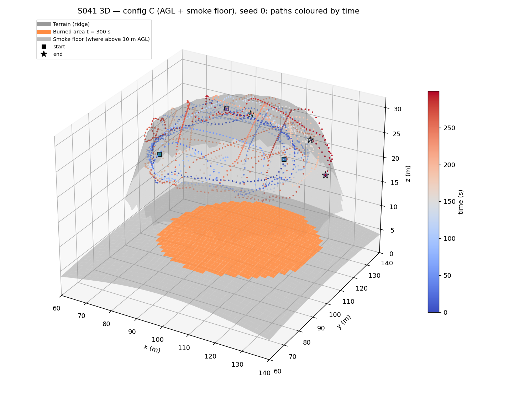
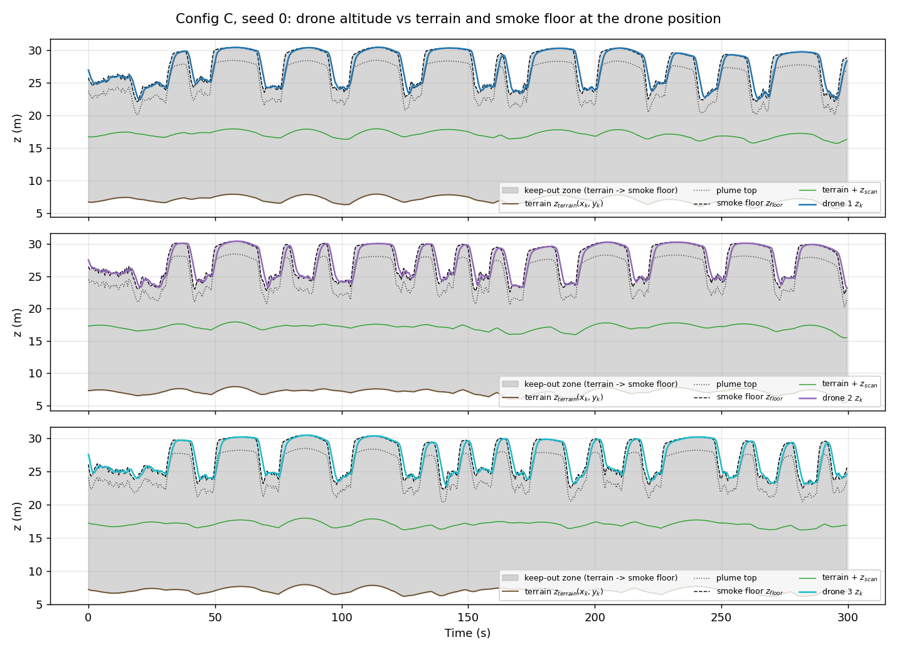
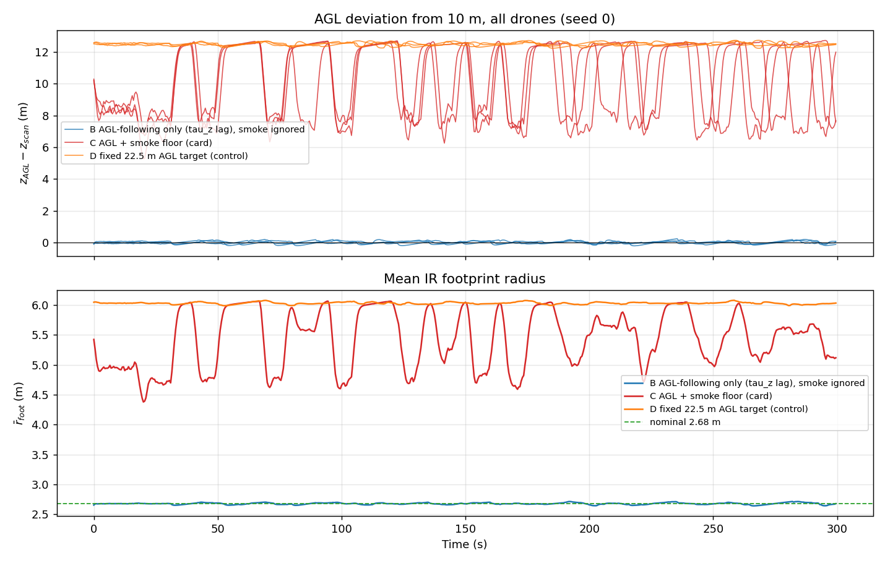
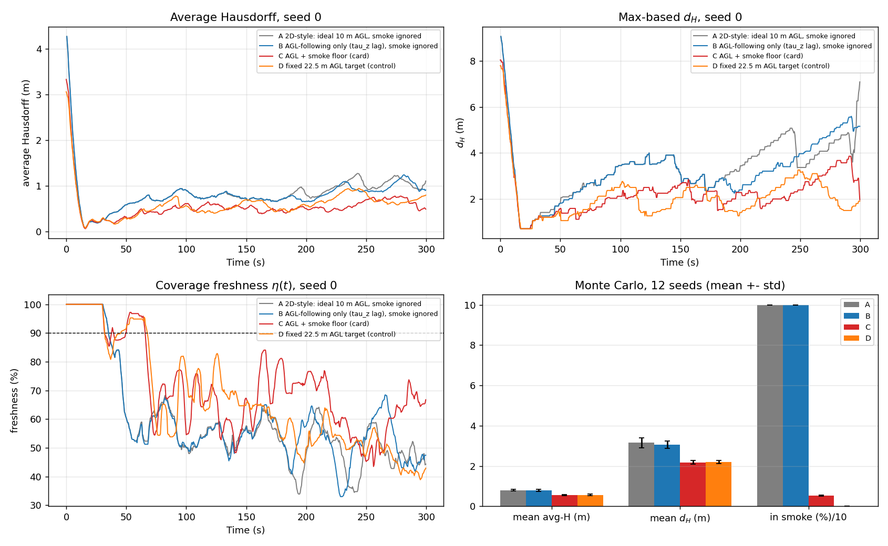
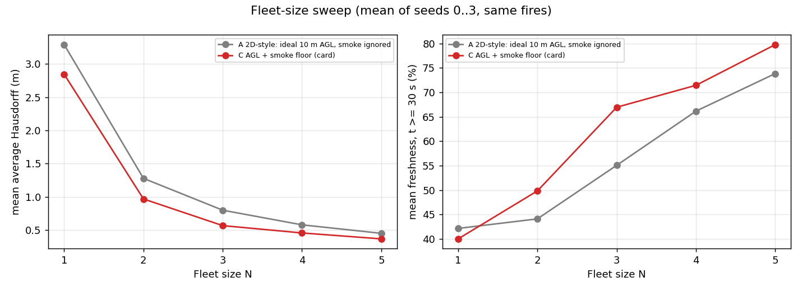
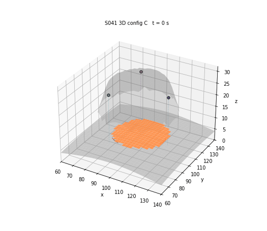

# S041 3D Upgrade — Wildfire Boundary Scan

**Domain**: Environmental Monitoring & SAR | **Difficulty**: ⭐⭐⭐ | **Status**: ✅ Completed

---

## Problem Definition

**Setup**: The S041 fire is placed on the card's ridge terrain. It is the same fire model as S041: elliptical Huygens spread on a 0.5 m grid, wind toward the NE (45°), head-fire rate 0.04 m/s, a 20 m initial radius at (100, 100) m, and spotting noise σ_spot = 0.01 m. Every burning cell now carries a smoke and heat column.

Three IR drones track the boundary with the S041 guidance and replanning logic. The drones start with an all-unknown map; they follow the boundary tangent with a signed stand-off correction, replan on coverage gaps and lost contact, and search outward for the front when needed. A separate altitude channel follows the terrain and climbs over the smoke. The IR footprint is a 15° cone, so its radius and its noise both grow with height above ground (AGL).

Four altitude configurations fly over the **same fire realisation** with the same sensor-noise stream. The fire does not depend on the drones, so it is simulated once per seed.

| Config | Altitude command | Role |
|--------|------------------|------|
| **A** 2D-style | ideal 10 m AGL hold, smoke ignored | the S041 behaviour (with the card's cone footprint) |
| **B** AGL only | first-order terrain following to 10 m AGL ($\tau_z$ lag, 2 m/s limit), smoke ignored | isolates the terrain effect |
| **C** AGL + smoke floor | the card's controller, $z_{cmd} = \max(z_{terrain} + z_{scan},\ z_{floor})$ | the card's 3D variant |
| **D** control | same lagged controller with a fixed 22.5 m AGL target (the highest possible smoke floor), smoke ignored | separates "flying higher" from "following the smoke floor" |

**Key question (card)**: How does the safe-altitude floor imposed by the smoke column reduce effective IR footprint coverage, and what fleet density is needed to compensate?

---

## Mathematical Model

**Terrain** (card): $z_{terrain} = 8\,\exp\!\bigl(-(x-100)^2/(2\cdot 40^2)\bigr)\cos\!\bigl(\pi (y-100)/200\bigr)$, which ranges from 0 to 8 m in the arena.

**Smoke floor** (card formula, with $d_b$ the distance to the nearest burning cell):

$$z_{floor} = z_{terrain} + h_{rise}\,e^{-d_b^2/(2\sigma_{plume}^2)} + h_{flame} + z_{safety}, \qquad h_{flame} = h_0 + k_{wind}\|U\| = 5.5\ \text{m}$$

The plume top is $z_{floor} - z_{safety}$. A drone below the plume top is **in smoke**. A drone between the plume top and $z_{floor}$ is **inside the 2 m safety margin**.

**Altitude channel**:

$$\dot z_k = \mathrm{clip}\!\left(\frac{z_{cmd,k} - z_k}{\tau_z},\ \pm \dot z_{max}\right), \qquad z_{cmd,k} = \max\bigl(z_{terrain}(x_k,y_k) + z_{scan},\ z_{floor}(x_k,y_k,t)\bigr) \ \text{(C)}$$

The command is evaluated at the drone's current position.

**IR cone**: $r_{foot,k} = z_{AGL,k}\tan 15°$, and the noise variance is $R_{sensor,k} = 25\,\mathrm{K}^2 \,(z_{AGL,k}/10\,\mathrm{m})^2$. Every cell in the footprint is classified burning when $T + w \ge 550$ K, with $w \sim \mathcal N(0, R_{sensor,k})$.

**Horizontal guidance** (S041): $\dot{\mathbf p}_{k,xy} = v_{cruise}\hat{\mathbf t}_k - K_\phi(s_k d_k - r_{foot,k})\hat{\mathbf n}_k$, clipped to $v_{cruise}$. The stand-off is the current footprint radius, which generalises S041's "settle $r_s$ outside the front". Lost contact means $d_k > r_{foot,k} + d_{replan}$.

**Metrics**:
- Max-based Hausdorff $d_H$ and the average (mean-based) Hausdorff distance between the true and the estimated boundary.
- Coverage freshness $\eta$, averaged over t ≥ 30 s.
- Share of drone-steps in smoke and inside the safety margin.
- Mean footprint radius and AGL.
- IR misclassification rate.

**Straight-front equilibrium of config C**: the stand-off $s$ must satisfy $s = r_{foot}$ and $r_{foot} = (h_{rise}e^{-s^2/50} + h_{flame} + z_{safety})\tan 15°$. Solving gives $s = 4.63$ m at 17.27 m AGL.

---

## Key Parameters

| Parameter | Value |
|-----------|-------|
| Arena / grid | 200 × 200 m, 0.5 m cells |
| Drones N | 3 (fleet sweep 1–5) |
| Terrain $A_{ridge}$, $\sigma_x$, $L_y$, centre | 8 m, 40 m, 200 m, (100, 100) m |
| Nominal scan AGL $z_{scan}$ | 10 m |
| IR half-angle $\alpha_s$ | 15° (footprint 2.68 m at 10 m AGL) |
| IR noise $R_{sensor,0}$ | 25 K² at 10 m AGL, ∝ $z_{AGL}^2$ |
| Fire / ambient / threshold temperature | 800 / 300 / 550 K |
| Cruise speed $v_{cruise}$ | 2.5 m/s |
| Altitude time constant $\tau_z$ | 1.0 s |
| Vertical rate limit $\|\dot z_{max}\|$ | 2.0 m/s |
| Flame height $h_0 + k_{wind}\|U\|$ | 3 + 0.5 × 5 = 5.5 m |
| Plume rise $h_{rise}$ / width $\sigma_{plume}$ | 15 m / 5 m |
| Plume cut-off | burning cells farther than 20 m (4σ) ignored (term < 0.005 m) |
| Safety clearance $z_{safety}$ | 2 m |
| Altitude bounds | 0.5 – 40 m (absolute) |
| Head-fire rate $R_0$, eccentricity $e_w$ | 0.04 m/s, 0.6 |
| Wind | 5.0 m/s toward 45° (NE) |
| Spotting noise σ_spot | 0.01 m/step (S041 fix) |
| Initial fire radius $r_0$ | 20 m at (100, 100) m |
| Stand-off gain $K_\phi$ | 0.8 s⁻¹ |
| Lost-contact distance $d_{replan}$ | 3.0 m beyond $r_{foot}$ |
| Coverage gap $\Delta t_{gap}$ / gap-replan hold | 30 s / 10 s |
| Drone start | 2.68 m (one nominal footprint) outside the perimeter, 120° apart, at the commanded altitude |
| Δt / $T_{sim}$ | 0.5 s / 300 s |
| Config D target | 22.5 m AGL = $h_{rise} + h_{flame} + z_{safety}$ |
| Monte Carlo | 12 seeds (0–11): fire `default_rng(seed)`, sensor `default_rng([seed, 1])`, identical for every config |
| Fleet sweep | N = 1–5, seeds 0–3, configs A and C |
| Animation | config C, seed 0, every 10th step, 61 frames |

---

## Implementation

```
src/03_environmental_sar/3d/s041_3d_wildfire.py
```

```bash
conda activate drones
python src/03_environmental_sar/3d/s041_3d_wildfire.py
```

The script imports the fixed 2D S041 module for the fire model, the boundary masks, the outward-normal estimate and the replan-target selection. Runtime ≈ 6 min: 48 Monte-Carlo missions, 32 fleet-sweep missions and the GIF. Two runs printed byte-identical output and wrote byte-identical PNG and GIF files.

---

## Results

### Card arithmetic (printed by the script)

| Quantity | Value |
|----------|-------|
| $h_{flame}$ | 5.50 m |
| $r_{foot}$ at 10 m / 20 m AGL | 2.679 m / 5.359 m |
| $\gamma_{max} = \arctan(2/2.5)$ | 38.7° |
| Terrain range | 0.00 – 8.00 m |
| Smoke floor rises above $z_{terrain} + z_{scan}$ | within 9.47 m of a burning cell |
| Floor directly above a burning cell | 22.5 m AGL |
| Config C straight-front equilibrium | stand-off 4.63 m at 17.27 m AGL |
| IR noise σ at 10 / 17.27 / 22.5 m AGL | 5.00 / 8.64 / 11.25 K: the 250 K threshold margin is 50.0 / 28.9 / 22.2 σ |

### Monte Carlo, 12 seeds, N = 3 (mean ± std over seeds)

| Config | Mean avg-Hausdorff | Mean $d_H$ | Freshness (t ≥ 30 s) | In smoke | In safety margin | Mean $r_{foot}$ | Mean AGL | IR misclass. |
|--------|-------------------|------------|----------------------|----------|------------------|-----------------|----------|--------------|
| A 2D-style | 0.801 ± 0.045 m | 3.157 ± 0.246 m | 55.4 ± 1.3 % | 100.0 % | 100.0 % | 2.68 m | 10.00 m | 0 % |
| B AGL only | 0.788 ± 0.045 m | 3.054 ± 0.178 m | 55.7 ± 2.1 % | 100.0 % | 100.0 % | 2.68 m | 10.00 m (9.77–10.22) | 0 % |
| C AGL + smoke floor | **0.558 ± 0.024 m** | **2.172 ± 0.092 m** | **68.0 ± 2.4 %** | 5.3 ± 0.2 % | 49.8 ± 0.7 % | 5.42 m | 20.23 m | 0 % |
| D fixed 22.5 m AGL | 0.563 ± 0.031 m | 2.187 ± 0.080 m | 67.2 ± 3.2 % | 0.0 % | 21.6 ± 1.4 % | 6.03 m | 22.50 m | 0 % |

**Head-to-head on identical fires** (seeds won out of 12):

| Comparison | Avg-Hausdorff | $d_H$ | Freshness | Mean difference (avg-H / $d_H$ / freshness) |
|------------|---------------|-------|-----------|------------------------------------------|
| C better than A | 12/12 | 12/12 | 12/12 | −0.243 m / −0.985 m / +12.5 pts |
| C better than B | 12/12 | 12/12 | 12/12 | −0.230 m / −0.882 m / +12.3 pts |
| B better than A | 6/12 | 8/12 | 6/12 | −0.013 m / −0.103 m / +0.2 pts |
| D better than C | 5/12 | 3/12 | 6/12 | +0.005 m / +0.015 m / −0.7 pts |

**When config C is inside the smoke column** (all 12 seeds, 21 600 drone-steps):

| Guidance mode | Share of drone-steps | In smoke |
|---------------|----------------------|----------|
| Boundary following | 51.4 % | 0 steps (0.0 %) |
| Transit to a replan target (or initial approach) | 48.6 % | 1153 steps (11.0 % of transit steps) |
| Front search | 0 % | — |

The deepest penetration below the plume top is 1.415 ± 0.090 m (range 1.251–1.588 m). In seed 0 it is 1.40 m.

### Fleet-size sweep (seeds 0–3, same fires)

| N | A: mean avg-H | C: mean avg-H | A: mean $d_H$ | C: mean $d_H$ | A: freshness | C: freshness | C: in smoke |
|---|---------------|---------------|---------------|---------------|--------------|--------------|-------------|
| 1 | 3.293 m | 2.845 m | 13.59 m | 11.70 m | 42.2 % | 40.0 % | 5.1 % |
| 2 | 1.277 m | 0.966 m | 4.43 m | 3.46 m | 44.1 % | 49.8 % | 5.3 % |
| 3 | 0.797 m | 0.564 m | 3.09 m | 2.18 m | 55.1 % | 66.9 % | 5.2 % |
| 4 | 0.576 m | 0.454 m | 2.35 m | 1.80 m | 66.1 % | 71.4 % | 6.0 % |
| 5 | 0.448 m | 0.364 m | 1.95 m | 1.51 m | 73.8 % | 79.7 % | 5.4 % |

### Key findings

- **The card's expectation does not hold: the smoke floor improves tracking.** The card expects the forced climb to *reduce* effective coverage and add tracking error. In this model the opposite happens. Config C beats the 2D-style config A on every seed: average Hausdorff 0.558 vs 0.801 m, max-based $d_H$ 2.172 vs 3.157 m, freshness 68.0 vs 55.4 %. The smoke floor binds whenever a drone is within 9.47 m of a burning cell, which is always the case while it follows the front. Config C therefore spends the mission at 15–23 m AGL (mean 20.23 m), and the mean footprint radius doubles from 2.68 m to 5.42 m. A wider footprint maps more boundary per pass and keeps more cells fresh.
- **The noise penalty does not matter.** The noise grows as $z_{AGL}^2$, but even directly above the fire (22.5 m AGL) σ = 11.25 K. The 800 K vs 300 K contrast is still 22.2 σ from the threshold, and 0 of all IR readings were misclassified in every config. The card's "degraded IR precision" is real in variance but has no effect on a binary hot/cold classification at these temperatures.
- **The gain comes from altitude, not from smoke awareness.** Control D flies a fixed 22.5 m AGL target and ignores the smoke. It tracks as well as C: 0.563 vs 0.558 m average Hausdorff, and D is better on only 5/12 seeds. D never enters the smoke, because 22.5 m AGL is the highest possible floor.
- **Terrain following alone changes nothing.** The ridge is only 0–8 m high and gentle under the fire. The lagged controller in B holds 10 m AGL within 9.77–10.22 m (RMS deviation 0.086 m), and B vs A is a coin flip: 6/12 seeds on average Hausdorff.
- **Smoke exposure.** A and B, which ignore the smoke, fly inside the smoke column for 100 % of the mission. They hover 2.68 m outside the front at 10 m AGL, and at worst they are 10.5 m (A) and 10.7 m (B) below the plume top. Config C cuts the in-smoke share to 5.3 %. Every one of its in-smoke steps happens during a **transit** across the burned interior, never while following the front. Entering the burned area raises the floor from the 17.27 m AGL following equilibrium to 22.5 m AGL. The $\tau_z$ = 1 s lag and the 2 m/s climb limit then leave the drone up to 1.588 m inside the plume for a few steps. Holding horizontal motion until the drone is above the next floor (the card's $\gamma_{max}$ = 38.7° approach constraint) would remove this. It is not implemented.
- **The safety margin is mostly a lag artefact.** C sits inside the 2 m margin for 49.8 % of drone-steps. A first-order lag that tracks a slowly rising command always stays just below it. The share is not a sign of real smoke exposure; the in-smoke share (5.3 %) is the meaningful number.
- **Fleet density (key question).** No extra drones are needed to compensate, because C is better than A at every fleet size on average Hausdorff and $d_H$. For N = 3–4 the forced climb is worth about one extra drone: C at N = 3 gives 0.564 m against A at N = 4 with 0.576 m, and C at N = 4 gives 0.454 m against A at N = 5 with 0.448 m. For N ≤ 2 one extra drone is worth more than the wider footprint: C at N = 2 gives 0.966 m against A at N = 3 with 0.797 m. The one exception to "C is better" is freshness with a single drone, where C is slightly lower than A (40.0 vs 42.2 %).

### Figures

**3D terrain and trajectories** (config C, seed 0). The grey surface is the ridge, orange is the burned area at t = 300 s, and the translucent grey surface is the smoke floor where it rises above 10 m AGL. The paths are coloured by time. The drones follow the floor around the fire, and the chords across the burned area are coverage-gap transits, flown higher because the floor is highest over burning cells:



**Altitude time series** (config C, seed 0). Each panel shows one drone's altitude against the terrain, the plume top, the smoke floor and terrain + 10 m at its position. The grey band is the keep-out zone. The drone rides just below the floor while following the front and climbs further on each transit across the burned area. It never comes down to terrain + 10 m:



**AGL deviation and footprint radius** (seed 0). B stays close to 10 m AGL (9.77–10.22 m on average over seeds). C moves between the following equilibrium and the 22.5 m floor over the fire (15.27–22.72 m AGL over all seeds), and D stays at about 22.5 m. The mean footprint is 2.68 m for B, 5.42 m for C and 6.03 m for D:



**Tracking comparison**: average Hausdorff, max-based $d_H$ and freshness for seed 0, plus the 12-seed Monte-Carlo bars. The smoke share is plotted divided by 10 so it fits the same axis:



**Fleet-size sweep** (configs A and C, seeds 0–3):



**Animation**: config C, seed 0, 61 frames with a slowly rotating view. The fire spreads over the ridge, the smoke floor surface grows with it, and the drones (with 30 s trails and dotted drop lines to the ground) ride above it:



### Deviations from the scenario card

| Card | Implementation | Reason |
|------|----------------|--------|
| Ridge centre $(x_c, y_c)$ not given; relief "approximately ±8 m" | $(x_c, y_c)$ = (100, 100) m, the ignition point, so the terrain spans 0 – 8 m | Design choice (added parameter): it puts the fire on the ridge crest. With this centre the cosine term is non-negative over the whole arena (\|y − y_c\| ≤ L_y/2 = 100 m), so the relief is 0 to 8 m rather than ±8 m. The card now notes this choice. |
| Terrain from a bilinear-interpolated map | The analytic ridge function is evaluated exactly | Same surface without interpolation error. |
| Vertical channel "not speed-clipped" while $\|\dot z_{max}\|$ = 2 m/s is listed | Clipped to 2 m/s | The card contradicted itself; the parameter table value is used. The card has been corrected. |
| Time-varying $h_{flame}(t)$ | Constant 5.5 m | The wind is constant, so the card's formula gives a constant. |
| $z_{floor}$ adds $h_{flame} + z_{safety}$ everywhere | Implemented literally | Away from the fire this floor is $z_{terrain}$ + 7.5 m, which stays below $z_{terrain}$ + 10 m, so it only binds within 9.47 m of a burning cell. |
| Max over all burning cells | Nearest burning cell within 20 m (4σ) | The maximum of the Gaussian is set by the nearest cell; the truncation error is < 0.005 m. |
| Smoke floor source not specified | The floor uses the true fire | It is assumed that the drones see the smoke column directly; the fire map is still estimated from IR. |
| Guidance $+K_\phi\phi\hat{\mathbf n}$, stand-off not specified for a variable footprint | S041's fixed law $-K_\phi(s d - r)\hat{\mathbf n}$ with $r = r_{foot,k}(t)$; lost contact at $r_{foot} + d_{replan}$ | Inherits the S041 sign fix; settling one footprint radius outside the front generalises S041's $r_s$. |
| 2D baseline = "S041" | Config A: S041 logic with the card's 2.68 m cone footprint at an ideal 10 m AGL | The 2D S041 uses a 2.0 m footprint and a single RNG stream, so its fire differs. A runs on the same fires and sensor stream as C. |
| — | Configs B (terrain only) and D (fixed 22.5 m AGL) added | They separate terrain, altitude and smoke-awareness effects. |
| — | Separate RNG streams for the fire and the sensor | Every config sees the identical fire, which makes the comparison fair. |
| Single smoke-violation rate $V_{smoke}$ | Split into "in smoke" (below the plume top) and "inside the 2 m margin" | Lag keeps the drone just below its command, so the margin share mostly measures the lag, not exposure. |
| Key question: fleet density | Fleet sweep N = 1–5 on 4 seeds for A and C | Answers the question directly. |
| Smoke plume iso-surfaces (translucent cones) | Translucent smoke-floor surface where it exceeds 10 m AGL | It shows the surface the drones actually fly on. |
| Safe-approach angle $\gamma_{max}$ | Reported (38.7°) but not enforced as a horizontal hold | Not needed for the card's metrics; it is the fix for the transit smoke entries (see findings). |

---

## Extensions

1. Enforce the safe-approach constraint: hold horizontal motion until $z_k \ge z_{floor}$ at the next position, and measure the extra transit time against the 5.3 % smoke exposure it removes.
2. Make the IR signal itself weaken with altitude (radiant flux ∝ $z_{AGL}^{-2}$ against a fixed noise floor), so that altitude has a real classification cost. Then find the AGL that maximises tracking.
3. Wind-driven plume tilt (card Extension 1), so the leeward side needs a higher floor.
4. Slope-accelerated spread on the ridge (card Extension 3).

---

## Related Scenarios

- Base 2D version: [S041 Wildfire Boundary Scan](../../../../scenarios/03_environmental_sar/S041_wildfire_boundary.md)
- 3D card: [S041 3D Upgrade — Wildfire Boundary Scan](../../../../scenarios/03_environmental_sar/3d/S041_3d_wildfire.md)
- Terrain following: [S003 Low-Altitude Tracking](../../../../scenarios/01_pursuit_evasion/S003_low_altitude_tracking.md)
- Plume sensing: [S045 Chemical Plume Tracing](../../../../scenarios/03_environmental_sar/S045_plume_tracing.md)
- Dynamic boundary tracking: [S055 Coastline Oil Spill Tracking](../../../../scenarios/03_environmental_sar/S055_oil_spill.md)
