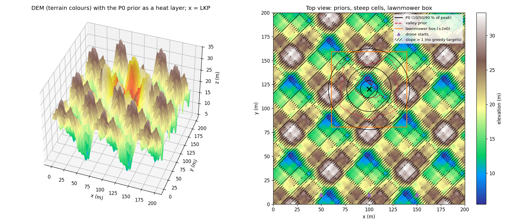
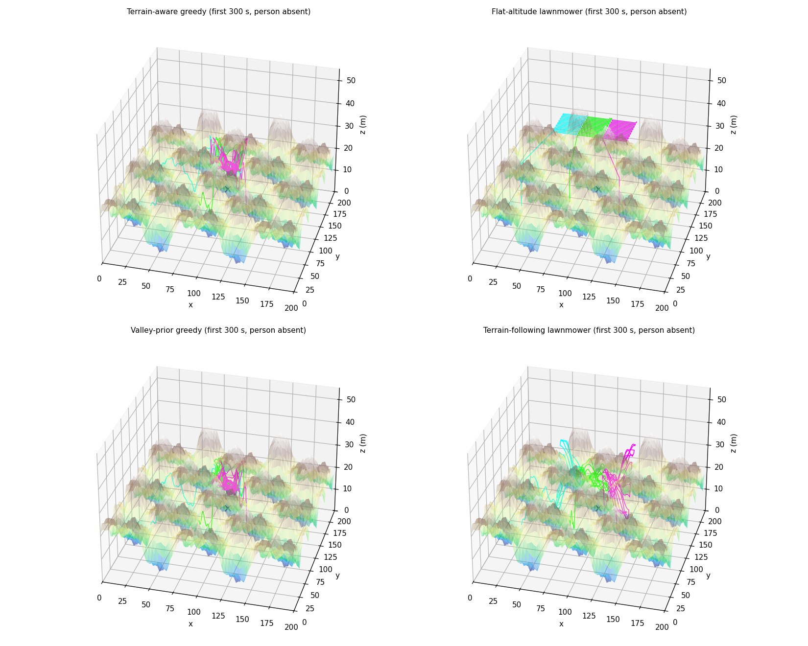
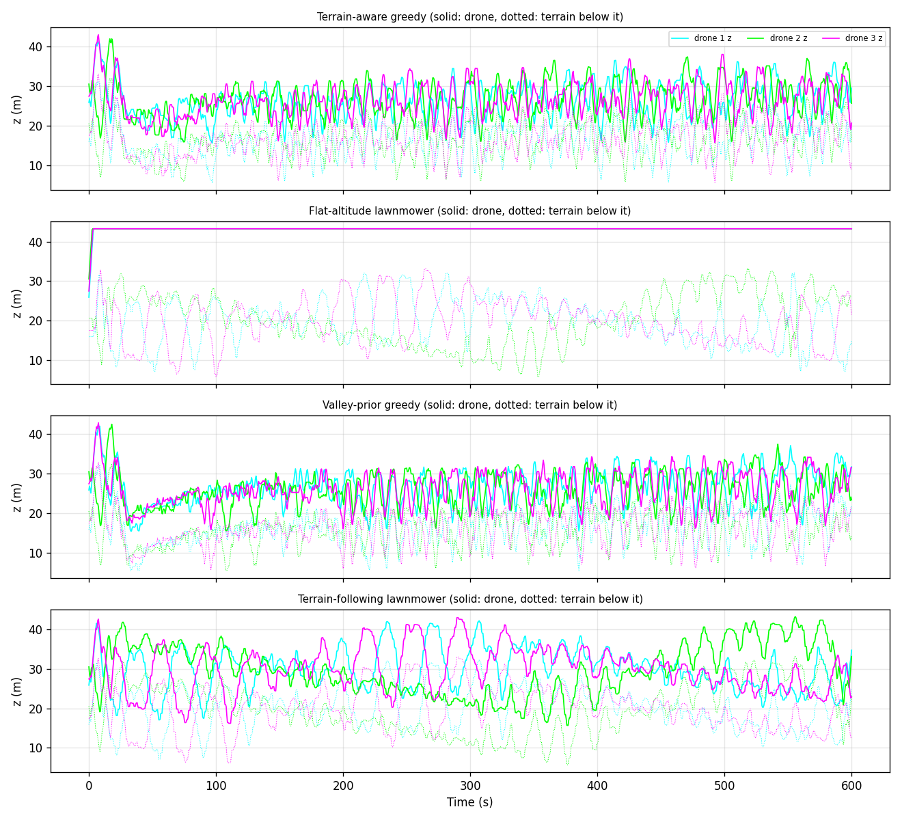
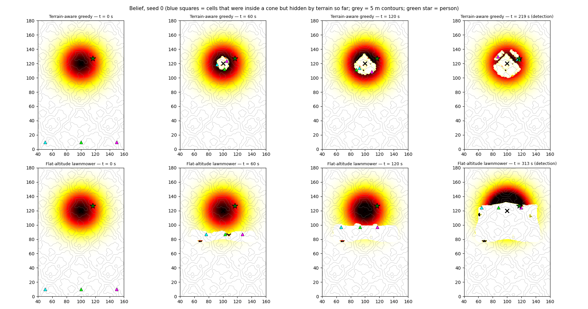
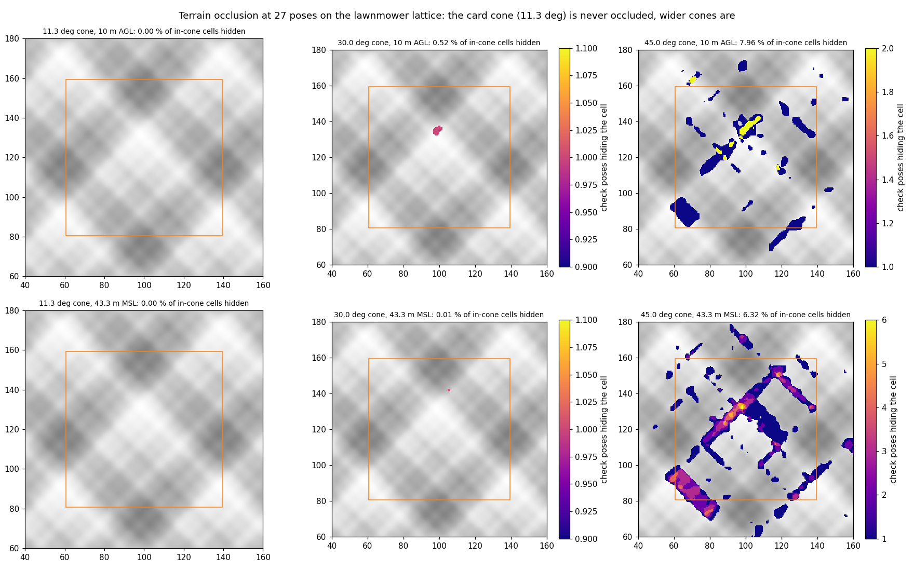
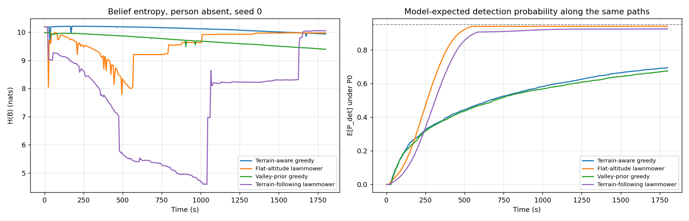
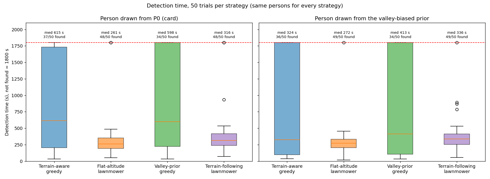
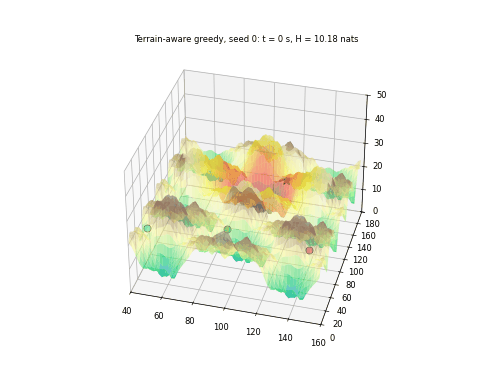

# S042 3D Upgrade — Missing Person Search

**Domain**: Environmental Monitoring & SAR | **Difficulty**: ⭐⭐⭐⭐ | **Status**: ✅ Completed

---

## Problem Definition

**Setup**: The S042 search is moved onto a synthetic mountain DEM. It keeps everything else from S042:
- the Gaussian + diffusion prior around the LKP (100, 120) m with σ₀ = 19.7 m;
- one shared Bayesian belief map on the 0.5 m grid;
- a binary hit/miss observation after a 1 s dwell, with $P_d$ = 0.90 and $P_{fa}$ = 0.02;
- three drones starting at the south edge, flying 5 m/s kinematic legs, with an 1800 s cutoff.

Every observation now uses the card's 3D sensor geometry. The camera is a downward thermal cone of half-angle 11.3°, which gives a 2.0 m footprint on level ground at 10 m AGL. Lines of sight are checked for terrain occlusion, and only visible in-cone cells receive the detection likelihood.

**Strategies** (same person, same sensor stream and same starts in every trial):

| Strategy | Description |
|----------|-------------|
| **Terrain-aware greedy** (card 1) | Fly to the highest-belief cell with slope ≤ 1, at 10 m AGL along terrain-following legs |
| **Flat-altitude lawnmower** (card 2) | The S042 boustrophedon of the LKP ± 2σ₀ box (3 strips, 2.5 m lattice) at one altitude above every ridge, 43.31 m MSL |
| **Valley-prior greedy** (card 3) | Terrain-aware greedy on the valley-biased prior $P_0\,e^{-z/15\,\text{m}}$ |
| **Terrain-following lawnmower** (control) | The same boustrophedon at 10 m AGL. It separates "lawnmower vs greedy" from "flat vs terrain-following" |

**Two truth models**: the person is drawn either from $P_0$ (the card) or from the valley-biased prior, in which case the valley hypothesis is true.

**Key question (card)**: Does terrain occlusion slow the search, and does terrain awareness or a valley prior shorten the time to detection?

---

## Mathematical Model

**DEM** (4 octaves, $L_k = 80/2^{k-1}$ m, $A_k = 10/2^{k-1}$ m):
$$z_{dem} = 20 + \sum_k A_k \sin(2\pi x/L_k + \phi_{x,k})\cos(2\pi y/L_k + \phi_{y,k}),$$
clipped to [0, 40] m. The clip is never active, because the range is 5.48–33.31 m. The first-octave phases put the LKP on that octave's valley floor; octaves 2–4 have seeded random phases.

**Sensor cone**: a cell is in the cone if $h = z_d - z_{dem}(c) > 0$ and its horizontal distance is ≤ $h\tan 11.3°$.

**Occlusion**: the line of sight from the drone to the cell is sampled at 20 interior points. If the DEM is more than 0.1 m above the line at any sample, the cell is occluded.

**Bayes update**: visible in-cone cells are multiplied by $P_d/P_{fa}$ after a hit and by $(1-P_d)/(1-P_{fa})$ after a miss. All other cells (outside the cone, or occluded) carry no information. A detection is a hit while the person's cell is visible in the cone, as in S042.

**Legs**:
- Terrain-following: $z = z_{dem} + 10$ m at 1 m samples, with leg time = 3D length / 5 m/s. The clearance is checked every 0.25 m.
- Flat lawnmower: one vertical climb to 43.31 m on the first leg, then level flight.

**Greedy targets**: the argmax of the belief over slope-safe cells ($|\nabla z| \le 1$), excluding cells within $2r_s$ of the other drones' targets.

**Metrics**:
- Detection time: median, IQR and mean, with not-found counted as 1800 s.
- Found counts and head-to-head wins on identical persons.
- Belief entropy and the model-expected $P_{det}(t) = 1 - \sum_c P_0(c)\prod(1-P_d)$ along person-absent paths.
- Occlusion counts.

---

## Key Parameters

| Parameter | Value |
|-----------|-------|
| Search area / grid | 200 × 200 m, 0.5 m cells (400 × 400) |
| Drones | 3, starting at (50, 10), (100, 10), (150, 10) m at 10 m AGL |
| $h_{AGL}$ | 10.0 m |
| Cone half-angle $\phi_s$ | 11.3° (footprint 1.998 m on level ground) |
| Speed / dwell | 5.0 m/s along the 3D path / 1.0 s |
| $P_d$ / $P_{fa}$ | 0.90 / 0.02 |
| $\sigma_{LKP}$, D, Δt | 10 m, 0.02 m²/s, 7200 s → σ₀ = 19.70 m |
| LKP | (100, 120) m, elevation 12.45 m |
| DEM | 20 m base, 4 octaves, $L_1$ = 80 m, $A_1$ = 10 m, phase seed 7, clip [0, 40] m |
| Valley temperature $\tau_{valley}$ | 15 m |
| Occlusion | 20 LOS samples, 0.1 m tolerance |
| Transit altitude samples | every 1.0 m |
| Safe slope | $\|\nabla z\| \le 1$ (45°) |
| Flat-lawnmower altitude | max DEM + 10 m = 43.31 m MSL |
| Lawnmower | LKP ± 2σ₀ box, 3 strips, 2.5 m lattice (S042) |
| Cutoff | 1800 s |
| Monte Carlo | 50 trials per strategy and truth model; person `default_rng([seed, 0, truth])`, sensor `default_rng([seed, 1])` |
| Occlusion check | 27 poses (every 40th lawnmower waypoint), cones of 11.3°, 30° and 45° |
| Animation | terrain-aware greedy, seed 0, 120 frames spread over 0–219.3 s (detection) |

---

## Implementation

```
src/03_environmental_sar/3d/s042_3d_missing_person.py
```

```bash
conda activate drones
python src/03_environmental_sar/3d/s042_3d_missing_person.py
```

The script imports the fixed 2D S042 module for the prior, the entropy, the greedy exclusion rule and the lawnmower lattice. Runtime ≈ 6.5 min: 400 Monte-Carlo missions, 4 person-absent runs, 8 demo runs and the GIF. Two runs printed byte-identical output and wrote byte-identical PNG and GIF files.

---

## Results

### Geometry checks

| Quantity | Value |
|----------|-------|
| DEM range / mean | 5.48 – 33.31 m / 20.00 m |
| Flat-lawnmower AGL over the box | 10.00 – 37.83 m (level-ground footprint 2.00 – 7.56 m) |
| Slope-safe cells | 53.3 % of the area |
| Prior mass on steep cells | 0.471 ($P_0$), 0.480 (valley prior) |
| Prior mass inside the lawnmower box | 0.912 ($P_0$), 0.929 (valley prior) |
| Prior entropy | 10.185 nats ($P_0$), 9.979 nats (valley prior) |
| Steepest slope | 2.62 (69.1°); a line of sight inside the 11.3° cone is ≥ 78.7° above horizontal |

**Occlusion check** (27 poses on the lawnmower lattice):

| Cone half-angle | 10 m AGL | 43.31 m MSL |
|-----------------|----------|-------------|
| 11.3° (card) | 0 / 1461 in-cone cells hidden (0.00 %) | 0 / 8435 (0.00 %) |
| 30° | 75 / 14414 (0.52 %) | 6 / 67086 (0.01 %) |
| 45° | 3815 / 47905 (7.96 %) | 12340 / 195265 (6.32 %) |

### Person-absent runs (seed 0, 1800 s)

| Strategy | Observations | Path | Mean visible footprint | Observations with any occluded cell | Min clearance | Altitude | H at 300 / 900 / 1800 s (nats) | E[$P_{det}$] at 300 / 900 / 1800 s |
|----------|-------------|------|------------------------|-------------------------------------|---------------|----------|-------------------------|-----------------------------|
| Terrain-aware greedy | 660 | 23773 m | 13.1 m² | 0 | 9.91 m | 15.5 – 43.3 m | 10.206 / 10.137 / 9.933 | 0.353 / 0.560 / 0.694 |
| Flat-altitude lawnmower | 3473 | 9629 m | 72.2 m² | 0 | 10.00 m | 25.9 – 43.3 m | 9.433 / 9.632 / 9.972 | 0.608 / 0.939 / 0.939 |
| Valley-prior greedy | 679 | 23690 m | 13.0 m² | 0 | 9.91 m | 15.5 – 42.9 m | 9.925 / 9.714 / 9.395 | 0.349 / 0.551 / 0.674 |
| Terrain-following lawnmower | 3195 | 11031 m | 13.5 m² | 0 | 9.92 m | 15.7 – 43.3 m | 8.335 / 4.958 / 10.049 | 0.466 / 0.915 / 0.923 |

### Seed-0 demonstration (person at (116.75, 126.75) m, z = 23.11 m)

| Strategy | Detection | Observations |
|----------|-----------|--------------|
| Terrain-aware greedy | 219.3 s | 158 |
| Flat-altitude lawnmower | 312.7 s | 589 |
| Valley-prior greedy | 392.1 s | 244 |
| Terrain-following lawnmower | 935.6 s | 1661 |

### Monte Carlo (50 trials per strategy, same persons; not found = 1800 s)

**Person drawn from $P_0$ (card)**

| Strategy | Found | Median | IQR | Mean | Found by 300 s | Steep-cell persons found |
|----------|-------|--------|-----|------|----------------|---------------------------|
| Terrain-aware greedy | 37/50 | 614.8 s | [202.5, 1731.0] s | 835.2 s | 17 | 12/25 |
| Flat-altitude lawnmower | **48/50** | **261.3 s** | [191.7, 352.2] s | **328.2 s** | **29** | 23/25 |
| Valley-prior greedy | 34/50 | 598.4 s | [224.7, 1800.0] s | 922.0 s | 14 | 11/25 |
| Terrain-following lawnmower | 48/50 | 315.6 s | [237.2, 415.5] s | 380.4 s | 23 | 23/25 |

**Person drawn from the valley-biased prior**

| Strategy | Found | Median | IQR | Mean | Found by 300 s | Steep-cell persons found |
|----------|-------|--------|-----|------|----------------|---------------------------|
| Terrain-aware greedy | 36/50 | 323.7 s | [97.5, 1800.0] s | 766.8 s | 25 | 12/23 |
| Flat-altitude lawnmower | **49/50** | **272.4 s** | [202.4, 332.5] s | **296.5 s** | **30** | 23/23 |
| Valley-prior greedy | 34/50 | 412.5 s | [103.6, 1800.0] s | 816.3 s | 20 | 9/23 |
| Terrain-following lawnmower | 49/50 | 336.0 s | [254.2, 413.5] s | 374.4 s | 19 | 23/23 |

**Head-to-head on identical persons** (faster / slower / tie):

| Comparison | Truth $P_0$ | Truth valley |
|------------|-------------|--------------|
| Flat lawnmower vs terrain-aware greedy | 31 / 17 / 2 | 24 / 25 / 1 |
| Flat lawnmower vs terrain-following lawnmower | 48 / 0 / 2 | 49 / 0 / 1 |
| Valley-prior greedy vs terrain-aware greedy | 21 / 17 / 12 | 23 / 15 / 12 |
| Terrain-following lawnmower vs terrain-aware greedy | 29 / 19 / 2 | 23 / 26 / 1 |

In all 400 Monte-Carlo missions the person was never hidden by terrain inside a cone (0 events).

### Key findings

- **The card's occlusion effect does not occur with its own sensor.** In 0 of all observations was any in-cone cell hidden, in every strategy, and the person was never hidden. A cell inside an 11.3° nadir cone is seen along a line of sight at least 78.7° above horizontal. The steepest DEM slope is 69.1°, so a ridge cannot rise above that line. The check with wider cones shows that the occlusion code works and when it would matter: 0.52 % / 0.01 % of in-cone cells are hidden at 30° and 7.96 % / 6.32 % at 45° (10 m AGL / flat altitude). The card's expected "occlusion dead zones" and slower entropy reduction for the flat lawnmower therefore do not appear.
- **Ignoring the terrain is faster, not slower.** The flat lawnmower flies at 43.31 m MSL, i.e. 10.00–37.83 m above the box, so its footprint is 2.00–7.56 m in radius (72.2 m² visible per observation against 13.5 m² for the terrain-following lawnmower). On the same lattice it beats the terrain-following lawnmower in 48/50 trials with 0 losses (49/0 under the valley truth): median 261.3 vs 315.6 s. It is also the best strategy overall, with 48/50 and 49/50 found. The card expects the opposite. With a constant $P_d$ that does not depend on range, a higher camera simply sees more. A detection probability that falls with slant range (thermal resolution) would change this; it is not in the card's model.
- **The terrain-aware greedy loses persons on steep ground.** Under $P_0$ it finds all 25 persons on slope-safe cells but only 12 of the 25 on steep cells, for 37/50 overall. 47.1 % of the prior mass lies on cells steeper than 45°, and the card's slope filter never sends a drone there; such persons are only seen if a neighbouring footprint happens to cover them. The lawnmowers find 23/25 steep-cell persons. The greedy is fastest when it succeeds early (seed 0: 219.3 s), but its median is 614.8 s and its IQR reaches 1731.0 s.
- **The valley prior does not help, even when it is true.** With the person drawn from the valley prior, valley-prior greedy is faster than plain greedy in 23 trials and slower in 15, but it finds fewer persons (34 vs 36/50) and has a higher median (412.5 vs 323.7 s). Under $P_0$ the split is 21/17. Over the box the DEM varies by only about 28 m, so $e^{-z/15}$ re-weights the prior mildly (entropy 10.185 → 9.979 nats; steep-cell mass 0.471 → 0.480). The greedy strategies' main problem is the slope filter, not the prior.
- **Terrain following costs path length, not safety.** Terrain-following legs keep at least 9.91 m above the DEM between the 1 m samples (10 m nominal), and the drones climb and descend over 15.5–43.3 m. The flat lawnmower holds 10.00 m clearance over the highest ridge.
- **Entropy is still a poor progress measure** (as in S042). The terrain-following lawnmower's entropy dips to 4.958 nats at 900 s and rises again to 10.049 nats, because of false-alarm spots. The flat lawnmower reaches the highest model-expected $P_{det}$ (0.939 at 900 s); both lawnmowers stall at about 0.92–0.94 because 8.8 % of the prior mass lies outside the box.

### Figures

**DEM and priors**. Left: the 3D DEM with the $P_0$ prior as a heat layer. Right: top view with the $P_0$ (black) and valley-prior (red dashed) contours, the steep cells (hatched, never greedy targets) and the lawnmower box:



**3D trajectories**: the first 300 s of the person-absent runs over the semi-transparent DEM. The greedy drones jump between distant cells and follow the terrain; the flat lawnmower flies a level sheet above every ridge:



**Altitude time series** (first 600 s): drone altitude (solid) and the terrain below it (dotted). The flat lawnmower stays at 43.31 m; the others follow the terrain 10 m above it:



**Belief snapshots** (seed 0) at t = 0, 60, 120 s and at detection, for the terrain-aware greedy and the flat lawnmower. Cells hidden by terrain would be marked blue; none ever were:



**Occlusion map**: in-cone cells hidden by terrain at the 27 check poses, for the card's 11.3° cone and for wider 30° and 45° cones, at 10 m AGL (top) and at the flat altitude (bottom):



**Entropy and model-expected detection probability** along the person-absent paths:



**Detection-time box plots** for 50 trials under each truth model:



**Animation**: the terrain-aware greedy, seed 0, from launch to detection at 219.3 s, with a rotating view over the search area (x 40–160 m, y 0–180 m). The belief is drawn as heat on the DEM; drones are shown with short trails and the person is the green star:



### Deviations from the scenario card

| Card | Implementation | Reason |
|------|----------------|--------|
| σ₀ ≈ 17.2 m | 19.70 m | Arithmetic error: $\sqrt{10^2 + 2\cdot0.02\cdot7200}$ = 19.7 m (also fixed in S042). The card has been corrected. |
| DEM = octave sum clipped to [0, 40] m | 20 m base added; $L_k = L_1/2^{k-1}$ | The sum spans ±18.75 m, so the clip would flatten about half the area to 0 m. The card has been corrected. |
| Random phases; "LKP on a valley floor" | First-octave phases put the LKP at that octave's minimum; octaves 2–4 random (seed 7) | Makes the card's LKP condition hold. Smaller octaves still lift the LKP to 12.45 m (the DEM mean is 20 m). |
| Flat lawnmower at 20 m MSL | Max DEM + 10 m = 43.31 m MSL | 20 m MSL is 13.3 m below the highest ridge, so the drone would fly into the terrain. The card has been corrected. |
| Occluded cells: likelihood 1 after a miss, other unseen cells $1-P_{fa}$ | Every unseen cell (outside the cone or occluded) gets the same $P_{fa}$ / $1-P_{fa}$ | The card's version up-weights occluded cells after every miss. The card has been corrected. |
| Transit altitude = running maximum of terrain + h | Terrain following, $z = z_{dem} + h$ at 1 m samples, clearance checked every 0.25 m (min 9.91 m) | The running maximum never descends along a leg. The card now notes this. |
| Greedy "unoccluded" target filter | Slope filter only; occlusion is checked at the observation pose | The observation pose is directly above the target at 10 m AGL, where nadir visibility is guaranteed. |
| DEM sampled on a 400 × 400 grid and interpolated | Analytic DEM evaluated exactly (also along the lines of sight) | Same surface without interpolation error. |
| Elliptical footprint "effective radius" | Exact per-cell nadir-angle test | The card's own cone criterion, applied per cell. |
| Three strategies | Plus a terrain-following lawnmower control | Separates the altitude effect from the search pattern. |
| Person drawn from the prior | From $P_0$ and, separately, from the valley prior | Tests the valley hypothesis both when it is false and when it is true. |
| Occlusion coverage map over mission time | Occlusion counts at 27 check poses for the 11.3°, 30° and 45° cones | Over the missions the map is empty (0 occluded cells); the check shows when occlusion appears. |
| Belief snapshots for one strategy | Terrain-aware greedy and flat lawnmower | Compares the two sensing geometries. |

---

## Extensions

1. Make $P_d$ fall with slant range (thermal resolution), and find the altitude that minimises detection time: the trade-off this card's model lacks.
2. Use an oblique or wide-FOV camera (≥ 30°), where the occlusion model becomes active (0.52–7.96 % hidden cells in the check).
3. Replace the hard slope filter with a slope-weighted prior, so that steep cells are searched later instead of never.
4. Downhill drift of the person (card Extension 3) with a terrain-aware prediction step.

---

## Related Scenarios

- Base 2D version: [S042 Missing Person Localization](../../../../scenarios/03_environmental_sar/S042_missing_person.md)
- 3D card: [S042 3D Upgrade — Missing Person Search](../../../../scenarios/03_environmental_sar/3d/S042_3d_missing_person.md)
- Terrain coverage: [S048 3D Upgrade — Lawnmower Coverage on Terrain](../../../../scenarios/03_environmental_sar/3d/S048_3d_lawnmower.md)
- Occlusion and 3D sensing: [S003 Low-Altitude Tracking](../../../../scenarios/01_pursuit_evasion/S003_low_altitude_tracking.md)
- Particle filter estimation: [S045 Chemical Plume Tracing](../../../../scenarios/03_environmental_sar/S045_plume_tracing.md)
