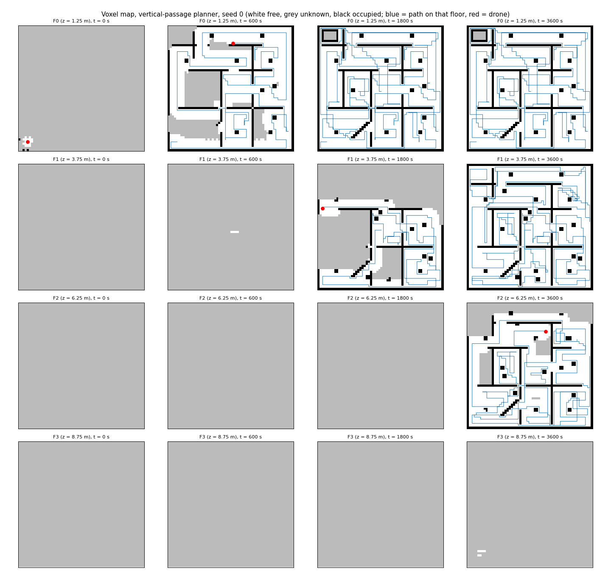
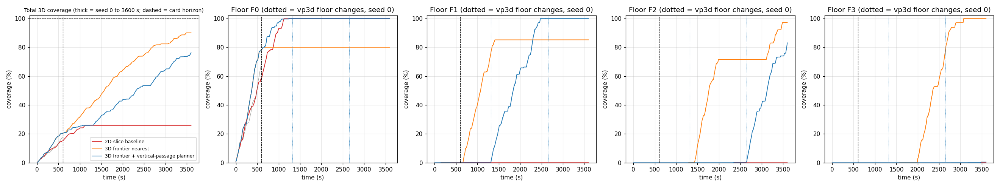
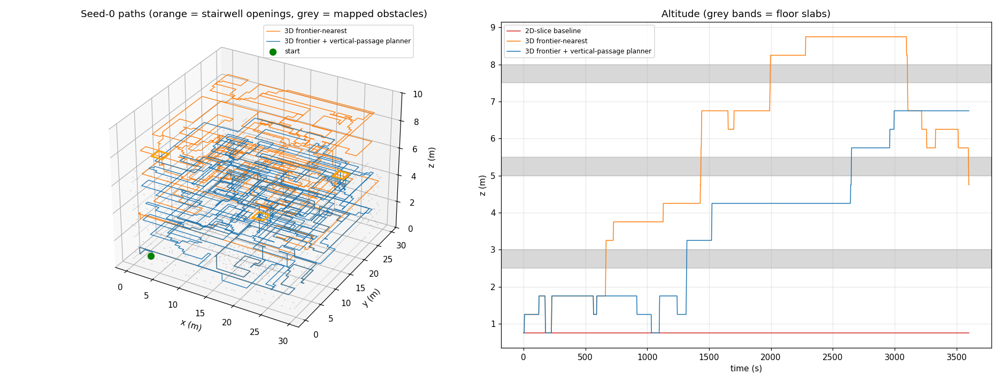
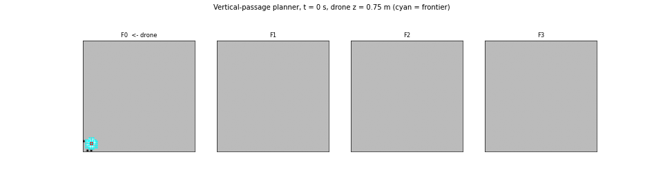

# S043 3D Upgrade — Confined Space Exploration

**Domain**: Environmental Monitoring & SAR | **Difficulty**: ⭐⭐⭐⭐ | **Status**: ✅ Completed

---

## Problem Definition

**Setup**: A rescue drone explores a four-floor collapsed building with no prior map. The building is 30 × 30 × 10 m, held as 60 × 60 × 20 voxels of 0.5 m.
- **Floor plans**: every floor reuses the S043 plan (outer walls, internal walls with doorways, debris columns and the fallen beam), extruded over the floor's free layers. Floors F1–F3 also get six random 2 × 2-cell rubble columns each (seed 43).
- **Slabs**: layer 0 is the ground, layer 19 the roof, and layers 5, 10 and 15 are floor slabs. Each slab is solid except for one 2 × 2 m stairwell opening. F0–F2 have 2.0 m of free height and F3 has 1.5 m.
- **Hazards**:
  - **Low-ceiling room** in F0 (x 14–24 m, y 2–9 m): only 1.0 m of headroom remains, so the drone must fly at the lowest layer.
  - **Crawl space** in F0 (x 1–5 m, y 26–29 m): 0.5 m of headroom, which is below $h_{min}$, so it is impassable.

The drone starts at (2, 2, 0.5) m.

**Strategies** (same building, start and lidar-noise stream):

| Strategy | Description |
|----------|-------------|
| **2D-slice baseline** | Nodes and frontiers restricted to the start layer (z = 0.75 m held fixed). It never changes floor |
| **3D frontier-nearest** | Nearest frontier node by travel time, on any floor |
| **3D frontier + vertical-passage planner** | Finish the current floor first. When the floor has no frontier left, go to the nearest frontier on another floor, with a −2.0 s cost bonus for frontiers in detected stairwells |

**Objective (card)**: maximise the fraction of 3D reachable free voxels mapped, never enter a voxel with p > 0.65, and never pass a gap narrower than $g_{min}$ or lower than $h_{min}$.

---

## Mathematical Model

**Voxel map**: log-odds, +0.85 for a hit and −0.40 for a pass-through, clamped to [−2.0, 3.5]. A voxel is free if p < 0.35, occupied if p > 0.65, and unknown otherwise.

**Lidar**: 128 beams, with 92 Fibonacci directions over the full sphere and a 36-beam horizontal ring. Range is 2.0 m and range noise is $\mathcal N(0, 0.05^2)$. Each beam is ray-marched in 0.05 m steps against the ground truth. The voxels before the noisy range get one free update per beam; the hit voxel gets an occupied update when the range is < 2 m.

**Body and passability**: a node (i, j, k) is traversable when voxel k (the body) and voxel k + 1 (headroom) are both free. That gives 1.0 m ≥ $h_{min}$ = 0.6 m of vertical clearance, and a 0.5 m voxel is wider than $g_{min}$ = 0.4 m. The ground-truth reachable set $\mathcal C_{reach}$ is every voxel of the nodes reachable from the start (6-connected).

**Coverage**:
$$\text{Coverage}_{3D} = |\{v \in \mathcal C_{reach}: p(v) < 0.35\}| / |\mathcal C_{reach}|,$$
also reported per floor, where floor k holds layers 5k … 5k + 4.

**Frontier node**: a known-free traversable node whose body or headroom voxel borders an unknown voxel (6-neighbourhood).

**Planning**: Dijkstra (scipy csgraph) over the known-free traversable nodes. Edge costs are travel times: 1.0 s per horizontal voxel at 0.5 m/s and 1.67 s per vertical voxel at $v_{z,max}$ = 0.3 m/s. The drone replans when the goal stops being a frontier or the next node is no longer free in the map.

**Motion**: voxel-centre to voxel-centre, one axis at a time, at 0.5 m/s horizontally and 0.3 m/s vertically. Every entered voxel is asserted free in the ground truth and below p = 0.65 in the map.

**Stairwell detection**: a known-free connected region in a slab layer with ≥ 4 voxels (1 m² ≥ $g_{min}^2$) and a known-free vertical run of ≥ 2.5 m through its centroid (the card's span criterion).

---

## Key Parameters

| Parameter | Value |
|-----------|-------|
| Environment | 30 × 30 × 10 m, 60 × 60 × 20 voxels of 0.5 m |
| Floors | F0–F3, slabs at z = 2.5, 5.0, 7.5 m; stairwells S1 (x 15–17, y 12.5–14.5 m), S2 (x 25–27, y 21–23 m), S3 (x 2.5–4.5, y 2.5–4.5 m), each 4.0 m² |
| Lidar | 128 beams (92 Fibonacci full sphere + 36 ring), $r_s$ = 2.0 m, σ_r = 0.05 m, 0.05 m march step |
| Log-odds | +0.85 / −0.40, clamp [−2.0, 3.5] |
| Thresholds | free < 0.35, occupied > 0.65 |
| Body / gap / headroom | $r_d$ = 0.15 m, $h_d$ = 0.20 m; $g_{min}$ = 0.40 m; $h_{min}$ = 0.60 m → 2 free voxels |
| Speeds | 0.5 m/s horizontal, $v_{z,max}$ = 0.3 m/s |
| Δt | 0.1 s |
| Horizon | 600 s (card); extended 3600 s |
| Stairwell bonus $\Delta p_{stair}$ | 2.0 s off the travel-time cost |
| Stairwell span criterion | ≥ 2.5 m |
| Start | (2.0, 2.0, 0.5) m → node centre (2.25, 2.25, 0.75) m |
| Lidar seeds | 0, 1, 2 (`default_rng([seed, 0])`); seed 0 is flown to 3600 s and its first 600 s are the card-horizon result |
| Rubble seed | 43 |
| Animation | vertical-passage planner, seed 0, one frame per 30 s, 121 frames |

---

## Implementation

```
src/03_environmental_sar/3d/s043_3d_confined_space.py
```

```bash
conda activate drones
python src/03_environmental_sar/3d/s043_3d_confined_space.py
```

The script imports the fixed 2D S043 module for the floor plan and the log-odds constants. Runtime ≈ 5 min: three 3600 s runs, six 600 s runs and the GIF. Two runs printed byte-identical output and wrote byte-identical PNG and GIF files.

---

## Results

### Building checks

| Quantity | Value |
|----------|-------|
| Occupied voxels | 37.0 % |
| Reachable nodes / $\mathcal C_{reach}$ voxels | 32751 / 44710 (F0 11604, F1 12240, F2 12260, F3 8606) |
| Reachable from the start layer alone | 3032 nodes = 13.6 % of $\mathcal C_{reach}$ |
| Low-ceiling room | traversable only at layer 1 (262 nodes; 0 at layer 2) |
| Crawl space | 48 free voxels with 0.5 m headroom, 0 reachable nodes |
| Card horizon | 600 s × 0.5 m/s = at most 300 m of flight |

### Card horizon, 600 s (3 lidar seeds)

| Strategy | Coverage at 600 s, seed 0 / 1 / 2 | Mean (min–max) | F0 at 600 s (seed 0) | Floor changes |
|----------|-----------------------------------|----------------|----------------------|---------------|
| 2D-slice baseline | 15.2 / 15.2 / 15.2 % | 15.2 % (15.2–15.2) | 58.5 % | 0 |
| 3D frontier-nearest | 20.4 / 18.0 / 20.5 % | 19.6 % (18.0–20.5) | 78.3 % | 0 |
| 3D + vertical-passage planner | 20.4 / 18.0 / 20.5 % | 19.6 % (18.0–20.5) | 78.3 % | 0 |

Head-to-head:
- Both 3D strategies beat the slice baseline in 3/3 seeds (+4.4 points on average).
- Frontier-nearest and the vertical-passage planner are identical in 3/3 seeds (difference +0.0).

### Extended horizon, 3600 s (seed 0)

| Strategy | Coverage at 600 / 1200 / 1800 / 2400 / 3600 s | Final F0 / F1 / F2 / F3 | Time to 25 / 50 / 75 % | Path | Plans | Frontiers exhausted |
|----------|-------------------------------------------|-------------------------|-------------------------|------|-------|---------------------|
| 2D-slice baseline | 15.2 / 25.9 / 25.9 / 25.9 / 25.9 % | 99.9 / 0.0 / 0.0 / 0.0 % | 1095.0 s / — / — | 590.0 m | 880 | 1132.0 s |
| 3D frontier-nearest | 20.4 / 38.0 / 59.2 / 73.8 / **90.0 %** | 80.0 / 85.2 / 97.2 / 100.0 % | **785.0 / 1567.0 / 2509.0 s** | 1788.1 m | 2646 | never |
| 3D + vertical-passage planner | 20.4 / 26.0 / 38.2 / 52.0 / 76.2 % | 100.0 / 100.0 / 83.1 / 0.6 % | 959.0 / 2310.0 / 3579.0 s | 1791.6 m | 2447 | never |

**Floor changes**:
- Frontier-nearest: 666 s F0→F1, 1433 s F1→F2, 1994 s F2→F3, 3105 s F3→F2, 3599 s F2→F1.
- Vertical-passage planner: 1319 s F0→F1, 2650 s F1→F2.

**Vertical-passage detection log** (first detection; cross-section and span as known at that moment):

| Run | Slab | Centroid | Free cross-section | Known vertical span | Detected at |
|-----|------|----------|--------------------|---------------------|-------------|
| Frontier-nearest | z = 2.5 m (S1) | (16.50, 13.50) m | 2.00 m² | 2.5 m | 144.0 s |
| Frontier-nearest | z = 5.0 m (S2) | (25.97, 22.42) m | 2.25 m² | 2.5 m | 1280.0 s |
| Frontier-nearest | z = 7.5 m (S3) | (2.85, 3.35) m | 1.25 m² | 3.0 m | 1562.0 s |
| Vertical-passage planner | z = 2.5 m (S1) | (16.50, 13.50) m | 2.00 m² | 2.5 m | 144.0 s |
| Vertical-passage planner | z = 5.0 m (S2) | (26.75, 22.00) m | 1.00 m² | 2.5 m | 2308.0 s |
| Vertical-passage planner | z = 7.5 m (S3) | (3.50, 3.25) m | 1.00 m² | 2.5 m | 2777.0 s |

All three detected centroids lie inside the true openings.

### Key findings

- **The card's 600 s horizon is too short to test the third dimension.** At 0.5 m/s the drone can fly at most 300 m, and no strategy leaves the ground floor before 600 s (first floor change at 666 s). Within the card horizon the 3D strategies still beat the 2D slice: 19.6 vs 15.2 % on average, 3/3 seeds. They do this because they also move between the three usable layers of F0: at 600 s, F0 is 78.3 % mapped against 58.5 % for the slice. The slice can only reach 13.6 % of $\mathcal C_{reach}$ as nodes, but its spherical lidar maps the headroom above it. Its ceiling is therefore 25.9 % (F0 at 99.9 %), reached when its frontiers run out at 1132.0 s.
- **The card's vertical-passage planner is worse than plain frontier-nearest.** Over 3600 s, frontier-nearest maps 90.0 % against 76.2 % and reaches 50 % at 1567.0 s against 2310.0 s. Finish-floor-first keeps the drone on F0 until 1319 s, to take F0 from 78.3 % (at 600 s) to 100 %, and later finishes F1 to 100 % before climbing at 2650 s. Cleaning up those last frontiers is slow. Between 600 and 1200 s total coverage rises by only 5.6 points for the vertical-passage planner (20.4 → 26.0 %), against 17.6 points for frontier-nearest (20.4 → 38.0 %), which climbs to the empty F1 at 666 s. Frontier-nearest never goes back for the last 20 % of F0, but it gains far more on F1–F3 (85.2 / 97.2 / 100.0 %). The −2 s stairwell bonus has little room to matter. It is only applied once the current floor has no frontier left, and at that point every remaining frontier lies beyond a stairwell anyway.
- **The vertical-passage detector works.** It finds all three stairwells, with centroids inside the true 2 × 2 m openings, as soon as the lidar sees through them (S1 at 144.0 s, long before either strategy uses it). The cross-section at first detection is 1.0–2.25 m² of the true 4.0 m², because only part of the opening is mapped by then.
- **Safety constraints hold.** No strategy entered an occupied or mapped-occupied voxel (asserted on every move). The 1.0 m low-ceiling room is traversed only at the lowest layer (262 nodes, 0 at layer 2), and the 0.5 m crawl space has 0 reachable nodes, so it is excluded from $\mathcal C_{reach}$ and never entered.
- **Seed sensitivity is small.** Coverage at 600 s varies by 2.5 points across the three lidar-noise seeds for the 3D strategies (18.0–20.5 %) and not at all for the slice (15.2 %).

### Figures

**Voxel map snapshots** (vertical-passage planner, seed 0) at t = 0, 600, 1800 and 3600 s. Rows are floors F0–F3, shown as a horizontal slice through each floor (white free, grey unknown, black occupied). The blue line is the path flown on that floor and the red dot is the drone:



**Coverage curves**: total 3D coverage and per-floor coverage. Thick lines are seed 0 to 3600 s; thin lines are seeds 1–2 to 600 s. The dashed line marks the card horizon, and dotted lines mark the vertical-passage planner's floor changes:



**3D trajectories and altitude** (seed 0, 3600 s). The orange squares are the stairwell openings. Frontier-nearest (orange) climbs to F3 by 1994 s, while the vertical-passage planner (blue) is still on F2 at 3600 s. The slice baseline stays at 0.75 m:



**Animation**: vertical-passage planner, seed 0, one frame per 30 s. Each panel is one floor slice with the frontier voxels in cyan; the drone is shown on its current floor:



### Deviations from the scenario card

| Card | Implementation | Reason |
|------|----------------|--------|
| Building layout not specified | S043 plan extruded per floor, plus F1–F3 rubble (seed 43), three 2 × 2 m stairwells, one 1.0 m low-ceiling room and one 0.5 m crawl space | Needed concrete geometry. The two ceiling features test $h_{min}$ and altitude-constrained passage. |
| Beams over the "upper hemisphere" with θ ∈ [0°, 180°] | Full sphere | θ up to 180° is the full sphere, and downward beams are needed to see openings below the drone. The card has been corrected. |
| Exact 3D DDA (Amanatides & Woo) | Sampled ray-march, 0.05 m steps (one tenth of a voxel) | Vectorised over all beams; at a tenth of a voxel the missed-corner error is negligible. |
| Cylindrical swept-volume check ($r_d$ = 0.15 m, K = 5) | Body voxel + headroom voxel must be free (map p < 0.35 to plan, p < 0.65 and ground truth to enter) | With 0.5 m voxels a single voxel already exceeds $g_{min}$ and the 0.30 m body; $h_{min}$ = 0.6 m rounds up to 2 voxels. |
| Frontier clusters → centroids | Nearest frontier node by Dijkstra travel time | A centroid can lie in an obstacle; the nearest-node rule is the S043 2D frontier rule. |
| Stairwell bonus applied when floor coverage ≥ η_floor = 80 % | Applied when the current floor has no frontier left | The drone cannot know its true coverage; "no frontier left" is the observable equivalent of "floor fully mapped". |
| Altitude optimisation z* (max headroom) with $v_{z,max}$ smoothing | Not implemented as a separate step; vertical moves are 1.67× more expensive in the planner and limited to 0.3 m/s | The 2-voxel headroom rule already guarantees clearance. In the low-ceiling room only one layer is passable. |
| $T_{max}$ = 600 s | 600 s reported, plus a 3600 s extended horizon | 300 m of flight cannot leave F0. The card now notes this. |
| Snapshots at 0, 200, 400, 600 s as isometric voxel renders | 0, 600, 1800, 3600 s as per-floor slices | Nothing happens above F0 before 600 s, and per-floor slices show the map more clearly than isometric voxels. |
| Path coloured by floor, stairwell segments orange | Paths coloured by strategy, stairwell openings outlined in orange, altitude plot with slab bands | Same information. |
| — | Three lidar-noise seeds at 600 s | Shows seed sensitivity. |

---

## Extensions

1. Replace finish-floor-first with an information-gain-per-travel-time rule that weighs leftover frontiers against an unexplored floor.
2. Multi-drone floor partitioning (card Extension 1): one drone per floor would remove the floor-switching trade-off.
3. Exact DDA and a swept-cylinder check at a finer 0.1 m voxel size, where $g_{min}$ and $h_{min}$ really constrain the path.
4. Dynamic floor collapse (card Extension 3): flip stairwell voxels to occupied mid-mission and measure replanning.

---

## Related Scenarios

- Base 2D version: [S043 Confined Space Exploration](../../../../scenarios/03_environmental_sar/S043_confined_space.md)
- 3D card: [S043 3D Upgrade — Confined Space Exploration](../../../../scenarios/03_environmental_sar/3d/S043_3d_confined_space.md)
- Volumetric mapping: [S050 Swarm Cooperative Mapping (Distributed EKF-SLAM)](../../../../scenarios/03_environmental_sar/S050_slam.md)
- Post-mapping inspection: [S044 Wall Crack Inspection](../../../../scenarios/03_environmental_sar/S044_wall_crack.md)
- Multi-drone coordination: [S042 Missing Person Localization](../../../../scenarios/03_environmental_sar/S042_missing_person.md)
