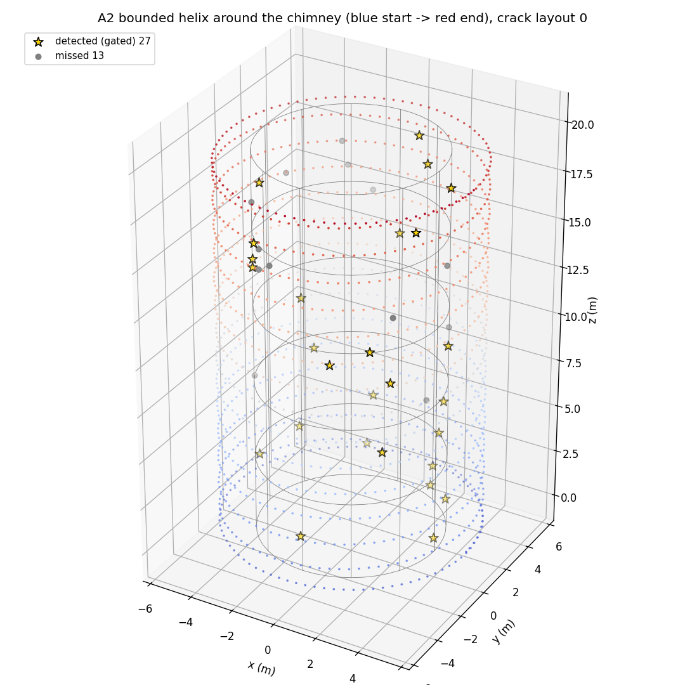
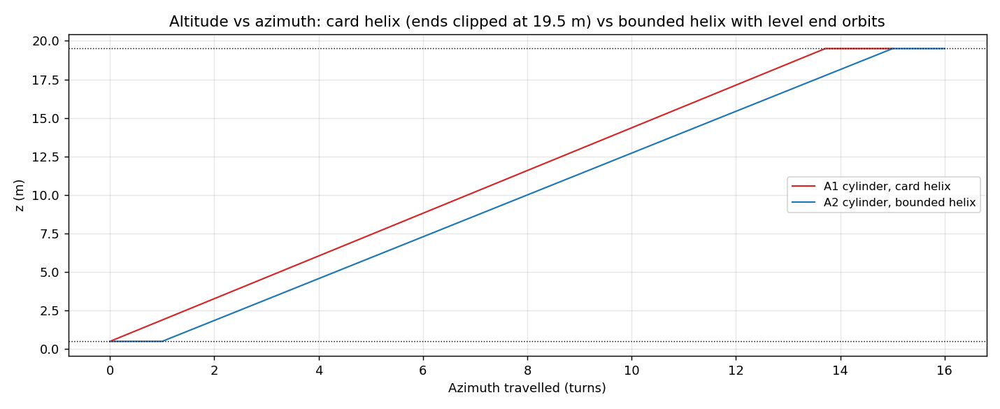
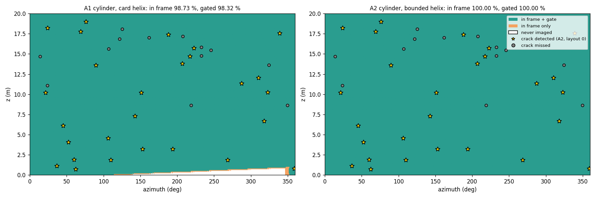
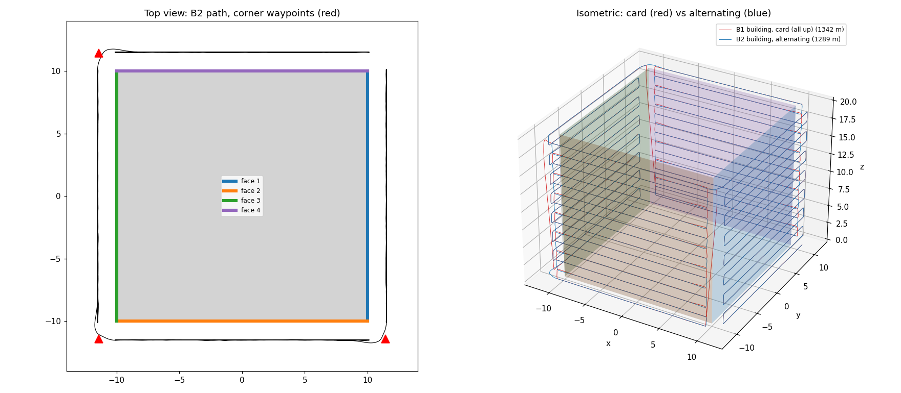
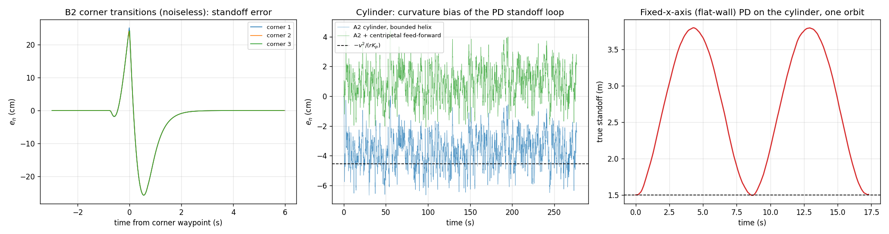
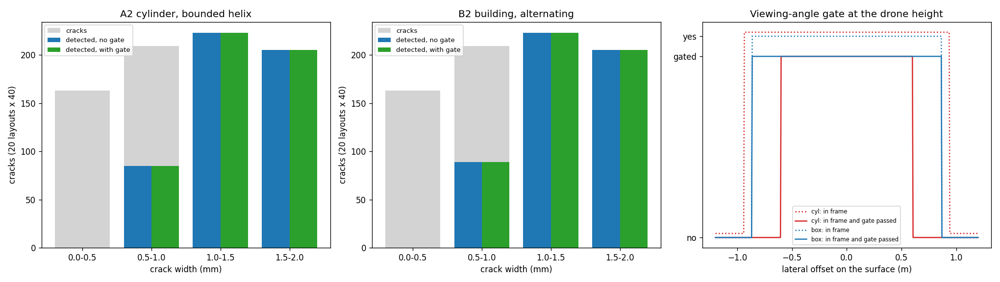
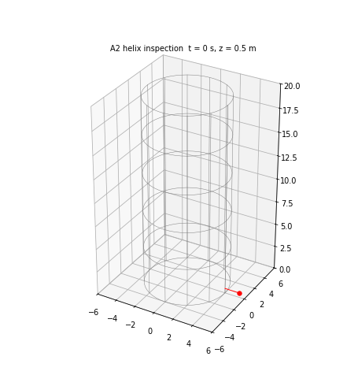

# S044 3D Upgrade — Wall Crack Inspection

**Domain**: Environmental Monitoring & SAR | **Difficulty**: ⭐⭐⭐ | **Status**: ✅ Completed

---

## Problem Definition

**Setup**: The S044 inspection camera and standoff loop are applied to two 3D structures. From S044 they keep:
- the camera: 60° FOV, 2048 px, 1.5 m standoff, per-frame detection probability $\Phi((w - w_{min}(r))/0.05\ \text{mm})$;
- the PD standoff loop: $K_p = 16$, $K_d = 8$, 5 cm range noise;
- the 2 m/s cruise speed, the 0.5–19.5 m altitude band and 40 cracks per structure with widths from U(0.1, 2.0) mm.

The structures are:

- **Structure A, cylindrical chimney**: $R_c$ = 4 m, H = 20 m, orbit radius 5.5 m. The outward normal rotates with azimuth.
  - **A1, card helix**: 15 turns of pitch 1.386 m from z = 0.5 m, clipped at 19.5 m.
  - **A2, bounded helix**: a level orbit at 0.5 m, 14 turns of pitch 19/14 = 1.357 m, then a level orbit at 19.5 m.
- **Structure B, square building**: a 20 × 20 m footprint with four 20 × 20 m faces (normals $+\hat x, -\hat y, -\hat x, +\hat y$). Each face gets 15 horizontal passes between 0.5 and 19.5 m. Between faces the drone flies through a corner waypoint 2.0 m out along the bisector.
  - **B1, card**: every face is scanned bottom-up, so the drone descends back to 0.5 m after each corner.
  - **B2, alternating**: faces are scanned up, down, up, down, so no descent is needed.

**Objective (card)**: at least 99 % surface coverage on both structures without collision, plus crack detection by width bin, flight distance, corner-transition behaviour and the viewing-angle rejection.

---

## Mathematical Model

**Motion**: a 3D double integrator, Δt = 0.05 s. A reference point moves along the path at 2 m/s.
- **Normal direction**: $\hat{\mathbf n}$ is the outward normal at the nearest surface point. Along it, the card PD acts on
  $$a_n = K_p\,(d_{ref} - d_{meas}) - K_d\,(\mathbf v\cdot\hat{\mathbf n})$$
  where $d_{ref}$ is the reference point's own distance to the surface (1.5 m on the faces and orbits, up to 2.0 m at a corner waypoint) and $d_{meas}$ is the true distance plus $\mathcal N(0, 5\,\text{cm})$.
- **Tangent plane**: a PD with the same $\omega_n$ = 4 rad/s (16 s⁻², 8 s⁻¹) tracks the reference point.
- **Cylinder**: only the normal PD can supply the centripetal acceleration $v^2/r$ = 0.727 m/s². In continuous time this requires a standing error $e_n = -v^2/(r K_p)$ = −4.55 cm, i.e. the drone sits farther out. Variant **A2 + FF** adds $-|\mathbf v_t|^2/r\,\hat{\mathbf n}$ as feed-forward.
- **Flat-wall law on the cylinder**: the card's claim that a flat-wall controller "drifts off-surface immediately" is tested by flying one orbit with the standoff measured and controlled along a fixed $\hat{\mathbf x}$ axis.

**Camera** (pinhole, boresight $-\hat{\mathbf n}$): a surface point is **in frame** when its horizontal and vertical image angles are both ≤ 30°. On a flat wall at 1.5 m this is exactly the S044 square $|dy|, |dz| \le 0.866$ m. The card's **viewing-angle gate** additionally requires
$$\cos\psi_c = \frac{(\mathbf p - \mathbf s_c)\cdot\hat{\mathbf n}_c}{\|\mathbf p - \mathbf s_c\|} \ge \cos 30°.$$
The slant range sets $w_{min}(r) = 2r\tan 30°/2048 \times 1000$ mm, which is 0.846 mm at 1.5 m.

**Coverage**: surface cells (cylinder: 0.5° × 0.1 m; faces: 0.1 × 0.1 m) count as covered when they are in frame at least once, with frames sampled at 10 Hz. The gated coverage also requires the gate. For the cylinder the card's arc-length criterion $R_c|\Delta\phi| \le h_{strip}$, $|\Delta z| \le h_{strip}$ is reported as well.

**Detection**: one uniform number per (frame, crack) is used for both the gated and the ungated rule (common random numbers). This is done for 20 crack layouts × 40 cracks per structure.

---

## Key Parameters

| Parameter | Value |
|-----------|-------|
| Cylinder radius $R_c$ / height H | 4.0 m / 20.0 m |
| Building | 20 × 20 m footprint, four 20 m × 20 m faces |
| Standoff $d_{standoff}$ / orbit radius | 1.5 m / 5.5 m |
| Corner waypoint offset | 2.0 m along the bisector of the two face normals |
| Camera FOV / resolution | 60° / 2048 px |
| Strip half-width $h_{strip}$ | 0.866 m |
| Design overlap / step Δz | 20 % / 1.386 m |
| Card helix A1 | 15 turns, pitch 1.386 m, from 0.5 m, clipped at 19.5 m |
| Bounded helix A2 | level orbit at 0.5 m + 14 turns of pitch 1.3571 m + level orbit at 19.5 m |
| Face passes | 15 per face, evenly spaced over 0.5–19.5 m (1.357 m apart) |
| Cruise speed | 2.0 m/s |
| Standoff PD $(K_p, K_d)$ | 16 s⁻², 8 s⁻¹ |
| Tangent-plane tracking PD (added) | 16 s⁻², 8 s⁻¹ |
| Range noise | 5 cm (seed 0) |
| Altitude band | 0.5 – 19.5 m (limiter, as in S044) |
| Crack widths / detection noise | U(0.1, 2.0) mm / 0.05 mm |
| Cracks | 40 per structure, z ∈ U(0.5, 19.5) m; cylinder φ ∈ U(0, 2π); building: random face, u ∈ U(0.5, 19.5) m |
| Crack layouts | 20 (`default_rng([seed, 42])`, seeds 0–19) |
| Δt | 0.05 s |
| Coverage grid | 0.5° × 0.1 m (cylinder), 0.1 × 0.1 m (faces) |
| "Near" view | slant range ≤ 2.5 m |
| Animation | A2 flight, 119 frames |

---

## Implementation

```
src/03_environmental_sar/3d/s044_3d_wall_crack.py
```

```bash
conda activate drones
python src/03_environmental_sar/3d/s044_3d_wall_crack.py
```

The script imports the fixed 2D S044 module for the camera, PD and noise constants. Runtime ≈ 50 s. Two runs printed byte-identical output and wrote byte-identical PNG and GIF files.

---

## Results

### Card arithmetic

| Quantity | Value |
|----------|-------|
| $h_{strip}$, Δz, $N_{pass}$ | 0.866 m, 1.386 m, 15 |
| End height of the card helix | 0.5 + 15 × 1.386 = 21.28 m (> 19.5 m) |
| $L_{helix}$ (card formula) | 518.8 m |
| Bounded helix | 14 turns of pitch 1.3571 m |
| $v^2/r$ on the orbit → PD-only standoff offset | 0.7273 m/s² → 4.55 cm (outward) |

### Flights

| Flight | Path (ref / flown) | Time | $e_n$ RMS | mean $e_n$ | max \|$e_n$\| | Min standoff | Altitude-limiter steps |
|--------|-------------------|------|-----------|------------|---------------|--------------|------------------------|
| A1 card helix | 518.7 / 522.4 m | 259.4 s | 3.83 cm | −3.67 cm | 6.68 cm | 1.500 m | 1 |
| A2 bounded helix | 553.3 / 557.2 m | 276.7 s | 3.84 cm | −3.68 cm | 6.66 cm | 1.500 m | 1 |
| A2 + centripetal FF | 553.3 / 552.6 m | 276.7 s | 1.42 cm | +0.89 cm | 4.59 cm | 1.454 m | 1 |
| B1 building, card | 1337.4 / 1342.3 m | 668.8 s | 1.60 cm | −0.07 cm | 26.11 cm | 1.462 m | 7 |
| B2 building, alternating | 1284.5 / 1289.2 m | 642.3 s | 1.91 cm | −0.10 cm | 27.38 cm | 1.462 m | 4 |

The maximum speed is 2.29–2.30 m/s in every flight.

**Integration-step check** (noiseless, first 3000° of the A2 helix, mean $e_n$ for t > 20 s):

| Δt | PD only | With feed-forward |
|----|---------|-------------------|
| 0.050 s (used) | −3.65 cm | +0.91 cm |
| 0.010 s | −4.39 cm | +0.19 cm |
| 0.005 s | −4.48 cm | +0.10 cm |

**Corner transitions** (B2 re-flown without range noise, so the transient is not hidden by noise):

| Corner | Time | Peak \|$e_n$\| | Peak at | \|$e_n$\| > 1 cm | Min standoff |
|--------|------|----------------|---------|------------------|--------------|
| 1 | 160.2 s | 25.72 cm | +0.54 s | −0.66 to +1.94 s | 1.500 m |
| 2 | 321.1 s | 25.63 cm | +0.57 s | −0.63 to +1.92 s | 1.500 m |
| 3 | 482.0 s | 25.73 cm | +0.56 s | −0.64 to +1.91 s | 1.500 m |

**Fixed-x-axis (flat-wall) standoff law on the cylinder, one orbit (17.3 s)**: the true standoff ranges from 1.49 to 3.80 m. The error first exceeds 0.5 m at t = 1.20 s.

### Coverage

| Flight | In frame | In frame + gate | Card arc-length criterion |
|--------|----------|-----------------|---------------------------|
| A1 card helix | **98.73 %** | 98.32 % | 98.44 % |
| A2 bounded helix | **100.00 %** | 100.00 % | 100.00 % |
| B1 building, card | 100.00 % | 100.00 % | — |
| B2 building, alternating | 100.00 % | 100.00 % | — |

**Viewing-angle gate at the nominal standoff** (crack at drone height):

| Surface | In-frame lateral half-width | Gate passes up to |
|---------|-----------------------------|-------------------|
| Cylinder | 0.936 m | 0.600 m |
| Flat face | 0.864 m | 0.864 m |

### Crack detection (20 layouts × 40 cracks)

| Structure | Detected, no gate | Detected, with gate | Per layout (mean ± std) | Layouts where the gate costs a detection |
|-----------|-------------------|---------------------|--------------------------|------------------------------------------|
| A2 cylinder | 513/800 (64.1 %) | 513/800 (64.1 %) | 25.6 ± 3.2 | 0/20 |
| B2 building | 517/800 (64.6 %) | 517/800 (64.6 %) | 25.9 ± 3.5 | 0/20 |

| Width bin | Cylinder (gated) | Building (gated) |
|-----------|------------------|------------------|
| 0.0 – 0.5 mm | 0/163 | 0/163 |
| 0.5 – 1.0 mm | 85/209 | 89/209 |
| 1.0 – 1.5 mm | 223/223 | 223/223 |
| 1.5 – 2.0 mm | 205/205 | 205/205 |

| Structure | In-frame crack views | Gate rejects | Near views (≤ 2.5 m) | Gate rejects (near) | Grazing views (> 2.5 m) | Gate rejects (grazing) | Median gate-passed near views per crack |
|-----------|---------------------|--------------|----------------------|---------------------|-------------------------|------------------------|------------------------------------------|
| Cylinder | 29946 | 51.4 % | 29946 | 51.4 % | 0 | — | 17 (of 29) |
| Building | 111401 | 87.5 % | 18115 | 23.3 % | 93286 | 100.0 % | 17 (of 17) |

No crack in any layout was ever outside every frame.

### Key findings

- **The card helix misses the 99 % target. The bounded helix reaches 100 %.** 15 turns of pitch 1.386 m from 0.5 m would end at 21.28 m. Clipped at the 19.5 m limit, the helix starts climbing immediately, so a wedge at the bottom is imaged by no pass: the white wedge at the bottom of the coverage map. Coverage is 98.73 % (98.44 % with the card's arc-length criterion). A level orbit at each end and 14 turns of pitch 1.357 m cover 100 % of the cylinder for 34.6 m more path (553.3 vs 518.7 m).
- **Curvature costs a standing standoff error, as expected.** On the orbit the standoff PD alone has to supply the 0.727 m/s² centripetal acceleration. The drone therefore sits 3.67 cm farther out on average (RMS 3.84 cm), against 0.07–0.10 cm on the flat faces. The continuous-time value is 4.55 cm. The 0.9 cm gap is the Δt = 0.05 s integration step: it shrinks to −4.39 and −4.48 cm at Δt = 0.01 and 0.005 s. Feed-forward of $-v_t^2/r$ removes the bias. The RMS drops to 1.42 cm, close to the 1.60 cm flat-wall noise floor, and the residual +0.89 cm mean is the same step effect (+0.10 cm at 0.005 s). The bias is small against the 0.866 m strip, so it has no visible effect on coverage or detection.
- **"A flat-wall controller drifts off-surface immediately": partly true.** With the standoff measured along a fixed x axis, the true standoff swings between 1.49 m and 3.80 m twice per orbit, and the error passes 0.5 m after 1.2 s. The drone does not hit the chimney in this setup, because the tangent-plane tracking keeps it on the orbit's y and z. It does lose the standoff, by up to 2.3 m.
- **Corner transitions settle in about 2 s, but with a 26 cm transient.** Without noise, $|e_n|$ exceeds 1 cm from 0.6 s before to 1.9 s after each corner waypoint, which matches the card's "recovery within ≤ 2 s". The peak error is 25.6–25.7 cm, about 0.55 s after the waypoint, when the nearest surface point jumps from the corner edge to the next face. The standoff never drops below 1.500 m in the noiseless flight (1.462 m with noise), so there is no collision risk.
- **Alternating the face direction saves the corner descents.** B2 flies 53.1 m less than the card's bottom-up restart (1289.2 vs 1342.3 m) and finishes 26.5 s sooner (642.3 vs 668.8 s), with identical coverage (100 %).
- **The viewing-angle gate costs views but no detections.** On the cylinder the gate cuts the usable half-width at the drone's height from 0.936 m to 0.600 m, because the surface curves away. It rejects 51.4 % of in-frame crack views; on flat faces it rejects only 23.3 % of near views (the corners of the square frame). Every crack is still seen in a median of 17 gate-passed near views, and per-frame detection is nearly certain for a crack wider than $w_{min}$ once it is in view. The gate therefore removes no detection in any of the 20 layouts on either structure (513/800 and 517/800 with and without it). The card's "penalty incurred by high curvature" is real for single frames but disappears with 20 Hz imaging and overlapping passes. On the building, 93286 extra "in-frame" views are grazing views (> 2.5 m) of the adjacent face seen almost edge-on near the corners. The gate rejects all of them, which is the case it is meant for.
- **Detection is set by camera resolution, as in S044.** On both structures 64 % of cracks are found. Nothing below 0.5 mm is found, 85–89 of 209 cracks in 0.5–1.0 mm are found, and every crack above 1.0 mm is found. This matches the S044 2D result (62.5 % for its single layout): $w_{min}$ = 0.846 mm at 1.5 m. Curvature does not change it.

### Figures

**Bounded helix around the chimney** (blue start → red end) with crack layout 0: detected cracks are gold stars, missed ones are grey:



**Altitude vs azimuth**: the card helix rises from the first turn and is clipped at 19.5 m. The bounded helix adds a level orbit at each end:



**Unwrapped cylinder coverage**: green means in frame and gate passed, orange means in frame only, white means never imaged. The card helix leaves the bottom wedge white:



**Building path**: top view of B2 with the corner waypoints, and an isometric view of B1 (red, with the diagonal descents at the corners) against B2 (blue):



**Standoff error**. Left: the three B2 corner transitions without noise. Middle: the cylinder's curvature bias with and without feed-forward; the dashed line is the continuous-time value $-v^2/(rK_p)$. Right: the true standoff under the fixed-x-axis law:



**Detection by width bin** for the cylinder and the building, with and without the gate, and the gate profile at the drone's height:



**Animation**: the A2 helix inspection; the red line is the camera boresight:



### Deviations from the scenario card

| Card | Implementation | Reason |
|------|----------------|--------|
| 15 helix turns of pitch 1.386 m from $z_{start}$ | Kept as A1 and clipped at 19.5 m. Bounded helix A2 (level orbits at 0.5 m and 19.5 m + 14 turns of pitch 1.357 m) used for detection | The card helix ends at 21.28 m and leaves a bottom wedge uncovered (98.73 %). The card has been corrected. |
| "Vertical step per half-orbit, direction reversal" | Pitch per full orbit | Contradicted the card's own helix formula. The card has been corrected. |
| Building start height $z_{start}$ = 0.5 m on every face | Kept as B1; alternating direction B2 added | Shows the cost of the restart (53.1 m). |
| Face passes not placed | 15 passes evenly over 0.5–19.5 m (drone altitude inside the band) | S044 kept the *footprint* inside 0.5–19.5 m and reached 95 %. Keeping the drone inside the band images the full 20 m height. |
| PD on the normal only; tangential motion not specified | 3D double integrator; tangent-plane PD tracking with the same gains (added) | Needed for a closed-loop 3D model. It makes the curvature bias appear, as it would on a real vehicle. |
| — | Centripetal feed-forward variant | Shows that the curvature bias can be removed. |
| In-frame test $R_c\|\Delta\phi\| \le h_{strip}$, $\|\Delta z\| \le h_{strip}$ | Pinhole projection along the boresight (card criterion also reported for coverage) | It is the true camera geometry on any surface, including the building corners. On the flat wall it equals the S044 square. |
| Corner standoff error from the noisy flight | Corner transients measured on a noiseless re-flight | With 5 cm range noise, a 1–2 cm settling threshold is triggered by noise. |
| "Viewing-angle rejection vs azimuth offset" log | Gate profile vs lateral offset, plus rejection shares for near and grazing views | Same information in compact form. |
| Single crack layout | 20 layouts × 40 cracks | Detection counts vary by ±3 per layout. |
| — | Altitude limiter at 0.5 / 19.5 m (as in S044) | The PD overshoots the top and bottom passes by a few mm; active for 1–7 steps per flight. |

---

## Extensions

1. Fly the cylinder with the feed-forward and a curvature-adapted pitch, using the 0.600 m gated half-width instead of 0.866 m, and compare coverage under the gate.
2. Hyperboloid cooling tower with $r_{orbit}(z) = R(z) + d$ (card Extension 1). The normal then also tilts out of the horizontal plane.
3. Smooth corner transitions (a circular arc of radius 2 m around the corner edge) to remove the 26 cm $e_n$ spike.
4. Add wind gusts to the double integrator, so that the standoff loop has a real disturbance to reject.

---

## Related Scenarios

- Base 2D version: [S044 Wall Crack Inspection](../../../../scenarios/03_environmental_sar/S044_wall_crack.md)
- 3D card: [S044 3D Upgrade — Wall Crack Inspection](../../../../scenarios/03_environmental_sar/3d/S044_3d_wall_crack.md)
- Cylindrical inspection: [S062 Wind Turbine Blade Inspection](../../../../scenarios/04_industrial_agriculture/S062_wind_turbine.md)
- Multi-face building scan: [S065 Building 3D Modeling — Multi-Angle Scan Path](../../../../scenarios/04_industrial_agriculture/S065_3d_scan_path.md)
- Corner clearance: [S043 Confined Space Exploration](../../../../scenarios/03_environmental_sar/S043_confined_space.md)
