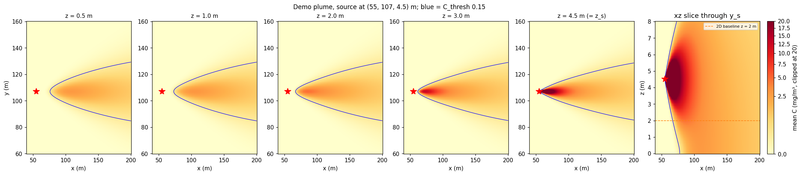
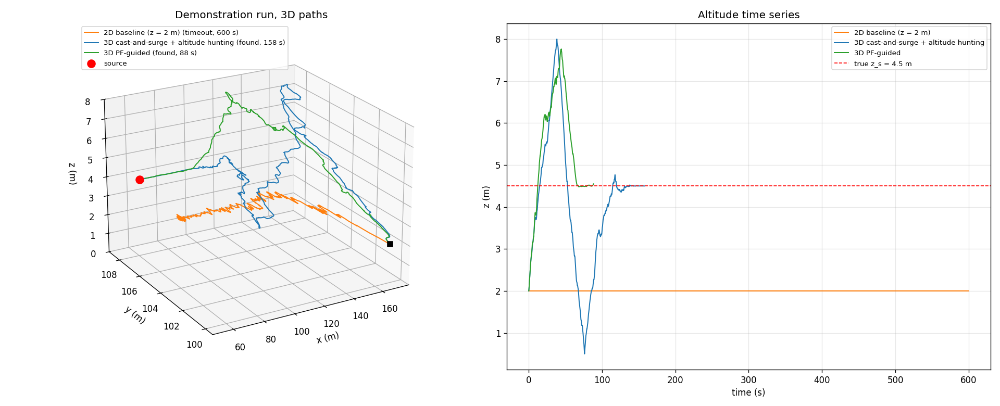
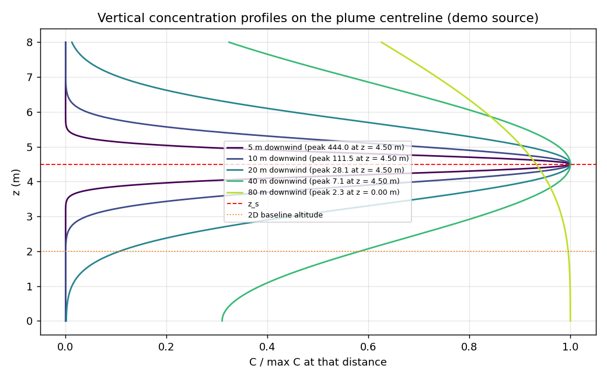
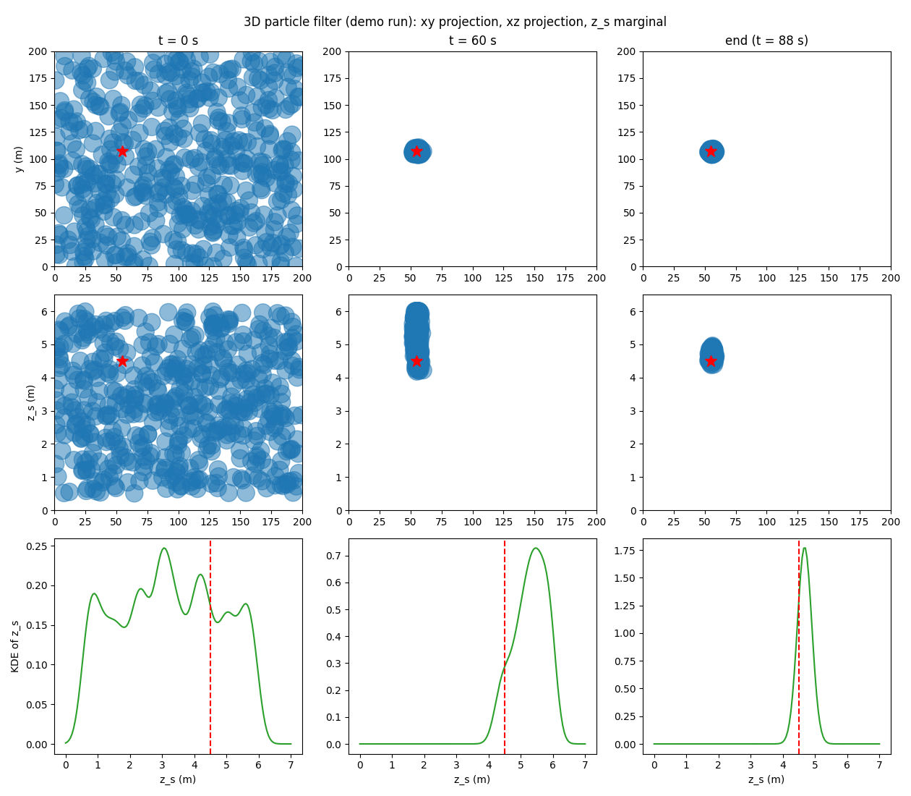
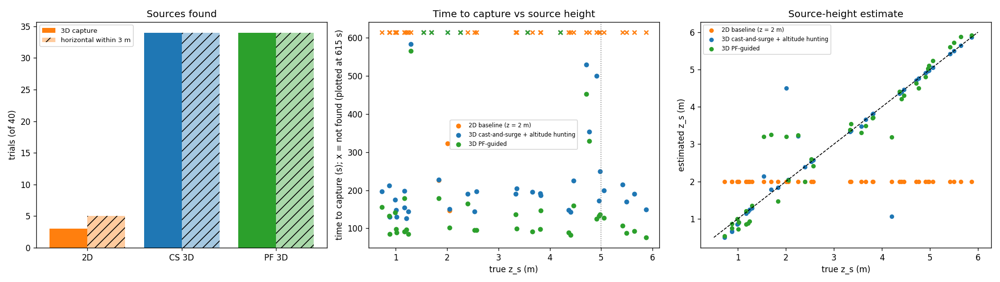
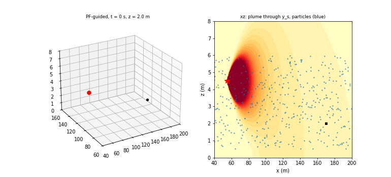

# S045 3D Upgrade — Chemical Plume Tracing

**Domain**: Environmental Monitoring & SAR | **Difficulty**: ⭐⭐⭐⭐ | **Status**: ✅ Completed

---

## Problem Definition

**Setup**: The S045 plume and sensor are kept from the 2D scenario:
- a Pasquill-Gifford class D Gaussian plume with ground reflection;
- wind 3 m/s toward +x and Q = 1 g/s, with concentrations in mg/m³;
- Bernoulli intermittency $p = 1 - e^{-C/2}$, additive noise σ = 0.05 and contact threshold 0.15.

The source is now **elevated at an unknown height** $z_s \in [0.5, 6]$ m, and the concentration depends on the drone's altitude. A single drone starts downwind at (170, 100, 2) m. It must reach the source within 3 m (3D distance) within 600 s and estimate $z_s$ to ±0.5 m.

**Strategies** (same sources, start, speeds and sensor seed in every trial):

| Strategy | Description | $z_s$ estimate |
|----------|-------------|----------------|
| **2D baseline** | S045 cast-and-surge at a fixed 2 m altitude, with a 4-probe horizontal gradient | 2 m (the flight altitude) |
| **3D cast-and-surge + altitude hunting** | 6-probe 3D gradient. The surge adds $k_z\hat g_z$ vertically. The cast sweeps ±y (S045's growing legs) and ±z (0.4 m/s between 0.5 and 8 m). When lost, it returns to the last contact point in 3D | final altitude |
| **3D PF-guided** | 3D cast-and-surge blended 50/50 with the direction to the 3D particle-filter posterior mean once the horizontal posterior std < 15 m (S045 rule) | posterior mean (KDE mode also reported) |

---

## Mathematical Model

**Plume** ($\Delta x = x - x_s > 0$, zero upwind of the source):

$$C = \frac{Q}{2\pi\sigma_y\sigma_z u}\, e^{-\frac{(y-y_s)^2}{2\sigma_y^2}} \left[e^{-\frac{(z-z_s)^2}{2\sigma_z^2}} + e^{-\frac{(z+z_s)^2}{2\sigma_z^2}}\right]$$

$$\sigma_y = 0.08\Delta x(1+0.0002\Delta x)^{-1/2}, \qquad \sigma_z = 0.06\Delta x(1+0.0015\Delta x)^{-1/2}$$

Close to the source the plume is vertically thin ($\sigma_z$ = 0.30 m at 5 m downwind). A drone at the wrong altitude therefore loses contact before it reaches the source.

**Measurement**: $C_{meas} = \max(0,\ C\,\xi + \eta)$, with $\xi \sim \text{Bernoulli}(1 - e^{-C/2})$ and $\eta \sim \mathcal N(0, 0.05^2)$.

**Gradient**: central differences with 1 m probes along each axis, every probe independently noisy. The lower z probe is clamped at the ground, with the divisor set to the actual probe separation. The result is normalised to $\hat{\mathbf g}$.

**Surge**: $\mathbf v = v_{surge}\,\mathrm{unit}(0.4\,\hat{\mathbf u}_{wind} + 0.6\,\hat{\mathbf g}_{xy}) + k_z \hat g_z \hat{\mathbf z}$, with $\hat{\mathbf u}_{wind} = -\hat{\mathbf x}$ (upwind).

**Kinematics**: $\dot{\mathbf v} = (\mathbf v_{cmd} - \mathbf v)/\tau_v$, $\|\mathbf v\| \le 2$ m/s. The altitude is kept in [0.5, 8] m with a reflecting boundary.

**3D particle filter**:
- 500 particles $(x_s, y_s, z_s)$, initially uniform over [0, 200]² × [0.5, 6] m.
- The S045 dropout-mixture likelihood is evaluated with the 3D plume at the drone's altitude.
- Systematic resampling when $N_{eff} < 250$, with roughening of 1 m in x and y and 0.1 m in z.
- The $z_s$ marginal is a weighted Gaussian KDE (bandwidth 0.2 m).

---

## Key Parameters

| Parameter | Value |
|-----------|-------|
| Volume | 200 × 200 m, drone altitude 0.5 – 8.0 m |
| Q / wind | 1.0 g/s / 3.0 m/s along +x |
| Source height $z_s$ | U(0.5, 6.0) m (demo: 4.5 m) |
| Noise σ / contact threshold / intermittency scale | 0.05 / 0.15 / 2.0 (S045 fixes) |
| $v_{surge}$ / $v_{cast}$ / $v_{z,cast}$ | 1.5 / 0.8 / 0.4 m/s |
| Altitude gain $k_z$ | 0.5 m/s per unit $\hat g_z$ |
| Upwind bias α | 0.4 |
| Probe offset δ | 1.0 m (all axes) |
| Cast legs / lost timeout | 8k m growing legs / 30 s (S045) |
| Particles / roughening | 500 / 1.0 m (x, y), 0.1 m (z) |
| PF guidance switch | horizontal posterior std < 15 m |
| $v_{max}$ / $\tau_v$ | 2.0 m/s / 0.5 s |
| Capture radius | 3.0 m (3D) |
| Δt / $T_{max}$ | 0.1 s / 600 s |
| Start | (170, 100, 2) m |
| Demo | source (55, 107, 4.5) m, seed 999 |
| Monte Carlo | 40 trials, source x ~ U(40, 70), y ~ U(60, 140), $z_s$ ~ U(0.5, 6) (`default_rng([trial, 0])`), sensor `[trial, 1]`, PF `[trial, 2]` |
| Animation | PF-guided demo, 112 frames (up to 120, one per 8 steps until capture) |

---

## Implementation

```
src/03_environmental_sar/3d/s045_3d_plume_tracing.py
```

```bash
conda activate drones
python src/03_environmental_sar/3d/s045_3d_plume_tracing.py
```

The script imports the fixed 2D S045 module for $\sigma_{y,z}$, the intermittency, the constants and the 2D cast-and-surge navigator. The 3D strategies reuse that navigator for the horizontal channel. Runtime ≈ 3 min (including the equal-speed control). Two runs printed byte-identical output and wrote byte-identical PNG and GIF files.

---

## Results

### Plume check (demo source $z_s$ = 4.5 m, on the centreline)

| Downwind | $\sigma_z$ | C at z = 2 m | C at z = $z_s$ | Peak altitude |
|----------|-----------|--------------|----------------|---------------|
| 5 m | 0.30 m | 0.000 | 443.974 | 4.50 m |
| 10 m | 0.60 m | 0.017 | 111.461 | 4.50 m |
| 20 m | 1.18 m | 3.006 | 28.098 | 4.50 m |
| 40 m | 2.33 m | 4.164 | 7.145 | 4.49 m |
| 115 m | 6.37 m | 1.392 | 1.253 | 0.00 m |

C at the start is 1.035. The 2D baseline cannot capture at all when $|z_s - 2| > 3$ m, which is the case for $z_s$ > 5 m (18 % of the $z_s$ range).

**Consistency check**: with the source at the flight altitude ($z_s$ = 2 m) and S045's trials 0–19, the 2D baseline finds 16/20. The closest approaches of the failures are 77.6, 84.1, 87.6 and 89.1 m. This is exactly the fixed 2D S045 result, so the baseline is the S045 algorithm.

### Demonstration run (source (55, 107, 4.5) m)

| Strategy | Result | Path | Closest 3D / horizontal | Contact | $z_s$ estimate | Surge / cast / lost |
|----------|--------|------|-------------------------|---------|----------------|---------------------|
| 2D baseline | timeout (600 s) | 296.3 m | 25.64 / 25.52 m | 83.5 % | 2.00 m | 84 / 16 / 0 % |
| 3D cast-and-surge | **found, 158.2 s** | 136.1 m | 2.85 / 2.85 m | 69.0 % | 4.50 m | 69 / 31 / 0 % |
| 3D PF-guided | **found, 88.3 s** | 116.4 m | 2.90 / 2.90 m | 75.5 % | 4.68 m (KDE mode 4.70 m) | 76 / 24 / 0 % |

The PF's final estimate is (55.9, 106.8, 4.68) m.

### Monte Carlo (40 trials; the start is in the plume in 22 of them; $z_s$ > 5 m in 5)

| Strategy | Found (3D) | Horizontal within 3 m | Median time (found) [IQR] | Median path (found) | Median final 3D error | $z_s$ RMSE | $\|z_s\|$ error ≤ 0.5 m |
|----------|-----------|----------------------|---------------------------|---------------------|----------------------|------------|-------------------------|
| 2D baseline | 3/40 | 5/40 | 225.9 s [186.4, 274.7] | 202.9 m | 13.29 m | 1.95 m | 7/40 |
| 3D cast-and-surge | **34/40** | 34/40 | 190.9 s [149.4, 210.2] | 162.1 m | 2.94 m | 0.66 m | **36/40** |
| 3D PF-guided | **34/40** | 34/40 | **104.6 s** [92.0, 146.0] | **133.1 m** | 2.92 m | **0.50 m** | 35/40 |

| Strategy | Start in plume | Start outside | $z_s$ ≤ 5 m | $z_s$ > 5 m |
|----------|----------------|---------------|-------------|-------------|
| 2D baseline | 1/22 | 2/18 | 3/35 | 0/5 |
| 3D cast-and-surge | 22/22 | 12/18 | 29/35 | 5/5 |
| 3D PF-guided | 22/22 | 12/18 | 29/35 | 5/5 |

More detail:
- **2D baseline**: with $|z_s - 2| < 1$ m it found only 3/16. Its failures from in-plume starts got within a median 9.5 m horizontally of the source (range 0.6–25.2 m).
- **PF $z_s$ from the KDE mode**: RMSE 0.74 m, within 0.5 m in 35/40. Among found trials the posterior-mean RMSE is 0.19 m.

**Head-to-head on identical trials**:

| Comparison | Faster | Slower | Both failed | $z_s$ error smaller |
|------------|--------|--------|-------------|---------------------|
| 3D cast-and-surge vs 2D | 32 | 3 | 5 | 36/40 |
| PF-guided vs 3D cast-and-surge | 34 | 0 | 6 | 7/40 |
| PF-guided vs 2D | 34 | 1 | 5 | 34/40 |

**Equal-speed fairness control.** Once its posterior is confident, PF-guided always flies its blended command at $v_{surge}$ = 1.5 m/s, even while the underlying cast-and-surge state is casting at 0.8 m/s. The control variant flies the same blend at the cast-and-surge command's own speed. It finds 34/40, with a median time over found trials of 113.3 s [102.3, 164.0], and meets the ±0.5 m $z_s$ target in 35/40. Against 3D cast-and-surge it is faster in 32 trials and slower in 2; both fail in 6.

### Key findings

- **The third dimension is decisive here, as the card expects.** The fixed-altitude S045 algorithm finds the same sources 16/20 when they sit at its flight altitude, but only 3/40 when the source height is random. Even with the source within 1 m of its altitude it finds only 3/16. The plume is vertically thin near the source ($\sigma_z$ = 0.30 m at 5 m, 0.60 m at 10 m downwind). For the demo source at 4.5 m the concentration at 2 m drops from 3.006 at 20 m downwind to 0.017 at 10 m and 0.000 at 5 m. The 2D drone therefore loses the plume 10–20 m short of the source and casts without ever reconnecting. In the demo it stays 25.5 m away despite 83.5 % "contact" in the far field. The card's claim that the 2D baseline "locates $(x_s, y_s)$" holds in only 5/40 trials.
- **Altitude hunting fixes it.** 3D cast-and-surge finds 34/40, including all 22 trials that start in the plume and all 5 with $z_s$ > 5 m that the 2D baseline cannot reach geometrically. It is faster than the 2D baseline in 32/40 trials; in the 3 trials the 2D baseline does solve, the 2D baseline is faster. The 6 remaining failures start outside the plume; casting does not find it within 600 s.
- **The particle filter adds speed, not success.** PF-guided finds exactly the same 34/40 trials but is faster in all 34 (median 104.6 vs 190.9 s, path 133.1 vs 162.1 m), because the posterior pulls it straight toward the source once it has converged. This is not just a speed advantage: in the equal-speed control the PF is still faster than cast-and-surge in 32/40 trials (median 113.3 vs 190.9 s).
- **Source-height estimation.**
  - The PF meets the card's ±0.5 m target in 35/40 trials (RMSE 0.50 m overall, 0.19 m over found trials).
  - The 3D cast-and-surge's final altitude is an equally good estimator: within 0.5 m in 36/40; the PF is closer in only 7/40 trials. At capture the drone is riding the plume centreline, which sits at $z_s$ near the source.
  - The 2D baseline's fixed 2 m "estimate" has RMSE 1.95 m.
  - The PF's large errors come from the 6 failed trials, where the posterior never converged. The KDE mode is no better than the posterior mean (RMSE 0.74 vs 0.50 m).
- **Altitude profile** (demo): both 3D strategies first climb, because in the far field the vertical gradient points up toward the 4.5 m centreline. Cast-and-surge then overshoots to the 8 m ceiling and sweeps down to 0.5 m before it locks onto 4.5 m. The PF-guided drone settles at the source height well before capture.

### Figures

**Plume volume**: xy slices at z = 0.5, 1, 2, 3 and 4.5 m (= $z_s$), and an xz slice through $y_s$, for the demo source. The blue contour is $C_{thresh}$. The near-source core exists only around $z_s$; at 2 m (orange dashed line in the xz slice) the plume only appears some distance downwind of the source:



**3D paths and altitude time series** (demo):



**Vertical concentration profiles** on the centreline, at 5, 10, 20, 40 and 80 m downwind, each normalised by its peak. Near the source the profile is a narrow spike at $z_s$; far downwind the ground reflection moves the peak to the ground:



**3D particle filter** (demo): xy and xz particle projections (marker size ∝ weight) and the $z_s$ marginal KDE at t = 0 s, 60 s and at capture (88 s). The card's 180 s and 360 s snapshots do not exist because the drone captured the source first. At 60 s the posterior is already concentrated horizontally but still biased high; at capture its mode is 4.70 m:



**Monte-Carlo comparison**: sources found (3D and horizontal), time to capture against $z_s$ (× = not found), and the $z_s$ estimate against the truth:



**Animation**: PF-guided demo run in a rotating 3D view, with the xz plume slice and particle cloud beside it:



### Deviations from the scenario card

| Card | Implementation | Reason |
|------|----------------|--------|
| Start (20, 80, 2) m "downwind" | (170, 100, 2) m | Wind blows toward +x, so the card's start sees zero concentration for every source with $x_s$ > 20 m (the S045 fix). The card has been corrected. |
| $C_{thresh}$ = 0.02, $p_{detect} = 1 - e^{-C/C_{thresh}}$ | 0.15 (= 3σ), intermittency scale 2.0 | Inherits the S045 fixes: at 0.02 the noise alone exceeds the threshold 34 % of the time. The card has been corrected. |
| PF jitter 0.1 m | 1.0 m in x, y (S045 fix), 0.1 m in z (card) | 0.1 m horizontal roughening was too small in S045; the card's value is kept for $z_s$. |
| Gaussian PF likelihood | S045 dropout-mixture likelihood | The Gaussian likelihood kills the true source on any dropout (S045 fix). |
| $z_{cmd} = z + k_z\hat g_z$ with $k_z$ = 0.5 m | Vertical velocity $k_z\hat g_z$ with $k_z$ = 0.5 m/s | The same step applied as a velocity command inside the first-order dynamics. |
| Cast sweeps "on independent timers" | Vertical sweep at 0.4 m/s between the 0.5 and 8 m bounds; the y sweep uses S045's growing legs | The card does not give a vertical timer. |
| $z_s$ RMSE "for each strategy" | Cast-and-surge: final altitude; 2D: 2 m; PF: posterior mean (and KDE mode) | Only the PF has an explicit estimator. |
| 20 Monte-Carlo runs | 40 | Tighter counts; trials 0–19 match S045's source positions in x and y. |
| — | Consistency check of the 2D baseline at $z_s$ = 2 m | Shows the baseline reproduces S045 (16/20). |
| — | Equal-speed PF control | Separates the PF guidance from its higher commanded speed. |
| PF snapshots at 0, 60, 180, 360 s | 0, 60 s and at capture (88 s) | The demo run ends before 180 s. |
| Concentration isosurface in the animation | xz slice through $y_s$ with the particle cloud | A clearer view of the vertical structure at 70 dpi. |

---

## Extensions

1. Logarithmic wind shear (card Extension 1): the centreline tilts with height, so altitude hunting must also correct the upwind direction.
2. Stability classes A and F (card Extension 6): class F makes the near-source plume even thinner and should hurt the 2D baseline further.
3. Use the PF posterior to choose the cast altitude for out-of-plume starts (the 6 common failures).
4. Two drones at different altitudes sharing one PF (card Extension 5).

---

## Related Scenarios

- Base 2D version: [S045 Chemical Plume Tracing](../../../../scenarios/03_environmental_sar/S045_plume_tracing.md)
- 3D card: [S045 3D Upgrade — Chemical Plume Tracing](../../../../scenarios/03_environmental_sar/3d/S045_3d_plume_tracing.md)
- 3D source localisation: [S046 Multi-Drone 3D Trilateration](../../../../scenarios/03_environmental_sar/S046_trilateration.md)
- Advecting scalar field: [S055 Coastline Oil Spill Tracking](../../../../scenarios/03_environmental_sar/S055_oil_spill.md)
- Gradient-ascent source finding: [S049 Dynamic Zone Search](../../../../scenarios/03_environmental_sar/S049_dynamic_zone.md)
