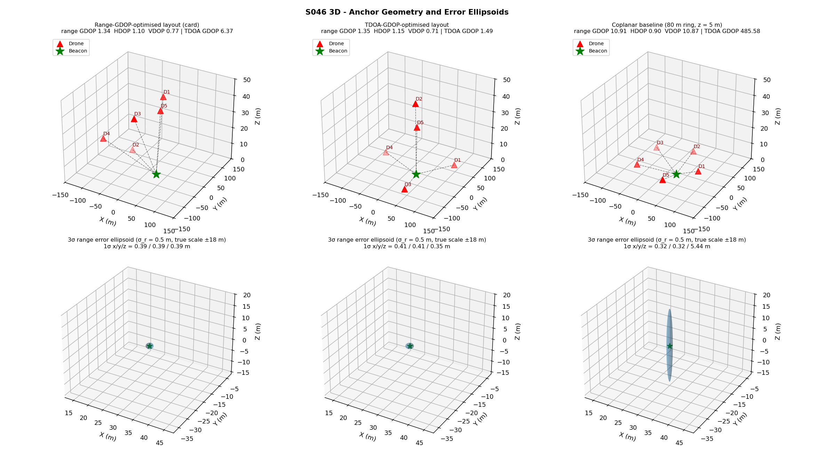
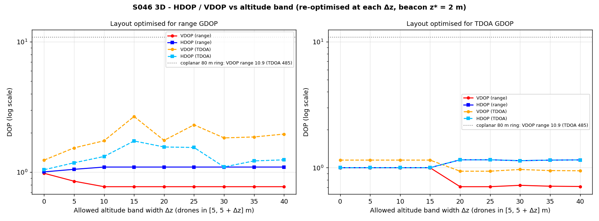
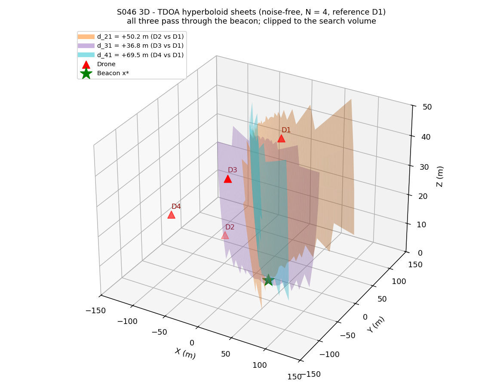
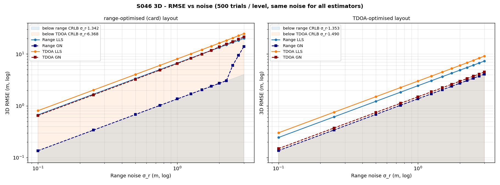
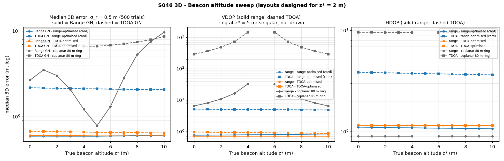
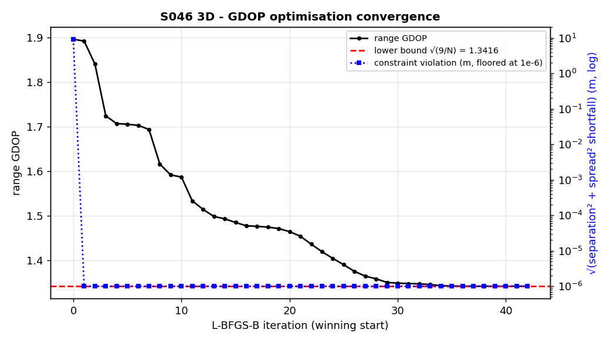
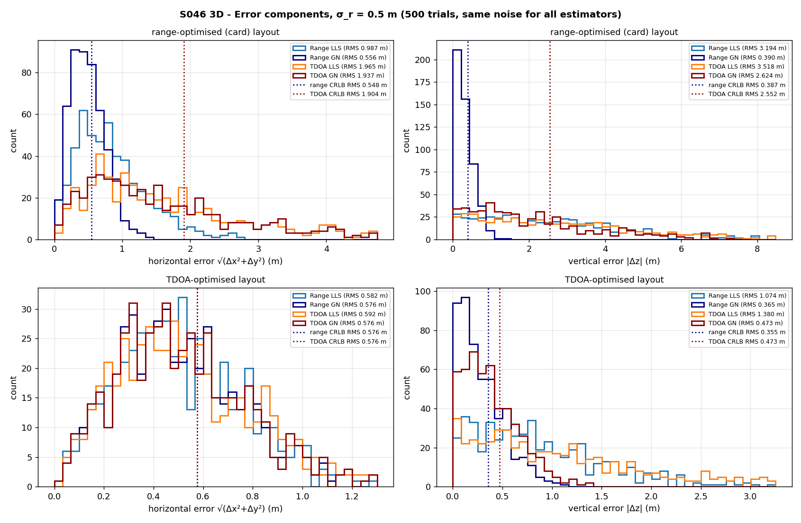
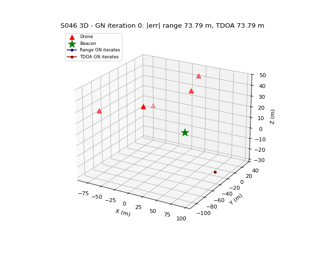

# S046 3D Upgrade — Trilateration with Altitude

**Domain**: Environmental & SAR | **Difficulty**: ⭐⭐⭐ | **Status**: ✅ Completed
**Based on**: [S046 Multi-Drone 3D Trilateration](../../s046_trilateration/README.md) (2D-folder version)

---

## Problem Definition

**Setup**: A survivor's beacon is at an unknown position $\mathbf{x}^*$ inside a $300 \times 300 \times 50$ m disaster area. Five drones hover at known positions and either measure the slant range to the beacon (range / RSSI ranging) or record the arrival time of its signal (TDOA, differences against drone D1). Both are corrupted by the same Gaussian arrival-time noise.

**What is new compared with the 2D-folder S046** (four drones at hand-picked tiers):

1. The five drone positions $(\phi_i, R_i, z_i)$ are chosen by minimising the 3D range GDOP with L-BFGS-B, with altitude bounds, a minimum altitude spread $\Delta z_{min} = 20$ m and a 15 m inter-drone separation.
2. TDOA localisation is added: a two-stage linear solver (unknowns $x, y, z, \rho_1$) and a weighted Gauss-Newton refinement.
3. HDOP and VDOP are tracked separately, as functions of the allowed altitude band and of the true beacon altitude $z^* \in [0, 10]$ m.

**Estimators compared** (same noise draw for all four in every trial): Range LLS, Range GN, TDOA LLS, TDOA GN.

**Layouts compared**: the card's range-GDOP-optimised layout, a TDOA-GDOP-optimised layout (added), and a coplanar baseline (the 2D-folder coplanar ring extended to five drones: 80 m radius, all at z = 5 m).

---

## Mathematical Model

**Measurements.** With per-drone arrival-time noise $e_i \sim \mathcal{N}(0, \sigma_r^2)$ (in metres), $\rho_i = \|\mathbf{p}_i - \mathbf{x}^*\|$:

$$r_i = \rho_i + e_i, \qquad d_{i1} = (\rho_i + e_i) - (\rho_1 + e_1), \quad i = 2..N$$

so $\operatorname{Var}(d_{i1}) = 2\sigma_r^2$ and $\operatorname{Cov}(d_{i1}, d_{j1}) = \sigma_r^2$: $\mathbf{Q} = \sigma_r^2(\mathbf{I} + \mathbf{1}\mathbf{1}^T)$.

**Range LLS / Range GN**: imported from the 2D script (range differencing against the last drone; Gauss-Newton with $\mathbf{H}_i = (\mathbf{x} - \mathbf{p}_i)^T/\rho_i$, started from the LLS, $\epsilon_{tol} = 10^{-4}$ m, $K_{max} = 100$).

**TDOA LLS (card Stage 1/2)**: $\;2(\mathbf{p}_i - \mathbf{p}_1)^T\mathbf{x} + 2 d_{i1}\rho_1 = \|\mathbf{p}_i\|^2 - \|\mathbf{p}_1\|^2 - d_{i1}^2$, solved by least squares for $[x, y, z, \rho_1]$. With $N = 5$ there are exactly 4 equations for 4 unknowns.

**TDOA GN** (weighted): $\;\Delta\mathbf{x} = (\mathbf{J}^T\mathbf{Q}^{-1}\mathbf{J})^{-1}\mathbf{J}^T\mathbf{Q}^{-1}(\mathbf{d} - \mathbf{h}(\mathbf{x}))$ with $\mathbf{J}_i = \mathbf{u}_i - \mathbf{u}_1$, $\mathbf{u}_i = (\mathbf{x} - \mathbf{p}_i)/\rho_i$, started from the TDOA LLS.

**DOP / CRLB.** Range: $\boldsymbol{\Sigma} = \sigma_r^2(\mathbf{H}^T\mathbf{H})^{-1}$. TDOA: $\boldsymbol{\Sigma} = (\tilde{\mathbf{H}}^T\mathbf{Q}^{-1}\tilde{\mathbf{H}})^{-1}$, $\tilde{\mathbf{H}}_i = \mathbf{u}_i - \mathbf{u}_1$. $\text{GDOP} = \sqrt{\operatorname{tr}\boldsymbol{\Sigma}}/\sigma_r$, $\text{HDOP} = \sqrt{\Sigma_{xx} + \Sigma_{yy}}/\sigma_r$, $\text{VDOP} = \sqrt{\Sigma_{zz}}/\sigma_r$.

**Lower bound.** Every row of $\mathbf{H}$ is a unit vector, so $\operatorname{tr}(\mathbf{H}^T\mathbf{H}) = N$ and $\text{GDOP} \ge \sqrt{9/N} = 1.3416$ for $N = 5$.

**Layout optimisation.** $\mathbf{p}_i = (R_i\cos\phi_i, R_i\sin\phi_i, z_i)$, $z_i \in [5, 45]$ m, $R_i \in [30, 120]$ m (box bounds in L-BFGS-B); separation $\ge 15$ m and spread $\max z - \min z \ge 20$ m as quadratic penalties (weight $10^4$). 16 multi-starts; the result is asserted feasible (violation < 5 cm).

---

## Key Parameters

| Parameter | Value | Notes |
|-----------|-------|-------|
| Drones $N$ | 5 | card |
| Search volume | 300 × 300 × 50 m | card |
| Design beacon $\mathbf{x}^*$ | (30, −20, 2) m | added (2D value; the card gives none) |
| Beacon altitude sweep $z^*$ | 0, 1, …, 10 m | card range |
| Range noise $\sigma_r$ | 0.5 m baseline | card |
| TDOA noise | std $\sqrt{2}\sigma_r = 0.71$ m, correlated (see above) | card std; correlation added |
| Altitude bounds | [5, 45] m | card |
| Minimum altitude spread $\Delta z_{min}$ | 20 m | card |
| Horizontal radius bounds | [30, 120] m | card |
| Separation $d_{sep}$ | 15 m | card |
| Optimiser | L-BFGS-B, finite-difference gradient, 16 starts (seed 0), penalty weight $10^4$ | starts / penalty added |
| GN tolerance / max iterations | $10^{-4}$ m / 100 | card |
| Monte Carlo trials | 500 per configuration (seed 42, same noise stream everywhere) | card |
| Noise sweep | 0.1, 0.25, 0.5, …, 3.0 m (13 levels) | 2D sweep |
| Altitude-band sweep | drones in [5, 5 + Δz] m, Δz = 0, 5, …, 40 m, re-optimised | added |
| Coplanar baseline | 5 drones on an 80 m ring at z = 5 m | added (2D coplanar ring) |
| Gross-error threshold | 20 m | 2D value |
| Uniqueness check | 200 random starts in the volume, noise-free, seed 7 | added |
| Animation | 36 frames, 4 fps, start = truth + N(0, 40²) m per axis, seed 99 | |

### Deviations from the scenario card

| Card | Implementation | Reason |
|------|----------------|--------|
| GDOP target ≤ 1.2 for the optimised 5-drone layout | 1.342 reached; the card target is corrected in the card | impossible: $\text{GDOP} \ge \sqrt{9/5} = 1.342$ for any 5 unit-vector rows |
| VDOP ≈ 8.0 coplanar / ≈ 1.4 optimised | 10.871 (80 m ring at 5 m) / 0.775 | computed values; the card table now carries them |
| "Without the 20 m spread constraint L-BFGS-B collapses all drones to a horizontal ring" | not observed: without the constraint the optimum has a 21.0 m spread and the same GDOP 1.342 | the range-GDOP optimum is highly degenerate (see Results) |
| "VDOP collapses rapidly once Δz > 10 m, quadratic degradation as Δz → 0" | VDOP 0.982 at Δz = 0, 0.775 from Δz = 10 m | coplanarity is not what hurts; the elevation angles seen from the beacon are |
| TDOA noise $\mathcal{N}(0, 2\sigma_r^2)$ independent, $\mathbf{W}_d = \text{diag}(1/2\sigma_r^2)$ and $\mathbf{I}_{TDOA} = \tilde{\mathbf{H}}^T\tilde{\mathbf{H}}/(2\sigma_r^2)$ | differences of a shared reference are correlated ($\mathbf{Q} = \sigma_r^2(\mathbf{I} + \mathbf{1}\mathbf{1}^T)$); GN and CRLB use $\mathbf{Q}^{-1}$; the LLS stage keeps the card's identity weight | the card's information matrix is not a bound: it gives 1.821 vs the correct 1.490 for the TDOA layout and 2.289 vs 2.489 for the z = 45 m layout (too optimistic). TDOA GN reaches the correct bound (0.745 m vs 0.745 m) |
| "With N < 4 the range system has a 1D family of solutions (circle)" | three spheres meet in **two** points (mirror images across the anchor plane); found numerically (see Results); card corrected | geometry |
| "TDOA is strictly a 3D construction (hyperboloids degenerate in 2D)" | TDOA also works in 2D (hyperbolas); sentence corrected in the card | geometry |
| GN Jacobian $\mathbf{H}_k = (\mathbf{p}_i - \mathbf{x}_k)/\|\mathbf{p}_i - \mathbf{x}_k\|$ with the update $\mathbf{x}_{k+1} = \mathbf{x}_k + (\mathbf{H}^T\mathbf{H})^{-1}\mathbf{H}^T\mathbf{f}$ | $\mathbf{H}_k = (\mathbf{x}_k - \mathbf{p}_i)/\rho_i$ (the 2D code, imported); card corrected | with the card's sign every step goes the wrong way (the same error was fixed in the 2D card) |
ho_i$ (2D code, imported); card corrected | with the card's sign every step goes the wrong way (the same error was fixed in the 2D card) |
| Analytic GDOP gradient | finite-difference gradient (scipy default) | same optimum; simpler |
| Error histogram "TDOA LLS carries a small bias" | TDOA LLS bias is small (z bias −0.046 / +0.057 m) but its main cost is variance (1.502 vs 0.745 m RMSE) | measured |
| Hyperboloids for N = 4 | drawn for drones D1–D4 of the optimised layout; the TDOA estimators use N = 5 | the linear TDOA stage needs $N - 1 \ge 4$ equations |
| — | TDOA-GDOP-optimised layout and altitude-band sweep added | needed to test the card's altitude-spread claims and to make the range-vs-TDOA comparison fair |
| Output path `outputs/03_environmental_sar/s046_3d_trilateration/` | `outputs/03_environmental_sar/3d/s046_3d_trilateration/` | 3D variants live under `3d/` |

---

## Implementation

```
src/03_environmental_sar/3d/s046_3d_trilateration.py
```

```bash
conda activate drones
python src/03_environmental_sar/3d/s046_3d_trilateration.py
```

Runtime ≈ 170–220 s. Two runs printed byte-identical output and produced identical files.

---

## Results

### Optimised layouts (design beacon (30, −20, 2) m)

| Layout | Altitude spread | Range GDOP / HDOP / VDOP | TDOA GDOP / HDOP / VDOP |
|---|---|---|---|
| Range-optimised (card constraints) | 39.8 m | **1.342** / 1.095 / 0.775 | 6.368 / 3.809 / 5.103 |
| Range-optimised, no spread constraint | 21.0 m | 1.342 / 1.095 / 0.775 | 2.323 / 1.244 / 1.961 |
| All five drones fixed at z = 45 m (coplanar) | 0.0 m | 1.342 / 1.095 / 0.775 | 2.489 / 1.128 / 2.219 |
| TDOA-optimised (card constraints) | 40.0 m | 1.353 / 1.152 / 0.709 | **1.490** / 1.152 / 0.945 |
| Coplanar 80 m ring at z = 5 m | 0.0 m | 10.908 / 0.898 / 10.871 | 485.576 / 9.564 / 485.481 |
| 2D-folder S046 well-spread (4 drones) | 20.0 m | 2.667 / 1.248 / 2.357 | 2.853 / 1.310 / 2.534 |

The card's range-optimised layout has D1–D5 at (25.4, 20.8, 45.0), (−67.1, 30.9, 5.2), (20.1, −105.6, 45.0), (−84.2, −75.9, 23.3), (42.0, −21.8, 42.1) m (elevations 46.3°, 1.7°, 26.5°, 9.5°, 73.2° from the beacon). L-BFGS-B reaches the bound 1.341641 in 42 iterations. The TDOA-optimised layout puts three drones low and far (5 m altitude, elevations 1.5–1.9°) and two almost straight above the beacon (84.9° and 84.8°, 15 m apart, i.e. the separation constraint is active).

**Key 3D findings**

- **The range-GDOP optimum is reachable without altitude diversity.** The bound 1.342 is reached with a 40 m spread, a 21 m spread and with all five drones coplanar at 45 m. What matters is the spread of *elevation angles seen from the beacon*, not the spread of drone altitudes. Coplanar is only bad when the plane is close to the beacon's height and far away: the 80 m ring at 5 m has VDOP 10.871 because a beacon 3 m below the ring changes every range very little when it moves vertically.
- **The card's spread constraint does nothing for range localisation.** Confining the drones to [5, 5 + Δz] m and re-optimising gives range VDOP 0.982 at Δz = 0, 0.854 at 5 m and 0.775 from 10 m on; HDOP stays 1.006–1.095 (`dop_vs_spread.png`). The degradation as Δz → 0 is 27 %, not "quadratic" and not "≈ 8". The constraint is inactive at the optimum (without it the spread is 21.0 m).
- **TDOA is where altitude geometry matters — and the card's objective ignores it.** TDOA loses the common-mode component of the range noise (the unknown transmit time), so when every drone is above the beacon the vertical direction is weakly observable. Among the layouts that reach the range-GDOP bound 1.342 (the four in the layout table plus the band-sweep layouts for Δz ≥ 10 m), TDOA GDOP varies from 2.137 (Δz = 30 m) to 6.368; the card's layout is the worst of them. Optimising TDOA GDOP directly gives 1.490 while costing only 0.8 % range GDOP (1.353 vs 1.342). With the same noise, TDOA GN on the TDOA-optimised layout beats TDOA GN on the card layout in 455/500 trials (RMSE 0.745 vs 3.261 m).
- **Uniqueness.** With D1–D3 only, noise-free GN from 200 random starts ends on two distinct exact solutions: the truth (30, −20, 2) and its mirror (−3.06, −18.60, 79.20) across the plane of the three drones (161 exact endings, 39 local minima). The mirror lies above the 50 m volume, so here a z prior would resolve it. With D1–D4 there is exactly one exact solution (118 exact endings, 82 local minima / non-convergence from far starts).

### Monte Carlo, σ_r = 0.5 m (500 trials, same noise for all estimators)

| Layout | Estimator | 3D RMSE | Median | Horiz RMS | Vert RMS | CRLB 3D | Gross (>20 m) |
|---|---|---|---|---|---|---|---|
| Range-opt. (card) | Range LLS | 3.343 m | 2.417 m | 0.987 | 3.194 | 0.671 (range) | 0 |
| | Range GN | **0.679 m** | 0.590 m | 0.556 | 0.390 | 0.671 (range) | 0 |
| | TDOA LLS | 4.030 m | 2.925 m | 1.965 | 3.518 | 3.184 (TDOA) | 0 |
| | TDOA GN | 3.261 m | 2.141 m | 1.937 | 2.624 | 3.184 (TDOA) | 0 |
| TDOA-opt. | Range LLS | 1.221 m | 0.953 m | 0.582 | 1.074 | 0.677 (range) | 0 |
| | Range GN | **0.682 m** | 0.603 m | 0.576 | 0.365 | 0.677 (range) | 0 |
| | TDOA LLS | 1.502 m | 1.107 m | 0.592 | 1.380 | 0.745 (TDOA) | 0 |
| | TDOA GN | **0.745 m** | 0.667 m | 0.576 | 0.473 | 0.745 (TDOA) | 0 |
| Coplanar ring | Range LLS | 3.006 m | 3.016 m | 0.485 | 2.967 | 5.454 (range) | 0 |
| | Range GN | 4785.191 m (3.206 m w/o gross) | 3.020 m | 2427.572 | 4123.706 | 5.454 | 7 |
| | TDOA LLS | 23.355 m (7.653 m w/o gross) | 6.848 m | 4.655 | 22.886 | 242.788 (TDOA) | 161 |
| | TDOA GN | 1528.394 m (7.415 m w/o gross) | 7.107 m | 46.873 | 1527.675 | 242.788 | 178 |

- **GN reaches the CRLB, LLS does not.** Range GN is 1.2 % above its bound on the card layout (0.679 vs 0.671 m) and TDOA GN equals its (correct, correlated-noise) bound on the TDOA layout (0.745 vs 0.745 m). Range GN beats Range LLS in 465/500 trials on the card layout; the LLS is 5× worse there (3.343 m), almost all of it vertical (3.194 m).
- **Range vs TDOA.** On the card layout Range GN beats TDOA GN in 461/500 trials (0.679 vs 3.261 m); on the TDOA layout the gap shrinks to 321/500 trials (0.682 vs 0.745 m) — the remaining 9 % is the price of the unknown transmit time.
- **Coplanar ring.** The horizontal error is fine (Range LLS 0.485 m) but the vertical is ill-conditioned; TDOA fails outright (161–178 of 500 trials > 20 m). Range LLS at 3.006 m is below the linearised "CRLB" 5.454 m because the 2D height step constrains the estimate below the drone plane (biased estimator; see the 2D README).

### Noise sweep (`rmse_vs_noise.png`)

On the card layout Range GN tracks its CRLB up to σ_r = 2.25 m (3.064 vs 3.019 m) and then starts to diverge (2 / 6 / 15 gross errors at 2.5 / 2.75 / 3.0 m, RMSE 13.920 m at 3.0 m); TDOA GN stays 2.4–12 % above its bound (0.652 vs 0.637 m at 0.1 m, 21.447 vs 19.103 m at 3.0 m) with gross errors from 1.25 m on (7/500, 170/500 at 3.0 m). On the TDOA layout all four estimators are clean: Range GN 4.097 m and TDOA GN 4.484 m at σ_r = 3.0 m (bounds 4.059 / 4.471 m), and only TDOA LLS shows gross errors (12/500 at 3.0 m).

### Beacon altitude sweep (`beacon_altitude_sweep.png`)

Both optimised layouts are insensitive to $z^* \in [0, 10]$ m (range GN median 0.590–0.603 m on the card layout, 0.602–0.608 m on the TDOA layout; TDOA GN 2.072–2.178 m vs 0.644–0.675 m). For the coplanar ring VDOP is singular at $z^* = 5$ m (beacon in the drone plane) and 6.537 at $z^*$ = 0 or 10 m. Its range GN median *drops* to 0.784 m at $z^* = 5$ m — not a geometric merit: the 2D LLS clamps the height onto the drone plane when the noisy spheres do not intersect, which is exactly right when the beacon is in that plane. Above the plane the "beacon below the drones" prior is wrong and the median grows to 9.686 m at $z^* = 10$ m.

**Point design.** The layout is optimised for one beacon position; over the whole 300 × 300 m area at z = 2 m its GDOP ranges from 1.342 to 14.502 (median 3.479), and only 22.7 % of the cells have GDOP < 2.

### Figures

**3D anchor geometry and 3σ range error ellipsoids** (true scale, ±18 m box) for the card layout, the TDOA-optimised layout and the coplanar ring:



**HDOP / VDOP vs allowed altitude band** — re-optimised at each Δz, range (solid) and TDOA (dashed) DOP of the resulting layout; in the right panel the range and TDOA HDOP curves coincide:



**TDOA hyperboloid sheets** for D2, D3, D4 against reference D1 (noise-free). The parametrisation is checked in the code (max residual 4.3e-14 m); the drawn grid passes within 1.03–2.51 m of the beacon:



**RMSE vs noise** for both optimised layouts; shaded areas lie below the range (blue) and TDOA (orange) CRLB:



**Beacon altitude sweep** — median 3D error, VDOP and HDOP vs $z^*$:



**GDOP optimisation convergence** — range GDOP and constraint violation per L-BFGS-B iteration of the winning start (start GDOP 1.896 with a 9.1 m violation):



**Error components** — horizontal and vertical error histograms with CRLB RMS lines, both optimised layouts:



**Animation** — range GN (blue) and TDOA GN (red) iterates from the same 40 m-perturbed start on the card layout, rotating view (36 frames): range GN converges in 6 iterations (final error 0.515 m), TDOA GN in 7 (0.741 m):



---

## Extensions

1. **Optimise for the estimator actually flown** — combined range + TDOA GDOP objective, or TDOA GDOP averaged over a prior of beacon positions (removes the point-design weakness: median GDOP 3.479 over the area).
2. **Asynchronous TDOA**: per-drone clock offsets as extra unknowns.
3. **Online repositioning**: re-optimise around the current estimate after each epoch.
4. **Robust estimation under NLOS** (Huber / Tukey) for rubble-attenuated signals.
5. **Levenberg-Marquardt / z-constrained GN** to remove the coplanar divergences.

---

## Related Scenarios

- 2D card: [S046 Multi-Drone 3D Trilateration](../../../../scenarios/03_environmental_sar/S046_trilateration.md)
- 3D card: [S046 3D Upgrade — Trilateration with Altitude](../../../../scenarios/03_environmental_sar/3d/S046_3d_trilateration.md)
- Prerequisite: [S042 Missing Person Localization](../../../../scenarios/03_environmental_sar/S042_missing_person.md)
- Follow-ups: [S047 Base Station Signal Relay](../../../../scenarios/03_environmental_sar/S047_signal_relay.md), [S050 Swarm Cooperative Mapping (Distributed EKF-SLAM)](../../../../scenarios/03_environmental_sar/S050_slam.md)
- Algorithmic cross-reference: [S008 Stochastic Pursuit — Kalman Filter Tracking](../../../../scenarios/01_pursuit_evasion/S008_stochastic_pursuit.md)
