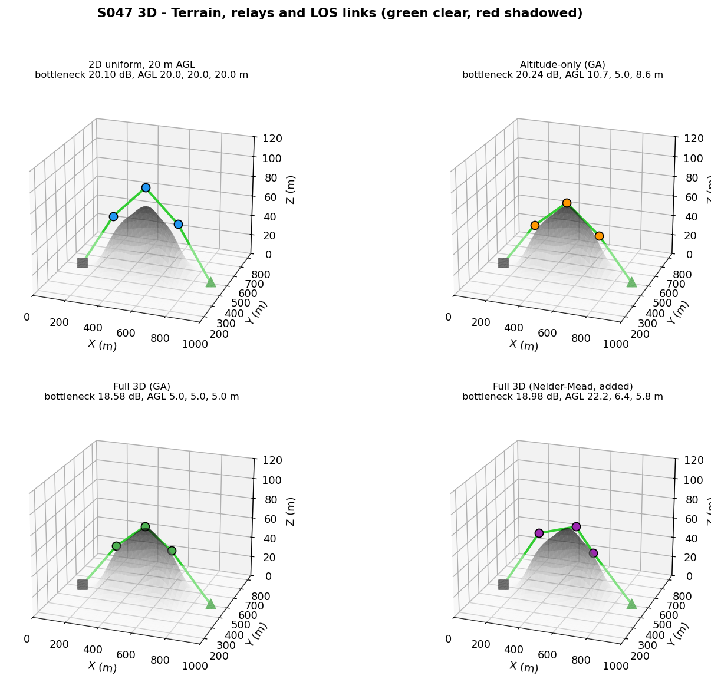
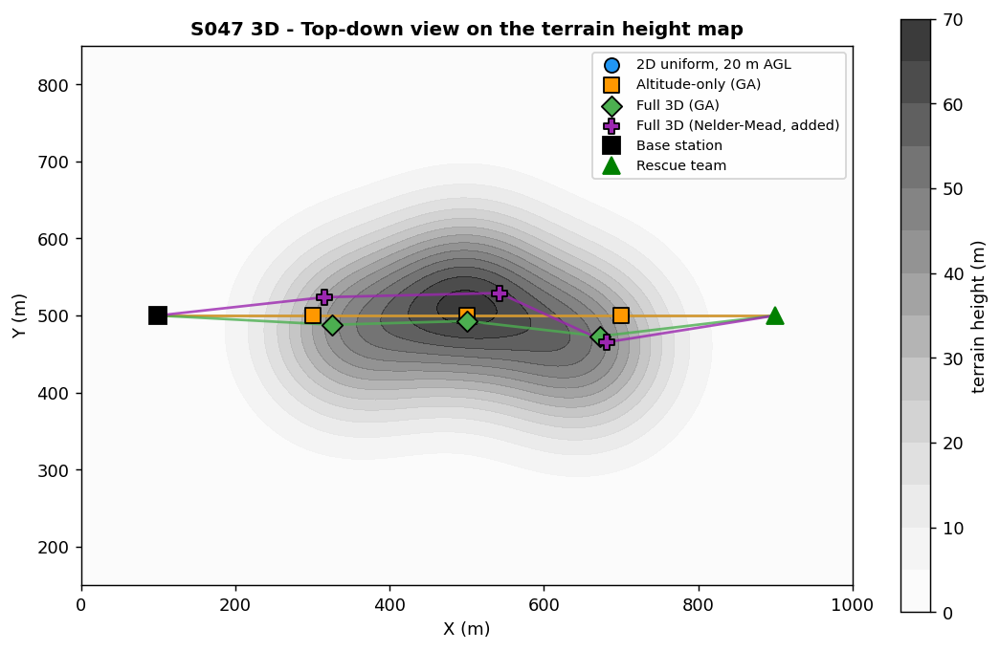
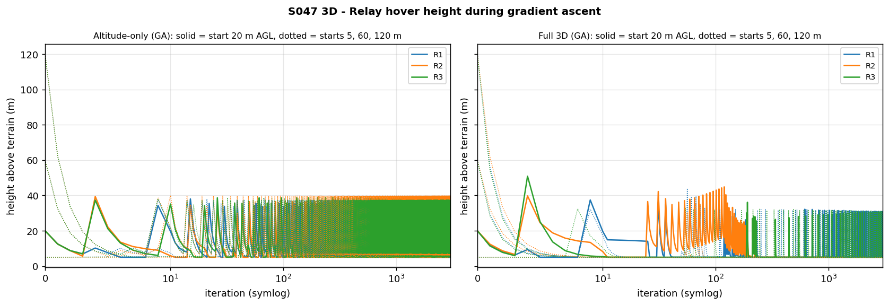
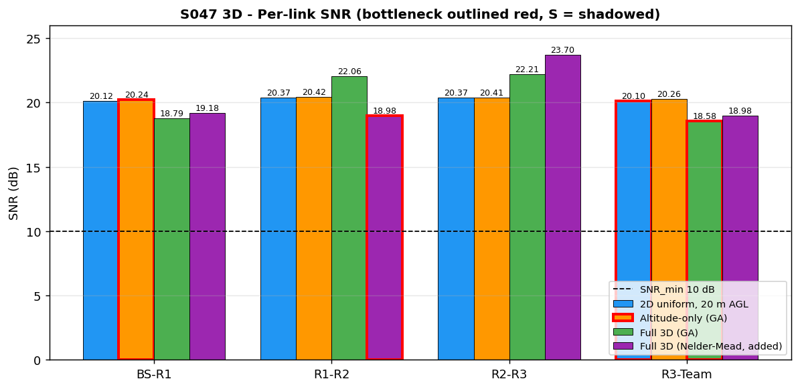
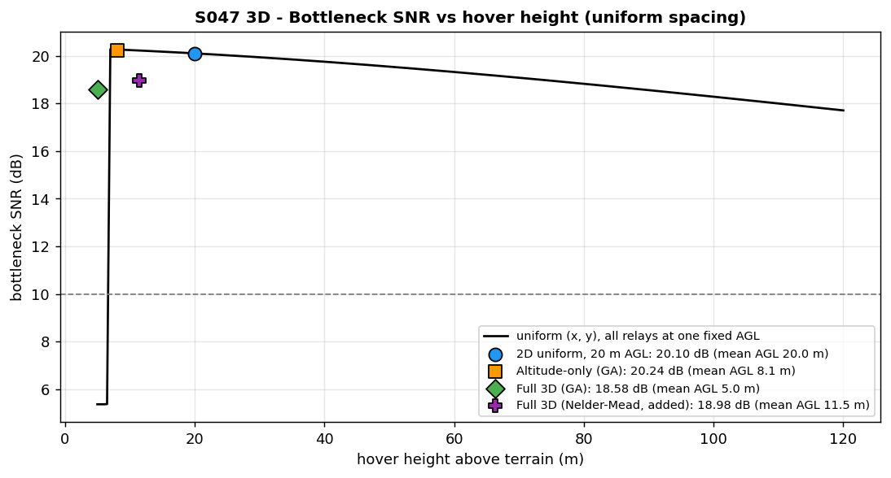
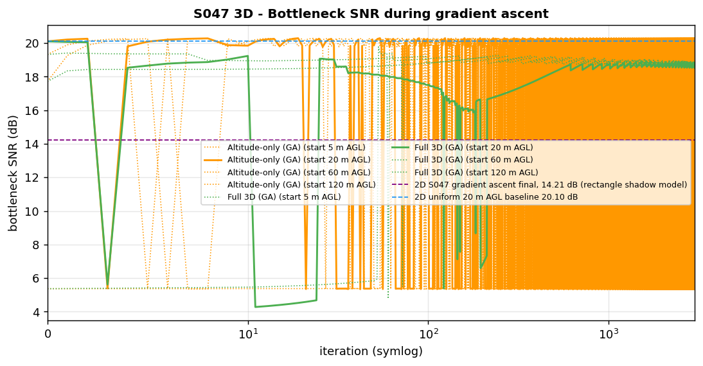
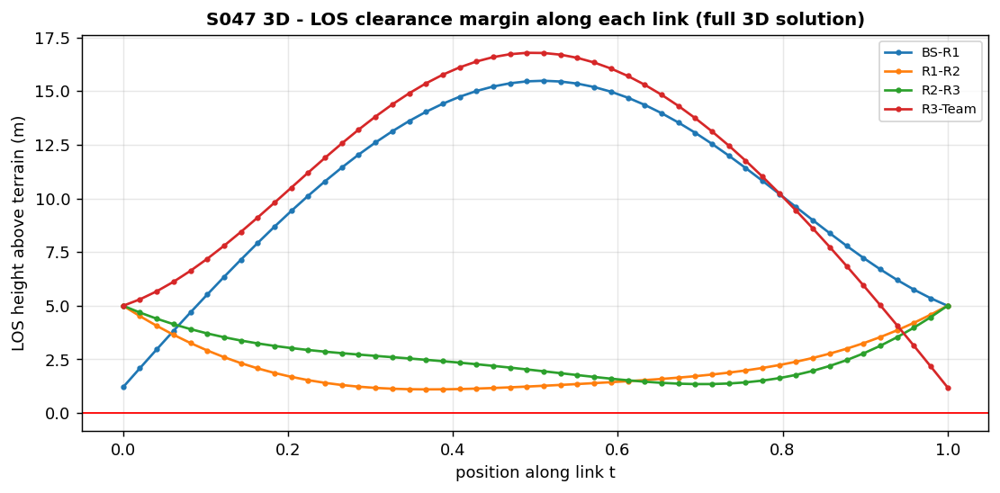
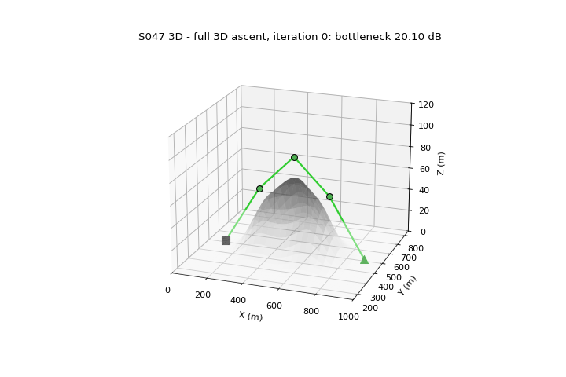

# S047 3D Upgrade — Signal Relay Enhancement

**Domain**: Environmental & SAR | **Difficulty**: ⭐⭐⭐ | **Status**: ✅ Completed
**Based on**: [S047 Base Station Signal Relay](../../s047_signal_relay/README.md) (2D-folder version)

---

## Problem Definition

**Setup**: A base station (BS) mast tip at (100, 500, 1.5) m and a rescue team at (900, 500, 1.5) m are separated by three Gaussian hills. The direct 800 m link is blocked by terrain (SNR −11.33 dB). Three relay drones form a 4-hop chain BS → R1 → R2 → R3 → team. Compared with the 2D-folder S047 (shadow rectangles tested at the hop midpoint), every relay now has an altitude, hop lengths are 3D, and a hop is shadowed only if its straight line of sight (LOS) dips below the terrain at any of 50 samples.

**Objective (card)**: maximise $J = \min_k \text{SNR}_k - \lambda\sum_i \max(0, z_i - z_{clear,i})^2$, the bottleneck SNR minus a penalty on hovering above the lowest altitude at which both adjacent hops of relay $i$ are clear.

**Strategies**:
1. **2D uniform baseline** — relays equally spaced on the BS–team line at 20 m above ground (card "20 m", see Deviations).
2. **Altitude-only (GA)** — (x, y) fixed at the uniform spacing; gradient ascent on $z_i$.
3. **Full 3D (GA)** — gradient ascent on all nine coordinates.
4. **Full 3D (Nelder-Mead, added)** — derivative-free reference optimiser on the same objective $J$, started from the baseline.

The two GA strategies use the 2D script's method (soft-min objective, central differences with ε = 1 m, step η × gradient) for the card's 3000 iterations, and are run from four initial hover heights (5, 20, 60, 120 m AGL). The 20 m start is the one shown.

---

## Mathematical Model

**Terrain**: $h(x, y) = \sum_{j=1}^{3} H_j \exp\!\bigl(-\tfrac{(x-c_{x,j})^2}{2\sigma^2} - \tfrac{(y-c_{y,j})^2}{2\sigma^2}\bigr)$ with $H = 40, 55, 45$ m and σ = 80 m.

**Link**: $d_k = \|\mathbf{p}_{k+1} - \mathbf{p}_k\|_3$, $L(d) = L_0 + 10 n \log_{10} d$ ($L_0 = 40.05$ dB at 1 m, 2.4 GHz, $n = 2.8$), $\text{SNR}_k = P_{tx} - L(d_k) - 15\,\text{dB}\cdot\text{shadowed}_k - N_{floor}$.

**Shadowing**: $\text{shadowed}_k = \mathbf{1}[\min_{t \in \mathcal{T}} (z_{los}(t) - h(x(t), y(t))) < 0]$, $\mathcal{T}$ = 50 equally spaced samples on [0, 1].

**Clearance altitude** (closed form instead of a sweep): for a fixed neighbour $\mathbf{a}$ and the relay's horizontal position, $z_i \ge \max_{t \in \mathcal{T}, t>0} \bigl(h(t) - (1-t) z_a\bigr)/t$; $z_{clear,i}$ is the larger of the two neighbours' values and $h(x_i, y_i) + 5$ m.

**Soft-min**: $J_{soft} = -\tfrac{1}{\alpha}\ln\sum_k e^{-\alpha\,\text{SNR}_k} - \lambda\sum_i\max(0, z_i - z_{clear,i})^2$, α = 0.5, λ = 0.05 dB/m².

**Projection after each step**: (x, y) into [0, 1000]², height above terrain into [5, 120] m, hops ≤ 700 m (forward / backward pass). Invariants asserted every step: relays at least 5 m above terrain and at most 120 m, all hops ≤ 700 m.

---

## Key Parameters

| Parameter | Value | Notes |
|-----------|-------|-------|
| Carrier / reference distance / exponent | 2.4 GHz / 1 m / 2.8 | card |
| $P_{tx}$ / $N_{floor}$ / SNR_min | 30 dBm / −95 dBm / 10 dB | card |
| $d_{max}$ | 700 m (3D) | card; never active (longest hop 234.7 m) |
| $\Delta_{shadow}$ | 15 dB | card |
| Ridge heights / σ | 40, 55, 45 m / 80 m both axes | card |
| Ridge centres | (350, 480), (500, 520), (650, 460) m | added: the card gives none; 2D shadow-zone centres |
| LOS samples | 50 | card |
| Height bounds | 5–120 m **above terrain** | card values, read as AGL (see Deviations) |
| Baseline hover height | 20 m AGL | card value, read as AGL |
| α / λ | 0.5 / 0.05 dB m⁻² | card |
| Step η / iterations | 5 × gradient (dB/m) / 3000 | card |
| Finite-difference ε | 1 m | 2D value |
| GA start heights | 5, 20, 60, 120 m AGL | added |
| Nelder-Mead | ≤ 6000 evaluations, xatol 1e-3, fatol 1e-6, start = baseline | added |
| BS / team | (100, 500, 1.5) / (900, 500, 1.5) m | card |
| Animation | 121 frames (every 25th step of the full-3D run), 10 fps | |

### Deviations from the scenario card

| Card | Implementation | Reason |
|------|----------------|--------|
| Baseline "relay altitudes fixed at 20 m"; bounds $z \in [5, 120]$ m | read as height above terrain (AGL) | the terrain under the uniform relay positions is 34.2, 66.8 and 35.0 m: an absolute 20 m would put all three relays inside the hills |
| Ridge centres not given | 2D shadow-zone centres | keeps the 2D geometry |
| $z_{clear,i}$ "by sweeping the terrain profile" | closed form over the same 50 LOS samples | exact for the sampled test, no sweep resolution |
| Analytic SNR gradient | central differences on the full objective (2D method) | the analytic formula omits the shadow and penalty terms, which dominate the behaviour |
| Expected "each relay climbing from 20 m to its ridge-clearance altitude" | relays **descend** from 20 m; they then oscillate (see Results) | the 20 m AGL baseline already clears every ridge; the clearance altitude is lower |
| Expected "gain from altitude freedom" (full 3D best) | full 3D GA and Nelder-Mead end **below** the baseline | see Results: the penalty's horizontal gradient drives the relays uphill |
| — | Nelder-Mead reference and multi-start added | to separate the method from what 3D freedom can buy |
| Output path `outputs/03_environmental_sar/s047_3d_signal_relay/` | `outputs/03_environmental_sar/3d/s047_3d_signal_relay/` | 3D variants live under `3d/` |

---

## Implementation

```
src/03_environmental_sar/3d/s047_3d_signal_relay.py
```

```bash
conda activate drones
python src/03_environmental_sar/3d/s047_3d_signal_relay.py
```

Runtime ≈ 245–345 s depending on machine load (8 gradient-ascent runs × 3000 iterations + Nelder-Mead). Two runs printed byte-identical output and produced identical files.

---

## Results

| Strategy (20 m AGL start) | Relays (x, y, z) m | Height above terrain | SNR per link (dB) | Bottleneck | $J$ |
|---|---|---|---|---|---|
| 2D uniform, 20 m AGL | (300, 500, 54.2), (500, 500, 86.8), (700, 500, 55.0) | 20.0, 20.0, 20.0 | 20.12, 20.37, 20.37, 20.10 | **20.105 dB** | −13.645 |
| Altitude-only (GA) | (300, 500, 45.0), (500, 500, 71.8), (700, 500, 43.6) | 10.73, 5.00, 8.58 | 20.24, 20.42, 20.41, 20.26 | **20.245 dB** | 19.609 |
| Full 3D (GA) | (325.7, 488.0, 47.7), (500.5, 492.8, 70.9), (672.4, 473.0, 52.2) | 5.00, 5.00, 5.00 | 18.79, 22.06, 22.21, 18.58 | 18.580 dB | 18.580 |
| Full 3D (Nelder-Mead, added) | (315.1, 523.7, 57.4), (541.9, 529.2, 68.4), (681.0, 465.3, 50.8) | 22.24, 6.44, 5.76 | 19.18, 18.98, 23.70, 18.98 | 18.977 dB | 18.947 |

No final layout has a shadowed link. Nelder-Mead used 3372 evaluations.

**All starts (final iterate after 3000 iterations; best iterate in brackets)**

| Strategy | Start 5 m AGL | 20 m | 60 m | 120 m |
|---|---|---|---|---|
| Altitude-only (GA) | 5.339 dB, 1 shadowed link [20.291] | 20.245 [20.291] | 20.291 [20.291] | 20.087, J −20.844 [20.279] |
| Full 3D (GA) | 18.828 [19.777] | 18.580 [20.105 at iteration 0] | 18.748 [19.408] | 18.720 [19.274] |

**Fixed-height sweep (uniform x, y, all relays at one AGL)**: shadowed below 7.0 m AGL (5.366 dB at 5 m); best 20.281 dB at 7.0 m; 20.105 dB at 20 m; 17.709 dB at 120 m. The shadow-free upper bound with four equal 200 m hops at ground level is 20.525 dB.

**Key findings**

- **Altitude freedom is worth at most a few tenths of a dB here.** The 20 m AGL baseline is already shadow-free, so the only thing lowering the relays buys is slightly shorter slant hops: the best result of any run is 20.291 dB (altitude-only), +0.19 dB over the baseline, and no layout can exceed 20.525 dB (+0.42 dB). The card's 3D gain does not appear in this geometry.
- **Altitude matters as a cliff, not a slope.** Below 7.0 m AGL the two middle hops clip the hills and lose 15 dB (5.37 dB bottleneck, below the 10 dB threshold). Above it, every extra metre costs a little: −2.4 dB from 20 m to 120 m AGL.
- **The card's gradient ascent cannot see the shadow cliff, and it oscillates across it.** The shadow term is a step: its finite-difference gradient is zero except within 1 m of the cliff, where it is ≈ 7.5 dB/m and kicks the relay up by tens of metres. The altitude-only runs therefore descend, hit the cliff, jump up and repeat (`altitude_convergence.png`, `convergence.png`); the final iterate depends on where in that cycle iteration 3000 falls (20.087 to 20.291 dB from clear starts). Started in the shadow (5 m AGL) the ascent never leaves it (5.339 dB): a +1 m probe does not clear the 1.3 m deficit, so the gradient is zero.
- **The card's altitude penalty pushes relays uphill.** Because $z_{clear,i} \ge h(x_i, y_i) + 5$ m, moving a relay over higher ground raises $z_{clear}$ and lowers the penalty. At the 20 m start the penalty gradient is (+0.484, −0.139, −1.500) dB/m for R1 and (−0.493, −0.295, −1.500) dB/m for R3, while the soft-min (SNR) gradient is at most 0.004 dB/m — the horizontal motion of the full-3D optimisers is driven almost entirely by the penalty. R1 and R3 move towards the hill tops, the outer hops lengthen (230.7 / 234.7 m) and the bottleneck falls to 18.58 dB. Nelder-Mead on the same $J$ gets stuck in a similar local optimum (18.977 dB). On the card's own objective, altitude-only (best $J$ = 20.050, 60 m start) beats every full-3D run.
- **Comparison with 2D.** The 2D-folder S047 ends at 14.21 dB because its rectangle shadow model forces short shadowed hops; with a terrain-height model and 3D LOS the same corridor is clear at any reasonable hover height. The two numbers come from different shadow models and are not directly comparable.

### Figures

**3D terrain, relays and LOS links** (green clear, red shadowed):



**Top-down view** on the terrain height map (the baseline and altitude-only relays share the same (x, y), so the blue markers are hidden under the orange ones):



**Relay height above terrain during gradient ascent** (solid = 20 m start, dotted = other starts):



**Per-link SNR** for the four strategies (bottleneck outlined in red):



**Bottleneck SNR vs hover height** for the uniform layout, with the four strategies marked at their mean height above terrain:



**Bottleneck SNR during gradient ascent**, with the 2D-folder result (different shadow model) and the 20 m baseline as reference lines:



**LOS clearance margin** along each link of the full-3D (GA) solution — all margins stay positive (minimum 1.21, 1.10, 1.35, 1.20 m on the four links):



**Animation** — full-3D gradient ascent from the 20 m start (every 25th iteration, 121 frames); links turn red while shadowed:



---

## Extensions

1. **Smooth shadowing** (e.g. knife-edge diffraction loss as a function of LOS clearance) so that gradient methods see the terrain.
2. **Penalise height above terrain, not above $z_{clear}$**, to remove the uphill incentive; or use energy per metre climbed.
3. **Steeper / elongated ridges** (σ_y ≫ σ_x) where a fixed 20 m AGL hover is shadowed and altitude freedom actually pays.
4. **Fewer relays at higher altitude** (card Extension 6).
5. **Moving rescue team** with receding-horizon replanning.

---

## Related Scenarios

- 2D card: [S047 Base Station Signal Relay](../../../../scenarios/03_environmental_sar/S047_signal_relay.md)
- 3D card: [S047 3D Upgrade — Signal Relay Enhancement](../../../../scenarios/03_environmental_sar/3d/S047_3d_signal_relay.md)
- 3D geometry reference: [S046 Multi-Drone 3D Trilateration](../../../../scenarios/03_environmental_sar/S046_trilateration.md)
- Network extension: [S051 Post-Disaster Communication Network Restoration](../../../../scenarios/03_environmental_sar/S051_post_disaster_comm.md)
- Relay chain in a different medium: [S059 Underwater Target Sonar Marking (Surface Cooperative Localization)](../../../../scenarios/03_environmental_sar/S059_sonar_relay.md)
