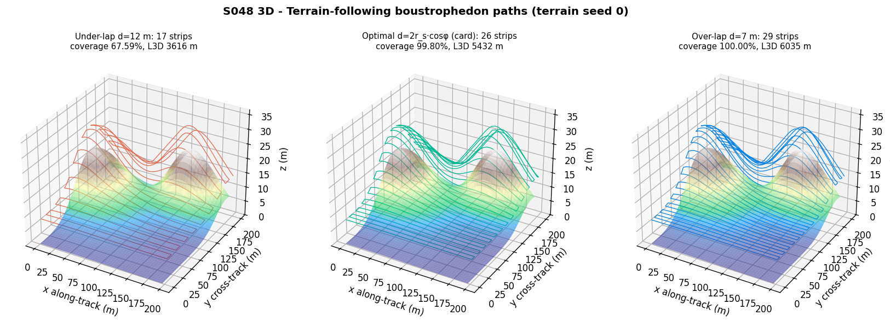
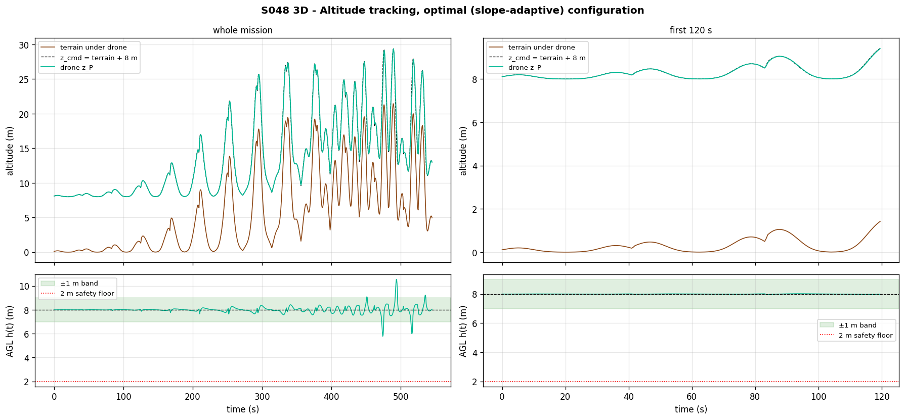
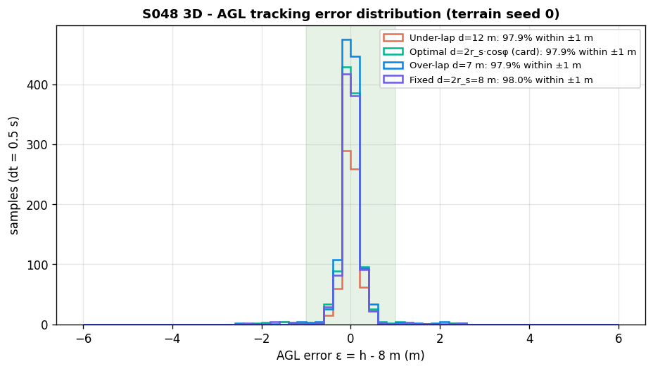
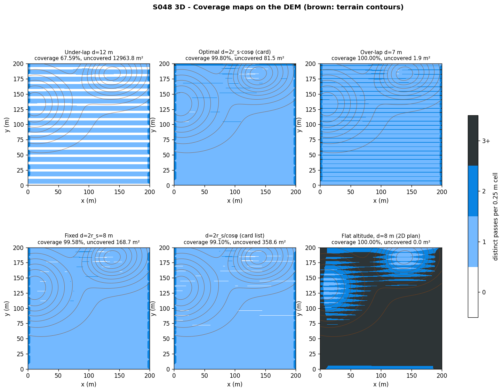
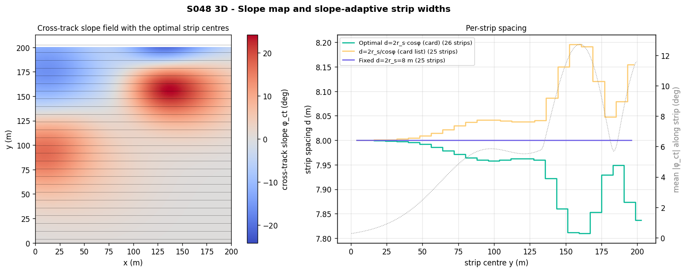
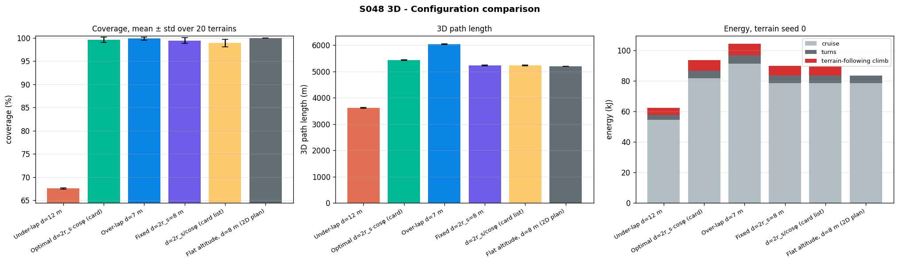
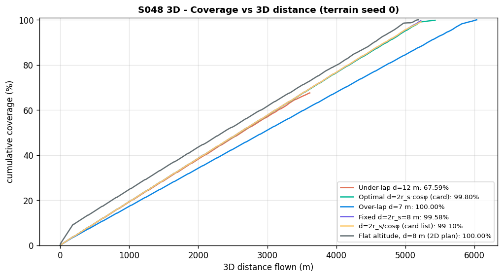
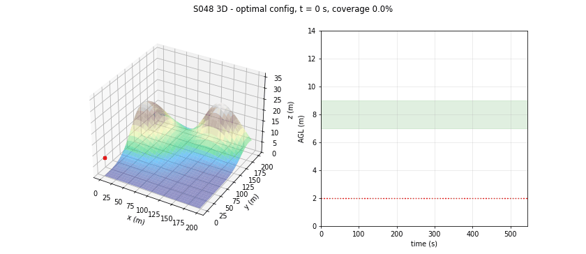

# S048 3D Upgrade — Lawnmower Coverage on Terrain

**Domain**: Environmental & SAR | **Difficulty**: ⭐⭐ | **Status**: ✅ Completed
**Based on**: [S048 Full-Area Coverage Scan (Lawnmower)](../../s048_lawnmower/README.md) (2D-folder version)

---

## Problem Definition

**Setup**: A single drone scans a 200 × 200 m area with a boustrophedon (lawnmower) path over undulating terrain: the sum of five Gaussian hills (amplitude 5–15 m, σ 20–50 m, random centres). Instead of the 2D-folder S048's flat world at one altitude, the drone **follows the terrain** at a target clearance of 8 m above ground level (AGL) with a proportional altitude controller limited to ±3 m/s, while it moves horizontally at 10 m/s. The nadir camera's footprint radius scales with the actual height above ground, so altitude-tracking errors change the footprint in real time.

**Configurations** (all terrain-following unless stated):

| Key | Strip spacing | Source |
|---|---|---|
| Under-lap | d = 12 m | card |
| Optimal | $d_i = 2 r_s \cos\phi_{ct,i}$ (slope-adaptive) | card maths section |
| Over-lap | d = 7 m | card |
| Fixed 8 m | $d = 2 r_s = 8$ m (no slope correction) | added |
| Card list variant | $d_i = 2 r_s / \cos\phi_{ct,i}$ | card comparison list (contradicts the maths section) |
| Flat altitude (2D plan) | d = 8 m at a constant altitude max(terrain) + 8 m | added: what the 2D planner would fly |

**Metrics**: coverage of the area, 3D path length, energy (with a climb term), AGL tracking error and safety. A showcase terrain (seed 0) is plotted; every metric is also reported over **20 random terrains** (seeds 0–19, the same terrains for every configuration).

---

## Mathematical Model

**Terrain**: $z_t(x, y) = \sum_{k=1}^{5} A_k \exp\bigl(-\tfrac{(x-x_k)^2 + (y-y_k)^2}{2\sigma_k^2}\bigr)$, $A_k \in [5, 15]$ m, $\sigma_k \in [20, 50]$ m; DEM on a 1 m grid, slopes by central differences.

**Altitude controller** (card): $z_{cmd} = z_t(x_P, y_P) + h_{AGL}$, $\dot z = \text{clip}(K_z (z_{cmd} - z_P), \pm\dot z_{max})$, Euler with $\Delta t = 0.5$ s ($K_z\Delta t = 0.75$, stable).

**Climb-limited speed (added safety rule)**: if the next 5 m step would bring the drone below the 2 m AGL safety floor at any of 5 sub-samples of the step, the step is shortened by bisection (the drone may hover and climb). Invariant asserted every step: clearance ≥ 2 m (hence never underground).

**Footprint**: $r = r_s\,h/h_{AGL}$, $r_s = h_{AGL}\tan(\theta_{FOV}/2) = 4$ m. Between two steps the footprint is swept as a capsule (as in 2D) with the smaller of the two radii.

**Strip spacing**: $\phi_{ct}(y_i)$ = mean |cross-track slope angle| along the strip; $y_0 = d_0/2$, $y_i = y_{i-1} + (d_{i-1} + d_i)/2$ (card).

**Energy**: $E = P_{cruise}\,t_{fly} + (P_{hover} - P_{cruise})\,t_{turn}(N-1) + (P_{climb} - P_{cruise})\,D_{up}/\dot z_{max}$ — the climb term is 33.3 J per metre climbed (see Deviations).

---

## Key Parameters

| Parameter | Value | Notes |
|-----------|-------|-------|
| Area | 200 × 200 m | card |
| Hills | 5, A ∈ [5, 15] m, σ ∈ [20, 50] m, uniform centres | card |
| DEM resolution | 1 m | card |
| Coverage cells | 0.25 m | added (card: 1 m), see Deviations |
| $h_{AGL}$ / $\tan(\theta_{FOV}/2)$ / $r_s$ | 8 m / 0.5 / 4 m | card |
| Cruise speed | 10 m/s | card |
| $\dot z_{max}$ / $K_z$ | 3 m/s / 1.5 s⁻¹ | card |
| $P_{cruise}$ / $P_{hover}$ / $P_{climb}$ | 150 / 200 / 250 W | card |
| $t_{turn}$ | 4 s | card |
| $\Delta t$ | 0.5 s | card |
| AGL bounds | 2–20 m | card (2 m enforced as the safety floor; 20 m counted as a violation) |
| Strip spacing | 12 / adaptive / 7 m (+ 8 m, $2r_s/\cos\phi$) | card (+ added) |
| Terrains | showcase seed 0, Monte Carlo seeds 0–19 | added |
| Animation | optimal configuration, every 12th sample, 92 frames, 10 fps | |

### Deviations from the scenario card

| Card | Implementation | Reason |
|------|----------------|--------|
| Constant 10 m/s along every strip | horizontal step shortened when the climb-limited controller would sink below 2 m AGL | with the card's controller at constant speed the drone **flies into the ground** on 2 of 20 terrains (lowest clearance −1.20 m and −0.9 m): slopes up to 31.7° need about 10 × tan 31.7° ≈ 6.2 m/s of climb at 10 m/s, twice $\dot z_{max}$. The rule slows at most 13 of ≈ 1 100 steps per mission |
| "Optimal $d^* = 2r_s/\cos\phi_{ct}$" (comparison list) vs "$d_{slope} = 2 r_s\cos\phi_{ct}$" (maths section) | maths-section formula is the "Optimal" configuration; the list formula is run as a separate configuration | the card contradicts itself; both are tested |
| "a drone 2 m too high casts a footprint 12% wider" | 25% (10 m / 8 m); card corrected | arithmetic |
| Over-lap "30% redundant overlap"; under-lap gap unspecified | 12.5% overlap (1 − 7/8), 4 m gap (12 − 8); card corrected | the card copied the 2D percentages ($r_s$ = 5 m there) |
| Energy $P_{climb}D_{climb}/v_z^{avg}$ with $D_{climb}$ = up + down | extra $(P_{climb} - P_{cruise})$ only while climbing, at $\dot z_{max}$: 33.3 J/m climbed; cruise term uses flight time | the card's term adds the full 250 W on top of cruise power for every second of vertical motion, up or down, which more than doubles the mission energy (148.80 vs 62.45 kJ for the under-lap run, seed 0); a 1.5 kg drone needs ≈ 15 N × 1 m = 15 J of potential energy per metre climbed, so 33 J/m at ~50 % efficiency is the right order |
| 1 m coverage cells | 0.25 m cells | with 1 m cells the result depends on how strip centres line up with cell centres: strips at integer y (d = 8 m) leave every cell centre ≥ 0.5 m inside a footprint, adaptive strips at non-integer y do not, which biased an earlier 1 m run in favour of the fixed 8 m spacing |
| Swept footprint radius | the smaller of the two step-end radii | conservative; the card marks cells only at the sample points, which leaves along-track gaps at 5 m steps |
| — | flat-altitude (2D plan), fixed 8 m and $2r_s/\cos\phi$ configurations; 20-terrain Monte Carlo | needed to test the card's claims against the 2D plan and against no slope correction |
| Output path `outputs/03_environmental_sar/s048_3d_lawnmower/` | `outputs/03_environmental_sar/3d/s048_3d_lawnmower/` | 3D variants live under `3d/` |

---

## Implementation

```
src/03_environmental_sar/3d/s048_3d_lawnmower.py
```

```bash
conda activate drones
python src/03_environmental_sar/3d/s048_3d_lawnmower.py
```

Runtime ≈ 200 s (6 configurations × 20 terrains + 20 constant-speed diagnostic runs). Two runs printed byte-identical output and produced identical files.

---

## Results

### Showcase terrain (seed 0: relief 0.00–21.63 m, max slope 24.7°)

| Configuration | Strips | d (m) | Coverage | Uncovered | $L_{3D}$ | Climb / descent | Energy cruise / turn / climb = total | AGL error within ±1 m | AGL min / max | Mission time |
|---|---|---|---|---|---|---|---|---|---|---|
| Under-lap d = 12 m | 17 | 12.00 | 67.59 % | 12 963.8 m² | 3 616 m | 139 / 133 m | 54.60 / 3.20 / 4.65 = **62.45 kJ** | 97.9 % | 6.44 / 10.55 m | 428.0 s |
| Optimal $2r_s\cos\phi$ | 26 | 7.81–8.00 | **99.80 %** | 81.5 m² | 5 432 m | 209 / 204 m | 81.75 / 5.00 / 6.96 = **93.71 kJ** | 97.9 % | 5.79 / 10.54 m | 645.0 s |
| Over-lap d = 7 m | 29 | 7.00 | **100.00 %** | 1.9 m² | 6 035 m | 227 / 221 m | 91.20 / 5.60 / 7.58 = **104.38 kJ** | 97.9 % | 5.42 / 10.23 m | 720.0 s |
| Fixed d = 8 m | 25 | 8.00 | 99.58 % | 168.7 m² | 5 225 m | 195 / 188 m | 78.60 / 4.80 / 6.50 = 89.90 kJ | 98.0 % | 5.68 / 10.52 m | 620.0 s |
| $2r_s/\cos\phi$ | 25 | 8.00–8.20 | 99.10 % | 358.6 m² | 5 226 m | 195 / 189 m | 78.60 / 4.80 / 6.51 = 89.91 kJ | 97.9 % | 5.59 / 10.47 m | 620.0 s |
| Flat altitude (2D plan) | 25 | 8.00 | 100.00 % | 0.0 m² | 5 192 m | 0 / 0 m | 78.60 / 4.80 / 0.00 = 83.40 kJ | 0.8 % | 8.22 / 29.63 m (811 samples above 20 m) | 620.0 s |

Uncovered area sits on slopes: the mean |cross-track slope| of uncovered cells is 7.50° (optimal), 10.81° (fixed 8 m) and 9.67° ($2r_s/\cos\phi$), against 5.61° over the whole area.

### 20 terrains (relief 21.0 ± 5.8 m [13.6, 36.7], max slope 21.1 ± 4.9° [13.5, 31.7])

| Configuration | Coverage mean ± std [min, max] | 100 % coverage | $L_{3D}$ | Energy (climb part) | AGL within ±1 m, mean [min, max] | Lowest AGL | Mission time |
|---|---|---|---|---|---|---|---|
| Under-lap 12 m | 67.55 ± 0.10 % [67.42, 67.91] | 0/20 | 3 618 ± 11 m | 63.31 ± 1.20 kJ (5.49) | 98.0 % [84.6, 100.0] | 2.00 m | 428.1 ± 0.4 s |
| Optimal $2r_s\cos\phi$ | **99.65 ± 0.56 %** [97.78, 99.95] | 0/20 | 5 435 ± 16 m | 95.02 ± 1.84 kJ (8.27) | 98.0 % [84.7, 100.0] | 2.00 m | 645.0 ± 0.7 s |
| Over-lap 7 m | **99.89 ± 0.32 %** [98.84, 100.00] | 15/20 | 6 039 ± 18 m | 106.05 ± 2.06 kJ (9.21) | 98.0 % [84.4, 100.0] | 2.00 m | 720.2 ± 0.7 s |
| Fixed 8 m | 99.46 ± 0.60 % [97.45, 99.83] | 0/20 | 5 230 ± 16 m | 91.43 ± 1.79 kJ (8.00) | 98.0 % [84.2, 100.0] | 2.00 m | 620.2 ± 0.6 s |
| $2r_s/\cos\phi$ | 98.93 ± 0.81 % [96.29, 99.67] | 0/20 | 5 231 ± 16 m | 91.41 ± 1.77 kJ (7.98) | 98.0 % [84.5, 100.0] | 2.00 m | 620.2 ± 0.6 s |
| Flat altitude (2D plan) | 100.00 % | 20/20 | 5 192 m | 83.40 kJ (0) | 1.5 % | AGL 8.00–44.68 m, 11 830 samples above 20 m | 620.0 s |

Head-to-head on the same terrains: optimal covers more than fixed 8 m on 20/20 terrains and more than $2r_s/\cos\phi$ on 20/20, but costs more energy than fixed 8 m on 20/20 (+3.58 kJ on average, one extra strip).

**Key findings**

- **The card's adaptive "optimal" spacing does not guarantee coverage.** It reaches 100 % on 0 of 20 terrains (mean 99.65 %); the card expected 100 %. Only the 7 m over-lap does so (15 of 20). The gaps are short streaks on the steeper slopes (`coverage_maps.png`), where the drone climbs faster than 3 m/s would allow and its AGL drops (minimum 5.79 m on seed 0 → footprint 2.9 m instead of 4 m).
- **Slope adaptation helps a little, and in the opposite direction to the card's comparison list.** Narrowing strips by cos φ (7.81–8.00 m) beats a fixed 8 m on 20/20 terrains (+0.19 percentage points) for +3.58 kJ; widening them by 1/cos φ (the comparison-list formula) is worse than both (98.93 %). The correction is small because the mean cross-track slope along a full strip stays moderate (the narrowest strip is 7.81 m, i.e. cos φ = 0.976, φ ≈ 12.5°). The mechanism is not the card's "projected footprint narrows" (the coverage metric uses the horizontal disc, which a slope does not shrink) but extra margin against the AGL dips.
- **AGL tracking**: 98.0 % of samples are within ±1 m on average, but the card's "95 % within ±1 m" holds on only 18 of 20 terrains (worst 84.2–84.7 %).
- **Terrain following has a real safety cost.** At the card's constant 10 m/s the controller cannot climb steep slopes fast enough: on 2 of 20 terrains the drone would hit the ground (clearance −1.20 m and −0.9 m). With the climb-limited speed rule the drone never goes below 2 m AGL; it slows down on at most 13 steps per mission, so mission time is essentially unchanged.
- **3D vs the 2D plan.** Flying the 2D plan at one altitude above the highest hill covers 100 % and is cheapest (83.40 kJ, no climbing) — but the camera is up to 44.68 m above ground, 5.6× the design height, with 11 830 samples above the 20 m ceiling over the 20 terrains. Coverage alone therefore makes the flat plan look best; what terrain following buys is a constant 8 m ground resolution, at +8.0 kJ (+9.6 %) for the same 8 m strips (91.43 vs 83.40 kJ).
- **Energy sanity check**: the climb term is (250 − 150) W / 3 m/s × 209 m climbed = 6.96 kJ for the optimal run on seed 0, i.e. 7.4 % of the total; cruise is 150 W × 545.0 s = 81.75 kJ. The card's formula would give 223.00 kJ for the same run.

### Figures

**3D terrain-following paths** for the three card configurations (seed 0):



**Altitude tracking**, optimal configuration: terrain, command and drone altitude, and the AGL with the ±1 m band:



**AGL error distribution** (seed 0):



**Coverage maps** on 0.25 m cells with terrain contours (white = not covered):



**Slope map and adaptive strip widths** (seed 0):



**Comparison** — coverage and 3D path length (mean ± std over 20 terrains) and the energy breakdown for seed 0 (red = climb term):



**Coverage vs 3D distance flown** (seed 0):



**Animation** — optimal configuration on seed 0 (3D path and AGL trace, 92 frames):



---

## Extensions

1. **Slope-aware speed planning** instead of the reactive slow-down: plan the along-track speed from the DEM so that $v\tan(\text{slope}) \le \dot z_{max}$ with margin.
2. **Feed-forward climb command** $\dot z_{ff} = \mathbf{v}\cdot\nabla z_t$ to remove the lag-induced AGL dips (the cause of the remaining gaps).
3. **Camera tilt / resolution-constrained flight** — trade the flat plan's cheapness against ground resolution explicitly.
4. **Real DEM tiles** and **multi-drone bands** (S049).

---

## Related Scenarios

- 2D card: [S048 Full-Area Coverage Scan (Lawnmower)](../../../../scenarios/03_environmental_sar/S048_lawnmower.md)
- 3D card: [S048 3D Upgrade — Lawnmower Coverage on Terrain](../../../../scenarios/03_environmental_sar/3d/S048_3d_lawnmower.md)
- Multi-drone extension: [S049 Dynamic Zone Search](../../../../scenarios/03_environmental_sar/S049_dynamic_zone.md)
- Mapping feedback: [S050 Swarm Cooperative Mapping (Distributed EKF-SLAM)](../../../../scenarios/03_environmental_sar/S050_slam.md)
- Agricultural parallel: [S067 Spray Coverage Overlap Optimization](../../../../scenarios/04_industrial_agriculture/S067_spray_overlap.md)
