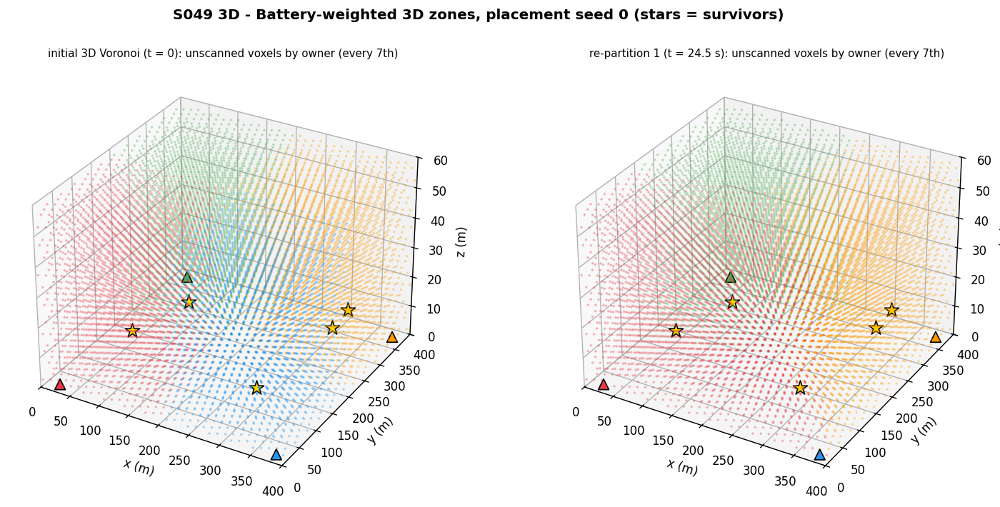
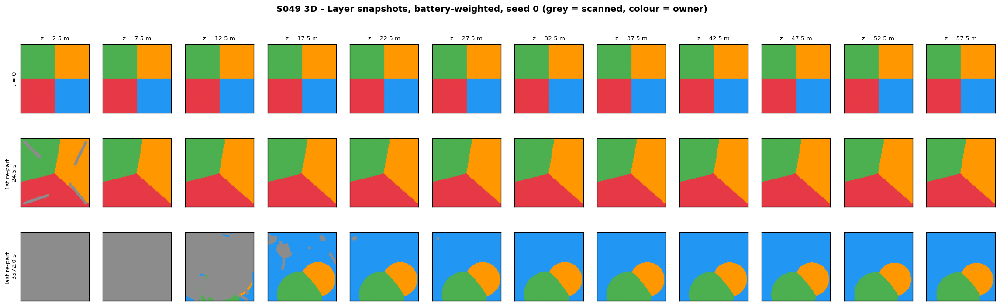
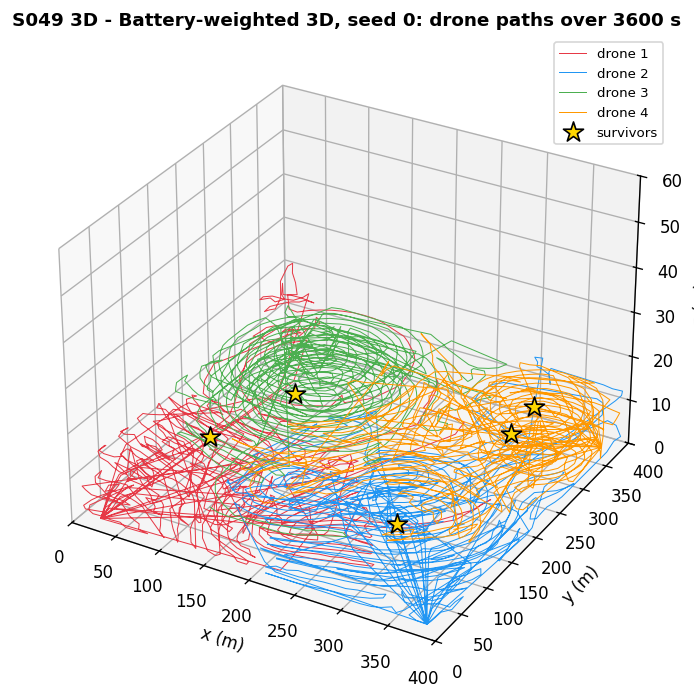
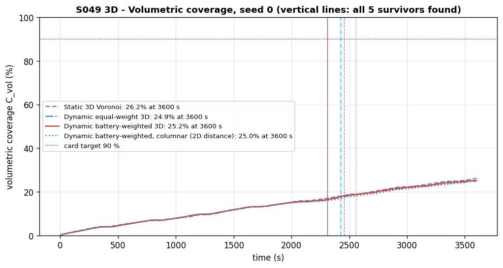
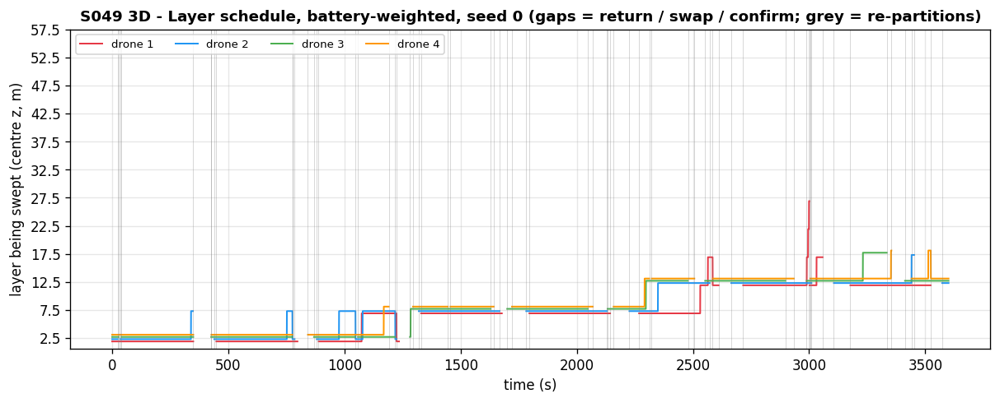
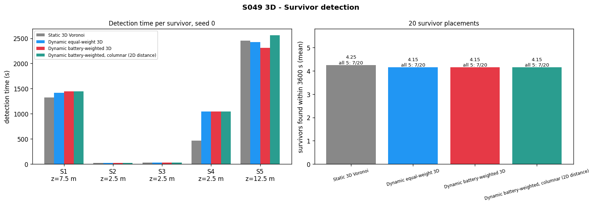
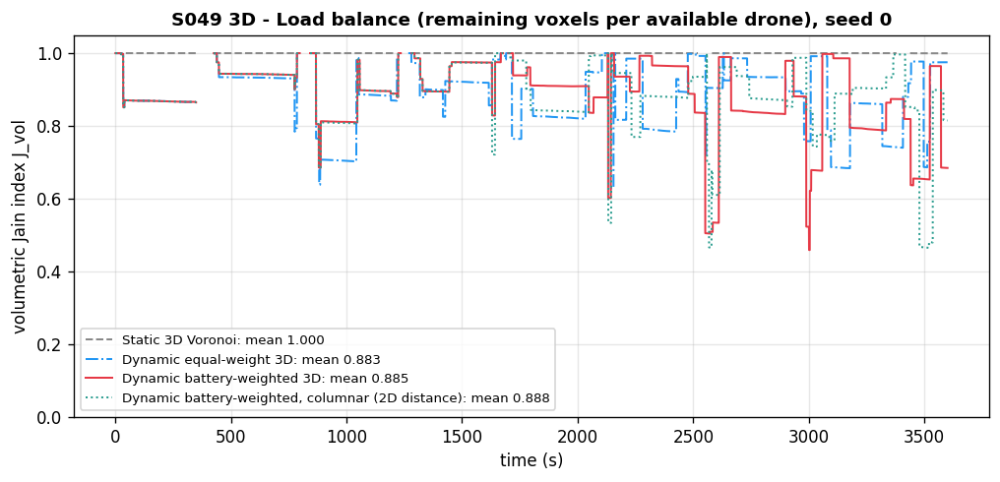
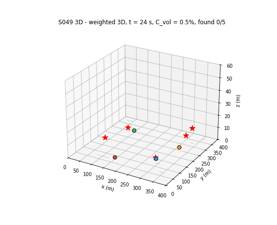

# S049 3D Upgrade — Dynamic Zone Assignment

**Domain**: Environmental & SAR | **Difficulty**: ⭐⭐⭐⭐ | **Status**: ✅ Completed
**Based on**: [S049 Dynamic Zone Search](../../s049_dynamic_zone/README.md) (2D-folder version)

---

## Problem Definition

**Setup**: Four drones search a 400 × 400 × 60 m rubble volume, discretised into 80 × 80 × 12 voxels of 5 m (layer centres z = 2.5 … 57.5 m, 76 800 voxels), for 5 survivors placed at voxel centres sampled from a 3D Gaussian-mixture prior concentrated near the ground. A voxel is scanned — and a survivor detected — when the drone is within 8 m horizontally and 2.5 m vertically. Each drone sweeps its zone **bottom-up, layer by layer**, using the 2D-folder rule inside the current layer (fly to the nearest of the 20 highest-prior unscanned voxels). The battery and mission rules are the 2D ones: SoC $= 1 - (d_{xy} + \gamma d_z)/D_{max}$ per pack; below 30 % the drone flies home (corner pad, ground level), swaps the pack (60 s) and rejoins; a drone that finds a survivor hovers 10 s to confirm and rejoins.

**Strategies** (same 20 survivor placements for all):

| Strategy | Partition of the unscanned voxels |
|---|---|
| Static 3D Voronoi | initial 3D Voronoi on the start positions, never changed |
| Dynamic equal-weight 3D | 3D Voronoi on the current 3D positions at every event |
| Dynamic battery-weighted 3D | $\arg\min_k \|\mathbf{x} - \mathbf{p}_k\|_3 / \text{SoC}_k$ at every event |
| Dynamic battery-weighted, columnar (added) | same weights, **horizontal** distance only — the 2D partition extruded through all layers |

Events (as in 2D): a drone leaves (battery, survivor), rejoins (swap or confirmation done) or exhausts its zone.

---

## Mathematical Model

**Prior**: $P(\mathbf{x}) \propto \sum_{m=1}^{4} \alpha_m\,\mathcal{N}(\mathbf{x}; \boldsymbol\mu_m, \text{diag}(\sigma_{xy,m}^2, \sigma_{xy,m}^2, \sigma_{z,m}^2))$ evaluated at the voxel centres and normalised.

**Weighted 3D Voronoi**: $V_k^w = \{\mathbf{x} : \|\mathbf{x} - \mathbf{p}_k\|_3/w_k \le \|\mathbf{x} - \mathbf{p}_j\|_3/w_j\ \forall j\}$, $w_k = \text{SoC}_k$ (equal weights: $w_k = 1$; columnar: $\|\cdot\|_2$ on (x, y)).

**Layer scheduling**: target = nearest (3D) of the 20 highest-prior unscanned voxels in the **lowest** layer of the zone that still has unscanned voxels. The drone moves at ≤ 6 m/s horizontally and ≤ 2 m/s vertically at the same time.

**Battery**: SoC $= 1 - (d_{xy} + 2 d_z)/3000$ m per pack; hovering drains like cruising (2D rule). Invariants asserted every step: SoC > 0 and z ≥ 0.

**Coverage**: $C_{vol} = |\mathcal{V}_{scanned}|/76\,800$. **Fairness**: $\mathcal{J}_{vol} = (\sum N_k^{rem})^2 / (K'\sum (N_k^{rem})^2)$ over the available drones.

---

## Key Parameters

| Parameter | Value | Notes |
|-----------|-------|-------|
| Volume / voxels | 400 × 400 × 60 m / 80 × 80 × 12 of 5 m | card |
| Drones / survivors | 4 / 5 | card |
| Speed / climb rate | 6 m/s / 2 m/s | card |
| $r_s$ / $r_z$ | 8 m / 2.5 m | card |
| $D_{max}$ / γ / SoC threshold | 3000 m / 2.0 / 30 % | card |
| Δt / mission limit | 0.5 s / 3600 s | card |
| Prior components (α; μ; σ_xy; σ_z) | 0.4; (100, 300, 2.5); 60; 8 · 0.3; (280, 150, 2.5); 50; 5 · 0.2; (340, 320, 10); 40; 15 · 0.1; (200, 80, 5); 30; 10 | added: the card gives only ranges (σ_xy 30–70 m, σ_z 5–15 m) |
| Home pads | corners (20, 20), (380, 20), (20, 380), (380, 380) at z = 0 | 2D pads, at ground level |
| Battery swap / confirmation hover | 60 s / 10 s | 2D values |
| TOP_M | 20 | 2D value |
| Placements | 20 (seeds 0–19); seed 0 is run to 3600 s for the figures, the others stop when all 5 are found | 2D value |
| Animation | 150 frames (every 24 s), 8 fps | |

### Deviations from the scenario card

| Card | Implementation | Reason |
|------|----------------|--------|
| $C_{vol}$ must reach ≥ 90 % within the mission | reaches ≈ 25 %; the card now states the bound | arithmetic: a 5 m layer needs ≈ 10 000 m of sweep at a 16 m swath, 12 layers ≈ 120 km; 4 drones × 6 m/s × 3600 s = 86.4 km of flight at most, so $C_{vol} \le 72$ % even without battery swaps and climbs |
| A drone below 30 % SoC or that finds a survivor is removed and its voxels redistributed | it returns home, swaps the pack and rejoins; a finder hovers 10 s and rejoins | the 2D-folder fixes: with permanent retirement the mission is impossible (one pack covers 2 100 m of the ≈ 120 km needed), and with 5 survivors and 4 drones nobody would be left for the last survivor |
| Re-partition only when a drone leaves | also when a drone rejoins or exhausts its zone | 2D rule: otherwise a returning drone has no zone |
| Starting area "at the edge" | one pad per drone at the four corners | 2D layout |
| Prior hotspots and spreads given as ranges | fixed components (table above) | reproducibility |
| Layer snapshots for every strategy | battery-weighted strategy only | the four strategies' zones look alike (see results); the others are summarised numerically |
| Gantt chart "one row per drone" | layer-vs-time step plot per drone | same information, readable with 12 layers |
| — | columnar (2D-distance) variant added | to test whether the 3D Voronoi differs from the 2D one |
| Output path `outputs/03_environmental_sar/s049_3d_dynamic_zone/` | `outputs/03_environmental_sar/3d/s049_3d_dynamic_zone/` | 3D variants live under `3d/` |

---

## Implementation

```
src/03_environmental_sar/3d/s049_3d_dynamic_zone.py
```

```bash
conda activate drones
python src/03_environmental_sar/3d/s049_3d_dynamic_zone.py
```

Runtime ≈ 170 s (80 runs in 10 worker processes; every run seeds its own generator). Two runs printed byte-identical output and produced identical files.

---

## Results

Prior mass per layer (z = 2.5 … 57.5 m): 39.0 %, 29.6 %, 15.1 %, 7.4 %, 4.0 %, 2.3 %, 1.3 %, 0.7 %, 0.4 %, 0.2 %, 0.1 %, 0.0 %. Over the 20 placements the 100 survivors lie at z = 2.5 m (46), 7.5 (21), 12.5 (16), 17.5 (7), 22.5 (5), 27.5 (2), 32.5 (1), 37.5 m (2).

### Monte Carlo, 20 survivor placements

| Strategy | Survivors found (mean) | All 5 found | Time to all 5 (when found): mean / median | Mean detection time of found survivors | Re-partitions | Battery swaps |
|---|---|---|---|---|---|---|
| Static 3D Voronoi | **4.25** | 7/20 | 2306.2 / 2617.0 s | 1002.4 s | 0 | 28.40 |
| Dynamic equal-weight 3D | 4.15 | 7/20 | 2397.0 / 2615.0 s | 960.3 s | 56.3 | 27.80 |
| Dynamic battery-weighted 3D | 4.15 | 7/20 | 2367.4 / 2443.5 s | 931.1 s | 56.4 | 27.95 |
| Battery-weighted, columnar | 4.15 | 7/20 | 2278.3 / 2558.5 s | 922.8 s | 55.9 | 27.70 |

Detection rate by survivor layer (all four strategies): 100 % at z = 2.5, 7.5 and 12.5 m; at z = 17.5 m 29 % (static) and 0 % (dynamic); 0 % at z ≥ 22.5 m.

Per placement (better / worse / tie, by survivors found, then by time of the last detection): equal vs static 4/5/11, weighted vs static 5/4/11, weighted vs equal 6/1/13, weighted vs columnar 3/3/14.

### Showcase placement (seed 0, run to 3600 s)

Survivors at (317.5, 302.5, 7.5), (282.5, 137.5, 2.5), (72.5, 297.5, 2.5), (42.5, 182.5, 2.5), (332.5, 322.5, 12.5) m.

| Strategy | Detection times S1–S5 | $C_{vol}$ at 3600 s | Re-partitions | Swaps | Horizontal / vertical distance | Mean $\mathcal{J}_{vol}$ |
|---|---|---|---|---|---|---|
| Static | 1327.5, 24.5, 29.5, 468.5, 2457.0 s | 26.2 % | 0 | 32 | 74 396 / 605 m | 1.000 |
| Equal-weight | 1417.5, 24.5, 29.5, 1043.0, 2426.5 s | 24.9 % | 67 | 31 | 74 634 / 588 m | 0.883 |
| Battery-weighted | 1445.5, 24.5, 29.5, 1047.5, **2312.0** s | 25.2 % | 68 | 31 | 74 466 / 662 m | 0.885 |
| Columnar | 1445.5, 24.5, 29.5, 1047.5, 2558.5 s | 25.0 % | 68 | 31 | 74 561 / 692 m | 0.888 |

The first re-partition (battery-weighted) happens at 24.5 s when drone 2 finds S2; the three remaining drones are all at SoC 0.949 and z = 2.5 m, and $\mathcal{J}_{vol}$ goes from 1.000 to 0.997.

**Key findings**

- **The 3D partition is, in practice, the 2D partition.** Because all drones sweep bottom-up, they sit in the same one or two layers when a re-partition happens (generator altitudes: median 7.5 m, range 0.0–30.5 m). The battery-weighted 3D Voronoi assigns only **0.2 %** of the voxels differently from the columnar (2D-distance) partition of the same generators (max 3.1 %, over 1 127 re-partitions), and the two strategies tie on 14 of 20 placements (3 better / 3 worse). The "3D polyhedra" of the card exist only in the rare re-partitions with drones at different heights.
- **The vertical dimension dominates the outcome, through the schedule, not the partition.** In one hour the team sweeps only about three layers (C_vol ≈ 25 %); every survivor at z ≤ 12.5 m is found, none above 17.5 m is found by a dynamic strategy, and only 7 of 20 placements have all five survivors found. The bottom-up order matches a prior with 84 % of its mass in the lowest three layers, so it finds 4.15–4.25 of 5 survivors on average, but it never reaches the 17 of 100 survivors above 12.5 m except for 2 found by the static strategy.
- **Re-partitioning does not help measurably** (as in the 2D-folder S049): the dynamic strategies find slightly fewer survivors than the static one (4.15 vs 4.25: the static strategy found 2 of the 7 survivors at 17.5 m, the dynamic ones none) and per placement they are mostly tied with it (11 ties of 20). Battery weighting beats equal weights on 6 placements and loses on 1 — all drones fly at the same energy rate, so the SoC weights are nearly equal.
- **The vertical energy penalty is small here.** Vertical flight is 605–692 m against ≈ 74 400 m horizontal per showcase run, i.e. under 2 % of the battery use even with γ = 2.
- **Load balance**: static keeps $\mathcal{J}_{vol}$ = 1.000 (equal quarters swept at equal rates); re-partitioning around current positions lowers it to 0.883–0.888, because Voronoi cells around arbitrary positions are not equal in size.

### Figures

**3D zones** (battery-weighted, seed 0): unscanned voxels coloured by owner at t = 0 and after the first re-partition:



**Layer snapshots** (battery-weighted, seed 0): owner per layer at t = 0, the first and the last re-partition (grey = scanned):



**Drone paths** (battery-weighted, seed 0):



**Volumetric coverage vs time**, seed 0, with the card's 90 % target:



**Layer schedule** (battery-weighted, seed 0): layer being swept by each drone over time:



**Survivor detection**: detection time per survivor (seed 0) and survivors found over 20 placements:



**Volumetric Jain index vs time** (seed 0):



**Animation**: battery-weighted run, seed 0 — scanned voxels (grey), drones, survivors (red → green when found), rotating view (150 frames):



---

## Extensions

1. **Prior-marginal layer order** (card Extension 1): sweep layers in order of remaining prior mass per metre of flight instead of strictly bottom-up — the obvious fix for the survivors above 17.5 m.
2. **Anisotropic weights** $\mathbf{W}_k = \text{diag}(w_k, w_k, w_k/\gamma)$ so that the 3D partition differs from the 2D one when it matters.
3. **More drones or longer endurance** to reach the card's 90 % target (≥ 5 × the flight capacity).
4. **Terrain / rubble floor** from a DEM.

---

## Related Scenarios

- 2D card: [S049 Dynamic Zone Search](../../../../scenarios/03_environmental_sar/S049_dynamic_zone.md)
- 3D card: [S049 3D Upgrade — Dynamic Zone Assignment](../../../../scenarios/03_environmental_sar/3d/S049_3d_dynamic_zone.md)
- 3D search volume references: [S043 Confined Space Exploration](../../../../scenarios/03_environmental_sar/S043_confined_space.md), [S050 Swarm Cooperative Mapping (Distributed EKF-SLAM)](../../../../scenarios/03_environmental_sar/S050_slam.md)
- Algorithmic cross-reference: [S019 Dynamic Target Reassignment](../../../../scenarios/01_pursuit_evasion/S019_dynamic_reassignment.md), [S040 Fleet Load Balancing](../../../../scenarios/02_logistics_delivery/S040_fleet_load_balancing.md)
