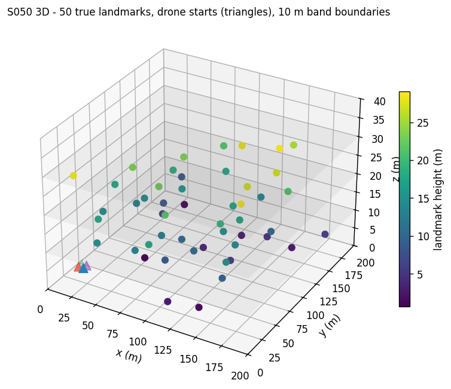
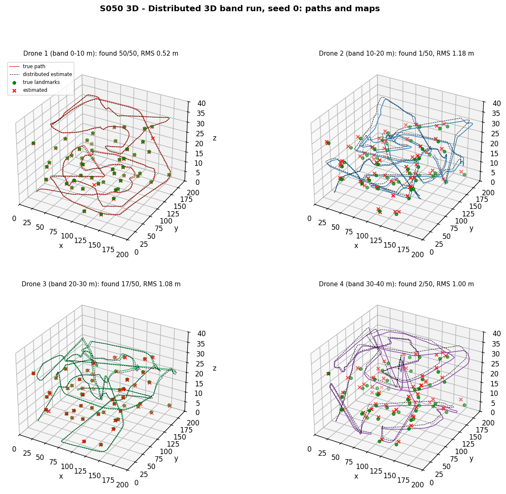
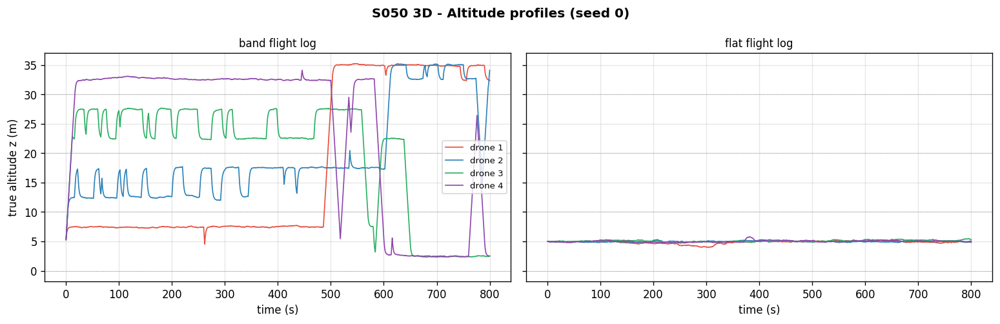
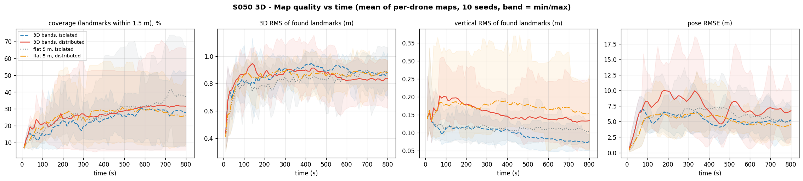
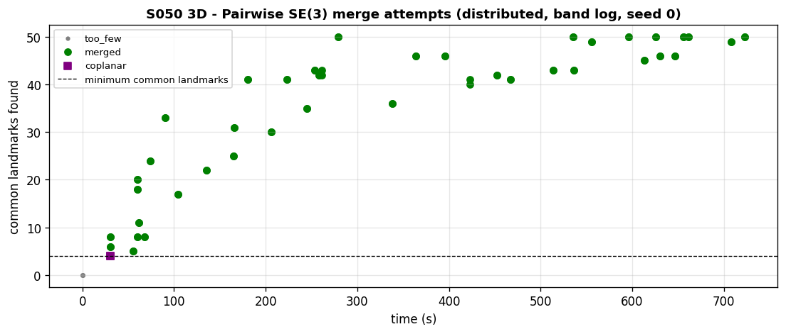
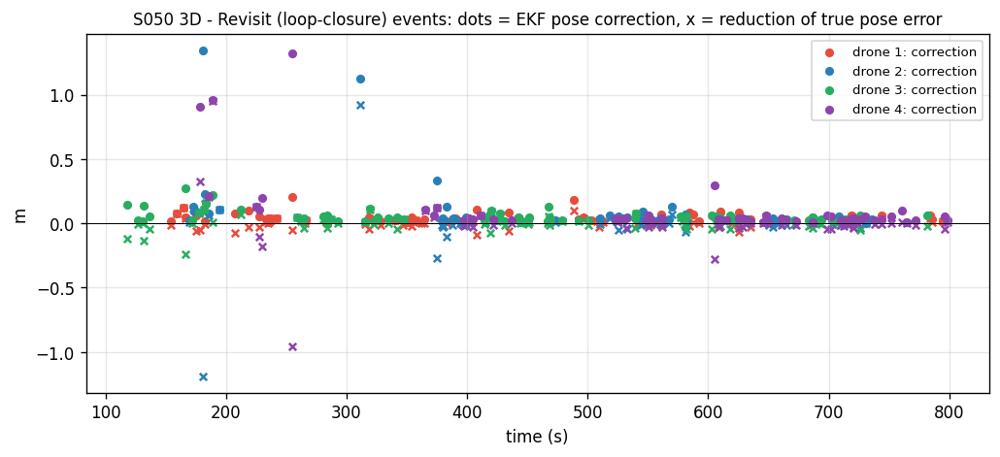
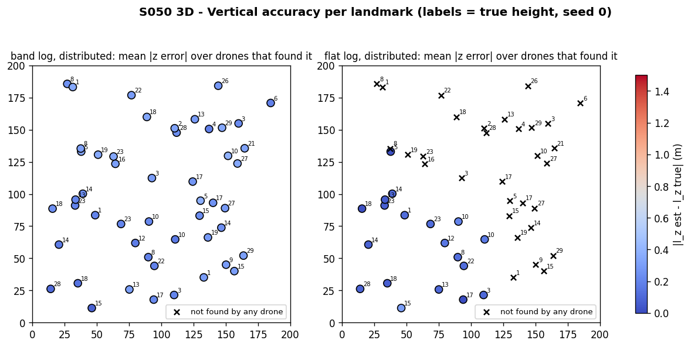
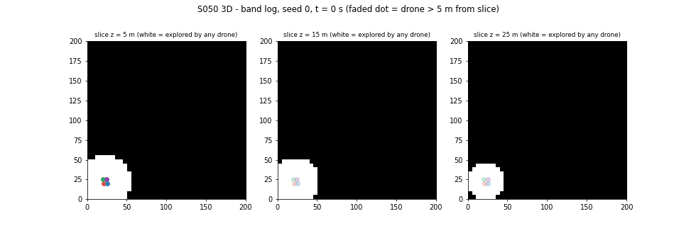

# S050 3D Upgrade — Swarm SLAM

**Domain**: Environmental & SAR | **Difficulty**: ⭐⭐⭐⭐⭐ | **Status**: ✅ Completed
**Based on**: [S050 Swarm Cooperative Mapping (Distributed EKF-SLAM)](../../s050_slam/README.md) (2D-folder version)

---

## Problem Definition

**Setup**: Four drones explore a GPS-denied 200 × 200 × 40 m volume containing 50 unknown point landmarks with heights uniform in [0, 30] m. They start together near (20, 20, 5) m. Each drone runs a 3D EKF-SLAM filter (pose $x, y, z, \psi$ plus 3 coordinates per landmark) fed by a range-bearing-elevation sensor with a 30 m spherical range. As in the 2D-folder S050, every drone flies a **true** trajectory that differs from its commanded odometry by process noise, and measurements come from the true pose.

**Flight logs** (both navigate on each drone's own isolated estimate, so the log does not depend on the estimator):

| Log | Navigation |
|---|---|
| **3D bands** (card policy) | altitude-separated 3D frontier: drone $i$ prefers frontier voxels in its 10 m band (0–10, 10–20, 20–30, 30–40 m); out-of-band gain × 0.2 |
| **flat 5 m** (card's 2D-constrained baseline) | all drones locked at z = 5 m; frontier in the horizontal plane; **same 3D sensor and filter** |

**Estimators**, run on the same measurements of each log: **isolated** (no communication) and **distributed** (pairwise SE(3) map merging within 50 m). This gives four strategies, compared over **10 noise seeds** (the same landmark map). Within a seed, both flight logs take their motion and measurement noise from the same pre-generated tables, indexed by step, drone and landmark (common random numbers), so the band and flat runs see the same noise draws even though their trajectories differ.

**Objective (card)**: fraction of landmarks mapped within 1.5 m, 3D and vertical RMS of the mapped landmarks, pose error.

---

## Mathematical Model

**Motion** (per step, Δt = 0.2 s): $x \mathrel{+}= v\Delta t\cos\psi$, $y \mathrel{+}= v\Delta t\sin\psi$, $z \mathrel{+}= \dot z\Delta t$, $\psi \mathrel{+}= \omega\Delta t$, with $v = 3$ m/s, $\dot z = \text{clip}(0.5(z_{target} - \hat z), \pm 1.5)$ m/s, $|\omega| \le 1$ rad/s; truth adds $\mathcal{N}(0, (\sigma\Delta t)^2)$ to each component.

**Observation**: $\boldsymbol\delta = \mathbf{l} - \mathbf{p}$, $\rho = \|\boldsymbol\delta\|$, $\phi = \text{atan2}(\delta_y, \delta_x) - \psi$, $\epsilon = \arcsin(\delta_z/\rho)$, with
$\partial\epsilon/\partial\delta_x = -\delta_x\delta_z/(\rho_{xy}\rho^2)$, $\partial\epsilon/\partial\delta_y = -\delta_y\delta_z/(\rho_{xy}\rho^2)$, $\partial\epsilon/\partial\delta_z = \rho_{xy}/\rho^2$ (card corrected, see Deviations).

**EKF**: standard predict / update; association by minimum Mahalanobis distance with gate $\chi^2_{3,0.95} = 7.815$; a new landmark needs $d_M > \chi^2_{3,0.999} = 16.266$ and ≥ 4 m from existing ones; initialisation with the card's $\mathbf{J}_{inv} \in \mathbb{R}^{3\times7}$ and full cross-covariance.

**SE(3) merging**: hypotheses from two correspondences with consistent 3D inter-landmark distances give a yaw and a 3D translation (|yaw| ≤ 0.5 rad); the hypothesis with most one-to-one inliers (< 2.5 m) wins and is refined by the card's SVD solution $\mathbf{R}^* = \mathbf{U}\,\text{diag}(1, 1, \det\mathbf{U}\mathbf{V}^T)\mathbf{V}^T$, $\mathbf{t}^* = \bar{\mathbf{l}}_i - \mathbf{R}^*\bar{\mathbf{l}}_j$ on ≥ 4 inliers that are not coplanar (RMS distance from their best-fit plane ≥ 1 m). As in 2D, matched landmarks must pass a $\chi^2_{3,0.999}$ consistency test and only landmarks the host lacks are transferred (covariance × 10, not inside the host's sensed volume).

**Frontier**: 5 m voxel grid; information gain = unexplored voxels in a cube of half-width 30 m (3D integral image); score $= \text{IG}\cdot\gamma_i/(d + 5)$; other drones' targets reduce the gain × 0.1 (2D rule).

---

## Key Parameters

| Parameter | Value | Notes |
|-----------|-------|-------|
| Volume / drones / landmarks | 200 × 200 × 40 m / 4 / 50 (z ∈ [0, 30] m, seed 42) | card |
| $v$ / $\dot z_{max}$ / Δt / $T_{max}$ | 3 m/s / 1.5 m/s / 0.2 s / 800 s | card |
| $r_{sense}$ / $r_{comm}$ | 30 m / 50 m | card |
| $\sigma_\rho$ / $\sigma_\phi$ / $\sigma_\epsilon$ | 0.3 m / 0.03 rad / 0.04 rad | card |
| $\sigma_{az}$ | 0.05 m/s² | card |
| $\sigma_{ax} = \sigma_{ay}$ / $\sigma_\omega$ | 0.05 m/s² / 0.02 rad/s | 2D values (card lists only $\sigma_{az}$) |
| Filter Q, R inflation | × 4 | 2D value |
| Gates | 7.815 / 16.266 | card / 2D rule in 3 DOF |
| Common-landmark radius / minimum common | 2.5 m / 4 non-coplanar | card |
| Non-coplanarity threshold | 1 m RMS from the best-fit plane | added |
| Merge period / inflation / sensed margin | 30 s / × 10 / 3 m | 2D values |
| Success radius | 1.5 m | card |
| Altitude bands / γ_out / bounds | 10 m each / 0.2 / [0.5, 35] m | card |
| Frontier voxel | 5 m (40 × 40 × 8) | card: 2 m, see Deviations |
| Altitude command gain | 0.5 s⁻¹ | added |
| Flat baseline altitude | 5 m | card start altitude |
| Starts | (20, 20), (25, 20), (20, 25), (25, 25) m at z = 5 m, headings 0, 30, 60, 90° | added |
| Revisit event | ≥ 3 mapped landmarks updated in one step, ≥ 1 of them unseen for ≥ 60 s | card: ≥ 5 landmarks |
| Seeds | 0–9 (seed 0 plotted) | 2D value |
| Animation | 100 frames, 5 fps, z-slices 5 / 15 / 25 m | card slices |

### Deviations from the scenario card

| Card | Implementation | Reason |
|------|----------------|--------|
| $\partial\epsilon/\partial\delta_z = 1/\rho_{xy}$ | $\rho_{xy}/\rho^2$; card corrected | calculus error: $\partial\arcsin(\delta_z/\rho)/\partial\delta_z = (\rho/\rho_{xy})(1/\rho - \delta_z^2/\rho^3)$ |
| SE(3) pose-graph back-end with Gauss-Newton on $\mathfrak{se}(3)$ | **not implemented**; revisits are handled by the EKF itself (re-observing correlated landmarks), and each revisit event logs the EKF pose correction | the EKF already closes loops through its landmark correlations; a separate pose graph would need a different (smoothing) estimator, which is the card's Extension 1 |
| Loop closure needs ≥ 5 previously mapped landmarks in view | ≥ 3 updated in the step, ≥ 1 unseen for ≥ 60 s | only a few landmarks lie inside a 30 m sphere (at most ≈ 50 × 113 000 m³ / 972 000 m³ ≈ 6 for a sphere fully inside the landmark volume), so the 5-landmark rule almost never fires |
| 2 m voxels (200 000), log-odds updated by landmark observations | 5 m binary "explored" voxels (12 800) marked within $r_{sense}$ of the drone | the 2 m grid makes the 20 000-step simulation too slow for a 10-seed Monte Carlo; the card's log-odds rule (voxels change only when a landmark is seen) leaves empty space unexplored for ever |
| Full SO(3) hypothesis search | yaw-only hypotheses, full SVD SO(3) refinement on the inliers | roll and pitch are observable from gravity on a multirotor; the refinement still uses the card's SVD |
| 2D-constrained baseline "missing all elevated landmarks above its sensing plane" | flat baseline with the same 3D sensor; the planar-sensor case is reported as a bound | with a planar range-bearing sensor the landmark height is not estimated at all, so only the 4 of 50 landmarks within 1.5 m of the 5 m plane could ever count — a bound by construction, not a simulation result |
| Altitude bounds 0.5–35 m | commands clipped to [0.5, 35] m; the true altitude reached 35.24 m on seed 0 (process noise) | the bound is enforced on the command, not on the noisy truth |
| Centralised filter (2D-folder S050) | not run | not part of the 3D card |
| Trajectory panel coloured by time with uncertainty ellipsoids; GIF with communication links | single-colour paths with matched-pair lines; GIF shows explored slices and drones only | readability of the 3D panels; the link structure is shown in `merge_events.png` |
| Output path `outputs/03_environmental_sar/s050_3d_slam/` | `outputs/03_environmental_sar/3d/s050_3d_slam/` | 3D variants live under `3d/` |

---

## Implementation

```
src/03_environmental_sar/3d/s050_3d_slam.py
```

```bash
conda activate drones
python src/03_environmental_sar/3d/s050_3d_slam.py
```

Runtime ≈ 255 s (20 flight logs × 4 000 steps, run in 10 worker processes, single-threaded BLAS). Each run builds its noise tables from its own seed, so the result does not depend on scheduling; two runs printed byte-identical output and produced identical files.

---

## Results

Landmark heights: 0.6–29.1 m (17 below 10 m, 20 at 10–20 m, 13 above 20 m).

### Monte Carlo, final values at t = 800 s (10 seeds: mean [min, max])

"Found" RMS values use only the landmarks mapped within the 1.5 m success radius (truncated); the "all landmarks" values use the nearest estimate of every true landmark, without truncation.

| Strategy | Coverage (mean per-drone map) | Team union | 3D RMS (found) | Horizontal RMS (found) | Vertical RMS (found) | Horizontal RMS, all landmarks | Vertical RMS, all landmarks | Pose RMSE | Coverage by height < 10 / 10–20 / ≥ 20 m |
|---|---|---|---|---|---|---|---|---|---|
| 3D bands, isolated | 27.65 % [9.50, 52.50] | 67.80 % [20, 100] | 0.88 m | 0.88 m | 0.08 m | 4.25 m [3.35, 5.13] | 0.54 m [0.10, 1.00] | 5.24 m [2.52, 7.42] | 21.2 / 33.8 / 26.7 % |
| 3D bands, distributed | 31.60 % [5.50, 66.00] | **74.80 %** [8, 100] | 0.84 m | 0.82 m | 0.13 m | 4.97 m [2.01, 6.80] | 1.01 m [0.31, 1.85] | 6.76 m [2.40, 10.94] | 26.8 / 35.8 / 31.5 % |
| flat 5 m, isolated | **37.35 %** [7.50, 67.00] | 71.60 % [8, 100] | 0.89 m | 0.88 m | 0.10 m | 6.98 m [5.12, 8.53] | 1.79 m [1.24, 2.53] | 5.37 m [1.63, 8.53] | 29.7 / 44.8 / 36.0 % |
| flat 5 m, distributed | 26.10 % [8.00, 48.00] | 64.60 % [12, 100] | 0.88 m | 0.86 m | 0.15 m | 4.08 m [2.56, 5.30] | 0.65 m [0.15, 1.49] | **4.60 m** [1.35, 7.61] | 18.5 / 33.1 / 25.2 % |

Per seed (coverage %, band iso / band dist / flat iso / flat dist): s0 28/35/46/16; s1 23/7/46/20; s2 14/11/42/32; s3 52/6/16/35; s4 10/29/8/10; s5 20/29/58/48; s6 34/38/67/8; s7 32/52/32/18; s8 50/66/18/46; s9 13/46/40/28.

Head-to-head on the same seeds and noise (better / worse / tie):

| Comparison | Coverage | Pose RMSE |
|---|---|---|
| 3D bands vs flat, isolated | 3 / 7 / 0 | 5 / 5 / 0 |
| 3D bands vs flat, distributed | 6 / 4 / 0 | — |
| distributed vs isolated, 3D bands | 7 / 3 / 0 | 1 / 9 / 0 |

Merging: 880 executed merges, 120 with too few common landmarks and 4 rejected as coplanar on the band logs (928 / 164 / 36 on the flat logs), 818 and 837 landmarks transferred. On seed 0 the executed band merges used 35.0 common landmarks on average with an alignment residual of 0.64 m RMS (max 1.19 m) and a 2.78° mean rotation. Revisit events (band, distributed, all seeds): 2 499, mean EKF pose correction 0.06 m (max 2.69 m); the true pose error went down in 1 359 of them (mean change +0.007 m). Smallest covariance eigenvalue in any filter: 1.149e-04 (all stayed positive definite).

**Key findings**

- **No strategy is reliably better; the seed-to-seed spread dominates.** Per-drone coverage ranges from 5.5 % to 67 % within every strategy. With common random numbers, altitude-separated exploration loses to the flat baseline for isolated filters on 7 of 10 seeds (27.65 % vs 37.35 % mean) and ties on pose (5 / 5); with distributed filters it wins 6 of 10. An earlier version of this README, with independent noise streams for the two logs, reported the opposite isolated result (7 / 3 for the bands) — a sign that 10 seeds cannot separate these strategies.
- **The card's expectation for the flat baseline does not hold.** It does not "plateau early because it cannot detect elevated landmarks": with a 30 m spherical sensor a drone at 5 m sees landmarks up to 30 m high, and the flat isolated runs map landmarks above 20 m as well as the band runs (36.0 % vs 26.7 %). The card's picture applies to a planar sensor, which could estimate at most 4 of 50 landmarks (those within 1.5 m of the 5 m plane) — a bound by construction.
- **Merging trades pose accuracy for map completeness.** Distributed filters cover more in 7 of 10 band seeds (team union 74.80 % vs 67.80 %) but have a larger pose error in 9 of 10 (6.76 vs 5.24 m), the same mechanism as in the 2D-folder S050: an alignment that fits ≈ 35 common landmarks to 0.64 m still imports the visitor's drifted map, and the host then localises on it.
- **Vertical error is smaller than horizontal error, also without truncation.** The card expected the vertical RMS to dominate. For landmarks within the 1.5 m success radius it is 0.08–0.15 m against 0.82–0.88 m horizontally, but that cut bounds both components. Over all 50 landmarks (nearest estimate, no cut) it is 0.54–1.79 m against 4.08–6.98 m horizontally, so the conclusion holds: height drift comes only from the small $\sigma_{az}$ noise, while the horizontal error is driven by heading drift (pose RMSE 4.6–6.8 m), which the elevation noise does not affect.
- **Revisits do not correct the drift.** Re-observing old landmarks moves the pose estimate by 0.06 m on average and reduces the true error in only about half of the events (1 359 of 2 499).
- **Absolute numbers are low** (mean coverage 26–37 % at 1.5 m) because pose errors of 5–7 m shift whole maps; coverage within the success radius is a strict metric in a GPS-denied run of this length.

### Figures

**Ground truth**: 50 landmarks coloured by height, drone starts and band boundaries:



**3D paths and maps**, distributed band run, seed 0 (orange lines connect matched estimates within 1.5 m):



**Altitude profiles**, seed 0: band log (drones leave their band once its frontier is exhausted) and flat log:



**Map quality vs time**: coverage, 3D RMS, vertical RMS and pose RMSE (mean over 10 seeds, shaded = min/max):



**SE(3) merge attempts**, band log, seed 0:



**Revisit (loop-closure) events**, band log, seed 0: EKF pose correction (dots) and change of the true pose error (crosses):



**Vertical accuracy per landmark**, seed 0, distributed filters (labels = true height):



**Animation**: explored voxels at z = 5, 15 and 25 m with the drones (band log, seed 0, 100 frames):



---

## Extensions

1. **Smoothing back-end** (iSAM2 / pose graph) instead of the sequential EKF — the card's SE(3) pose graph.
2. **Inter-drone relative measurements at rendezvous** so that merges can tell which frame is right.
3. **Planar-sensor baseline** with a sensing slab, to quantify the card's original 2D-vs-3D question properly.
4. **2 m voxels / OctoMap** with a faster frontier implementation.

---

## Related Scenarios

- 2D card: [S050 Swarm Cooperative Mapping (Distributed EKF-SLAM)](../../../../scenarios/03_environmental_sar/S050_slam.md)
- 3D card: [S050 3D Upgrade — Swarm SLAM](../../../../scenarios/03_environmental_sar/3d/S050_3d_slam.md)
- Probabilistic mapping foundation: [S042 Missing Person Localization](../../../../scenarios/03_environmental_sar/S042_missing_person.md)
- Communication topology: [S047 Base Station Signal Relay](../../../../scenarios/03_environmental_sar/S047_signal_relay.md)
- Zone search: [S049 Dynamic Zone Search](../../../../scenarios/03_environmental_sar/S049_dynamic_zone.md)
