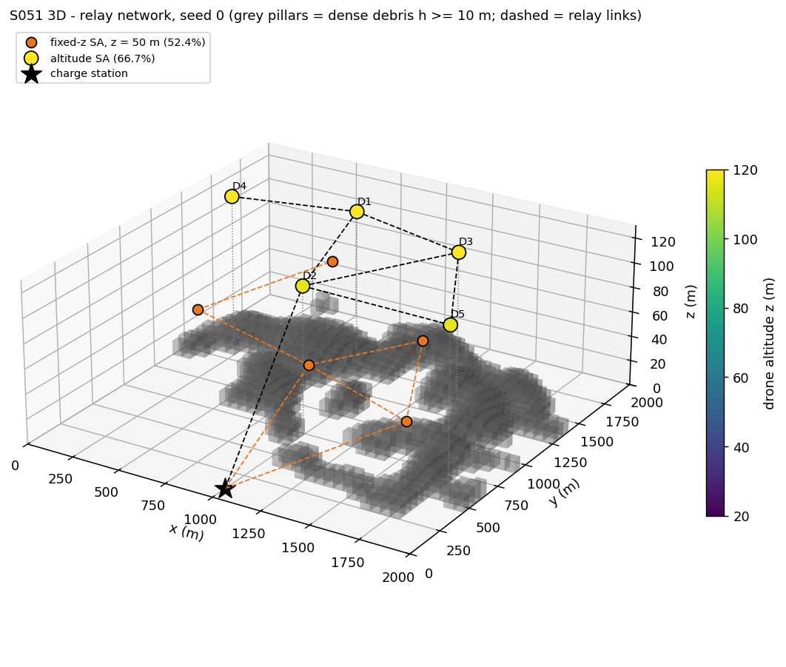
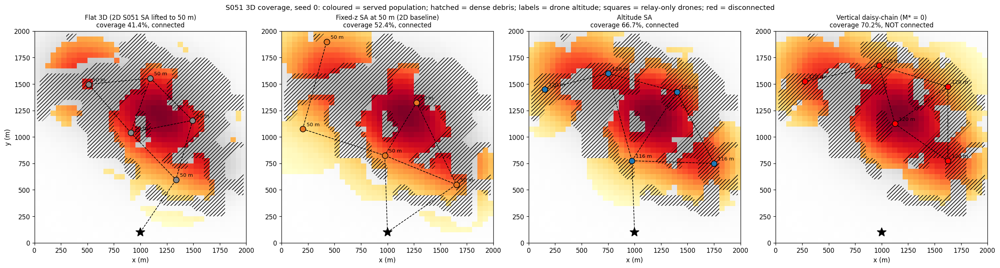
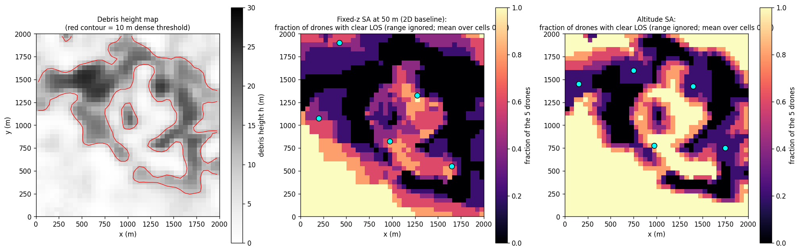
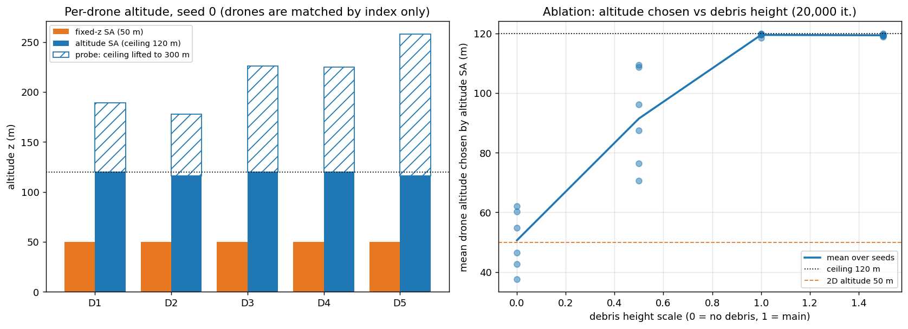
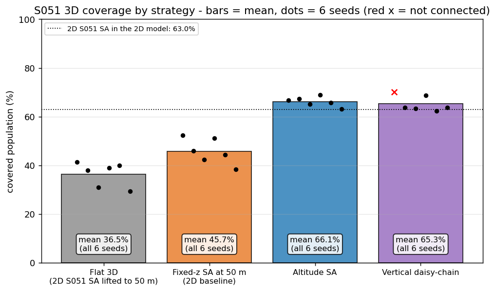
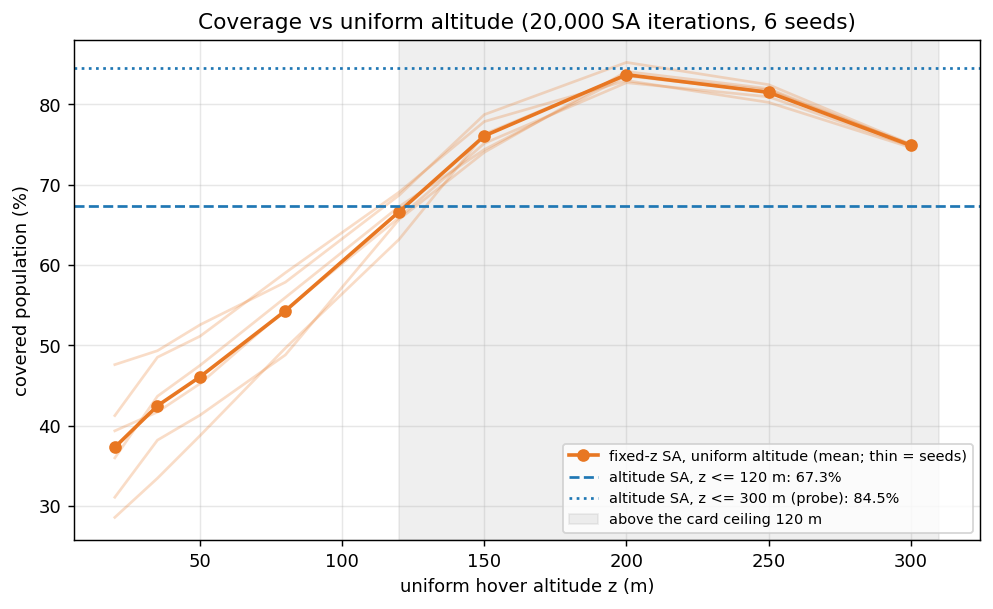
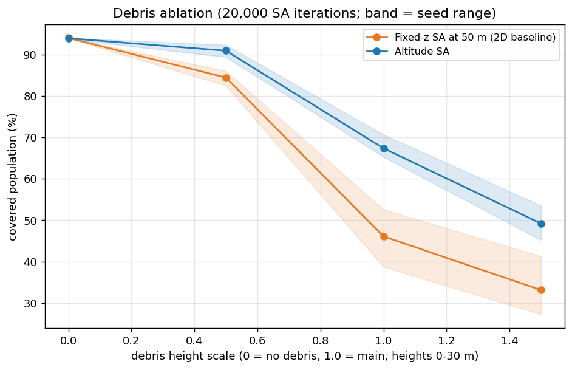
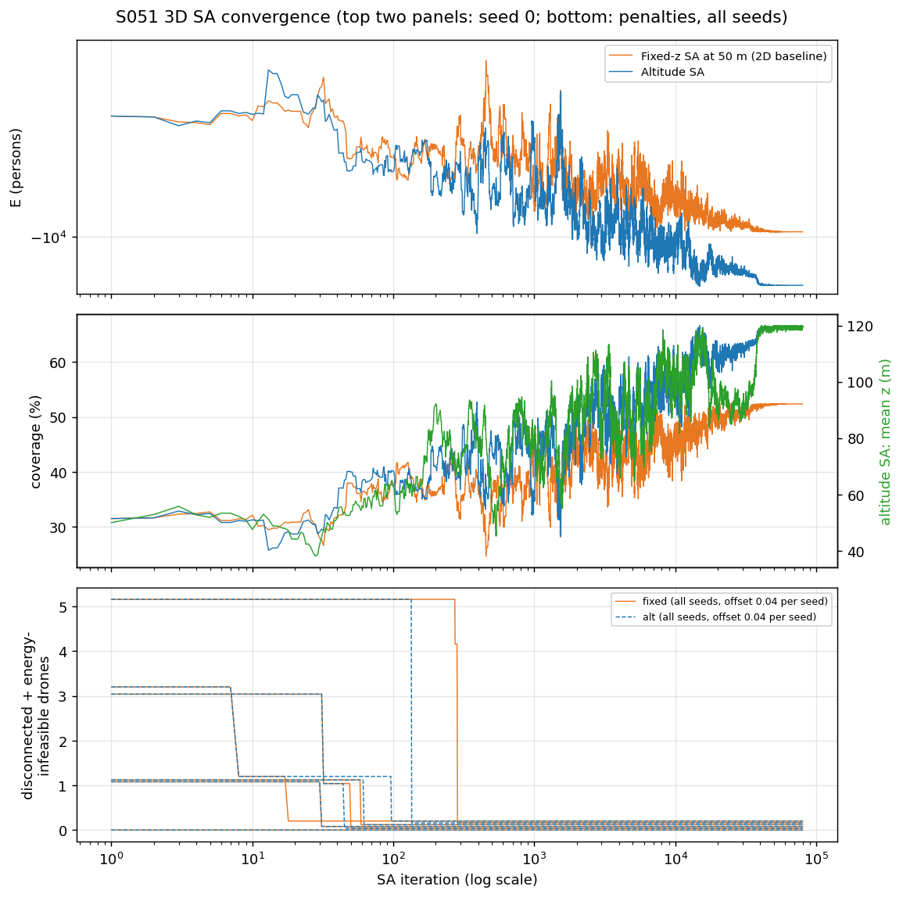
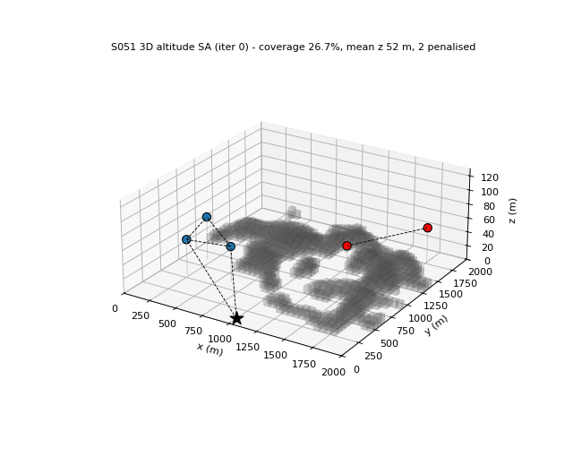

# S051 3D Upgrade — Post-Disaster Comm Network

**Domain**: Environmental & SAR | **Difficulty**: ⭐⭐⭐⭐ | **Status**: ✅ Completed
**Based on**: [S051 Post-Disaster Communication Network Restoration](../../s051_post_disaster_comm/README.md) (2D version)

---

## Problem Definition

**Setup**: The S051 city: 2000 × 2000 m, a 40 × 40 grid of 50 m cells holding 18,672 persons, and a charge station at (1000, 100, 0) m. Five drones act as airborne cell towers. In the 2D version every drone hovers at 50 m, serves every cell within a 300 m ground disc, and links to other nodes within 600 m. In this version:

- each drone has its own altitude $z_k \in [20, 120]$ m;
- a cell is served when the slant range is at most $d_{cov} = 450$ m **and** the line of sight (LOS) to the cell clears the debris;
- collapsed buildings form a debris height map $h_u \in [0, 30]$ m. Cells with $h_u \ge 10$ m are dense debris and block rays as vertical columns;
- relay links need a 3D distance of at most $d_{relay} = 900$ m and a clear LOS;
- hover power rises with altitude, and each drone must fit the transit and a 1500 s hover into the 144 kJ battery.

**Objective**: maximise the covered population with all five drones connected to the charge station and every drone energy-feasible.

**Strategies** (all on the same debris maps and the same SA random numbers per seed):
1. **Flat 3D (card baseline)**: the 2D S051 SA solution (300 m disc, 600 m range, no debris) lifted to 50 m and evaluated in the 3D model.
2. **Fixed-z SA at 50 m (2D baseline, added)**: the S051 SA re-optimised in the 3D model, with every drone held at 50 m. This is the 2D strategy at fixed altitude, run with the same envelope as strategy 3.
3. **Altitude SA (card)**: the same SA with $z_k$ added to the state.
4. **Vertical daisy-chain (card)**: $M$ relay-only drones are stacked above the highest debris cell, and the other $K - M$ drones are placed by greedy (x, y, z) coverage. $M^*$ is the connected layout with the most coverage.

Six debris maps (seeds 0–5) form the Monte Carlo. Seed 0 is the one shown in the figures.

---

## Mathematical Model

**Coverage (slant range and LOS)**: drone $k$ at $(x_k, y_k, z_k)$ serves cell $u$ with ground centroid $(x_u, y_u, 0)$ if
$$d_{3D}(k,u) = \sqrt{\|\mathbf{c}_u^{xy} - \mathbf{p}_k^{xy}\|^2 + z_k^2} \le d_{cov},\qquad \text{LOS}(k,u) = \text{clear}.$$
The ground footprint radius $\sqrt{d_{cov}^2 - z^2}$ **shrinks** with altitude: 449.6 m at 20 m, 447.2 m at 50 m, 433.7 m at 120 m.

**Debris LOS**: the ray $\mathbf{r}(\tau) = (1-\tau)\mathbf{p}_k + \tau(x_u, y_u, 0)$ is sampled at $\tau = n/50$, $n = 0 \ldots 49$. It is blocked if a sample lies in a dense-debris column, $r_z(\tau) \le h(\mathbf{r}^{xy}(\tau))$. The survivor's own cell is excluded. Because the sample height is $(1-\tau) z_k$ and its horizontal track does not depend on $z_k$, the ray is clear if and only if $z_k > \max_n h_n / (1 - \tau_n)$. This clearance altitude is precomputed for every (lattice point, cell) pair, and the result is checked against direct ray marching for every reported layout.

**Relay links**: an edge $(i, j)$ exists if $\|\mathbf{p}_i - \mathbf{p}_j\| \le d_{relay}$ and the 49 interior samples of the link clear the debris. The base is node 0 at ground level. Connectivity is checked with a breadth-first search from the base (equivalent to $\lambda_2 > 0$ for the base's component).

**Energy**: $P_{hover}(z) = P_0(1 + \kappa z)$, $L_k = \sqrt{\|\mathbf{p}_k^{xy} - \mathbf{p}_{base}^{xy}\|^2 + z_k^2}$, feasible if $(E_{max} - 2 L_k P_{transit}/v)/P_{hover}(z_k) \ge T_{hover}$.

**SA**: $E = -C + \alpha\,(n_{disconnected} + n_{energy})$, with $C$ in persons and $\alpha = 10^6$. Each step moves one random drone by $\Delta x, \Delta y \sim \mathcal{U}(-\delta_{xy}, \delta_{xy})$ (rounded to the 25 m lattice) and $\Delta z \sim \mathcal{U}(-\delta_z, \delta_z)$, with $\delta_{xy} = \max(200\,T/T_0, 25)$ m and $\delta_z = \max(20\,T/T_0, 2)$ m. Proposals that put a drone inside a debris column ($z \le h$) are rejected. The cooling is $\beta = (T_{end}/T_0)^{1/N}$ with $T_0 = 500$, $T_{end} = 0.25$ and $N = 80\,000$. The fixed-z run draws the same random numbers every step and ignores $\Delta z$.

**Asserted invariants**: altitude inside its bounds, every drone above the debris under it, positions inside the area, coverage counters within $[0, K]$, and the incrementally tracked SA coverage equal to the direct ray-marched coverage (to 1e-9).

---

## Key Parameters

| Parameter | Value | Notes |
|-----------|-------|-------|
| Fleet $K$ / area / grid | 5 / 2000 × 2000 m / 40 × 40 | card (2D) |
| Population | 18,672 persons, 2D S051 map (seed 42) | 2D |
| Altitude bounds | 20–120 m | card |
| $f_c$ / $P_{tx}$ / $G_{tx} = G_{rx}$ / $P_{min}$ | 900 MHz / 1 W / 3 dBi / −100 dBm | card; see the $d_{cov}$ row |
| $d_{cov}$ / $d_{relay}$ | 450 m / 900 m | card's stated values, used directly; with the card's $P_{min}$ the formula gives 167.3 km (see Deviations) |
| Debris heights / dense threshold / LOS samples | 0–30 m / 10 m / 50 | card |
| Debris generator | $h = 30\sqrt{\rho/\rho_{max}}\,q$, $q$ = rank-uniform Gaussian-smoothed noise (σ = 1.5 cells) | added; dense cells 32.6–40.9 % per seed |
| $P_{hover,0}$ / $\kappa$ / $E_{max}$ / $v$ | 80 W / 4e-5 1/m / 144 kJ / 15 m/s | card |
| $P_{transit}$ | 80 W | added (card gives none) |
| $T_{hover}$ | 1500 s | 2D |
| $\alpha$ / $T_0$ / $T_{end}$ / iterations | 1e6 / 500 / 0.25 / 80 000 | card, 2D cooling fix |
| $\delta_{xy}$ / $\delta_z$ at $T_0$ | 200 m / 20 m | card, scaled with $T$ as in 2D |
| SA lattice / $\delta_z$ floor | 25 m / 2 m | added |
| Charge station | (1000, 100, 0) m | card |
| Daisy-chain altitude levels for greedy | 20, 40, …, 120 m | added |
| Monte Carlo | 6 seeds (debris map and SA seed) | added |
| Sweeps | uniform altitude 20–300 m; debris scale 0, 0.5, 1, 1.5; correlation 0.5, 3 cells (20 000 SA iterations each) | added |

---

## Implementation

```
src/03_environmental_sar/3d/s051_3d_post_disaster_comm.py
```

```bash
conda activate drones
python src/03_environmental_sar/3d/s051_3d_post_disaster_comm.py
```

The seeds run in a pool of up to 6 worker processes, and the results are collected in seed order. Runtime ≈ 150–280 s with 6 workers, depending on how many other simulations share the CPU. Two runs (default threading and `OMP_NUM_THREADS=1`) printed byte-identical output and wrote byte-identical files.

---

## Results

### Coverage per seed (% of population; * = not connected)

| Seed | Flat 3D | Fixed-z SA 50 m | Altitude SA | Daisy-chain ($M^*$) | Altitude − fixed |
|---|---:|---:|---:|---:|---:|
| 0 | 41.39 | 52.36 | 66.67 | 70.21* (0) | +14.31 pp |
| 1 | 37.92 | 45.94 | 67.33 | 63.75 (0) | +21.38 pp |
| 2 | 31.05 | 42.44 | 65.17 | 63.25 (0) | +22.73 pp |
| 3 | 39.01 | 51.13 | 68.93 | 68.68 (0) | +17.79 pp |
| 4 | 39.95 | 44.27 | 65.67 | 62.28 (0) | +21.40 pp |
| 5 | 29.42 | 38.27 | 63.10 | 63.82 (0) | +24.83 pp |
| **Mean** | **36.45** | **45.73** | **66.14** | 65.33 (64.36 over the 5 connected seeds) | **+20.41 pp** |

- **Altitude SA beats the 2D baseline in 6/6 seeds**, by +14.31 to +24.83 pp. The fixed-z SA at 50 m in turn beats the lifted 2D solution by +9.28 pp on average, because it is re-optimised with the debris in view. The 2D S051 solution covers 62.97 % in its own 2D model but only 36.45 % once debris shadow is applied.
- **The mechanism is debris shadow, and it is measured directly.** Averaged over seeds, 82.78 % of the population lies within slant range of the fixed-50 m layout, but 37.05 % of it is debris-shadowed. For the altitude SA the in-range share is 86.04 %, of which only 19.89 % is shadowed (flat 3D: 48.61 % shadowed). The LOS map (`los_shadow_map.png`) shows the same: on average 0.39 of the 5 drones see a cell at 50 m, against 0.60 for the altitude-SA layout.
- **Ablation (debris height scale)**: with no debris (scale 0) altitude SA and fixed-50 m tie (93.90 % vs 93.98 %, mean −0.08 pp), and the SA leaves the drones at a mean 50.6 m (37.5–62.1 m), since the footprint radius barely changes between 20 m and 50 m (449.6 m vs 447.2 m). With half-height debris the gain is +6.49 pp at a mean altitude of 91.5 m, with full debris +21.26 pp at 119.5 m, and with 1.5 × debris +16.05 pp at 119.4 m. Altitude SA wins in 6/6 seeds at every scale above 0. The altitude rises because of the debris, not because of the bound.
- **The optimum sits on the card's 120 m ceiling.** All 30 drones (6 seeds × 5) end within 5 m of 120 m (mean 119.3 m, minimum 115.7 m). Coverage increases steadily with uniform altitude up to the ceiling: 37.31 % at 20 m, 46.08 % at 50 m and 66.63 % at 120 m. **Per-drone altitude adds nothing over a uniform 120 m**: altitude SA minus uniform 120 m is +0.72 pp on average (−0.61 to +2.08), better in 3/6 seeds and tied in 1. This is within the SA's own run-to-run noise (the 80 000-iteration runs average −1.20 pp *below* the 20 000-iteration runs of the same seed). The card's expectation that the optimiser "lifts high-load relay drones higher" does not appear under the ceiling.
- **Probe with the ceiling lifted to 300 m** (beyond the card bounds, for insight only): uniform-altitude coverage peaks at 200 m (83.69 %) and falls to 74.89 % at 300 m, where the footprint has shrunk to 335 m. Altitude SA with $z \le 300$ m reaches 84.54 % (+17.20 pp over the capped altitude SA). Here the five altitudes do differ, spreading by 41–107 m within a seed (mean 208.8 m, range 130.8–257.8 m), and the SA beats the best uniform altitude in 6/6 seeds, but only by +0.85 pp. A genuine per-drone altitude trade-off between footprint and shadow exists, but only above the 120 m ceiling.
- **Sensitivity to the added debris generator**: with a correlation length of 0.5 cells the gain is +32.05 pp, and with 3 cells +16.64 pp, better in 6/6 seeds each time, so the conclusion does not depend on the smoothing length.
- **The vertical daisy-chain never helps.** $M^* = 0$ in every seed: in every seed, coverage falls with each added relay-only drone (seed 0: 70.21, 62.69, 53.07, 40.27 and 27.08 % for $M$ = 0–4), and no relay link needs a vertical bridge. In the final flat, fixed-z and altitude-SA layouts, no link within 900 m is debris-blocked (0 in all seeds). Even for random drone pairs, links are blocked only at 20 m (1137/7352 pairs, 15.47 %), never at 50 m (0/8659). The card's premise that debris breaks drone-to-drone LOS holds only for drones flying below about 50 m. With $M = 0$ the heuristic is a 3D greedy placement, and the greedy always picks the 120 m level. It is competitive with altitude SA (alt − daisy +1.68 pp over the 5 connected seeds, −0.72 to +3.58), but in seed 0 the greedy layout is disconnected (70.21 %*) and no $M$ reconnects it.
- **Constraints**: energy never binds inside the bounds. The maximum transit distance is 2241 m at 20 m and 2196 m at 120 m, against at most 2150 m to the farthest corner. Hover power barely changes over the altitude range (80.064 W at 20 m, 80.384 W at 120 m). Both SA variants are connected and energy-feasible from iteration 0 in seed 0, and by iteration 284 at the latest over all seeds.

### Figures

**3D relay network**, seed 0: altitude-SA drones coloured by altitude, the fixed-50 m layout in orange, dense-debris pillars in grey:



**Coverage maps**, seed 0: served population (coloured), dense debris (hatched), relay links (dashed) and each drone's altitude. The seed-0 daisy-chain (pure greedy, $M^* = 0$) is disconnected:



**Debris and LOS shadow map**, seed 0: debris height (left) and, for each cell, the fraction of the 5 drones with a clear LOS, ignoring range (fixed-50 m centre, altitude SA right):



**Altitudes**: per-drone altitude in seed 0 (fixed 50 m, altitude SA at the 120 m ceiling, and the lifted-ceiling probe hatched), and the debris-scale ablation of the mean altitude chosen by altitude SA:



**Coverage by strategy**: bars = mean over all 6 seeds, dots = seeds, red × = not connected. Dotted line = the 2D S051 SA in its own 2D model:



**Coverage vs uniform altitude** (fixed-z SA, thin lines = seeds), with the two altitude-SA results. The grey band is above the card ceiling:



**Debris ablation**: fixed-50 m SA and altitude SA against the debris height scale (band = seed range):



**SA convergence**: cost and coverage for seed 0 (top two panels; the green curve is the altitude SA's mean altitude), and the number of disconnected or energy-infeasible drones for every seed (bottom, offset per seed):



**Animation**: altitude SA in seed 0; drones climb as the debris shadow is cleared (62 frames: 61 samples every 1333 iterations, plus the final best layout):



### Deviations from the scenario card

| Card | Implementation | Reason |
|------|----------------|--------|
| $d_{cov} = \frac{c}{4\pi f_c}\sqrt{P_{tx}G_{tx}G_{rx}/P_{min}}$ "≈ 450 m" with $P_{min}$ = −100 dBm; $d_{relay}$ "≈ 900 m" | $d_{cov}$ = 450 m and $d_{relay}$ = 900 m used directly | With the card's values the formula gives 167.3 km (printed), which would cover the whole city from anywhere. 450 m and 900 m correspond to free-space received powers of −48.6 and −54.6 dBm, the effective thresholds (urban margin included). Card corrected. |
| "Hovering higher extends the ground footprint (slant-range coverage grows with altitude)" | Under the card's own slant-range model the footprint **shrinks** with altitude (449.6 → 433.7 m from 20 to 120 m) | Altitude helps only through debris LOS. Card corrected. |
| Discrete LOS over $n = 0 \ldots N_{ray}$ | $n = 0 \ldots 49$ (survivor end excluded), survivor's own cell excluded; drones may not hover inside a debris column | At $n = N_{ray}$ the ray is at ground level, so every ray would be blocked. Card corrected. |
| Debris map "synthetic" (no generator given) | Building stock ∝ $\sqrt{\text{density}}$ × smoothed rank-uniform collapse field | Debris where the buildings are, and none at the charge station (asserted). Scale and correlation length are swept. |
| Flat baseline only | Added the fixed-z SA at 50 m on the same seeds | The lifted 2D solution was optimised without debris. The fixed-z SA isolates the value of altitude (X5). |
| Cooling $\beta = 0.995$; constant $\delta_{xy}$, $\delta_z$ | 2D schedule ($\beta$ from $T_0 \to T_{end}$, step sizes scaled with $T$, with floors) | Reuses the reviewed 2D fix; with $\beta = 0.995$ the last 78 760 iterations would be pure hill-climbing. |
| Continuous $(x, y)$ | 25 m lattice (half a cell); $z$ continuous | Allows an exact precomputed clearance table, which makes 80 000-iteration runs with ray-traced coverage affordable. |
| $P_{transit}$ not given | 80 W ($= P_{hover,0}$) | Energy never binds either way (printed margins). |
| Daisy-chain: remaining drones "by greedy coverage above the unobstructed area" | Greedy over cell centroids × {20, 40, …, 120} m with the full 3D coverage model | Defines the card's greedy. Relay-only stack drones cover nothing (card). |
| Expected: optimiser lifts high-load relay drones; altitude chart differs per drone | Every drone ends at the 120 m ceiling; per-drone altitudes differ only in the lifted-ceiling probe | Reported as found (X6). |
| Output path `outputs/03_environmental_sar/s051_3d_post_disaster_comm/` | `outputs/03_environmental_sar/3d/s051_3d_post_disaster_comm/` | 3D variants live under `3d/`. |

---

## Extensions

1. **Terrain-adaptive altitude floor** (card extension 1). It matters only below about 50 m, where the drones are never placed here.
2. **Regulated ceiling as a variable**: price the ceiling (e.g. a permit cost or a battery/wind penalty above 120 m) and optimise it jointly with the layout. The probe shows the interior optimum near 200 m.
3. **Antenna pattern**: a downtilted directional antenna would penalise high altitudes directly and create an interior optimum under the ceiling.
4. **Building-height-aware survivors**: survivors on upper floors or rooftops (receiver height > 0) change the shadow geometry.
5. **Dynamic debris / aftershocks** (card extension 4) with online re-annealing.

---

## Related Scenarios

- 2D version: [S051 Post-Disaster Communication Network Restoration](../../../../scenarios/03_environmental_sar/S051_post_disaster_comm.md)
- 3D card: [S051 3D Upgrade — Post-Disaster Comm Network](../../../../scenarios/03_environmental_sar/3d/S051_3d_post_disaster_comm.md)
- Relay geometry: [S047 Base Station Signal Relay](../../../../scenarios/03_environmental_sar/S047_signal_relay.md)
- Debris-aware flight: [S043 Confined Space Exploration](../../../../scenarios/03_environmental_sar/S043_confined_space.md)
- Follow-up: [S052 Glacier Melt Area Measurement](../../../../scenarios/03_environmental_sar/S052_glacier.md)
