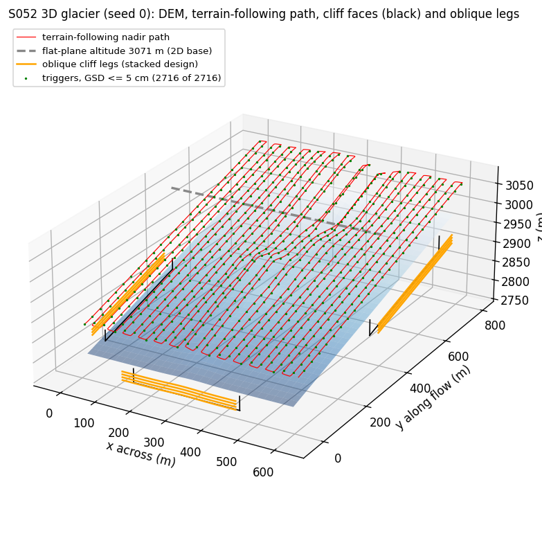
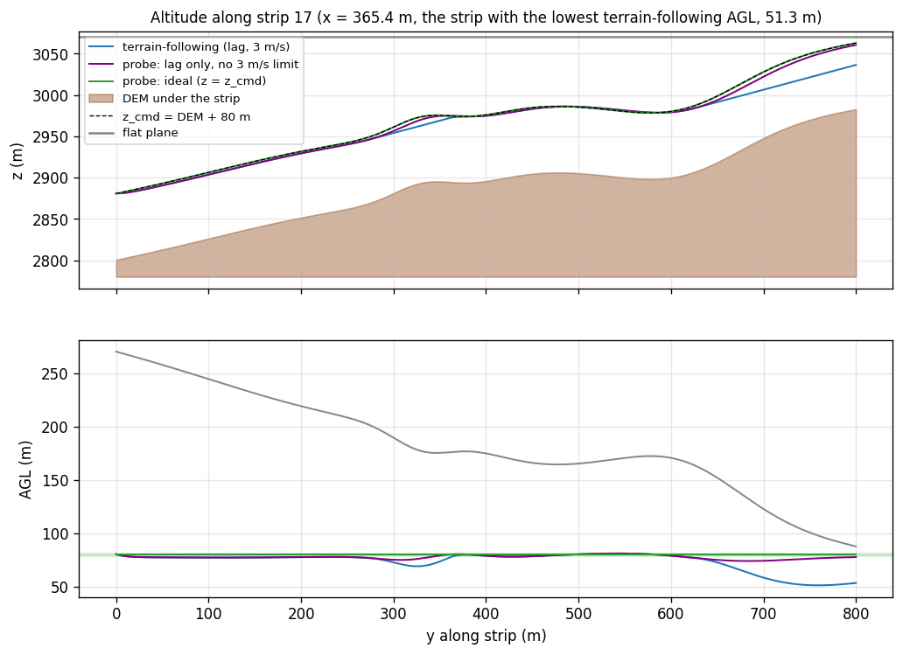
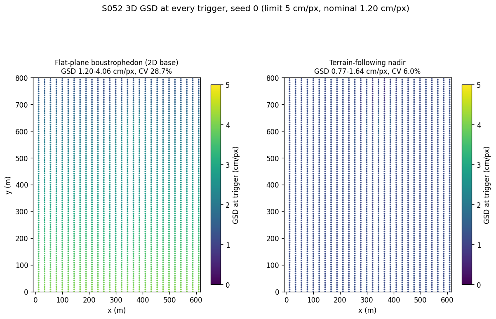
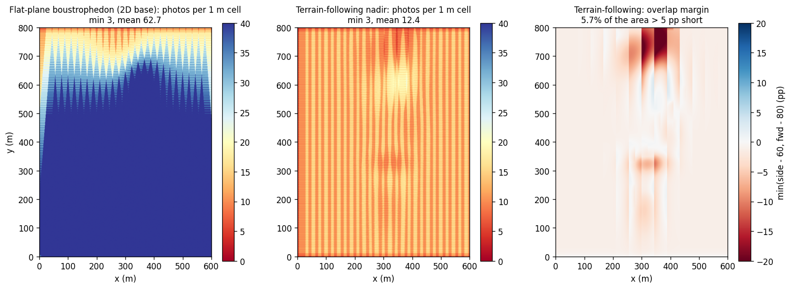
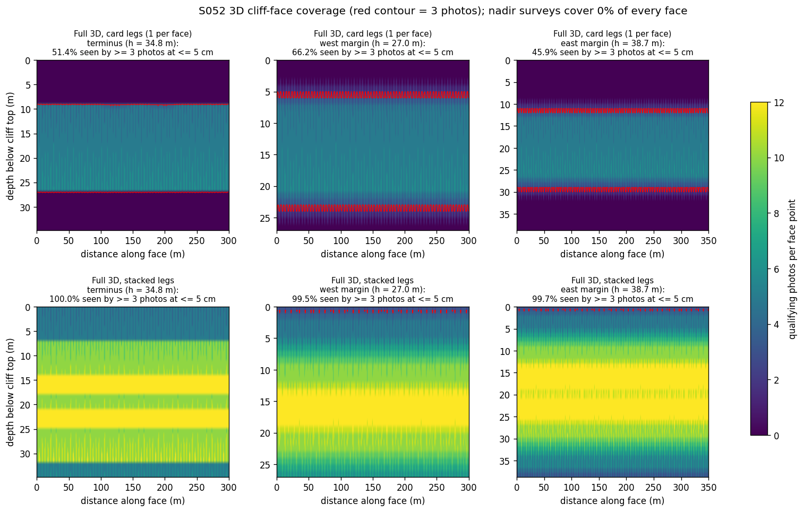
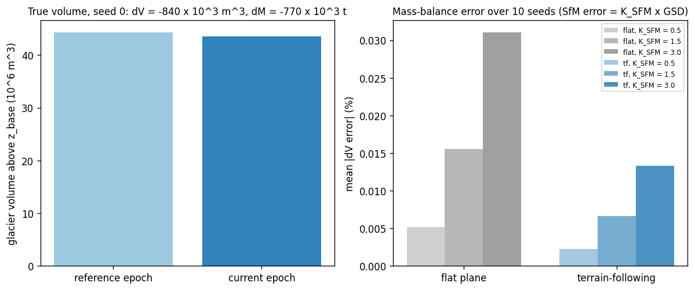
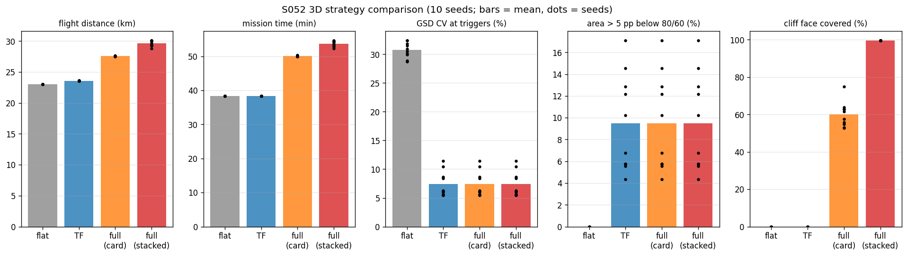
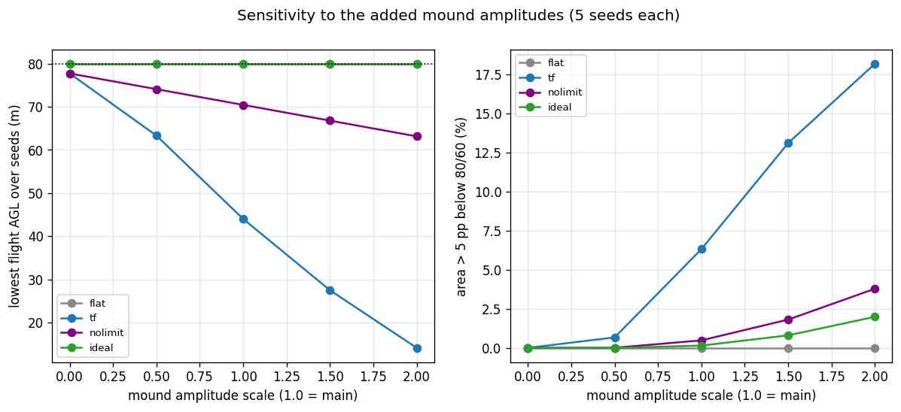
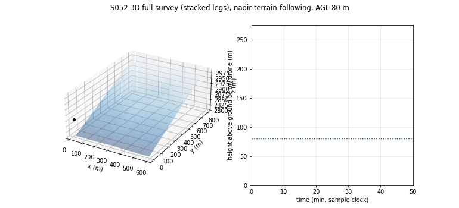

# S052 3D Upgrade — Glacier Area Monitoring

**Domain**: Environmental & SAR | **Difficulty**: ⭐⭐⭐ | **Status**: ✅ Completed
**Based on**: [S052 Glacier Melt Area Measurement](../../s052_glacier/README.md) (2D version)

---

## Problem Definition

**Setup**: The S052 survey drone (25 mm lens, 17.3 × 13.0 mm sensor, 4608 × 3456 px, 80 % forward and 60 % side overlap, 10 m/s) surveys an 800 × 600 m glacier. In 3D the glacier is a synthetic DEM: a 180 m ramp along the flow direction ($y$, terminus at $y = 0$, $z_{base}$ = 2800 m) plus six Gaussian mounds (four ridges, two hollows). Vertical ice cliffs of 20–40 m stand at the terminus ($y = 0$, $x$ = 150–450 m) and along both lateral margins ($x = 0$, $y$ = 100–400 m; $x = 600$, $y$ = 350–700 m). The 2D base flew one altitude over a near-flat surface.

**Objective (card)**: GSD ≤ 5 cm/px and the 80/60 overlap on horizontal and vertical surfaces; a volume and mass-balance estimate from the reconstructed DEM; NDWI melt area.

**Strategies** (same DEM, cliffs and noise draws per seed):
1. **Flat-plane boustrophedon (2D base)**: the 28 S052 strips at one fixed altitude, max(DEM) + 80 m, the lowest fixed altitude that keeps 80 m clearance everywhere.
2. **Terrain-following (TF) nadir**: $z_{cmd} = z_{dem} + 80$ m, first-order lag $\tau_z$ = 1 s, $|\dot z| \le 3$ m/s.
3. **Full 3D, card legs**: TF nadir plus one oblique leg per cliff face (30 m stand-off, camera 70° from nadir, optical axis at mid-height).
4. **Full 3D, stacked legs (added)**: as 3, but with enough stacked legs to cover the whole face height with 60 % overlap between legs.

**Probes** (not strategies): *nolimit* = the TF lag law without the 3 m/s limit; *ideal* = $z = z_{cmd}$ exactly. They separate the effect of the vertical-speed limit from that of the lag.

---

## Mathematical Model

**DEM**: $z_{dem}(x, y) = z_{base} + \Delta z_{ramp}\,y/L + \sum_{k=1}^{6} A_k e^{-(x-x_k)^2/2\sigma_{x,k}^2 - (y-y_k)^2/2\sigma_{y,k}^2}$, with $|A_k| \sim U(10, 35)$ m (4 positive, 2 negative), $\sigma \sim U(30, 90)$ m, and centres uniform inside the glacier. Each seed gives a new DEM and new cliff heights $h_{cliff} \sim U(20, 40)$ m.

**Flight**: the horizontal path is the 2D S052 boustrophedon, sampled every $v\,\Delta t$ = 1 m ($\Delta t$ = 0.1 s). Altitude follows $\dot z = \text{clip}((z_{cmd} - z)/\tau_z, \pm v_{z,max})$. Photos are taken at the exact 2D trigger distances; the altitude at each trigger is interpolated. 3D distance $= \sum\|\Delta\mathbf{p}\|$; the total ascent is $\sum\max(\Delta z, 0)$. Horizontal speed is 10 m/s in every strategy, so the nadir survey time is the same for all of them by construction.

**Nadir coverage (2D model, per-photo altitude)**: ground point $q$ is in photo $k$ iff $|x_q - x_k| \le (z_k - z_q)s_w/2f$ and $|y_q - y_k| \le (z_k - z_q)s_h/2f$, on a 1 m grid. GSD$_k = (z_k - z_{dem}(x_k, y_k))\,p/f$. Local overlap per cell: side $= 1 - B_y/W_{fp}(\text{AGL})$, using the lower AGL of the two neighbouring strips over that cell; forward $= 1 - B_x/L_{fp}(\text{AGL})$.

**Oblique legs**: with stand-off $d_s$ and pitch $\psi$ from nadir, the optical axis meets the face $d_s/\tan\psi$ = 10.92 m below the camera, at slant range $R = d_s/\sin\psi$ = 31.93 m. With the vertical half-FOV of 14.57°, one leg sees the face from 2.85 to 20.68 m below the camera (17.83 m). Stacked legs are spaced 17.83 × (1 − 0.6) = 7.13 m apart. Along the leg the footprint is $R s_w/f$ = 22.09 m and photos are taken every 4.42 m (80 % forward overlap); the legs extend half a footprint beyond each face end. A face point counts as covered when at least 3 photos see it from its front side, inside the frame, with face GSD $= |v|\,(p/f)/\cos(\text{incidence}) \le 5$ cm. Cliff transits climb to the flat-plane altitude, fly straight, and descend (3 m/s vertical, 10 m/s horizontal).

**Volume and mass balance**: on the card's 5 m grid, $V = \delta^2\sum\max(z - z_{base}, 0)$. The reference epoch is thicker by a thinning field (3.0 m at the terminus to 0.5 m at the head). Reconstructed DEMs add iid noise $\sigma = K_{SfM}\cdot$GSD per cell, independently in each epoch (GSD from the mean AGL of the photos that see the cell). Cells seen by fewer than 3 photos would be holes (none occur). $\Delta M = \rho_{ice}\Delta V$.

**NDWI melt area**: the 2D S052 pipeline (pools, NDWI noise, 0.5 m raster, ≥ 3-photo mask) applied to each strategy's coverage count.

**Asserted invariants**: $|\dot z| \le 3$ m/s for TF; flight AGL > 10 m; oblique legs above the proglacial ground in front of each face.

---

## Key Parameters

| Parameter | Value | Notes |
|-----------|-------|-------|
| Camera | $f$ = 25 mm, 17.3 × 13.0 mm, 4608 × 3456 px; 1.201 cm/px at 80 m | 2D / card (card table said 4.8 cm, see Deviations) |
| Overlap $O_f$ / $O_s$; strips | 80 % / 60 %; 28 strips, $B_y$ = 22.144 m, $B_x$ = 8.32 m | 2D |
| $h_{AGL}$ / $\tau_z$ / $v_{z,max}$ / $v$ | 80 m / 1 s / 3 m/s / 10 m/s | card |
| $z_{base}$ / $\Delta z_{ramp}$ / mounds | 2800 m / 180 m / 6 | card |
| Mound amplitudes / widths | $\lvert A\rvert$ ~ U(10, 35) m (4 +, 2 −), σ ~ U(30, 90) m | added; amplitude swept ×0–2 |
| Cliffs | 20–40 m, terminus + both margins (positions above) | card heights; positions added |
| $d_s$ / $\psi$ | 30 m / 70° from nadir | card |
| Stacked-leg overlap | 60 % (= $O_s$) | added |
| DEM grid $\delta$ / $\rho_{ice}$ | 5 m / 917 kg/m³ | card |
| Thinning between epochs | 3.0 m (terminus) → 0.5 m (head) | added |
| $K_{SfM}$ | 1.5 × GSD per 5 m cell | added; swept 0.5, 1.5, 3.0 |
| Time step | 0.1 s | 2D used 0.5 s; finer for the 1 s lag |
| Monte Carlo | 10 seeds; mound sweep 5 seeds × 5 scales | added |

---

## Implementation

```
src/03_environmental_sar/3d/s052_3d_glacier.py
```

```bash
conda activate drones
python src/03_environmental_sar/3d/s052_3d_glacier.py
```

Runtime ≈ 200–350 s (single process, measured while other simulations shared the CPU). Two runs (default threading and `OMP_NUM_THREADS=1`) printed byte-identical output and wrote byte-identical figures.

---

## Results

### Seed 0 (DEM 2800.1–2990.7 m, relief 190.6 m; flat plane at 3070.7 m; cliffs 34.8 / 27.0 / 38.7 m)

| Metric | Flat plane (2D base) | TF nadir | Full 3D, card legs | Full 3D, stacked | Probe: no 3 m/s limit | Probe: ideal TF |
|---|---:|---:|---:|---:|---:|---:|
| 3D distance | 22,998 m | 23,599 m | 27,640 m | 30,145 m | 23,638 m | 23,649 m |
| Total ascent | 0 m | 2567 m | 3371 m | 3552 m | 2595 m | 2611 m |
| Mission time | 2300 s | 2300 s | 3024 s | 3283 s | 2300 s | 2300 s |
| GSD range at triggers | 1.203–4.065 cm | 0.771–1.638 cm | same | same | 1.112–1.292 cm | 1.201 cm |
| GSD CV | 28.73 % | 6.01 % | same | same | 3.00 % | 0.00 % |
| Triggers > 5 cm | 0 | 0 | 0 | 0 | 0 | 0 |
| Trigger AGL | 80.1–270.7 m | 51.4–109.1 m | same | same | 74.1–86.0 m | 80.0 m |
| Area ≥ 3 photos | 100 % | 100 % | 100 % | 100 % | 100 % | 100 % |
| Photos per cell (mean) | 62.72 | 12.43 | same | same | 12.39 | 12.37 |
| Area meeting 80/60 | 100.00 % | 4.04 % | same | same | 3.87 % | 9.71 % |
| Area > 5 pp short of 80/60 | 0.00 % | 5.75 % | same | same | 0.57 % | 0.11 % |
| Min side / forward overlap | 60.01 / 80.00 % | 32.71 / 67.77 % | same | same | 50.62 / 77.03 % | 53.73 / 78.49 % |
| Cliff faces covered | 0.00 % | 0.00 % | 52.78 % | 99.73 % | — | — |
| ΔV error ($K_{SfM}$ 1.5) | −0.0180 % | −0.0041 % | same | same | — | — |

Per face, the card's single leg covers 51.4 % (terminus), 66.2 % (west) and 45.9 % (east); the stacked design (4, 3 and 4 legs) covers 100.0, 99.5 and 99.7 %. True volumes: $V_{ref}$ = 4.4371 × 10⁷ m³, $V_{cur}$ = 4.3531 × 10⁷ m³, ΔV = −840,000 m³, ΔM = −770,280 t.

### Monte Carlo (10 seeds; mean [min, max])

| Metric | Flat plane | TF nadir | Full 3D, card | Full 3D, stacked |
|---|---:|---:|---:|---:|
| 3D distance | 22,997.89 m | 23,596.55 [23,577.20, 23,618.88] m | 27,574.13 [27,532.93, 27,639.77] m | 29,685.23 [28,783.10, 30,144.82] m |
| Mission time | 2299.79 s | 2299.79 s | 3003.12 [2993.89, 3024.28] s | 3223.39 [3139.34, 3282.52] s |
| GSD CV | 30.73 [28.73, 32.44] % | 7.39 [5.42, 11.47] % | same | same |
| GSD max | 3.95 [3.90, 4.06] cm | 1.63 [1.47, 1.82] cm | same | same |
| Flight AGL min | 80.00 m | 51.77 [40.61, 64.00] m | same | same |
| Area > 5 pp short | 0.00 % | 9.50 [4.32, 17.11] % | same | same |
| Min side overlap | 60.05 % | 33.91 [18.35, 47.11] % | same | same |
| Cliff faces covered | 0.00 % | 0.00 % | 59.99 [52.78, 75.05] % | 99.68 [99.60, 99.73] % |

Probes (10-seed means): area > 5 pp short 0.72 % (no 3 m/s limit) and 0.20 % (ideal); minimum side overlap 51.29 % and 53.28 %.

**Key findings**

- **Terrain following buys a constant GSD, not overlap.** The flat plane has to fly at max(DEM) + 80 m (3060.0–3070.7 m), so its AGL ranges from 80 to about 270 m: its GSD varies 3.28× within a survey on average (CV 30.73 %), but it never exceeds 5 cm (≤ 4.06 cm). Because the AGL is never below the 80 m design height, it meets 80/60 overlap on 100 % of the glacier (TF lower GSD CV in 10/10 seeds, flat plane never short of overlap). The card's claim that the flat plane "breaks the photogrammetric overlap guarantee" does not hold for a *safe* fixed altitude; it held in the 2D base only because that plane was 80 m above the centreline and the flanks rose under it.
- **With the card's 3 m/s vertical limit, TF itself breaks the overlap** on the steepest mounds. At 10 m/s the drone can climb a grade of at most 0.3. Where a mound is steeper, it falls behind and the AGL drops to 40.6–64.0 m (seed minima), so the footprint shrinks: 9.50 % of the area is more than 5 pp short of 80/60 (more than the flat plane in 10/10 seeds), and the side overlap falls to 18–47 %. **Probe**: removing the 3 m/s limit (lag only) cuts the > 5 pp area to 0.72 %, and ideal tracking to 0.20 %. So the speed limit causes most of the shortfall, and the 1 s lag a small part. Even ideal TF meets the exact 80/60 on only 9.71 % (seed 0) of the area, although only 0.11 % is more than 5 pp short: with the 2D nominal spacing every cell flown at exactly 80 m AGL sits on the 60 % / 80 % edge, and the cross-slope of the mounds pushes many cells just below it. The exact-compliance figure is therefore not a useful comparison; the > 5 pp shortfall is.
- **Mound-amplitude sweep** (5 seeds): the TF shortfall grows with the mounds: > 5 pp short 0.00 % (ramp only, scale 0), 0.67 % (×0.5), 6.32 % (×1), 13.12 % (×1.5), 18.20 % (×2), with the lowest flight AGL down to 14.1 m at ×2. On the ramp alone the steady lag gives AGL 77.7–82.3 m. The flat plane stays at 0.00 % at every scale, with GSD up to 4.37 cm at ×2.
- **Cost of 3D flight**: TF flies 2.60 % further (+2.52 to +2.70 %) and climbs about 2.5 km in total, at the same mission time. Cliff legs add 30.6 % (card legs) or 40.2 % (stacked) to the mission time. Most of the card-leg overhead is transit: in seed 0, 624 s of transit against 101 s on the legs; stacked: 593 s and 390 s.
- **Cliffs are invisible to nadir surveys, and one leg per face is not enough.** No nadir photo covers a face point in any seed. The only front-facing nadir photos (1,324,050 photo × face-point pairs, seed 0) come from the outermost 2D strip at $x$ = 608.96 m, just outside the east margin, and they fail the frame and 5 cm face-GSD test. The card's single mid-height leg sees only 17.83 m of face height, so it covers 52.78–75.05 % of the faces (mean 59.99 %). Stacked legs (2–5 per face, depending on height) cover 99.60–99.73 %; what remains uncovered is a thin strip along the top edge (figure). Face GSD on the axis is 0.510 cm.
- **The volume / mass-balance estimate does not depend on the strategy** (honest negative). With unbiased per-cell SfM noise, the errors average out over the thousands of 5 m cells: the mean |ΔV error| is 0.0155 % (flat) and 0.0067 % (TF), and the maximum over $K_{SfM}$ = 0.5–3.0 is 0.0813 %. The TF DEM is less noisy per cell (RMSE 1.84 vs 3.99 cm), but this follows directly from the assumed σ ∝ GSD. No holes occur in either strategy. Systematic SfM errors (doming, poor tie points at low overlap), which would separate the strategies, are not modelled.
- **NDWI melt area is identical** for flat and TF in 10/10 seeds (−0.607 %, the NDWI classification error, as in 2D).
- **Card bounds**: every strategy leaves the card's [2780, 3060] m altitude band (flat plane 3070.7 m in seed 0, TF up to 3069.9 m), because the mounds sit on top of the 180 m ramp. The bound is reported, not enforced.

### Figures

**3D DEM and paths**, seed 0: TF nadir path (red), flat-plane altitude (grey dashed), cliff faces (black outlines) and stacked oblique legs (orange):



**Altitude along the strip with the lowest TF AGL** (strip 17): the TF drone climbs at the 3 m/s limit (straight slope) and falls behind the steep mound. The probes track the command; the flat plane flies far higher above this strip (lower panel):



**GSD at every trigger**, flat plane vs TF (common colour scale):



**Coverage count** (photos per 1 m cell, clipped at 40) for flat and TF, and the TF overlap margin (red = short of 80/60). The shortfalls sit on the steep mound faces:



**Cliff-face coverage**, qualifying photos per face point: the card's single leg per face (top) against stacked legs (bottom); the red contour is 3 photos:



**Volume and mass balance**: true volumes for seed 0, and the mean |ΔV error| over 10 seeds for three values of $K_{SfM}$:



**Strategy comparison** (10 seeds; bars = mean, dots = seeds):



**Mound-amplitude sweep**: lowest flight AGL and the area more than 5 pp short of 80/60, for the flat plane, TF and both probes:



**Animation**: the full survey with stacked legs, seed 0 (DEM and path on the left, height above ground on the right; 110 frames, one every 276 path samples):



### Deviations from the scenario card

| Card | Implementation | Reason |
|------|----------------|--------|
| Nominal GSD at 80 m "≈ 4.8 cm/px" | 1.201 cm/px | $80 \times 3.754\,\mu\text{m}/25$ mm (printed). 4.8 cm would need 320 m; already fixed in the 2D card. Card corrected. |
| Cliff slant range $R = d_s/\cos\psi$; GSD on the cliff "≈ 8.4 cm/px"; drone at mid-height | $R = d_s/\sin\psi$ = 31.93 m; camera 10.92 m above the aim point; face GSD 0.51 cm on axis | With $\psi$ measured from nadir, the horizontal component of the axis is $\sin\psi$. The card's own formula gives 87.71 m and 1.32 cm (printed), not 8.4 cm. A camera at mid-height pitched 20° down would aim 10.9 m below mid-height. Card corrected. |
| One oblique leg per face | Card design kept (strategy 3) and stacked legs added (strategy 4) | One leg sees 17.83 m of face, less than the 20–40 m cliffs. |
| "Terrain relief … breaks the photogrammetric overlap guarantee" for the flat plane; GSD varies "± 40 %" | A safe flat plane (min AGL 80 m) keeps the overlap everywhere; its GSD varies 3.25–3.38× | Verified numerically; the overlap shortfall appears in TF with the 3 m/s limit instead. Card corrected. |
| DEM ramp along $x$ ($L_{area}$ = 800 m) | Ramp along $y$ (the 800 m axis of the 2D layout, the strip direction) | Keeps the 2D strips and photo triggers unchanged; only the axis name differs. |
| Mound amplitudes, widths and cliff positions not given | U(10, 35) m (4 ridges, 2 hollows), σ U(30, 90) m; cliff segments listed above | Added; amplitude swept ×0–2. |
| Mass-balance from "two simulated survey epochs" (no error model) | Thinning field + iid SfM noise ∝ GSD per 5 m cell, independent per epoch; the same photo layout is used for both epochs | Simplest error model that ties the DEM to the flight; $K_{SfM}$ swept. |
| Altitude bounds [2780, 3060] m | Reported, not enforced | Every strategy exceeds 3060 m once mounds sit on the ramp top; enforcing it would make the safe flat plane impossible. |
| Survey time as a comparison metric | Reported, but equal for all nadir strategies by construction | Horizontal speed is fixed at 10 m/s (card's $\Delta D_{TF}$ formula), so time cannot separate flat and TF (X3); distance and ascent are reported instead. |
| NDWI mosaic figure | Melt-area numbers printed only | The NDWI pipeline is the 2D one (figures in the 2D README); the result is identical for both strategies. |
| Output path without `3d/` | `outputs/03_environmental_sar/3d/s052_3d_glacier/` | 3D variants live under `3d/`. |

---

## Extensions

1. **Feed-forward / look-ahead altitude command** (use the DEM ahead of the drone), or slow down where the grade exceeds $v_{z,max}/v$. The probes show this would remove most of the TF overlap shortfall.
2. **Overlap-aware TF spacing**: plan the strips with a small margin (e.g. at 70 m AGL) so that cross-slope does not push cells below 60 %.
3. **Contour-parallel strips**: fly along the contours of the ramp to cut the 2.5 km of climbing.
4. **SfM error model with overlap and incidence**, so that the DEM and ΔV accuracy depend on the flight, not only on the GSD.
5. **Cliff-retreat volume** from the oblique legs (face position change between epochs), which nadir DEMs cannot see.

---

## Related Scenarios

- 2D version: [S052 Glacier Melt Area Measurement](../../../../scenarios/03_environmental_sar/S052_glacier.md)
- 3D card: [S052 3D Upgrade — Glacier Area Monitoring](../../../../scenarios/03_environmental_sar/3d/S052_3d_glacier.md)
- Coverage planning: [S048 Full-Area Coverage Scan (Lawnmower)](../../../../scenarios/03_environmental_sar/S048_lawnmower.md)
- Volumetric reconstruction: [S053 Coral Reef 3D Reconstruction](../../../../scenarios/03_environmental_sar/S053_coral_reef.md)
- Multi-angle facade scanning: [S065 Building 3D Modeling — Multi-Angle Scan Path](../../../../scenarios/04_industrial_agriculture/S065_3d_scan_path.md)
