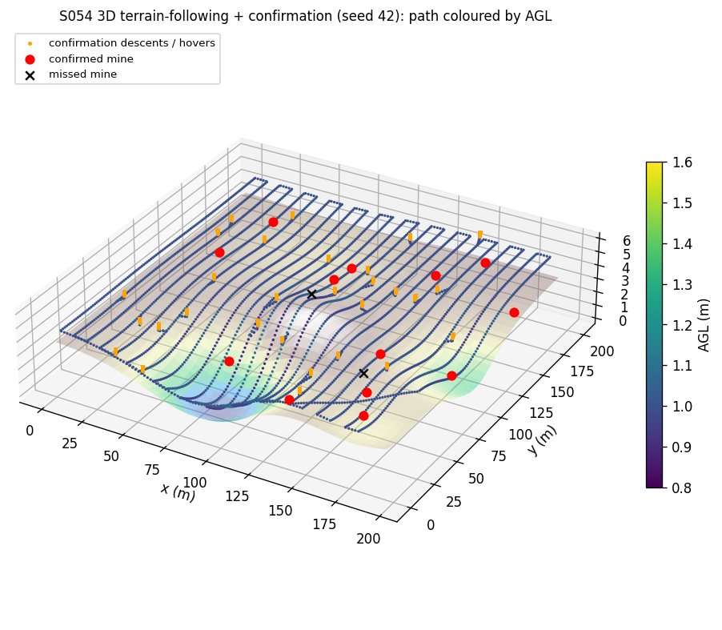
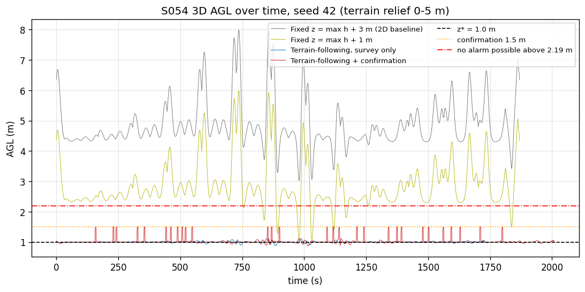
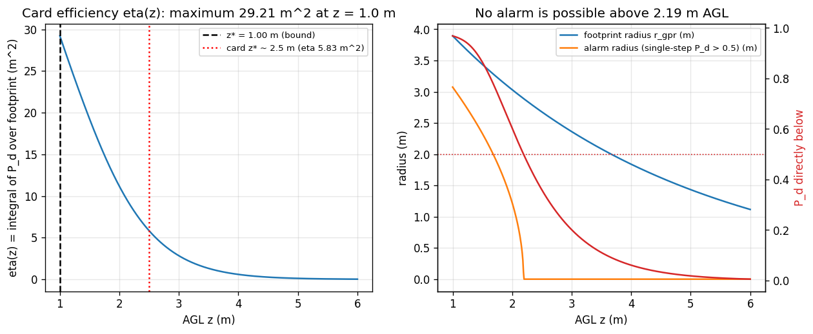
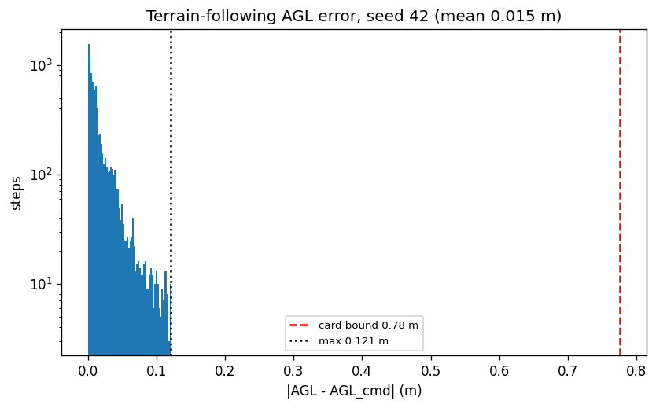
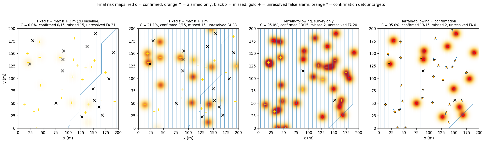
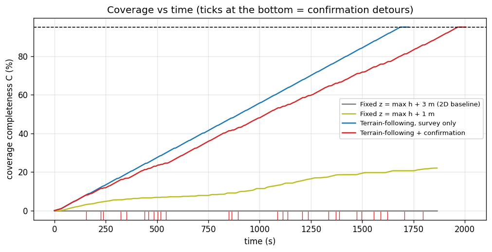
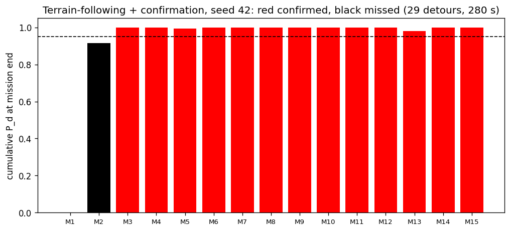
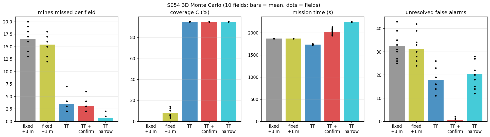
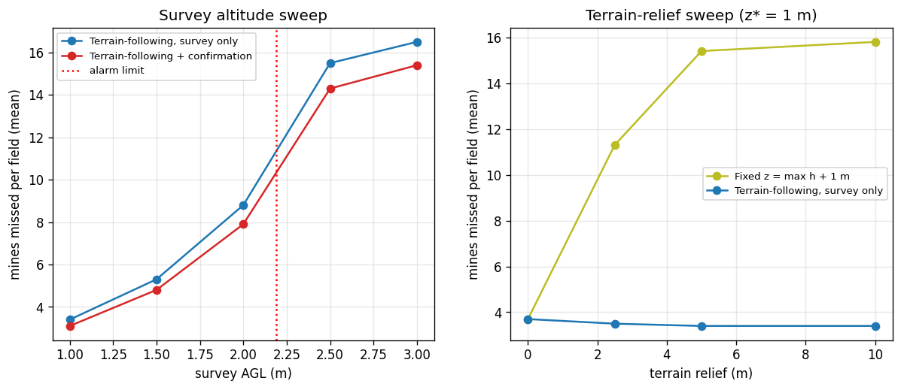
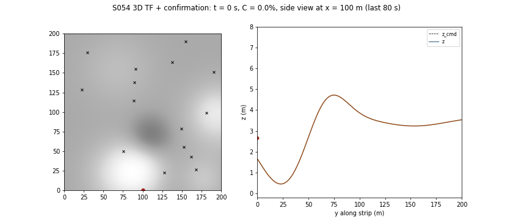

# S054 3D Upgrade — Minefield Detection

**Domain**: Environmental & SAR | **Difficulty**: ⭐⭐⭐⭐ | **Status**: ✅ Completed
**Based on**: [S054 Minefield Detection](../../s054_minefield/README.md) (2D version)

---

## Problem Definition

**Setup**: The S054 field is 200 × 200 m on a 1 m grid. The drone flies 3 m/s from the entry point (100, 0). Mines lie at $y \ge 15$ m, with 15 in the showcase field and U{8, 20} in the Monte Carlo. False alarms come per 8 × 8 m block and pass. Each alarm feeds the risk map, and the least-risk escape path is recomputed; the survey stops at 95 % coverage and the drone returns home along the escape path. All of this is reused from the 2D script. New in 3D:

- **Uneven ground**: a DEM with 5 m relief (8 Gaussian bumps).
- **Altitude-sensitive GPR**: footprint and gain shrink with height above ground (AGL), and range is the slant distance to the mine's surface point.
- **Altitude as a state**: $\dot z = \text{clip}((z_{cmd} - z)/\tau_z, \pm 1.5\ \text{m/s})$, with $\tau_z$ = 0.5 s.

**Objective (card)**: coverage $C \ge 0.95$, confirmation rate $D_{confirm} \ge 0.90$ and escape-path risk below 0.1, in minimum time.

**Strategies** (same mines, terrain and false-alarm draws per field):
1. **Fixed z = max h + 3 m (2D baseline)**: the S054 boustrophedon at one world-frame altitude, 3 m above the highest ground (the 2D altitude).
2. **Fixed z = max h + 1 m (added)**: the same, with the clearance equal to the optimal survey AGL. Over flat ground this would be identical to strategy 3.
3. **Terrain-following (TF) at $z^*$, survey only (card)**.
4. **TF + confirmation (card)**: after any alarm that leaves the footprint unconfirmed (mine or false alarm; the drone cannot tell them apart), the drone flies there, settles at 1.5 m AGL, hovers 2 s, climbs back and resumes the strip.

Also reported: **TF with narrow strips** (2 × the alarm radius, added), and the **2D S054 fixed sweep** on the same fields (flat ground, 2D GPR), for reference.

---

## Mathematical Model

**GPR (card)**: $r_{gpr}(z) = r_0 e^{-z/H_{ref}}$, $G(z) = e^{-z^2/2H_{ref}^2}$,
$$P_d(\rho, z) = \bigl(1 - e^{-r_{gpr}(z)^2/2\rho^2}\bigr)\,G(z),\qquad \rho = \sqrt{d_{xy}^2 + (z_d - h(\mathbf{m}))^2},$$
where $z$ is the drone's AGL. $P_d = 0$ when the horizontal distance exceeds $r_{gpr}(z)$ (the reviewed 2D cutoff). The coverage map, alarms ($P_d > 0.5$ in one step), confirmations ($P_d^{cum} > 0.95$), false alarms and their clearing all use this 3D model.

**Optimal scan altitude**: $\eta(z) = \int_0^{r_{gpr}(z)} P_d(\sqrt{z^2 + s^2}, z)\,2\pi s\,ds$ is maximised over [1, 6] m with a grid and a bounded scalar search. Every factor decreases with $z$, so $\eta$ is monotone and the optimum is the bound: $z^* = 1.000$ m, with $\eta(z^*)$ = 29.213 m² against 5.829 m² at the card's 2.5 m (5.01×).

| AGL | 1.0 m | 1.5 m | 2.0 m | 2.5 m | 3.0 m |
|---|---|---|---|---|---|
| $r_{gpr}$ | 3.894 m | 3.436 m | 3.033 m | 2.676 m | 2.362 m |
| $P_d$ directly below | 0.969 | 0.865 | 0.603 | 0.359 | 0.201 |
| Alarm radius ($P_d > 0.5$) | 3.074 m | 2.330 m | 1.225 m | 0 | 0 |

With 8 m strips (card) and an alarm radius of 3.074 m at $z^*$, mines in the seams between strips are never alarmed. The seam-free width is 2 × 3.074 = 6.15 m, the narrow-strip variant.

**Terrain following**: $z_{cmd} = h(x, y) + z^*$. On a 15° slope at 3 m/s the steady lag is $\tau_z v\tan 15°$ = 0.402 m; the card's bound $\dot z_{max}\tau_z/\cos 15°$ = 0.776 m is not a tight bound. The 3D distance includes vertical motion.

**Asserted invariants**: AGL > 0 at every step, $|\dot z| \le 1.5$ m/s, horizontal speed ≤ 3 m/s, no key collision between the Monte Carlo results.

---

## Key Parameters

| Parameter | Value | Notes |
|-----------|-------|-------|
| Field / grid / speed / time step | 200 × 200 m / 1 m / 3 m/s / 0.2 s | card (2D) |
| $r_0$ / $H_{ref}$ / AGL range | 5 m / 4 m / 1–6 m | card |
| $z^*$ | 1.000 m (computed; card "≈ 2.5 m") | see Deviations |
| $z_{lo}$ / hover / $\dot z_{max}$ / $\tau_z$ | 1.5 m / 2 s / 1.5 m/s / 0.5 s | card |
| $\theta_{alarm}$ / $\theta_{confirm}$ / $P_{fa}$ / $R_{safe}$ / $R_{caution}$ / $\alpha$ | 0.50 / 0.95 / 0.05 / 0.10 / 0.40 / 50 | card (2D) |
| Strip width | 8 m; narrow variant 6.15 m | card; added |
| Terrain relief / DEM | 5 m / 8 Gaussian bumps, σ ~ U(15, 40) m, normalised to [0, 5] m | card relief; shape added |
| Showcase field | seed 42, 15 mines (2D showcase) | 2D |
| Monte Carlo | 10 fields (seeds 0–9), N_mine ~ U{8, 20}, own terrain per field | added |
| Sweeps | survey AGL 1.0–3.0 m; terrain relief 0, 2.5, 5, 10 m | added |

---

## Implementation

```
src/03_environmental_sar/3d/s054_3d_minefield.py
```

```bash
conda activate drones
python src/03_environmental_sar/3d/s054_3d_minefield.py
```

The 3D mission subclasses the 2D `Mission`, replacing sensing (3D GPR) and motion (vertical tracker). The Monte Carlo fields run in a pool of up to 6 processes and are collected in seed order. Runtime ≈ 260–350 s (measured while other simulations shared the CPU). Runs with default threading and with `OMP_NUM_THREADS=1` printed byte-identical output and wrote byte-identical figures.

---

## Results

### Showcase field (seed 42, 15 mines; terrain 0–5.00 m, max slope 8.45°)

| Metric | Fixed max h + 3 m (2D baseline) | Fixed max h + 1 m | TF survey | TF + confirmation | 2D S054 (flat) |
|---|---:|---:|---:|---:|---:|
| Mission time | 1869 s | 1869 s | **1729 s** | 2009 s | 1730 s |
| 3D distance | 5528 m | 5528 m | 5142 m | 5473 m | 5144 m |
| Coverage $C$ | 0.00 % | 21.11 % | 95.00 % | 95.00 % | 95.00 % |
| Mines confirmed / missed | 0 / 15 | 0 / 15 | 13 / 2 | 13 / 2 | 12 / 3 |
| $D_{confirm}$ | 0 % | 0 % | 86.67 % | 86.67 % | 80.00 % |
| False alarms raised / unresolved | 31 / 31 | 33 / 33 | 29 / 20 | 29 / **0** | 29 / 17 |
| Confirmation detours (time) | — | — | — | 29 (280 s) | — |
| AGL range | 3.020–7.981 m | 1.020–5.981 m | 0.879–1.115 m | 0.879–1.500 m | — |
| Mean / max \|AGL error\| (survey) | 0 / 0 m | 0 / 0 m | 0.015 / 0.121 m | 0.017 / 0.300 m | — |
| Max single-step $P_d$ on any mine | 0.037 | 0.326 | 0.957 | 0.957 | — |
| Escape samples with mean $R \ge 0.1$ | 0.00 % | 0.00 % | 0.29 % | 0.25 % | 0.00 % |

All 29 confirmation detours in the showcase go to false alarms: every real mine that was alarmed had already been confirmed in the same pass.

### Monte Carlo (10 fields, 16.5 mines per field on average)

| Strategy | Mines missed | $D_{confirm}$ | Coverage | Mission time | Unresolved false alarms |
|---|---:|---:|---:|---:|---:|
| Fixed max h + 3 m (2D baseline) | 16.50 ± 2.33 | 0.00 % | 0.00 % | 1868.64 s | 32.40 |
| Fixed max h + 1 m | 15.40 ± 2.06 | 6.36 % | 7.82 % | 1869.06 s | 31.20 |
| TF survey | 3.40 ± 1.50 | 79.61 % | 95.00 % | **1731.50 s** | 17.90 |
| TF + confirmation | 3.10 ± 1.22 | 81.23 % | 95.00 % | 2019.88 s | **0.50** |
| TF, narrow strips (6.15 m) | **0.70 ± 0.64** | **95.87 %** | 95.00 % | 2245.52 s | 20.30 |
| 2D S054 fixed (flat ground, 2D GPR) | 2.40 ± 1.50 | 85.91 % | 95.00 % | 1730.18 s | 16.10 |

Fields meeting $C \ge 0.95$ and $D_{confirm} \ge 0.90$: TF narrow 10/10 and 10/10; TF and TF + confirmation 10/10 and 0/10; fixed altitudes 0/10 and 0/10 (2D reference: 10/10 and 3/10).

**Key findings**

- **At the 2D altitude the card's GPR detects nothing.** At 3 m AGL the single-step $P_d$ directly below a mine is 0.201, so no alarm can ever be raised: the highest single-step $P_d$ on any mine in the showcase is 0.037. Flown at 3 m above the *highest* ground (the only safe fixed altitude over 5 m relief), the 2D baseline reaches 0 % coverage and misses every mine in 10/10 fields.
- **Terrain following is what makes the sensor work.** TF misses fewer mines than either fixed altitude in 10/10 fields (−13.10 vs +3 m, −12.00 vs +1 m). Even the fixed plane with only 1 m clearance at the top fails: over lower ground its AGL rises to 6 m, where the GPR is blind (coverage 7.82 %). **Relief sweep**: with flat ground the fixed plane and TF are identical (both 3.70 missed, 95 %). With 2.5 m of relief the fixed plane misses 11.30 mines (39.65 % coverage), and with 10 m 15.80 (2.76 %). TF stays at 3.40–3.50 missed for every relief. The terrain causes the difference, through the AGL.
- **The optimal survey altitude is the 1 m lower bound, not 2.5 m.** **Survey-altitude sweep** (TF): 3.40 mines missed at 1.0 m, 5.30 at 1.5 m, 8.80 at 2.0 m, 15.50 at 2.5 m (the card's $z^*$; coverage 27.37 %) and 16.50 at 3.0 m. Above 2.192 m AGL no alarm is possible at all; only mines right under the track can still be confirmed by accumulating several weak readings. The altitude ends on the bound because the card's GPR model degrades monotonically with height. This was derived from $\eta$ and confirmed by the sweep; no tuning was involved.
- **TF tracks the terrain closely**: the mean AGL error during the survey is 0.015 m and the maximum 0.121 m (showcase; Monte Carlo max 0.08 ± 0.01 m), against the card's 0.776 m bound. The terrain is gentle (max slope 8.04° over the Monte Carlo fields), and the minimum AGL is 0.879 m.
- **With the card's 8 m strips, 3D TF misses more than the 2D sweep** (3.40 vs 2.40; more in 6/10 fields, never fewer). Its alarm radius is 3.074 m instead of 3.40 m, so the seams between strips are wider. **Narrow strips** (6.15 m) cut the misses to 0.70 (fewer in 10/10 fields) and reach $D_{confirm} \ge 0.90$ in 10/10 fields, at the cost of a longer mission (2245.52 vs 1731.50 s).
- **Confirmation detours resolve false alarms, not mines.** Against TF without detours: unresolved false alarms fall by 17.40 per field (fewer in 10/10), the mission takes 288 s longer (+210 to +380 s), and confirmed mines rise by only 0.30 (more in 3/10). At 1 m AGL a detected mine is almost always confirmed in the same pass, so the detours mostly visit false alarms. They also lower the share of escape samples with mean risk ≥ 0.1 (0.15 % vs 1.24 %), because cleared false alarms leave the risk map. The 1.5 m confirmation altitude is *above* $z^*$, so the "descent" is actually a small climb from 1.0 m to 1.5 m. It still works, because hovering gives 10 readings at $P_d$ = 0.865.

### Figures

**3D trajectory**, TF + confirmation (showcase): path coloured by AGL, confirmation hovers in orange, mines at their surface height (red = confirmed, black × = missed):



**AGL over time** for the four strategies, with $z^*$, the confirmation altitude and the altitude above which no alarm is possible:



**Card efficiency η(z)** with $z^*$ at the lower bound and the card's 2.5 m; footprint radius, alarm radius and $P_d$ directly below:



**Terrain-following AGL error** (log scale) against the card bound:



**Final risk maps** with the ground track, confirmed / alarmed / missed mines, unresolved false alarms and confirmation-detour targets:



**Coverage vs time** (ticks at the bottom = confirmation detours). The fixed-altitude curves stay near 0:



**Per-mine cumulative $P_d$** at the end of the TF + confirmation run (red = confirmed, black = missed):



**Monte Carlo** (bars = mean, dots = fields):



**Sweeps**: mines missed vs survey AGL (TF and TF + confirmation), and vs terrain relief (fixed max h + 1 m against TF):



**Animation**: TF + confirmation, top view and a side view at the drone's strip (terrain, commanded and actual altitude over the last 80 s); 90 frames, one every 113 steps of 0.2 s:



### Deviations from the scenario card

| Card | Implementation | Reason |
|------|----------------|--------|
| $z^*_{AGL}$ "≈ 2.5 m" from maximising η | $z^*$ = 1.000 m (the lower bound) | η is monotonically decreasing (printed: 29.213 m² at 1 m, 5.829 m² at 2.5 m). At 2.5 m no alarm is possible. Card corrected. |
| "$r_{gpr}(z^*) \approx 4$ m, matching the 2D model" | $r_{gpr}$(1 m) = 3.894 m; 4 m at 0.893 m | Card arithmetic. Card corrected. |
| $G(1.5) \approx 0.84$, $r_{gpr}(1.5) \approx 4.7$ m | 0.932 and 3.436 m | Card arithmetic. Card corrected. |
| Baseline at constant world $z$ = 3 m | $z$ = max h + 3 m | 3 m above the datum would fly into terrain up to 5 m high. Card corrected. |
| Strip width 8 m "based on $r_{gpr}(z^*)$" | 8 m kept for the card strategies; 6.15 m narrow variant added | 8 m leaves seams for an alarm radius of 3.074 m (the 2D seam finding). |
| Confirmation waypoint inserted "on first alarm" | Inserted once the alarm has left the footprint unconfirmed (mine or false alarm), one visit each | At 1 m AGL most alarms are confirmed within the same pass, so an immediate detour would be wasted. |
| $\epsilon_{AGL} \le \dot z_{max}\tau_z/\cos\varphi$ = 0.78 m | Reported, with the steady lag $\tau_z v\tan\varphi$ = 0.402 m at 15° and the measured errors | The card's expression is not a tight bound. |
| Mines at $h_{terrain}$; GPR cutoff not specified | Slant range to the surface point; $P_d = 0$ beyond $r_{gpr}(z)$ horizontally | Keeps the reviewed 2D cutoff. |
| DEM shape not given | 8 Gaussian bumps normalised to 0–5 m | Relief swept 0–10 m. |
| Output path without `3d/` | `outputs/03_environmental_sar/3d/s054_3d_minefield/` | 3D variants live under `3d/`. |

---

## Extensions

1. **Minimum safe AGL**: add a ground-collision margin so that $z^*$ comes from a safety/detection trade-off rather than the 1 m bound.
2. **Slope-adaptive strip width** (card extension 1), using the 3D alarm radius.
3. **Confirmation only for real-looking returns**: a belief over alarm identity would cut the detour time spent on false alarms.
4. **Two-drone split** (card extension 3): a survey drone and a confirmation drone, to remove the detour interruptions.
5. **DEM uncertainty** (card extension 4): at 1 m AGL a 0.3 m DEM error is a large fraction of the clearance.

---

## Related Scenarios

- 2D version: [S054 Minefield Detection](../../../../scenarios/03_environmental_sar/S054_minefield.md)
- 3D card: [S054 3D Upgrade — Minefield Detection](../../../../scenarios/03_environmental_sar/3d/S054_3d_minefield.md)
- Terrain following: [S003 Low-Altitude Tracking](../../../../scenarios/01_pursuit_evasion/S003_low_altitude_tracking.md)
- Probabilistic sensing: [S056 Nuclear Plant Leak Detection (Radiation Hotspot Localization)](../../../../scenarios/03_environmental_sar/S056_radiation.md)
- Risk-aware replanning: [S034 Weather Rerouting](../../../../scenarios/02_logistics_delivery/S034_weather_rerouting.md)
