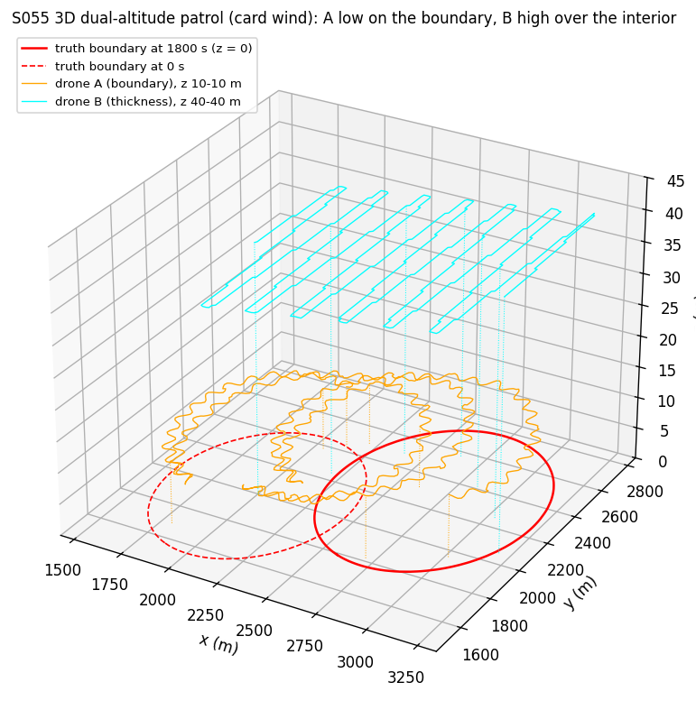
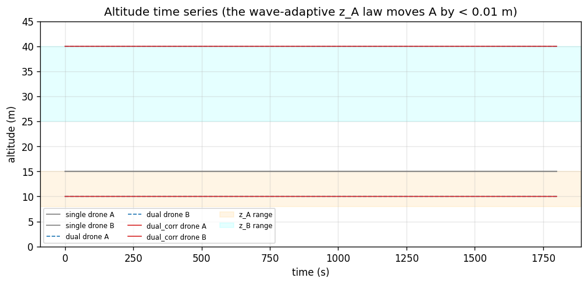
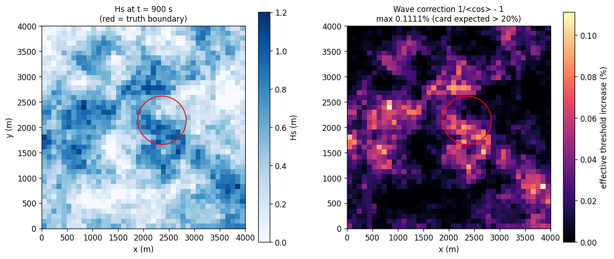
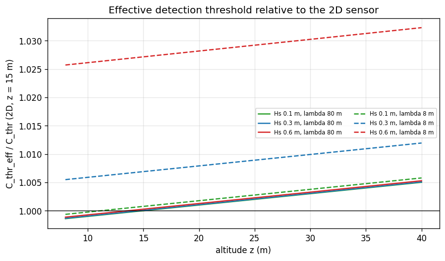
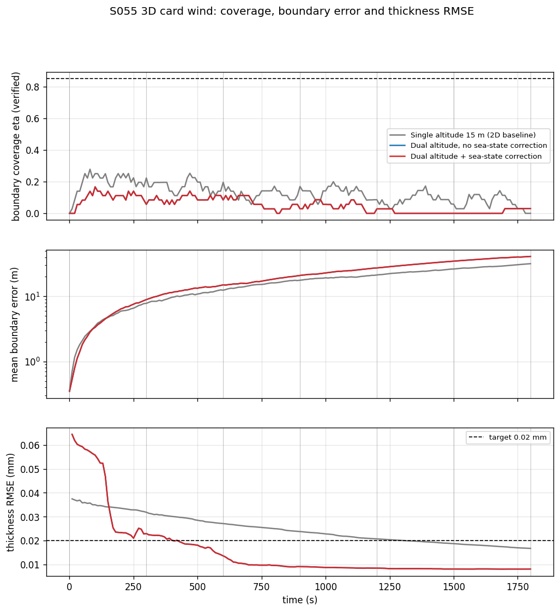
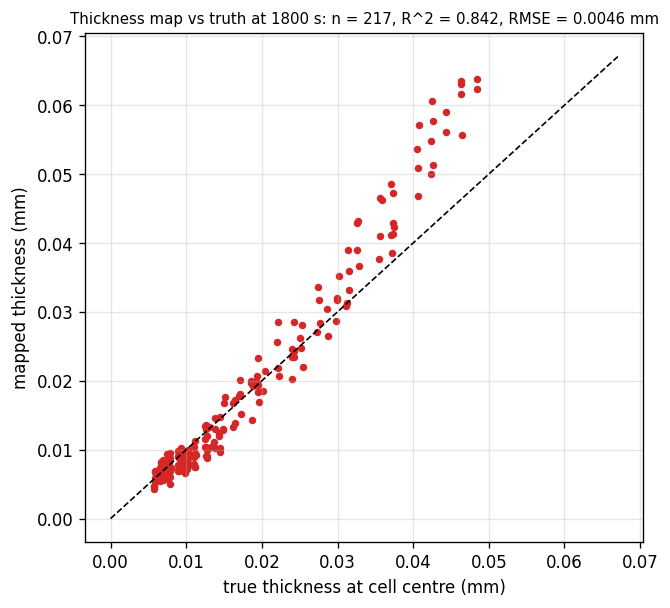
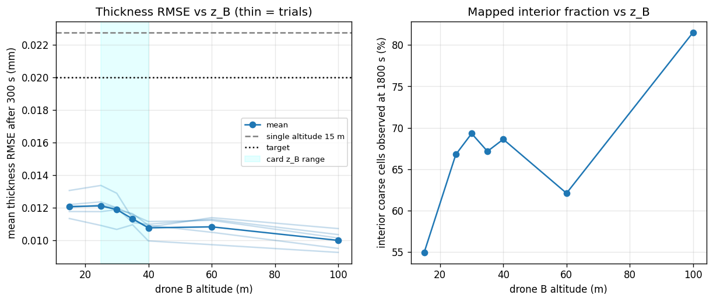
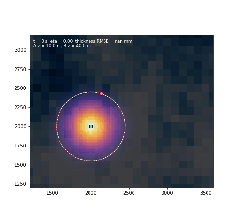

# S055 3D Upgrade — Oil Spill Tracking

**Domain**: Environmental & SAR | **Difficulty**: ⭐⭐⭐⭐ | **Status**: ✅ Completed
**Based on**: [S055 Coastline Oil Spill Tracking](../../s055_oil_spill/README.md) (2D version)

---

## Problem Definition

**Setup**: The S055 slick: advection–diffusion on a 4 × 4 km, 20 m grid, drift (0.40, 0.15) m/s, boundary $C = 0.08$, a 36-landmark Kalman filter with drift prediction, and replanning every 30 s over a 30 min mission. In 2D, two drones at 15 m carry a point sensor $\mathbf{1}[C \ge 0.08]$. In 3D:

- a nadir fluorescence sensor sees a footprint of radius $r_{foot} = z\tan\phi$ ($\phi$ = 26.57°);
- its radiance follows the card's model, which depends on the oil thickness $H_{oil} = H_0\,C/C_0\,\sqrt{t_0/(t + t_0)}$, the altitude and the local wave tilt;
- a spatially correlated significant-wave-height field $H_s(x, y, t)$ tilts the sea surface.

The ground station inverts each reading into a thickness and a concentration. It thresholds the concentration at 0.08 to detect boundary crossings and builds a 20 × 20 thickness map (50 m cells, drift-following).

**Objective (card)**: boundary coverage $\eta \ge 0.85$ and interior thickness RMSE $\epsilon_{th} \le 0.02$ mm.

**Strategies** (same truth, wave field and noise seeds per trial):
1. **Single altitude, 15 m (2D baseline)**: both drones patrol the boundary exactly as in the 2D S055 "adaptive + prediction" strategy. The thickness map is built from their boundary samples only.
2. **Dual altitude, no sea-state correction**: drone A at $z_A = r_{target}/\tan\phi$ = 10 m patrols the whole boundary alone. Drone B flies at the card's $z_B$ (= 40 m, see below) over a drift-following 1000 m box in a lawnmower pattern, mapping the thickness.
3. **Dual altitude + sea-state correction**: as 2, plus dividing each reading by $\langle\cos\theta_w\rangle$, the card's wave-adaptive $z_A$ law, and the landmark confidence weights $w_k$ with covariance inflation.

The Monte Carlo has 5 trials: the card wind, plus 4 directions from the 2D S055 Monte Carlo at the same speed.

---

## Mathematical Model

**Sensor (card)**: $L = L_0\,\frac{A_{foot}}{\pi z^2}\,\bar\alpha\,\cos\theta_w\,e^{-\mu_{atm}z}\,(1 + \sigma_L\varepsilon)$, where $\bar\alpha$ is the mean of $1 - e^{-\kappa H_{oil}}$ over 7 points of the footprint disc. $\theta_w \sim \mathcal{N}(0, \bar\sigma_\theta^2)$ is drawn per sample, with $\bar\sigma_\theta = \arctan(\pi H_s/\lambda_w)$.

**Inversion**: $\hat H = -\kappa^{-1}\ln\bigl(1 - L/(L_0\tan^2\phi\,e^{-\mu z_m}\,c_w)\bigr)$ and $\hat C = \hat H/(H_0\sqrt{t_0/(t+t_0)})$. Here $z_m$ = 15 m for strategy 1 and the true altitude otherwise, and $c_w = \langle\cos\theta_w\rangle = e^{-\bar\sigma_\theta^2/2}$ for strategy 3, 1 otherwise. A crossing is a change of $\mathbf{1}[\hat C \ge 0.08]$ between consecutive 20 m samples (2D measurement model).

**What the card's model actually implies** (all values printed by the script):
- $A_{foot}/(\pi z^2) = \tan^2\phi$ = 0.2500 at every altitude, so altitude enters the radiance only through $e^{-\mu z}$: 0.99800 at 10 m and 0.99203 at 40 m. Relative to 15 m, the radiance is 1.00100 × at 10 m and 0.99501 × at 40 m.
- With $\lambda_w$ = 80 m, $H_s$ = 0.6 m gives a slope spread of 1.350° and $\langle\cos\theta_w\rangle$ = 0.999723: the effective threshold rises by only 0.0278 % (0.1111 % at the largest $H_s$ in the simulated field, 1.20 m). Only with a steep 8 m wavelength does it reach 2.71 % at $H_s$ = 0.6 m.
- $\ln(L_A/L_B)$ = 0.006000 at both 0.01 mm and 0.10 mm thickness, which equals $-\mu(z_A - z_B)$. The two-altitude pair carries no thickness information; one calibrated reading is enough.
- The card's $z_B = \arg\max_z r_{foot}(z)\,\alpha\,e^{-\mu z} = 1/\mu$ = 5000 m, so $z_B$ is always clipped to its 40 m ceiling.
- The card's wave-adaptive law gives $z_A$ = 10.0014 m at $H_s$ = 0.6 m; in the run, $z_A$ stays within 10.0000–10.0040 m.

**Drone B**: lawnmower strips $2r_{foot}(z_B)$ apart (40 m at 40 m altitude) over a 1000 m box that moves with the predicted drift. One pass is 26.0 km (3245 s at 8 m/s), longer than the 1800 s mission. **Thickness map**: the latest reading per 50 m cell, scaled by the known ageing $\sqrt{(t_m + t_0)/(t + t_0)}$. Unobserved cells take the nearest observed cell's value. $\epsilon_{th}$ is the RMSE over cells whose true $C \ge 0.08$.

**Kalman filter, coverage, error**: as in the 2D S055 (verified $\eta$ from crossings, mean landmark-to-truth distance $\bar e$). Strategy 3 inflates $P_k$ by $\Delta\sigma_q^2(1 - w_k)$ when $w_k < w_{min}$.

**Asserted invariants**: altitude inside its range, $C \ge 0$, speed ≤ 8 m/s (2D).

---

## Key Parameters

| Parameter | Value | Notes |
|-----------|-------|-------|
| Domain, PDE, drift, $D$, landmarks, $\sigma_r$, $r_{assoc}$, $T_{replan}$, $T_{stale}$, speed, $\Delta s$ | as 2D S055 | card |
| $\phi$ / $r_{target}$ | arctan(0.5) = 26.57° / 5 m | card |
| $z_A$ range / $z_B$ range / $\tau_z$ | 8–15 m / 25–40 m / 2 s | card |
| $\mu_{atm}$ / $\kappa$ / $H_0$ | 2e-4 1/m / 500 1/m / 0.10 mm | card |
| $\sigma_H$ / $L_{wave}$ / $\lambda_w$ | 0.3 m / 500 m / 80 m | card |
| $\Delta\sigma_q$ / $w_{min}$ / $\epsilon_{th}$ target | 0.3 / 0.3 / 0.02 mm | card |
| Mean $H_s$ | 0.5 m | added (card gives only the std) |
| Wave field | 100 m grid, AR(1) with a 300 s time constant, updated every 30 s | added (card: "5-minute timescale") |
| $t_0$ | 1800 s | added (card: $R_0/k_F$, $k_F$ not given) |
| Radiometric noise $\sigma_L$ | 5 % | added; swept 2 %, 10 % |
| Footprint samples | 7 (centre + 6 at 0.7 $r_{foot}$) | added |
| Thickness map | 20 × 20 cells over a 1000 m drift-following box | card grid, box added |
| Sweeps | $z_B$ 15–100 m, $z_A$ 8/15 m, $\lambda_w$ = 8 m probe | added |
| Monte Carlo | 5 trials | added |

---

## Implementation

```
src/03_environmental_sar/3d/s055_3d_oil_spill.py
```

```bash
conda activate drones
python src/03_environmental_sar/3d/s055_3d_oil_spill.py
```

The card-wind trial runs in the main process and the other 4 trials in a process pool; results are collected in trial order. Runtime ≈ 25–75 s. Two runs (default threading and `OMP_NUM_THREADS=1`) printed byte-identical output and wrote byte-identical figures.

---

## Results

### Card wind

| Metric | Single 15 m (2D) | Dual | Dual + correction |
|---|---:|---:|---:|
| Mean $\eta$ (verified) | **0.129** | 0.053 | 0.053 |
| Mean boundary error | **17.1 m** | 21.3 m | 21.3 m |
| Final boundary error | **31.8 m** | 41.1 m | 41.1 m |
| Crossings | 184 | 70 | 70 |
| Mean thickness RMSE (after 300 s) | 0.0229 mm | **0.0108 mm** | **0.0108 mm** |
| Final thickness RMSE | 0.0167 mm | 0.0081 mm | 0.0081 mm |
| Time with RMSE ≤ 0.02 mm | 33.1 % | **92.1 %** | **92.1 %** |
| Interior cells observed at the end | 34.2 % | 68.7 % | 68.7 % |
| Confidence inflations / min $w_k$ | — | — | 0 / 0.9972 |

### Monte Carlo (5 wind directions)

| Metric | Single 15 m | Dual | Dual + correction |
|---|---:|---:|---:|
| Mean $\eta$ | 0.1216 ± 0.0049 | 0.05261 ± 0.00098 | 0.05261 ± 0.00098 |
| Mean boundary error | 18.01 ± 0.6 m | 21.31 ± 0.43 m | 21.31 ± 0.43 m |
| Mean thickness RMSE | 0.02277 mm | 0.01077 mm | 0.01077 mm |
| Time with RMSE ≤ 0.02 mm | 33.51 % | 93.38 % | 93.38 % |
| Mean signed thickness error | −0.01642 mm | +0.00049 mm | — |

**Key findings**

- **The dual-altitude split trades boundary tracking for a thickness map.** Moving one drone to the interior lowers the thickness RMSE in 5/5 trials (by 0.012 mm on average, from 0.0228 to 0.0108 mm), and the 0.02 mm target is met 93 % of the time instead of 34 %. The single-altitude map only has boundary samples, which are thin oil, so it underestimates the interior thickness by 0.0164 mm on average. The price is paid in 5/5 trials: one patrol drone instead of two halves the verified coverage (0.122 → 0.053) and raises the mean boundary error by 3.3 m (18.0 → 21.3 m). Neither strategy comes close to the 0.85 coverage target; the 2D study already showed it needs about 8 drones.
- **The gain comes from where drone B flies, not from its altitude.** Ablation: drone B at the 2D altitude of 15 m (swath 15 m) gives 0.0121 mm, the same as at 25 m (0.0121 mm). Raising $z_B$ to its 40 m ceiling helps only a little (0.0108 mm). Beyond the card bound, 60 m gives 0.0108 mm and 100 m gives 0.0100 mm (81.5 % of the interior observed). The smooth slick lets nearest-cell filling cover what B has not yet flown over, so a wider swath matters little.
- **Drone A's altitude does not matter**: 8, 10 and 15 m give boundary errors of 21.31, 21.31 and 21.27 m. The point-like sampling every 20 m, not the 4–7.5 m footprint, sets the crossing accuracy.
- **The sea-state correction changes nothing at card parameters** (honest negative). Strategies 2 and 3 have identical boundary results in 5/5 trials, and their thickness RMSE differs by 3.4e-06 mm on average. The landmark weights never fall below 0.9972, so the inflation never triggers (0 times). **Steep-wave probe** ($\lambda_w$ = 8 m): the correction still does not lower the thickness RMSE (0/5 trials; +0.0000 to +0.0009 mm). The signed errors explain why: the map already has a small positive bias (+0.00049 mm). Uncorrected wave attenuation pulls it to −0.00020 mm, and the correction restores +0.00051 mm. The correction removes the wave bias as intended, but that bias was partly cancelling another one. The boundary error changes by −1.04 to +1.57 m (lower in 3/5).
- **Radiometric noise** of 2, 5 and 10 % gives a thickness RMSE of 0.0110, 0.0108 and 0.0112 mm: the map error comes from coverage and staleness, not from sensor noise.
- **Map vs truth** at the end of the card-wind run (dual + correction, observed interior cells): n = 217, R² = 0.842, RMSE = 0.0046 mm.

### Figures

**3D trajectories** (card wind, dual + correction): drone A (orange) zig-zags along the boundary at 10 m, drone B (cyan) flies its lawnmower at 40 m; truth boundary at 0 s (dashed) and 1800 s (solid) on the sea surface:



**Altitude time series**: single (15 m), dual and dual + correction drones; the wave-adaptive $z_A$ law is invisible at this scale:



**Sea state at 900 s**: $H_s$ and the wave correction $1/\langle\cos\theta_w\rangle - 1$, with the truth boundary:



**Effective detection threshold** relative to the 2D sensor at 15 m, for three wave heights at the card's 80 m wavelength (solid, almost flat at 1) and at the 8 m probe wavelength (dashed):



**Coverage, boundary error and thickness RMSE** over the card-wind mission. The dual curves (blue) are hidden under the dual + correction curves (red):



**Thickness map vs truth** at 1800 s (dual + correction, observed interior cells):



**Drone B altitude sweep**: thickness RMSE (thin lines = trials) and mapped interior fraction; the dashed line is the single-altitude strategy:



**Animation** (card wind, dual + correction): concentration, wave height (blue overlay), truth (red) and estimated (white) boundary, drones A (orange) and B (cyan); 61 frames, one every 30 s:



### Deviations from the scenario card

| Card | Implementation | Reason |
|------|----------------|--------|
| Single-altitude pass "cannot separate extent from thickness"; dual-altitude closed-form inversion | Each calibrated reading is inverted on its own | $\ln(L_A/L_B)$ is the same for every thickness (printed); the card's formula divides by $\Delta$const = 0. Card corrected. |
| Wave correction raises the threshold "> 20 %" in places | At most 0.1111 % in the simulated field | $\arctan(\pi H_s/80\ \text{m})$ ≤ 1.35° at $H_s$ = 0.6 m. Card corrected; a steep-wave probe is added. |
| "Higher $z_A$ reduces the path-length penalty" | It increases it; the law moves $z_A$ by < 0.01 m | Card corrected. |
| $z_B = \arg\max$ … | 1/μ = 5000 m, clipped to 40 m | Card corrected; $z_B$ swept 15–100 m. |
| Expected: dual altitude reaches 0.02 mm "after the first replanning epoch", single "remains above" | Dual meets it 93 % of the time after about 400 s (figure); single reaches it late in the mission (33.5 % of the time) | Reported as found. |
| $H_s$ field: std only; "5-minute timescale" | Mean 0.5 m, 100 m grid, AR(1) with a 300 s time constant | Needed to define the field. |
| $t_0 = R_0/k_F$ | $t_0$ = 1800 s | $k_F$ is not given. |
| Drone B "covering the full interior" | Drift-following lawnmower over a 1000 m box with $2r_{foot}$ spacing; nearest-cell fill | One pass at 40 m takes 3245 s, longer than the mission. |
| Drone A holds $r_{foot}$ = 5 m via $\dot z$ law | $z_A$ = 10 m (+ card law in strategy 3) | Same result; the law is a near-constant. |
| Landmark confidence heatmap at 600 / 1200 / 1800 s | Minimum weight printed (0.9972) | All weights lie between 0.9972 and 1; a heatmap would be uniform. |
| Boundary follower $\mathbf{v} = v\hat\tau + k_{lat}(\cdot)$ | 2D zig-zag patrol (2D fix) | A binary threshold sensor needs crossings (2D deviation). |
| Output path without `3d/` | `outputs/03_environmental_sar/3d/s055_3d_oil_spill/` | 3D variants live under `3d/`. |

---

## Extensions

1. **Imaging sensor**: a line-scan footprint locates the boundary inside the footprint without crossing it. Altitude then trades capture range ($r_{foot}$) against localisation precision, which gives a real interior optimum for $z_A$.
2. **Shared roles**: alternate the drones between boundary and interior duty, or let B fly the boundary on its way back, to recover part of the lost coverage.
3. **Thickness-weighted lawnmower**: plan B's strips over the predicted thick core first.
4. **Wave-following altitude** (card extension 5) with an explicit glint model, where wave tilt actually matters.
5. **Weathering model**: estimate $t_0$ online from the decay of repeated thickness readings.

---

## Related Scenarios

- 2D version: [S055 Coastline Oil Spill Tracking](../../../../scenarios/03_environmental_sar/S055_oil_spill.md)
- 3D card: [S055 3D Upgrade — Oil Spill Tracking](../../../../scenarios/03_environmental_sar/3d/S055_3d_oil_spill.md)
- Plume field: [S045 Chemical Plume Tracing](../../../../scenarios/03_environmental_sar/S045_plume_tracing.md)
- Boundary tracking: [S041 Wildfire Boundary Scan](../../../../scenarios/03_environmental_sar/S041_wildfire_boundary.md)
- Altitude-dependent sensing: [S056 Nuclear Plant Leak Detection (Radiation Hotspot Localization)](../../../../scenarios/03_environmental_sar/S056_radiation.md)
