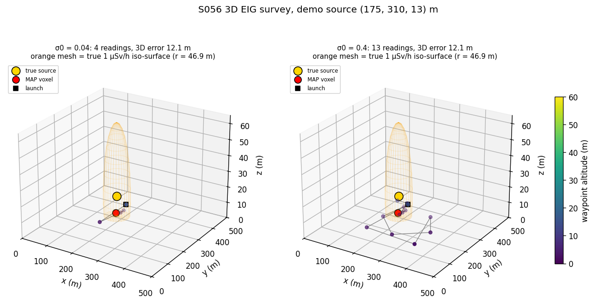
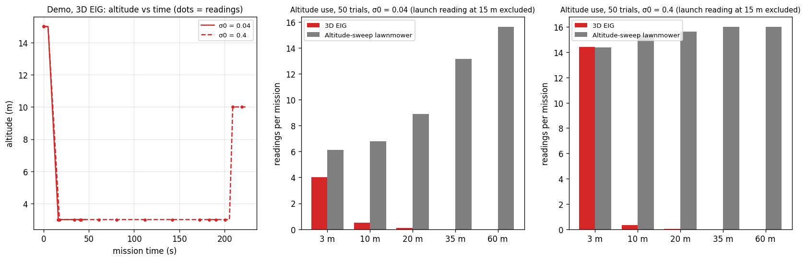
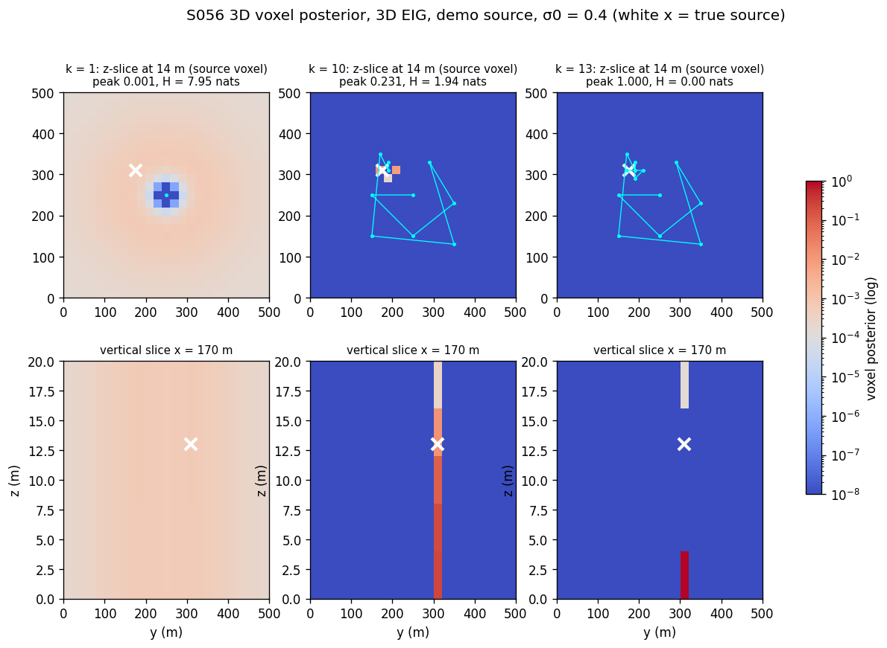
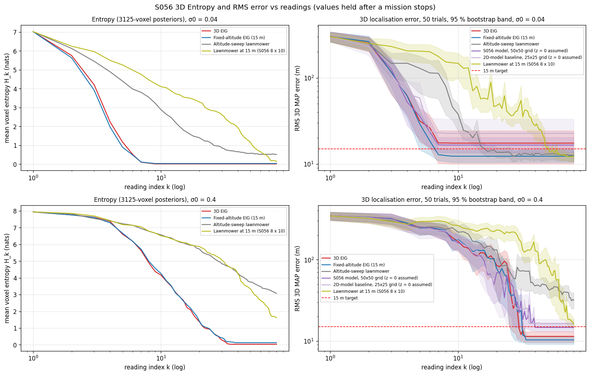
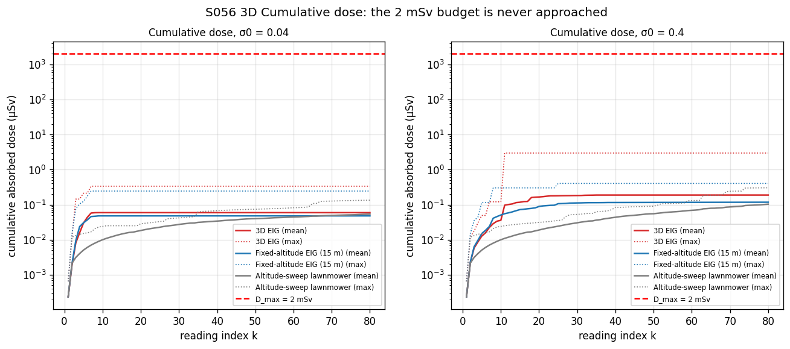
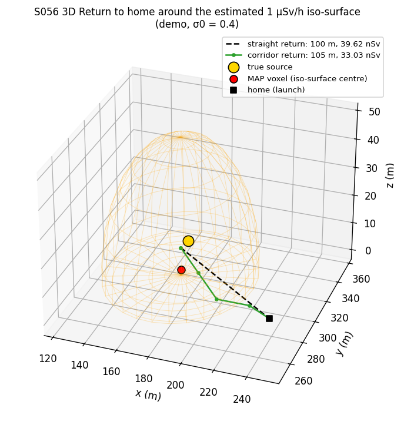
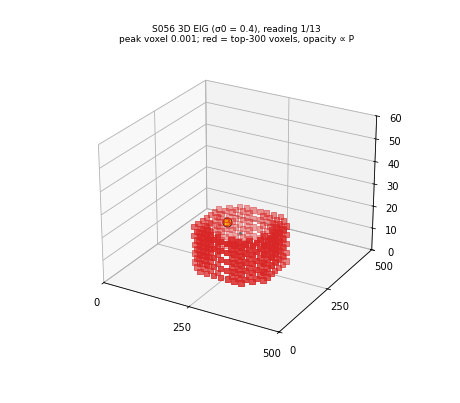

# S056 3D Upgrade — Radiation Hotspot Detection

**Domain**: Environmental Monitoring & SAR | **Difficulty**: ⭐⭐⭐⭐ | **Status**: ✅ Completed

---

## Problem Definition

**Setup**: The S056 survey is kept: a 500 × 500 m exclusion zone, one point source of known strength, inverse-square dose with air attenuation and background, Gaussian counting noise, a sequential Bayesian posterior, a stop at posterior peak ≥ 0.90 or 80 readings, a 5-waypoint cooldown and a first reading at the launch point. Two things become 3D:
- The source can sit anywhere in $[0, 500]^2 \times [0, 20]$ m (ground to rooftop). It is inferred on a 25 × 25 × 5 voxel posterior (20 × 20 × 4 m voxels, 3125 voxels).
- The drone chooses its altitude. Candidate waypoints are the 625 horizontal cell centres × 5 altitudes {3, 10, 20, 35, 60} m. It flies straight 3D legs at 8 m/s and dwells 5 s per reading.

The absorbed dose is integrated along every leg from the true field. The EIG score is penalised by $\lambda_D(k)\,D_{3D}(\mathbf{w}, \hat{\mathbf{p}}_s^{mean})$ as on the card. Every strategy takes its first reading at the launch point (250, 250, 15) m.

**Strategies** (same 50 sources, same noise draws, same launch reading):

| Strategy | Description |
|----------|-------------|
| **3D EIG** (card 1) | Max of EIG − dose penalty over all 3125 (x, y, z) waypoints, 3D voxel posterior |
| **Fixed-altitude EIG** (card 2) | The same score and posterior, waypoints locked at 15 m |
| **Altitude-sweep lawnmower** (card 3) | A 4 × 4 boustrophedon at each altitude, 60 m down to 3 m (80 readings), 3D voxel posterior |
| **S056 model, 50 × 50 grid** (2D baseline, X5) | The S056 model as written: ground-level source hypotheses on S056's 50 × 50 grid of 10 m cells, h = 15 m, the same EIG rule. Its estimate is taken at z = 0 |
| 2D-model baseline, 25 × 25 grid | The same ground-source model on the 25 × 25 cells of this variant, so that only the posterior differs from the fixed-altitude EIG |
| **Lawnmower at 15 m** (control) | The S056 8 × 10 lawnmower at 15 m, 3D voxel posterior |

Ablations and probes:
- 3D EIG with $\lambda_0$ = 0 and 0.5 (card 0.05).
- 3D EIG without the 3 m altitude.
- Split mismatch probes. Each source is moved to its voxel centre in x-y only (vertical mismatch remains), in z only (horizontal mismatch remains), or fully (no mismatch).

 Like S056, everything is run at the card's detector noise $\sigma_0$ = 0.04 and at a 10× noisier detector ($\sigma_0$ = 0.4).

**Key question (card)**: Does choosing the altitude localise a 3D source faster or better than a fixed 15 m survey?

---

## Mathematical Model

**Dose rate** (3D slant range, stand-off floor $r_{min}$ = 1 m added):
$$D_{3D}(\mathbf{p}, \mathbf{p}_s) = D_{bg} + \frac{A}{r^2}e^{-\mu r},\qquad r = \max(\|\mathbf{p} - \mathbf{p}_s\|, r_{min})$$

**Measurement** (S056 fix: $D_{3D}$ already contains $D_{bg}$):
$$z_k = D_{3D}(\mathbf{p}_k, \mathbf{p}_s^*) + \varepsilon_k,\qquad \varepsilon_k \sim \mathcal{N}\bigl(0, \sigma_0^2 D_{3D}(\mathbf{p}_k, \mathbf{p}_s^*)\bigr)$$

**Altitude sensitivity** (card formula, checked numerically):
$$\frac{\partial D_{3D}}{\partial z_d} = -A\,(z_d - z_s)\frac{2 + \mu r}{r^4}e^{-\mu r}$$
This is zero at $z_d = z_s$. At $\rho$ = 20 m horizontal offset its magnitude peaks at $|z_d - z_s|$ = 11.54 m (≈ $\rho/\sqrt3$ = 11.55 m). At one fixed altitude $h$, $z_s$ and $2h - z_s$ give identical readings. At 15 m, a source at 12 m and one at 18 m both read 4.970237 µSv/h at 20 m offset.

**Voxel posterior**: uniform prior, $H_0 = \ln 3125$ = 8.047 nats. Log-likelihood update with $\hat\sigma_j = \sigma_0\sqrt{D_{3D}(\mathbf{p}_k, \mathbf{c}_j)}$. MAP voxel estimate.

**EIG and dose penalty**:
$$\text{EIG}(\mathbf{w}) = \tfrac12\log\Bigl(1 + \frac{\sum_j P_k(v_j)[D_{3D}(\mathbf{w},\mathbf{c}_j) - \bar z]^2}{\sigma_0^2\,\bar z(\mathbf{w})}\Bigr),\qquad
\mathbf{w}^* = \arg\max_{\mathbf{w}\notin\mathcal{R}_k}\bigl[\text{EIG}(\mathbf{w}) - \lambda_D(k)\,D_{3D}(\mathbf{w}, \hat{\mathbf{p}}_s^{mean})\bigr]$$
$$\lambda_D(k) = \lambda_0\exp\Bigl(\frac{D_{acc,k} - D_{max}/2}{D_{max}/4}\Bigr)$$
Ties within 10⁻⁹ (relative) are broken by 3D distance and then by index (the S056 fix).

**Dose accumulation**: the true dose rate is sampled every ≤ 2 m along each leg and multiplied by the leg time, plus $D_{3D}\,\Delta t_{int}$ per dwell. A mission stops if $D_{acc} \ge D_{max}$.

**Safe return to home**: the iso-surface $D_{3D} = 1$ µSv/h around the MAP voxel is a sphere of radius 46.92 m. The corridor is a shortest path on the waypoint lattice (plus the launch point) that does not enter this sphere. Inside it, a step may only go to a node of lower estimated dose, so it can leave. It is compared with the straight line home.

---

## Key Parameters

| Parameter | Value |
|-----------|-------|
| Zone / source height range | 500 × 500 m / $z_s \in [0, 20]$ m |
| Voxel grid | 25 × 25 × 5 = 3125 voxels of 20 × 20 × 4 m |
| Altitude set $\mathcal{Z}$ | {3, 10, 20, 35, 60} m; 3125 candidate waypoints |
| Fixed altitude (card 2, 2D baselines) | 15 m |
| Ground-source 2D baselines | S056's 50 × 50 grid of 10 m cells; also this variant's 25 × 25 grid |
| Bootstrap for RMS ratios (added) | 2000 paired resamples, seeds 5600 / 5700 + noise multiplier (5800–5912 for the 200-seed check) |
| Larger-sample 3 m check (added) | 200 held-out seeds (50–249), σ0 = 0.04 and 0.4, 3D EIG / fixed altitude / 3D EIG without 3 m |
| Speed / dwell | 8 m/s / 5 s |
| Max readings / stop threshold | 80 / peak ≥ 0.90 |
| Source strength $A$ | 2000 µSv·m²/h |
| $\mu$ / $D_{bg}$ | 2 × 10⁻⁴ m⁻¹ / 0.10 µSv/h |
| $\sigma_0$ | 0.04 (card); 0.4 (10× case, as in S056) |
| Dose budget $D_{max}$ / $\lambda_0$ | 2 mSv / 0.05 (ablations 0 and 0.5) |
| Cooldown | 5 waypoints |
| Target | 3D error ≤ 15 m |
| Monte Carlo (changed) | 50 trials (card 30), source and noise from `default_rng(56000 + trial)` |
| Launch point (added) | (250, 250, 15) m, first reading taken there |
| Stand-off floor $r_{min}$ (added) | 1 m (active in at most 1 reading of 50 missions) |
| Dose integration step (added) | ≤ 2 m along each leg |
| Altitude-sweep lattice (added) | 4 × 4 per altitude layer, layers 60 → 3 m |
| Iso-dose for the corridor | 1 µSv/h (radius 46.92 m) |
| Demo source (added) | (175, 310, 13) m |
| Error band | 95 % bootstrap of the RMS (1000 resamples) |

---

## Implementation

```
src/03_environmental_sar/3d/s056_3d_radiation.py
```

```bash
conda activate drones
python src/03_environmental_sar/3d/s056_3d_radiation.py
```

The dose matrices [candidate waypoint × hypothesis] are computed once (3125 × 3125 for the 3D EIG), so each EIG map costs two matrix–vector products. Runtime ≈ 3–3.5 min including the 200-seed checks (200 s and 200 s with `OMP/OPENBLAS/MKL_NUM_THREADS=1`, 175 s with default threading). The three runs printed byte-identical output and wrote byte-identical PNG and GIF files.

---

## Results

### Field checks

| Altitude above a ground source | Dose directly above | Dose 20 m off-centre |
|------|------:|------:|
| 3 m | 222.19 µSv/h | 4.970 µSv/h |
| 10 m | 20.06 µSv/h | 4.082 µSv/h |
| 20 m | 5.08 µSv/h | 2.586 µSv/h |
| 35 m | 1.72 µSv/h | 1.321 µSv/h |
| 60 m | 0.65 µSv/h | 0.594 µSv/h |

### Monte Carlo (50 sources uniform in the volume; same draws for all strategies)

**σ0 = 0.04 (card)**

| Strategy | RMS 3D | Median / max | ≤ 15 m | RMS horiz. | RMS vert. | Readings | Converged | Path | Time | Mean dose |
|----------|------:|------:|:---:|------:|------:|------:|:---:|------:|------:|------:|
| 3D EIG | 17.5 m | 8.7 / 75.9 m | 42/50 | 16.1 m | 6.7 m | 5.6 ± 1.4 | 50/50 | 848 m | 134 s | 0.059 µSv |
| **Fixed-altitude EIG** | **12.3 m** | 10.6 / 35.9 m | 42/50 | 9.8 m | 7.5 m | 5.1 ± 1.5 | 50/50 | 800 m | 126 s | 0.048 µSv |
| Altitude-sweep lawnmower | 12.6 m | 9.2 / 32.9 m | 38/50 | 11.6 m | 5.0 m | 51.6 ± 25.4 | 30/50 | 5957 m | 1003 s | 0.053 µSv |
| S056 model, 50 × 50 grid | 16.6 m | 13.9 / 55.9 m | 26/50 | 11.8 m | 11.7 m | 4.9 ± 1.3 | 50/50 | 746 m | 118 s | 0.090 µSv |
| 2D-model baseline, 25 × 25 grid | 22.7 m | 14.6 / 121.2 m | 26/50 | 19.5 m | 11.7 m | 4.7 ± 1.3 | 50/50 | 748 m | 117 s | 0.028 µSv |
| Lawnmower at 15 m | 12.2 m | 11.5 / 20.5 m | 37/50 | 8.6 m | 8.7 m | 45.7 ± 24.3 | 45/50 | 2500 m | 541 s | 0.046 µSv |
| 3D EIG, $\lambda_0$ = 0 | 19.8 m | 8.9 / 75.9 m | 40/50 | 18.7 m | 6.6 m | 5.5 ± 1.5 | 50/50 | 849 m | 134 s | 0.196 µSv |
| 3D EIG, $\lambda_0$ = 0.5 | 14.0 m | 10.1 / 39.0 m | 35/50 | 11.1 m | 8.4 m | 5.8 ± 1.6 | 50/50 | 880 m | 139 s | 0.071 µSv |
| 3D EIG without 3 m (probe) | 11.5 m | 9.1 / 22.7 m | 38/50 | 8.2 m | 8.1 m | 5.8 ± 1.4 | 50/50 | 815 m | 131 s | 0.083 µSv |

**σ0 = 0.4 (10×)**

| Strategy | RMS 3D | Median / max | ≤ 15 m | RMS horiz. | RMS vert. | Readings | Converged | Path | Time | Mean dose |
|----------|------:|------:|:---:|------:|------:|------:|:---:|------:|------:|------:|
| 3D EIG | 11.4 m | 8.4 / 23.6 m | 41/50 | 9.2 m | 6.7 m | 15.8 ± 7.9 | 50/50 | 3480 m | 514 s | 0.188 µSv |
| **Fixed-altitude EIG** | **10.3 m** | 9.1 / 20.6 m | 46/50 | 7.8 m | 6.7 m | 23.2 ± 22.1 | 44/50 | 4121 m | 631 s | 0.117 µSv |
| Altitude-sweep lawnmower | 31.7 m | 17.3 / 95.8 m | 20/50 | 30.8 m | 7.6 m | 78.4 ± 7.9 | 2/50 | 9010 m | 1518 s | 0.103 µSv |
| S056 model, 50 × 50 grid | 14.7 m | 14.0 / 24.0 m | 28/50 | 8.9 m | 11.7 m | 16.2 ± 8.2 | 50/50 | 3174 m | 478 s | 0.149 µSv |
| 2D-model baseline, 25 × 25 grid | 16.5 m | 15.8 / 39.1 m | 23/50 | 11.6 m | 11.7 m | 14.2 ± 7.8 | 50/50 | 2956 m | 440 s | 0.074 µSv |
| Lawnmower at 15 m | 16.2 m | 13.7 / 36.3 m | 28/50 | 13.7 m | 8.5 m | 74.2 ± 15.2 | 10/50 | 3940 m | 864 s | 0.066 µSv |
| 3D EIG, $\lambda_0$ = 0 | 10.4 m | 8.5 / 23.3 m | 44/50 | 8.3 m | 6.3 m | 16.0 ± 7.7 | 50/50 | 3418 m | 507 s | 0.258 µSv |
| 3D EIG, $\lambda_0$ = 0.5 | 10.7 m | 8.4 / 22.7 m | 41/50 | 8.5 m | 6.4 m | 19.5 ± 8.8 | 50/50 | 4218 m | 625 s | 0.190 µSv |
| 3D EIG without 3 m (probe) | 9.5 m | 8.7 / 19.6 m | 46/50 | 7.4 m | 6.0 m | 17.1 ± 7.9 | 50/50 | 3529 m | 527 s | 0.152 µSv |

**Head-to-head on identical sources** (wins / ties / losses for the first strategy):

| σ0 | Pair | Lower 3D error | Lower horiz. error | Fewer readings | RMS 3D ratio [95 % bootstrap CI] | Mean-readings ratio |
|----|------|:---:|:---:|:---:|:---:|:---:|
| 0.04 | 3D EIG vs fixed-altitude EIG | 24 / 6 / 20 | 7 / 35 / 8 | 6 / 22 / 22 | 1.42 [0.89, 1.93] | 1.10 |
| 0.04 | 3D EIG vs altitude-sweep lawnmower | 21 / 13 / 16 | 12 / 32 / 6 | 50 / 0 / 0 | 1.38 [0.83, 1.94] | 0.11 |
| 0.04 | Fixed-altitude EIG vs S056 model (50 × 50) | 37 / 0 / 13 | 25 / 0 / 25 | 16 / 15 / 19 | 0.74 [0.56, 0.99] | 1.05 |
| 0.04 | Fixed-altitude EIG vs 2D model (25 × 25) | 43 / 0 / 7 | 12 / 31 / 7 | 8 / 21 / 21 | 0.54 [0.34, 0.96] | 1.08 |
| 0.04 | Altitude-sweep vs 15 m lawnmower | 16 / 15 / 19 | 5 / 31 / 14 | 18 / 8 / 24 | 1.03 [0.88, 1.20] | 1.13 |
| 0.04 | 3D EIG without 3 m vs 3D EIG | 18 / 12 / 20 | 8 / 37 / 5 | 10 / 22 / 18 | 0.66 [0.46, 1.13] | 1.04 |
| 0.04 | 3D EIG without 3 m vs fixed-altitude EIG | 17 / 18 / 15 | 6 / 42 / 2 | 1 / 18 / 31 | 0.94 [0.78, 1.11] | 1.14 |
| 0.4 | 3D EIG vs fixed-altitude EIG | 26 / 5 / 19 | 3 / 36 / 11 | 24 / 11 / 15 | 1.10 [0.93, 1.32] | 0.68 |
| 0.4 | 3D EIG vs altitude-sweep lawnmower | 32 / 4 / 14 | 28 / 16 / 6 | 50 / 0 / 0 | 0.36 [0.28, 0.48] | 0.20 |
| 0.4 | Fixed-altitude EIG vs S056 model (50 × 50) | 34 / 0 / 16 | 27 / 0 / 23 | 19 / 7 / 24 | 0.70 [0.62, 0.80] | 1.43 |
| 0.4 | Fixed-altitude EIG vs 2D model (25 × 25) | 46 / 0 / 4 | 18 / 29 / 3 | 11 / 5 / 34 | 0.63 [0.54, 0.73] | 1.64 |
| 0.4 | Altitude-sweep vs 15 m lawnmower | 19 / 4 / 27 | 11 / 14 / 25 | 2 / 38 / 10 | 1.96 [1.44, 2.53] | 1.06 |
| 0.4 | 3D EIG without 3 m vs 3D EIG | 22 / 6 / 22 | 12 / 37 / 1 | 8 / 9 / 33 | 0.84 [0.69, 0.99] | 1.08 |
| 0.4 | 3D EIG without 3 m vs fixed-altitude EIG | 19 / 23 / 8 | 3 / 47 / 0 | 11 / 10 / 29 | 0.93 [0.82, 1.02] | 0.74 |

The CIs are paired bootstraps over the 50 trials (2000 resamples, seeded). **3D EIG vs fixed-altitude EIG in detail**:

| σ0 | Median 3D error | RMS without each side's worst 2 trials | Gross errors (> 30 m) | Two worst trials |
|----|---:|---:|:---:|---:|
| 0.04 | 8.75 vs 10.63 m | 10.69 vs 11.06 m | 2 vs 1 | 75.9, 63.1 vs 35.9, 20.2 m |
| 0.4 | 8.40 vs 9.15 m | 10.59 vs 9.74 m | 0 vs 0 | 23.6, 23.3 vs 20.6, 18.3 m |

**Diagnostics**

| σ0 | Quantity | 3D EIG | Fixed-altitude EIG | S056 model (50 × 50) | 2D model (25 × 25) |
|----|----------|------:|------:|------:|------:|
| 0.04 | Gross errors (> 30 m) | 2 | 1 | 2 | 1 |
| 0.04 | Median posterior on the source's own voxel / cell | 6.47 × 10⁻²²¹ | 2.31 × 10⁻¹²⁹ | 1.77 × 10⁻³⁷ (2D cell) | 1.00 (2D cell) |
| 0.04 | Distinct altitudes per mission | 1.48 | 1.00 | 1.00 | 1.00 |
| 0.4 | Gross errors (> 30 m) | 0 | 0 | 0 | 1 |
| 0.4 | Median posterior on the source's own voxel / cell | 3.79 × 10⁻⁷ | 4.78 × 10⁻¹⁰ | 3.08 × 10⁻⁵ (2D cell) | 0.987 (2D cell) |
| 0.4 | Distinct altitudes per mission | 1.32 | 1.00 | 1.00 | 1.00 |

**Altitude use of the 3D EIG** (readings per mission after the launch reading):

| σ0 | Variant | 3 m | 10 m | 20 m | 35 m | 60 m | Share at 3 m |
|----|---------|---:|---:|---:|---:|---:|---:|
| 0.04 | $\lambda_0$ = 0.05 (card) | 4.02 | 0.50 | 0.10 | 0.00 | 0.00 | 0.870 |
| 0.04 | $\lambda_0$ = 0 | 3.92 | 0.48 | 0.14 | 0.00 | 0.00 | 0.863 |
| 0.04 | $\lambda_0$ = 0.5 | 4.02 | 0.44 | 0.30 | 0.00 | 0.00 | 0.845 |
| 0.4 | $\lambda_0$ = 0.05 (card) | 14.42 | 0.34 | 0.02 | 0.00 | 0.00 | 0.976 |
| 0.4 | $\lambda_0$ = 0 | 14.32 | 0.58 | 0.06 | 0.00 | 0.00 | 0.957 |
| 0.4 | $\lambda_0$ = 0.5 | 16.90 | 0.72 | 0.60 | 0.16 | 0.14 | 0.913 |

**Vertical probe**: trials where the horizontal voxel is correct, and how many of these miss the height by more than one voxel or land on the mirror side of 15 m:

| σ0 | Strategy | Horizontal voxel correct | Vertical error > 1 voxel | Mirror side of 15 m | RMS vert. (these trials) |
|----|----------|:---:|:---:|:---:|---:|
| 0.04 | 3D EIG | 46/50 | 21 | 5 | 6.60 m |
| 0.04 | Fixed-altitude EIG | 45/50 | 25 | 9 | 7.42 m |
| 0.04 | Altitude-sweep lawnmower | 39/50 | 15 | 1 | 4.83 m |
| 0.4 | 3D EIG | 46/50 | 17 | 8 | 5.84 m |
| 0.4 | Fixed-altitude EIG | 49/50 | 27 | 10 | 6.53 m |
| 0.4 | Altitude-sweep lawnmower | 24/50 | 13 | 6 | 6.70 m |

**On-grid ablation** (each source moved to its voxel centre, so there is no model mismatch):

| σ0 | Strategy | RMS 3D | Exact voxel | Readings | Converged | 3D EIG vs fixed: fewer / equal / more readings | Mean-readings ratio |
|----|----------|------:|:---:|------:|:---:|:---:|:---:|
| 0.04 | 3D EIG | 0.0 m | 50/50 | 5.7 ± 1.3 | 50/50 | 13 / 26 / 11 | 0.89 |
| 0.04 | Fixed-altitude EIG | 0.6 m | 49/50 | 6.4 ± 3.0 | 50/50 | | |
| 0.4 | 3D EIG | 0.8 m | 48/50 | 16.8 ± 8.4 | 50/50 | 23 / 18 / 9 | 0.82 |
| 0.4 | Fixed-altitude EIG | 0.8 m | 48/50 | 20.6 ± 14.8 | 48/50 | | |

Moving the sources onto voxel centres also removes the quantisation floor, so the near-zero errors above are partly by construction. The floor is the RMS distance from each source to its own voxel centre: 7.45 m for continuous sources, 1.10 m with x-y moved, 7.37 m with z moved, 0 when fully moved.

**Split mismatch probes** (RMS 3D error, gross errors > 30 m in brackets; 3D EIG / fixed-altitude EIG / 3D EIG without 3 m; ratio = 3D EIG / fixed with 95 % bootstrap CI):

| σ0 | Sources | 3D EIG | Fixed-altitude EIG | 3D EIG without 3 m | Ratio [CI] | 3D EIG lower / higher error |
|----|---------|---:|---:|---:|:---:|:---:|
| 0.04 | Continuous (both mismatches) | 17.46 m (2) | 12.30 m (1) | 11.52 m (0) | 1.42 [0.90, 1.92] | 24 / 20 |
| 0.04 | x-y on the centre (vertical mismatch only) | 1.14 m (0) | 3.10 m (0) | 1.18 m (0) | 0.37 [0.28, 0.61] | 9 / 3 |
| 0.04 | z on the centre (horizontal mismatch only) | 18.32 m (3) | 10.79 m (0) | 11.64 m (0) | 1.70 [1.01, 2.38] | 17 / 22 |
| 0.04 | Fully on the centre (no mismatch) | 0.00 m (0) | 0.57 m (0) | 0.00 m (0) | – | 1 / 0 |
| 0.4 | Continuous (both mismatches) | 11.38 m (0) | 10.31 m (0) | 9.54 m (0) | 1.10 [0.91, 1.31] | 26 / 19 |
| 0.4 | x-y on the centre (vertical mismatch only) | 1.58 m (0) | 2.93 m (0) | 1.16 m (0) | 0.54 [0.36, 0.90] | 9 / 8 |
| 0.4 | z on the centre (horizontal mismatch only) | 10.87 m (0) | 10.09 m (0) | 9.78 m (0) | 1.08 [0.89, 1.27] | 19 / 18 |
| 0.4 | Fully on the centre (no mismatch) | 0.80 m (0) | 0.80 m (0) | 0.00 m (0) | – | 2 / 2 |

The CI in the "continuous" rows uses a different bootstrap seed from the head-to-head table above, hence the small difference ([0.90, 1.92] vs [0.89, 1.93]).

**Mean voxel entropy (nats) after $k$ readings**:

| σ0 | Strategy | k = 1 | 2 | 3 | 5 | 10 |
|----|----------|---:|---:|---:|---:|---:|
| 0.04 | 3D EIG | 7.02 | 5.75 | 4.21 | 1.17 | 0.01 |
| 0.04 | Fixed-altitude EIG | 7.02 | 5.63 | 3.92 | 0.89 | 0.03 |
| 0.04 | Altitude-sweep lawnmower | 7.02 | 6.13 | 5.45 | 4.40 | 2.88 |
| 0.04 | Lawnmower at 15 m | 7.02 | 6.25 | 5.96 | 5.25 | 4.10 |
| 0.4 | 3D EIG | 7.94 | 7.76 | 7.63 | 6.61 | 4.16 |
| 0.4 | Fixed-altitude EIG | 7.94 | 7.76 | 7.61 | 6.67 | 4.26 |
| 0.4 | Altitude-sweep lawnmower | 7.94 | 7.82 | 7.54 | 7.23 | 6.57 |
| 0.4 | Lawnmower at 15 m | 7.94 | 7.85 | 7.70 | 7.18 | 6.51 |

**Dose and return to home** (after the 3D EIG missions):

| σ0 | Largest mission dose (any strategy) | Start inside est. iso-surface | Straight line crosses it from outside | Length straight / corridor (ratio) | True dose straight / corridor (mean) | Corridor lower dose | Max true dose after exit, straight / corridor |
|----|------:|:---:|:---:|------:|------:|:---:|------:|
| 0.04 | 3.021 µSv (0.151 % of $D_{max}$) | 49/50 | 0/50 | 207 / 219 m (1.06) | 13.93 / 14.60 nSv | 26/50 | 3.958 / 23.876 µSv/h |
| 0.4 | 3.361 µSv (0.168 % of $D_{max}$) | 50/50 | 0/50 | 205 / 217 m (1.06) | 24.59 / 22.59 nSv | 29/50 | 0.996 / 1.000 µSv/h |

No mission was stopped by the dose budget.

### Demo source (175, 310, 13) m

| σ0 | Strategy | Readings | Peak | MAP voxel | 3D error | Path | Altitudes used |
|----|----------|---:|---:|---|---:|---:|---|
| 0.04 | 3D EIG | 4 | 1.000 | (170, 310, 2) | 12.1 m | 212 m | 3 |
| 0.04 | Fixed-altitude EIG | 4 | 1.000 | (190, 310, 2) | 18.6 m | 292 m | 15 |
| 0.04 | Altitude-sweep lawnmower | 27 | 0.903 | (170, 310, 14) | 5.1 m | 3164 m | 35, 60 |
| 0.04 | S056 model (50 × 50) | 3 | 1.000 | (175, 315, 0) | 13.9 m | 168 m | 15 |
| 0.04 | 2D model (25 × 25) | 4 | 1.000 | (190, 310, 0) | 19.8 m | 360 m | 15 |
| 0.04 | Lawnmower at 15 m | 28 | 1.000 | (170, 310, 2) | 12.1 m | 1611 m | 15 |
| 0.4 | 3D EIG | 13 | 1.000 | (170, 310, 2) | 12.1 m | 1271 m | 3, 10 |
| 0.4 | Fixed-altitude EIG | 9 | 0.992 | (190, 310, 2) | 18.6 m | 1142 m | 15 |
| 0.4 | Altitude-sweep lawnmower | 80 | 0.631 | (170, 310, 14) | 5.1 m | 9196 m | all five |
| 0.4 | S056 model (50 × 50) | 17 | 1.000 | (175, 315, 0) | 13.9 m | 3491 m | 15 |
| 0.4 | 2D model (25 × 25) | 10 | 1.000 | (170, 310, 0) | 13.9 m | 1186 m | 15 |
| 0.4 | Lawnmower at 15 m | 80 | 0.207 | (170, 310, 10) | 5.8 m | 4231 m | 15 |

Return home on the σ0 = 0.4 demo: straight 100 m / 39.62 nSv, corridor 105 m / 33.03 nSv. The drone starts inside the estimated iso-surface.

**Key findings**:
- **Modelling the source height lowers the 3D error, but the size of the gain depends on the 2D baseline's grid (2D-baseline comparison, X5).** The fixed-altitude EIG flies the same 15 m survey with the same EIG rule as the ground-source model; only the posterior differs.
  - Against S056 as written (50 × 50 grid of 10 m cells), the RMS 3D error drops from 16.6 to 12.3 m (ratio 0.74, CI [0.56, 0.99], 37 of 50 trials) at the card's noise. At 10× noise it drops from 14.7 to 10.3 m (0.70, [0.62, 0.80], 34 of 50).
  - Against the same model on this variant's 25 × 25 grid, the gain is larger: 22.7 → 12.3 m (0.54) and 16.5 → 10.3 m (0.63).
  - Much of the gap is by construction, because the ground-source model always answers z = 0 (RMS vertical 11.7 m).
  - Horizontally there is no clear winner on S056's own grid: RMS 9.8 vs 11.8 m and 7.8 vs 8.9 m, with per-trial splits of 25 / 25 and 27 / 23. The larger horizontal distortion seen on the 25 × 25 grid (9.8 vs 19.5 m) does not survive the finer grid.
- **Freeing the altitude gives no detectable accuracy difference; the card's expected gain does not appear.** The RMS 3D error is 17.5 vs 12.3 m (ratio 1.42) at σ0 = 0.04 and 11.4 vs 10.3 m (1.10) at σ0 = 0.4, but both bootstrap CIs include 1: [0.89, 1.93] and [0.93, 1.32]. The RMS gap at σ0 = 0.04 comes from two trials (75.9 and 63.1 m). Without each side's two worst trials, the RMS is 10.69 vs 11.06 m, and the median favours the 3D EIG (8.75 vs 10.63 m). Per trial the split is 24 / 20 and 26 / 19. What the 3D EIG does have is more gross failures at the card's noise: 2 of 50 against 1 of 50. Horizontally it is worse a little more often than better (7 vs 8, 3 vs 11). Its entropy also does not fall fastest. At σ0 = 0.04 the fixed-altitude EIG is lower after 2, 3 and 5 readings (0.89 vs 1.17 nats at k = 5); at σ0 = 0.4 the two are within 0.1 nats (6.61 vs 6.67 at k = 5, 4.16 vs 4.26 at k = 10).
- **The altitude choice does save readings with the noisier detector.** At σ0 = 0.4 the 3D EIG needs 15.8 instead of 23.2 readings (ratio 0.68; fewer in 24 trials, more in 15) and converges in 50/50 instead of 44/50 missions. At σ0 = 0.04 it needs slightly more (5.6 vs 5.1; ratio 1.10).
- **The 3D EIG almost never uses the high altitudes.** 87.0 % (σ0 = 0.04) and 97.6 % (σ0 = 0.4) of its readings after launch are at 3 m, and none are at 35 or 60 m with the card's $\lambda_0$. The card's picture of high passes for context followed by a dive does not appear. Close to the ground the spread of predicted doses across hypotheses is largest, which is what the EIG score rewards.
- **The residual errors come from an interaction between the altitude policy and the 20 m horizontal voxel mismatch (split probes).** No voxel estimate can beat the quantisation floor, which is 7.45 m RMS for these continuous sources. The probes separate the two kinds of mismatch:
  - *Vertical mismatch only* (x-y moved to the voxel centre): the 3D EIG beats the fixed altitude, 1.14 vs 3.10 m (ratio 0.37, CI [0.28, 0.61]) at σ0 = 0.04 and 1.58 vs 2.93 m ([0.36, 0.90]) at σ0 = 0.4. Readings at a second altitude do resolve the source height better.
  - *Horizontal mismatch only* (z moved): at σ0 = 0.04 the 3D EIG is worse, 18.32 vs 10.79 m (ratio 1.70, CI [1.01, 2.38]), with 3 gross errors against 0. At σ0 = 0.4 the two are level (10.87 vs 10.09 m).
  - *Probed cause*: in the 50 main trials the same 3D EIG without the 3 m altitude gets 11.64 m and 0 gross errors under horizontal mismatch, and 11.52 m with 0 gross errors on continuous sources (17.46 m and 2 with 3 m allowed). On its own this is thin evidence: the ratio CI is [0.46, 1.13] and the gap rests on 2 gross failures.
  - The no-3 m policy was defined *after* seeing these first 50 trials, so the 200 further seeds (50–249) serve as a held-out confirmation. At σ0 = 0.04 they confirm it. With 3 m allowed the 3D EIG has 14 gross failures against 5 without 3 m, and the RMS ratio is 1.27 [1.16, 1.40] on continuous sources. Under horizontal mismatch only it has 15 vs 5 failures, ratio 1.22 [1.11, 1.35]. So the 3 m readings, where the dose changes fastest, turn a 10 m horizontal model error into a confident wrong voxel.
  - On the same 200 seeds the full 3D EIG and the fixed altitude are still indistinguishable: 1.08 [0.96, 1.21]. The 3D EIG without 3 m beats the fixed altitude: 12.39 vs 14.54 m, 0.85 [0.76, 0.95]; under horizontal mismatch 0.88 [0.79, 0.98].
  - On the 50 main trials, without the 3 m altitude the 3D EIG matches the fixed altitude: 11.52 vs 12.30 m (CI [0.78, 1.11]) and 9.54 vs 10.31 m ([0.82, 1.02]). At σ0 = 0.4 it still needs fewer readings (ratio 0.74).
  - At σ0 = 0.4 the 3 m effect is small or absent.
    - On the 50 main trials, 3D EIG without 3 m vs with it gives 0.84 [0.69, 0.99].
    - On the 200 held-out seeds, 3D EIG with 3 m vs without gives 1.06 [0.97, 1.16] on continuous sources, which is not significant. Gross failures are 0 with 3 m and 2 without. Under horizontal mismatch only it is 1.10 [1.01, 1.19].
    - On the held-out seeds at σ0 = 0.4, the full 3D EIG and the fixed altitude are indistinguishable (0.96 [0.88, 1.04]). The 3D EIG without 3 m is slightly better than the fixed altitude (0.90 [0.84, 0.97]).
  - With no mismatch at all, both find the exact voxel in 48–50 of 50 trials. The altitude freedom then saves readings (ratio 0.89 and 0.82).
- **The mirror ambiguity of a single altitude is real but not the limiting factor.** Among trials with the correct horizontal voxel, the fixed-altitude EIG lands on the mirror side of 15 m in 9 (σ0 = 0.04) and 10 (σ0 = 0.4) trials, against 5 and 8 for the 3D EIG. Voxel centres (2, 6, 10, 14, 18 m) are not symmetric about 15 m, so on-grid sources are resolved exactly even at one altitude. With continuous source heights, however, the second altitude helps: in the vertical-mismatch-only probe the fixed altitude has 3.10 m RMS against 1.14 m for the 3D EIG.
- **The $\lambda_0$ sweep changes the result by a few trials.** At σ0 = 0.04 the RMS 3D error is 19.8 / 17.5 / 14.0 m for $\lambda_0$ = 0 / 0.05 / 0.5. At σ0 = 0.4 it is 10.4 / 11.4 / 10.7 m. A larger $\lambda_0$ adds readings (19.5 vs 15.8 at σ0 = 0.4) and hardly moves the altitude mix (84.5–97.6 % at 3 m). At σ0 = 0.04, removing the 3 m altitude matters more than any $\lambda_0$: RMS 11.52 m without 3 m, against 14.0–19.8 m across $\lambda_0$. At σ0 = 0.4 it does not: the held-out 3 m effect is not significant (1.06 [0.97, 1.16]), while the $\lambda_0$ values span 10.4–11.4 m.
- **Sweeping the lawnmower through all altitudes hurts it.** Compared with the S056 lawnmower at 15 m, the RMS 3D error is about equal at σ0 = 0.04 (12.6 vs 12.2 m) and much worse at σ0 = 0.4 (31.7 vs 16.2 m, ratio 1.96). Readings at 35 and 60 m carry little information: the dose above a ground source is 1.72 and 0.65 µSv/h there. As in S056, the slow lawnmower is competitive in accuracy at the card's noise (12.6 m, against 17.5 m for the 3D EIG), but the 3D EIG needs only 0.11× its readings (5.6 vs 51.6).
- **The dose budget never binds.** The largest dose of any mission (all strategies and probes) is 3.021 µSv (σ0 = 0.04) and 3.361 µSv (σ0 = 0.4), 0.151–0.168 % of the 2 mSv budget, so $\lambda_D$ stays at its floor $\lambda_0 e^{-2}$. A 5 s dwell 3 m above a ground source costs only 222.19 µSv/h × 5 s.
- **The safe corridor brings no measurable benefit.** The drone ends inside the estimated 1 µSv/h sphere in 49/50 and 50/50 missions, because it finishes near the source. The straight line home never crosses the sphere from outside. The corridor is 6 % longer, and the true dose on the way home is tens of nanosieverts either way; it is lower on the corridor in only 26 and 29 of 50 trials. When the MAP voxel is wrong (σ0 = 0.04), the corridor can pass closer to the true source than the straight line: the maximum true dose after leaving the estimated sphere is 23.876 vs 3.958 µSv/h.

### 3D Trajectory

The 3D EIG on the demo source at both noise levels, coloured by altitude. Gold = true source, red = MAP voxel, orange mesh = true 1 µSv/h iso-surface. The axes are not to scale, so the sphere looks elongated. The σ0 = 0.04 mission flies only at 3 m; the σ0 = 0.4 mission uses 3 m and 10 m:



### Altitude Profile and Altitude Use

Left: altitude vs mission time on the demo. Middle and right: mean readings per mission at each altitude over the 50 trials for the 3D EIG and the altitude-sweep lawnmower:



### Voxel Posterior Slices

3D EIG, demo source, σ0 = 0.4. Top: horizontal slice through the source's voxel layer (12–16 m). Bottom: vertical slice at x = 170 m. The posterior is shown after 1, 10 and 13 readings; the mission stops after 13, so the card's snapshots at $k$ = 30 and 60 do not exist. After 10 readings the column above the source still carries mass at several heights. The final MAP voxel is at z = 2 m (3D error 12.1 m):



### Entropy and RMS Error Curves

Mean voxel entropy (3125-voxel posteriors only; the ground-source models have 2500 and 625 cells) and RMS 3D MAP error with 95 % bootstrap bands, held after a mission stops:



### Cumulative Dose

Mean (solid) and maximum (dotted) cumulative dose vs reading index, against the 2 mSv budget:



### Safe Return Corridor

Demo, σ0 = 0.4: straight return vs the corridor around the estimated 1 µSv/h iso-surface:



### Animation

Rotating view of the top-300 voxels (opacity ∝ posterior) and the 3D EIG path on the demo source at σ0 = 0.4, one frame per reading (13 frames):



### Deviations from the scenario card

| Card | Implementation | Reason |
|------|----------------|--------|
| $\sigma_{rad} = \sigma_0\sqrt{D_{3D} + D_{bg}}$ (also in $\hat\sigma_j$ and $\bar\sigma^2_{rad}$) | $\sigma_0\sqrt{D_{3D}}$ | $D_{3D}$ already contains $D_{bg}$; same fix as S056. Card corrected. |
| "The gradient $\partial D/\partial z_d$ is maximised when $z_d \approx z_s$" | It is zero at $z_d = z_s$ and peaks near $\|z_d - z_s\| = \rho/\sqrt3$ (printed: 11.54 m at $\rho$ = 20 m) | Follows from the factor $(z_d - z_s)$ in the card's own formula. Card corrected; the mirror ambiguity at a fixed altitude was added to the card. |
| 30 Monte Carlo trials | 50, per-trial seeds | Matches the S056 2D Monte Carlo; win counts need the larger sample. |
| Waypoint chosen before the first reading | First reading at (250, 250, 15) m for every strategy | S056 fix: a common first reading keeps the comparison fair. |
| `argmax` of the score | Relative 10⁻⁹ ties broken by 3D distance, then index | S056 fix for BLAS-dependent tie-breaking (X1). |
| Inverse-square law with no floor | $r \ge r_{min}$ = 1 m | Avoids a singular dose if a waypoint coincides with the source. Active in at most 1 reading per 50 missions. |
| Trapezoid of the two leg end points for the transit dose | True dose rate sampled every ≤ 2 m along the leg | A leg that passes over the source between two distant end points would be under-counted by the trapezoid. |
| "Boustrophedon at each altitude level" | 4 × 4 lattice per layer, 60 → 3 m, 80 readings in total | Fits the 80-reading budget. The S056 8 × 10 lawnmower at 15 m was added as a control. |
| Three strategies | Plus the S056 model on its own 50 × 50 grid (the X5 2D baseline), the same model on this variant's 25 × 25 grid, and the 15 m lawnmower | The 50 × 50 run is S056 as written. The 25 × 25 run isolates the posterior, because it uses the same candidate cells as the fixed-altitude EIG. The two give different effect sizes, so both are reported. |
| — | $\lambda_0$ ablations (0, 0.5), a 3D EIG without the 3 m altitude, and on-grid / x-y-only / z-only source probes with bootstrap CIs | Sensitivity to the penalty, and direct probes of where the errors come from (C9). |
| Dose budget $D_{acc} \le D_{max}$ | Also asserted per leg: the absorbed dose grows on every leg and dwell; every waypoint lies on its model's horizontal lattice (20 m or 10 m cell centres) at an altitude from the independent constants $\mathcal Z$ or $h$ = 15 m | Invariants that can fail (X4). A test that moved the candidate altitudes to 1000 m, or shifted x by 3 m, triggers the assert. |
| Corridor "re-routed through the 3D field" | Shortest lattice path that does not enter the estimated 1 µSv/h sphere, except to leave it | The drone almost always ends inside the sphere, so the corridor must allow an exit. |
| Posterior slices at $k$ = 1, 10, 30, 60 | $k$ = 1, 10 and the final reading 13 | The demo mission stops after 13 readings. |
| Dose budget keeps the drone within 2 mSv | Implemented; it never binds (max 0.168 % of the budget) | The card's numbers make the budget 3 orders of magnitude larger than any mission dose. |
| Building-mounted source | Point source in free air, no structure | The card has no geometry for the building; low passes under an elevated source are therefore unobstructed. |

---

## Extensions

1. Fix the horizontal voxel mismatch: inflate the likelihood variance by the within-voxel dose spread, or use a particle filter (card Extension 5). The split probes show that this mismatch combined with 3 m readings causes the gross failures.
2. Re-run the altitude comparison with that robust likelihood to see whether the 3D EIG's better height resolution (vertical-only probe) and reading savings (ratio 0.82–0.89 on-grid) survive at 3 m.
3. A realistic dose budget (e.g. a stronger source or a sensitive payload) so that $\lambda_D$ actually rises during the mission.
4. Unknown source strength (card Extension 2): altitude diversity should matter more there, because strength and distance trade off at one altitude.
5. Occluding building geometry for elevated sources (card Extension 1).

---

## Related Scenarios

- Base 2D version: [S056 Nuclear Plant Leak Detection (Radiation Hotspot Localization)](../../../../scenarios/03_environmental_sar/S056_radiation.md)
- 3D card: [S056 3D Upgrade — Radiation Hotspot Detection](../../../../scenarios/03_environmental_sar/3d/S056_3d_radiation.md)
- Bayesian search: [S042 Missing Person Localization](../../../../scenarios/03_environmental_sar/S042_missing_person.md)
- Field mapping: [S045 Chemical Plume Tracing](../../../../scenarios/03_environmental_sar/S045_plume_tracing.md), [S055 Coastline Oil Spill Tracking](../../../../scenarios/03_environmental_sar/S055_oil_spill.md)
