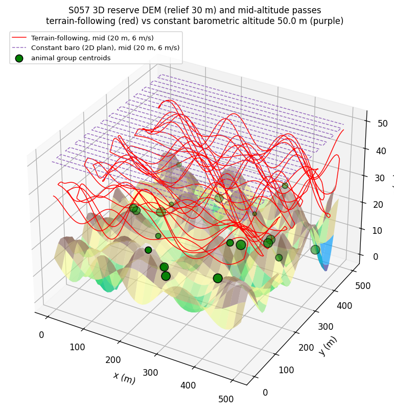
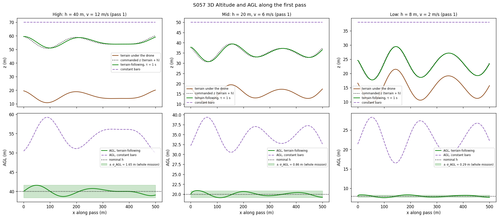
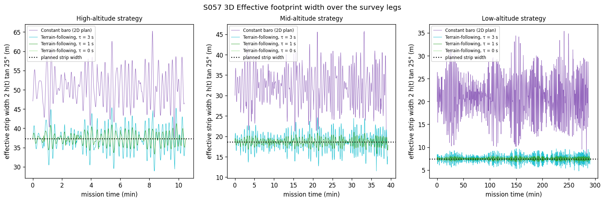
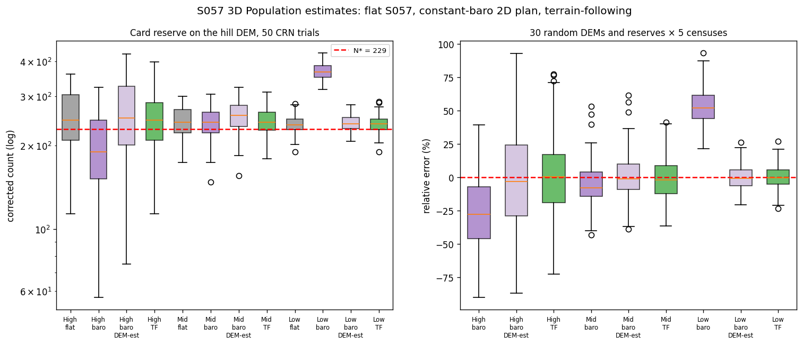
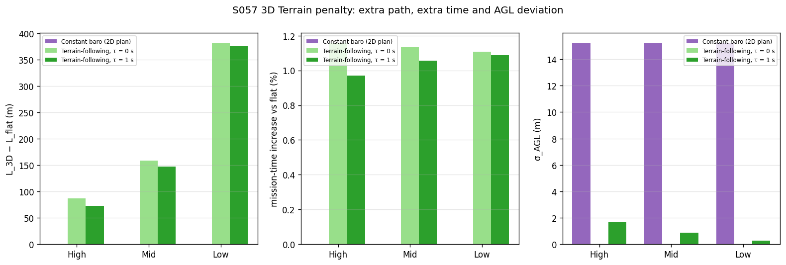
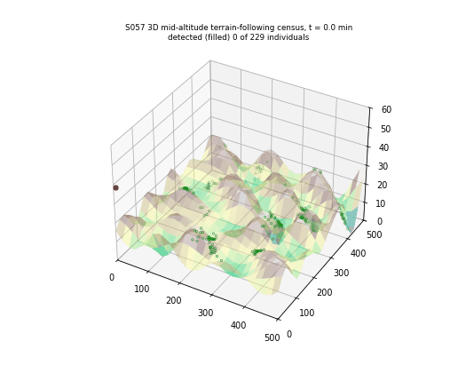

# S057 3D Upgrade — Wildlife Census

**Domain**: Environmental Monitoring & SAR | **Difficulty**: ⭐⭐⭐ | **Status**: ✅ Completed

---

## Problem Definition

**Setup**: The S057 census moves onto hilly terrain. From S057 it keeps:
- the 500 × 500 m reserve with 20 clustered groups (seed 42, $N^*$ = 229, $\bar c$ = 0.282);
- the 25° nadir camera;
- the detection model $P_d = P_{d0}e^{-\alpha H}e^{-\beta v}(1-c_g)$;
- contiguous lawnmower strips of width $2h\tan 25°$;
- the estimator $\hat N = N_{raw}/\overline P_d(h, v, \bar c)$;
- the three operating points.

The terrain is a DEM of five sin·cos harmonics with 30 m peak-to-valley relief, and the animals stand on it. Every pass is integrated as a 3D trajectory at constant 3D speed $v$.

**Flight modes** (same plan, same animals and the same detection uniforms in every mode):

| Mode | Description |
|------|-------------|
| **Flat terrain (S057)** | The 2D reference: zero terrain, constant height $h$ |
| **Constant baro (2D plan)** (X5 baseline) | The S057 plan flown at one barometric altitude that keeps $h$ above the highest terrain: $z$ = max DEM + $h$ |
| **Terrain-following** (card) | $z_{cmd} = z_{terrain}(x, y) + h$ with a first-order lag $\tau_z$ = 1 s; sweep $\tau_z$ = 0, 1, 3 s |

**Detection in 3D**: an animal is in the camera cone on a pass when its cross-track offset is at most $H\tan 25°$, where $H = z_{drone} - z_{animal}$ at overflight. Its detection probability uses that same $H$. A footprint wider than the planned spacing overlaps the next strip, so the same animal can be counted twice. A narrower footprint leaves gaps, where animals are missed. The $k$-th pass that covers an animal uses that animal's $k$-th detection uniform, and these uniforms are shared by all modes (CRN).

**Estimators**:
- The card's estimator, $N_{raw}/\overline P_d(h_{nom}, v, \bar c)$.
- An added DEM-aware estimator, $N_{raw}/((1-\bar c)\bar f)$. Here $\bar f$ is the area mean, over a 2 m ground grid, of the summed per-pass $P_{d0}e^{-\alpha H}e^{-\beta v}$, computed from the flown trajectory and the DEM. It needs no animal positions, so a constant-baro survey could use it in post-processing.

**Key question (card)**: Does terrain following restore the strip-transect assumptions that a constant-altitude survey breaks on hilly ground, and at what cost?

---

## Mathematical Model

**DEM**:
$$z_{raw} = \frac{\Delta z_{max}}{K}\sum_{k=1}^{5}\sin\Bigl(\frac{2\pi x}{\lambda_{x,k}} + \phi_{x,k}\Bigr)\cos\Bigl(\frac{2\pi y}{\lambda_{y,k}} + \phi_{y,k}\Bigr),\qquad \lambda \sim U(80, 300)\ \text{m}$$
$z_{raw}$ is rescaled to [0, 30] m on a 101 × 101 node grid (5 m cells) and interpolated bilinearly. The raw sum of the card DEM spans 38.02 m (see Deviations).

**Terrain-following lag at constant 3D speed**, integrated in horizontal arc length $s$ with $\Delta s$ = 0.1 m:
$$\dot z = \frac{z_{cmd} - z}{\tau_z},\qquad e = \frac{z_{cmd} - z}{\tau_z v},\qquad \frac{dz}{ds} = \frac{e}{\sqrt{1-e^2}},\qquad dt = \frac{ds\sqrt{1 + (dz/ds)^2}}{v}$$
The code asserts $|e| < 1$ (climb rate below the airspeed), AGL > 0 and 3D speed ≤ $v$. Hence $T_{mission} = L_{3D}/v$, as on the card.

**AGL deviation**: $\sigma_{AGL} = \sqrt{\frac1T\int (h(t) - h_{AGL})^2\,dt}$, with $h(t)$ the nadir AGL over the whole pass including turns.

**Card overlap fraction** between adjacent passes, averaged along $x$: $\delta_j = \max(0, w_j + w_{j+1} - W_{strip})/W_{strip}$, with half-widths $w_j = h_j\tan 25°$.

**Battery** (S057 model on terrain): 1800 s endurance, 180 s landing reserve, 300 s swap. Transits run at 12 m/s via a climb to max DEM + 10 m, a level leg and a descent to the launch corner (0, 0). The battery is checked every 2 m of survey path. The code asserts that the battery never runs empty and never lands below the reserve.

---

## Key Parameters

| Parameter | Value |
|-----------|-------|
| Reserve / groups / $N^*$ | 500 × 500 m / 20 / 229 (S057 seed 42) |
| Camera half-angle | 25° |
| $P_{d0}$ / $\alpha$ / $\beta$ | 0.95 / 0.04 m⁻¹ / 0.08 s/m |
| High / Mid / Low $(h, v)$ | (40 m, 12 m/s) / (20 m, 6 m/s) / (8 m, 2 m/s) |
| Strip width / passes | 37.30 / 18.65 / 7.46 m; 14 / 27 / 68 passes |
| DEM | $K$ = 5, $\lambda \in$ [80, 300] m, seed 57, rescaled to 30 m relief, 101 × 101 nodes |
| Altitude lag $\tau_z$ | 1.0 s (card); sweep 0, 1, 3 s (added) |
| AGL bounds | 5–50 m (reported, not enforced) |
| Monte Carlo (card reserve) | 50 trials, seeds 57000 + trial |
| Random terrains (added) | 30 DEM + reserve pairs × 5 censuses (seeds 57100+) |
| Constant-baro altitude (added) | max DEM + $h$ |
| Detection uniforms per animal (added) | 8 (asserted sufficient) |
| Integration step (added) | 0.1 m horizontal |
| Ground grid for $\bar f$ (added) | 2 m |
| Battery / reserve / swap / transit | 1800 s / 180 s / 300 s / 12 m/s (S057) |
| Transit clearance (added) | max DEM + 10 m |

---

## Implementation

```
src/03_environmental_sar/3d/s057_3d_wildlife.py
```

```bash
conda activate drones
python src/03_environmental_sar/3d/s057_3d_wildlife.py
```

The script imports the fixed S057 module for the reserve, the individual draws, the detection model and the strip layout. Runtime ≈ 50 s on an idle machine and up to about 2 min under load (47–128 s measured). The three runs printed byte-identical output and wrote byte-identical PNG and GIF files.

---

## Results

### Terrain checks

| Quantity | Value |
|----------|-------|
| Raw harmonic-sum relief (card DEM) | 38.02 m → rescaled to 30.00 m |
| Raw relief over 30 random DEMs | 27.4 – 53.6 m (mean 40.1); the card formula allows up to 60 m |
| Max slope along x / max gradient | 0.441 (23.8°) / 0.686 |
| Constant altitude at mean terrain + $h$ (not flown) | Low: below the terrain on 4.1 % of the reserve and below terrain + $h$/2 on 20.4 %; Mid: 0.0 % / 1.2 %; High: 0.0 % / 0.0 % |

The last row is why the constant-baro baseline has to fly at max DEM + $h$.

### Flight geometry (card reserve, hill DEM)

| Strategy | Mode | $\tau_z$ | $L_{3D}$ | $T = L_{3D}/v$ | Sorties / total time | $\sigma_{AGL}$ | AGL min / mean / max | Outside 5–50 m | Mean multiplicity $\bar k$ | Uncovered area | Card $\bar\delta$ | Effective $\overline P_d$ |
|---|---|---:|---:|---:|---:|---:|---:|---:|---:|---:|---:|---:|
| High | flat | – | 7485 m | 624 s | 1 / 674 s | 0.000 m | 40.00 / 40.00 / 40.00 m | 0.0 % | 1.000 | 0.00 % | 0.0000 | 0.0527 |
| High | baro | – | 7485 m | 624 s | 1 / 676 s | 15.226 m | 40.00 / 54.47 / 69.94 m | **82.0 %** | 1.352 | 0.00 % | 0.3623 | 0.0295 |
| High | TF | 0 | 7572 m | 631 s | 1 / 682 s | 0.000 m | 40.00 / 40.00 / 40.00 m | 0.0 % | 1.005 | 1.32 % | 0.0000 | 0.0523 |
| High | TF | 1 | 7558 m | 630 s | 1 / 681 s | 1.652 m | 34.69 / 40.00 / 44.48 m | 0.0 % | 1.004 | 2.04 % | 0.0107 | 0.0523 |
| High | TF | 3 | 7520 m | 627 s | 1 / 677 s | 3.451 m | 29.47 / 40.01 / 49.63 m | 0.0 % | 1.001 | 3.41 % | 0.0227 | 0.0523 |
| Mid | flat | – | 13985 m | 2331 s | 2 / 2761 s | 0.000 m | 20.00 / 20.00 / 20.00 m | 0.0 % | 1.000 | 0.00 % | 0.0000 | 0.1895 |
| Mid | baro | – | 13985 m | 2331 s | 2 / 2765 s | 15.224 m | 20.73 / 34.50 / 49.95 m | 0.0 % | 1.704 | 0.00 % | 0.7246 | 0.1053 |
| Mid | TF | 0 | 14143 m | 2357 s | 2 / 2786 s | 0.000 m | 20.00 / 20.00 / 20.00 m | 0.0 % | 1.005 | 0.62 % | 0.0000 | 0.1885 |
| Mid | TF | 1 | 14132 m | 2355 s | 2 / 2784 s | 0.860 m | 16.84 / 20.00 / 22.56 m | 0.0 % | 1.005 | 0.97 % | 0.0070 | 0.1884 |
| Mid | TF | 3 | 14094 m | 2349 s | 2 / 2778 s | 2.225 m | 12.35 / 19.99 / 26.37 m | 0.0 % | 1.004 | 2.86 % | 0.0251 | 0.1878 |
| Low | flat | – | 34500 m | 17250 s | 12 / 21507 s | 0.000 m | 8.00 / 8.00 / 8.00 m | 0.0 % | 1.000 | 0.00 % | 0.0000 | 0.4218 |
| Low | baro | – | 34500 m | 17250 s | 12 / 21517 s | 15.220 m | 8.00 / 22.50 / 37.94 m | 0.0 % | **2.799** | 0.00 % | 1.8120 | 0.2312 |
| Low | TF | 0 | 34882 m | 17441 s | 12 / 21607 s | 0.000 m | 8.00 / 8.00 / 8.00 m | 0.0 % | 1.008 | 0.18 % | 0.0000 | 0.4207 |
| Low | TF | 1 | 34875 m | 17438 s | 12 / 21606 s | 0.291 m | 6.96 / 8.00 / 8.86 m | 0.0 % | 1.008 | 0.26 % | 0.0025 | 0.4206 |
| Low | TF | 3 | 34856 m | 17428 s | 12 / 21603 s | 0.852 m | 5.14 / 8.00 / 10.39 m | 0.0 % | 1.009 | 1.00 % | 0.0107 | 0.4196 |

The planned 2D path is 7485 / 13985 / 34500 m for every mode. The effective $\overline P_d$ is $(1-\bar c)\bar f/\bar k$, the mean per-look detection probability; the nominal values are 0.0527 / 0.1895 / 0.4218.

### Census, card reserve (50 CRN trials, $N^*$ = 229)

| Strategy | Mode | $\tau_z$ | Estimator | Raw count | $\hat N$ (mean ± std) | Bias | Per-survey mean \|error\| | RMS error | Miss rate | No-coverage rate | Double-count rate |
|---|---|---:|---|---:|---:|---:|---:|---:|---:|---:|---:|
| High | flat | – | card | 13.0 | 247.1 ± 62.7 | +7.9 % | 24.3 % | 28.5 % | 94.3 % | 0.00 % | 0.00 % |
| High | baro | – | card | 10.3 | 194.7 ± 62.5 | −15.0 % | 25.2 % | 31.1 % | 95.6 % | 0.00 % | 1.15 % |
| High | baro | – | DEM | 10.3 | 256.9 ± 82.4 | +12.2 % | 31.0 % | 38.0 % | 95.6 % | 0.00 % | 1.15 % |
| High | TF | 1 | card | 13.0 | 246.7 ± 63.6 | +7.7 % | 23.5 % | 28.8 % | 94.3 % | 3.23 % | 0.00 % |
| High | TF | 1 | DEM | 13.0 | 247.7 ± 63.9 | +8.2 % | 23.6 % | 29.1 % | 94.3 % | 3.23 % | 0.00 % |
| Mid | flat | – | card | 46.2 | 244.0 ± 30.2 | +6.5 % | 12.1 % | 14.7 % | 79.8 % | 0.00 % | 0.00 % |
| Mid | baro | – | card | 45.3 | 238.9 ± 34.0 | +4.3 % | 12.8 % | 15.5 % | 81.3 % | 0.00 % | 5.27 % |
| Mid | baro | – | DEM | 45.3 | 252.3 ± 35.9 | +10.2 % | 16.1 % | 18.7 % | 81.3 % | 0.00 % | 5.27 % |
| Mid | TF | 1 | card | 46.4 | 244.9 ± 30.5 | +7.0 % | 12.2 % | 15.0 % | 79.7 % | 1.02 % | 0.03 % |
| Mid | TF | 1 | DEM | 46.4 | 245.2 ± 30.5 | +7.1 % | 12.2 % | 15.1 % | 79.7 % | 1.02 % | 0.03 % |
| Low | flat | – | card | 100.4 | 238.1 ± 18.6 | +4.0 % | 7.1 % | 9.0 % | 56.1 % | 0.00 % | 0.00 % |
| Low | baro | – | card | 155.6 | **369.0 ± 24.9** | **+61.1 %** | 61.1 % | 62.1 % | 46.8 % | 0.00 % | **21.58 %** |
| Low | baro | – | DEM | 155.6 | 240.6 ± 16.2 | +5.0 % | 7.1 % | 8.7 % | 46.8 % | 0.00 % | 21.58 % |
| Low | TF | 1 | card | 101.0 | 239.5 ± 19.1 | +4.6 % | 7.4 % | 9.5 % | 56.0 % | 0.26 % | 0.37 % |
| Low | TF | 1 | DEM | 101.0 | 238.3 ± 19.0 | +4.0 % | 7.1 % | 9.2 % | 56.0 % | 0.26 % | 0.37 % |

On this reserve the flat S057 reference itself is +4.0 to +7.9 % high. This combines the reserve's +2.3 % camouflage-weighting bias from S057 with the sampling noise of 50 correlated trials.

**Per-survey head-to-head** (smaller / equal / larger \|error\|, terrain-following with the card estimator first):

| Strategy | vs baro, card est. | vs baro, DEM est. | vs flat S057 | TF DEM est. vs TF card est. | Mean \|error\| ratio TF / baro-DEM | Time ratio TF / baro (survey / total) |
|---|:---:|:---:|:---:|:---:|:---:|:---:|
| High | 20 / 9 / 21 | 32 / 0 / 18 | 15 / 16 / 19 | 23 / 0 / 27 | 0.76 | 1.010 / 1.006 |
| Mid | 22 / 4 / 24 | 26 / 0 / 24 | 19 / 12 / 19 | 16 / 0 / 34 | 0.75 | 1.011 / 1.007 |
| Low | 50 / 0 / 0 | 25 / 0 / 25 | 14 / 9 / 27 | 37 / 0 / 13 | 1.04 | 1.011 / 1.004 |

### Lag sweep (terrain-following, card estimator)

| Strategy | $\sigma_{AGL}$ at $\tau_z$ = 0 / 1 / 3 s | Min AGL | Bias | Mean \|error\| | Uncovered area | $\bar k$ |
|---|---|---|---|---|---|---|
| High | 0.000 / 1.652 / 3.451 m | 40.00 / 34.69 / 29.47 m | +7.2 / +7.7 / +6.6 % | 23.7 / 23.5 / 24.0 % | 1.32 / 2.04 / 3.41 % | 1.005 / 1.004 / 1.001 |
| Mid | 0.000 / 0.860 / 2.225 m | 20.00 / 16.84 / 12.35 m | +7.0 / +7.0 / +6.4 % | 12.3 / 12.2 / 12.9 % | 0.62 / 0.97 / 2.86 % | 1.005 / 1.005 / 1.004 |
| Low | 0.000 / 0.291 / 0.852 m | 8.00 / 6.96 / 5.14 m | +4.5 / +4.6 / +4.5 % | 7.4 / 7.4 / 7.8 % | 0.18 / 0.26 / 1.00 % | 1.008 / 1.008 / 1.009 |

### 30 random terrains and reserves × 5 censuses (CRN across modes)

| Strategy | Baro, card est. | Baro, DEM est. | TF, card est. | TF, DEM est. | TF(card) vs baro(DEM) | TF(card) vs baro(card) |
|---|---|---|---|---|:---:|:---:|
| High | −26.3 % ± 25.6, \|err\| 30.6 % | −1.5 % ± 34.5, \|err\| 28.8 % | −0.7 % ± 29.3, \|err\| **23.1 %** | −0.3 % ± 29.5, \|err\| 23.2 % | 101 / 0 / 49 | 89 / 15 / 46 |
| Mid | −5.6 % ± 16.3, \|err\| 13.8 % | +0.5 % ± 17.3, \|err\| 13.1 % | −1.7 % ± 15.1, \|err\| **12.2 %** | −1.7 % ± 15.1, \|err\| 12.2 % | 83 / 0 / 67 | 78 / 13 / 59 |
| Low | +52.1 % ± 13.4, \|err\| 52.1 % | −0.8 % ± 8.8, \|err\| 7.1 % | −0.1 % ± 8.4, \|err\| **6.6 %** | −0.7 % ± 8.4, \|err\| 6.6 % | 75 / 0 / 75 | 150 / 0 / 0 |

Each cell is the bias ± std of the relative error, then the per-survey mean |error|, over 150 censuses. The last two columns are wins / ties / losses for terrain-following.

**Key findings**:
- **A 2D plan flown at a safe constant altitude breaks the census, most at low altitude.** To keep $h$ above every hill, the drone flies higher than planned: for Low the AGL ranges from 8.00 to 37.94 m (mean 22.50 m) instead of 8 m. The footprint then overlaps neighbouring strips ($\bar k$ = 2.799), 21.58 % of counts are double counts, and the card estimator over-estimates by +61.1 % (+52.1 % over 30 random terrains). It loses every one of the 50 card-reserve censuses and all 150 random-terrain censuses to terrain-following. At high altitude the effect reverses: lower $P_d$ dominates, so the bias is −15.0 % (−26.3 % over random terrains). The drone also spends 82.0 % of the time above the 50 m AGL bound.
- **Terrain following restores the 2D behaviour.** With $\tau_z$ = 1 s the bias and per-survey error stay close to the flat S057 reference on the same draws: 23.5 vs 24.3 %, 12.2 vs 12.1 % and 7.4 vs 7.1 % mean |error|. Over random terrains the bias is −1.7 to −0.1 %. The cost is small: the survey takes 1.010–1.011× as long as at constant altitude, and the sortie counts are unchanged (1 / 2 / 12).
- **Much of the constant-altitude damage can be removed in post-processing, but not all.** The DEM-aware estimator divides by the coverage-weighted detection probability from the flown track. It removes the constant-baro bias over random terrains (−1.5 / +0.5 / −0.8 %) and brings Low to 7.1 % mean |error|, level with terrain-following (75 / 0 / 75 wins, ratio 1.04 on the card reserve). At High and Mid the higher AGL still costs detections that no correction recovers. Terrain-following is more accurate (23.1 vs 28.8 % and 12.2 vs 13.1 % mean |error|) and wins 101 / 150 and 83 / 150 censuses. At Low, the extra looks from overlapping strips at constant altitude compensate for the lower per-look $P_d$ (0.2312 vs 0.4206).
- **The card's lag concern is real for tracking but small for the census.** $\sigma_{AGL}$ grows with speed and $\tau_z$: 1.652 m at High against 0.291 m at Low with $\tau_z$ = 1 s, and 3.451 m with $\tau_z$ = 3 s. The census hardly notices: from $\tau_z$ = 0 to 3 s the mean |error| moves from 23.7 to 24.0 % (High), 12.3 to 12.9 % (Mid) and 7.4 to 7.8 % (Low). The minimum AGL stays above the 5 m bound (5.14 m at Low with $\tau_z$ = 3 s).
- **Even perfect terrain following leaves small gaps.** With $\tau_z$ = 0 the nadir AGL is exactly $h$, yet 1.32 / 0.62 / 0.18 % of the reserve is not covered (0 % on flat ground). On a side slope the ground beside the track is higher or lower than the nadir point, so the footprint edge moves. The card's nadir-only footprint ignores this. The gaps are too small to show in the error statistics.
- **The card's overlap fraction $\delta$ tracks the problem.** It is 0.3623 / 0.7246 / 1.8120 for constant baro and 0.0107 / 0.0070 / 0.0025 for terrain-following with $\tau_z$ = 1 s. This is the same ranking as the simulated double-count rate.

### 3D Terrain and Trajectory

The DEM with the group centroids, the mid-altitude terrain-following passes (red) and the constant-baro passes at 50.0 m (purple):



### Altitude Profile

First pass of each strategy. Top: terrain, commanded altitude, terrain-following altitude ($\tau_z$ = 1 s) and the constant-baro altitude. Bottom: AGL, with the nominal $h$ and ±σ_AGL of the whole mission:



### Effective Footprint Width

$2h(t)\tan 25°$ from the nadir AGL over the survey legs, against the planned strip width:



### Count Distribution

Left: corrected counts on the card reserve (log scale) for flat S057, constant baro (card and DEM-aware estimators) and terrain-following. Right: relative error over the 30 random terrains:



### Terrain Penalty

Extra 3D path and mission time relative to flat ground, and $\sigma_{AGL}$. Constant baro adds no path, because it flies level:



### Animation

Mid-altitude terrain-following census of trial 0. Hollow green markers are animals not yet detected; filled ones have been detected. 36 frames, one every 4000 integration steps of 139 863. The final frame shows 47 detected individuals, matching the census:



### Deviations from the scenario card

| Card | Implementation | Reason |
|------|----------------|--------|
| Relief "Δz_max = 30 m peak-to-valley" with amplitude $\Delta z_{max}/K$ per harmonic | Raw sum rescaled to exactly [0, 30] m | The card formula spans up to 60 m; the raw relief was 38.02 m here and 27.4–53.6 m over 30 seeds. Card corrected. |
| "Because AGL is truly constant, strip width is uniform and the correction remains valid" | Nearly; 0.18–1.32 % of the area is uncovered with perfect tracking | Side slopes move the footprint edge. Card corrected. |
| Footprint test: horizontal distance from the nadir ≤ $h(t)\tan\theta$, "irrespective of the animal's elevation" | Cone test to the animal's own elevation, $H = z_{drone} - z_{animal}$; $P_d$ uses the same $H$ | This is the physical camera geometry on sloped ground, and it is what makes the constant-altitude baseline over-cover. |
| Only terrain-following strategies | Plus the flat S057 reference and the constant-baro 2D plan | The X5 2D-baseline comparison. |
| $\epsilon = \lvert\overline{\hat N} - N^*\rvert/N^*$ | Per-survey mean \|error\|, RMS, bias and win counts | S057 fix: the card's $\epsilon$ ranks noisy strategies too well. |
| $P_{double,j} = P_d^2\delta_j$ | Double counts simulated per animal and pass; card $\bar\delta$ reported alongside | Direct simulation needs no independence approximation. |
| DEM on a 100 × 100 grid | 101 × 101 nodes (100 × 100 cells of 5 m) | Nodes on both reserve edges. |
| No battery | S057 battery model with 3D transits at max DEM + 10 m | Low needs 12 sorties; asserts no flight on an empty battery. |
| Single terrain | Plus 30 random DEM + reserve pairs | Results do not hinge on one DEM. |
| Card reserve Monte Carlo from one stream | Per-trial seeds (57000 + trial) | Results do not depend on the trial count or order. |
| — | DEM-aware estimator | Tests whether a constant-altitude survey can be fixed in post-processing. |
| Speed $v$ | Constant 3D speed; ground speed slows on climbs | Gives the card's $T = L_{3D}/v$. Blur still uses $v$. |

---

## Extensions

1. Adaptive AGL per strip (card Extension 1), now with the DEM-aware estimator, so that changing altitude does not bias the count.
2. Feed-forward terrain command (card Extension 2) to remove the lag-induced gaps at high speed (2.04 % uncovered at High with $\tau_z$ = 1 s).
3. Slope-aware strip spacing: shrink the spacing where side slopes narrow the footprint, which closes the residual gaps.
4. Animals drifting downhill (card Extension 4), which adds double counts even with perfect tracking.

---

## Related Scenarios

- Base 2D version: [S057 Wildlife Population Census](../../../../scenarios/03_environmental_sar/S057_wildlife.md)
- 3D card: [S057 3D Upgrade — Wildlife Census](../../../../scenarios/03_environmental_sar/3d/S057_3d_wildlife.md)
- Terrain coverage: [S048 3D Upgrade — Lawnmower Coverage on Terrain](../../../../scenarios/03_environmental_sar/3d/S048_3d_lawnmower.md)
- Coverage geometry: [S048 Full-Area Coverage Scan (Lawnmower)](../../../../scenarios/03_environmental_sar/S048_lawnmower.md)
- Footprint vs altitude: [S044 Wall Crack Inspection](../../../../scenarios/03_environmental_sar/S044_wall_crack.md)
