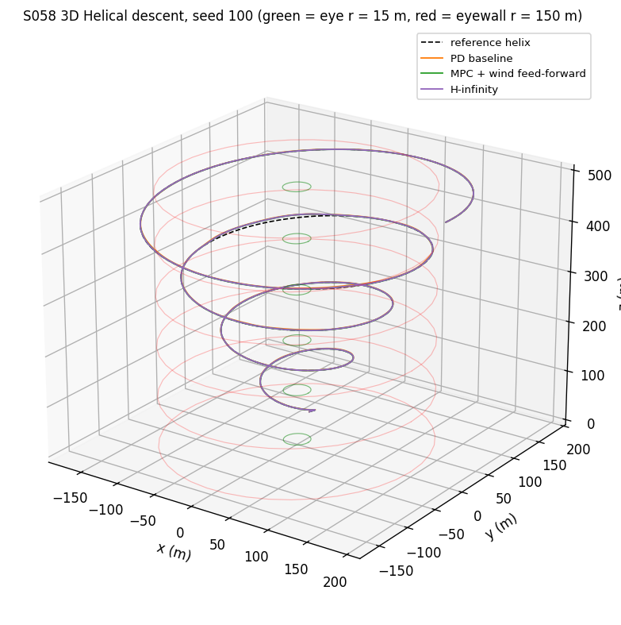
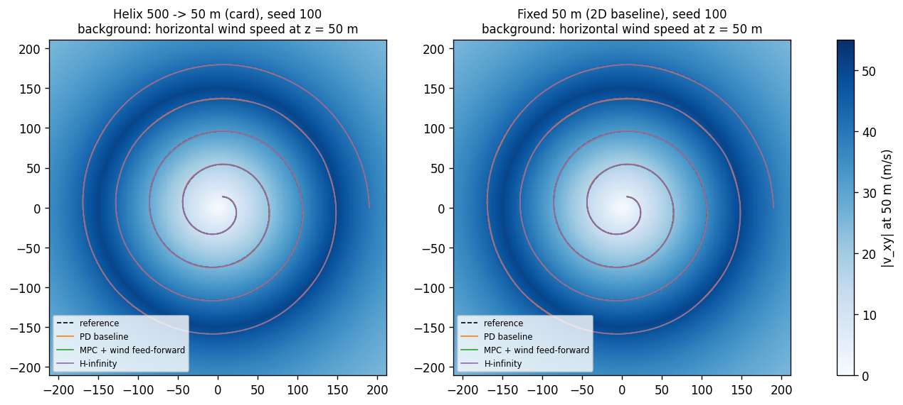
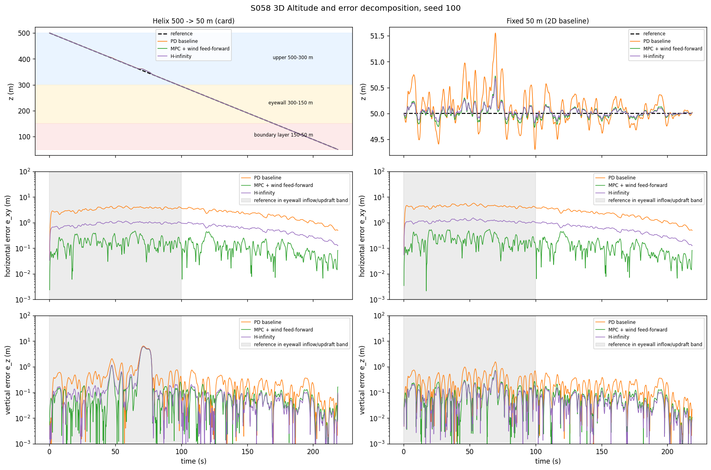
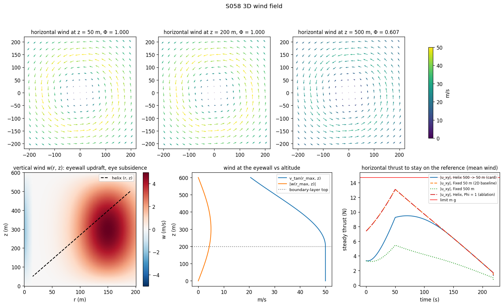
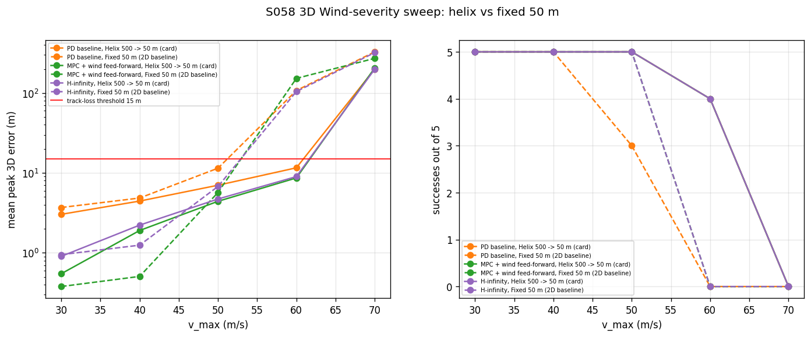
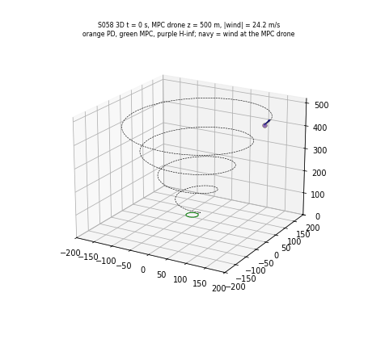

# S058 3D Upgrade — Typhoon Eye Penetration

**Domain**: Environmental Monitoring & SAR | **Difficulty**: ⭐⭐⭐⭐⭐ | **Status**: ✅ Completed

---

## Problem Definition

**Setup**: The S058 inbound spiral (r 190 → 15 m, 0.8 m/s inward, 0.12 rad/s, 218.75 s) becomes a helical descent from 500 m to the 50 m boundary layer through a 3D Rankine vortex. The wind field has three parts:
- Tangential and radial wind scaled by a vertical envelope $\Phi(z)$. It is 1 below the 200 m boundary-layer top and decays as a Gaussian with $\sigma_z$ = 300 m above it.
- An eyewall updraft of up to 5 m/s, with subsidence inside the eye.
- 3D band-limited gusts.

The 1.5 kg drone has six states. Its horizontal thrust is limited to $mg$ and its vertical thrust to $[0.7, 1.3]\,mg$. These are the card's decoupled limits: the tilt is 45° at hover thrust and up to 55.0° when $u_z$ = 0.7 $mg$. A tilt-cone ablation, $\|\mathbf u_{xy}\| \le \min(mg, u_z)$, checks the results under a true 45° limit. It must track the helix and complete the altitude sounding.

**Controllers** (S058, extended to 6 states; same gusts for every run of a seed):

| Controller | Description |
|------------|-------------|
| **PD baseline** | $K_p$ = 4 N/m, $K_d$ = 2.5 N·s/m per axis, with still-air and gravity feed-forward |
| **MPC + wind feed-forward** | Condensed QP over 20 steps; Rankine-vertical wind at the predicted positions; thrust constraints enforced by ADMM |
| **H-infinity** | Discrete game-Riccati state feedback, $\gamma = 1.1\gamma^*$, no wind model |
| MPC, no wind feed-forward | Ablation (S058) |
| MPC, card cost on absolute $\mathbf u$ | Probe of the card's cost (see Deviations) |

**Altitude plans**:

| Plan | Description |
|------|-------------|
| **Helix 500 → 50 m** (card) | Linear descent at 2.0571 m/s while spiralling inward |
| **Fixed 50 m** (2D baseline, X5) | The S058 spiral flown in the boundary layer, where $\Phi$ = 1 |
| Fixed 500 m | The spiral at the entry altitude: weakest wind, but no sounding |
| Helix, $\Phi$ = 1 (ablation) | Helix without the vertical decay of the wind |
| Helix, no vertical wind (ablation) | Helix without updraft and subsidence |

**Key question (card)**: How do the vertical structure of the vortex and a descending reference change the tracking problem, and which controller copes best?

---

## Mathematical Model

**Wind** (cylindrical $r$, $z$):
$$v_{tan} = \Phi(z)\,v_{Rankine}(r),\quad v_{rad} = -\Phi(z)\,v_{inflow}e^{-(r-r_{max})^2/2\sigma_{rad}^2},\quad \Phi(z) = \begin{cases}1 & z \le 200\text{ m}\\ e^{-(z-200)^2/2\sigma_z^2} & z > 200\text{ m}\end{cases}$$
$$w = w_{max}e^{-(r-r_{max})^2/2\sigma_{rad}^2}\sin\frac{\pi z}{H_{dom}} - [r < r_{eye}]\,w_{sub}\Bigl(1 - \frac{r}{r_{eye}}\Bigr)\sin\frac{\pi z}{H_{dom}},\qquad H_{dom} = 600\text{ m}$$
Gusts are an Ornstein–Uhlenbeck process per axis, with 2 s correlation time and standard deviation $0.1\,\Phi(z)\,v_{Rankine}(r)$.

**Dynamics** (S058 drag form):
$$m\ddot{\mathbf p} = \mathbf u - mg\,\hat{\mathbf e}_z + b(\mathbf v_{wind} + \mathbf v_{gust} - \dot{\mathbf p}),\qquad \|\mathbf u_{xy}\| \le mg,\quad 0.7\,mg \le u_z \le 1.3\,mg$$
The model is discretised exactly (ZOH) at 0.1 s. The largest possible $\|\mathbf u\|$ is 24.13 N, so $F_{max}$ = 30 N never binds.

**Reference**: $r = 190 - 0.8t$, $\theta = 0.12t$, $z = 500 - 2.0571t$. The drone starts on the reference with the reference velocity (S058 fix).

**MPC**: $\sum_j \|\mathbf x - \mathbf x_{ref}\|^2_Q + \|\mathbf u - mg\hat{\mathbf e}_z\|^2_R$ plus a terminal DARE weight. $Q$ = diag(10, 10, 10, 1, 1, 1), $R$ = diag(0.1, 0.1, 0.05).

**H-infinity**: performance output $\mathbf z = [\sqrt{10}\,(\mathbf p - \mathbf p_{ref});\ R^{1/2}\mathbf u]$ against the 3D disturbance acceleration. $\gamma^*$ is found by bisection.

**Metrics**:
- Mean 3D error $\bar e_{3D}$, its horizontal and vertical parts, and the peak 3D error.
- Fraction of saturated steps (either thrust limit active).
- Success: the 3D error never exceeds 15 m.
- Sounding completeness: the share of the 46 altitude waypoints (every 10 m) visited within 5 m in altitude and 20 m in radius.

---

## Key Parameters

| Parameter | Value |
|-----------|-------|
| Entry / floor / eye | (190 m, 500 m) / 50 m / 15 m |
| $v_{max}$ / $r_{max}$ / $v_{inflow}$ / $\sigma_{rad}$ | 50 m/s / 150 m / 8 m/s / 40 m |
| $z_{bl}$ / $\sigma_z$ | 200 m / 300 m |
| $w_{max}$ / $w_{sub}$ / $H_{dom}$ | 5 m/s / 2 m/s / 600 m |
| Gusts | 10 % of local $v_{tan}$, OU with 2 s correlation (S058) |
| $m$ / $b$ / $F_{max}$ | 1.5 kg / 0.4 N·s/m / 30 N |
| Thrust limits | $\|\mathbf u_{xy}\| \le$ 14.71 N; $u_z \in$ [10.30, 19.13] N (tilt 45.0° at $u_z = mg$, 55.0° at 0.7 $mg$) |
| Tilt-cone ablation (added) | $\|\mathbf u_{xy}\| \le \min(mg, u_z)$, PD and H-infinity |
| Updraft probe (added) | helix with and without vertical wind at $v_{max}$ = 40 m/s, 5 seeds |
| $v_{inbound}$ / $\omega_{spiral}$ / $v_{descent}$ | 0.8 m/s / 0.12 rad/s / 2.0571 m/s |
| Mission | 218.75 s, 2188 steps of 0.1 s |
| MPC | $N_p$ = 20, $Q$ = diag(10, 10, 10, 1, 1, 1), $R$ = diag(0.1, 0.1, 0.05), ADMM ≤ 150 iterations, tolerance 10⁻³ N |
| PD / H-infinity | 4 N/m, 2.5 N·s/m / $\gamma = 1.1\gamma^*$ |
| Waypoints | every 10 m, tolerance 5 m (altitude) / 20 m (radius) |
| Track-loss threshold (added, S058) | 15 m |
| Seeds | 12 (100–111), common to all runs; sweep 5 seeds, $v_{max}$ = 30–70 m/s |

---

## Implementation

```
src/03_environmental_sar/3d/s058_3d_typhoon.py
```

```bash
conda activate drones
python src/03_environmental_sar/3d/s058_3d_typhoon.py
```

The script sets BLAS to one thread, as S058 does. Runtime is dominated by the MPC runs:
- 297–346 s for the version without the tilt-cone and 40 m/s updraft probes, measured in an independent review run;
- 387–568 s for this version, measured with the CPU saturated by other simulations running in parallel.

The 568 s run is above the 8-minute target, so the runtime is a risk on a busy machine (X9). Three runs (two with `OMP/OPENBLAS/MKL_NUM_THREADS=1`, one with default threading; the script fixes BLAS to one thread itself) printed byte-identical output and wrote byte-identical PNG and GIF files.

---

## Results

### Model checks

| Quantity | Value |
|----------|-------|
| Eyewall crossing on the helix | t = 50.0 s at $z_{ref}$ = 397.1 m, $\Phi$ = 0.806 |
| $\Phi$(500 m) / $\Phi$(300 m) | 0.607 (card: "≈ 70 %") / 0.946 |
| Peak updraft on the helix / in the domain | 4.51 m/s / 5.00 m/s at z = 300 m |
| Steady $\|\mathbf u_{xy}\|$ to stay on the reference, helix | **9.48 N (64 % of $mg$)** at t = 70.4 s (r = 133.7 m, z = 355 m) |
| Same, fixed 50 m (2D baseline) | **13.09 N (89 %)** at t = 50.1 s (r = 149.9 m) |
| Same, fixed 500 m / helix with $\Phi$ = 1 | 5.46 N (37 %) / 13.09 N (89 %) |
| Steady $u_z$ range on the helix | 12.09 – 14.71 N (inside the 10.30 – 19.13 N band) |
| $\gamma^*$ / operating $\gamma$ | 0.5289 / 0.5818 (same as S058) |
| H-infinity gains | x/y 15.22 N/m, 10.60 N·s/m; z 14.41 N/m, 7.51 N·s/m |
| LQR (unconstrained MPC) gains | x/y 8.21 / 5.24; z 11.02 / 6.36 |
| Closed-loop $\mathcal H_\infty$ norm, all / horizontal / vertical inputs | PD 1.3973 / 1.3973 / 1.3301; LQR 0.7613 / 0.7613 / 0.5491; H-inf 0.5709 / 0.5709 / 0.4859 |

Peak steady horizontal thrust for $v_{max}$ = 30 / 40 / 50 / 60 / 70 m/s:
- helix: 4.48 / 6.41 / 9.48 / 12.62 / 15.78 N;
- fixed 50 m: 5.10 / 9.09 / 13.09 / 17.08 / 21.08 N.

The limit is 14.71 N.

### Tracking, $v_{max}$ = 50 m/s, 12 seeds (mean ± std)

| Plan | Controller | $\bar e_{3D}$ | $\bar e_{xy}$ / $\bar e_z$ | Peak 3D (xy / z) | Mean signed z error | Saturated | Success | Sounding |
|------|-----------|---:|---:|---:|---:|---:|:---:|:---:|
| Helix | PD | 2.833 ± 0.093 m | 2.760 / 0.369 m | 6.02 ± 1.85 m (4.74 / 3.62) | +0.286 m | 5.2 % | 12/12 | 100 % |
| Helix | **MPC + FF** | **0.263 ± 0.113 m** | 0.151 / 0.162 m | **2.97 ± 2.78 m** (0.51 / 2.90) | +0.086 m | 5.7 % | 12/12 | 100 % |
| Helix | H-infinity | 0.799 ± 0.100 m | 0.723 / 0.166 m | 3.30 ± 2.59 m (1.23 / 2.91) | +0.143 m | 6.0 % | 12/12 | 100 % |
| Helix | MPC, no FF | 1.415 ± 0.092 m | 1.349 / 0.189 m | 4.00 ± 2.27 m (2.30 / 2.99) | +0.160 m | 5.7 % | 12/12 | 100 % |
| Helix | MPC, card cost | 0.264 ± 0.113 m | 0.151 / 0.162 m | 2.98 ± 2.79 m (0.51 / 2.90) | +0.095 m | 5.8 % | 12/12 | 100 % |
| Fixed 50 m | PD | 3.295 ± 0.145 m | 3.280 / 0.240 m | 9.18 ± 4.26 m (9.17 / 1.51) | +0.049 m | 5.2 % | **10/12** | – |
| Fixed 50 m | MPC + FF | 0.280 ± 0.100 m | 0.249 / 0.084 m | 3.95 ± 3.66 m (3.85 / 0.69) | −0.004 m | 5.2 % | 12/12 | – |
| Fixed 50 m | H-infinity | 0.919 ± 0.111 m | 0.914 / 0.067 m | 4.85 ± 3.86 m (4.83 / 0.60) | +0.015 m | 5.3 % | 12/12 | – |
| Fixed 50 m | MPC, no FF | 1.647 ± 0.125 m | 1.643 / 0.086 m | 6.22 ± 4.12 m (6.22 / 0.69) | +0.019 m | 5.3 % | 11/12 | – |
| Fixed 500 m | PD | 1.948 ± 0.026 m | 1.936 / 0.175 m | 3.55 ± 0.17 m | +0.111 m | 0.0 % | 12/12 | – |
| Fixed 500 m | MPC + FF | 0.123 ± 0.006 m | 0.105 / 0.049 m | 0.39 ± 0.05 m | −0.004 m | 0.0 % | 12/12 | – |
| Fixed 500 m | H-infinity | 0.510 ± 0.007 m | 0.507 / 0.048 m | 0.92 ± 0.04 m | +0.031 m | 0.0 % | 12/12 | – |

ADMM was active in 6.7 % of the steps (MPC + FF, helix), 6.6 % (no FF, helix), 5.2 % / 5.3 % (fixed 50 m) and 0.0 % (fixed 500 m). The card-cost probe needed it in 99.8 % of the steps. On the helix the median peak of $e_z$ occurs at r ≈ 133–135 m and z ≈ 357–366 m, inside the eyewall updraft.

**Helix vs fixed 50 m (same seeds)**:

| Controller | Lower peak error on the helix | Lower mean horizontal error on the helix | Mean peak ratio helix / fixed | Success helix vs fixed |
|------------|:---:|:---:|:---:|:---:|
| PD | 10/12 | 12/12 | 0.66 | 12 vs 10 |
| MPC + FF | 9/12 | 12/12 | 0.75 | 12 vs 12 |
| H-infinity | 9/12 | 12/12 | 0.68 | 12 vs 12 |
| MPC, no FF | 10/12 | 12/12 | 0.64 | 12 vs 11 |

**Ablations on the helix** (mean peak error / mean $e_z$ / success / saturated steps):

| Controller | Helix | Helix, $\Phi$ = 1 | Helix, no vertical wind | Fixed 50 m |
|------------|------|------|------|------|
| PD | 6.02 m / 0.369 m / 12 / 5.2 % | 10.92 m / 0.528 m / 9 / 11.6 % | 4.75 m / 0.201 m / 12 / 0.6 % | 9.18 m / 0.240 m / 10 / 5.2 % |
| MPC + FF | 2.97 m / 0.162 m / 12 / 5.7 % | 6.91 m / 0.305 m / 11 / 12.3 % | 0.64 m / 0.072 m / 12 / 0.6 % | 3.95 m / 0.084 m / 12 / 5.2 % |
| H-infinity | 3.30 m / 0.166 m / 12 / 6.0 % | 7.54 m / 0.304 m / 11 / 12.6 % | 1.25 m / 0.055 m / 12 / 0.6 % | 4.85 m / 0.067 m / 12 / 5.3 % |

With $\Phi$ = 1 the peak horizontal errors equal the fixed-50 m ones: 9.17 / 3.85 / 4.83 m for PD / MPC / H-infinity.

**Tilt-cone ablation** ($\|\mathbf u_{xy}\| \le \min(mg, u_z)$, 12 seeds; mean peak error, horizontal part in brackets, success, saturated steps). With the card's decoupled limits the largest applied tilt is 55.0° on both plans; with the cone it is 45.0°:

| Controller | Helix | Fixed 50 m | Helix, $\Phi$ = 1 | Helix lower peak than fixed 50 m | Mean peak ratio helix / fixed |
|---|---|---|---|:---:|:---:|
| PD | 7.73 m (7.01), 12/12, 8.1 % | 20.90 m (20.90), 6/12, 13.3 % | 74.11 m (74.10), 0/12, 30.5 % | 12/12 | 0.37 |
| H-infinity | 5.10 m (3.93), 12/12, 8.9 % | 16.55 m (16.55), 7/12, 13.4 % | 75.21 m (75.20), 0/12, 31.3 % | 12/12 | 0.31 |

**Updraft probe at $v_{max}$ = 40 m/s** (5 seeds; mean peak error / mean $e_z$ / successes / saturated steps):

| Controller | Helix | Helix, no vertical wind | Fixed 50 m |
|---|---|---|---|
| PD | 4.44 m / 0.283 m / 5 / 3.1 % | 3.84 m / 0.162 m / 5 / 0.0 % | 4.85 m / 0.193 m / 5 / 0.2 % |
| MPC + FF | 1.90 m / 0.093 m / 5 / 3.3 % | 0.41 m / 0.057 m / 5 / 0.1 % | 0.51 m / 0.066 m / 5 / 0.1 % |
| H-infinity | 2.22 m / 0.102 m / 5 / 3.3 % | 0.99 m / 0.044 m / 5 / 0.1 % | 1.24 m / 0.052 m / 5 / 0.2 % |

**Severity sweep** (5 seeds; mean $\bar e_{3D}$ / mean peak / successes):

| $v_{max}$ | Helix PD | Helix MPC | Helix H-inf | Fixed 50 m PD | Fixed 50 m MPC | Fixed 50 m H-inf |
|---|---|---|---|---|---|---|
| 30 | 1.707 / 3.03 / 5 | 0.109 / 0.55 / 5 | 0.449 / 0.90 / 5 | 1.959 / 3.69 / 5 | 0.124 / 0.38 / 5 | 0.513 / 0.95 / 5 |
| 40 | 2.263 / 4.44 / 5 | 0.175 / 1.90 / 5 | 0.613 / 2.22 / 5 | 2.585 / 4.85 / 5 | 0.165 / 0.51 / 5 | 0.677 / 1.24 / 5 |
| 50 | 2.882 / 7.01 / 5 | 0.325 / 4.41 / 5 | 0.855 / 4.71 / 5 | 3.364 / 11.46 / 3 | 0.326 / 5.68 / 5 | 0.972 / 6.76 / 5 |
| 60 | 3.622 / 11.59 / **4** | 0.584 / 8.65 / **4** | 1.203 / 8.99 / **4** | 18.126 / 107.62 / 0 | 27.067 / 152.76 / 0 | 16.274 / 104.55 / 0 |
| 70 | 89.612 / 200.26 / 0 | 80.679 / 206.30 / 0 | 89.168 / 199.29 / 0 | 183.585 / 328.46 / 0 | 150.846 / 272.15 / 0 | 179.262 / 321.28 / 0 |

**Key findings**:
- **The descending helix makes the eyewall easier to cross than the 2D baseline.** The helix crosses the eyewall at 397.1 m, where $\Phi$ = 0.806. The steady horizontal thrust needed there peaks at 9.48 N (64 % of $mg$) instead of 13.09 N (89 %) in the boundary layer. On the same seeds the helix has a lower peak error than the fixed-50 m flight in 9–10 of 12 seeds and a lower mean horizontal error in 12 of 12 for every controller. The mean peak is 0.64–0.75× the fixed-50 m value. PD succeeds in 12/12 instead of 10/12. In the severity sweep at $v_{max}$ = 60 m/s, the helix still succeeds in 4/5 seeds, while every controller at the fixed 50 m altitude succeeds in 0/5 (fails 5/5); at 70 m/s both plans fail. Under a true 45° tilt cone the advantage grows: the helix has the lower peak in 12/12 seeds for PD and H-infinity (mean peak ratio 0.37 / 0.31), and the fixed-50 m flight succeeds in only 6/12 and 7/12 seeds.
- **The vertical wind decay is the cause, shown by the ablation.** With $\Phi$ = 1 on the same helix, the peak horizontal errors return exactly to the fixed-50 m values (9.17 / 3.85 / 4.83 m). Saturation rises from 5.2–6.0 % to 11.6–12.6 %, and PD fails 3 of 12 seeds. The descent itself does not help; flying the eyewall at altitude, where the wind is weaker, does.
  - The *exact* equality is an artefact of the card's decoupled limits, under which horizontal authority does not depend on $u_z$.
  - Under the tilt cone, the $\Phi$ = 1 helix is far worse than the fixed 50 m flight: 74–75 m peaks and 0/12 successes. The steady thrusts suggest why (*not separately probed*). On the helix the steady vertical thrust drops as low as 12.09 N while descending through the updraft, and the cone then caps the horizontal thrust below the 13.09 N the full-strength eyewall needs.
  - So the vertical decay is what makes the descending helix feasible.
- **The eyewall updraft is the helix's new problem.** The updraft reaches 4.51 m/s on the helix. Together with the gusts it pushes the vertical thrust against its ±0.3 $mg$ band. The largest altitude errors sit in the updraft zone: median at r ≈ 135 m, z ≈ 365 m, peak $e_z$ 2.90–3.62 m. The drone flies above the reference on average (+0.086 to +0.286 m). Removing the vertical wind cuts the MPC peak error from 2.97 to 0.64 m and saturation from 5.7 to 0.6 %. At low wind speeds the updraft makes the helix *worse* than the fixed 50 m flight for MPC and H-infinity, but not for PD.
  - At $v_{max}$ = 40 m/s the MPC peak is 1.90 m on the helix against 0.51 m at fixed 50 m; H-infinity 2.22 vs 1.24 m.
  - PD is still slightly better on the helix: 4.44 vs 4.85 m.
  - Removing the vertical wind brings the helix to 0.41 m (MPC), 0.99 m (H-infinity) and 3.84 m (PD). The probe therefore confirms the updraft as the cause of the extra error. The updraft does not scale with $v_{max}$, but the horizontal benefit does. The card's expectation that "$e_z$ peaks in the updraft zone" holds.
- **The controller ranking from S058 carries over.** On the helix: MPC 0.263 m < H-infinity 0.799 m < PD 2.833 m mean error. MPC wins all 12 seeds and has a lower peak than H-infinity in 11/12. Without the wind feed-forward, MPC drops to 1.415 m, between H-infinity and PD, as in S058. Most of MPC's lead therefore still comes from knowing the wind.
- **H-infinity does not get harder in 3D.** The axes are decoupled, so the vertical channel is one more double integrator with drag. Its worst-case gain under the H-infinity controller is 0.4859, below the horizontal 0.5709, and $\gamma^*$ stays at the S058 value of 0.5289. The card expected it to increase; the card has been corrected.
- **Sounding completeness cannot separate the controllers.** It is 100 % for every controller and every helix variant, because the 5 m / 20 m tolerances are far larger than any tracking error. It only shows that the fixed-altitude flights produce no sounding at all.
- **Fixed 500 m is the easy case.** There is no saturation and the MPC peak error is 0.39 m, but the flight never samples the boundary layer.
- **The card's absolute control cost changes nothing measurable.** It gives 0.264 vs 0.263 m mean error and +0.095 vs +0.086 m signed altitude error. It only keeps the constrained solver busy in 99.8 % of the steps, against 6.7 % with the hover-relative cost.

### 3D Helix

Seed 100: reference helix and the three controllers. Green rings are the eye (r = 15 m), red rings the eyewall (r = 150 m):



### Top-Down View

Horizontal projection for the helix and the fixed-50 m flight (seed 100), on the boundary-layer wind speed:



### Altitude and Error Decomposition

Seed 100. Left: helix with the three altitude bands. Right: fixed 50 m. The rows show altitude, horizontal error and vertical error. Grey marks the time when the reference is in the eyewall inflow and updraft band ($|r_{ref} - r_{max}| \le \sigma_{rad}$). The vertical error of the helix spikes after t ≈ 70 s, inside the updraft:



### 3D Wind Field

The panels show:
- top: horizontal wind at 50, 200 and 500 m;
- bottom left: vertical wind in the r–z plane, with the helix path;
- bottom middle: eyewall wind against altitude;
- bottom right: steady horizontal thrust needed on each plan (the fixed-50 m curve lies under the $\Phi$ = 1 helix curve).



### Severity Sweep



### Animation

Seed 100, rotating 3D view: the three drones on the helix, with the wind vector at the MPC drone. The eye ring turns lime at the end because the MPC run succeeded. 56 frames, 4 s each:



### Deviations from the scenario card

| Card | Implementation | Reason |
|------|----------------|--------|
| $m\ddot{\mathbf p} = \mathbf u - mg\hat{\mathbf e}_z + m\mathbf f_{wind} + \mathbf f_{turb} - b\dot{\mathbf p}$ | Drag form $b(\mathbf v_{wind} + \mathbf v_{gust} - \dot{\mathbf p})$ | S058 fix: the wind is a velocity; as a force the eyewall term exceeds the control authority about 5×. Card corrected. |
| White Gaussian turbulence | OU gusts, 2 s correlation, same σ | S058 fix (band-limited gusts). Card corrected. |
| "Wind at 500 m ≈ 70 % of peak" | $\Phi$(500) = 0.607 | $e^{-0.5}$ = 0.607. Card corrected. |
| $\sin(\pi z/z_{top})$ with $z_{top}$ = 600 m, while $z_{top}$ = 500 m is the entry altitude | $H_{dom}$ = 600 m in the vertical wind | Same symbol for two values. Card corrected. |
| MPC cost $\|\mathbf u\|^2_R$ | $\|\mathbf u - mg\hat{\mathbf e}_z\|^2_R$; the card's literal cost kept as a probe | The absolute cost drives the unconstrained optimum below the thrust floor in 99.8 % of the steps; the tracking result is unchanged (printed). Card updated. |
| "$\gamma^*$ expected to increase relative to 2D" | $\gamma^*$ = 0.5289, the same as S058 | The decoupled vertical channel has a lower worst-case gain (0.4859 < 0.5709). Card corrected. |
| PD without feed-forward, drone starts at rest, H-infinity placeholder | S058 versions: still-air + gravity feed-forward, start on the reference, game-Riccati synthesis | S058 fixes. |
| "Mission success" | Track-loss threshold: 3D error never above 15 m | S058 fix. |
| Three controllers on the helix | Plus the fixed-50 m 2D baseline, fixed 500 m, $\Phi$ = 1 and no-vertical-wind ablations (the latter also at 40 m/s), an MPC without wind, a tilt-cone ablation and a severity sweep | The X5 baseline comparison, and direct probes of what causes the differences. |
| "Attitude limit ±45°" as $\|\mathbf u_{xy}\| \le mg$ | Card's decoupled limits kept (tilt up to 55.0°); tilt cone $\|\mathbf u_{xy}\| \le \min(mg, u_z)$ as an ablation for PD and H-infinity | The card's limit equals 45° only at hover thrust. The MPC's ADMM projection is not extended to the cone. |
| — | Assert that the drone stays between the sea surface and the 600 m domain top | The wind model is undefined above $H_{dom}$; replaces a thrust-norm check that could not fail (24.13 N < 30 N). |

---

## Extensions

1. Altitude-aware reference: cross the eyewall above the updraft maximum (z > 450 m, where $\sin(\pi z/600)$ is smaller), then descend inside the radius of maximum wind. This trades sounding coverage at the eyewall for margin.
2. Widen the vertical thrust band, or add an updraft feed-forward from a lidar, to remove the ~3 m vertical excursion.
3. Moving vortex (card Extension 1) with the reference in the eye-fixed frame.
4. Online estimation of $v_{max}$, $r_{max}$ and $\Phi(z)$ (card Extension 4) to replace the MPC's perfect wind model.

---

## Related Scenarios

- Base 2D version: [S058 Typhoon Eye Probing](../../../../scenarios/03_environmental_sar/S058_typhoon.md)
- 3D card: [S058 3D Upgrade — Typhoon Eye Penetration](../../../../scenarios/03_environmental_sar/3d/S058_3d_typhoon.md)
- Vertical profiling: [S060 Multi-Drone Cooperative Meteorological Measurement](../../../../scenarios/03_environmental_sar/S060_meteorological.md)
- Extreme environment monitoring: [S056 Nuclear Plant Leak Detection (Radiation Hotspot Localization)](../../../../scenarios/03_environmental_sar/S056_radiation.md)
