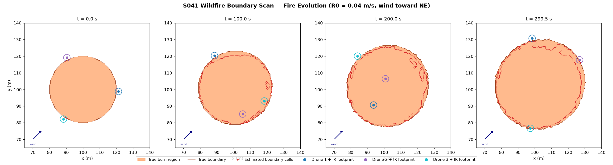
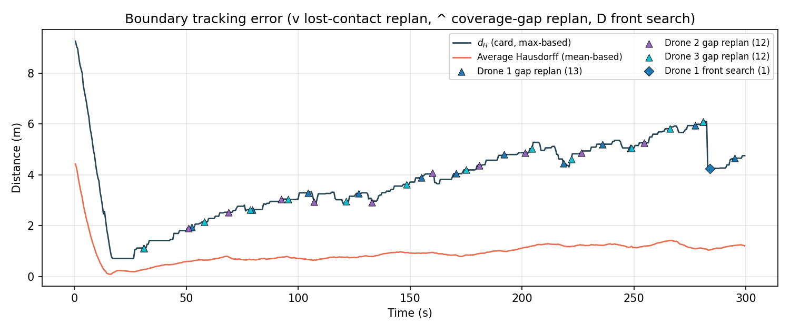
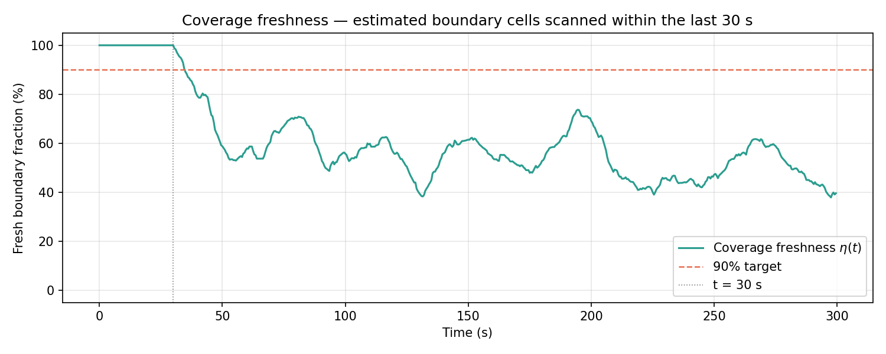
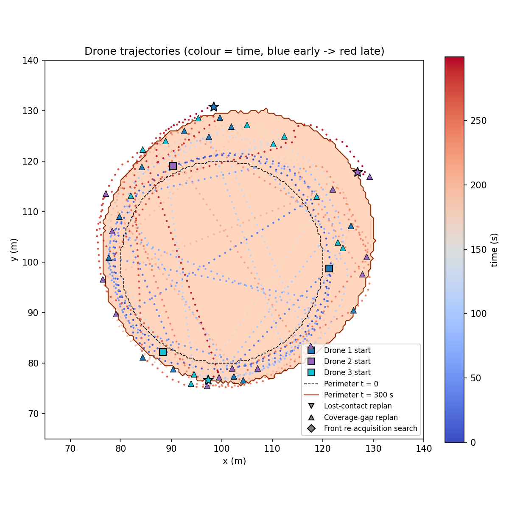
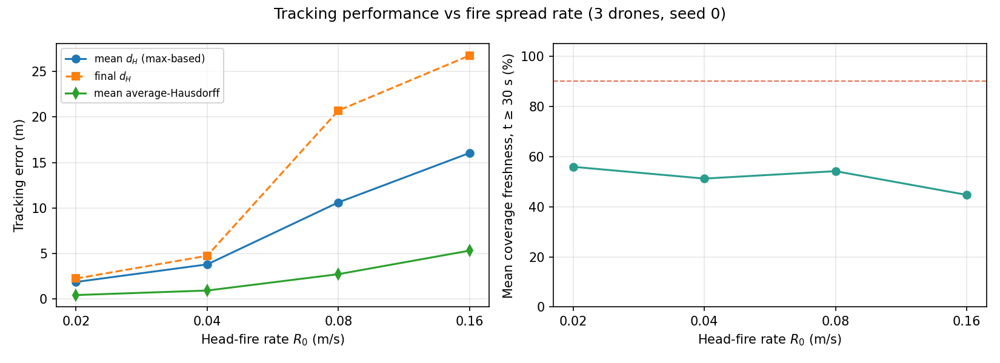
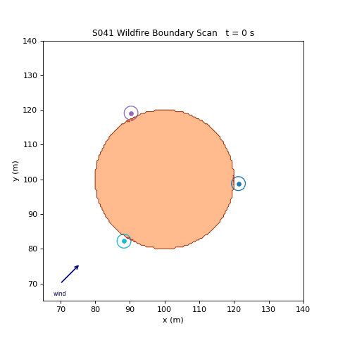

# S041 Wildfire Boundary Scan

**Domain**: Environmental Monitoring & SAR | **Difficulty**: ⭐⭐ | **Status**: ✅ Completed

---

## Problem Definition

**Setup**: An active wildfire burns inside a 200 × 200 m operational area. The fire front expands stochastically following an elliptical spread model driven by a constant wind blowing toward the NE (45°). A fleet of N = 3 drones carrying downward-facing IR sensors flies at a fixed scan altitude of z = 10 m. At t = 0 the fire perimeter is a circle of radius r₀ = 20 m centred at the ignition point (100, 100) m. Each drone only detects whether its footprint is above a burning or unburned cell via a noisy IR temperature reading.

**Key question**: How well can three gradient-following drones, starting with no map of the fire, track an expanding wildfire boundary, and how does the tracking error grow with the fire's spread rate?

---

## Mathematical Model

### Fire Spread (Elliptical Huygens)

$$R(\theta) = R_0 \cdot \frac{1 - e_w}{1 - e_w \cos\theta}$$

$\theta$ is measured from the direction the wind blows toward (45°, NE). $R(0) = R_0$ is the head-fire rate and $R(\pi) = R_0(1-e_w)/(1+e_w)$ the back-fire rate; with $e_w = 0.6$ the head fire is 4× faster than the back fire (0.04 / 0.016 / 0.01 m/s head / flank / back).

Spread is computed on the 0.5 m grid with a 16-direction stencil in continuous time (Huygens principle): a burning cell $n$ ignited at $T_n$ has pushed its front $R(\theta_{nc})(t - T_n)$ toward neighbour $c$ at distance $L_{nc}$. Each cell adjacent to the fire accumulates a spotting perturbation $W_c = \sum_i \epsilon_i$, $\epsilon_i \sim \mathcal{N}(0,\sigma_{spot}^2)$ drawn once per step, and ignites when

$$\max_n \bigl[R(\theta_{nc})(t - T_n) - L_{nc}\bigr] + W_c \ge 0 .$$

Sub-cell progress is therefore carried between steps, so slow fronts (0.005–0.02 m per step) really advance.

### IR Sensor Model and Shared Map

$$z_{ij} = T_{true}(\mathbf{x}_{ij}) + w_{ij}, \qquad w_{ij} \sim \mathcal{N}(0,\, R_{sensor}), \qquad \hat{F}_{ij} = \mathbf{1}\!\left[z_{ij} \geq T_{thresh}\right]$$

The shared map has three states (unknown / unburned / burning) and starts **all unknown** — the drones only know the dispatch location (they start 1 m outside the reported 20 m perimeter). The estimated boundary is the set of cells observed burning that are 4-adjacent to a cell observed unburned. A cell keeps its last observed state until it is re-scanned, so the estimate goes stale as the fire advances.

### Boundary Gradient-Following Guidance

$$\dot{\mathbf{p}}_k = v_{cruise} \cdot \hat{\mathbf{t}}_k - K_\phi \cdot \phi_k(t) \cdot \hat{\mathbf{n}}_k, \qquad \phi_k = s_k\, d_k^{fire} - r_s$$

$\hat{\mathbf{n}}_k$ is the local outward normal of the estimated boundary (from the centroid of burning to the centroid of unburned cells within 3 m of the nearest boundary cell), $s_k = +1$ on the unburned side and $-1$ over the burned side, and $\hat{\mathbf{t}}_k$ is the clockwise tangent. The speed is clipped to $v_{cruise}$, so the drone settles $r_s$ outside the front.

### Replanning Trigger

1. **Lost contact**: $d_k^{fire} > r_s + d_{replan}$
2. **Coverage gap**: some estimated boundary cell has not been scanned for $\Delta t_{gap} = 30$ s (checked only after the drone has followed the front for at least 10 s since its last replan)

$$\mathbf{p}_{k}^{target} = \arg\max_{(i,j) \in \hat{\partial \mathcal{F}}} \bigl(t - T_{last\_scan}(i,j)\bigr)$$

Cells within 10 m of another drone's active target are skipped. If contact is lost while the whole footprint reads "burning" (the front has run away from a stale part of the map), the drone instead flies radially outward from the burned-area centroid until it re-acquires the front ("front search"). Replans are counted separately by trigger type.

### Performance Metrics

$$d_H(t) = \frac{1}{2}\left[\max_{\mathbf{x} \in \partial \mathcal{F}} \min_{\hat{\mathbf{x}} \in \hat{\partial \mathcal{F}}} \|\mathbf{x} - \hat{\mathbf{x}}\| + \max_{\hat{\mathbf{x}} \in \hat{\partial \mathcal{F}}} \min_{\mathbf{x} \in \partial \mathcal{F}} \|\mathbf{x} - \hat{\mathbf{x}}\|\right]$$

The average Hausdorff distance (same formula with mean instead of max) is reported as well, because the max-based $d_H$ is set by the single worst stale fragment.

$$\eta(t) = \frac{\bigl|\{(i,j) \in \hat{\partial \mathcal{F}} : t - T_{last\_scan}(i,j) \leq \Delta t_{gap}\}\bigr|}{|\hat{\partial \mathcal{F}}|}$$

---

## Key Parameters

| Parameter | Value |
|-----------|-------|
| Arena size | 200 × 200 m |
| Grid resolution | 0.5 m |
| Number of drones N | 3 |
| Scan altitude z | 10.0 m (informational, 2D simulation) |
| IR sensor radius r_s | 2.0 m |
| IR noise variance R_sensor | 25 K² |
| Fire / ambient temperature | 800 K / 300 K |
| Classification threshold T_thresh | 550 K |
| Drone cruise speed v_cruise | 2.5 m/s |
| Stand-off gain K_phi | 0.8 s⁻¹ |
| Head-fire spread rate R₀ | 0.04 m/s (sweep: 0.02, 0.04, 0.08, 0.16) |
| Ellipse eccentricity e_w | 0.6 (R_head / R_back = 4) |
| Wind direction | 45° (blowing toward NE) |
| Spotting noise sigma_spot | 0.01 m/step (card: 0.05, see deviations) |
| Spread stencil | 16 directions (\|di\|, \|dj\| ≤ 2) |
| Initial fire radius r₀ | 20 m at (100, 100) m |
| Drone start | 1 m outside the initial perimeter, 120° apart |
| Lost-contact replan distance d_replan | 3.0 m |
| Max coverage gap Δt_gap | 30 s |
| Gap-replan hold time | 10 s |
| Replan-target reservation radius | 10 m |
| Outward-normal window | ±6 cells (3 m) |
| Simulation timestep Δt | 0.5 s |
| Simulation duration T_sim | 300 s |
| Random seed | 0 (one `np.random.default_rng` per run) |
| Animation | every 4th step, 151 frames |

---

## Implementation

```
src/03_environmental_sar/s041_wildfire_boundary.py
```

```bash
conda activate drones
python src/03_environmental_sar/s041_wildfire_boundary.py
```

Runtime ≈ 1.5 min (spread check + main run + 3 sweep runs + GIF).

---

## Results

### Spread-model check (fire only, no drones, 300 s)

| σ_spot | Head advance | Flank advance | Back advance | Final area |
|--------|-------------|---------------|--------------|------------|
| Model $R(\theta)\,T$ | 12.0 m | 4.8 m | 3.0 m | — |
| 0.00 m | 11.1 m | 5.5 m | 2.7 m | 2190 m² |
| 0.01 m (used) | 11.8 m | 5.8 m | 3.3 m | 2261 m² |
| 0.05 m (card) | 17.1 m | 11.5 m | 8.3 m | 3109 m² |

### Main run (R₀ = 0.04 m/s, seed 0)

| Metric | Value |
|--------|-------|
| Fire area | 1256 → 2264 m² (+80.3 %) |
| Front advance head / flank / back | 12.2 / 5.5 / 3.0 m |
| Hausdorff $d_H$ (card, max-based) — mean / final | 3.35 m / 5.23 m |
| Average Hausdorff (mean-based) — mean / final | 0.83 m / 1.08 m |
| Coverage freshness — mean / minimum (t ≥ 30 s) | 60.4 % / 37.9 % |
| Replans: lost-contact / coverage-gap | 0 / 38 (13 + 13 + 12 per drone) |
| Front re-acquisition searches | 0 |
| First coverage-gap replan | t = 30.5 s |

### Spread-rate sweep (seed 0)

| R₀ (m/s) | Mean $d_H$ | Final $d_H$ | Mean avg-Hausdorff | Mean freshness | Replans lost / gap | Searches | Final area |
|----------|-----------|-------------|--------------------|----------------|--------------------|----------|------------|
| 0.02 | 1.83 m | 1.74 m | 0.47 m | 55.8 % | 0 / 42 | 0 | 1724 m² |
| 0.04 | 3.35 m | 5.23 m | 0.83 m | 60.4 % | 0 / 38 | 0 | 2264 m² |
| 0.08 | 8.78 m | 14.45 m | 2.29 m | 52.2 % | 5 / 31 | 2 | 3518 m² |
| 0.16 | 19.05 m | 42.80 m | 6.54 m | 52.2 % | 10 / 28 | 2 | 6734 m² |

**Key Findings**:
- The fire now really expands: +80.3 % area in 300 s, with the head fire (NE, downwind) advancing 12.2 m against 3.0 m for the back fire, matching the 4:1 head/back ratio of the corrected $R(\theta)$.
- Because the map starts empty, $d_H$ is large at t = 0 (each drone has only mapped its own footprint) and falls below 1 m by about t = 17 s, once the three drones have swept the whole initial perimeter. After that the error grows slowly as unscanned parts of the boundary go stale: the average boundary error stays around 1 m (mean 0.83 m), while the max-based $d_H$ climbs to about 5 m, set by stale fragments in the fast-moving NE head sector.
- Every replan in the main run came from the coverage-gap trigger (38 gap vs 0 lost-contact). The first one fires at t = 30.5 s, the first step at which cells scanned at t = 0 exceed the 30 s gap. Lost-contact replans and front searches only appear at R₀ ≥ 0.08 m/s, where stale parts of the map fall more than 5 m behind the real front.
- Coverage freshness never reaches the 90 % target after t = 30 s (mean 60.4 %, minimum 37.9 %). Three drones at 2.5 m/s could in principle sweep the ~170 m perimeter every ~23 s, but each gap replan sends a drone across the burned interior to the oldest cell, and the crossing time is time not spent on the perimeter.
- Tracking error grows faster than linearly with spread rate: going from R₀ = 0.04 to 0.08 m/s raises the mean average-Hausdorff error from 0.83 to 2.29 m, and at 0.16 m/s it reaches 6.54 m (max-based mean $d_H$ 19.05 m). At that rate the 3-drone fleet no longer keeps contact with the whole front.

**Fire evolution map** — true burn region (orange), true boundary (brown line), estimated boundary cells (red dots), drones and IR footprints at t = 0, 100, 200, 299.5 s. Stale estimated fragments are visible inside the NE head of the fire:



**Hausdorff distance over time** — card $d_H$ (max-based) and average Hausdorff, with every replanning event marked by drone and trigger type:



**Coverage freshness over time** — fraction of estimated boundary cells scanned within the last 30 s; 100 % until t = 30 s, then fluctuating between about 38 % and 74 %:



**Drone trajectory overlay** — paths coloured by time, initial (dashed) and final (brown) perimeter, replanning events. The straight chords across the fire are coverage-gap transits:



**Spread-rate sweep** — tracking error and mean freshness vs head-fire rate R₀:



**Animation** — replay of the recorded history of the main run (the same fire the drones tracked):



### Deviations from the scenario card

| Card | Implementation | Reason |
|------|----------------|--------|
| $R(\theta) = R_0(1+e_w)^2/(1+e_w\cos\theta)$, $e_w = (R_h/R_b-1)/2$ | $R(\theta) = R_0(1-e_w)/(1-e_w\cos\theta)$, $e_w = (R_h/R_b-1)/(R_h/R_b+1)$ | The card formula gave 1.6 R₀ at the head and 6.4 R₀ at the back (back fire 4× faster than head fire). The card has been corrected. |
| Boundary cells jump to `round(cell + Δr/δ)` along a centroid normal | Continuous-time Huygens arrival on a 16-direction stencil | With Δr = 0.005–0.02 m per step the rounding always landed on the same cell, so the fire did not spread (+0.5 % area in 300 s). |
| σ_spot = 0.05 m/step | 0.01 m/step | With independent per-cell noise, a 0.05 m perturbation (2.5× the per-step head advance) speeds up first-arrival spread by 5–6 m in every direction (spread check above) and washes out the elliptical shape. 0.01 m keeps the model's mean rates. |
| Estimate initialised as a copy of the true fire | Estimate starts all "unknown" | Initialising with ground truth made tracking trivially perfect. |
| $\hat{\mathbf{n}}$ = direction from nearest boundary cell to drone, unsigned $\phi$ | Local outward normal from the map, signed $\phi$ | The unsigned law can hold the drone on the burned side of the front, from where it never sees the front advance. |
| Gap trigger checked every step | Checked only after 10 s of following; targets within 10 m of another drone's target skipped | Without these, once any cell was stale all drones were sent back-to-back to the same oldest cell, never patrolled, and lost the head-fire sector entirely. |
| — | Front search when contact is lost over burned ground | Re-acquires a front that has run away from a stale part of the map. |
| Key question asks about wind speed | Sweep over head-fire rate R₀ (0.02–0.16 m/s) | R₀ is the model's wind-driven spread parameter; the sweep stops at 0.16 m/s so the fire stays inside the arena. |
| Hausdorff metric (max-based) | Reported, plus the mean-based average Hausdorff | The max-based value is dominated by single stale fragments. |

---

## Extensions

1. **Wind shift event**: introduce a sudden 90° wind direction change at t = 150 s; measure how quickly the fleet detects the new dominant fire front and reassigns drones to cover the accelerated head-fire segment.
2. **Variable fleet size sweep**: run with N ∈ {1, 2, 3, 4, 5} drones and plot mean Hausdorff error and coverage freshness vs N; identify the minimum fleet size that keeps d_H < 5 m and η > 90% simultaneously.
3. **Probabilistic boundary representation**: replace the binary occupancy grid with a per-cell burn probability updated via Kalman-style likelihood update; track the 0.5-isoprobability contour and compare Hausdorff error against the binary-threshold baseline.

---

## Related Scenarios

- Prerequisites: [S048 Lawnmower Coverage](../../../scenarios/03_environmental_sar/S048_lawnmower.md) (basic coverage planning before dynamic tracking)
- Follow-ups: [S049 Dynamic Zone Search](../../../scenarios/03_environmental_sar/S049_dynamic_zone.md), [S055 Oil Spill Tracking](../../../scenarios/03_environmental_sar/S055_oil_spill.md)
- Algorithmic cross-reference: [S045 Chemical Plume Tracing](../../../scenarios/03_environmental_sar/S045_plume_tracing.md), [S042 Missing Person Search](../../../scenarios/03_environmental_sar/S042_missing_person.md)
