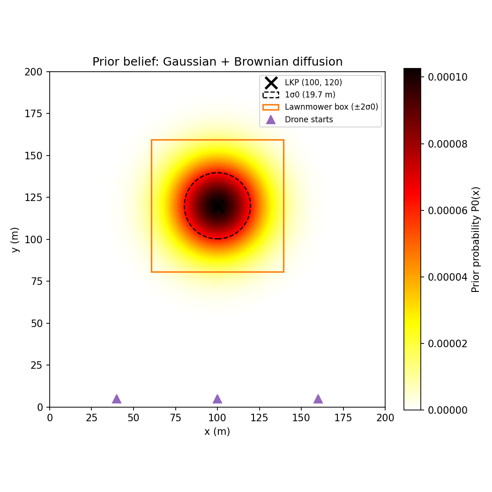
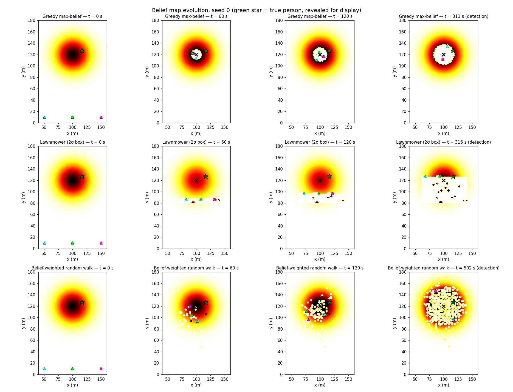
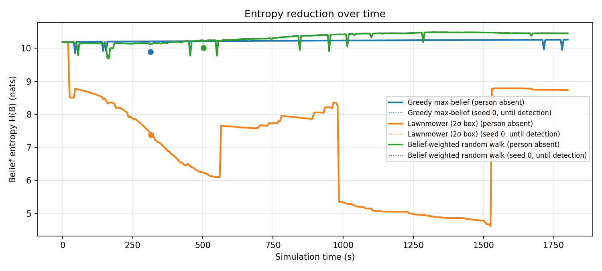
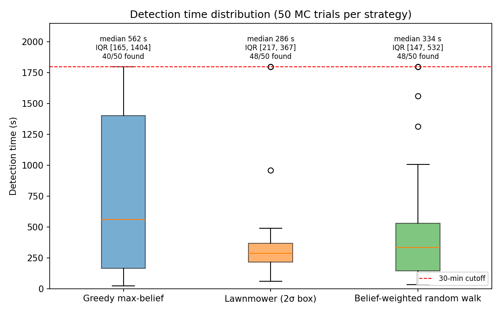
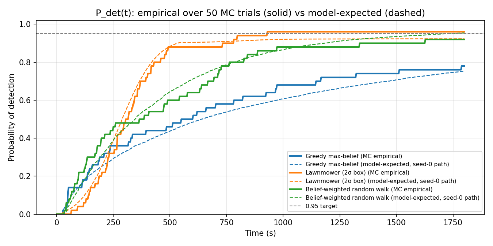
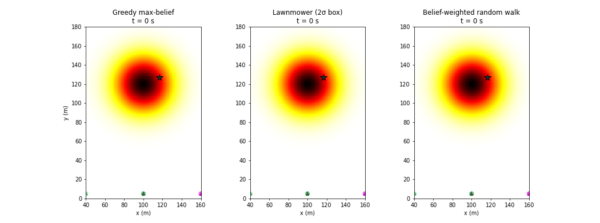

# S042 Missing Person Localization

**Domain**: Environmental Monitoring & SAR | **Difficulty**: ⭐⭐⭐ | **Status**: ✅ Completed

---

## Problem Definition

**Setup**: A hiker has gone missing in a flat 200 × 200 m wilderness area. The last known position (LKP) was recorded 2 hours before the search begins. The person's initial probability of presence is modelled as a Gaussian centred on the LKP, broadened by a diffusion term proportional to elapsed time. A fleet of $N = 3$ drones, starting on the south edge at (50, 10), (100, 10) and (150, 10) m (card), is deployed to localise the (stationary) person as quickly as possible.

**Objective**:
- Minimise the time to first confirmed detection (target cumulative $P_{det} \geq 0.95$)
- Track how the belief entropy $H$ evolves over the search

**Comparison Strategies** (identical drones, start positions, speed, sensor and dwell; in Monte Carlo trial $k$ every strategy searches for the same person position):
1. **Greedy max-belief frontier** — each drone flies to the cell with the highest current belief, excluding cells within $2r_s$ of other drones' targets
2. **Lawnmower sweep** — boustrophedon coverage of the LKP ± 2σ₀ box, split into three vertical strips (one per drone), 2.5 m waypoint lattice; ignores the belief map while searching and repeats when finished
3. **Belief-weighted random walk** — next waypoint sampled among 2.5 m blocks within 20 m of the drone with probability $\propto (\text{block belief})^{1/T}$, temperature annealed $T(t) = \max(0.25,\ e^{-t/600\,\mathrm{s}})$

---

## Mathematical Model

### Prior Distribution

$$P_0(\mathbf{x}) = \frac{1}{Z} \exp\!\left(-\frac{\|\mathbf{x} - \mathbf{x}_{LKP}\|^2}{2\,\sigma_0^2}\right)$$

where $\sigma_0^2 = \sigma_{LKP}^2 + 2 D \Delta t$ combines positional uncertainty at the LKP ($\sigma_{LKP} = 10$ m) with Brownian diffusion ($D = 0.02$ m²/s, $\Delta t = 7200$ s), giving $\sigma_0 = \sqrt{100 + 288} = 19.7$ m.

### Sensor Model and Bayesian Update

After a 1 s dwell at each waypoint a drone reports hit/miss: $P(z=1 \mid \text{person in footprint}) = P_d = 0.90$, $P(z=1 \mid \text{not in footprint}) = P_{fa} = 0.02$.

$$B_{t+1}(\mathbf{x}) = \frac{P(z_i \mid H_{\mathbf{x}}) \cdot B_t(\mathbf{x})}{\sum_{\mathbf{x}'} P(z_i \mid H_{\mathbf{x}'}) \cdot B_t(\mathbf{x}')}$$

The likelihood is the same constant for every cell outside the footprint, so the update is applied as a likelihood-ratio multiplication inside the footprint only (miss: ×0.102, hit: ×45) followed by normalisation — mathematically identical to the full update, and fast enough for 150 Monte Carlo missions. The mission ends on the first true hit; false-alarm hits only update the belief.

### Belief Entropy and Expected Detection Probability

$$H(B_t) = -\sum_{\mathbf{x}} B_t(\mathbf{x}) \log B_t(\mathbf{x}), \qquad \mathbb{E}[P_{det}(t)] = \sum_{\mathbf{x}} B_0(\mathbf{x}) \Bigl(1 - \prod_{\text{scans } \tau \le t \text{ covering } \mathbf{x}} (1 - P_d)\Bigr)$$

### Greedy Waypoint Selection

$$\mathbf{w}_i^* = \arg\max_{\mathbf{w}} \; B_t(\mathbf{w}) \quad \text{s.t.} \quad \|\mathbf{w}_i^* - \mathbf{w}_j\| \ge 2\,r_s \ \ \forall j \neq i$$

### Kinematics

Each drone flies straight legs at $v_d = 5$ m/s; its position is interpolated along the leg, so snapshots and the animation show where the drones actually are (no teleporting to the next waypoint).

---

## Key Parameters

| Parameter | Value | Notes |
|-----------|-------|-------|
| Search area | 200 × 200 m | |
| Grid resolution | 0.5 m/cell | 400 × 400 = 160,000 cells |
| Number of drones $N$ | 3 | Start (50, 10), (100, 10), (150, 10) m (card) |
| Sensor footprint radius $r_s$ | 2.0 m | |
| Scan altitude $h$ | 10.0 m | Informational (2D simulation) |
| Drone cruise speed $v_d$ | 5.0 m/s | |
| Sensor dwell per waypoint $\tau_{dwell}$ | 1.0 s | |
| Probability of detection $P_d$ | 0.90 | 10% miss rate |
| False alarm rate $P_{fa}$ | 0.02 | |
| LKP positional uncertainty $\sigma_{LKP}$ | 10.0 m | |
| Brownian diffusion coefficient $D$ | 0.02 m²/s | |
| Time since LKP $\Delta t$ | 7200 s (2 hours) | |
| Prior spread $\sigma_0$ | 19.7 m | $\sqrt{10^2 + 2 \cdot 0.02 \cdot 7200}$ |
| LKP coordinates | (100, 120) m | |
| Hard mission cutoff | 1800 s (30 minutes) | |
| Redundancy exclusion radius | $2\,r_s = 4.0$ m | Greedy and random walk |
| Lawnmower box | LKP ± 2σ₀ = x 60.6–139.4, y 80.6–159.4 m | 3 strips, 1056 waypoints |
| Lawnmower lattice spacing | 2.5 m | ≤ $\sqrt{2}\,r_s$ = 2.83 m, no coverage gaps |
| Random-walk block size / radius | 2.5 m / 20 m | |
| Random-walk temperature | $T_0 = 1.0$, $T_{min} = 0.25$, $\tau = 600$ s | |
| Monte Carlo trials | 50 per strategy | Seeds 0–49, common person positions |
| Entropy sampling interval | 5 s | |
| Animation | 150 frames, 10 fps | Title shows t and entropy H per strategy |

---

## Implementation

```
src/03_environmental_sar/s042_missing_person.py   # Main simulation script
```

```bash
conda activate drones
python src/03_environmental_sar/s042_missing_person.py
```

Runtime ≈ 55 s (previously > 10 min).

---

## Results

### Monte Carlo (50 trials per strategy, not-found trials counted as 1800 s)

| Strategy | Found | Median | IQR | Median of found trials | Detected by 60 s | Empirical P_det reaches 0.95 |
|----------|-------|--------|-----|------------------------|------------------|------------------------------|
| Greedy max-belief | 40/50 | 562.5 s | [165.5, 1404.3] s | 340.4 s | 12 % | never (0.80 at 1800 s) |
| Lawnmower (±2σ₀ box) | 48/50 | 285.6 s | [216.6, 367.3] s | 274.3 s | 0 % | 959.1 s |
| Belief-weighted random walk | 48/50 | 333.6 s | [146.7, 531.5] s | 297.5 s | 10 % | 1561.2 s |

### Seed-0 runs

| Strategy | Detection | Observations | Entropy start → end |
|----------|-----------|--------------|---------------------|
| Greedy max-belief | 313.1 s | 242 | 10.185 → 9.897 nats |
| Lawnmower | 315.5 s | 600 | 10.185 → 7.384 nats |
| Belief-weighted random walk | 501.6 s | 421 | 10.185 → 10.009 nats |

The seed-0 person is at (116.75, 126.75) m.

### Person-absent runs (seed 0, full 1800 s)

| Strategy | Observations | Mean leg | Transit share | H(300 s) | H(900 s) | H(1800 s) | E[P_det] 300 / 900 / 1800 s | E[P_det] reaches 0.95 |
|----------|--------------|----------|---------------|----------|----------|-----------|-----------------------------|-----------------------|
| Greedy max-belief | 881 | 25.3 m | 82 % | 10.208 | 10.231 | 10.260 | 0.331 / 0.581 / 0.754 | never |
| Lawnmower | 3479 | 2.7 m | 35 % | 7.547 | 8.063 | 8.739 | 0.534 / 0.917 / 0.923 | never |
| Belief-weighted random walk | 1575 | 12.1 m | 71 % | 10.156 | 10.392 | 10.453 | 0.460 / 0.839 / 0.954 | 1715.0 s |

**Key Findings**:
- **Lawnmower is the best strategy here**: it finds the person in 48/50 trials with the lowest median (285.6 s) and the tightest IQR ([216.6, 367.3] s), and its empirical detection curve is the first to reach 0.95 (at 959.1 s). The random walk also finds 48/50 but more slowly (median 333.6 s, reaches 0.95 at 1561.2 s). Greedy is the worst: 40/50 found, median 562.5 s, the widest IQR ([165.5, 1404.3] s), and it never reaches 0.95. Greedy is fast when the person is near the LKP (12 % of trials within 60 s, against 10 % for the random walk and 0 % for the lawnmower, which first has to reach the bottom of its box), but it wastes most of its time flying.
- **Why greedy is slow**: after a miss, the highest-belief cells form a nearly flat ring around the searched disc, and the argmax jumps between points on opposite sides of that ring. The mean leg is 25.3 m and 82 % of the mission time is transit, so greedy makes only 881 observations in 1800 s against 3479 for the lawnmower (mean leg 2.7 m).
- **Model-expected P_det** (seed-0 person-absent paths): only the random walk reaches 0.95 (at 1715.0 s). It is never confined to the box, while the lawnmower stalls at 0.923 because only 91.2 % of the prior mass lies inside the ±2σ₀ box. The lawnmower's empirical curve still passes 0.95 (48/50 = 0.96); the gap to the model value (0.96 vs 0.923) is within the sampling noise of 50 trials (binomial standard error ≈ 0.04). Greedy reaches 0.80 empirically and 0.754 expected.
- **Entropy is not a good progress measure in this setup.** A miss at the belief peak flattens the belief, so greedy and random walk *raise* entropy (10.185 → 10.260 and 10.453 nats after 1800 s without a target). The lawnmower's entropy drops (to 7.547 nats at 300 s and below 5 nats later in the run) mainly because the false alarms it does not chase (2 % per scan, about 20 per pass) pile belief into small spots (×45 per false hit). The upward jumps in its curve are passes that clear those spots again; H ends at 8.739 nats. Greedy hardly changes the entropy at all, so the earlier claim that "greedy achieves faster entropy reduction" was wrong.

**Prior Belief Map** — Gaussian prior centred on LKP with $\sigma_0 = 19.7$ m, lawnmower box and drone start positions:



**Belief Snapshots** — belief at $t = 0, 60, 120$ s and at detection for each strategy (seed 0). Drones (triangles) and footprints are shown at their actual interpolated positions; the green star is the true person (shown for display only). Greedy clears a growing disc around the LKP, the lawnmower clears its box row by row (dark dots are false-alarm spots), and the random walk scatters scans around the peak:



**Entropy over time** — solid: person-absent runs over the full 1800 s; dotted: seed-0 runs until detection (dot marks the detection):



**Monte Carlo detection times** — box-plot over 50 trials (not-found trials plotted at the 1800 s cutoff):



**Cumulative probability of detection** — empirical fraction of the 50 trials detected by time t (solid) and model-expected $\mathbb{E}[P_{det}(t)]$ along the seed-0 person-absent search paths (dashed), with the 0.95 target; circles / squares mark where the empirical / model curves reach 0.95:



**Animation** — seed 0, all three strategies side by side, drones moving kinematically, belief updating after each scan; each panel title shows the time and the current belief entropy:



### Deviations from the scenario card

| Card | Implementation | Reason |
|------|----------------|--------|
| σ₀ ≈ 17.2 m | σ₀ = 19.7 m | Arithmetic error in the card: $\sqrt{10^2 + 2 \cdot 0.02 \cdot 7200} = 19.7$ m. Card corrected. |
| Lawnmower: "systematic boustrophedon coverage, ignoring the belief map" (area, row spacing and drone allocation not specified; the card's code calls an undefined `_lawnmower_next`) | ±2σ₀ box around the LKP, 3 strips (one per drone), 2.5 m lattice | The previous implementation swept the whole area with 4 m rows; a 4 m lattice with $r_s = 2$ m discs leaves about 21 % of every square unseen, and a whole-area sweep covers only about half the area in 30 min, mostly far from the LKP. A box sized from the prior is standard SAR practice and gives a fair comparison. The belief map is still ignored during the sweep. |
| Drone jumps to its new waypoint when it is assigned | Kinematic legs at 5 m/s, positions interpolated | Snapshots previously showed future positions. |
| Entropy-weighted random walk | Implemented as a belief-weighted, annealed random walk (local 20 m candidate set, weight ∝ block belief$^{1/T}$) | The card's third strategy was missing. |
| Expected $P_{det}(t)$ curve from $B_t$ | Empirical MC curve plus model-expected curve using $B_0$ along the person-absent path | The empirical curve is what the mission actually achieves; weighting by the prior $B_0$ gives the standard probability-of-success formula. |
| Belief snapshot figure for greedy only | All three strategies | Needed for the comparison. |
| Full-grid Bayes normalisation every observation | Footprint-only likelihood-ratio update | Same posterior, much faster (C2 runtime). |

---

## Extensions

1. **Non-stationary target**: replace the fixed person assumption with a correlated random walk model; apply a predict-step (convolution with a diffusion kernel) to the belief map before each Bayes update.
2. **Terrain-aware prior**: incorporate terrain features (cliffs, rivers, dense vegetation) as a non-Gaussian prior by reweighting cells using a terrain traversal cost map.
3. **Particle filter for large areas**: replace the grid belief map with $N_p = 5000$ weighted particles for a 1 km × 1 km area where a full grid is computationally prohibitive.
4. **Coordinated entropy-based path planning**: replace the greedy next-waypoint policy with a receding-horizon planner that optimises joint entropy reduction over a 60 s planning window across all drones simultaneously.
5. **Communication-degraded search**: introduce intermittent communication loss; implement a divergence-aware merge step when contact is restored (KL-divergence between local and shared beliefs).

---

## Related Scenarios

- Prerequisites: [S048 Full-Area Coverage Scan (Lawnmower)](../../../scenarios/03_environmental_sar/S048_lawnmower.md)
- Follow-ups: [S043 Confined Space Exploration](../../../scenarios/03_environmental_sar/S043_confined_space.md), [S049 Dynamic Zone Search](../../../scenarios/03_environmental_sar/S049_dynamic_zone.md)
- Algorithmic cross-reference: [S045 Chemical Plume Tracing](../../../scenarios/03_environmental_sar/S045_plume_tracing.md) (particle filter source estimation)
