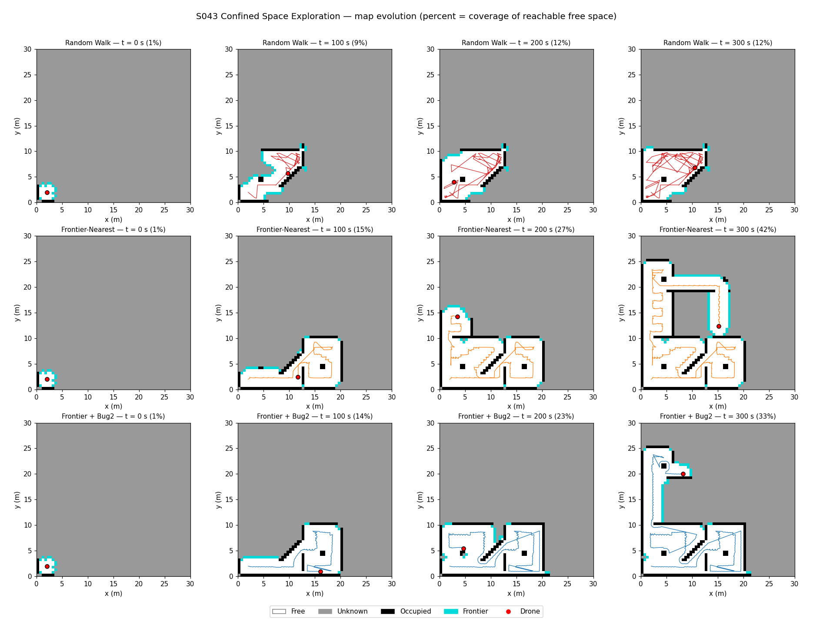
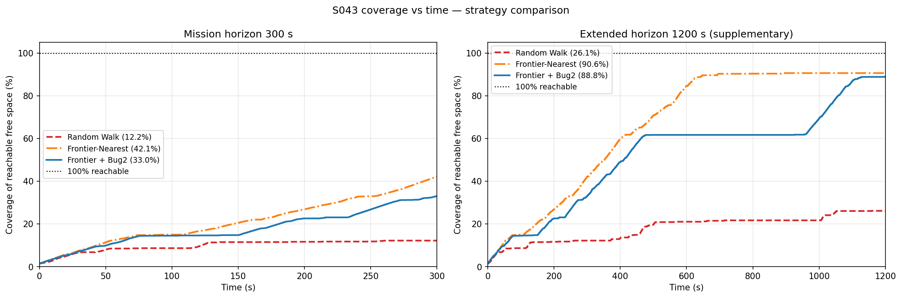
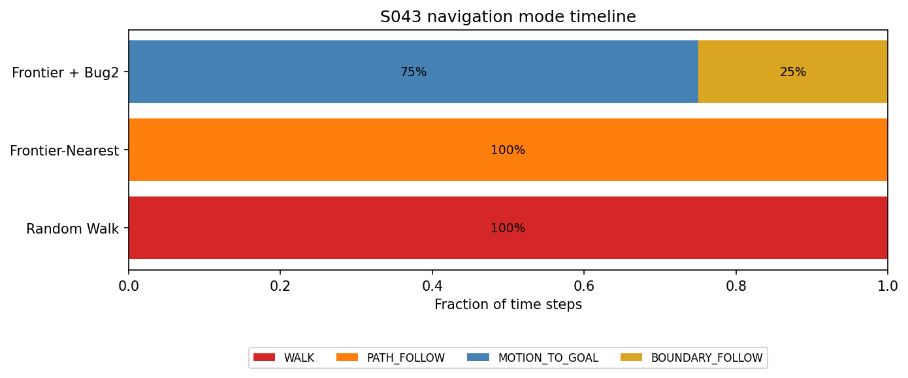
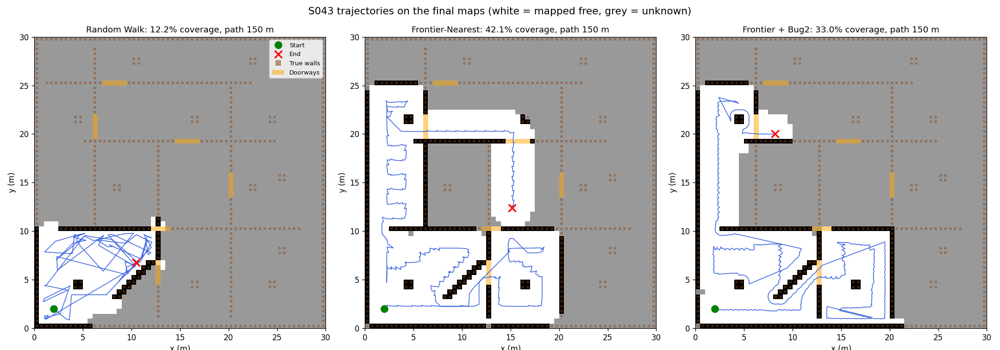
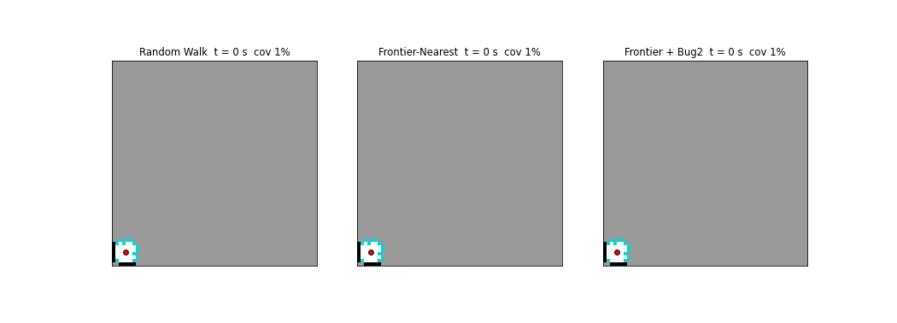

# S043 Confined Space Exploration

**Domain**: Environmental Monitoring & SAR | **Difficulty**: ⭐⭐⭐ | **Status**: ✅ Completed

---

## Problem Definition

**Setup**: A small rescue drone is deployed inside a collapsed building whose interior is completely unknown. The floor plan (30 × 30 m) contains load-bearing walls, fallen debris columns, and narrow corridors formed by partial collapses. No prior map is available; the drone must build one from scratch while navigating safely. The environment is discretised into a 60 × 60 occupancy grid at Δ = 0.5 m resolution. The drone carries a 360° lidar-range sensor (radius $r_s = 2.0$ m) with Gaussian range noise.

**Objective**: Maximise the fraction of reachable free space mapped within $T_{max} = 300$ s, while never entering a cell whose occupancy probability exceeds $p_{occ} = 0.65$ and never squeezing through a gap narrower than $g_{min} = 0.35$ m.

**Comparison Strategies** (same drone, sensor, speed, start and lidar-noise stream):
1. **Random walk** — keep a random free heading for an exponentially distributed time (mean 8 s), re-draw it when the time is up or the map shows an obstacle within $d_{turn}$ (baseline)
2. **Frontier-based (nearest)** — goal = nearest frontier cell by shortest known-free path (Dijkstra on the current map); the drone follows that path
3. **Frontier-based + Bug2** — same frontier goal selection, but the drone gets there with the Bug2 local planner (M-line + wall following) instead of a planned path

---

## Mathematical Model

### Occupancy Grid and Log-Odds Update

Each cell $c$ stores a log-odds belief $l(c)$. Sensor model update (36 beams, range noise $\sigma_r = 0.05$ m, each cell updated at most once per beam):

$$l_t(c) = l_{t-1}(c) + \begin{cases} l_{occ} = +0.85 & \text{hit cell} \\ l_{free} = -0.40 & \text{free cell along beam} \\ 0 & \text{otherwise} \end{cases}$$

with clamping bounds $[l_{min}, l_{max}] = [-2.0, 3.5]$. Recovered probability: $p(c) = e^{l(c)} / (1 + e^{l(c)})$. Free: $p < 0.35$; occupied: $p > 0.65$; unknown otherwise.

### Frontier Extraction and Goal Selection

$$\mathcal{F} = \left\{ c \in \mathcal{M} \;\middle|\; p(c) < 0.35 \;\text{ and }\; \exists\, c' \in \mathcal{N}_4(c):\; 0.35 \leq p(c') \leq 0.65 \right\}$$

The goal is the frontier cell with the shortest path through known-free cells (8-connected Dijkstra, no corner cutting, cells next to a mapped obstacle avoided so the body keeps clearance). A goal is dropped when it is reached, stops being a frontier, becomes occupied, or is not reached within 40 s; goals that time out, lead to a blocked path, or make Bug2 loop around an obstacle are blacklisted (frontier cells within 1 m are skipped from then on).

### Bug2 Algorithm

The M-line runs from the drone's position when the goal was assigned to the goal. In MOTION_TO_GOAL the drone flies straight at the goal until the map shows an obstacle within $d_{turn} = 0.4$ m; it then switches to BOUNDARY_FOLLOW with the wall on its right (it orbits the nearest mapped occupied cell at 0.75 m). It leaves the wall only when it is back on the M-line (within 0.1 m), closer to the goal than the hit point by $d_{progress} = 0.1$ m, and the way to the goal is free. Returning to the hit point after more than 2 m of wall following marks the goal unreachable.

### Safety

Every move is checked twice: the 0.4 × 0.4 m safety box (body half-size 0.15 m + 0.05 m margin) must not overlap a mapped occupied cell, and the 0.3 × 0.3 m body must not overlap a true wall. If a newly mapped obstacle appears inside the safety box, the drone first backs away from it (ESCAPE mode).

### Coverage Metric

$$\text{Coverage}(t) = \frac{\left|\left\{c \in \mathcal{C}_{reach} \;:\; p_t(c) < 0.35\right\}\right|}{|\mathcal{C}_{reach}|} \times 100\%$$

$\mathcal{C}_{reach}$ = 3080 ground-truth free cells (770 m²) reachable from the start.

---

## Key Parameters

| Parameter | Value | Notes |
|-----------|-------|-------|
| Environment size | 30 × 30 m | |
| Grid resolution $\Delta$ | 0.5 m/cell | 60 × 60 cells |
| Sensor radius $r_s$ | 2.0 m | |
| Number of lidar beams $N_b$ | 36 | Uniformly spaced |
| Range noise std dev $\sigma_r$ | 0.05 m | |
| Log-odds hit increment $l_{occ}$ | +0.85 | |
| Log-odds free decrement $l_{free}$ | −0.40 | |
| Log-odds clamp $[l_{min}, l_{max}]$ | [−2.0, 3.5] | |
| Occupied probability threshold $p_{occ}$ | 0.65 | |
| Free probability threshold $p_{free}$ | 0.35 | |
| Drone body width | 0.3 m | Radius 0.15 m |
| Map safety clearance | 0.20 m | Body half-size + 0.05 m |
| Minimum passable gap $g_{min}$ | 0.35 m | Always met: planned paths use ≥ 0.5 m wide free cells |
| Obstacle detection distance $d_{turn}$ | 0.4 m | Bug2 and random walk |
| Goal-reached tolerance $d_{goal}$ | 0.3 m | |
| Bug2 leave margin $d_{progress}$ | 0.1 m | |
| Bug2 M-line tolerance | 0.1 m | |
| Bug2 wall stand-off / gain | 0.75 m / 1.0 m⁻¹ | To the nearest occupied cell centre |
| Frontier goal timeout | 40 s | |
| Blacklist radius | 1.0 m | |
| Random-walk mean heading hold | 8 s | Exponential |
| Drone cruise speed $v_d$ | 0.5 m/s | |
| Mission horizon $T_{max}$ | 300 s | |
| Extended horizon (supplementary) | 1200 s | |
| Simulation timestep $\Delta t$ | 0.1 s | |
| Start position $\mathbf{p}_0$ | (2.0, 2.0) m | |
| Random seed | 0 | Separate seeded streams for lidar noise and random-walk choices |
| Animation | every 20 steps (2 s), 151 frames | |

---

## Implementation

```
src/03_environmental_sar/s043_confined_space.py   # Main simulation script
```

```bash
conda activate drones
python src/03_environmental_sar/s043_confined_space.py
```

Runtime ≈ 2.5 min (three 300 s runs, three 1200 s supplementary runs, GIF).

---

## Results

### Mission horizon 300 s

| Strategy | Coverage 100 / 200 / 300 s | Path length | Mode split | Frontier goals (blacklisted) | Doorways crossed |
|----------|---------------------------|-------------|------------|------------------------------|------------------|
| Random Walk | 8.6 / 11.6 / **12.2 %** | 150.0 m | WALK 100 % | — | none |
| Frontier-Nearest | 15.0 / 26.8 / **42.1 %** | 150.0 m | PATH_FOLLOW 100 % | 627 (0) | D4 ×2, D6, D2 |
| Frontier + Bug2 | 14.5 / 22.6 / **33.0 %** | 150.0 m | MOTION_TO_GOAL 75.0 %, BOUNDARY_FOLLOW 25.0 % | 464 (2) | D4 ×2, D6 |

No strategy had a blocked move (map 0, physical 0) and none reached 50 % in 300 s.

**Doorway passage log** (designed doorways D1–D6; the gap estimate is the run of mapped-free cells along the wall line at the moment of crossing):

| Strategy | t (s) | Doorway | Gap estimate | Mode |
|----------|-------|---------|--------------|------|
| Frontier-Nearest | 27.2 | D4 | 2.5 m | PATH_FOLLOW |
| Frontier-Nearest | 92.4 | D4 | 2.5 m | PATH_FOLLOW |
| Frontier-Nearest | 258.5 | D6 | 2.5 m | PATH_FOLLOW |
| Frontier-Nearest | 281.1 | D2 | 2.5 m | PATH_FOLLOW |
| Frontier + Bug2 | 27.2 | D4 | 2.5 m | MOTION_TO_GOAL |
| Frontier + Bug2 | 137.8 | D4 | 2.5 m | BOUNDARY_FOLLOW |
| Frontier + Bug2 | 296.0 | D6 | 2.5 m | BOUNDARY_FOLLOW |

All designed doorways are 2.0–2.5 m wide, far above $g_{min} = 0.35$ m, so the gap check never rejects a doorway in this layout. The 2 m opening at the west end of the y = 10 m wall is not one of the designed doorways and is not logged, although both frontier strategies use it.

### Extended horizon 1200 s (supplementary)

| Strategy | Coverage 600 / 1200 s | Time to 50 / 80 / 90 % | Frontiers exhausted | Blocked (rejected) moves | Blacklisted goals | Unmapped reachable cells |
|----------|----------------------|------------------------|---------------------|--------------------------|-------------------|--------------------------|
| Random Walk | 21.0 / 26.1 % | — / — / — | — | 0 | 0 | 2276 |
| Frontier-Nearest | 84.5 / 90.6 % | 352.1 / 574.8 / 694.1 s | 1032.6 s | 12 | 24 | 290 |
| Frontier + Bug2 | 61.7 / 88.8 % | 410.4 / 1057.1 / — s | never | 0 | 28 | 344 |

In the 1200 s Frontier-Nearest run the safety check rejected 12 moves (the next step along the planned path would have violated the map clearance or touched a true wall). Each rejection blacklists that goal and triggers a replan, so the drone never touched a wall; the 300 s runs had no rejected moves.

**Key Findings**:
- **Exploration now works for both frontier strategies**: they fly the full 150 m in 300 s, pass through several doorways, and keep mapping new space. Frontier-Nearest maps 42.1 % of the reachable space in 300 s and Frontier + Bug2 33.0 %. The 300 s horizon itself is the main limit: at 0.5 m/s the drone flies only 150 m, and a 4 m wide lidar swath over 150 m sweeps at most about 600 m² of the 770 m² reachable area, even without overlap or detours.
- **Frontier-Nearest beats Frontier + Bug2** because it follows a planned shortest path through known free space, while Bug2 flies straight at the goal and spends 25 % of its time wall-following around debris and walls between it and the goal. In the 1200 s run Frontier-Nearest reaches 90 % at 694.1 s; Bug2 stays at about 61.7 % from roughly t = 480 s to t = 950 s (flat segment in the coverage curve). In that period it keeps switching between frontier goals that lie behind obstacles, and each new goal resets the M-line. It only moves on after enough of those goals have timed out and been blacklisted (28 by the end).
- **Random walk with persistent headings** stays in the start room (12.2 %, the region left of the fallen beam) and never crosses a doorway in 300 s; even after 1200 s it maps only 26.1 %.
- Frontier-Nearest runs out of frontier goals at 1032.6 s with 290 reachable cells still unknown: the frontiers that led to them had been blacklisted (24 goals) after timeouts or paths that turned out to be blocked once mapped. Better recovery (re-trying blacklisted goals later) would close this gap.

**Map Evolution** — occupancy map at $t = 0, 100, 200, 300$ s for each strategy (rows); free (white), unknown (grey), occupied (black), frontier cells (cyan), path so far, drone (red dot); the percentage is the coverage at that time:



**Coverage Curve** — Coverage(t) for the three strategies over the 300 s mission (left) and over the supplementary 1200 s horizon (right):



**Mode Timeline** — fraction of time steps in each navigation mode per strategy:



**Trajectory Overlay** — 300 s trajectories on the final maps, with true walls (brown) and the designed doorways (orange):



**Animation** — the three 300 s runs side by side, replayed from the recorded history:



### Deviations from the scenario card

| Card | Implementation | Reason |
|------|----------------|--------|
| Random walk: new random direction every step | Persistent heading, exponential hold time (mean 8 s) | Re-drawing the heading every 0.1 s kept the drone inside a 2 × 2 m box (2.1 % coverage). |
| Frontier-Nearest: fly straight at the frontier; when blocked, re-pick (same) frontier | Follow the Dijkstra path to the frontier; blacklist goals on timeout / blocked path | The old version froze after 236 of 3001 steps, re-picking the same blocked frontier. |
| Bug2 without M-line; leaves the wall whenever 0.1 m closer to the goal | Proper Bug2: M-line from goal assignment, leave only on the M-line closer than the hit point, loop detection | The old version was not Bug2 and spent 92 % of steps boundary-following. |
| Card text says "right-hand rule, wall on left" | Wall kept on the right | The card text is self-contradictory; the right-hand rule keeps the wall on the right. |
| Drone could move through unmapped walls | Map check with 0.05 m safety margin + physical body check against the true walls, ESCAPE mode | Required for a physically valid simulation; the drone never touched a true wall. |
| Gap detection by a 7-cell perpendicular scan before each heading | Path planning only through 0.5 m free cells, plus a doorway passage log | Every free cell is wider than $g_{min} = 0.35$ m, so a planned path can never pass a gap narrower than $g_{min}$. The log reports each doorway crossing with a measured gap width. |
| Frontier clusters → centroid goals | Nearest frontier cell | Centroids can fall in unknown or occupied space; the nearest cell is always a reachable free cell. |
| Log-odds update at every 0.25 m sample (a cell could be updated twice per beam) | Each cell updated at most once per beam | Avoids double-counting a single beam. |
| 300 s mission only | Plus a supplementary 1200 s run | Shows the strategies actually complete the exploration given enough time. |

---

## Extensions

1. **Multi-drone coordinated exploration**: deploy $N = 3$ drones from different access points; partition the frontier queue using max-dispersion allocation; merge maps via a shared log-odds accumulation server.
2. **Victim detection layer**: attach a heat sensor; integrate a Bayesian occupancy-augmented victim probability map that triggers hover-and-alert when $p_{victim}(c) > 0.8$.
3. **Structural hazard avoidance**: label cells with a hazard potential $V_h(c)$ proportional to proximity to heavily-loaded occupied cells; weight BFS path cost as $c_{path} = d_{nav} + \alpha V_h$.
4. **Dynamic gap closure**: simulate debris settling by randomly flipping free cells to occupied; require the drone to re-check known gaps on each frontier planning cycle.
5. **3D confined-space extension**: extend the grid to a volumetric voxel map (60 × 60 × 20 cells at 0.5 m); add altitude control to find the vertical slice with maximum clearance through each horizontal gap.

---

## Related Scenarios

- Prerequisites: [S041 Wildfire Boundary Scan](../../../scenarios/03_environmental_sar/S041_wildfire_boundary.md), [S042 Missing Person Search](../../../scenarios/03_environmental_sar/S042_missing_person.md)
- Follow-ups: [S044 Wall Crack Inspection](../../../scenarios/03_environmental_sar/S044_wall_crack.md), [S048 Lawnmower Coverage](../../../scenarios/03_environmental_sar/S048_lawnmower.md)
- Algorithmic cross-reference: [S004 Obstacle Chase](../../../scenarios/01_pursuit_evasion/S004_obstacle_chase.md) (Bug algorithm in pursuit context), [S022 Obstacle Avoidance Delivery](../../../scenarios/02_logistics_delivery/S022_obstacle_avoidance_delivery.md) (potential field avoidance)
