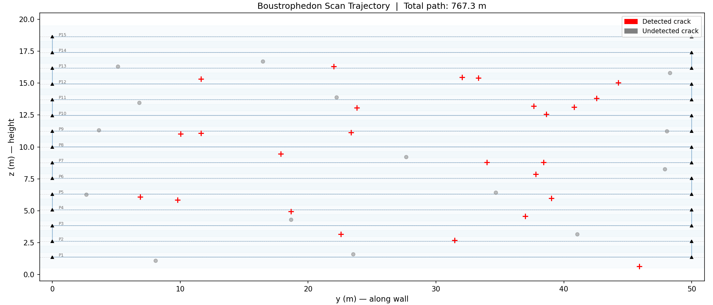
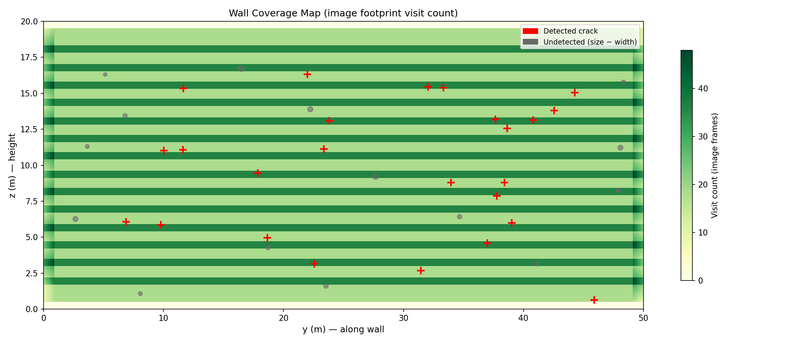
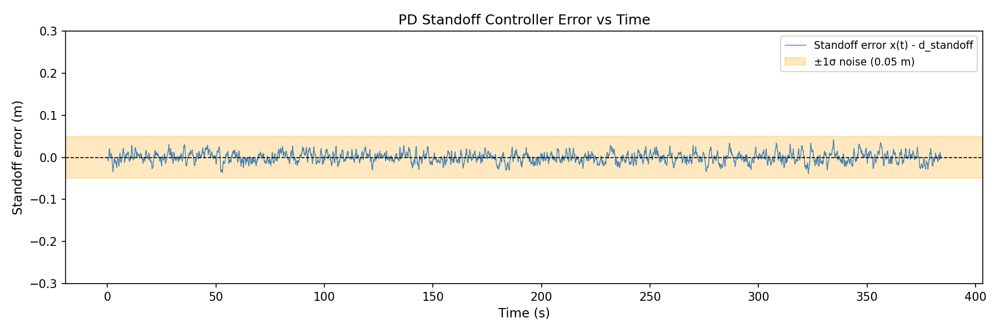
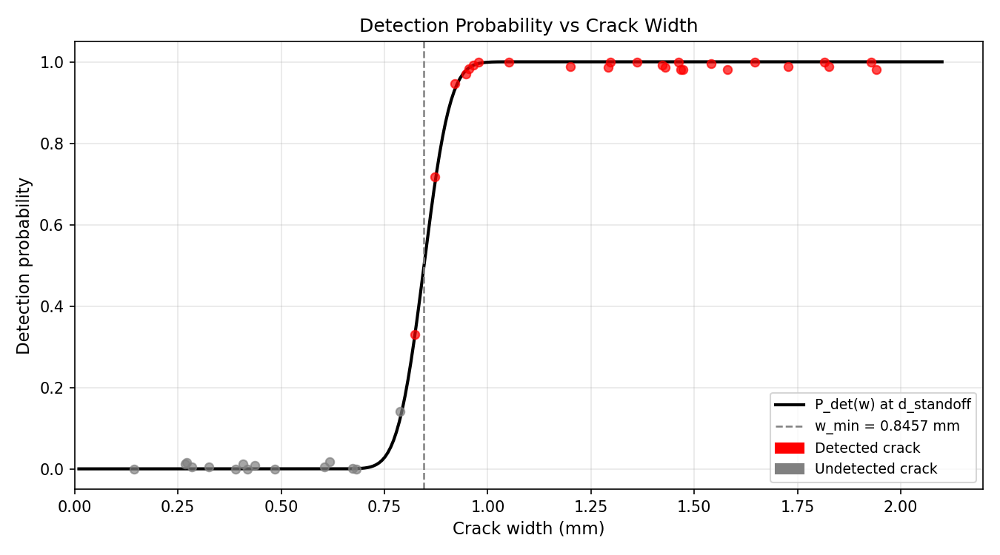
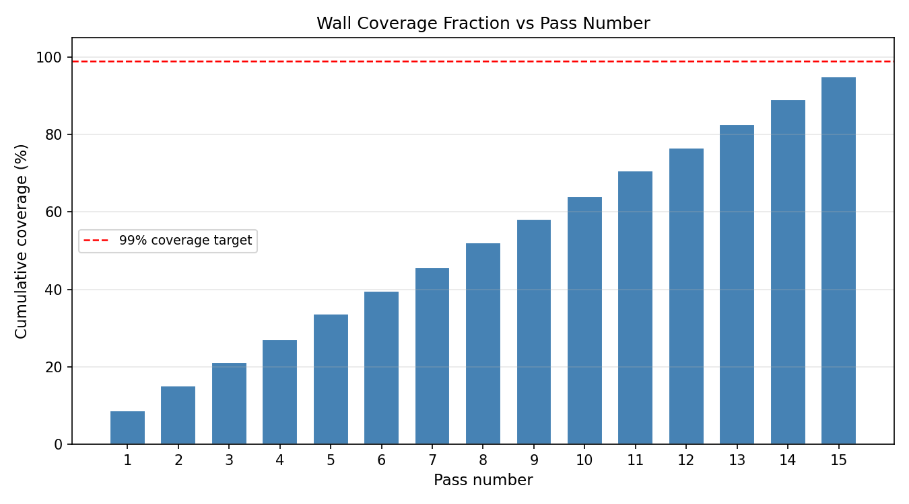
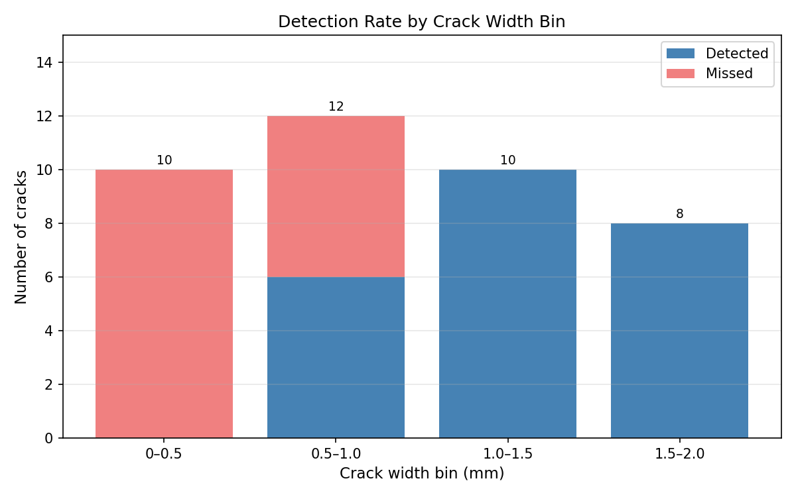
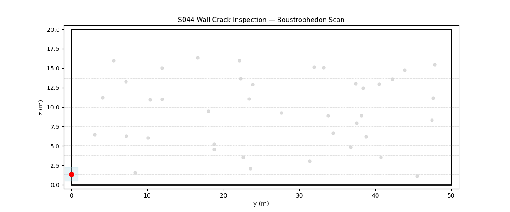

# S044 Wall Crack Inspection

**Domain**: Environmental Monitoring & SAR | **Difficulty**: ⭐⭐ | **Status**: ✅ Completed

---

## Problem Definition

**Setup**: A single inspection drone flies a boustrophedon (serpentine) path along a 50 m × 20 m reinforced-concrete building facade, maintaining a constant standoff distance of 1.5 m from the wall. 40 synthetic cracks are placed at random positions (seed 42) with widths drawn from U(0.1, 2.0) mm.

**Objective**: Achieve complete surface coverage while maximising the number of cracks detected. Report coverage fraction, detection rate by crack width bin, and total flight distance.

---

## Mathematical Model Summary

**Strip geometry**: Camera FOV = 60°, standoff = 1.5 m → strip half-width $h_{strip} = 1.5 \tan 30° = 0.866$ m, strip width 1.732 m.

**Boustrophedon passes**: $N_{pass} = \lceil 20 / 1.386 \rceil = 15$ passes (1.386 m = strip width with 20 % overlap). The passes are spread evenly between z = 0.5 + 0.866 = 1.366 m and z = 19.5 − 0.866 = 18.634 m (inside the 0.5–19.5 m safe-altitude band), so the actual spacing is 1.233 m (28.8 % overlap). Along each pass the drone cruises at 2 m/s and slows on the last step so every waypoint is reached exactly.

**Crack detection probability** (evaluated every frame while the crack is inside the square image footprint):
$$P_{det}(w_i, r) = \Phi\!\left(\frac{w_i - w_{min}(r)}{\sigma_{noise}}\right), \quad w_{min}(r) = \frac{2r\tan(30°)}{2048} \times 1000 \text{ mm}$$

At the 1.5 m standoff $w_{min} = 1.732/2048 \times 1000 = 0.846$ mm, so cracks narrower than about 0.85 mm are essentially undetectable with this camera at this range.

**PD standoff controller** (critically damped, $\omega_n = 4$ rad/s): $\ddot{x} = K_p (d_{standoff} - x_{meas}) - K_d \dot{x}$, $K_p = 16\ \text{s}^{-2}$, $K_d = 8\ \text{s}^{-1}$, with wall-distance measurement noise σ = 0.05 m.

**Coverage**: the wall is divided into 0.1 m × 0.1 m cells; a cell is covered if its centre lies inside the image footprint ($|y_j - y| \le h_{strip}$, $|z_k - z| \le h_{strip}$) in at least one frame.

---

## Key Parameters

| Parameter | Value |
|-----------|-------|
| Wall dimensions | 50 m × 20 m |
| Standoff distance | 1.5 m |
| Camera FOV | 60° |
| Strip half-width $h_{strip}$ | 0.866 m |
| Strip overlap (design) | 20 % (Δz = 1.386 m) |
| Actual pass spacing | 1.233 m (28.8 % overlap) |
| Number of passes | 15 |
| Safe altitude band | 0.5 – 19.5 m |
| Cruise speed | 2.0 m/s |
| Camera resolution | 2048 px |
| Detection noise $\sigma_{noise}$ | 0.05 mm |
| Synthetic cracks | 40 (widths U(0.1, 2.0) mm, seed 42) |
| PD standoff gains $(K_p, K_d)$ | 16 s⁻², 8 s⁻¹ |
| Wall-distance sensor noise | 0.05 m |
| Simulation timestep | 0.05 s |
| Coverage grid resolution | 0.1 m |
| Detection / noise RNG seed | 0 |
| Animation | ≤ 150 frames |

---

## Simulation Results

| Metric | Value |
|--------|-------|
| Wall coverage fraction | **95.00 %** |
| Cracks detected | **25 / 40 (62.5 %)** |
| Cracks wider than $w_{min}$ = 0.846 mm | 24 / 40 |
| Total flight distance | **767.3 m** |
| Simulation steps | 7683 |
| Simulation time | 384.1 s (6.4 min) |
| Standoff error | RMS 1.17 cm, mean −0.03 cm, max 4.18 cm |

**Detection by crack width**

| Width bin | Detected |
|-----------|----------|
| 0.0 – 0.5 mm | 0 / 10 |
| 0.5 – 1.0 mm | 7 / 12 |
| 1.0 – 1.5 mm | 10 / 10 |
| 1.5 – 2.0 mm | 8 / 8 |

**Key findings**:
- Coverage is 95.00 %, not 100 %: the footprint spans z = 0.50–19.50 m, so the 0.5 m bands at the bottom and top of the wall (2 × 0.5 m / 20 m = 5 %) are never imaged because the passes stay inside the safe-altitude band. Every pass adds 6.0–6.5 % (8.6 % for the first), as shown in the per-pass chart.
- Detection is limited by the camera resolution, not by coverage: every crack inside the imaged area is seen in many frames, so the outcome is set by $w_{min}$ = 0.846 mm. All 18 cracks wider than 1.0 mm are detected, none of the 10 below 0.5 mm, and 7 of the 12 in the 0.5–1.0 mm bin. One crack slightly below $w_{min}$ is detected thanks to the 0.05 mm noise term, so 25 cracks are detected although only 24 are wider than $w_{min}$.
- Flight distance 767.3 m = 15 passes × 50 m + 17.27 m of vertical transitions; at 2 m/s this takes 384.1 s.
- The PD loop holds the 1.5 m standoff within 1.17 cm RMS (max 4.18 cm) despite 5 cm measurement noise, because the closed loop (ω_n = 4 rad/s) filters out the white measurement noise.

**Boustrophedon Trajectory** — drone path overlaid on the wall with detected cracks (red +) and missed cracks (grey circles):

**Wall Coverage Map** — visit count (image frames) per 0.1 m cell; the uncovered 0.5 m bands at the bottom and top are visible:

**PD Standoff Error** — standoff error over the mission (RMS 1.17 cm):

**Detection Probability Curve** — $P_{det}$ vs crack width at the 1.5 m standoff, with the simulated cracks:

**Coverage vs Pass Number** — cumulative coverage after each horizontal pass (95.0 % after pass 15):

**Detection Rate by Width Bin** — detected vs missed per width bin:

**Animation**:

### Deviations from the scenario card

| Card | Implementation | Reason |
|------|----------------|--------|
| Pass heights $z_k = z_{start} + k\,\Delta z$ (last passes above 19.5 m and clipped) | 15 passes evenly spaced between 1.366 and 18.634 m (1.233 m spacing) | Keeps every pass inside the safe-altitude band; overlap rises from 20 % to 28.8 %. |
| Height PD controller $(K_p, K_d) = (9, 6)$ | Along-wall and vertical motion are kinematic velocity commands at 2 m/s | Only the standoff (x) axis uses the PD loop; the unused height gains were removed from the code. |
| $w_{min} \approx 0.847\ \mu$m | $w_{min} = 0.846$ mm | Unit/arithmetic error in the card (1.732 m / 2048 px = 0.846 mm). Card corrected. |
| Waypoint reached within 0.3 m | Waypoint reached exactly | The 0.3 m tolerance let each pass stop up to 0.3 m short of its target height, leaving part of the top band unimaged. |
| "Standoff RMS" | RMS computed as $\sqrt{\overline{e^2}}$ (earlier version printed the standard deviation) | Correct definition (includes any mean offset; the mean error here is −0.03 cm). |

---

## Extensions

1. Variable standoff with laser rangefinder for obstacle avoidance
2. Adaptive re-planning: hover for close-up when crack > 1.5 mm detected
3. Multi-facade inspection with inter-facade TSP routing
4. Wind disturbance rejection: PD vs LQR comparison

---

## Related Scenarios

- Prerequisites: [S041 Wildfire Boundary Scan](../../../scenarios/03_environmental_sar/S041_wildfire_boundary.md), [S048 Lawnmower Coverage](../../../scenarios/03_environmental_sar/S048_lawnmower.md)
- Follow-ups: [S061 Power Line Inspection](../../../scenarios/04_industrial_agriculture/S061_power_line.md), [S065 Building 3D Scan Path](../../../scenarios/04_industrial_agriculture/S065_3d_scan_path.md)
- Cross-reference: [S043 Confined Space Exploration](../../../scenarios/03_environmental_sar/S043_confined_space.md)
