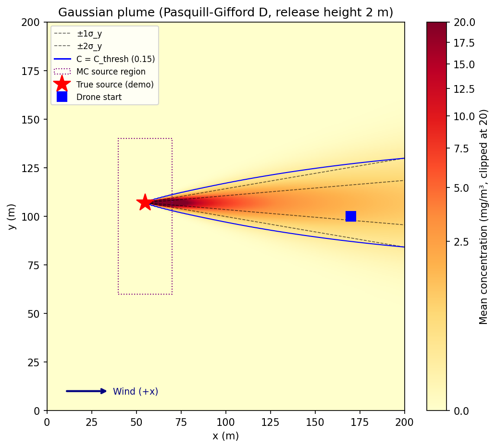
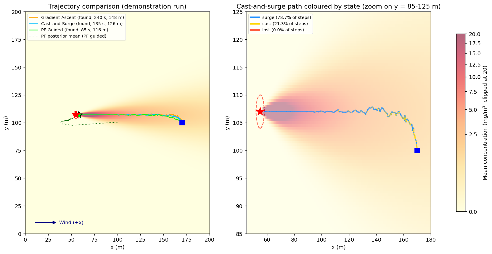
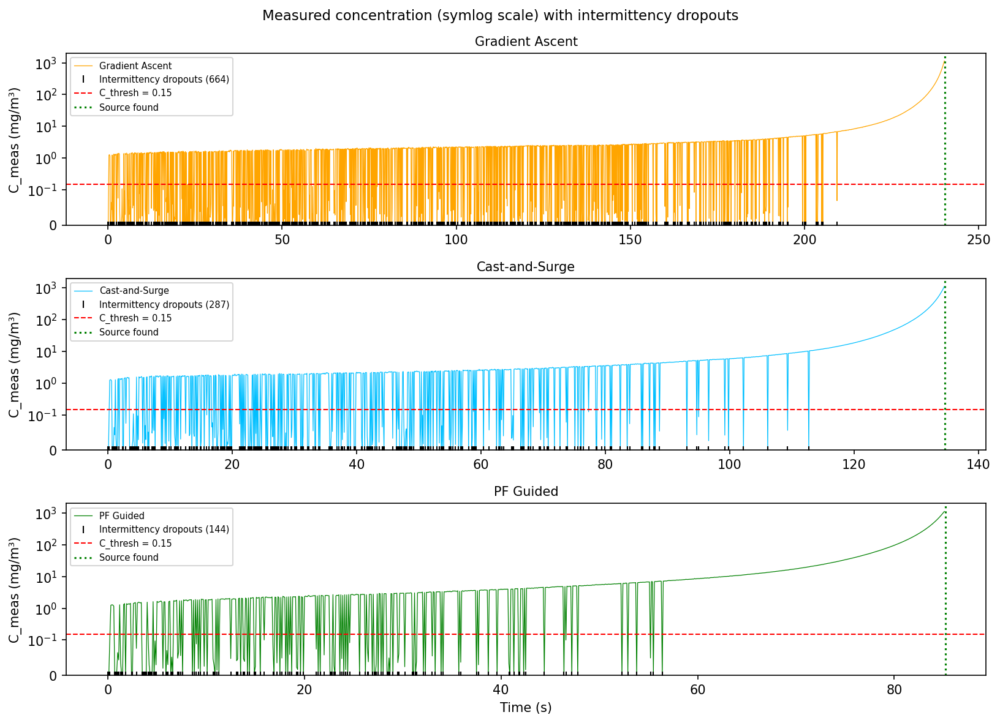
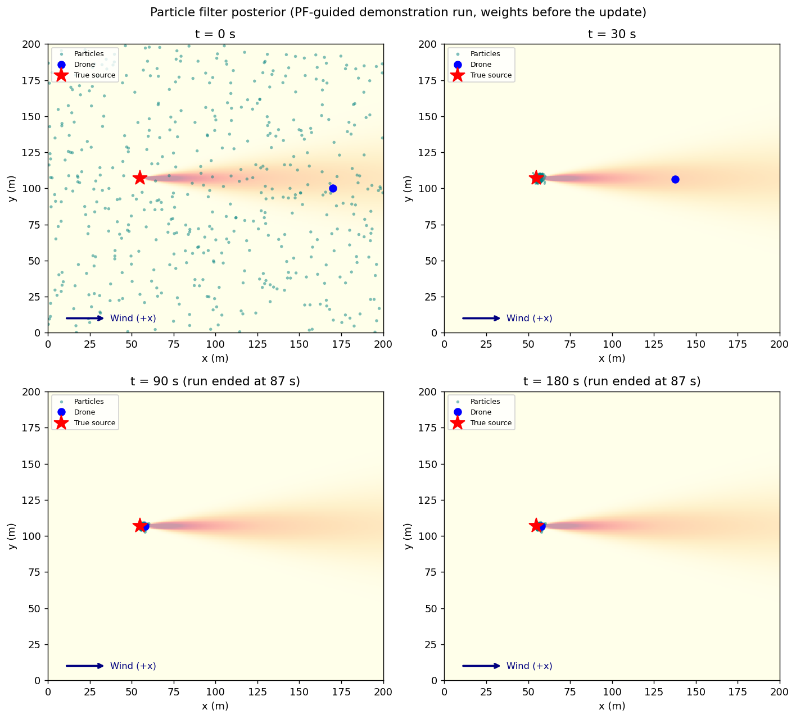
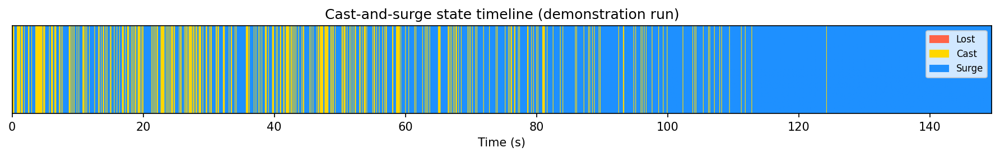
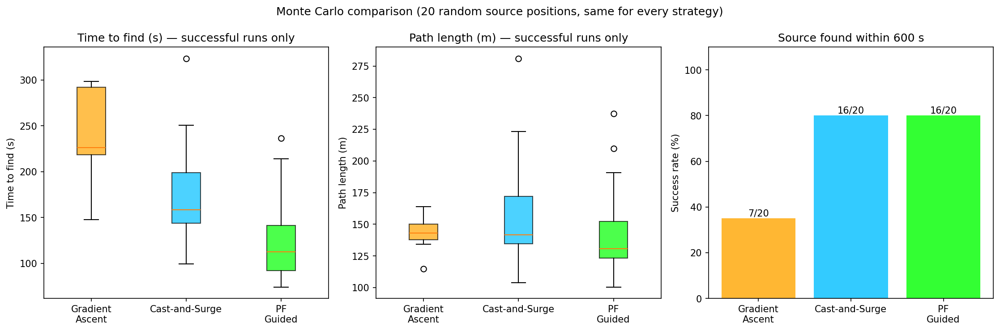
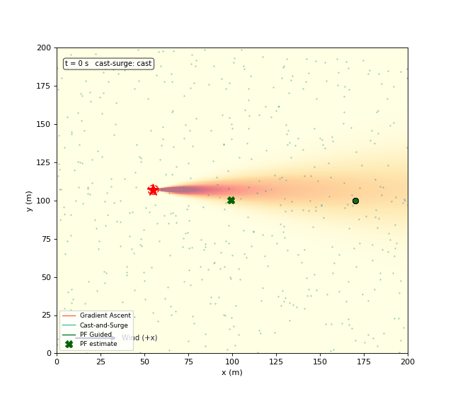

# S045 Chemical Plume Tracing

**Domain**: Environmental Monitoring & SAR | **Difficulty**: ⭐⭐⭐ | **Status**: ✅ Completed

---

## Problem Definition

**Setup**: A gas leak of unknown location has occurred somewhere upwind in a 200 × 200 m open area. Wind blows steadily along the positive $x$-axis at $u = 3$ m/s, so the plume extends **downwind toward +x** from the source. A single drone starts at (170, 100) m, downwind of the suspected source region (x = 40–70 m), and must fly **upwind (−x)** to the source. The drone carries a chemical sensor that measures local concentration with additive noise; turbulence causes intermittent concentration dropouts.

**Objective**: Navigate from the initial position to within $r_{capture} = 3$ m of the true source in minimum time (timeout 600 s), using only local concentration readings and the known mean wind direction.

**Comparison Strategies** (same drone dynamics, sensor and source positions per trial):
1. **Pure gradient ascent** — while in contact, move at $v_{surge}$ along the finite-difference gradient estimate; out of contact, drift slowly upwind at 0.2 m/s (card)
2. **Cast-and-surge (chemotaxis)** — surge upwind (biased by the gradient) while in contact; cast crosswind with growing legs when contact is lost; return to the last contact point after 30 s without contact
3. **Particle filter guided** — cast-and-surge blended 50/50 with the direction to the particle-filter posterior mean, once the posterior standard deviation is below 15 m

---

## Mathematical Model

### Gaussian Plume Dispersion

The leak is released at height $H = 2$ m, the same as the flight altitude $z_d = 2$ m. Gaussian plume with ground reflection, sampled at $z_d$, in normalised units (1 unit = 1 mg/m³):

$$C(x, y) = \frac{Q}{2\pi\,\sigma_y \sigma_z\, u}\,\exp\!\left(-\frac{y'^2}{2\sigma_y^2}\right)\left[e^{-(z_d-H)^2/2\sigma_z^2} + e^{-(z_d+H)^2/2\sigma_z^2}\right] \Big/ C_{ref}, \qquad x' = x - x_s > 0$$

and $C = 0$ upwind of the source ($x' \le 0$). Pasquill-Gifford class D:

$$\sigma_y(x') = 0.08\, x'\,(1 + 0.0002\, x')^{-1/2}, \qquad \sigma_z(x') = 0.06\, x'\,(1 + 0.0015\, x')^{-1/2}$$

### Turbulent Intermittency and Sensor Model

$$C_{meas}(t) = \max\bigl(0,\; C(x, y)\,\xi(t) + \eta(t)\bigr), \quad \xi \sim \text{Bernoulli}\bigl(1 - e^{-C/C_{int}}\bigr), \quad \eta \sim \mathcal{N}(0, \sigma_{noise}^2)$$

The drone is "in contact" when $C_{meas} \ge C_{thresh} = 0.15 = 3\sigma_{noise}$. The gradient is estimated from four extra probes at ±1 m.

### Cast-and-Surge Algorithm

| State | Condition | Action |
|-------|-----------|--------|
| **Surge** | $C_{meas} \geq C_{thresh}$ | $\mathbf{v} = v_{surge}\,\mathrm{unit}\bigl(\alpha\,\hat{\mathbf{u}}_{up} + (1-\alpha)\,\hat{\mathbf{g}}\bigr)$, $\hat{\mathbf{u}}_{up} = (-1, 0)$, $\alpha = 0.4$ |
| **Cast** | Contact lost $\leq T_{cast}$ s | Crosswind at $v_{cast}$ plus a 0.2 m/s upwind drift (card); leg $k$ has length $k\,L_{cast}$, direction alternates; first leg toward the side the last gradient pointed to |
| **Lost** | Contact lost $> T_{cast}$ s | Return to the last contact position, then restart casting |

### Particle Filter Source Localisation

$N_p = 500$ particles, initialised uniformly over the area. The likelihood uses the exact measurement model (dropout mixture, clipped at zero):

$$p(z \mid C_i) = \begin{cases} p_d\,\Phi(-C_i/\sigma) + (1-p_d)\tfrac12 & z = 0 \\ p_d\,\mathcal{N}(z; C_i, \sigma^2) + (1-p_d)\,\mathcal{N}(z; 0, \sigma^2) & z > 0 \end{cases}, \quad p_d = 1 - e^{-C_i/C_{int}}$$

Systematic resampling (seeded generator) when $N_{eff} < N_p/2$, followed by 1 m Gaussian roughening. Posterior estimate = weighted mean.

---

## Key Parameters

| Parameter | Value | Notes |
|-----------|-------|-------|
| Area | 200 × 200 m | |
| Source emission rate $Q$ | 1.0 g/s | |
| Release height $H$ | 2.0 m | = flight altitude |
| Wind speed $u$ | 3.0 m/s | Along +x (upwind = −x) |
| Drone flight altitude $z_d$ | 2.0 m | |
| Concentration unit $C_{ref}$ | 1 mg/m³ (10⁻³ g/m³) | |
| Sensor noise $\sigma_{noise}$ | 0.05 mg/m³ | |
| Contact threshold $C_{thresh}$ | 0.15 mg/m³ | 3 σ_noise |
| Intermittency scale $C_{int}$ | 2.0 mg/m³ | $p_{detect} = 1 - e^{-C/C_{int}}$ |
| Surge speed $v_{surge}$ | 1.5 m/s | |
| Cast speed $v_{cast}$ | 0.8 m/s | |
| Upwind drift (cast, and gradient ascent out of contact) | 0.2 m/s | card |
| First cast leg $L_{cast}$ | 8.0 m | Leg $k$: $k \cdot 8$ m |
| Max cast duration $T_{cast}$ | 30.0 s | |
| Upwind bias $\alpha$ | 0.4 | |
| Gradient probe offset $\delta$ | 1.0 m | |
| Particle count $N_p$ | 500 | |
| PF roughening jitter | 1.0 m | |
| PF guidance switch-on | posterior std < 15 m | |
| Capture radius $r_{capture}$ | 3.0 m | |
| Max drone speed $v_{max}$ | 2.0 m/s | |
| Speed time constant $\tau_v$ | 0.5 s | |
| Mission timeout $T_{max}$ | 600 s | |
| Simulation timestep $\Delta t$ | 0.1 s | |
| Drone start | (170, 100) m | |
| Demonstration source | (55, 107) m | seed 999 |
| Monte Carlo | 20 trials, source ~ U(40, 70) × U(60, 140) m | same source and seeds for every strategy |
| Animation | 150 frames | |

---

## Implementation

```
src/03_environmental_sar/s045_plume_tracing.py   # Main simulation script
```

```bash
conda activate drones
python src/03_environmental_sar/s045_plume_tracing.py
```

Runtime ≈ 1 min (previously > 10 min).

---

## Results

### Plume detectability (demonstration source, centreline)

| Downwind distance | Mean C (mg/m³) | σ_y | p_detect | C / σ_noise |
|-------------------|----------------|-----|----------|-------------|
| 10 m | 111.461 | 0.80 m | 1.00 | 2229.2 |
| 30 m | 13.545 | 2.39 m | 1.00 | 270.9 |
| 60 m | 4.870 | 4.77 m | 0.91 | 97.4 |
| 115 m | 1.667 | 9.10 m | 0.57 | 33.3 |

At the start point the demonstration plume gives C = 1.240 mg/m³ (above $C_{thresh}$). With $C_{thresh} = 3\sigma_{noise}$ a noise-only reading exceeds the threshold with probability 0.0013, so a "contact" now really means plume.

### Demonstration run (source at (55, 107) m)

| Strategy | Result | Time | Path | Steps in contact | Dropouts |
|----------|--------|------|------|------------------|----------|
| Gradient Ascent | found | 240.2 s | 147.6 m | 72.4 % | 664 |
| Cast-and-Surge | found | 134.6 s | 125.5 m | 78.7 % | 287 |
| PF Guided | found | 85.2 s | 115.5 m | 83.1 % | 144 |

Cast-and-surge states: surge 78.7 %, cast 21.3 %, lost 0.0 %. PF-guided final estimate (56.7, 106.7) m, error 1.7 m, posterior std 1.4 m (553 resamplings).

### Monte Carlo (20 random source positions)

| Strategy | Found | Median time (found) | Median path (found) | Found when start is in the plume | Found when start is outside the plume |
|----------|-------|---------------------|---------------------|----------------------------------|----------------------------------------|
| Gradient Ascent | 7/20 | 226.3 s | 143.0 m | 7/10 | 0/10 |
| Cast-and-Surge | 16/20 | 158.5 s | 141.5 m | 10/10 | 6/10 |
| PF Guided | 16/20 | 112.8 s | 130.6 m | 10/10 | 6/10 |

In 10 of the 20 trials the start point lies in the plume (mean C ≥ C_thresh). Closest approach in the failed trials: gradient 18.4, 35.6, 23.0, 24.6, 31.8, 39.0, 14.5, 23.0, 35.6, 29.0, 25.0, 27.4, 34.3 m; cast-and-surge and PF guided 77.6, 84.1, 87.6, 89.1 m (the same four trials).

**Key findings**:
- **The plume is now detectable and the source is found.** With the corrected geometry (plume downwind at x > x_s, drone starting downwind and surging toward −x) and a detectable concentration scale, cast-and-surge and PF guided find the source whenever they start inside the plume (10/10 each).
- **Ranking: PF guided ≥ cast-and-surge ≫ gradient ascent.** PF guided and cast-and-surge succeed equally often (16/20), but PF guided is faster (median 112.8 s vs 158.5 s) and flies shorter paths (130.6 m vs 141.5 m). Once the particle cloud has collapsed onto the source (posterior std 1.4 m at the end of the demonstration run), it pulls the drone straight up the plume, while cast-and-surge loses time casting after dropouts (21.3 % of the demonstration run). Gradient ascent finds only 7/20 and fails even in 3 of the 10 in-plume starts. Those three are marginal starts at the plume edge, where contact is rare: the drone is in contact for only 0.6–3.5 % of steps, so it almost never gets a gradient estimate. Out of contact it only drifts upwind at 0.2 m/s with no crosswind search, so nothing moves it sideways into the plume core. Its failures got within 14.5–39.0 m of the source but never within 3 m.
- **Starting outside the plume is the hard case.** Gradient ascent never finds the plume from outside (0/10): the upwind drift alone does not move it sideways into the plume. Cast-and-surge and PF guided cast crosswind and find the plume in 6/10. The remaining 4 fail (closest approach 77.6–89.1 m) because a source 30–40 m off the start line needs cast legs of up to ~80 m at 0.8 m/s, which takes most of the 600 s budget. Without contact the posterior stays broad, so the PF guidance never switches on and PF guided behaves like cast-and-surge.
- The PF estimate is only as good as its measurement model. With the dropout-aware likelihood it converges near the source within the first 30 s of the demonstration run (see snapshots); a plain Gaussian likelihood would discard the true source on the first dropout.

**Concentration Map** — mean concentration (clipped at 20 mg/m³) for the demonstration source, ±1σ_y/±2σ_y lines, the $C = C_{thresh}$ contour, the Monte Carlo source region and the drone start:



**Trajectory Comparison** — demonstration run, all three strategies plus the PF posterior-mean track (left), and the cast-and-surge path coloured by state, surge / cast / lost (right, zoomed crosswind):



**Concentration Time Series** — measured $C_{meas}(t)$ (symlog scale) with each intermittency dropout marked and the threshold dashed:



**Particle Filter Snapshots** — particle cloud of the PF-guided demonstration run at t = 0 and 30 s; that run ends at 85.2 s, so the 90 s and 180 s panels show the final cloud:



**State Machine Timeline** — surge / cast / lost states of the cast-and-surge demonstration run:



**Performance Summary** — Monte Carlo time-to-find and path length (successful runs) and success rate:



**Animation** — demonstration run, all three drones on one map, with the PF-guided particle cloud and estimate:



### Deviations from the scenario card

| Card | Implementation | Reason |
|------|----------------|--------|
| Upwind vector $(1, 0)$; start (20, 80) with source (140, 95) | Upwind $(-1, 0)$; start (170, 100), sources at x = 40–70 m; gradient-ascent out-of-contact drift $(-0.2, 0)$ m/s instead of $(+0.2, 0)$ | Wind blows toward +x, so the plume lies at x > x_s. The card's start was upwind of the source (zero concentration), and both its "upwind" vector and the +0.2 m/s gradient-ascent fallback pointed downwind. Card corrected. |
| Ground-level source, sensor at 2 m; C in g/m³ | Release height 2 m (= flight altitude) with ground reflection; C in mg/m³ | With a ground source the 2 m sensor reads ≈ 0 within ~8 m of the source, so capture within 3 m is impossible by following concentration. In g/m³ the old run's peak mean concentration was 0.0072, below both the 0.02 threshold and the 0.05 noise, so every "contact" was noise. |
| $C_{thresh} = 0.02$ | 0.15 (= 3σ_noise) | At 0.02 noise alone exceeds the threshold 34 % of the time. |
| $p_{detect} = 1 - e^{-C/C_{thresh}}$ | $1 - e^{-C/C_{int}}$, $C_{int} = 2.0$ | With the new scale, $C/C_{thresh}$ would make dropouts disappear; a separate intermittency scale keeps a meaningful dropout rate (p_detect 0.57 at 115 m). |
| PF Gaussian likelihood, unseeded `np.random` resampling | Dropout-mixture likelihood, seeded systematic resampling + 1 m roughening | The Gaussian likelihood kills the true source on any dropout; the unseeded generator made runs non-reproducible. |
| Cast legs of constant length 8 m | Leg k has length 8k m, alternating sides | Constant 8 m legs only sweep one side of the loss point. |
| PF guidance always blended | Blended only once posterior std < 15 m | Before convergence the posterior mean is the area centre and would pull the drone away from the plume. |
| Single fixed source | Demonstration source + 20 random sources (crosswind offsets up to ±40 m) | Gives a discriminative comparison: half the trials start outside the plume. Runtime cut from > 10 min to ≈ 1 min by vectorising the PF and running it only for the PF-guided strategy. |

---

## Extensions

1. **3D plume tracing**: extend the dispersion model to full 3D; drone varies altitude to exploit vertical concentration gradients and determine stack height.
2. **Moving source**: the gas leak migrates slowly; add a source motion model to the particle filter prediction step and evaluate tracking lag.
3. **Multi-drone cooperative search**: deploy $N = 3$ drones with different starting crosswind positions; fuse their particle filter posteriors via consensus averaging.
4. **Realistic wind field**: replace uniform mean wind with a spatially varying field generated by a 2D potential-flow solver or pre-recorded meteorological dataset.
5. **RL navigation policy**: train a PPO agent with state $(C_{meas}, \hat{\nabla}C, \hat{\mathbf{p}}_s, \mathbf{v}_d)$ and continuous action $\mathbf{v}_{cmd}$; compare against the cast-and-surge heuristic.
6. **Sensor fusion**: combine chemical sensor readings with thermal infrared and acoustic modalities; update a joint likelihood in the particle filter.

---

## Related Scenarios

- Prerequisites: [S041 Wildfire Boundary Scan](../../../scenarios/03_environmental_sar/S041_wildfire_boundary.md), [S042 Missing Person Localization](../../../scenarios/03_environmental_sar/S042_missing_person.md)
- Follow-ups: [S055 Coastline Oil Spill Tracking](../../../scenarios/03_environmental_sar/S055_oil_spill.md), [S056 Nuclear Plant Leak Detection (Radiation Hotspot Localization)](../../../scenarios/03_environmental_sar/S056_radiation.md)
- Algorithmic cross-reference: [S048 Full-Area Coverage Scan (Lawnmower)](../../../scenarios/03_environmental_sar/S048_lawnmower.md), [S046 Multi-Drone 3D Trilateration](../../../scenarios/03_environmental_sar/S046_trilateration.md)
