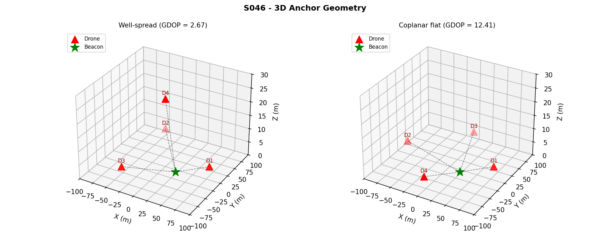
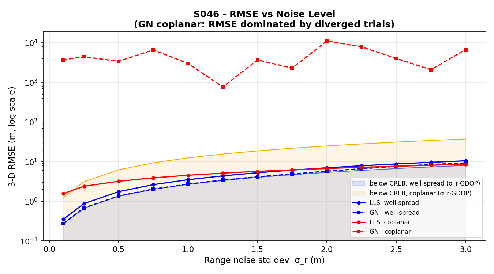
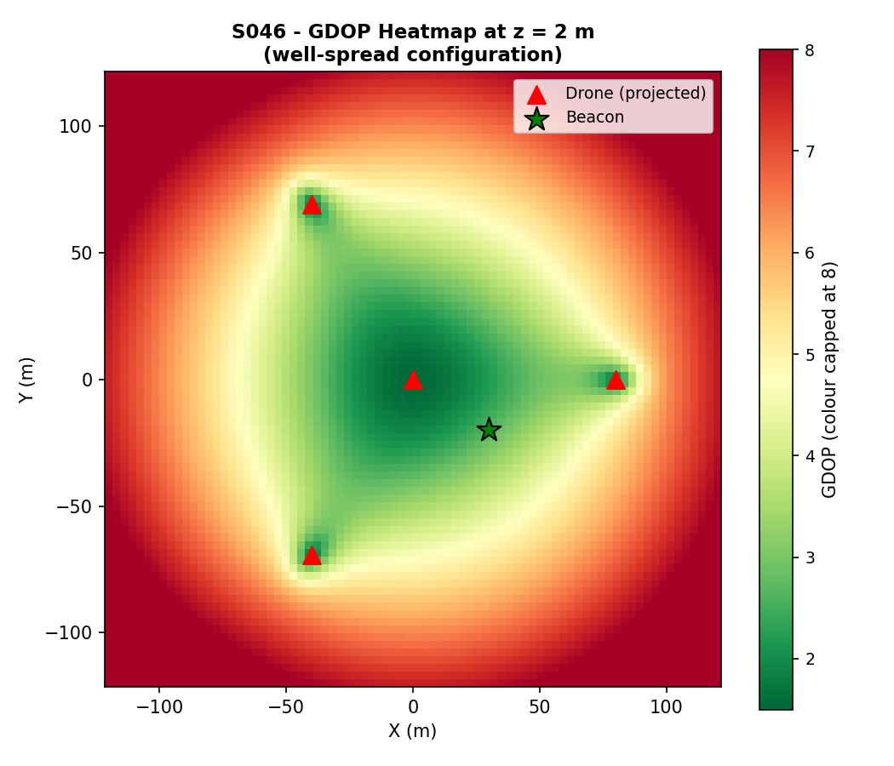
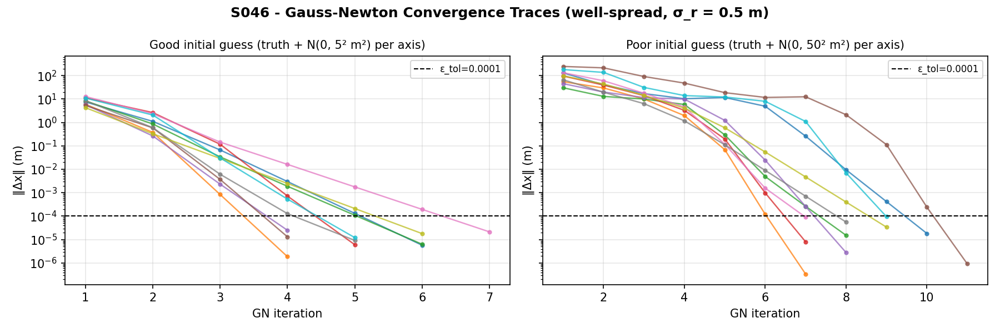
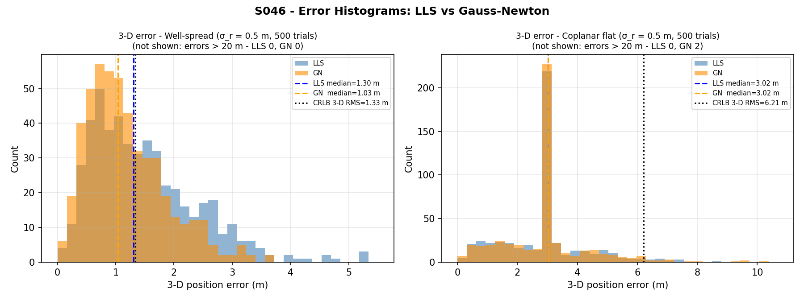
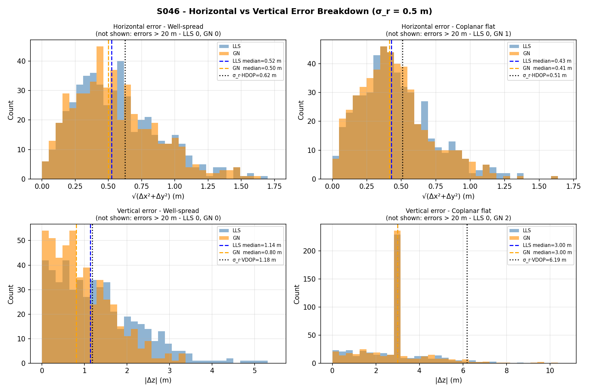
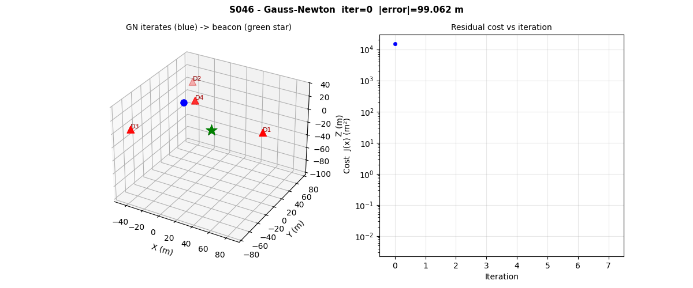

# S046 Multi-Drone 3D Trilateration

**Domain**: Environmental & SAR | **Difficulty**: ⭐⭐ | **Status**: ✅ Completed

---

## Problem Definition

**Setup**: A survivor or emergency beacon is located at an unknown 3D position $\mathbf{x}^* = (x^*, y^*, z^*)$ inside a search area of 200 × 200 × 30 m. Four drones hover at known, fixed positions and each measures the slant range to the beacon using an RF or acoustic ranging unit. All measurements are corrupted by zero-mean Gaussian noise.

**Objective**: Fuse four noisy range measurements into the best possible estimate $\hat{\mathbf{x}}$ of the beacon's 3D position, and characterise localisation uncertainty via GDOP and the Cramér-Rao lower bound (CRLB).

**Comparison Methods**:
1. **Linear least squares (LLS)** — algebraically linearise the range equations by differencing against a reference drone; closed-form solution
2. **Nonlinear least squares via Gauss-Newton (GN)** — iterative refinement, initialised from the LLS solution (the true position is never used)

**Comparison Geometries**:
- **Well-spread**: three drones at 120° azimuth (z = 5 m) + one overhead drone (z = 25 m)
- **Coplanar**: all four drones at z = 5 m (poor vertical geometry)

---

## Mathematical Model

### Range Measurement Model

$$r_i = \|\mathbf{x}^* - \mathbf{p}_i\|_2 + \epsilon_i, \qquad \epsilon_i \sim \mathcal{N}(0,\, \sigma_r^2)$$

### Linear Least Squares (Range-Differencing)

From $r_i^2 = \|\mathbf{x}\|^2 - 2\mathbf{p}_i^T\mathbf{x} + \|\mathbf{p}_i\|^2$, subtracting the reference row $N$ eliminates $\|\mathbf{x}\|^2$ and gives $\mathbf{A}\hat{\mathbf{x}} = \mathbf{b}$ with

$$\mathbf{A}_i = 2(\mathbf{p}_i - \mathbf{p}_N)^T, \qquad b_i = \|\mathbf{p}_i\|^2 - \|\mathbf{p}_N\|^2 - r_i^2 + r_N^2$$

$$\hat{\mathbf{x}}_{LLS} = (\mathbf{A}^T \mathbf{A})^{-1} \mathbf{A}^T \mathbf{b}$$

For the coplanar formation every row of $\mathbf{A}$ has zero z-component (rank 2), so the differenced system only gives $(x, y)$; the height is then taken from the sphere equations, $z = z_{plane} - \sqrt{\max(0,\ \overline{r_i^2 - d_{h,i}^2})}$ (mean over the four drones, root below the drones because the beacon is on the ground). When noise makes the mean negative, the estimate is clamped onto the drone plane $z = 5$ m.

### Gauss-Newton Nonlinear Least Squares

Range model $h_i(\mathbf{x}) = \|\mathbf{x} - \mathbf{p}_i\|$, Jacobian $\mathbf{H}_i = (\mathbf{x} - \mathbf{p}_i)^T / \|\mathbf{x} - \mathbf{p}_i\|$ (unit vector from drone $i$ to the estimate). Update:

$$\mathbf{x}_{k+1} = \mathbf{x}_k + (\mathbf{H}_k^T \mathbf{H}_k)^{-1} \mathbf{H}_k^T \bigl(\mathbf{r} - \mathbf{h}(\mathbf{x}_k)\bigr)$$

Convergence when $\|\Delta \mathbf{x}_k\| < \epsilon_{tol} = 10^{-4}$ m or $K_{max} = 100$ iterations; the iteration also stops if $\det(\mathbf{H}^T\mathbf{H}) < 10^{-10}$ (singular geometry).

### GDOP and CRLB

$$\text{GDOP} = \sqrt{\text{tr}\!\left[(\mathbf{H}^T \mathbf{H})^{-1}\right]}, \qquad \text{CRLB 3-D RMS} = \sigma_r \cdot \text{GDOP}$$

HDOP and VDOP use the (x, y) and z diagonal entries of $(\mathbf{H}^T\mathbf{H})^{-1}$. Since every row of $\mathbf{H}$ is a unit vector, $\text{tr}(\mathbf{H}^T\mathbf{H}) = 4$ and $\text{GDOP} \geq \sqrt{9/4} = 1.5$ for four drones.

---

## Key Parameters

| Parameter | Value | Notes |
|-----------|-------|-------|
| Number of drones $N$ | 4 | |
| Range noise std dev $\sigma_r$ | 0.5 m | Baseline |
| Horizontal spread radius $R_{xy}$ | 80 m | |
| Low-altitude tier $z_{low}$ | 5 m | |
| High-altitude (overhead) $z_{high}$ | 25 m | |
| True beacon position $\mathbf{x}^*$ | (30, -20, 2) m | |
| Gauss-Newton tolerance $\epsilon_{tol}$ | $10^{-4}$ m | |
| Max GN iterations $K_{max}$ | 100 | |
| GN initial guess (Monte Carlo) | LLS solution | |
| Monte Carlo trials per configuration and noise level | 500 | seed 42 (same noise stream for every level / geometry) |
| Noise sweep levels | 0.1, 0.25, 0.5, …, 3.0 m (13 levels, step 0.25 m) | |
| Gross-error threshold | 20 m | 3-D error above this is counted separately |
| Convergence study initial guesses | truth + N(0, 5²) m and truth + N(0, 50²) m per axis | 10 runs, seed 3 |
| Animation initial guess | truth + N(0, 40²) m per axis | seed 99 |
| GDOP heatmap | 80 × 80 grid over [-120, 120]² m at z = 2 m | |

### Deviations from the scenario card

- **Card math corrected** (Type A bug, also fixed in the card): the card's LLS right-hand side $b_i = r_i^2 - r_N^2 - \|\mathbf{p}_i\|^2 + \|\mathbf{p}_N\|^2$ had the wrong sign — the code copied it and returned $\hat{\mathbf{x}} \approx -\mathbf{x}^*$ (old RMSE 72.2 m). The card's GN Jacobian $(\mathbf{p}_i - \mathbf{x})/\|\cdot\|$ is $\partial f/\partial\mathbf{x}$, but was used with the "+" update that requires $\partial h/\partial\mathbf{x} = (\mathbf{x} - \mathbf{p}_i)/\|\cdot\|$; GN diverged (old RMSE 50,713 m well-spread, 102,531 m coplanar). Both are fixed in code and card.
- **Card GDOP/CRLB expectations were wrong**: the card expected GDOP ≈ 1.4 (well-spread) / ≈ 4.2 (coplanar) and CRLB ≈ 0.7 m. With the card's own definition and geometry the values are 2.667 / 12.415 and 1.334 m, and 1.4 is not reachable by any 4-drone geometry (lower bound 1.5, see above). The geometry is poor mainly because all drones are above the beacon and the three low drones are only 3 m higher than it (VDOP 2.357). The card's parameter table now carries the computed values.
- **GN initial guess**: the card's sample code started GN from truth + N(0, 5²) m; the Monte Carlo now starts from the LLS solution. The 5 m / 50 m perturbed starts are kept only for the card's convergence-trace figure.
- **Coplanar LLS height**: the card's LLS is rank-deficient for the coplanar formation (z unobservable from differences); the sphere-equation height step described above is an addition.
- **Noise sweep**: 13 levels (0.1, then 0.25 to 3.0 in 0.25 m steps) instead of `linspace(0.1, 3.0, 15)`, so that the baseline σ_r = 0.5 m is a sweep point (the old printout labelled σ = 0.514 m as "σ = 0.5").
- **CRLB envelope**: drawn as the shaded region below σ_r·GDOP (unattainable region for an unbiased estimator) instead of a ±10 % band.
- **Error histograms**: medians instead of Gaussian fits (the coplanar distribution is far from Gaussian); trials with errors above 20 m are counted in the panel titles instead of being drawn.

---

## Implementation

```
src/03_environmental_sar/s046_trilateration.py   # Main simulation script
```

```bash
conda activate drones
python src/03_environmental_sar/s046_trilateration.py
```

Runtime ≈ 16 s (13 noise levels × 2 geometries × 500 trials + 2 × 500 baseline trials).

---

## Results

### Geometry

| Configuration | GDOP | HDOP | VDOP | CRLB 3-D RMS (σ_r = 0.5 m) | CRLB horizontal / vertical |
|---|---|---|---|---|---|
| Well-spread | 2.667 | 1.248 | 2.357 | 1.334 m | 0.624 / 1.179 m |
| Coplanar | 12.415 | 1.018 | 12.373 | 6.207 m | 0.509 / 6.186 m |

### Baseline σ_r = 0.5 m (500 trials each)

| Geometry | Method | 3-D RMSE | Median 3-D error | Horizontal RMS | Vertical RMS | Errors > 20 m |
|---|---|---|---|---|---|---|
| Well-spread | LLS | 1.747 m | 1.303 m | 0.649 m | 1.622 m | 0/500 |
| Well-spread | GN | **1.356 m** | **1.035 m** | 0.637 m | 1.197 m | 0/500 |
| Coplanar | LLS | **3.192 m** | 3.018 m | 0.538 m | 3.146 m | 0/500 |
| Coplanar | GN | 3397.983 m (3.281 m without the 2 gross errors) | 3.019 m | 73.823 m | 3397.181 m | 2/500 (max 75,980.9 m) |

GN needs 4.15 iterations on average (max 7) for the well-spread formation and 6.95 (max 100) for the coplanar one.

**Well-spread — GN reaches the CRLB, LLS does not.** GN's 3-D RMSE 1.356 m is 1.6 % above the CRLB of 1.334 m (1.356 / 1.334 = 1.016); LLS's 1.747 m is 31 % above it (1.747 / 1.334 = 1.31). Both are essentially unbiased (mean error per axis ≤ 0.087 m), so LLS loses through inefficiency, not bias: the reference range $r_N$ enters every differenced row and the squared ranges weight the drones unequally. The gap is almost entirely vertical (vertical RMS 1.622 m LLS vs 1.197 m GN, CRLB 1.179 m) — the horizontal RMS is nearly the same (0.649 vs 0.637 m, CRLB 0.624 m). Across the noise sweep GN stays below LLS at every level (e.g. 0.273 vs 0.350 m at σ_r = 0.1 m, 9.252 vs 10.454 m at σ_r = 3.0 m); GN stays within 2.5 % of the CRLB up to σ_r = 1.0 m (2.714 vs 2.667 m) and drifts to 16 % above it at 3.0 m (9.252 / 8.001 = 1.16), where the problem becomes noticeably nonlinear and GN starts to land in wrong minima (errors > 20 m: 3/500 at σ_r = 2.0 m, 24/500 at 3.0 m).

**Coplanar — the vertical coordinate is barely observable and plain GN is unreliable.** The horizontal estimate is fine (LLS horizontal RMS 0.538 m vs HDOP bound 0.509 m), but a beacon only 3 m below a ring of drones 80 m away changes the ranges very little when it moves vertically. In 215 of the 500 trials the noisy ranges imply a negative squared height, so the LLS height is clamped onto the drone plane (z = 5 m, i.e. a 3 m vertical error — the spike at 3 m in the histograms). GN started there has a zero z-column in its Jacobian and stops immediately (the same 215 trials stay on the plane); in 11 trials it moves to the mirror side above the drones (z > 5 m) and in 2 trials it diverges (maximum error 75,980.9 m), which alone drives the GN RMSE to 3397.983 m. Without those two trials GN (3.281 m) is still slightly worse than LLS (3.192 m), so iterating brings nothing in this geometry. Coplanar GN has gross errors at every noise level (1 to 16 of 500), which is why its RMSE curve sits at 10³–10⁴ m.

**Coplanar LLS is below the "CRLB" — this is not a contradiction.** LLS's 3.192 m is smaller than σ_r·GDOP = 6.207 m because the linearised CRLB does not hold here: the estimator is biased/constrained (it never goes above the drone plane, so the vertical error is at most about 3 m upward), and near the plane the range depends on the height almost quadratically, so the linear Fisher-information bound is not meaningful.

### GN convergence (10 runs, well-spread, σ_r = 0.5 m)

From a 5 m start GN needs 4–7 iterations, from a 50 m start 7–11 iterations; in all 10 runs both starts end at the same solution (largest final error 2.363 m in both cases), i.e. a poor initial guess only costs iterations in this geometry. The animation run (40 m start) converges in 7 iterations to a final error of 0.970 m.

### GDOP map (well-spread, z = 2 m)

Over the 240 × 240 m slice GDOP ranges from 1.532 to 10.353 (median 6.225); only 11.5 % of the cells have GDOP < 3 — the low-GDOP zone is the area enclosed by the three low drones, around the overhead drone.

**Anchor Geometry** — 3D view of well-spread (120° + overhead) vs. coplanar configurations; beacon marked as a green star; range lines drawn from each drone:



**RMSE vs. Noise Level** — LLS/GN × well-spread/coplanar against σ_r (log scale); shaded regions lie below the CRLB σ_r·GDOP of each geometry. GN well-spread hugs its CRLB line; GN coplanar sits at 10³–10⁴ m because of a few diverged trials:



**GDOP Heatmap** — GDOP as a function of beacon $(x, y)$ at z = 2 m for the well-spread configuration (colour capped at 8):



**Gauss-Newton Convergence** — $\|\Delta \mathbf{x}_k\|$ vs. iteration for 10 noise realisations, 5 m vs 50 m initial-guess perturbation:



**Error Histogram** — 3-D position errors of 500 trials at σ_r = 0.5 m with medians and the CRLB; in the coplanar panel the spike at 3 m is the trials whose height is clamped onto the drone plane:



**Vertical Error Breakdown** — horizontal and vertical error histograms for LLS and GN; the coplanar geometry leaves the horizontal error at the HDOP level but spreads the vertical error up to ≈ 10 m:



**Animation** — GN iterates (blue) from a 40 m-perturbed start converging to the beacon in 7 iterations, with the residual cost per iteration (20 frames at 2 fps):



---

## Extensions

1. **Weighted least squares**: assign measurement weights $w_i = 1/\sigma_{r,i}^2$ when drones have heterogeneous sensor quality or different distances to the beacon.
2. **Sequential (online) update**: process range measurements one drone at a time using recursive least-squares (RLS) or extended Kalman filter (EKF) to support real-time beacon tracking.
3. **Optimal hover placement via GDOP minimisation**: formulate drone placement as a continuous optimisation problem; minimise GDOP subject to altitude and collision-avoidance constraints.
4. **Time-difference of arrival (TDOA)**: replace one-way ranging with TDOA measurements $\tau_{ij} = (r_i - r_j)/c$; re-derive the hyperbolic least-squares system.
5. **Moving beacon tracking with Gauss-Newton EKF**: augment the state vector with beacon velocity and run an iterated EKF; evaluate tracking lag against a survivor walking at 1 m/s.
6. **Robust GN for coplanar geometry**: Levenberg-Marquardt damping or a z ≤ z_plane constraint to remove the divergent and mirror-side solutions seen above.

---

## Related Scenarios

- Prerequisites: [S041 Wildfire Boundary Scan](../../../scenarios/03_environmental_sar/S041_wildfire_boundary.md), [S042 Missing Person Localization](../../../scenarios/03_environmental_sar/S042_missing_person.md)
- Follow-ups: [S047 Base Station Signal Relay](../../../scenarios/03_environmental_sar/S047_signal_relay.md), [S050 Swarm Cooperative Mapping (Distributed EKF-SLAM)](../../../scenarios/03_environmental_sar/S050_slam.md)
- Algorithmic cross-reference: [S007 Jamming & Blind Pursuit](../../../scenarios/01_pursuit_evasion/S007_jamming_blind_pursuit.md) (noisy state estimation), [S008 Stochastic Pursuit — Kalman Filter Tracking](../../../scenarios/01_pursuit_evasion/S008_stochastic_pursuit.md) (Kalman filtering)
