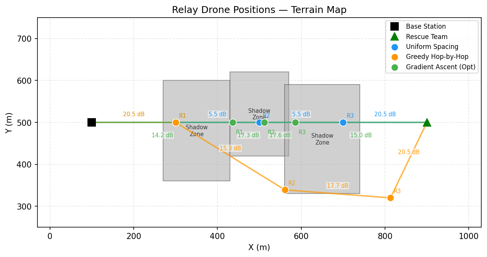
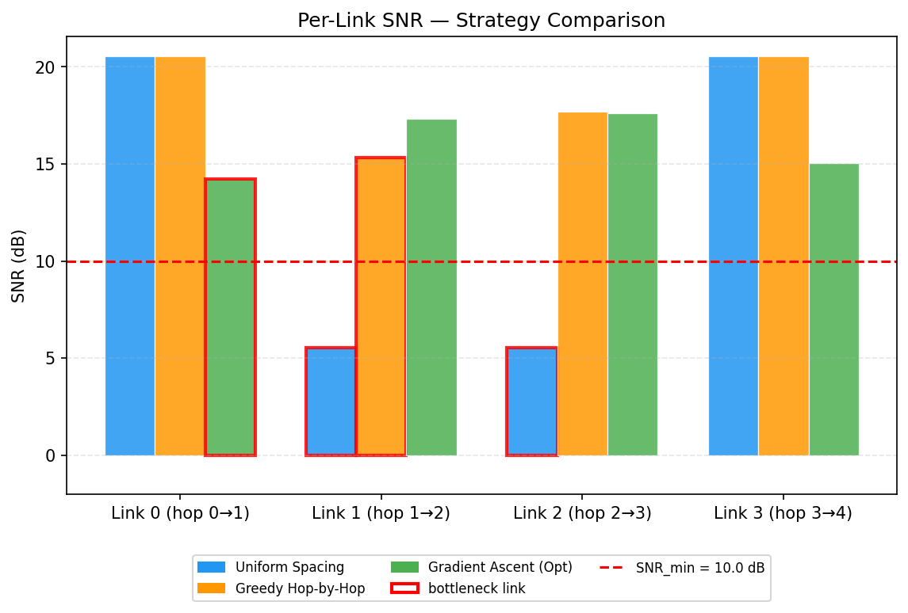
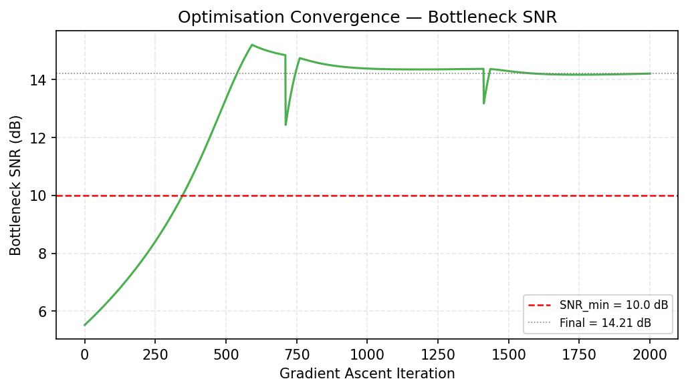
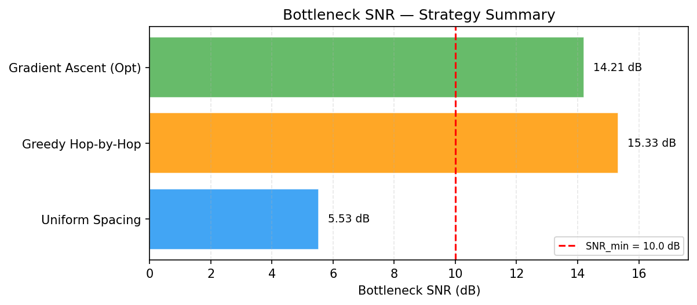
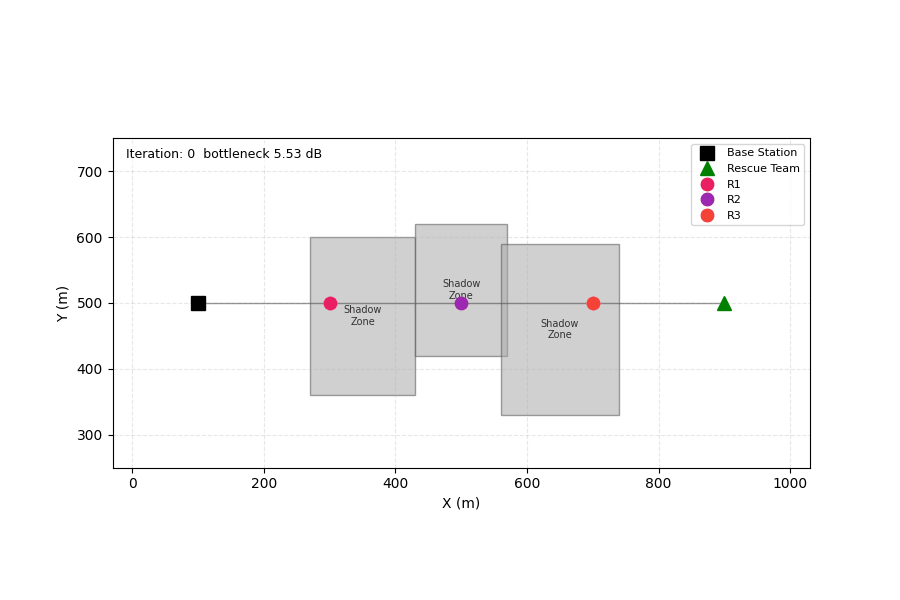

# S047 Base Station Signal Relay

**Domain**: Environmental Monitoring & SAR | **Difficulty**: ⭐⭐ | **Status**: ✅ Completed

---

## Problem Definition

**Setup**: A ground base station (BS) at (100, 500) m and a rescue team at (900, 500) m in a mountain valley are out of direct radio range. Three relay drones must be positioned in a 1000 × 1000 m operating area to form a communication chain BS → R1 → R2 → R3 → team. Three rectangular shadow zones (ridge lines and a valley wall) add 15 dB of attenuation to any hop whose midpoint lies inside them. Each drone acts as a store-and-forward repeater, so the end-to-end link quality is governed by the **weakest** hop (the bottleneck).

**Objective**: Find the three relay positions that maximise the minimum single-hop SNR across all four links:

$$\max_{\mathbf{p}_1, \mathbf{p}_2, \mathbf{p}_3} \; \min_{k \in \{0,1,2,3\}} \text{SNR}_k \quad \text{s.t.}\ d_k \le d_{max}$$

**Comparison Strategies**:
1. **Uniform spacing** — relays at 1/4, 2/4, 3/4 of the straight BS-to-team line
2. **Greedy hop-by-hop** — relays placed one at a time from the BS side; each relay maximises the SNR of its own hop given the previous node, ignoring all downstream hops (with a progress requirement, see below)
3. **Gradient ascent on min-SNR** — ascent on the soft-min of all four hop SNRs, started from the uniform layout

---

## Mathematical Model

### Log-Distance Path Loss with Terrain Shadowing

$$L(d) = L_0 + 10 n \log_{10}\!\left(\frac{d}{d_0}\right) + \Delta_{shadow} \cdot \mathbf{1}[\text{midpoint} \in \text{shadow zone}] \quad \text{(dB)}$$

where $L_0 = 20 \log_{10}(4\pi d_0 f_c / c) = 20\log_{10}(4\pi \cdot 2.4\times10^9 / 3\times10^8) = 40.05$ dB, $n = 2.8$ and $\Delta_{shadow} = 15$ dB.

### Per-Link SNR

$$\text{SNR}_k \;[\text{dB}] = P_{tx} - L(d_k) - N_{floor}$$

A link is viable if $\text{SNR}_k \geq \text{SNR}_{min} = 10$ dB. Example: a clear 200 m hop gives $30 - (40.05 + 28 \log_{10} 200) + 95 = 30 - (40.05 + 64.43) + 95 = 20.52$ dB (printed 20.53 dB from unrounded $L_0$); the same hop through a shadow zone gives 15 dB less, 5.53 dB.

### Greedy Hop-by-Hop

For $i = 1, 2, 3$, with $\mathbf{p}_0 = $ BS:

$$\mathbf{p}_i = \arg\max_{\mathbf{p}} \text{SNR}(\mathbf{p}_{i-1}, \mathbf{p}) \quad \text{s.t.}\ \|\mathbf{p} - \mathbf{p}_{team}\| \le D\left(1 - \tfrac{i}{N+1}\right),\ \|\mathbf{p} - \mathbf{p}_{i-1}\| \le d_{max}$$

with $D = 800$ m (BS-to-team distance), so relay $i$ must be within 600 / 400 / 200 m of the team. The search runs over a 1 m grid of the operating area. The last hop R3 → team is not optimised.

### Gradient Ascent on Soft-Min SNR

$$J_{soft} = -\frac{1}{\alpha} \ln \!\left(\sum_{k=0}^{3} e^{-\alpha \cdot \text{SNR}_k}\right), \qquad \alpha = 0.5$$

$\mathbf{p}_i \leftarrow \mathbf{p}_i + \eta\, \partial J_{soft}/\partial \mathbf{p}_i$ with central-difference gradients (ε = 1 m), $\eta = 5$, 2000 iterations. After every step the chain is projected onto the range constraint (forward pass: each relay within $d_{max}$ of its predecessor; backward pass: each relay within $d_{max}$ of its successor, which includes the last hop R3 → team) and clipped to the operating area.

---

## Key Parameters

| Parameter | Value | Notes |
|-----------|-------|-------|
| Carrier frequency $f_c$ | 2.4 GHz | ISM band |
| Reference distance $d_0$ | 1 m | |
| Path loss exponent $n$ | 2.8 | Mixed terrain |
| Transmit power $P_{tx}$ | 30 dBm | All nodes |
| Noise floor $N_{floor}$ | -95 dBm | |
| Minimum viable SNR | 10 dB | |
| Max comm range $d_{max}$ | 600 m | Per hop |
| Terrain shadow penalty $\Delta_{shadow}$ | 15 dB | |
| Shadow zones (centre x, y; half-width, half-height) | (350, 480; 80, 120), (500, 520; 70, 100), (650, 460; 90, 130) m | 3 obstructions |
| Number of relay drones | 3 | |
| Soft-min temperature $\alpha$ | 0.5 | |
| Gradient ascent step $\eta$ | 5 (× gradient in dB/m) | |
| Gradient ascent iterations | 2000 | finite-difference ε = 1 m |
| Greedy candidate grid | 1 m | |
| Operating area | 1000 × 1000 m | |
| Base station position | (100, 500) m | |
| Rescue team position | (900, 500) m | |
| Animation | 101 frames (every 20th ascent step), 12 fps | |

### Deviations from the scenario card

- **Greedy hop-by-hop was not implemented before** (the previous code iterated the midpoint rule starting from its own fixed point and returned the uniform layout, so both had a 5.53 dB bottleneck). It is now the card's per-hop strategy. Taken literally, "maximise the current hop's SNR" is solved by not moving away from the previous node at all, so a progress requirement was added: relay $i$ must have covered $i/4$ of the BS-to-team distance (within 600 / 400 / 200 m of the team). Without such a rule the strategy is undefined.
- **Range constraint on the last hop**: the card's sequential clipping only checked hops 0–2; a backward pass now also enforces $d_3 \le d_{max}$ for R3 → team. In this layout the constraint is never active (largest hop of any strategy: 336.2 m < 600 m).
- **Card expectation not met — relays do not "converge away from shadow zones"**: the gradient ascent ends with all three relays on the y = 500 m line and the two middle hops inside shadow zone 2 (see Results). The shadow penalty is a step function of the hop midpoint, so its gradient is zero almost everywhere, and the uniform start is symmetric about y = 500 m, so the y-gradient is zero; the ascent can only rebalance hop lengths along the line.
- **Convergence is not monotone**: with a fixed step the bottleneck rises to 15.20 dB after 592 steps, then drops when a hop midpoint crosses a shadow boundary, and settles at 14.21 dB. The card's method returns the final iterate, which is what the comparison uses; the best iterate is reported for reference.
- The card's stochastic shadowing term $X_\sigma$ is set to its expected value 0 as the card prescribes (deterministic optimisation).

---

## Implementation

```
src/03_environmental_sar/s047_signal_relay.py   # Main simulation script
```

```bash
conda activate drones
python src/03_environmental_sar/s047_signal_relay.py
```

Runtime ≈ 15 s. The scenario is deterministic (no random sources).

---

## Results

| Strategy | Relay positions (m) | Link 0 | Link 1 | Link 2 | Link 3 | Bottleneck SNR | Longest hop |
|---|---|---|---|---|---|---|---|
| Uniform spacing | (300, 500), (500, 500), (700, 500) | 20.53 | 5.53 (shadow) | 5.53 (shadow) | 20.53 | **5.53 dB** ✗ | 200.0 m |
| Greedy hop-by-hop | (300.0, 500.0), (561.0, 339.0), (813.0, 320.0) | 20.53 | 15.33 | 17.68 | 20.53 | **15.33 dB** ✓ | 306.7 m |
| Gradient ascent | (436.2, 500.0), (511.9, 500.0), (585.9, 500.0) | 14.21 | 17.34 (shadow) | 17.61 (shadow) | 15.04 | **14.21 dB** ✓ | 336.2 m |

(SNR in dB; "shadow" = hop midpoint inside a shadow zone; ✗/✓ = below/above the 10 dB threshold.)

Gradient ascent: initial bottleneck 5.53 dB, best 15.20 dB after 592 steps, final 14.21 dB after 2000 steps (final − initial = +8.68 dB).

**Uniform spacing** fails: all hops are 200 m long, but the midpoints of hops 1 and 2 (x = 400 and 600 m on y = 500 m) lie in shadow zones 1 and 3, so these hops lose 15 dB and end at 5.53 dB, below the 10 dB threshold.

**Greedy hop-by-hop** gives the best bottleneck, 15.33 dB (+9.80 dB over uniform, 15.33 − 5.53). R1 stays at (300, 500) because the BS → R1 hop is already clear. For R2 the straight continuation would be shadowed, so the grid search finds the shortest hop whose midpoint (430.5, 419.5) m just slips past the lower-right corner of zone 1 (x > 430) and the lower-left corner of zone 2 (y < 420) — a 306.7 m clear hop (15.33 dB) instead of a 200 m shadowed one (5.53 dB). For R3 the nearest point of its 200 m progress disc would again give a shadowed hop (zone 3), so it moves to (813, 320), whose hop midpoint (687.0, 329.5) m passes just below zone 3 (y < 330) — 252.7 m, 17.68 dB. The un-optimised last hop happens to be clear (199.9 m, 20.53 dB). Greedy wins here because the shadow geometry leaves a clear corridor that a hop-by-hop search finds, but it relies on threading exact zone corners and on the last hop happening to be clear — nothing in the method protects the downstream links.

**Gradient ascent** lifts the bottleneck from 5.53 to 14.21 dB without ever leaving the y = 500 m line. It cannot "see" the shadow zones (zero gradient, see Deviations); instead it shortens the shadowed middle hops to 75.7 m and 74.0 m — short enough that even with the 15 dB penalty they reach 17.34 and 17.61 dB — and accepts long clear outer hops (336.2 m, 314.1 m) that become the new bottleneck (14.21 dB). It ends 1.12 dB below greedy (15.33 − 14.21), and even its best iterate (15.20 dB) does not reach greedy. This is a local optimum of a non-smooth objective, not a global one.

All three layouts satisfy the 600 m range limit; greedy and gradient ascent both clear the 10 dB threshold on every link.

**Terrain Map** — shadow zones (grey), BS (black square), rescue team (green triangle) and the relay chains of all three strategies with per-link SNR; uniform (blue) and gradient-ascent (green) chains lie on y = 500 m, greedy (orange) detours below shadow zones 2 and 3:



**SNR Bar Chart** — four link SNRs per strategy, 10 dB threshold dashed, bottleneck links outlined in red (uniform has two tied bottlenecks):



**Convergence Curve** — bottleneck SNR vs. gradient-ascent iteration: rise to 15.20 dB at step 592, drops after steps 711 (−2.41 dB) and 1412 (−1.19 dB) when a hop midpoint crosses a shadow boundary, final 14.21 dB:



**Bottleneck Comparison** — $\min_k \text{SNR}_k$ per strategy:



**Animation** — relay positions during gradient ascent (every 20th step, 101 frames); the relays slide along y = 500 m towards the centre:



---

## Extensions

1. **3D altitude optimisation**: extend relay positions to $(x, y, z)$, allowing drones to climb above ridge lines; add an altitude penalty term (energy cost) to balance SNR gain against flight endurance.
2. **Stochastic shadowing**: replace fixed $X_\sigma = 0$ with Monte Carlo realisation $X_\sigma \sim \mathcal{N}(0, \sigma_{sh}^2)$; optimise expected bottleneck SNR or the 10th-percentile (robust design).
3. **Dynamic relay — moving rescue team**: the rescue team moves at 1 m/s; implement a receding-horizon controller that re-solves the relay placement every 30 s.
4. **Heterogeneous transmit power**: assign individual $P_{tx,i}$ budgets per relay drone subject to $\sum_i P_{tx,i} \leq P_{total}$; co-optimise positions and power allocation.
5. **Relay count selection**: vary $N_{relays} \in \{1, 2, 3, 4, 5\}$ and plot the trade-off between bottleneck SNR improvement and drone resource cost.
6. **Shadow-aware optimiser**: replace the step-function penalty with a smooth one (e.g. a sigmoid of the distance to the zone edge) or use multi-start / greedy initialisation so the ascent can leave the straight line.

---

## Related Scenarios

- Prerequisites: [S041 Wildfire Boundary Scan](../../../scenarios/03_environmental_sar/S041_wildfire_boundary.md), [S046 Multi-Drone 3D Trilateration](../../../scenarios/03_environmental_sar/S046_trilateration.md)
- Follow-ups: [S048 Full-Area Coverage Scan (Lawnmower)](../../../scenarios/03_environmental_sar/S048_lawnmower.md), [S051 Post-Disaster Communication Network Restoration](../../../scenarios/03_environmental_sar/S051_post_disaster_comm.md)
- Algorithmic cross-reference: [S059 Underwater Target Sonar Marking (Surface Cooperative Localization)](../../../scenarios/03_environmental_sar/S059_sonar_relay.md), [S049 Dynamic Zone Search](../../../scenarios/03_environmental_sar/S049_dynamic_zone.md) (multi-agent positioning)
